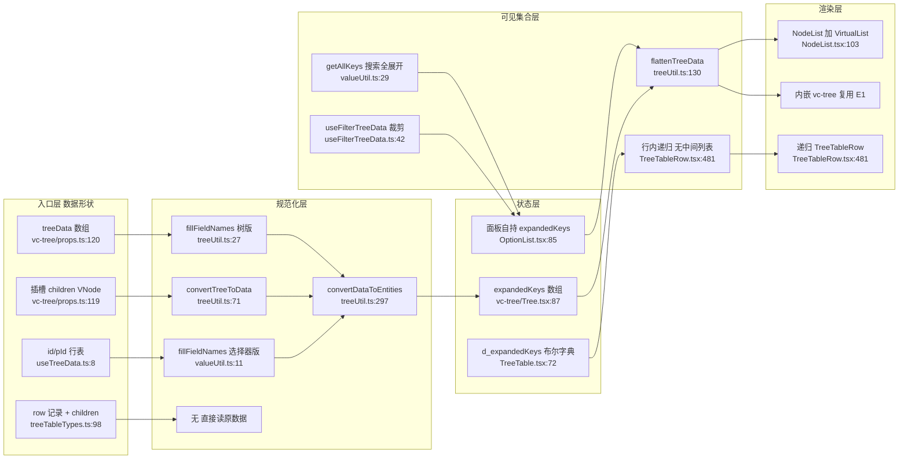
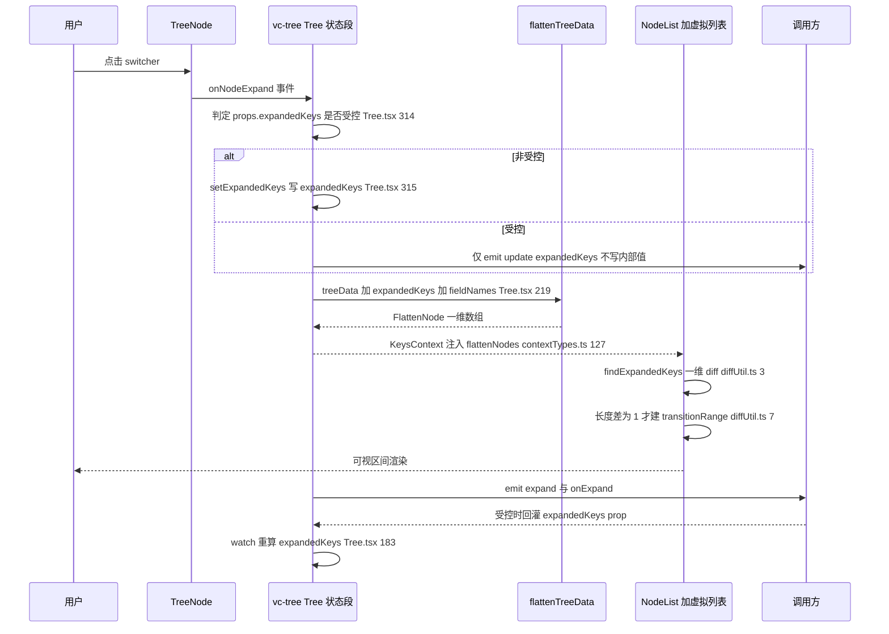
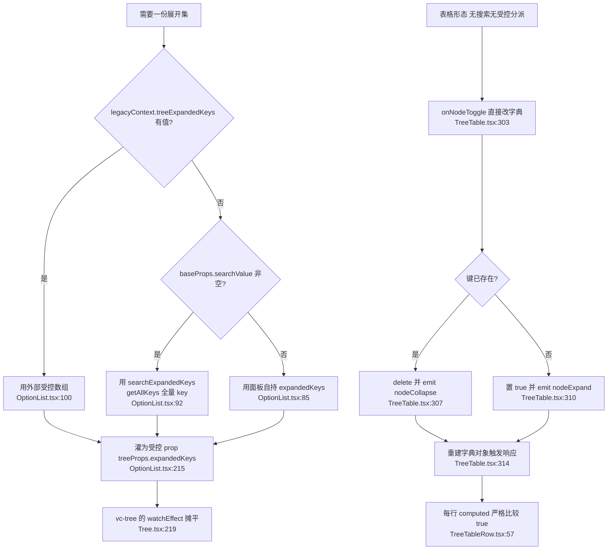

# C09-00 类横写：树数据的三种可视化形态

> **本篇解决** 同一份树数据在 `tree` / `tree-select` / 表格的树形展开三种形态里如何被规范化，展开与选中状态分别由谁持有，以及 `vc-tree` 与 `table-core` 两条展开路径为何并存。
> **前置**：I03《vc-util 工具层》、I08《虚拟化双实现：vc-virtual-list 与 virtual-scroller》、I06《table-core 状态机》、I02《vc-trigger 弹出时序与事件穿透》　**读者坐标**：`03-components/09-tree` 第 1/3 篇（类横写）

## 一、职责与边界

本篇是 C09 类的横写篇，解决一件事：**把「同一份树数据在多种可视化形态里被怎么处理」这条横向关系一次讲清**，使后续两个组件篇（C09-01 tree、C09-02 directory-tree）各自只需纵向展开自己那一条。

本篇负责：

- 树数据规范化：`treeData` / 插槽 children / id-pId 行表三种入口分别被哪个函数归一，产物形状是什么；
- 展开与选中状态的**持有者**与**数据表示**：谁存数组、谁存字典、谁存取反集合；
- 渲染形状：一维摊平列表与递归组件树的分界，以及这条分界带来的能力/代价差；
- 勾选传导算法的共享范围，与「树里找不到的 key」在两形态里的相反处置；
- `vc-tree` 与 `table-core` 两条内核路径的职责分层为什么并不冲突。

本篇**不负责**：

- 单个组件的完整 props/事件/插槽清单（属各组件篇；`tree` 的属性清单见 [apps/docs/components/tree.md](../../../apps/docs/components/tree.md)）；
- 虚拟列表自身的实现——已由 I08《虚拟化双实现：vc-virtual-list 与 virtual-scroller》论证，本篇只引用其「`vc-virtual-list` 仅被 `vc-select`/`vc-tree`/`vc-tree-select` 消费、`virtual-scroller` 仅被 `data-table/DataTable.tsx:47` 消费」这一结论；
- 表格排序/过滤/分页内核——已由 I06《table-core 状态机》论证，本篇只补它的边界（无展开职责）；
- 下拉浮层的开合时序与事件穿透——归 I02《vc-trigger 弹出时序与事件穿透》；
- DOM/Portal/生命周期兼容工具——归 I03《vc-util 工具层》；
- 拖拽落点几何、连接线 CSS 具体值、目录树的键盘导航全序——分别归 C09-01、C09-02。

依赖清单（本类五篇之间的纵向依赖由 `OUTLINE.md` 的 C09 表定义）：

| 方向 | 对象 | 关系 |
| --- | --- | --- |
| 向下 | `vc-tree/` | 树与选择器共用的规范化 + 状态 + 渲染内核 |
| 向下 | `vc-tree-select/` | 选择器形态的适配层，内嵌 `vc-tree` |
| 横向 | `tree-table/` | 表格形态自带一套展开与联动，不依赖 `vc-tree` |
| 依赖 | `table-core/` | 仅提供排序/过滤/分页的数据变换 |
| 依赖 | `vc-select/` | 选择器形态的选中值与搜索语义来源 |
| 依赖 | `tree/utils/iconUtil.tsx` | 被 `tree-select` 复用的 switcher 图标工厂 |
| 依赖 | `tree/style/index.ts` | 被 `tree-select` 复用的 `genTreeStyle` |

## 二、源码地图

行数取自 `find <dir> -type f | xargs wc -l`，只列本篇实际取证的模块。

| 文件 | 行数 | 职责 | 关键导出 / 主入口行 |
| --- | --- | --- | --- |
| `vc-tree/index.ts` | 8 | 内核入口，首行标注上游基线版本 | `vc-tree/index.ts:1` |
| `vc-tree/Tree.tsx` | 1250 | 规范化 + 六组状态 + 事件回流，**树形态主实现** | `vc-tree/Tree.tsx:82`（状态段起点） |
| `vc-tree/utils/treeUtil.ts` | 463 | 摊平、双索引 entity、字段名归一、插槽反解 | `treeUtil.ts:130` `flattenTreeData` |
| `vc-tree/utils/conductUtil.ts` | 241 | 父子勾选传导（fill / clean 两模式） | `conductUtil.ts:185` `conductCheck` |
| `vc-tree/utils/diffUtil.ts` | 45 | 展开动画的一维 diff | `diffUtil.ts:3` `findExpandedKeys` |
| `vc-tree/useMaxLevel.ts` | 38 | 由 entity 反推 `maxLevel` / `levelEntities` | `useMaxLevel.ts:5` |
| `vc-tree/NodeList.tsx` | 304 | 摊平列表 → 虚拟列表 + 过渡数据 | `NodeList.tsx:103`（`useInjectKeysState`） |
| `vc-tree/TreeNode.tsx` | 587 | 单节点渲染 | 见 C09-01 |
| `vc-tree/Indent.tsx` | 31 | 连接线缩进单元 | `Indent.tsx:8` |
| `vc-tree/MotionTreeNode.tsx` | 124 | 展开动画占位行 | `NodeList.tsx:29` `MOTION_KEY` |
| `vc-tree/interface.tsx` | 101 | `DataNode`/`FlattenNode`/`DataEntity`/`FieldNames` | `interface.tsx:95` |
| `vc-tree/util.tsx` | 354 | `pos` 运算、拖拽落点、`conductExpandParent` | `util.tsx:89` `calcDropPosition` |
| `vc-tree-select/TreeSelect.tsx` | 791 | 选择器形态主编排，**选择器主实现** | `TreeSelect.tsx:237` / `:238` |
| `vc-tree-select/OptionList.tsx` | 262 | 下拉面板，持有展开态并内嵌 `vc-tree` | `OptionList.tsx:8`、`:85` |
| `vc-tree-select/hooks/useTreeData.ts` | 74 | 三入口归一 + id/pId 连树 | `useTreeData.ts:8` `parseSimpleTreeData` |
| `vc-tree-select/hooks/useDataEntities.ts` | 42 | 借内核钩子建第三张索引 | `useDataEntities.ts:13` |
| `vc-tree-select/hooks/useCheckedKeys.ts` | 38 | 缺失值保全 + 传导 | `useCheckedKeys.ts:19` |
| `vc-tree-select/hooks/useFilterTreeData.ts` | 63 | 搜索期树裁剪 | `useFilterTreeData.ts:42` `dig` |
| `vc-tree-select/utils/valueUtil.ts` | 50 | 选择器版 `fillFieldNames` / `getAllKeys` | `valueUtil.ts:11`、`:29` |
| `vc-tree-select/utils/strategyUtil.ts` | 48 | `SHOW_ALL`/`SHOW_PARENT`/`SHOW_CHILD` | `strategyUtil.ts:12` |
| `tree/Tree.tsx` | 277 | 公开 Tree，注入默认值与样式 | `tree/Tree.tsx:222` `itemHeight = 28` |
| `tree/index.tsx` | 41 | 聚合导出 + `install` | `tree/index.tsx:30` |
| `tree/utils/dictUtil.ts` | 100 | 范围多选 `calcRangeKeys` | `dictUtil.ts:26` |
| `tree/utils/iconUtil.tsx` | 67 | switcher 图标工厂，被 `tree-select` 复用 | `iconUtil.tsx:16` |
| `tree/style/index.ts` | 479 | 树样式 + 供外部复用的 `genTreeStyle` | `tree/style/index.ts:450` |
| `tree-select/index.tsx` | 367 | 公开 TreeSelect，复用 select 样式与 tree 图标 | `tree-select/index.tsx:19` |
| `tree-select/style/index.tsx` | 74 | 复用 `genTreeStyle` + select 基座 | `tree-select/style/index.tsx:4` |
| `directory-tree/DirectoryTree.tsx` | 299 | 目录树，**自持展开数组**并代理读回内核状态 | `DirectoryTree.tsx:121`、`:90-95` |
| `tree/DirectoryTree.tsx` | 7 | 兼容用纯 re-export | `tree/DirectoryTree.tsx:2`（注释即说明） |
| `tree-table/TreeTable.tsx` | 966 | 表格树形展开主编排，**表格形态主实现** | `TreeTable.tsx:70`（状态段） |
| `tree-table/TreeTableRow.tsx` | 512 | 行 + 递归子行 + 勾选上下传播 | `TreeTableRow.tsx:481`、`:356` |
| `tree-table/treeTableTypes.ts` | 224 | props 定义（`dataKey` 默认 `'key'`） | `treeTableTypes.ts:98-103` |
| `table-core/engine.ts` | 51 | `DataShape` 分派四个数据变换，**无展开** | `engine.ts:26` |

主实现入口三处：树 `vc-tree/Tree.tsx:82`、选择器 `vc-tree-select/TreeSelect.tsx:237`、表格 `tree-table/TreeTable.tsx:70`。

测试分布（按 `packages/xiaoye-ui/vitest.config.mts:33` 的 `src/**/*.test.{js,ts,jsx,tsx}` glob 判定为实际执行）：

| 测试文件 | 用例数 | 覆盖对象 |
| --- | --- | --- |
| `tree/util.test.js` | 3 | 仅 `calcRangeKeys`（`tree/util.test.js:1` 只 import 它） |
| `tree-select/index.test.js` | 8 行 | 仅 focus/mount 两个共享用例（`tree-select/index.test.js:6-7`） |
| `directory-tree/__tests__/directory-tree.test.tsx` | 8 | 含 `update:expandedKeys`（`:80`） |
| `tree-table/__tests__/tree-table.test.js` | 18 | 含展开与 `nodeExpand`（`:159`、`:232`、`:278`） |
| `table-core/__tests__/table-core.test.ts` | — | `createTableEngine` 分派（`:224`） |

`vc-tree/` 与 `vc-tree-select/` 两个目录 `find` 结果里**没有任何 `*.test.*` 文件**；`conductCheck` 与 `flattenTreeData` 在全仓测试文件里 `grep -rln "conductCheck\|flattenTreeData" --include='*.test.*' packages/xiaoye-ui/src` 零命中。这两条是负面结论，已各用第二种方法交叉验证（前者用 `find` 列目录，后者用全仓 grep）。

## 三、架构与数据流

### 图 1：三种形态的分层对照（静态结构）

三种形态在同一张图上横向并排，每一列是一种形态，每一行是一个职责层。**同一层里出现两份实现就是「没复用」，出现箭头就是「跨形态共享」**。



读图三条：

- L2 里 `fillFieldNames` 有**两份实现**（`vc-tree/utils/treeUtil.ts:27`、`vc-tree-select/utils/valueUtil.ts:11`），但 `convertDataToEntities`（`treeUtil.ts:297`）只有一份，选择器靠 `useTreeData.ts:48` 归一后的数据喂给它。共享是**函数粒度**的，不是模块粒度。
- L3 的三格是三种不同数据结构（论点 2 展开），且 `C2`（选择器面板）与 `C1`（树内核）之间没有合并，只有「面板算完当受控 prop 灌下去」这一条单向边（`vc-tree-select/OptionList.tsx:215`）。
- L5 的 `E2`「内嵌 vc-tree」使选择器形态的渲染最终回到 `E1`，所以虚拟化只有一条实现路径；`E3` 的递归渲染路径与 `E1` 彼此独立、都没有虚拟化。

### 图 2：树形态一次「点击展开箭头」的完整闭环



这条闭环里有三处必须解释的分支：

1. `Tree.tsx:313-316` 的 `setExpandedKeys` 先判 `props.expandedKeys === undefined` 才写内部值——受控时内部数组**不动**，界面变化全靠调用方回灌。所以受控树里点箭头若无 `v-model:expanded-keys` 且不改 props，视觉上不会有任何反应。
2. `flattenTreeData` 不是被点击直接调用的，而是在 `watchEffect`（`Tree.tsx:218-220`）里由 `expandedKeys` 变化被动触发——展开集与渲染列表之间没有命令式同步点，这是摊平路线能保持一致性的原因。
3. `NodeList.tsx:124-166` 的过渡分支只在 `findExpandedKeys` 判定「长度恰好差 1」时进入（`diffUtil.ts:7`）；`Tree.tsx:906` 那段被注释掉的 `[Legacy]` 手工刷新证明，异步 `loadData` 完成后**不再**手动重算摊平列表，完全依赖上面第 2 点的 `watchEffect`。

### 图 3：选择器形态「展开集合由谁决定」的优先级，与表格形态对照



`S1`/`S3` 两层判断是选择器形态**特有**的：树形态只有「受控与否」一层（`vc-tree/Tree.tsx:314`），表格形态一层都没有（`TreeTable.tsx:303` 直接改本地字典后 emit）。选择器多出 `S3` 这一层，是因为下拉面板必须保证搜索命中的节点可见——它不看用户展开了什么，而是重算一份全量 key（`vc-tree-select/utils/valueUtil.ts:29`），代价在论点 2 已述：搜索期用户手动折叠无效（`OptionList.tsx:106-111` 靠同时写两个 ref 才勉强保住手动展开）。

## 四、核心机制精读

### 论点 1：三种形态的「树数据入口」并不相同，只有 `vc-tree` 与 `vc-tree-select` 共享同一套 fieldNames 归一语义，表格树形展开走的是完全独立的 row 归一

`vc-tree` 的数据入口只有两个：嵌套数组 `treeData`，或者用 `<xy-tree-node>` 写插槽 children 再被反解成数据。

```tsx
// packages/xiaoye-ui/src/vc-tree/props.ts:119
  children: PropTypes.any,
  treeData: { type: Array as PropType<DataNode[]> }, // Generate treeNode by children
  fieldNames: { type: Object as PropType<FieldNames> },
```

插槽 children 的反解在 `convertTreeToData`，它把 VNode 的 `props` + `slots` 摊平回 `DataNode`，并且要处理 Vue 模板特有的「布尔属性写成空字符串」问题：

```typescript
// packages/xiaoye-ui/src/vc-tree/utils/treeUtil.ts:71
export function convertTreeToData(rootNodes: VueNode): DataNode[] {
  function dig(node: VueNode = []): DataNode[] {
    const treeNodes = filterEmpty(node as NodeElement[]);
    return treeNodes.map(treeNode => {
      // Filter invalidate node
      if (!isTreeNode(treeNode)) {
        warning(!treeNode, 'Tree/TreeNode can only accept TreeNode as children.');
        return null;
      }
      const slots = (treeNode.children as any) || {};
      const key = treeNode.key as string | number;
      const props: any = {};
      for (const [k, v] of Object.entries(treeNode.props)) {
        props[camelize(k)] = v;
      }
      const { isLeaf, checkable, selectable, disabled, disableCheckbox } = props;
      // 默认值为 undefined
      const newProps = {
        isLeaf: isLeaf || isLeaf === '' || undefined,
        // ...
      };
```

`isLeaf === ''` 这一分支（`treeUtil.ts:89`）是插槽写法独有的：模板里写 `<xy-tree-node is-leaf>` 时，Vue 传下来的 prop 值是空字符串而不是 `true`，不归一就会把叶子节点判成非叶子。这段逻辑在 `treeData` 数组入口里不存在，因为数组入口由调用方直接给布尔值。

`vc-tree-select` 的入口比 `vc-tree` 多一个：**id/pId 扁平行表**。

```typescript
// packages/xiaoye-ui/src/vc-tree-select/hooks/useTreeData.ts:48
export default function useTreeData(
  treeData: Ref<DataNode[]>,
  children: Ref<VueNode[]>,
  simpleMode: Ref<boolean | SimpleModeConfig>,
): ShallowRef<DefaultOptionType[]> {
  const mergedTreeData = shallowRef<DefaultOptionType[]>();
  watch(
    [simpleMode, treeData, children],
    () => {
      const simpleModeValue = simpleMode.value;
      if (treeData.value) {
        mergedTreeData.value = simpleMode.value
          ? parseSimpleTreeData(toRaw(treeData.value), {
              id: 'id',
              pId: 'pId',
              rootPId: null,
              ...(simpleModeValue !== true ? simpleModeValue : {}),
            })
          : toRaw(treeData.value).slice();
      } else {
        mergedTreeData.value = convertChildrenToData(toRaw(children.value));
      }
    },
    { immediate: true, deep: true },
  );
  return mergedTreeData;
}
```

`parseSimpleTreeData`（`useTreeData.ts:8-42`）用两趟遍历把行表连成树：第一趟建 `keyNodes` 索引并给每节点补 `key`，第二趟按 `pId` 找父节点 push 进 `parent.children`，`parentKey === rootPId` 或「找不到父节点且 `rootPId === null`」的进根列表。注意后半个条件——`rootPId` 为 `null` 时，**任何孤儿节点都会被提升为根**，这意味着数据里父 ID 拼错不会报错，只会让子树在顶层多长出来。

而 `fieldNames` 的语义在两条路径里是**同名不同实现**：

```typescript
// packages/xiaoye-ui/src/vc-tree-select/utils/valueUtil.ts:11
export function fillFieldNames(fieldNames?: FieldNames) {
  const { label, value, children } = fieldNames || {};

  const mergedValue = value || 'value';

  return {
    _title: label ? [label] : ['title', 'label'],
    value: mergedValue,
    key: mergedValue,
    children: children || 'children',
  };
}
```

对照 `vc-tree` 版本（`vc-tree/utils/treeUtil.ts:27-37`）：那边默认 `title: 'title'`、`_title: [mergedTitle]`、`key: 'key'`，字段名取自 `{ title, _title, key, children }`；这边默认 `_title: ['title', 'label']`、`key` 被**强制等于 `value` 字段**，字段名取自 `{ label, value, children }`。差异不是随手写的：选择器的值语义来自 `vc-select`（value/label 二元），所以 `key` 只能复用 `value`，title 允许 `title`/`label` 两个候选字段回退。

这个 `_title`（带下划线前缀、类型是 `string[]`）在 `vc-tree` 自己的公开字段名里根本没有来源——它是为选择器预留的私有通道，`vc-tree` 的类型定义就把话说死了：

```typescript
// packages/xiaoye-ui/src/vc-tree/interface.tsx:95
export interface FieldNames {
  title?: string;
  /** @private Internal usage for `vc-tree-select`, safe to remove if no need */
  _title?: string[];
  key?: string;
  children?: string;
}
```

通道能生效，是因为选择器把自己那份 `fieldNames` 原样塞进了内嵌的树：`vc-tree-select/OptionList.tsx:208-210` 组 `const treeProps: Partial<TreeProps> = { fieldNames: context.fieldNames }`，而 `context.fieldNames` 来自 `vc-tree-select/TreeSelect.tsx:237` 的那份 `fillFieldNames`。于是 `vc-tree` 的 `fillFieldNames`（`vc-tree/utils/treeUtil.ts:28` 解构 `_title`）收到选择器的数组，`flattenTreeData` 的 title 挑选循环（`treeUtil.ts:150-157`）按数组顺序取第一个非 `undefined` 字段。`_title` 之所以是复数，就是为了这条回退；`vc-tree` 单用时它恒为单元素数组。

表格的树形展开不参与以上任何一套。它的行数据是扁平 row 记录，子行挂在 row 的 `children` 上，由视图层递归决定渲染与否——这一路径的归一见论点 4 与论点 5。

结论：三种形态里只有前两种共享「用 `pos` 兜底 key、用 `_title` 数组建索引」的规范化内核，且共享的实现是 `vc-tree/utils/treeUtil.ts`。复用是不完整的：`vc-tree-select` 不 import `flattenTreeData` 与 `fillFieldNames`（`vc-tree-select/utils/valueUtil.ts:11` 是它自己的同名实现），摊平是它内嵌的 `vc-tree` 间接做的（`vc-tree-select/OptionList.tsx:8` `import Tree from '../vc-tree/Tree'`）。

### 论点 2：展开状态的**数据结构**在三种形态里分别是 `Key[]` 数组、`Key[]` 数组加「搜索时强制全展开」、`Record<id, true>` 布尔字典——三种表示互不兼容，这是形态之间无法直接换底层的最硬约束

`vc-tree` 用**有序 key 数组**表示展开集合：

```tsx
// packages/xiaoye-ui/src/vc-tree/Tree.tsx:82
    const selectedKeys = shallowRef<Key[]>([]);
    const checkedKeys = shallowRef<Key[]>([]);
    const halfCheckedKeys = shallowRef<Key[]>([]);
    const loadedKeys = shallowRef<Key[]>([]);
    const loadingKeys = shallowRef<Key[]>([]);
    const expandedKeys = shallowRef<Key[]>([]);
```

数组只在 `flattenTreeData` 里被立刻升成 `Set`（`vc-tree/utils/treeUtil.ts:141` `const expandedKeySet = new Set(...)`），以及在 `computed` 里缓存一份 `expandedKeysSet`（`vc-tree/Tree.tsx:151-153`）供节点自身判断状态。选数组而不是字典，直接被对外 API 决定：`update:expandedKeys` 要能原样 emit 回调用方，而调用方书写的就是数组。

`tree-select` 形态里，展开状态**不由树内核持有，而由下拉面板持有**，树内核只是被控组件：

```tsx
// packages/xiaoye-ui/src/vc-tree-select/OptionList.tsx:85
    const expandedKeys = shallowRef<Key[]>(legacyContext.treeDefaultExpandedKeys);
    const searchExpandedKeys = shallowRef<Key[]>(null);

    watch(
      () => baseProps.searchValue,
      () => {
        if (baseProps.searchValue) {
          searchExpandedKeys.value = getAllKeys(toRaw(context.treeData), toRaw(context.fieldNames));
        }
      },
      {
        immediate: true,
      },
    );
    const mergedExpandedKeys = computed(() => {
      if (legacyContext.treeExpandedKeys) {
        return legacyContext.treeExpandedKeys.slice();
      }
      return baseProps.searchValue ? searchExpandedKeys.value : expandedKeys.value;
    });

    const onInternalExpand = (keys: Key[]) => {
      expandedKeys.value = keys;
      searchExpandedKeys.value = keys;

      legacyContext.onTreeExpand?.(keys);
    };
```

三点要读出来：

1. `mergedExpandedKeys`（`OptionList.tsx:99-104`）有**三层优先级**：外部受控 `treeExpandedKeys` > 搜索态 `searchExpandedKeys` > 面板自持的 `expandedKeys`。搜索一旦有词，展开集被 `getAllKeys` 覆盖成「全树所有 key」，用户手风琴式的展开被丢弃。
2. `onInternalExpand`（`106-111`）把**两个** ref 一起写。这是必须的：若不写 `searchExpandedKeys`，下一次渲染 `mergedExpandedKeys` 仍走搜索分支，用户点击折叠箭头就毫无效果。
3. 面板算出的 `mergedExpandedKeys` 最后以**受控 prop** 塞回树内核：`treeProps.expandedKeys = mergedExpandedKeys.value`（`vc-tree-select/OptionList.tsx:214-216`）。也就是说树形态里那套「非受控 + 首次 default」的机制在选择器形态里被完全绕开——因为 `expandedKeys` 恒为 `undefined` 以外的值。

`getAllKeys` 的遍历也是独立实现（`vc-tree-select/utils/valueUtil.ts:29-46`），它只读 `fieldNames.value` 和 `fieldNames.children`，不做 `pos` 兜底。这意味着**在 simpleMode 之外，若数据节点缺 `value` 字段，展开集里会混进 `undefined`**，而 `vc-tree` 的 `flattenTreeData` 对同一个缺失 key 会用 `pos` 兜底（`vc-tree/utils/treeUtil.ts:147` `getKey(treeNode[fieldKey], pos)`），两端对「无 key 节点」的处理不一致。

表格树形展开用的是**第四种表示：布尔字典**，且 `expandedKeys` 与 `selectionKeys` 语义分裂：

```tsx
// packages/xiaoye-ui/src/tree-table/TreeTable.tsx:70
    const state = reactive({
      // 浅拷贝：避免后续 delete/赋值直接改动父组件传入的对象
      d_expandedKeys: props.expandedKeys ? { ...props.expandedKeys } : {},
      d_first: props.first,
      d_rows: props.rows,
      d_sortField: props.sortField,
      d_sortOrder: props.sortOrder,
      d_multiSortMeta: props.multiSortMeta ? [...props.multiSortMeta] : [],
      // ...
    });
```

```tsx
// packages/xiaoye-ui/src/tree-table/TreeTable.tsx:303
    function onNodeToggle(node: any) {
      const key = nodeKey(node);

      if (state.d_expandedKeys[key]) {
        delete state.d_expandedKeys[key];
        emit('nodeCollapse', node);
      } else {
        state.d_expandedKeys[key] = true;
        emit('nodeExpand', node);
      }

      state.d_expandedKeys = { ...state.d_expandedKeys };
      emit('update:expandedKeys', state.d_expandedKeys);
    }
```

字典用「键存在即为真」，折叠靠 `delete`。因为 `state` 是 `reactive` 对象，`delete` 之后仍要整体重新赋值 `{ ...state.d_expandedKeys }`（`TreeTable.tsx:314`）来触发依赖更新——Vue 3 的 reactive 能代理 `delete`，但这里选择显式重建，配合 `TreeTable.tsx:84` 那行注释「state 是 reactive，禁止解构」看，这段代码对响应性边界是防御性的。

节点侧读取时用了严格比较：

```tsx
// packages/xiaoye-ui/src/tree-table/TreeTableRow.tsx:56
    const expanded = computed(() => {
      return props.expandedKeys && props.expandedKeys[nodeKey(props.node)] === true;
    });

    const leaf = computed(() => {
      return props.node?.leaf === false
        ? false
        : !(props.node?.children && props.node?.children.length);
    });

    function nodeKey(node: any) {
      return resolveFieldData(node, props.dataKey);
    }
```

`nodeKey`（`TreeTableRow.tsx:23-25`）走 `resolveFieldData(node, props.dataKey)`——行的身份由**用户指定的字段路径**求出，可以是嵌套路径或函数；而 `vc-tree` 的行身份由数据里的 `key` 字段或 `pos` 位置串决定。两边对「什么是一个节点」的定义不同：树里是 `key`/`pos`，表格里是 `dataKey` 解析值。

同表的勾选状态又是**第五种表示**：`selectionKeys[key]` 可以是 `true`，也可以是 `{ checked, partialChecked }` 对象（`TreeTableRow.tsx:29` 用 `=== true` 判选中行，`TreeTableRow.tsx:66-76` 用 `.checked`/`.partialChecked` 判复选框）。三种树形态里只有表格把「行选中」和「复选框勾选」做成两套并存的键空间；`vc-tree` 是 `selectedKeys` 与 `checkedKeys`/`halfCheckedKeys` 三个平行数组（`vc-tree/Tree.tsx:82-84`），`tree-select` 只有一套 `checkedKeys`（值即选项值）。

结论：展开/选中状态在三种形态里共有五种表示（`Key[]`、`Key[]`+搜索覆盖、`Record<id,true>`、`Record<id, boolean>`、`Record<id, {checked, partialChecked}>`），没有一处共享状态容器。想把 `tree-select` 的下拉换成表格展开、或把 TreeTable 的展开状态喂给 Tree，必须先写一层表示转换，**不能直接传**。

### 论点 3：树形态与选择器形态把树**摊平成一维列表**再渲染，表格树形展开把树**递归成组件树**再渲染；摊平换来虚拟化、展开动画和拖拽定位三件事，代价是行高必须固定

`flattenTreeData` 的注释就把用途写明了：

```typescript
// packages/xiaoye-ui/src/vc-tree/utils/treeUtil.ts:124
/**
 * Flat nest tree data into flatten list. This is used for virtual list render.
 * @param treeNodeList Origin data node list
 * @param expandedKeys
 * need expanded keys, provides `true` means all expanded (used in `rc-tree-select`).
 */
export function flattenTreeData(
  treeNodeList: DataNode[],
  expandedKeys: Key[] | true,
  fieldNames: FieldNames,
): FlattenNode[] {
  // ...
  const expandedKeySet = new Set(expandedKeys === true ? [] : expandedKeys);
  const flattenList: FlattenNode[] = [];

  function dig(list: DataNode[], parent: FlattenNode = null): FlattenNode[] {
    return list.map((treeNode, index) => {
      const pos: string = getPosition(parent ? parent.pos : '0', index);
      const mergedKey = getKey(treeNode[fieldKey], pos);
      // ...
      const flattenNode: FlattenNode = {
        // ...
        isStart: [...(parent ? parent.isStart : []), index === 0],
        isEnd: [...(parent ? parent.isEnd : []), index === list.length - 1],
      };

      flattenList.push(flattenNode);

      // Loop treeNode children
      if (expandedKeys === true || expandedKeySet.has(mergedKey)) {
        flattenNode.children = dig(treeNode[fieldChildren] || [], flattenNode);
      } else {
        flattenNode.children = [];
      }
```

要盯住三行。`treeUtil.ts:141` 与 `174`：`expandedKeys` 类型是 `Key[] | true`，传 `true` 时 `expandedKeySet` 被建成**空集**，但 `174` 行的短路 `expandedKeys === true` 让递归照旧进子层——这是一个「空 Set 但当作全集用」的反直觉写法，靠短路条件而非集合内容生效。`treeUtil.ts:167-168` 的 `isStart`/`isEnd` 是**逐层的布尔数组**，不是单个布尔；它记录「从根到本节点这一路上，我在每一层是不是第一个/最后一个孩子」，这正是画树连接线所需的全部信息：

```tsx
// packages/xiaoye-ui/src/vc-tree/Indent.tsx:8
const Indent = ({ prefixCls, level, isStart, isEnd }: IndentProps) => {
  const baseClassName = `${prefixCls}-indent-unit`;
  const list = [];
  for (let i = 0; i < level; i += 1) {
    list.push(
      <span
        key={i}
        class={{
          [baseClassName]: true,
          [`${baseClassName}-start`]: isStart[i],
          [`${baseClassName}-end`]: isEnd[i],
        }}
      />,
    );
  }
```

`Indent` 只需要 `isStart[i]`/`isEnd[i]` 就能决定第 i 层画不画横线，不必知道兄弟节点是谁——这是摊平列表才做得到的事：一旦递归成组件树，子组件就拿不到「同层最后一个」这种全局序号信息了。表格里对应能力是靠 `ariaPosInset`/`ariaSetSize` 这两个 prop 逐层往下传的（`tree-table/TreeTableRow.tsx:496-497`），只喂给 a11y 属性，不用于画线。

摊平之后，渲染交给 `vc-virtual-list`：

```tsx
// packages/xiaoye-ui/src/vc-tree/NodeList.tsx:103
    const { expandedKeys, flattenNodes } = useInjectKeysState();
    expose({
      scrollTo: scroll => {
        listRef.value.scrollTo(scroll);
      },
      getIndentWidth: () => indentMeasurerRef.value.offsetWidth,
    });
    // ============================== Motion ==============================
    const transitionData = shallowRef<FlattenNode[]>(flattenNodes.value);
    const transitionRange = shallowRef([]);
    const motionType = ref<'show' | 'hide' | null>(null);
```

`flattenNodes` 不是 prop 传下来的，而是从 KeysContext 注入（`vc-tree/contextTypes.ts:121-127` 声明 `expandedKeys: ShallowRef<Key[]>` 与 `flattenNodes: ShallowRef<FlattenNode[]>`）。I08《虚拟化双实现》已证 `vc-virtual-list` 在本库只被 `vc-select`、`vc-tree`、`vc-tree-select` 消费，`virtual-scroller` 只被 `data-table/DataTable.tsx:47` 消费；本篇补一个同源事实：`tree-table` 目录里 `grep -rn "virtual|VirtualList|scroller" tree-table/*.tsx tree-table/*.ts` **零命中**，即 TreeTable 完全不虚拟化，行数全量进 DOM。

摊平还让「展开动画」可以用一维 diff 表达：

```typescript
// packages/xiaoye-ui/src/vc-tree/utils/diffUtil.ts:3
export function findExpandedKeys(prev: Key[] = [], next: Key[] = []) {
  const prevLen = prev.length;
  const nextLen = next.length;

  if (Math.abs(prevLen - nextLen) !== 1) {
    return { add: false, key: null };
  }

  function find(shorter: Key[], longer: Key[]) {
    const cache: Map<Key, boolean> = new Map();
    shorter.forEach(key => {
      cache.set(key, true);
    });

    const keys = longer.filter(key => !cache.has(key));

    return keys.length === 1 ? keys[0] : null;
  }
  // ...
}

export function getExpandRange(shorter: FlattenNode[], longer: FlattenNode[], key: Key) {
  const shorterStartIndex = shorter.findIndex(item => item.key === key);
  const shorterEndNode = shorter[shorterStartIndex + 1];
  const longerStartIndex = longer.findIndex(item => item.key === key);

  if (shorterEndNode) {
    const longerEndIndex = longer.findIndex(item => item.key === shorterEndNode.key);
    return longer.slice(longerStartIndex + 1, longerEndIndex);
  }
  return longer.slice(longerStartIndex + 1);
}
```

`diffUtil.ts:7-9` 是硬门：**只有展开集长度恰好变化 1 才认为是可动画的单点展开/折叠**；`getExpandRange` 则用「摊平列表里本节点的下一个节点」当哨兵，反推出这次展开新出现的整段子树区间（`diffUtil.ts:40-44`），若本节点已是列表末尾则取到结尾（`45`）。这两段逻辑都只在**一维有序数组**上成立，表格的递归行没有对应实现。

拖拽落点计算同样依赖摊平后的 `pos` 序列与全局层级：`vc-tree/util.tsx:89` 的 `calcDropPosition`、`vc-tree/util.tsx:89` 的 `getDragChildrenKeys`、`vc-tree/util.tsx:50` 的 `posToArr`，全部以位置串（`'0-1-2'` 这种）为主键。表格里没有拖拽换父级的能力，只有展开。

代价在渲染入口就被写死：`tree/Tree.tsx:222` 给出 `itemHeight = 28` 默认值并原样传下去（`tree/Tree.tsx:244`、`vc-tree/NodeList.tsx:252-254` 的 `height`/`itemHeight`/`virtual`）。固定行高是 `vc-virtual-list` 的前提，所以**自定义节点内容把行撑高后，虚拟滚动的可视区间估算就会偏**；TreeTable 没这个约束，行高随便长。

另一个只属于「摊平」路线的行为差异：树的选择器形态把 `flattenTreeData` 的 `expandedKeys` 传成节点自身状态驱动的结果，而表格里分页只切根节点——

```typescript
// packages/xiaoye-ui/src/tree-table/TreeTable.tsx:139
    const dataToRender = computed(() => {
      const data = processedData.value;

      if (props.pagination) {
        const first = props.lazy ? 0 : state.d_first;
        return data.slice(first, first + state.d_rows);
      } else {
        return data;
      }
    });
```

`processedData` 是**根节点序列**（`TreeTable.tsx:103-135` 里排序/过滤都只作用在树顶层，子节点由 `sortSingleTree`/`filterTree` 递归携带），`dataToRender` 对它切片后，每行的子树是在 `TreeTableRow` 内部递归渲染出来的（`TreeTableRow.tsx:481-482`）。所以 TreeTable 的 `rows=10` 是「10 个根行」，展开后 DOM 里的 `<tr>` 数可以远超 10；而树的虚拟列表里「一屏多少条」就是真实渲染条数。两者对「一页/一屏」的定义不同。

结论：摊平不是实现偷懒，而是虚拟化、连接线绘制、展开动画、拖拽定位四项能力共同要求的数据形状；表格形态放弃摊平，换来列宽/行高自由与单元格插槽，同时放弃了以上四项。

### 论点 4：勾选传导（父子联动）是全类唯一被真正共享的状态算法，但两种形态对「树里找不到的 key」的处理相反——树丢弃、选择器保留，差异写在一个 `conductCheck` 的五参数签名两侧

传导内核只有一个，两个形态都调它：

```typescript
// packages/xiaoye-ui/src/vc-tree/utils/conductUtil.ts:185
export function conductCheck<TreeDataType extends BasicDataNode = DataNode>(
  keyList: Key[],
  checked: true | { checked: false; halfCheckedKeys: Key[] },
  keyEntities: Record<Key, DataEntity<TreeDataType>>,
  maxLevel: number,
  levelEntities: Map<number, Set<DataEntity<TreeDataType>>>,
  getCheckDisabled?: GetCheckDisabled<TreeDataType>,
): ConductReturnType {
  const warningMissKeys: Key[] = [];

  // ...

  // We only handle exist keys
  const keys = new Set<Key>(
    keyList.filter(key => {
      const hasEntity = !!keyEntities[key];
      if (!hasEntity) {
        warningMissKeys.push(key);
      }

      return hasEntity;
    }),
  );

  note(
    !warningMissKeys.length,
    `Tree missing follow keys: ${warningMissKeys
      .slice(0, 100)
      .map(key => `'${key}'`)
      .join(', ')}`,
  );

  let result: ConductReturnType;
  if (checked === true) {
    result = fillConductCheck<TreeDataType>(keys, levelEntities, maxLevel, syntheticGetCheckDisabled);
  } else {
    result = cleanConductCheck(keys, checked.halfCheckedKeys, levelEntities, maxLevel, syntheticGetCheckDisabled);
  }
```

`conductUtil.ts:203-212` 把**没有 entity 的 key 直接过滤掉**，只在 dev 环境 `note` 一句（`214-220`，且最多列 100 个）。也就是说：**传进来的 key 若不在当前树里，就静默消失**。传导本身按层跑两趟——自顶向下 fill、自底向上聚合半选：

```typescript
// packages/xiaoye-ui/src/vc-tree/utils/conductUtil.ts:25
function fillConductCheck<TreeDataType extends BasicDataNode = DataNode>(
  keys: Set<Key>,
  levelEntities: Map<number, Set<DataEntity<TreeDataType>>>,
  maxLevel: number,
  syntheticGetCheckDisabled: GetCheckDisabled<TreeDataType>,
): ConductReturnType {
  const checkedKeys = new Set<Key>(keys);
  const halfCheckedKeys = new Set<Key>();

  // Add checked keys top to bottom
  for (let level = 0; level <= maxLevel; level += 1) {
    const entities = levelEntities.get(level) || new Set();
    entities.forEach(entity => {
      const { key, node, children = [] } = entity;

      if (checkedKeys.has(key) && !syntheticGetCheckDisabled(node)) {
        children
          .filter(childEntity => !syntheticGetCheckDisabled(childEntity.node))
          .forEach(childEntity => {
            checkedKeys.add(childEntity.key);
          });
      }
    });
  }

  // Add checked keys from bottom to top
  const visitedKeys = new Set<Key>();
  for (let level = maxLevel; level >= 0; level -= 1) {
    // ...
    // Skip if parent is disabled
    if (syntheticGetCheckDisabled(entity.parent.node)) {
      visitedKeys.add(parent.key);
      return;
    }
```

`levelEntities`（`Map<level, Set<entity>>`）与 `maxLevel` 都由 `useMaxLevel(keyEntities)` 从 entity 索引现算（`vc-tree/useMaxLevel.ts:10-33`），所以传导**必须**先有 `convertDataToEntities` 的产物，两者不能单独使用。第二趟的 `visitedKeys`（`conductUtil.ts:58`、`64`）用来去重「同一个父被多个子触发聚合」，并且「父禁用则整支跳过」——这解释了为什么禁用父节点下的子节点勾选不会冒泡成父半选。

树形态的调用是**两趟修正**：

```tsx
// packages/xiaoye-ui/src/vc-tree/Tree.tsx:719
      } else {
        // Always fill first
        let { checkedKeys: newCheckedKeys, halfCheckedKeys: newHalfCheckedKeys } = conductCheck(
          [...checkedKeys.value, key],
          true,
          keyEntitiesValue,
          maxLevel.value,
          levelEntities.value,
        );

        // If remove, we do it again to correction
        if (!checked) {
          const keySet = new Set(newCheckedKeys);
          keySet.delete(key);
          ({ checkedKeys: newCheckedKeys, halfCheckedKeys: newHalfCheckedKeys } = conductCheck(
            Array.from(keySet),
            { checked: false, halfCheckedKeys: newHalfCheckedKeys },
            keyEntitiesValue,
            maxLevel.value,
            levelEntities.value,
          ));
        }

        checkedObj = newCheckedKeys;

        // [Legacy] This is for vc-tree-select`
        eventObj.checkedNodes = newCheckedKeys
          // ...
```

取消勾选不能一次算完：先按「全填」把整支勾上，再把本节点摘掉重算一遍 clean 传导（`Tree.tsx:730-741`）。`checked` 参数的联合类型 `true | { checked: false; halfCheckedKeys }`（`conductUtil.ts:187`）就是为这两趟准备的两种模式。`Tree.tsx:744` 那句 `[Legacy]` 注释直接点名 `vc-tree-select`——事件对象里额外挂 `checkedNodes`/`checkedNodesPositions`/`halfCheckedKeys` 是为选择器服务的，树本身不用。

选择器形态在**调用之前**就把差异消化掉了：

```typescript
// packages/xiaoye-ui/src/vc-tree-select/hooks/useCheckedKeys.ts:19
  watchEffect(() => {
    let checkedKeys: RawValueType[] = rawLabeledValues.value.map(({ value }) => value);
    let halfCheckedKeys: RawValueType[] = rawHalfCheckedValues.value.map(({ value }) => value);

    const missingValues = checkedKeys.filter(key => !keyEntities.value[key]);

    if (treeConduction.value) {
      ({ checkedKeys, halfCheckedKeys } = conductCheck(
        checkedKeys,
        true,
        keyEntities.value,
        maxLevel.value,
        levelEntities.value,
      ));
    }
    newRawCheckedValues.value = Array.from(new Set([...missingValues, ...checkedKeys]));
    newRawHalfCheckedValues.value = halfCheckedKeys;
  });
```

`useCheckedKeys.ts:23` 先把不在树里的值挑出来存进 `missingValues`，`34` 行再原样并回结果。语义上这是必须的：选择器的 value 是**已选中的值集合**，节点可能因为远程搜索、懒加载或过滤而暂时不在当前 `treeData` 里，但它们必须仍是选中态（否则标签会被吞掉）。树形态没有这个概念——它的 key 只能来自当前数据。

`treeConduction` 的定义也说明联动是可选的：`vc-tree-select/TreeSelect.tsx:231` `computed(() => props.treeCheckable && !props.treeCheckStrictly)`，与树侧的 `props.checkStrictly`（`vc-tree/Tree.tsx:253` `if (!props.checkStrictly)` 才走 conduct）是一对同义不同名的开关。

选择器还借 `convertDataToEntities` 的两个扩展回调建了**第三张索引**：

```typescript
// packages/xiaoye-ui/src/vc-tree-select/hooks/useDataEntities.ts:13
  watchEffect(() => {
    const fieldNamesValue = fieldNames.value;
    const collection = convertDataToEntities(treeData.value, {
      fieldNames: fieldNamesValue,
      initWrapper: wrapper => ({
        ...wrapper,
        valueEntities: new Map(),
      }),
      processEntity: (entity, wrapper: any) => {
        const val = entity.node[fieldNamesValue.value];

        // Check if exist same value
        if (process.env.NODE_ENV !== 'production') {
          const key = entity.node.key;

          warning(!isNil(val), 'TreeNode `value` is invalidate: undefined');
          warning(!wrapper.valueEntities.has(val), `Same \`value\` exist in the tree: ${val}`);
          warning(
            !key || String(key) === String(val),
            `\`key\` or \`value\` with TreeNode must be the same or you can remove one of them. key: ${key}, value: ${val}.`,
          );
        }
        wrapper.valueEntities.set(val, entity);
      },
    }) as any;
    valueEntities.value = collection.valueEntities;
    keyEntities.value = collection.keyEntities;
  });
```

`initWrapper` / `processEntity` 正是 `convertDataToEntities` 签名里留的两个钩子（`vc-tree/utils/treeUtil.ts:307-310`、`349-351`），选择器用它们在同一趟遍历里顺带建 `valueEntities`，避免二次遍历。`useDataEntities.ts:30-33` 的 dev 警告「`key` 或 `value` 必须相同」是论点 1 里「`fillFieldNames` 把 `key` 强制等于 `value`」这条设计的直接印证。

表格形态**完全没有这套传导**。TreeTable 的父子联动是在行组件里手写递归实现的，且状态写回的是字典：

```tsx
// packages/xiaoye-ui/src/tree-table/TreeTableRow.tsx:357
      if (check) selectionKeys[nodeKey(node)] = { checked: true, partialChecked: false };
      else delete selectionKeys[nodeKey(node)];

      if (node.children && node.children.length) {
        for (const child of node.children) {
          // ...
```

```tsx
// packages/xiaoye-ui/src/tree-table/TreeTableRow.tsx:375
      for (const child of props.node.children) {
        if (_selectionKeys[nodeKey(child)] && _selectionKeys[nodeKey(child)].checked)
          // ...
        else if (_selectionKeys[nodeKey(child)] && _selectionKeys[nodeKey(child)].partialChecked)
          // ...
      // ...
      if (check && checkedChildCount === props.node.children.length) {
        _selectionKeys[nodeKey(props.node)] = { checked: true, partialChecked: false };
      // ...
        else if (
          (checkedChildCount > 0 && checkedChildCount !== props.node.children.length)
        )
          _selectionKeys[nodeKey(props.node)] = { checked: false, partialChecked: true };
        else _selectionKeys[nodeKey(props.node)] = { checked: false, partialChecked: false };
```

这里看不到 `levelEntities`／按层聚合，只有「往下遍历 children、往上数 children 的 checked 个数」两套朴素循环（`TreeTableRow.tsx:357-394`），并且它**不处理 disabled/不可勾子节点**——`conductUtil.ts:40-46` 与 `71-73` 那两处 `syntheticGetCheckDisabled` 过滤在这里没有对应物，所以父行的半选判定会把禁用子行也算进 `checkedChildCount`。

结论：本类真正共享的只有 `conductCheck` + `convertDataToEntities` + `useMaxLevel` 这一组「勾选传导三件套」，由 `vc-tree` 与 `vc-tree-select` 两家使用（`vc-tree-select/hooks/useCheckedKeys.ts:3`、`hooks/useDataEntities.ts:1`、`TreeSelect.tsx:29`/`32` 三条 import 为证）；`tree-table` 另写一套。

### 论点 5：`vc-tree` 与 `table-core` 不是两条竞争路径——`table-core` 的 `DataShape` 分派只覆盖排序/过滤/分页且不含展开，展开职责全在视图层；本类真正的「重复」发生在视图层：四份用途各异的可见集合计算

`table-core` 的引擎接口只有四个方法：

```typescript
// packages/xiaoye-ui/src/table-core/engine.ts:26
export function createTableEngine(options: TableEngineOptions): TableEngine {
  const { dataShape } = options;

  const isTree = dataShape === 'tree';

  return {
    sortSingle(data: any[], params: SortSingleParams): any[] {
      return isTree ? sortSingleTree(data, params) : sortSingleFlat(data, params);
    },

    sortMultiple(data: any[], params: SortMultipleParams): any[] {
      return isTree ? sortMultipleTree(data, params) : sortMultipleFlat(data, params);
    },

    filter(data: any[], params: FilterFlatParams | FilterTreeParams): any[] | undefined {
      return isTree
        ? filterTree(data, params as FilterTreeParams)
        : filterFlat(data, params as FilterFlatParams);
    },

    paginate(data: any[], first: number, rows: number): any[] {
      return paginate(data, first, rows);
    },
  };
}
```

`dataShape: 'flat' | 'tree'`（`table-core/types.ts:8`）分派的是**数据变换**，`paginate`（`engine.ts:46-48`）两个分支甚至共用同一实现——它只切数组，不知道树为何物。签名里没有任何 `expand`/`collapse`/`visible` 概念。这与 I06《table-core 状态机》已证的结论一致：展开状态只在 TreeTable 侧，分组寄生在排序元数据里；本篇不重复那部分论证，只补一个同源的边界事实，并用两种写法交叉验证过：`grep -rn "expand" table-core/` 与 `grep -rni "expand" table-core/`（大小写不敏感）**均为 0 命中**，即整个 `table-core` 目录连提到展开这个词的注释都没有。

也就是说：`vc-tree` 的内核边界画在「数据规范化 + 状态 + 渲染列表」三层一体（`utils/treeUtil.ts` + `Tree.tsx` 状态段 + `NodeList.tsx`），`table-core` 的内核边界画在「纯数据变换」一层。两条路径覆盖的层次不重叠，所以它们**不是并存的两种实现**，而是一个覆盖三层、一个覆盖一层。表格里缺的那两层由 `TreeTable.tsx` + `TreeTableRow.tsx` 自己补齐（论点 2 的状态、论点 3 的递归渲染）。

把这些线归拢到一张表上——本类「哪些节点参与可见/可导航」这件事被算了四遍、用途各不相同：

| 计算 | 位置 | 用途 |
| --- | --- | --- |
| `flattenTreeData` | `vc-tree/utils/treeUtil.ts:130` | 渲染 + 虚拟化 + 连接线 + 动画 |
| `getAllKeys` | `vc-tree-select/utils/valueUtil.ts:29` | 搜索时强制全展开 |
| `useFilterTreeData` 的 `dig` | `vc-tree-select/hooks/useFilterTreeData.ts:42` | 搜索期裁剪整棵树 |
| `TreeTableRow` 递归 | `tree-table/TreeTableRow.tsx:481` | 渲染（无中间列表） |

其中第三份的策略值得单独记一句，因为它是选择器形态独有而树形态没有的能力：

```typescript
// packages/xiaoye-ui/src/vc-tree-select/hooks/useFilterTreeData.ts:42
    function dig(list: DefaultOptionType[], keepAll = false) {
      const res = [];
      for (let index = 0, len = list.length; index < len; index++) {
        const dataNode = list[index];
        const children = dataNode[fieldChildren];

        const match = keepAll || filterOptionFunc(searchValueVal, fillLegacyProps(dataNode));
        const childList = dig(children || [], match);

        if (match || childList.length) {
          res.push({
            ...dataNode,
            [fieldChildren]: childList,
          });
        }
      }
      return res;
    }
```

`useFilterTreeData.ts:49` 把父节点的 `match` 当 `keepAll` 传给孩子（命中父即整支保留），`:51` 的 `match || childList.length` 又让「有任一后代命中」的祖先留下。产出的仍是**树形**结果而不是列表——这与 `flattenTreeData` 的剪枝（`treeUtil.ts:174` 只按 `expandedKeys` 决定下钻）是两套完全独立的选择逻辑：搜索裁剪由 `useFilterTreeData` 负责，展开可见性由 `expandedKeys` 负责，两者串联后才得到最终渲染的摊平列表。

结论：并存的两条路径其实层次不同、不构成竞争；真正的重复是**视图层按形态复制**——表格形态没有复用 `vc-tree` 的任何一层，展开状态、可见集合与行渲染都是另写的一份。

## 五、对外契约如何生效

本节只讲**一条契约从公开层流到渲染/回调的路径形状**，属性清单不在此重复（见 [apps/docs/components/tree.md](../../../apps/docs/components/tree.md) 与 [apps/docs/components/tree-select.md](../../../apps/docs/components/tree-select.md)）。

**字段名契约（`fieldNames`）在三个形态里的落点不同。** 公开 `Tree` 支持一个已废弃的别名入口并做映射：

```tsx
// packages/xiaoye-ui/src/tree/Tree.tsx:191
    watchEffect(() => {
      devWarning(
        props.replaceFields === undefined,
        'Tree',
        '`replaceFields` is deprecated, please use fieldNames instead',
      );
    });
```

`tree/Tree.tsx:220` 渲染时把 `fieldNames = props.replaceFields` 解出来，`tree/Tree.tsx:242` 再随 `newProps` 传给内核。内核侧 `fieldNames` 是一个 `computed`（`vc-tree/Tree.tsx:128`），同时喂给 `convertDataToEntities`（`Tree.tsx:173`）与 `flattenTreeData`（`Tree.tsx:219`）——**一份字段名配置驱动两张索引**。选择器形态没有 `replaceFields`，但它的 `fieldNames` 语义更宽（`label`/`value`，见论点 1），并且会一路传到内嵌树；表格形态完全没有这个通道，字段名只有一个 `dataKey`（`tree-table/treeTableTypes.ts:98`，默认字符串 `'key'`，允许函数），它只用于求行身份，不参与 title/children 解析——子字段名被硬编码为 `children`（`TreeTableRow.tsx:63`、`481`）。

**展开状态契约的读写在三个形态里是不对称的。** 树形态写内部值要满足「非受控」条件（`vc-tree/Tree.tsx:313-316`），受控时只 emit；表格形态无论如何都改自己的 `state.d_expandedKeys` 再 emit（`TreeTable.tsx:303-315`），并且 `props.expandedKeys` 变化只靠一个单向 `watch` 回灌（`TreeTable.tsx:257-262`），**没有** 树形态那种 `undefined` 判定——这意味着调用方只要传了 `expandedKeys` prop，本地字典每次都会被父值整体覆盖。所以「受控」这个词在三个形态里对应的代码形状不同，不能凭直觉迁移。

**状态回读契约靠 `expose` 而非 props。** 内核把自己全部六组状态以 `computed` 暴露出去：

```tsx
// packages/xiaoye-ui/src/vc-tree/Tree.tsx:1070
    expose({
      onNodeExpand,
      scrollTo,
      onKeydown,
      selectedKeys: computed(() => selectedKeys.value),
      checkedKeys: computed(() => checkedKeys.value),
      halfCheckedKeys: computed(() => halfCheckedKeys.value),
      loadedKeys: computed(() => loadedKeys.value),
      loadingKeys: computed(() => loadingKeys.value),
      expandedKeys: computed(() => expandedKeys.value),
    });
```

目录树正是靠这份 expose 把内部状态代理成自己的只读状态：`directory-tree/DirectoryTree.tsx:90` 起逐条写成 `computed(() => treeRef.value?.expandedKeys)` 形式。公开 `Tree` 自己也做了一遍同样的代理（`tree/Tree.tsx:183` 起的 `selectedKeys`/`checkedKeys`/`halfCheckedKeys`/`loadedKeys`/`loadingKeys`/`expandedKeys`），所以这条读路径有两层转发：调用方 ref → 公开 Tree 的 computed → 内核的 computed → 内核内部 `shallowRef`。这是一条**跨组件实例的读路径**，代价是目录树无法在树状态更新前介入（只能事后读），也是它必须另存一份 `expandedKeys` ref 的原因（`DirectoryTree.tsx:121`，配合 `:133` 的单向 watch）。

**内部状态流到渲染靠 provide/inject，不靠 prop 链。** `KeysStateKeyType` 把 `expandedKeys`、`flattenNodes`、六组 `Set` 一起声明（`vc-tree/contextTypes.ts:115-128`），`useProvideKeysState`/`useInjectKeysState` 提供默认空值兜底（`contextTypes.ts:130-148`），`NodeList.tsx:103` 直接 `const { expandedKeys, flattenNodes } = useInjectKeysState()`。选择器形态的内嵌树也走同一条 inject 路径，所以下拉面板里节点的选中/展开渲染与独立 Tree 完全一致——这是「选择器不自己画节点」这个契约能被兑现的机制原因。

**选中值语义契约只在树与选择器之间需要翻译，且由常量策略控制。** 选择器在内核算完传导后还要做一次展示层裁剪：

```typescript
// packages/xiaoye-ui/src/vc-tree-select/utils/strategyUtil.ts:12
export type CheckedStrategy = typeof SHOW_ALL | typeof SHOW_PARENT | typeof SHOW_CHILD;

export function formatStrategyValues(
  values: Key[],
  strategy: CheckedStrategy,
  keyEntities: Record<Key, DataEntity>,
  fieldNames: InternalFieldName,
): RawValueType[] {
  const valueSet = new Set(values);

  if (strategy === SHOW_CHILD) {
    return values.filter(key => {
      // ...
  }
  if (strategy === SHOW_PARENT) {
    return values.filter(key => {
      const entity = keyEntities[key];
      const parent = entity ? entity.parent : null;
      if (parent && !isCheckDisabled(parent.node) && valueSet.has(parent.key)) {
        return false;
      }
      return true;
    });
  }
  return values;
}
```

`SHOW_CHILD` 是默认值（`vc-tree-select/TreeSelect.tsx:215` `showCheckedStrategy: SHOW_CHILD`），两处消费点分别是选框显示（`TreeSelect.tsx:388`）与 emit 给调用方的值（`TreeSelect.tsx:439`）。注意 `SHOW_PARENT` 分支靠的是 `entity.parent`——这个字段只有 `convertDataToEntities` 会填（`vc-tree/utils/treeUtil.ts:343-347`），所以策略常量与内核索引之间存在硬耦合：换了不带 parent 的数据索引，`SHOW_PARENT` 会静默退化成 `SHOW_ALL`（`strategyUtil.ts:40` 的 `parent &&` 短路）。

**样式契约：三个形态复用同一份树样式函数。** `tree/style/index.ts:450` 导出 `genTreeStyle(prefixCls, token)`，选择器的样式入口直接调它（`tree-select/style/index.tsx:4` `import { genTreeStyle } from '../../tree/style'`），配合选择器自己的 select 基座样式（`tree-select/index.tsx:36` 导入 `useSelectStyle`，`:179` 调用）。这意味着**改 `genTreeStyle` 会同时影响 Tree、TreeSelect、DirectoryTree 三处外观**（`tree/style/index.ts:372` 的 `genDirectoryStyle` 是目录树单独的一支）。

**图标契约也是跨目录复用**：`tree-select/index.tsx:19` 导入 select 的 `getIcons`、`:21` 导入 tree 的 `renderSwitcherIcon`，后者在 `:316` 被调用——所以选择器下拉里的展开箭头和独立树用的是同一个函数（`tree/utils/iconUtil.tsx:16`），叶子/加载中/展开三态判定只有一份。

**注册契约统一走 `registerComponent`**：`tree/index.tsx:36-38` 一次注册 `Tree`/`TreeNode`/`DirectoryTree` 三个，`tree-select/index.tsx` 与 `directory-tree/index.ts:11-14` 各自注册自己。`tree/index.tsx:32` 用 `Object.assign(Tree, { DirectoryTree, TreeNode, install })` 的复合导出方式，与 `directory-tree/index.ts` 的独立导出并存，因此同一组件有两条注册入口——这条重复由 `tree/DirectoryTree.tsx:2-4` 的 re-export 注释解释为兼容保留。

## 六、设计取舍

**取舍一：树/选择器选「摊平一维列表」，表格选「递归组件」。** 摊平路线的收益是论点 3 列的四件事（虚拟化、连接线、动画 diff、拖拽定位），成本是每次 `expandedKeys` 变化都要 `flattenTreeData` 整树重建（`vc-tree/Tree.tsx:219` 在 `watchEffect` 里，无区间复用），且行高必须固定才能给虚拟列表喂 `itemHeight`（`tree/Tree.tsx:222`）。被放弃的方案是让 `NodeList` 也递归渲染组件树——那会让 `Indent`（`vc-tree/Indent.tsx:8`）拿不到 `isStart`/`isEnd` 数组，连接线要退化成父组件向下传兄弟计数。表格路线的收益相反：单元格插槽自由（`TreeTableRow.tsx:431` 按 `props.columns` 组 cells）、行高随内容、可挂列宽调整与固定表头，代价是 `tree-table` 目录里没有任何虚拟化代码（`grep -rn "virtual|VirtualList|scroller" tree-table/*.tsx tree-table/*.ts` 零命中），I06/I08 已说明 `virtual-scroller` 只服务 `data-table/DataTable.tsx:47` 的扁平表格。这里被放弃的方案是「给 TreeTable 也接虚拟」：递归 `<tr>` 结构下每个组件实例只知道自己父级，无法回答「第 N 行落在哪个节点」，要接虚拟就得先把摊平列表造出来，等于把两条评论里的方案各实现一半。**赔上的具体边界**：TreeTable 的可用规模由「展开后的总行数」决定，而分页只切根（`TreeTable.tsx:139`），所以调 `rows` 并不能限制 DOM 规模。

**取舍二：选择器内嵌整棵 `vc-tree`，而不是自己画选项列表。** 好处是节点渲染、勾选传导、键盘 `activeEntity` 全部零重复（`vc-tree-select/OptionList.tsx:8` 直接 `import Tree from '../vc-tree/Tree'`）；代价是展开态出现**两份**并且必须三层优先级协调（`OptionList.tsx:99-104`），以及一个隐蔽后果：**内嵌树是受控还是非受控不由任何配置项决定，而由三份候选值此刻是否恰好有值决定**。下发处有守卫：

```tsx
// packages/xiaoye-ui/src/vc-tree-select/OptionList.tsx:214
      if (mergedExpandedKeys.value) {
        treeProps.expandedKeys = mergedExpandedKeys.value;
      }
```

`mergedExpandedKeys` 的三个来源分别是外部 `treeExpandedKeys`、搜索期的 `searchExpandedKeys`、面板自持的 `expandedKeys`（其初值为 `legacyContext.treeDefaultExpandedKeys`，`OptionList.tsx:85`）。只有三者都空（即调用方没传受控值、没搜索过、也没点过箭头）时 `treeProps.expandedKeys` 才缺席，此时内嵌树走非受控分支，`defaultExpandAll` 才可能生效——注意选择器确实把它转发了（`OptionList.tsx:246` `defaultExpandAll={treeDefaultExpandAll}`，值来自 `TreeSelect.tsx:166` 的 prop）。也就是说同一份配置在「首次打开」与「点过一次箭头之后」两种时刻语义不同，这是内嵌 + 双份状态方案的直接税负，也是坑 7 与坑 8 的共同根源。

**取舍三：搜索期重建整棵裁剪树。** `useFilterTreeData.ts:52-55` 对每个保留节点做 `{ ...dataNode, [fieldChildren]: childList }`，等于每个字符都复制一遍命中的子树。备选方案是像 `flattenTreeData` 那样只在摊平时打标记、不复制数据——那需要内嵌树理解「被过滤」概念，而内核没有这个概念（它只认 `expandedKeys`）。选择器把「哪些节点存在」和「哪些节点展开」拆成两个正交控制点，代价是内存与复制，换来的是不侵入内核、且 `getAllKeys`（`valueUtil.ts:29`）能对着裁剪后的树算出「命中支全展开」。

**取舍四：`conductCheck` 保持纯函数单一职责，缺失 key 的处理放在调用方。** 内核丢掉无 entity 的 key（`vc-tree/utils/conductUtil.ts:203-212`），选择器先摘出来再并回（`vc-tree-select/hooks/useCheckedKeys.ts:23`、`:34`）。另一条路是在 `conductCheck` 里加一个 `keepMissing` 参数，两条路径共用；没这么做的原因从签名能看出来：`conductCheck` 的返回值类型 `ConductReturnType`（`conductUtil.ts:4-7`）两个字段都是 `Key[]`，一旦允许保留外来值，返回语义就要分裂成「树内 key」与「树外 value」两类，而这两类在选择器里确实要分开处理（`TreeSelect.tsx:567` 只用 `keyEntitiesValue[key].node[...]` 取那些存在的 key）。**赔上的**是两处语义必须靠人记住保持同步，`vc-tree/Tree.tsx:744` 那句 `[Legacy] This is for vc-tree-select` 就是这笔债的显式记号：内核为了服务选择器多挂了三个事件字段。

**取舍五：不统一展开状态的数据结构。** 树用数组（`vc-tree/Tree.tsx:87`）、表格用布尔字典（`TreeTable.tsx:72`）。统一成一种在技术上没有障碍，但两者的 `update:*` 事件负载都是公开 API 的一部分（树侧 `tree/Tree.tsx:204` 直接把内核给的数组原样 emit、表格 `TreeTable.tsx:315`），改形状就是 breaking change。注意内核本身不用 `emit`：`vc-tree/Tree.tsx` 全文没有 `emit(` 调用，它靠 `props.onExpand` 回调把数组交给外层（`vc-tree/Tree.tsx:385` 的 `const { onDragenter, onExpand, allowDrop, direction } = props` 是同一种取法），`v-model` 语义是在公开 `tree/Tree.tsx:203` 的 `handleExpand` 里补的。表格选字典还有功能性理由：它的键空间要跟 `selectionKeys`、`contextMenuSelection` 共用同一套 `dataKey` 解析值（`treeTableTypes.ts:98`），字典比数组更贴合「按行身份查」的读法。

**上游实现与本地重写的边界要交代清楚**：`vc-tree/index.ts:1` 与 `vc-tree-select/index.tsx:1` 各有一行注释标明所依据的上游基线版本号（上游 rc-tree / rc-tree-select 系实现，非本库现状描述）。这些残留不止在注释里：`vc-tree/NodeList.tsx:29` 的动画哨兵常量字符串值仍以 `RC_TREE_` 开头，`vc-tree-select/utils/legacyUtil.tsx` 与 `LegacyContext.tsx` 两整层也是为兼容旧写法保留的（`vc-tree-select/OptionList.tsx:12` 导入 legacy context、`utils/legacyUtil.tsx:11`/`:62`/`:85` 三个转换函数），`vc-tree/utils/treeUtil.ts:128` 的注释描述的 `true` 入参在本库没有任何调用方（`grep -rn "flattenTreeData(" packages/xiaoye-ui/src` 只有 `vc-tree/Tree.tsx:219` 一处活调用，第二处 `Tree.tsx:906` 已被注释掉）。本库另写的部分主要是表格形态，以及选择器对内核缺失能力的三层补偿。

## 七、坑与改动指南

### 坑 1：一次性展开/折叠多个节点时，树的展开动画整体消失

- 触发：给 `expandedKeys` 一次性写入相差 2 个以上的数组（如「全部展开」按钮、`defaultExpandAll` 之后的外部重置）。
- 症状：子树瞬间出现/消失，没有 `motionName` 过渡；单个点击箭头时动画正常。
- 原因：过渡判定要求前后展开集**长度差恰好为 1**，否则直接返回 `{ add: false, key: null }`，`NodeList` 走「无 diff」分支即时替换数据。
- 定位：`packages/xiaoye-ui/src/vc-tree/utils/diffUtil.ts:7`；消费点 `packages/xiaoye-ui/src/vc-tree/NodeList.tsx:127`（`diffExpanded.key !== null`）与 `:162`（`else if (prevData !== data)`）。
- 测试现状：`vc-tree/` 目录无测试文件，该分支无测试保护。

### 坑 2：TreeTable 的 `expandedKeys` 只认字面量 `true`

- 触发：给表格传 `{ 'node-1': 1 }` 或 `{ 'node-1': 'yes' }` 这类 truthy 值。
- 症状：点击箭头时行会展开（内部写的是 `true`），但外部回灌的字典里所有非 `true` 值一律不展开，看起来像「状态丢了」。
- 原因：行组件用严格比较 `props.expandedKeys[nodeKey(props.node)] === true`；而内部 toggle 写死 `true` 并用 `delete` 折叠。
- 定位：读取端 `packages/xiaoye-ui/src/tree-table/TreeTableRow.tsx:57`；写入端 `packages/xiaoye-ui/src/tree-table/TreeTable.tsx:306`（`if (state.d_expandedKeys[key])` 用的是宽松判定）与 `:310`。
- 顺带：宽松判定与严格判定的**不一致**本身是坑——`{k: 1}` 会让 `onNodeToggle` 走 `delete` 分支（以为是展开态），实际行没展开，点一下反而 emit `nodeCollapse`。
- 测试现状：`tree-table/__tests__/tree-table.test.js:159`、`:278` 只测布尔字典，无 truthy 值用例。

### 坑 3：TreeTable 只要传了 `expandedKeys` prop，本地展开就会被父值整体覆盖

- 触发：把 `expandedKeys` 当「初始值」传给 TreeTable 而不做 `v-model`/`@node-expand` 回写。
- 症状：用户展开一行后，任何导致 `props.expandedKeys` 引用变化的父组件重渲染都会把展开集重置；用户展开的项丢失。
- 原因：单向 `watch` 无条件 `state.d_expandedKeys = newValue || {}`，没有内核那种「`props.expandedKeys === undefined` 才写内部值」的受控判定。
- 定位：`packages/xiaoye-ui/src/tree-table/TreeTable.tsx:257`（watch）对照 `packages/xiaoye-ui/src/vc-tree/Tree.tsx:313`（受控判定）；`expandedKeys` 的 prop 默认值是 `null`（`packages/xiaoye-ui/src/tree-table/treeTableTypes.ts:102`）。
- 测试现状：该分支无测试保护。

### 坑 4：TreeTable 的父子勾选不识别禁用子行，半选态会算错

- 触发：`selectionMode="checkbox"` 下，某父行有 N 个子行、其中 1 个子行按业务应不可勾。
- 症状：勾父行会把「不可勾」的子行也标成 `checked`；子行全勾时父行可能停在 `partialChecked`。
- 原因：向下传播与向上聚合都只按 `node.children` 全量计数，既没有 `disabled`/`disableCheckbox` 概念，也没有内核的 `isCheckDisabled` 过滤；`TreeTableRow.tsx` 全文 `grep -n "disabled"` 零命中。
- 定位：`packages/xiaoye-ui/src/tree-table/TreeTableRow.tsx:356`（`propagateDown`）、`:369`（`propagateUp`）、`:375`（计数循环）、`:382`（`checkedChildCount === props.node.children.length`）。对照内核正确写法：`packages/xiaoye-ui/src/vc-tree/utils/conductUtil.ts:42`（过滤 disabled 子）与 `:21`（`isCheckDisabled`）。
- 测试现状：`tree-table/__tests__/tree-table.test.js` 里 `grep -n "checkbox|partialChecked|selectionKeys"` 零命中，勾选传播整体无测试保护。

### 坑 5：勾选传导会静默吞掉不在当前数据里的 key

- 触发：树形态下 `checkedKeys`（或 `defaultCheckedKeys`）含数据里不存在的 key；典型是异步 `loadData` 还没回来就先设了选中。
- 症状：这些 key 从 emit 回来的 `checkedKeys` 里消失，UI 上少勾；生产环境无任何提示。
- 原因：`conductCheck` 第一步就是「只处理有 entity 的 key」，缺失者进 `warningMissKeys` 且仅用 `note`（dev 才输出）报告，最多列 100 个。
- 定位：`packages/xiaoye-ui/src/vc-tree/utils/conductUtil.ts:203`（过滤）与 `:214`（`note`）；`packages/xiaoye-ui/src/vc-tree/Tree.tsx:254`（初始化路径同样走 conduct）。
- 对照：选择器形态自己补了这一步（`packages/xiaoye-ui/src/vc-tree-select/hooks/useCheckedKeys.ts:23` 摘出、`:34` 并回），所以**同一个数据缺陷在 Tree 上表现为丢勾、在 TreeSelect 上不会**——排查时不要用 TreeSelect 的现象推断 Tree。
- 测试现状：该分支无测试保护（`conductCheck` 在全仓测试里零引用）。

### 坑 6：数据里有重复 `key` 时不会有警告，且 entity 索引被后者覆盖

- 触发：`treeData` 两个节点写同一个 `key`（远程数据合并、`fieldNames.key` 指错字段都可能造成）。
- 症状：展开/勾选其中一个节点，另一个也变；`conductCheck` 的父子结果不可预测。
- 原因：`convertDataToEntities` 用 `keyEntities[mergedKey] = entity` 直接赋值，后写覆盖前写；库内确实有一个专门查重复 key 的函数，但它**没有任何调用方**。
- 定位：覆盖点 `packages/xiaoye-ui/src/vc-tree/utils/treeUtil.ts:340`；未被调用的校验 `packages/xiaoye-ui/src/vc-tree/utils/treeUtil.ts:42`（`warningWithoutKey`，`grep -rn "warningWithoutKey" --include='*.ts' --include='*.tsx' --include='*.vue' packages apps` 只有定义这 1 处命中）。选择器侧的同名校验存在（`packages/xiaoye-ui/src/vc-tree-select/hooks/useDataEntities.ts:29`），所以 TreeSelect 会警告而 Tree 不会。
- 测试现状：该分支无测试保护。

### 坑 7：TreeSelect 搜索期间用户手动折叠无效

- 触发：下拉里输入搜索词，然后点某棵已展开子树的箭头想折叠它。
- 症状：折叠可能瞬时生效又被展开回来；清空搜索词后展开态又变了。
- 原因：有搜索词时展开集被 `searchExpandedKeys` 接管，其值是 `getAllKeys` 算出的**全树 key**；优先级链为「外部受控 > 搜索 > 面板自持」。`onInternalExpand` 必须同时写两个 ref 才勉强保住手动操作。
- 定位：`packages/xiaoye-ui/src/vc-tree-select/OptionList.tsx:99`（优先级 `computed`）、`:88-98`（搜索 watch 灌全量 key）、`:106`（同写两 ref）。
- 测试现状：`vc-tree-select/` 目录无测试文件，`tree-select/index.test.js` 只有 focus/mount 两个通用用例（`packages/xiaoye-ui/src/tree-select/index.test.js:6`）。

### 坑 8：TreeSelect 搜索一次之后，展开态被永久写成「全展开」，清空搜索词也不会回退

- 触发：下拉里输入搜索词 → 再点一下任意节点的折叠箭头 → 清空搜索词。
- 症状：清空后整棵树仍是展开的，回不到搜索前的展开集；看起来像「搜索把用户的展开选择覆盖了」，且不可恢复。
- 原因：四步链条。第一步，有搜索词时面板算出全量 key 并当受控值灌进内嵌树（`packages/xiaoye-ui/src/vc-tree-select/OptionList.tsx:92` 赋值、`:214` 下发）；第二步，内嵌树在受控分支里把这份全量 key **同步进自己的内部数组**（`packages/xiaoye-ui/src/vc-tree/Tree.tsx:189` 判定、`:209` 赋值）；第三步，箭头点击的新数组是从**内部数组**派生的，不是从 props 派生（`vc-tree/Tree.tsx:864` 取 `expandedKeys.value`、`:883-887` 做增删）；第四步，面板把这个结果同时写进两个 ref（`OptionList.tsx:106-109`），而搜索词的 watch 只在「有词」时赋值、清空时不复位（`OptionList.tsx:88-98` 的 `if (baseProps.searchValue)`）。
- 定位：上述五行；`mergedExpandedKeys` 的优先级定义在 `OptionList.tsx:99`。
- 测试现状：`vc-tree-select/` 无测试文件，该链条无测试保护。

### 坑 9：展开动画进行中连点第二个节点会被整次丢弃

- 触发：快速连点两个不同节点的展开箭头（第二下落在第一下的动画结束之前）。
- 症状：第二下毫无反应，既不展开也不报错；再点一次才生效。
- 原因：`onNodeExpand` 开头有一个 `listChanging` 短路 `return`，而这个标志只在列表变更动画结束时复位；短路处没有排队或合并逻辑。
- 定位：`packages/xiaoye-ui/src/vc-tree/Tree.tsx:869`（注释即「Do nothing when motion is in progress」）与 `:870`（`if (listChanging.value) return`）；标志声明 `vc-tree/Tree.tsx:126`，复位点见 `vc-tree/NodeList.tsx:120`（`props.onListChangeEnd()`）。
- 相关：`packages/xiaoye-ui/src/vc-tree/Tree.tsx:879` 的 `warning('Expand state not sync with index check')` 是同一区域的自检，dev 环境若见到这句，说明内部数组与节点 `expanded` 标记已经不一致（坑 8 的链条就能造成它）。
- 测试现状：该分支无测试保护。

### 坑 10：TreeTable 的分页限制不了 DOM 行数

- 触发：给树表格设 `:rows="20"` 并把根节点全部展开。
- 症状：DOM 里 `<tr>` 数远超 20，页面卡顿。
- 原因：`dataToRender` 只对**根节点序列**切片，子树由行组件递归渲染。
- 定位：`packages/xiaoye-ui/src/tree-table/TreeTable.tsx:139`（切片）、`:854`（只 map 根）、`packages/xiaoye-ui/src/tree-table/TreeTableRow.tsx:481`（递归子行）。
- 对照：树形态的摊平列表长度就是真实条数（`packages/xiaoye-ui/src/vc-tree/utils/treeUtil.ts:171` 每可见节点 push 一次）。

### 改动安全边界与验证命令

按「爆炸半径」从小到大：

1. 只动视图（`vc-tree/TreeNode.tsx`、`Indent.tsx` 的类名/结构）：影响 Tree、TreeSelect 下拉、DirectoryTree 三处，须跑 `packages/xiaoye-ui/src/tree`、`tree-select`、`directory-tree` 三个目录的用例。
2. 动 `flattenTreeData` 或 `expandKeys` 语义：影响 Node 与 Select 两个形态的渲染与虚拟列表窗口，`diffUtil.ts` 的两个函数隐含依赖它的顺序（前序 DFS），改顺序即改动画区间。
3. 动 `conductUtil.ts` / `convertDataToEntities`：三处消费点必须同步核对——`vc-tree/Tree.tsx:172`、`vc-tree-select/hooks/useDataEntities.ts:15`、`directory-tree/DirectoryTree.tsx:100`。
4. 动 `tree/style/index.ts:450` 的 `genTreeStyle`：外观同时命中 Tree 与 TreeSelect（`tree-select/style/index.tsx:4`）。
5. 动本类任一组件目录（增删改名）：生成物要重算，`pnpm gen:entries` 后跑 `pnpm check:entries`。

验证命令（本类最小集）：

```bash
cd packages/xiaoye-ui
npx vitest run src/tree-table/__tests__/tree-table.test.js \
  src/directory-tree/__tests__/directory-tree.test.tsx \
  src/table-core/__tests__/table-core.test.ts src/tree/util.test.js
pnpm typecheck
```

`npx vitest run` 的用例路径要与 `packages/xiaoye-ui/vitest.config.mts:33` 的 include glob 一致；只按文件位置猜会漏掉不在 glob 内的文件。

## 附：本篇可证伪的三个检查点

1. **「摊平只有一条活调用路径，且 `expandedKeys === true` 分支在本库无人使用」**（论点 3、六·上游边界的断言）。执行：

   ```bash
   grep -rn "flattenTreeData(" packages/xiaoye-ui/src --include='*.ts' --include='*.tsx'
   ```

   应当只看到 3 行：`vc-tree/utils/treeUtil.ts:130` 的定义、`vc-tree/Tree.tsx:219` 的唯一活调用（传的是 `expandedKeys.value` 数组）、`vc-tree/Tree.tsx:906` 的注释残骸。若出现第 4 行且传入 `true`，则本篇「`true` 分支无人使用、空 Set 靠短路生效」的表述需要重写。

2. **「`table-core` 不承担任何展开职责，所以 `vc-tree` 与 `table-core` 不构成两条竞争路径」**（论点 5 的核心断言）。执行：

   ```bash
   grep -rni "expand" packages/xiaoye-ui/src/table-core/ | wc -l
   ```

   应当输出 `0`（大小写不敏感）。若未来有人把展开状态机挪进 `table-core`，这个数字会大于 0，论点 5 关于「一个覆盖三层、一个覆盖一层」的分层描述即失效，须改写为真正的双路径并存。

3. **「`fieldNames` 归一在树族有两份同名实现，`key` 语义不同：树版 `key: 'key'`，选择器版 `key` 强制等于 `value` 字段」**（论点 1 的断言）。执行：

   ```bash
   grep -rn "export function fillFieldNames" packages/xiaoye-ui/src --include='*.ts' --include='*.tsx'
   ```

   应当看到 4 行：树族两份在 `vc-tree/utils/treeUtil.ts:27` 与 `vc-tree-select/utils/valueUtil.ts:11`（本篇论点 1 对照过两者的默认字段差异），另两份属于 `vc-select/utils/valueUtil.ts:24` 与 `vc-cascader/utils/commonUtil.ts:24`、不在树族共用链上。若树族两份收敛成一份，论点 1「共享是函数粒度但不完整」的表述需要重写。
