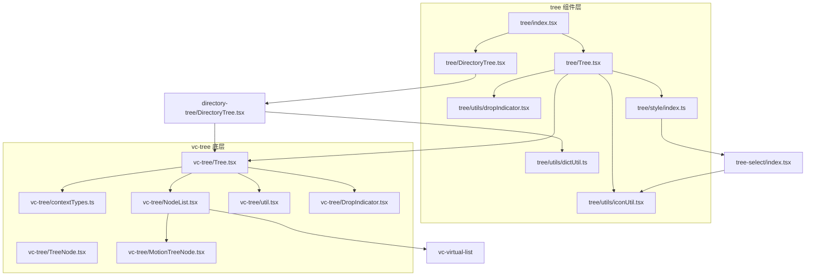
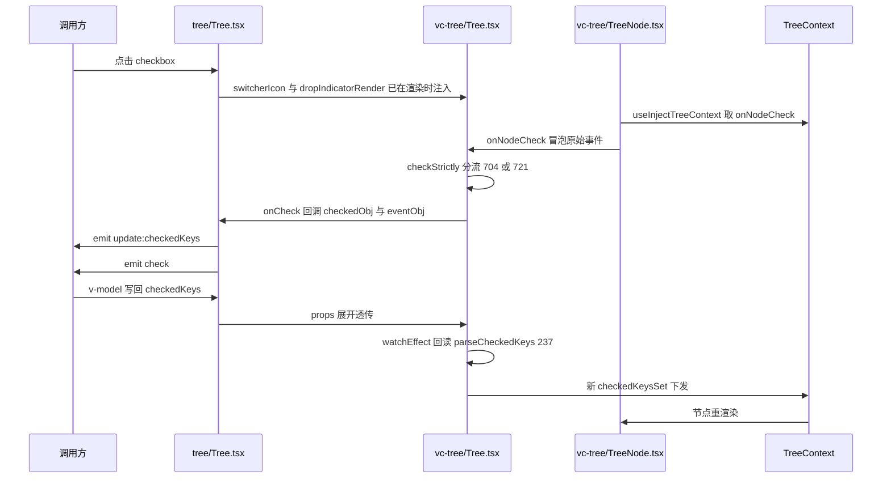
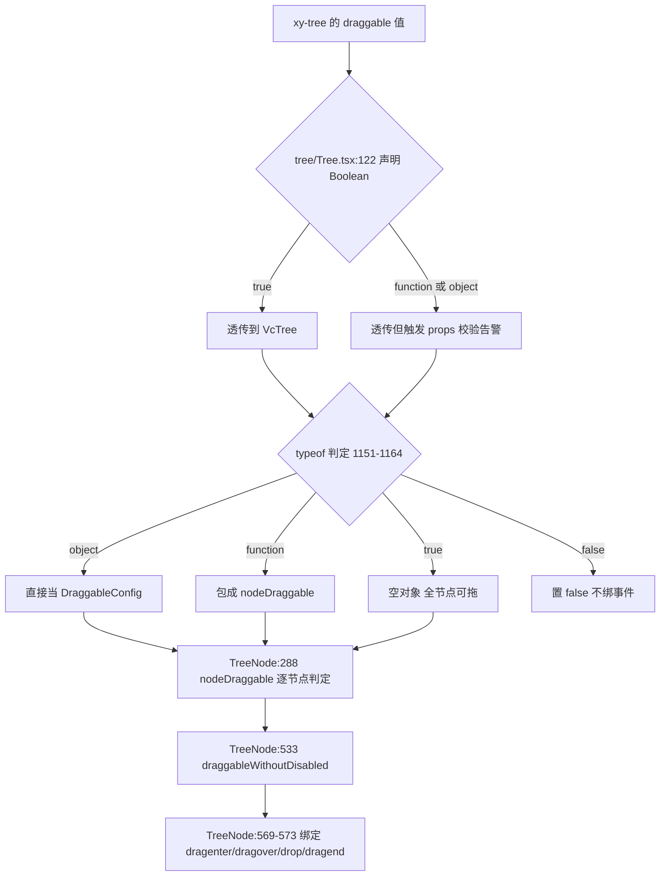
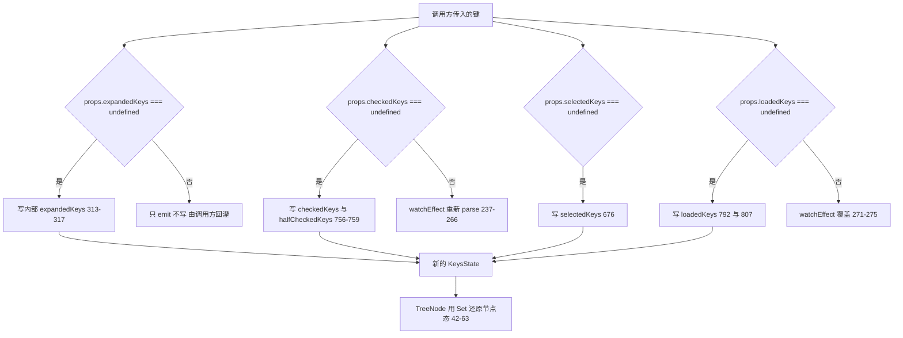

# C09-01 Tree 树形控件

> **本篇解决**：`src/tree/` 组件层到底在 `vc-tree` 之上补了哪些能力（Draggable、Directory、checkStrictly、异步 loadData、虚拟滚动接线），以及这些能力各自的装配点在哪个文件哪一行。
> **前置**：C09-00《类横写：树数据的三种可视化形态》　**读者坐标**：`03-components/09-tree` 第 2/3 篇

## 一、职责与边界

`packages/xiaoye-ui/src/tree/` 一共只有 8 个文件、1004 行，其中主实现 `Tree.tsx` 只有 277 行；而它下面的 `packages/xiaoye-ui/src/vc-tree/` 有 15 个文件、3985 行，单是 `vc-tree/Tree.tsx` 就 1250 行。这个 1∶4 的体量差就是本篇的主题：**组件层几乎不实现树，它实现的是「把 `vc-tree` 装成 `xy-tree`」这件事**——属性表合并、默认值补齐、三个渲染器注入（switcher 图标、拖拽指示线、checkbox 占位）、v-model 三对事件的二次派发、实例方法的转发，以及把 ConfigProvider 的 `virtual`/`direction`/`prefixCls` 接进来。

本篇负责回答：

- 一个 prop 从 `<xy-tree>` 写到 `<VcTree>`，中间被谁改过形状（`showLine`、`fieldNames`、`itemHeight`、`motion`、`switcherIcon`）。
- `draggable`、`checkStrictly`、`loadData` 三个能力各自的**装配点**在哪个文件的哪一行，为什么在 `tree/` 里 grep 不到它们的逻辑。
- 组件层暴露给调用方的实例契约（`expose`）与 `vc-tree` 内部状态之间是什么映射关系。

本篇**不负责**（C09-00《类横写：树数据的三种可视化形态》已论证，此处不重复展开）：树数据规范化 `convertDataToEntities` / `fillFieldNames` 的实现细节、`conductCheck` 的算法与它丢弃树外 key 的行为、展开态与选中态的多种表示法。这些结论本篇直接引用。同理，`DirectoryTree` 的真实现在 `packages/xiaoye-ui/src/directory-tree/`（C09-02 主题），`vc-virtual-list` 的虚拟化策略是 I08 主题，本篇只讲 `tree/` 如何把它们接线。

依赖清单（本篇范围内被引用/引用他人的事实）：

| 关系 | 证据 |
| --- | --- |
| 组件层唯一渲染的实体是 `VcTree` | `packages/xiaoye-ui/src/tree/Tree.tsx:4`、`:242` |
| 组件层的 props 表以 `vc-tree` 的 props 表为基 | `packages/xiaoye-ui/src/tree/Tree.tsx:10`、`:88-91` |
| `tree/` 的类型被 `tree-select`、`table`、`vc-tree-select` 反向消费 | `packages/xiaoye-ui/src/tree-select/index.tsx:20-21`、`:27`、`packages/xiaoye-ui/src/table/hooks/useSelection.tsx:2`、`packages/xiaoye-ui/src/vc-tree-select/LegacyContext.tsx:8` |
| `tree/style` 的 `genTreeStyle` 被 `tree-select` 整份复用 | `packages/xiaoye-ui/src/tree-select/style/index.tsx:5`、`:27` |
| `tree/utils/dictUtil.ts` 只被 `directory-tree` 消费 | `packages/xiaoye-ui/src/directory-tree/DirectoryTree.tsx:16` |
| `tree/DirectoryTree.tsx` 是 7 行 re-export 垫片 | `packages/xiaoye-ui/src/tree/DirectoryTree.tsx:1-7` |
| 底层 `vc-tree/index.ts` 自述基线为上游 rc-tree 5.6.3（上游实现，非本库现状） | `packages/xiaoye-ui/src/vc-tree/index.ts:1` |

## 二、源码地图

组件层（`packages/xiaoye-ui/src/tree/`，8 个文件 / 1051 行含测试）：

| 文件 | 行数 | 职责 | 关键锚点 |
| --- | --- | --- | --- |
| `tree/index.tsx` | 41 | 入口、子组件挂载、全局注册 | `TreeNode` 直接取 vc 实现 `:28`；`Object.assign` 挂静态属性与 `install` `:32-41` |
| `tree/Tree.tsx` | 277 | 装配层主实现（本篇主文件） | props 表 `:88-140`；`defineComponent` `:144`；`expose` `:177-189`；渲染函数 `:211-275` |
| `tree/DirectoryTree.tsx` | 7 | 纯 re-export 垫片 | `:5-7` 三行全部指向 `directory-tree/DirectoryTree` |
| `tree/utils/iconUtil.tsx` | 67 | switcher 图标的唯一决策点 | `renderSwitcherIcon` `:16-67`；`showLeafIcon` 解码 `:28-31`；叶子早退 `:34-46` |
| `tree/utils/dropIndicator.tsx` | 33 | 产品化拖拽指示线 | `offset = 4` `:3`；RTL 左右互换 `:13-18`；带 class 的 div `:32` |
| `tree/utils/dictUtil.ts` | 100 | 目录树 range 选择计算 | `calcRangeKeys` `:26-81`；`convertDirectoryKeysToNodes` `:83-100`；私有 `traverseNodesKey` `:9-23` |
| `tree/util.test.js` | 45 | **仅**测 `calcRangeKeys` | `:1` 只 import `./utils/dictUtil` |
| `tree/style/index.ts` | 479 | Tree + Directory 两套视觉的样式源 | 导出 hook `:473-479`；`genTreeStyle` `:450-470`；`genBaseStyle` `:65`；`genDirectoryStyle` `:372` |

底层（`packages/xiaoye-ui/src/vc-tree/`，15 个文件 / 3985 行；规范化与 conduct 系列归 C09-00）：

| 文件 | 行数 | 职责 | 关键锚点 |
| --- | --- | --- | --- |
| `vc-tree/Tree.tsx` | 1250 | 全部状态机：展开/选中/勾选/加载/拖拽 | 组件头 `:53-76`；`dragState` `:89-106`；`onNodeDragEnter` `:384`；`onNodeCheck` `:691`；`onNodeLoad` `:767`；`draggable` 归一 `:1151-1164`；`TreeContext` 装配 `:1166-1209` |
| `vc-tree/TreeNode.tsx` | 587 | 单节点 DOM 与 `loadData` 触发 | `name: 'XYTreeNode'` `:28`；`isLeaf` `:86-96`；`isDraggable` `:288-289`；`syncLoadData` `:315-340`；root 类名与事件绑定 `:533-573` |
| `vc-tree/NodeList.tsx` | 304 | `vc-virtual-list` 接线 + 展开动画过渡 | `VirtualList` 导入 `:6`；`getMinimumRangeTransitionRange` `:64-74`；`getIndentWidth` `:108` |
| `vc-tree/MotionTreeNode.tsx` | 124 | appear/leave 动效容器 | `:20`、`onAfterAppear/onAfterLeave` `:79-81` |
| `vc-tree/props.ts` | 255 | props 基表 | `treeProps` `:114`；`draggable` `:134`；`checkedKeys` `:141-143`；被注释的 `loadingKeys` `:77` |
| `vc-tree/contextTypes.ts` | 150 | provide/inject 通道定义 | `TreeContextKey` `:91`、`TreeContext` 组件 `:93`、`KeysStateKey` `:129` |
| `vc-tree/DropIndicator.tsx` | 34 | vc 兜底指示线（调试级样式） | `backgroundColor: 'red'` `:16`；无 class 的 div `:33` |
| `vc-tree/util.tsx` | 354 | `calcDropPosition` 等拖拽几何 | 见论点 2 定位 |
| `vc-tree/index.ts` | 8 | 底层入口 | `:1` 自述「base rc-tree 5.6.3」（上游基线声明，非本库现状） |

主实现入口：`packages/xiaoye-ui/src/tree/Tree.tsx:144`（`defineComponent`）到 `:242`（`<VcTree>`）。

## 三、架构与数据流

图 1 是静态结构：`tree/` 的 8 个文件里，只有 `Tree.tsx` 与 `iconUtil.tsx`、`dropIndicator.tsx` 会在运行时被 `<xy-tree>` 走到；`dictUtil.ts` 与 `DirectoryTree.tsx` 属于「住在 tree 目录、服务别的组件」的住户。



`VCDROP` 是 `vc-tree` 自己的默认指示线（`vc-tree/Tree.tsx:74` 把 `dropIndicatorRender` 的默认值设为它），但组件层在 `tree/Tree.tsx:241` 无条件覆写为 `tree/utils/dropIndicator.tsx` 的实现，所以实际渲染路径里 `VCDROP` 只有在**直接使用 `VcTree`** 时才会出现。`DICT` 与 `ICON` 的箭头方向也值得注意：`dictUtil.ts` 住在 `tree/` 下（`tree/utils/dictUtil.ts:26`），但它的唯一消费者是 `directory-tree`（`directory-tree/DirectoryTree.tsx:16`）；反过来 `iconUtil.tsx` 同时被 `Tree.tsx:13` 和 `tree-select/index.tsx:21` 使用——**目录归属和真实依赖方向在 tree 这里是不一致的**，这是「先有 ant-design-vue 目录结构、后拆 directory-tree 组件」留下的形状。

图 2 是一次勾选的完整闭环，覆盖组件层与底层之间每一次往返：



这条链上有两个细节只能从图上看出：**（a）** `update:checkedKeys` 与 `check` 是同一次点击的两个 emit，参数完全相同（`packages/xiaoye-ui/src/tree/Tree.tsx:199-202`），而且那个数组/对象既是 emit 载荷又是底层内部状态——`arrAdd`/`arrDel` 返回的是克隆数组（`packages/xiaoye-ui/src/vc-tree/util.tsx:22`、`:31`），同一个引用先赋给 `checkedKeys.value`（`packages/xiaoye-ui/src/vc-tree/Tree.tsx:717`、`:757`）再被 emit（`:709`、`:742`），所以调用方在 `@check` 里原地 `push`/`splice` 会直接改写内部状态；**（b）** 受控写回不是「事件 → ref」的直连，而是走 `packages/xiaoye-ui/src/vc-tree/Tree.tsx:233-266` 的 `watchEffect` 重新算一遍，非严格模式在这一步会再跑一次 `conductCheck`（`:254`）——C09-00 已论证这是全库唯一一份 `conductCheck`，本篇只强调它在这里被**第二次**调用（一次在 `:721` 点击时，一次在 `:254` 受控回读时）。

图 3 是 `draggable` 的归一与消费分支，论点 2 展开：



图 3 里 `B` 那个判定是本篇的第一个关键结论：`tree/Tree.tsx:122` 用 `booleanType()` 覆盖了从 `vc-tree/props.ts:134` 继承来的 `[Function, Boolean]`，而 `D` 的四个分支承认三种输入形态。也就是说**底层比组件层宽，声明比实现窄**，object 分支（`vc-tree/Tree.tsx:1153`）在 `<xy-tree>` 上无法被合法触达。

## 四、核心机制精读

### 论点 1：`tree/Tree.tsx` 的全部业务是「改名 + 补默认值 + 注入三个渲染器 + 二次 emit」，其余 props 一律整体透传

`packages/xiaoye-ui/src/tree/Tree.tsx:211-245`：

```tsx
// packages/xiaoye-ui/src/tree/Tree.tsx:211
    return () => {
      const {
        showIcon,
        showLine,
        switcherIcon = slots.switcherIcon,
        icon = slots.icon,
        blockNode,
        checkable,
        selectable,
        fieldNames = props.replaceFields,
        motion = props.openAnimation,
        itemHeight = 28,
        onDoubleclick,
        onDblclick,
      } = props as TreeProps;
      const newProps = {
        ...attrs,
        ...omit(props, [
          'onUpdate:checkedKeys',
          'onUpdate:expandedKeys',
          'onUpdate:selectedKeys',
          'onDoubleclick',
        ]),
        showLine: Boolean(showLine),
        dropIndicatorRender,
        fieldNames,
        icon,
        itemHeight,
      };
```

逐段看：

1. `:212-225` 的这个解构**不是取业务参数，而是一张「重命名表」**。`switcherIcon = slots.switcherIcon`（`:215`）与 `icon = slots.icon`（`:216`）把插槽当作 props 的兜底值；`fieldNames = props.replaceFields`（`:220`）把已废弃的 `replaceFields` 折叠进 `fieldNames`，同时 `:191-197` 的 `watchEffect` 用 `devWarning` 提示废弃；`motion = props.openAnimation`（`:221`）给 v2 时代的动画名留了同一个后门；`itemHeight = 28`（`:222`）则是**唯一一处写死的数值**——它给虚拟滚动定了行高，下面 §七 坑 1 会说明它为什么危险。
2. `:226-233` 的 `newProps` 先铺 `attrs` 再铺 `omit(props, …)`：`tree/Tree.tsx:147` 声明了 `inheritAttrs: false`，所以调用方写的任何非声明属性（`id`、`data-*`、`aria-*`）都会落进 `attrs` 并被带到 `VcTree`；被 `omit` 掉的四项是**只属于组件层的 v-model 通道**，`vc-tree` 没有对应的 emit 名，透传下去只会被当成未知 prop。
3. `:234` `showLine: Boolean(showLine)`：对象形态在传给底层前被压成布尔值。底层因此只会按布尔决定 `-show-line` 类名（`packages/xiaoye-ui/src/vc-tree/Tree.tsx:1214`），`showLeafIcon` 的语义被**截留在组件层**，见论点 3。
4. `:235` `dropIndicatorRender` 是无条件覆盖。它来自 `import dropIndicatorRender from './utils/dropIndicator'`（`:14`），把底层默认的红色调试线（`packages/xiaoye-ui/src/vc-tree/DropIndicator.tsx:16` `backgroundColor: 'red'`、`:33` 返回无 class 的 `<div style={style} />`）换成带 `xy-tree-drop-indicator` 类、由 token 驱动的线（`packages/xiaoye-ui/src/tree/utils/dropIndicator.tsx:32` + `packages/xiaoye-ui/src/tree/style/index.ts:33-55`）。
5. `:236-238` 三行把重命名的结果写回 `newProps`，注意 `fieldNames`/`icon`/`itemHeight` 在 `omit(props, …)` 里已经以原值出现一次，这里靠对象字面量后写覆盖前写来生效——**组件层没有任何「合并策略」，靠的是 JS 的键序**。

再看渲染侧的注入（`packages/xiaoye-ui/src/tree/Tree.tsx:247-279`）：

```tsx
// packages/xiaoye-ui/src/tree/Tree.tsx:247
      return wrapSSR(
        <VcTree
          {...newProps}
          virtual={virtual.value}
          motion={motion}
          ref={treeRef}
          prefixCls={prefixCls.value}
          class={classNames(
            {
              [`${prefixCls.value}-icon-hide`]: !showIcon,
              [`${prefixCls.value}-block-node`]: blockNode,
              [`${prefixCls.value}-unselectable`]: !selectable,
              [`${prefixCls.value}-rtl`]: direction.value === 'rtl',
            },
            attrs.class,
            hashId.value,
          )}
          direction={direction.value}
          checkable={checkable}
          selectable={selectable}
          switcherIcon={(nodeProps: SwitcherIconProps) =>
            renderSwitcherIcon(prefixCls.value, switcherIcon, nodeProps, slots.leafIcon, showLine)
          }
          onCheck={handleCheck}
          onExpand={handleExpand}
          onSelect={handleSelect}
          onDblclick={onDblclick || onDoubleclick}
          v-slots={{
            ...slots,
            checkable: () => <span class={`${prefixCls.value}-checkbox-inner`} />,
          }}
          children={children}
        ></VcTree>,
      );
```

`:261-263` 是**第四个注入点**：不管调用方给 `switcherIcon` 的是字符串、组件还是函数，`VcTree` 收到的永远是一个箭头函数——把「用户想画的图标」这件事从底层夺到组件层。`:268-271` 更极端，`v-slots` 里用 `checkable` 键塞了一个固定 `<span class="xy-tree-checkbox-inner">`，对应底层 `packages/xiaoye-ui/src/vc-tree/Tree.tsx:1176` 的 `customCheckable: slots.checkable`，即**组件层用「占位插槽」把 checkbox 的外观决定权也从底层拿走**（真实的 checkbox 结构与样式来自 `packages/xiaoye-ui/src/tree/style/index.ts:475` 的 `getCheckboxStyle(`${prefixCls}-checkbox`, token)`）。

结论回扣：`tree/Tree.tsx` 里搜不到任何树的算法（没有 `conductCheck`、没有 `calcDropPosition`、没有 `expandedKeys` 的 setter），它只提供 4 类装配——重命名（`:212-225`）、默认值（`:222`、`:148-153`）、渲染器注入（`:235`、`:261-263`、`:268-271`）、事件二次派发（`:199-210`）。判断「这个 bug 该在哪层修」时，这条边界就是答案：**只要现象和图标、指示线、checkbox 外观、v-model 通道、行高有关，改 `tree/`；有关状态流转，一律改 `vc-tree/`**。

### 论点 2：`draggable` 被组件层逐级收窄成布尔值，底层 `DraggableConfig` 的 object/function 形态在 `<xy-tree>` 上没有合法入口

`packages/xiaoye-ui/src/tree/Tree.tsx:120-126`：

```tsx
// packages/xiaoye-ui/src/tree/Tree.tsx:121
    loadedKeys: arrayType<Key[]>(),
    draggable: booleanType(),
    showIcon: booleanType(),
    icon: functionType<(nodeProps: XyTreeNodeAttribute) => any>(),
    switcherIcon: PropTypes.any,
    prefixCls: String,
```

`booleanType` 的定义是 `packages/xiaoye-ui/src/_util/type.ts:58-60`：

```ts
// packages/xiaoye-ui/src/_util/type.ts:58
export function booleanType(defaultVal?: boolean) {
  return { type: Boolean, default: defaultVal as boolean };
}
```

而 `treeProps()` 在 `:88-91` 先展开 `vcTreeProps()` 再补自己的键，所以 `draggable` 这一行**覆盖**了底层的声明：

`packages/xiaoye-ui/src/vc-tree/props.ts:112-134`（截取）：

```ts
// packages/xiaoye-ui/src/vc-tree/props.ts:112
export type DraggableFn = (node: DataNode) => boolean;
export type ExpandAction = false | 'click' | 'doubleclick' | 'dblclick';
export const treeProps = () => ({
  // ...
  draggable: { type: [Function, Boolean] as PropType<DraggableFn | boolean> },
```

底层的归一逻辑承认三种形态，`packages/xiaoye-ui/src/vc-tree/Tree.tsx:1150-1164`：

```tsx
// packages/xiaoye-ui/src/vc-tree/Tree.tsx:1150
      // It's better move to hooks but we just simply keep here
      let draggableConfig: DraggableConfig | false;
      if (draggable) {
        if (typeof draggable === 'object') {
          draggableConfig = draggable;
        } else if (typeof draggable === 'function') {
          draggableConfig = {
            nodeDraggable: draggable,
          };
        } else {
          draggableConfig = {};
        }
      } else {
        draggableConfig = false;
      }
```

`DraggableConfig` 的形状在 `packages/xiaoye-ui/src/vc-tree/Tree.tsx:48-51`：

```ts
// packages/xiaoye-ui/src/vc-tree/Tree.tsx:48
export type DraggableConfig = {
  icon?: any;
  nodeDraggable?: DraggableFn;
};
```

两个消费者分别读取这两个字段，`packages/xiaoye-ui/src/vc-tree/TreeNode.tsx:286-298`：

```tsx
// packages/xiaoye-ui/src/vc-tree/TreeNode.tsx:286
    const isDraggable = () => {
      const { data } = props;
      const { draggable } = context.value;
      return !!(draggable && (!draggable.nodeDraggable || draggable.nodeDraggable(data)));
    };

    // ==================== Render: Drag Handler ====================
    const renderDragHandler = () => {
      const { draggable, prefixCls } = context.value;
      return draggable && draggable?.icon ? (
        <span class={`${prefixCls}-draggable-icon`}>{draggable.icon}</span>
      ) : null;
    };
```

`renderDragHandler()` 在节点根 div 里被调用（`packages/xiaoye-ui/src/vc-tree/TreeNode.tsx:579`），配套的样式是 `packages/xiaoye-ui/src/tree/style/index.ts:198-200`（默认 `visibility: 'hidden'`）与 `:164-183`（节点带 `-draggable` 类时 `opacity: 0.2`，hover 到 `0.45`，禁用节点再隐藏）。

逐段解释这条收窄链的后果：

- **类型面**：`TreeProps`（`packages/xiaoye-ui/src/tree/Tree.tsx:142`，`Partial<ExtractPropTypes<ReturnType<typeof treeProps>>>`）里 `draggable` 是 `boolean | undefined`，写 `:draggable="{ nodeDraggable: fn }"` 在 `pnpm typecheck` 下不成立。
- **运行时面**：即便绕过类型，Vue 的 props 校验按 `tree/Tree.tsx:122` 的 `type: Boolean` 判定，传函数/对象会在开发环境产生一次类型不匹配告警，但值本身仍会透传——`newProps` 是 `...omit(props, [...])` 的键序覆盖（`:226-239`），不做任何形状转换，因此功能可用、只是「不合法」。
- **消费面**：全仓库没有任何调用点用到 object/function 形态。可复现的检索是 `grep -rn "draggable" packages/xiaoye-ui/src/tree apps/docs/examples/tree`，命中只有 `tree/Tree.tsx:122` 的声明与 `apps/docs/examples/tree/draggable.vue:4` 的裸属性 `draggable`；手册的 Props 表也把 `draggable` 的类型写成 boolean（见 `apps/docs/components/tree.md`）。于是 `icon` 字段（拖拽把手图标）与 `nodeDraggable`（逐节点决定是否可拖）这两条能力，**从产品 API 上是够不到的，只有直接用 `VcTree` 才能触发**。
- **实现面**：`nodeDraggable` 只看 `data`，即整棵树的判定函数拿到的是原始 `DataNode`，而组件层没有任何地方把 `XyTreeNodeAttribute`（`tree/Tree.tsx:24-42`）转换给它。

结论回扣：`draggable` 是「`vc-*` 分层」这个架构的教科书式样本——**能力在底层实现，宽度在组件层收窄，两者不同步就形成沉默的 API 空洞**。要开放「拖拽把手图标」或「部分节点不可拖」，改动点不是 `vc-tree`，而是 `tree/Tree.tsx:122` 这一行（把它换成 `someType<boolean | DraggableFn | DraggableConfig>([Boolean, Function, Object])`），并且要顺带处理 `vc-tree/props.ts:134` 里缺失的 `Object` 类型项。

### 论点 3：`showLine` 的对象形态只在组件层被解释，叶子图标的四条分支全在 `iconUtil.tsx`，且自定义 `switcherIcon` 对叶子节点无效

组件层把对象压平（`packages/xiaoye-ui/src/tree/Tree.tsx:240`）后再传给底层，底层只认布尔：`packages/xiaoye-ui/src/vc-tree/Tree.tsx:1211-1217`

```tsx
// packages/xiaoye-ui/src/vc-tree/Tree.tsx:1211
          <div
            role="tree"
            class={classNames(prefixCls, className, rootClassName, {
              [`${prefixCls}-show-line`]: showLine,
              [`${prefixCls}-focused`]: focused.value,
              [`${prefixCls}-active-focused`]: activeKey.value !== null,
            })}
```

真正读 `showLeafIcon` 的是 `packages/xiaoye-ui/src/tree/utils/iconUtil.tsx:23-46`：

```tsx
// packages/xiaoye-ui/src/tree/utils/iconUtil.tsx:23
  const { isLeaf, expanded, loading } = props;
  let icon = switcherIcon;
  if (loading) {
    return <LoadingOutlined class={`${prefixCls}-switcher-loading-icon`} />;
  }
  let showLeafIcon: boolean;
  if (showLine && typeof showLine === 'object') {
    showLeafIcon = showLine.showLeafIcon;
  }
  let defaultIcon = null;
  const switcherCls = `${prefixCls}-switcher-icon`;
  if (isLeaf) {
    if (!showLine) {
      return null;
    }
    if (showLeafIcon && leafIcon) {
      return leafIcon(props);
    }
    if (typeof showLine === 'object' && !showLeafIcon) {
      defaultIcon = <span class={`${prefixCls}-switcher-leaf-line`} />;
    } else {
      defaultIcon = <FileOutlined class={`${prefixCls}-switcher-line-icon`} />;
    }
    return defaultIcon;
```

这段的四个出口必须按顺序读，因为**后面的分支永远看不到被前面 `return` 掉的输入**：

| 输入 | 结果 | 证据 |
| --- | --- | --- |
| `loading` 为真 | `LoadingOutlined`，`switcherIcon` 被完全忽略 | `tree/utils/iconUtil.tsx:25-27` |
| 叶子 + `showLine` 为假 | `null`（不画 switcher 图标） | `:34-37` |
| 叶子 + `showLine={{showLeafIcon:true}}` + 有 `leafIcon` 插槽 | 调用 `leafIcon(props)` | `:38-40` |
| 叶子 + `showLine={{showLeafIcon:false}}` | 空 `<span class="xy-tree-switcher-leaf-line">` | `:41-42` |
| 叶子 + `showLine === true` | `FileOutlined` | `:43-45`（`showLeafIcon` 在布尔入参下从未赋值，保持 `undefined`，故 `:41` 的 `typeof showLine === 'object'` 为假） |

`showLeafIcon` 在 `:28` 声明时**没有初始值**（`let showLeafIcon: boolean;`），所以「`showLine` 传布尔 true」和「传 `{showLeafIcon: true}`」在叶子上的表现不同：前者走 `FileOutlined`，后者才吃 `leafIcon` 插槽。这是组件层独有的语义，底层完全不知道。

`showLine` 对应的视觉由两处样式承担：`packages/xiaoye-ui/src/tree/style/index.ts:322-354`（`-show-line` 下给 `-indent-unit` 画 `::before` 竖线、给 `-switcher-line-icon` 调 `verticalAlign`）与 `:231-247`（`-switcher-leaf-line` 自己的 `::before`），再加 `:356-366` 用 `-treenode-leaf-last` 修掉最后一个叶子的下线；`-treenode-leaf-last` 这个类由 `packages/xiaoye-ui/src/vc-tree/TreeNode.tsx:548` 打上。

后半段 `packages/xiaoye-ui/src/tree/utils/iconUtil.tsx:47-66`：

```tsx
// packages/xiaoye-ui/src/tree/utils/iconUtil.tsx:47
  } else {
    defaultIcon = <CaretDownFilled class={switcherCls} />;
    if (showLine) {
      defaultIcon = expanded ? (
        <MinusSquareOutlined class={`${prefixCls}-switcher-line-icon`} />
      ) : (
        <PlusSquareOutlined class={`${prefixCls}-switcher-line-icon`} />
      );
    }
  }

  if (typeof switcherIcon === 'function') {
    icon = switcherIcon({ ...props, defaultIcon, switcherCls });
  } else if (isValidElement(icon)) {
    icon = cloneVNode(icon, {
      class: switcherCls,
    });
  }

  return icon || defaultIcon;
```

三个要点：

1. **函数形态的 `switcherIcon` 会收到 `defaultIcon`**（`:58-59`），这是「保留库内图标再包一层」的逃生口；VNode 形态则被 `cloneVNode` 强塞 `xy-tree-switcher-icon` 类（`:60-63`），这个类正是 `:21-29` 的 `getSwitchStyle` 里 `fontSize: 10` + `svg` 旋转动画的宿主。
2. **非叶子才会走到 `:58-64`**。叶子在 `:46` 就 `return defaultIcon` 了，因此 `showLine` 打开时，用户传的 `switcherIcon` 对叶子节点一律不起作用——它只对分支节点生效。本库恰好有一个同时开了两者的示例（`apps/docs/examples/tree/switcher-icon.vue:5` 的 `show-line` 与 `:8` 的 `#switcherIcon`），它呈现的就是这个不对称：分支图标被替换（该插槽还收到底层给的 `switcherCls`，对应 `iconUtil.tsx:59` 的入参扩展），叶子仍是 `FileOutlined` 或空线。
3. `:23` 从 `props` 里取的是**底层传上来的节点态**（`expanded`/`loading`/`isLeaf`），来源是 `packages/xiaoye-ui/src/vc-tree/TreeNode.tsx:133-150` 的 `renderArgsData`；调用链是 `Tree.tsx:261-263` 注入的箭头函数 → 底层 `packages/xiaoye-ui/src/vc-tree/TreeNode.tsx:305-312` 的 `switcherIconFromCtx` → `typeof switcherIcon === 'function'` 才执行。注意 `:307` 的优先级 `switcherIconFromProps || switcherIconFromCtx`：**per-node 的 `switcherIcon` 会整棵树的被覆盖掉**，而 `treeData` API 无法给单节点传 `switcherIcon`（`tree/Tree.tsx:125` 的 `switcherIcon: PropTypes.any` 是树级的），只有走 `<xy-tree-node>` 的子节点写法才行——这条在 §五 讨论 slot 路径时再落一次。

`isLeaf` 的判定不在组件层，`packages/xiaoye-ui/src/vc-tree/TreeNode.tsx:86-97`：

```tsx
// packages/xiaoye-ui/src/vc-tree/TreeNode.tsx:86
    const isLeaf = computed(() => {
      const { isLeaf } = props;
      const { loadData } = context.value;

      const has = hasChildren.value;

      if (isLeaf === false) {
        return false;
      }

      return isLeaf || (!loadData && !has) || (loadData && loaded.value && !has);
    });
```

它把「是否叶子」和「是否配了 `loadData`」绑在一起：**没有 `loadData` 时，无 children 就是叶子；有 `loadData` 时，必须 `loaded` 且仍无 children 才算叶子**。这条式子同时决定了 `iconUtil` 走哪条图标分支和 `syncLoadData` 会不会被触发（论点 4），是两层之间最紧的一处隐式契约。

### 论点 4：异步 `loadData` 的装配点在 `vc-tree/TreeNode.tsx` 的生命周期钩子里，不在 `Tree` 也不在组件层；`loadingKeys` 根本没有对外入口

组件层关于加载只写了三行：`packages/xiaoye-ui/src/tree/Tree.tsx:121`（`loadedKeys: arrayType<Key[]>()`）与 `packages/xiaoye-ui/src/tree/Tree.tsx:186-187`：

```ts
// packages/xiaoye-ui/src/tree/Tree.tsx:186
      loadedKeys: computed(() => treeRef.value?.loadedKeys),
      loadingKeys: computed(() => treeRef.value?.loadingKeys),
```

`loadData` 本身是从 `vcTreeProps()` 继承来的（`packages/xiaoye-ui/src/vc-tree/props.ts:208`）：

```ts
// packages/xiaoye-ui/src/vc-tree/props.ts:208
  loadData: { type: Function as PropType<(treeNode: EventDataNode) => Promise<any>> },
```

触发者是节点自己，`packages/xiaoye-ui/src/vc-tree/TreeNode.tsx:315-340`：

```tsx
// packages/xiaoye-ui/src/vc-tree/TreeNode.tsx:315
    // Load data to avoid default expanded tree without data
    const syncLoadData = () => {
      //const { expanded, loading, loaded } = props;
      const { loadData, onNodeLoad } = context.value;

      if (loading.value) {
        return;
      }

      // read from state to avoid loadData at same time
      if (loadData && expanded.value && !isLeaf.value) {
        // We needn't reload data when has children in sync logic
        // It's only needed in node expanded
        if (!hasChildren.value && !loaded.value) {
          onNodeLoad(eventData.value);
        }
      }
    };

    onMounted(() => {
      syncLoadData();
    });
    onUpdated(() => {
      // fix: sync load data on update
      syncLoadData();
    });
```

**这里没有 `watch(expanded, …)`**。加载是靠 `onMounted`/`onUpdated` 两个生命周期回调「顺路」检查出来的（`:334-340`），注释 `:338` 的 `fix:` 说明这条补挂是后补的。后果是：**加载时机与渲染时机绑定**——判定条件是四重与（`:320` 不在 loading、`:325` 有 loadData 且已展开且非叶子、`:328` 无 children 且未 loaded），只有当该节点组件发生挂载或更新时才会检查一次。常规交互里 `expanded` 变化必然带来该节点的重渲染，所以看起来像 watcher；但在虚拟滚动下 `NodeList` 只把可视区的 flatten 节点交给 `VirtualList` 渲染（`packages/xiaoye-ui/src/vc-tree/NodeList.tsx:248-250`、默认插槽产出 `MotionTreeNode` `:267-297`），**尚未挂载的节点不会被提前懒加载，要等它进入视口挂载的那一刻才发请求**。

请求本身在 `packages/xiaoye-ui/src/vc-tree/Tree.tsx:767-795`：

```tsx
// packages/xiaoye-ui/src/vc-tree/Tree.tsx:767
    const onNodeLoad = (treeNode: EventDataNode) => {
      const key = treeNode[fieldNames.value.key];
      const loadPromise = new Promise<void>((resolve, reject) => {
        // We need to get the latest state of loading/loaded keys
        const { loadData, onLoad } = props;

        if (!loadData || loadedKeysSet.value.has(key) || loadingKeysSet.value.has(key)) {
          return null;
        }

        // Process load data
        const promise = loadData(treeNode);
        promise
          .then(() => {
            const newLoadedKeys = arrAdd(loadedKeys.value, key);
            const newLoadingKeys = arrDel(loadingKeys.value, key);

            // onLoad should trigger before internal setState to avoid `loadData` trigger twice.
            if (onLoad) {
              onLoad(newLoadedKeys, {
                event: 'load',
                node: treeNode,
              });
            }

            if (props.loadedKeys === undefined) {
              loadedKeys.value = newLoadedKeys;
            }
            loadingKeys.value = newLoadingKeys;
```

去重靠两个 `Set` 的 membership（`:773`），而不是 promise 缓存；`loadingKeys.value = arrAdd(...)` 在构造器末尾同步写入（`:816`），保证下一个 tick 之前 `loadingKeysSet` 已经包含该 key，从而 `:773` 拦住并发重复请求。`onLoad` 先于内部状态写入触发（`:785-795`），注释 `:784` 明确说了这是为了避免 `loadData` 被触发两次。

失败分支是关键，`packages/xiaoye-ui/src/vc-tree/Tree.tsx:798-814`：

```tsx
// packages/xiaoye-ui/src/vc-tree/Tree.tsx:798
          .catch(e => {
            const newLoadingKeys = arrDel(loadingKeys.value, key);
            loadingKeys.value = newLoadingKeys;

            // If exceed max retry times, we give up retry
            loadingRetryTimes[key] = (loadingRetryTimes[key] || 0) + 1;
            if (loadingRetryTimes[key] >= MAX_RETRY_TIMES) {
              warning(false, 'Retry for `loadData` many times but still failed. No more retry.');
              const newLoadedKeys = arrAdd(loadedKeys.value, key);
              if (props.loadedKeys === undefined) {
                loadedKeys.value = newLoadedKeys;
              }
              resolve();
            }

            reject(e);
          });
```

`MAX_RETRY_TIMES = 10`（`packages/xiaoye-ui/src/vc-tree/Tree.tsx:46`）、计数器 `loadingRetryTimes` 是普通对象而非响应式（`:88`）。这段有四个可核对的行为：

1. 每次 reject 都会把该 key 的失败计数 +1，到第 10 次时**把节点标成 loaded**（`:806-809`）并 `resolve()`；此后 `isLeaf` 变成真（`packages/xiaoye-ui/src/vc-tree/TreeNode.tsx:96` 的 `loadData && loaded.value && !has`），节点从此不再可展开。也就是说「一直失败的懒加载节点」最终会被静默降级成一个叶子。
2. 计数达到 10 时先 `resolve()` 再 `reject(e)`（`:810` 与 `:813`），同一个 executor 里第二次 settle 被 JS 忽略，所以对外表现是「resolve」；调用方 `await` 到的是成功。
3. 未达 10 次只 `reject(e)`，而 `:819` 挂了 `loadPromise.catch(() => {})`，注释 `:818` 写「Not care warning if we ignore this」——**未处理的 rejection 被刻意吞掉**，因此调用方在 `loadData` 里 throw 不会在任何地方留下日志（除非自己打）。
4. `loadedKeys` 有受控分支（`:792`、`:807` 都判 `props.loadedKeys === undefined`），`loadingKeys` **没有**。因为 `loadingKeys` 从来不是 prop：`treeProps`（`packages/xiaoye-ui/src/vc-tree/props.ts:114-255`）里没有这个键，`packages/xiaoye-ui/src/vc-tree/props.ts:77` 的那一行是注释状态且属于 `nodeListProps`（`:61-99`）——同一片被注释掉的还有 `expandedKeys`/`selectedKeys`/`checkedKeys`/`halfCheckedKeys`/`keyEntities`（`:73-79`），说明底层刻意让这些状态**不走 props**，而走 `useInjectKeysState()`（`packages/xiaoye-ui/src/vc-tree/TreeNode.tsx:42-49`）注入的 `Set`，再由 `getTreeNodeProps` 还原成节点属性（`:51-63`）。

组件层能给的出口只有 `expose`（`packages/xiaoye-ui/src/tree/Tree.tsx:177-187`），而且是 `computed(() => treeRef.value?.loadedKeys)` 这种只读转发。`loadedKeys` 可控但没有 v-model 通道：组件层只 emit 三对事件（`packages/xiaoye-ui/src/tree/Tree.tsx:200-209`），全仓库 `grep -rn "update:loadedKeys" packages apps`（排除 `dist`）命中为 0——想受控必须自己接 `@load` 回写。

loading 的视觉也分了两处：`packages/xiaoye-ui/src/tree/utils/iconUtil.tsx:25-27` 让 loading 优先于任何 `switcherIcon`，而 `packages/xiaoye-ui/src/vc-tree/TreeNode.tsx:466-467` 有另一条兜底：

```tsx
// packages/xiaoye-ui/src/vc-tree/TreeNode.tsx:466
      } else if (loadData && loading.value) {
        $icon = renderIcon();
```

它的注释在 `:453`（`// Icon - Still show loading icon when loading without showIcon`）。由于组件层默认 `showIcon: false`（`packages/xiaoye-ui/src/tree/Tree.tsx:151`），`<xy-tree>` 的懒加载节点即使没开 `showIcon` 也会出现加载图标——**这条来自底层，不是组件层的决定**。

### 论点 5：`checkStrictly` 改变的是事件的**载荷形状**而不是算法；组件层原样转发，导致 `v-model:checkedKeys` 收到数组或对象两种类型

组件层的声明里，`checkedKeys` 允许两种形状，但更新事件只声明了一种：

```ts
// packages/xiaoye-ui/src/tree/Tree.tsx:111
    /** （受控）选中复选框的树节点 */
    checkedKeys: someType<Key[] | { checked: Key[]; halfChecked: Key[] }>([Array, Object]),
    /** 默认选中复选框的树节点 */
    defaultCheckedKeys: arrayType<Key[]>(),
```

（`packages/xiaoye-ui/src/tree/Tree.tsx:111-114`；`checkStrictly` 的声明在 `packages/xiaoye-ui/src/tree/Tree.tsx:97-98`。）而 `'onUpdate:checkedKeys'` 的类型是 `functionType<(keys: Key[]) => void>()`（`packages/xiaoye-ui/src/tree/Tree.tsx:137`），转发函数不做任何归一（`packages/xiaoye-ui/src/tree/Tree.tsx:199-202`）：

```tsx
// packages/xiaoye-ui/src/tree/Tree.tsx:199
    const handleCheck: TreeProps['onCheck'] = (checkedObjOrKeys, eventObj) => {
      emit('update:checkedKeys', checkedObjOrKeys);
      emit('check', checkedObjOrKeys, eventObj);
    };
```

`checkedObjOrKeys` 的真实类型由底层决定，`packages/xiaoye-ui/src/vc-tree/Tree.tsx:704-718`：

```tsx
// packages/xiaoye-ui/src/vc-tree/Tree.tsx:704
      if (checkStrictly) {
        const newCheckedKeys = checked
          ? arrAdd(checkedKeys.value, key)
          : arrDel(checkedKeys.value, key);
        const newHalfCheckedKeys = arrDel(halfCheckedKeys.value, key);
        checkedObj = { checked: newCheckedKeys, halfChecked: newHalfCheckedKeys };

        eventObj.checkedNodes = newCheckedKeys
          .map(checkedKey => keyEntitiesValue[checkedKey])
          .filter(entity => entity)
          .map(entity => entity.node);

        if (props.checkedKeys === undefined) {
          checkedKeys.value = newCheckedKeys;
        }
      } else {
```

对照非严格分支 `packages/xiaoye-ui/src/vc-tree/Tree.tsx:719-759`（截取）：

```tsx
// packages/xiaoye-ui/src/vc-tree/Tree.tsx:720
        // Always fill first
        let { checkedKeys: newCheckedKeys, halfCheckedKeys: newHalfCheckedKeys } = conductCheck(
          [...checkedKeys.value, key],
          true,
          keyEntitiesValue,
          maxLevel.value,
          levelEntities.value,
        );

        // If remove, we do it again to correction
        if (!checked) {
          const keySet = new Set(newCheckedKeys);
          keySet.delete(key);
          ({ checkedKeys: newCheckedKeys, halfCheckedKeys: newHalfCheckedKeys } = conductCheck(
            Array.from(keySet),
            { checked: false, halfCheckedKeys: newHalfCheckedKeys },
            keyEntitiesValue,
            maxLevel.value,
            levelEntities.value,
          ));
        }

        checkedObj = newCheckedKeys;
```

四条结论：

1. **两种形状**：严格模式 `checkedObj` 是对象（`:709`），非严格是数组（`:742`）。组件层把它同时喂给 `update:checkedKeys` 和 `check`（`tree/Tree.tsx:200-201`），所以开启 `checkStrictly` 后 `v-model:checked-keys` 绑的 ref 会从数组变成对象——`tree/Tree.tsx:137` 的类型声明与此不符，属于「类型比实现窄」的第二例（第一例是论点 2 的 `draggable`）。
2. **非严格点一次要跑两遍 `conductCheck`**：先按「全部勾上」算一遍（`:721-727`），如果本次是取消勾选，再把 key 从结果集里删掉重算一遍（`:730-740`）。`conductCheck` 本身只有一份实现这一事实由 C09-00 论证，本篇只标注这里的**调用次数**，以及 `:725-726` 传入的 `maxLevel.value`/`levelEntities.value` 来自 `useMaxLevel(keyEntities)`（`packages/xiaoye-ui/src/vc-tree/Tree.tsx:231`）。
3. **半选态在严格模式下不会被重算**：非严格分支会写 `halfCheckedKeys.value`（`:758`），严格分支只写 `checkedKeys.value`（`:716-718`），`newHalfCheckedKeys` 只出现在 emit 的载荷里（`:709`）——它等于「上一次的半选集合减去本次点的这个 key」（`:708`）。所以非受控 + `checkStrictly` 时，实例上 `tree/Tree.tsx:185` 暴露的 `halfCheckedKeys` 恒为 `[]`；受控时它来自 `parseCheckedKeys`（`packages/xiaoye-ui/src/vc-tree/util.tsx:298-322`），而**数组形式的 `checkedKeys` 会把 `halfCheckedKeys` 解析成 `undefined`，再在 `packages/xiaoye-ui/src/vc-tree/Tree.tsx:250` 被解构默认值 `= []` 兜住**，于是「受控 + 严格 + 传数组」会让内部半选集合被清空。
4. **受控回读也要过一次分叉**：`packages/xiaoye-ui/src/vc-tree/Tree.tsx:233-266` 的 `watchEffect` 只在 `props.checkable` 为真时运行（`:234`），优先读 `props.checkedKeys`（`:237-238`），其次 `defaultCheckedKeys`（`:239-240`），最后回落到当前内部值（`:241-247`）；只有非严格才会在这里补跑 `conductCheck`（`:253-262`）。这意味着**严格模式下的受控值被逐字接受、不做父子推导**，这正是 `checkStrictly` 的语义所在，但也意味着「切换 `checkStrictly` 而不重新给值」会让半选/全选集合停留在上一种模式的产物上，需要调用方自己重算。

半选的视觉落点是 `packages/xiaoye-ui/src/vc-tree/TreeNode.tsx:544` 的 `${prefixCls}-treenode-checkbox-indeterminate` 类，它由 `halfChecked` 驱动（`packages/xiaoye-ui/src/vc-tree/TreeNode.tsx:70` 的 `eagerComputed`），而不是由组件层控制——组件层只负责在 `tree/Tree.tsx:274-277` 放了一个 `xy-tree-checkbox-inner` 的空占位插槽。

### 论点 6：拖拽的几何量只有一个来源——`NodeList` 里的隐藏测量节点；组件层交出去的 `dropIndicatorRender` 依赖它，但没有任何 props 能保证它非零

指示线的绘制方在组件层，`packages/xiaoye-ui/src/tree/utils/dropIndicator.tsx:12-32`：

```tsx
// packages/xiaoye-ui/src/tree/utils/dropIndicator.tsx:12
  const { dropPosition, dropLevelOffset, prefixCls, indent, direction = 'ltr' } = props;
  const startPosition = direction === 'ltr' ? 'left' : 'right';
  const endPosition = direction === 'ltr' ? 'right' : 'left';
  const style: CSSProperties = {
    [startPosition]: `${-dropLevelOffset * indent + offset}px`,
    [endPosition]: 0,
  };
  switch (dropPosition) {
    case -1:
      style.top = `${-3}px`;
      break;
    case 1:
      style.bottom = `${-3}px`;
      break;
    default:
      // dropPosition === 0
      style.bottom = `${-3}px`;
      style[startPosition] = `${indent + offset}px`;
      break;
  }
  return <div style={style} class={`${prefixCls}-drop-indicator`} />;
```

`offset = 4` 定义在 `packages/xiaoye-ui/src/tree/utils/dropIndicator.tsx:3`，`-3` 是硬编码（`:21`、`:24`、`:28`），对应的样式端在 `packages/xiaoye-ui/src/tree/style/index.ts:43-53` 用 `&:after` 画了个 8px 的空心圆（`top: -3`）。也就是说**线本身和它的端点标记分别用两套坐标，只有 `top/bottom: ±3` 这一处是两边都写死的常数**。

被调用的地方在底层，`packages/xiaoye-ui/src/vc-tree/TreeNode.tsx:406-423`：

```tsx
// packages/xiaoye-ui/src/vc-tree/TreeNode.tsx:406
    const renderDropIndicator = () => {
      const { disabled, eventKey } = props;
      const {
        draggable,
        dropLevelOffset,
        dropPosition,
        prefixCls,
        indent,
        dropIndicatorRender,
        dragOverNodeKey,
        direction,
      } = context.value;
      const rootDraggable = draggable !== false;
      // allowDrop is calculated in Tree.tsx, there is no need for calc it here
      const showIndicator = !disabled && rootDraggable && dragOverNodeKey === eventKey;
      return showIndicator
        ? dropIndicatorRender({ dropPosition, dropLevelOffset, indent, prefixCls, direction })
        : null;
    };
```

`indent` 从 context 来（`:413`），它的写入点只有一处：拖拽开始时回读列表实例，`packages/xiaoye-ui/src/vc-tree/Tree.tsx:367`

```tsx
// packages/xiaoye-ui/src/vc-tree/Tree.tsx:367
      indent.value = listRef.value.getIndentWidth();
```

而 `getIndentWidth` 是 DOM 测量，`packages/xiaoye-ui/src/vc-tree/NodeList.tsx:108`：

```tsx
// packages/xiaoye-ui/src/vc-tree/NodeList.tsx:108
      getIndentWidth: () => indentMeasurerRef.value.offsetWidth,
```

测量节点是那个 `aria-hidden` 的隐藏 div 里的 `xy-tree-indent-unit`（`packages/xiaoye-ui/src/vc-tree/NodeList.tsx:232-246`），它的宽度由样式给：`packages/xiaoye-ui/src/tree/style/index.ts:187-195`（`-indent-unit { width: treeTitleHeight }`，而 `treeTitleHeight = token.controlHeightSM`，见 `:455`）。

这条链上有三个非 props 通道，必须一起看：**测量节点必须已挂载**（`indentMeasurerRef.value.offsetWidth` 没有可选链，`:108`）、**`indent` 只在 `onNodeDragStart` 里赋值一次**（`:367`，拖拽过程中不重算，所以拖拽中改主题宽度不会跟着变）、**`indent` 参与除法**（`packages/xiaoye-ui/src/vc-tree/util.tsx:117`：`const rawDropLevelOffset = (horizontalMouseOffset - 12) / indent;`，其中 `-12` 是硬编码阈值，`horizontalMouseOffset` 在 `:115-116` 按 `direction === 'rtl' ? -1 : 1` 变号）。若 `indent` 为 0（样式未加载、SSR 首帧、或缩进单元被覆盖成 `width: 0`），`rawDropLevelOffset` 直接是 `Infinity`，`:142-149` 的循环就会一路走到 `abstractDropNodeEntity.parent` 为 `undefined` 为止。

同一条链上还有两处**不对称**，是本篇最实际的坑：

1. `drop` 落点不校验目标禁用状态。`packages/xiaoye-ui/src/vc-tree/Tree.tsx:577-579` 只看 `dropAllowed`，`:594-597` 的 `warning` 只挡「拖进自己的子树」，而 `dropAllowed` 来自 `allowDrop`（默认 `() => true`，`packages/xiaoye-ui/src/vc-tree/Tree.tsx:75`；调用点在 `packages/xiaoye-ui/src/vc-tree/util.tsx:158-162`），它拿到的是 `dragNode`/`dropNode` 数据、不含禁用判断。
2. 但指示线会因禁用而隐藏（`packages/xiaoye-ui/src/vc-tree/TreeNode.tsx:420`），拖拽事件也照常绑定（`packages/xiaoye-ui/src/vc-tree/TreeNode.tsx:569-573` 用的是 `mergedDraggable`，而只有 `onDragstart` 用的是带禁用保护的 `draggableWithoutDisabled`，见 `:567`）。

组合起来：**把一个禁用节点作为放置目标，看不到蓝线，但松手仍会触发 `onDrop`**。相比之下键盘路径是检查禁用的（`packages/xiaoye-ui/src/vc-tree/Tree.tsx:1048`、`:1056`）。这是底层行为，组件层没有任何地方纠正它（`tree/Tree.tsx` 里没有 `onDrop` 包装，只有 `onCheck`/`onExpand`/`onSelect` 三个，见 `packages/xiaoye-ui/src/tree/Tree.tsx:270-272`）。

### 论点 7：`tree/` 目录里有两处「名不副实」的住户：7 行 re-export 垫片，以及把 vc 组件当作公开 `TreeNode` 导出

`packages/xiaoye-ui/src/tree/DirectoryTree.tsx:1-7` 全文：

```tsx
// packages/xiaoye-ui/src/tree/DirectoryTree.tsx:1
/**
 * DirectoryTree 唯一实现位于 directory-tree/DirectoryTree.tsx（含 CSS-in-JS）。
 * 此文件仅做 re-export，保持 tree 模块的导入路径兼容。
 */
export { directoryTreeProps } from '../directory-tree/DirectoryTree';
export type { ExpandAction, DirectoryTreeProps } from '../directory-tree/DirectoryTree';
export { default } from '../directory-tree/DirectoryTree';
```

入口侧，`packages/xiaoye-ui/src/tree/index.tsx:26-41`：

```tsx
// packages/xiaoye-ui/src/tree/index.tsx:26
/* istanbul ignore next */

const TreeNode = VcTreeNode;

export { DirectoryTree, TreeNode };

export default Object.assign(Tree, {
  DirectoryTree,
  TreeNode,
  install: (app: App) => {
    registerComponent(app, Tree);
    registerComponent(app, TreeNode);
    registerComponent(app, DirectoryTree);
    return app;
  },
});
```

`VcTreeNode` 是 `import { TreeNode as VcTreeNode } from '../vc-tree'`（`packages/xiaoye-ui/src/tree/index.tsx:3`），底层出口在 `packages/xiaoye-ui/src/vc-tree/index.ts:5-6`。也就是说 **`XYTreeNode` 这个对外组件的实现文件是 `vc-tree/TreeNode.tsx`（`packages/xiaoye-ui/src/vc-tree/TreeNode.tsx:28` 声明了 `name: 'XYTreeNode'`），组件层没有为它写任何包装**；标签名由 `registerComponent` 从 `name` 推导（`packages/xiaoye-ui/src/_util/registerComponent.ts:6-11` 的 `toXYTagName`，`:22-25` 做重复注册保护）。同一目录下的 `Tree` 反倒不是：`packages/xiaoye-ui/src/vc-tree/Tree.tsx:55` 的名字是裸的 `'Tree'`，公开名 `XYTree` 来自组件层 `packages/xiaoye-ui/src/tree/Tree.tsx:146`。

`dictUtil.ts` 是另一处名不副实：它住在 `tree/utils/`，导出的 `calcRangeKeys`（`packages/xiaoye-ui/src/tree/utils/dictUtil.ts:26-81`）和 `convertDirectoryKeysToNodes`（`:83-100`）**只被 `directory-tree` 消费**（`packages/xiaoye-ui/src/directory-tree/DirectoryTree.tsx:16`、调用点 `:217`、`:227`、`:236`、`:246`），`Tree.tsx` 里没有一次 import。而这个目录唯一的测试 `packages/xiaoye-ui/src/tree/util.test.js:1` 恰好只测它：

```js
// packages/xiaoye-ui/src/tree/util.test.js:1
import { calcRangeKeys } from './utils/dictUtil';
```

`calcRangeKeys` 的实现值得注意的一点是它**只看展开的节点**：遍历回调在 `packages/xiaoye-ui/src/tree/utils/dictUtil.ts:77` 返回 `expandedKeys.includes(key)`，而 `traverseNodesKey` 在 `:17-19` 规定「回调返回 `false` 就不再下钻」。于是折叠的子树被整片跳过（注释 `:25` 写明「只考虑 expanded 情况以优化性能」），range 选择的结果随展开状态变化——这与 `vc-tree` 自己的展开逻辑（`packages/xiaoye-ui/src/vc-tree/util.tsx:329` 的 `conductExpandParent`）是两套互不复用的代码。

结论回扣：`tree/` 目录不是「Tree 组件的全部」，它是**一个装配层 + 两个别人的住户**。判断影响面时要按真实依赖走：改 `iconUtil.tsx` 会同时影响 `tree-select`（`packages/xiaoye-ui/src/tree-select/index.tsx:21`、`:320`）；改 `dictUtil.ts` 只影响目录树；改 `DirectoryTree.tsx` 垫片只影响 import 路径。

## 五、对外契约如何生效

### props：一份声明、两层默认值、一次整体透传

`treeProps()` 的形状是「继承 + 覆写」（`packages/xiaoye-ui/src/tree/Tree.tsx:88-91`，`const baseTreeProps = vcTreeProps(); return {...baseTreeProps, ...}`），默认值则分两处给：组件层用 `initDefaultProps(treeProps(), {checkable: false, selectable: true, showIcon: false, blockNode: false})`（`packages/xiaoye-ui/src/tree/Tree.tsx:148-153`），底层再给自己的 `initDefaultProps(treeProps(), {...})`（`packages/xiaoye-ui/src/vc-tree/Tree.tsx:57-76`）。因为组件层传下去的是「已经带默认值的 props 对象」（`packages/xiaoye-ui/src/tree/Tree.tsx:226-239`），**只有值为 `undefined` 的键才会让底层默认值生效**。于是同一份声明里出现了两组相反的默认：`showIcon` 底层默认 `true`（`packages/xiaoye-ui/src/vc-tree/Tree.tsx:60`）、组件层默认 `false`（`packages/xiaoye-ui/src/tree/Tree.tsx:151`）；`checkStrictly` 底层给了显式 `false`（`packages/xiaoye-ui/src/vc-tree/Tree.tsx:65`）而组件层的 `booleanType()` 是 `default: undefined`（`packages/xiaoye-ui/src/_util/type.ts:58-60` + `packages/xiaoye-ui/src/tree/Tree.tsx:98`），最终值仍由底层兜住。这类「两层默认值」是排查「为什么这个开关默认是开的」最容易走错的地方。

`prefixCls` 也是两层：底层默认 `'vc-tree'`（`packages/xiaoye-ui/src/vc-tree/Tree.tsx:58`），组件层无条件覆盖为 `useConfigInject('tree', props)` 的结果（`packages/xiaoye-ui/src/tree/Tree.tsx:168`、`:247`），这才是 `xy-` 前缀的来源（命名约束见根目录 `AGENTS.md`）。

### 受控判定：四组键，四种写法，没有统一的合并 hook

图 4 是底层判定受控的方式——它不经过 `useMergedState` 之类的统一 hook，而是每处就地判 `undefined`：



四处判定的行号：展开 `packages/xiaoye-ui/src/vc-tree/Tree.tsx:313-317`、勾选 `:716-718` 与 `:756-759`、选中 `:676`、加载 `:792` 与 `:807` 外加受控回读 `:271-275`。它们的**语义差别很实在**：`loadedKeys` 的受控分支是「只要传了值就整体覆盖内部」（`:272-274` 的 `watchEffect` 不判来源），而 `checkedKeys` 的受控分支要先过 `parseCheckedKeys`（`packages/xiaoye-ui/src/vc-tree/util.tsx:298-322`）再在非严格模式下重算父子（`packages/xiaoye-ui/src/vc-tree/Tree.tsx:253-262`）。组件层对这些一无所知，它只负责把 `undefined` 原样带下去。

### 事件：三对 emit 走组件层，其余走 props 回调

`tree/Tree.tsx:199-210` 定义了 `handleCheck`/`handleExpand`/`handleSelect`，每个都是「先 `update:xxxKeys` 再 `xxx`」，并在 `:264-266` 挂到 `VcTree`。剩下二十多个回调（`onDrop`、`onLoad`、`onRightClick`、`onScroll`、`onDragstart`…）**全部是 props**，声明集中在 `packages/xiaoye-ui/src/vc-tree/props.ts:164-233`（`onDblclick` 本身就在 `:164`），被组件层整体 `omit` 后透传。后果是模板里写 `@drop`、`@load`、`@scroll` 时，Vue 把它们当作声明过的 prop（`onDrop`/`onLoad`/`onScroll`）交进 `props`，拿到的是**树自己的载荷**（例如 `onDrop` 的参数是 `packages/xiaoye-ui/src/vc-tree/Tree.tsx:601-608` 组装的 `dropResult`），而不是原生 `DragEvent` 的 DOM 监听语义——虽然 `dropResult.event` 里确实带着原生事件（`packages/xiaoye-ui/src/vc-tree/Tree.tsx:602`）。`onDblclick` 是唯一被组件层重写的：`packages/xiaoye-ui/src/tree/Tree.tsx:273` 用 `onDblclick || onDoubleclick` 兼容了两个名字，同时把 `onDoubleclick` 从透传里 `omit` 掉（`:228-232`）。

### slots：`default` 是遗留路径，`checkable` 被组件层占用

`slots.default` 会被 `filterEmpty` 处理后当作 `children` prop 传下去（`packages/xiaoye-ui/src/tree/Tree.tsx:246`、`:272`），底层在 `packages/xiaoye-ui/src/vc-tree/Tree.tsx:108-120` 的 `watch`（`deep: true`）里用 `convertTreeToData(toRaw(props.children))` 反推 `treeData`（实现 `packages/xiaoye-ui/src/vc-tree/utils/treeUtil.ts:71`），组件层同时发一条废弃警告（`packages/xiaoye-ui/src/tree/Tree.tsx:164-167`）。二选一的判定在底层而不是组件层：`packages/xiaoye-ui/src/vc-tree/Tree.tsx:111-114` 写的是 `props.treeData !== undefined ? props.treeData.slice() : convertTreeToData(toRaw(props.children))`，组件层的警告只负责提醒「别再用 children」（`packages/xiaoye-ui/src/tree/Tree.tsx:164-167`），并不阻止这条路被走。children 变化会触发那次 `deep: true` 的深比较。

`switcherIcon`、`icon` 两个插槽不通过 context 的插槽名生效，而是被当作 props 的兜底值（`packages/xiaoye-ui/src/tree/Tree.tsx:215-216`）——也就是说 `#icon` 与 `:icon` 谁都可以写，函数签名统一为 `XyTreeNodeAttribute`（`packages/xiaoye-ui/src/tree/Tree.tsx:24-42`、`:124`）。`title` 走的是另一条：底层直接读 context 里的插槽（`packages/xiaoye-ui/src/vc-tree/TreeNode.tsx:440`）。而 `checkable` 这个插槽名被组件层无条件占用（`packages/xiaoye-ui/src/tree/Tree.tsx:274-277` 的对象字面量后写覆盖，它也不在 `:155-162` 的声明里），底层把它读成 `customCheckable`（`packages/xiaoye-ui/src/vc-tree/Tree.tsx:1176`）并在 checkbox 位置调用（`packages/xiaoye-ui/src/vc-tree/TreeNode.tsx:387`）。调用方给 `<xy-tree>` 传 `#checkable` 不会生效，只能改 `xy-tree-checkbox-inner` 的样式。

### expose：一个实例代理加一个逃逸口

`packages/xiaoye-ui/src/tree/Tree.tsx:173-189` 建立了 `treeRef` 并暴露 9 个成员。`scrollTo` 是唯一做了空值保护的转发（`:174-176`，`treeRef.value?.scrollTo(scroll)`），其余状态全是 `computed(() => treeRef.value?.xxx)`：`selectedKeys`、`checkedKeys`、`halfCheckedKeys`、`loadedKeys`、`loadingKeys`、`expandedKeys`（`:183-188`）。两个直接后果：**首帧读取返回 `undefined`**（`treeRef` 还没赋值），以及 `treeRef` 本身也在暴露列表里（`:178`），意味着调用方能拿到 `VcTree` 的整个实例、绕过组件层去触碰底层——`onNodeExpand` 就是这么转发的（`:179-181`）。底层的 `scrollTo` 在无虚拟高度时也会执行（`packages/xiaoye-ui/src/vc-tree/Tree.tsx:288-290`，直接调 `listRef.value.scrollTo`，没有可选链），所以「传了 `height` 之外的调用」要自己保证列表已挂载。

## 六、设计取舍

**薄装配层 vs 复刻一套状态机。** 组件层选择「不写业务、只写契约」（论点 1），好处在文件数上直接可见：`tree/` 8 个文件对 `vc-tree/` 15 个文件，`Tree.tsx` 的渲染函数只有 60 多行（`packages/xiaoye-ui/src/tree/Tree.tsx:211-281`），新增一个底层能力时组件层往往只需在 props 表里补一行——`...baseTreeProps` 的继承写法（`packages/xiaoye-ui/src/tree/Tree.tsx:88-91`）让这件事零成本。**赔上的代价是本篇论证过的两类漂移**：声明比实现窄（`draggable`，论点 2）、emit 载荷类型与声明不符（`checkStrictly`，论点 5）。两者都不是 bug 修复能解决的，因为**没有任何机制校验两层声明的一致性**：仓库里唯一的新鲜度校验是 `pnpm check:entries`（针对 `src/components.ts` 等生成物，见根目录 `AGENTS.md`），它不管 props 形状。

**样式归属：让 Tree 的生成器同时负责目录树外观。** `genTreeStyle` 在一次调用里返回基础样式与目录样式两份结果（`packages/xiaoye-ui/src/tree/style/index.ts:464-469`），目录树自己的样式入口只补了 `width: 100%`（`packages/xiaoye-ui/src/directory-tree/style/index.ts:22-25`，注释直接写明「复用 Tree 在 directory-tree 前缀下生成的完整树样式」）。复用机制是 `useConfigInject` 的 `getPrefixCls(name, props.prefixCls)`——传入的 `prefixCls` 优先级最高（`packages/xiaoye-ui/src/config-provider/hooks/useConfigInject.ts:14`），于是 `directory-tree` 把 `xy-directory-tree` 传进组件层 Tree（`packages/xiaoye-ui/src/directory-tree/DirectoryTree.tsx:285`），同一份 `genTreeStyle` 就在新前缀下实例化了一遍。换来的是一行连接线样式都不用重写；赔上是**样式与组件不再一一对应**：`tree-select` 复用 `genTreeStyle` 时（`packages/xiaoye-ui/src/tree-select/style/index.tsx:27-30`）会用 `xy-select-tree` 前缀生成目录分支 `.xy-select-tree.xy-select-tree-directory`（`packages/xiaoye-ui/src/tree/style/index.ts:376`），而没有任何元素会同时带这两个类（`grep -rn "select-tree-directory" packages apps` 命中 0）；同理，只用 `<xy-tree>` 的应用也会为 `-directory` 规则付费。

**勾选重算：全量而非增量。** 非严格模式下一次点击最多触发两次 `conductCheck`（`packages/xiaoye-ui/src/vc-tree/Tree.tsx:721-740`），受控值回灌时还要再来一次（`:253-262`）。这套写法放弃了维护增量脏节点集（`checkedKeys` 与树结构的 diff），换来的是「任意时刻只要 `keyEntities` 正确，结果就正确」；`conductCheck` 只有一份实现这一事实由 C09-00 论证，本篇只补一句：**调用次数由这层的两处决定，深树的性能讨论应该先数这两处**。

**虚拟滚动参数：写死还是推导。** `itemHeight = 28`（`packages/xiaoye-ui/src/tree/Tree.tsx:222`）与样式侧的 `treeTitleHeight = token.controlHeightSM`（`packages/xiaoye-ui/src/tree/style/index.ts:455`）没有联系。底层其实允许不写死（`packages/xiaoye-ui/src/vc-tree/props.ts:247` 的 `itemHeight: Number` 无默认值），组件层给常量是为了让「不传 `height` 也能安全虚拟」——`packages/xiaoye-ui/src/vc-tree/NodeList.tsx:70-74` 里 `virtual === false || !height` 才会退回全量渲染，否则按 `height / itemHeight` 估过渡范围。**代价是主题或业务 CSS 改动行高后，虚拟列表的估算就与现实脱钩**（见 §七 坑 1）。

**懒加载时机：生命周期而非 watcher。** 每个节点都建 `watch(expanded, …)` 意味着 N 个 watcher 与 N 份清理函数，实现者选了 `onMounted`/`onUpdated` 顺路检查（`packages/xiaoye-ui/src/vc-tree/TreeNode.tsx:334-340`）。换来的是零常驻开销，赔上是「加载与渲染时机绑定」——虚拟滚动下未挂载的节点不会被预加载（§二 图 1 的 `NL` 到 `vc-virtual-list` 那条边），以及重试 10 次后静默把节点降级为叶子（`packages/xiaoye-ui/src/vc-tree/Tree.tsx:803-810`）。这是**用可观察行为换内存**的一处明确取舍，源码里没有注释说明放弃了什么，本节据实现补上。

**保留遗留 children 路径。** 组件层继续接收默认插槽并转成 `children` prop（`packages/xiaoye-ui/src/tree/Tree.tsx:246`、`:272`），底层用 `deep: true` 的 `watch` 反推 `treeData`（`packages/xiaoye-ui/src/vc-tree/Tree.tsx:108-120`），同时把 `vc-tree` 的 `TreeNode` 原样作为公开组件导出（`packages/xiaoye-ui/src/tree/index.tsx:28`、`:30-34`）。放弃删除它的理由在依赖面上：`vc-tree-select` 直接引用组件层的类型（`packages/xiaoye-ui/src/vc-tree-select/LegacyContext.tsx:8`）、`table` 也是（`packages/xiaoye-ui/src/table/hooks/useSelection.tsx:2`），说明 `tree` 的类型已经是事实上的共享词汇表；代价是深比较常驻以及 `tree/` 目录里留下论点 7 那两处「外来户」。

## 七、坑与改动指南

以下 8 条按「触发 → 症状 → 原因 → 定位」写，定位行号均为本次取证结果。

**坑 1：改了行高，虚拟滚动错位。**

- 触发：给 `xy-tree-node-content-wrapper`/`xy-tree-title` 加大 `line-height` 或 `padding`，或把 `controlHeightSM` 覆盖成别的值，同时开了虚拟（传 `height`）。
- 症状：滚动到中段出现空白带或行重叠，`scrollTo({key})` 落到错误偏移。
- 原因：虚拟列表用 `itemHeight` 估高，而这个数是组件层写死的 28，不跟随 token。
- 定位：`packages/xiaoye-ui/src/tree/Tree.tsx:222`（`itemHeight = 28`）；消费点 `packages/xiaoye-ui/src/vc-tree/NodeList.tsx:255` 与估高逻辑 `packages/xiaoye-ui/src/vc-tree/NodeList.tsx:70-74`；真实行高来源 `packages/xiaoye-ui/src/tree/style/index.ts:455`。改法是显式把 `itemHeight` 传给 `<xy-tree>`（`packages/xiaoye-ui/src/vc-tree/props.ts:247`），而不是改 CSS。

**坑 2：`checkStrictly` 让 `v-model:checkedKeys` 换成对象。**

- 触发：同一份代码在 `checkStrictly` 开关之间切换，或直接 `v-model:checked-keys` 绑一个数组 ref。
- 症状：`checkedKeys.includes(...)`、`checkedKeys.length` 变成 `undefined`/抛 TypeError；勾选计数恒为 0。
- 原因：严格模式 emit 的是 `{checked, halfChecked}` 对象，非严格 emit 数组；组件层不归一。
- 定位：`packages/xiaoye-ui/src/vc-tree/Tree.tsx:709`（对象）与 `:742`（数组）；组件层原样转发 `packages/xiaoye-ui/src/tree/Tree.tsx:199-202`，而声明仍写 `Key[]`：`packages/xiaoye-ui/src/tree/Tree.tsx:137`。半选集合的第二个坑在同一条分支上：非受控 + 严格时实例的 `halfCheckedKeys` 恒空（`packages/xiaoye-ui/src/tree/Tree.tsx:185` + `packages/xiaoye-ui/src/vc-tree/Tree.tsx:716-718`）。

**坑 3：`showLine` 打开后自定义 `switcherIcon` 对叶子无效。**

- 触发：`show-line` 为真且传了 `switcherIcon`（VNode 或函数）。
- 症状：分支图标换成了自定义的，叶子仍是文件图标或空线。
- 原因：叶子在 `iconUtil` 里提前 `return`，走不到应用 `switcherIcon` 的分支。
- 定位：`packages/xiaoye-ui/src/tree/utils/iconUtil.tsx:34-46`（早退）与 `:58-66`（生效区）；`showLeafIcon` 只在 `:28-31` 被解码，而组件层已把 `showLine` 压成布尔再传底层（`packages/xiaoye-ui/src/tree/Tree.tsx:240`）。要覆盖叶子只能同时用 `#leafIcon`（`packages/xiaoye-ui/src/tree/Tree.tsx:161`、`:262`）。

**坑 4：懒加载失败 10 次后节点被静默降级为叶子。**

- 触发：`loadData` 反复 reject（接口 500、鉴权失败）。另一侧的镜像问题：如果它返回的 promise 永不 settle，节点会一直停在 loading，因为 `loadingKeys` 只在 `then`/`catch` 里清理（`packages/xiaoye-ui/src/vc-tree/Tree.tsx:782`、`:799`、`:816`），没有任何超时。
- 症状：spinner 消失、箭头不见、再点无反应，控制台只有一条 warning；用户报告「展开不了」。
- 原因：失败计数达到 `MAX_RETRY_TIMES` 后把 key 加进 `loadedKeys` 并 `resolve()`。
- 定位：`packages/xiaoye-ui/src/vc-tree/Tree.tsx:46`（常量 10）、`:798-814`（计数与降级）、`:819` 吞掉 rejection；降级后果见 `packages/xiaoye-ui/src/vc-tree/TreeNode.tsx:96` 的 `isLeaf` 式子。**该分支无测试保护**（见下方测试现状）。

**坑 5：禁用节点仍可作为放置目标。**

- 触发：`draggable` + 某节点 `disabled`（或树级 `disabled`），把它拖到该节点上松手。
- 症状：拖拽过程中看不到指示线（以为不能放），但 `onDrop`/`@drop` 照常触发，数据被改动。
- 原因：显示端与执行端用了不同的判据；落点只过 `allowDrop`，不看目标禁用。
- 定位：`packages/xiaoye-ui/src/vc-tree/TreeNode.tsx:420`（显示含 `!disabled`）、`:567` 与 `:569-573`（`onDragstart` 用禁用保护量、其余用无保护量）、`packages/xiaoye-ui/src/vc-tree/Tree.tsx:577-579`（`dropAllowed` 是唯一闸门）、默认 `allowDrop` 恒真 `packages/xiaoye-ui/src/vc-tree/Tree.tsx:75`。临时解法是在自己的 `allowDrop` 里判 `dropNode.disabled`。

**坑 6：拖拽层级判定依赖一次 DOM 测量，`indent` 为 0 时算出 `Infinity`。**

- 触发：样式未加载（SSR 首帧、按需样式漏引）、或把 `-indent-unit` 的宽度覆盖成 0，然后拖拽。
- 症状：拖拽时缩进跳变、指示线跑到极左/极右，或整棵树 drop 位置全部落到最后一个可放点。
- 原因：`rawDropLevelOffset = (horizontalMouseOffset - 12) / indent`，`indent` 只在 dragstart 从隐藏测量节点读一次。
- 定位：`packages/xiaoye-ui/src/vc-tree/util.tsx:117`（除法）、`packages/xiaoye-ui/src/vc-tree/Tree.tsx:367`（唯一赋值点）、`packages/xiaoye-ui/src/vc-tree/NodeList.tsx:108`（无可选链的 `offsetWidth`）、宽度来源 `packages/xiaoye-ui/src/tree/style/index.ts:187-195`。指示线侧的对称计算在 `packages/xiaoye-ui/src/tree/utils/dropIndicator.tsx:16`，两处都吃同一个 `indent`。

**坑 7：`ConfigProvider` 的 `dropdownMatchSelectWidth: false` 会连带关掉树的虚拟滚动。**

- 触发：在全局 `ConfigProvider` 上为 Select 关掉宽度对齐，同时页面用了大数据量 `<xy-tree>`。
- 症状：树不再虚拟，DOM 数量暴涨、滚动卡顿，且没有任何警告。
- 原因：`virtual` 的表达式把两个无关开关写在同一个条件里。
- 定位：`packages/xiaoye-ui/src/config-provider/hooks/useConfigInject.ts:33-38`（`&& dropdownMatchSelectWidth.value !== false`）与其来源 `:30-32`；组件层取用点 `packages/xiaoye-ui/src/tree/Tree.tsx:168`、`:244`；退化为全量渲染的判定 `packages/xiaoye-ui/src/vc-tree/NodeList.tsx:70-74`。绕过办法：在单个 `<xy-tree>` 上显式 `:virtual="true"`（`props.virtual !== false` 分支）。

**坑 8：`#checkable` 插槽被组件层占用，写了没效果。**

- 触发：给 `<xy-tree>` 传名为 `checkable` 的插槽想自定义勾选框。
- 症状：插槽不渲染，仍然是默认的空 `span`。
- 原因：`v-slots` 的对象字面量把 `checkable` 无条件覆盖成占位节点，且该名字不在声明的插槽类型里。
- 定位：`packages/xiaoye-ui/src/tree/Tree.tsx:274-277`（覆盖）、`:155-162`（声明里没有它）、底层消费 `packages/xiaoye-ui/src/vc-tree/Tree.tsx:1176` 与 `packages/xiaoye-ui/src/vc-tree/TreeNode.tsx:387`。真要改外观，改 `xy-tree-checkbox-inner` 的样式（生成处 `packages/xiaoye-ui/src/tree/style/index.ts:475`）。

**测试现状（两条独立验证）。**

- `tree/` 目录里唯一的测试是 `packages/xiaoye-ui/src/tree/util.test.js`，它只 import 了 `calcRangeKeys`（`packages/xiaoye-ui/src/tree/util.test.js:1`），测的是目录树的范围选择（`packages/xiaoye-ui/src/tree/utils/dictUtil.ts:26-81`）；它会被执行，因为 `packages/xiaoye-ui/vitest.config.mts:33` 的 include 覆盖 `src/**/*.test.{js,ts,jsx,tsx}`。
- 没有任何测试文件直接引用组件层 `Tree`：`grep -rln "tree/Tree" packages/xiaoye-ui/src packages/xiaoye-ui/tests --include='*.test.*'` 命中 0。间接覆盖来自目录树测试——`packages/xiaoye-ui/src/directory-tree/__tests__/directory-tree.test.tsx:26` 的 `mountTest(DirectoryTree)`（助手在 `packages/xiaoye-ui/tests/shared/mountTest.js`）会渲染目录树，而目录树内部复用的正是组件层 `Tree`（`packages/xiaoye-ui/src/directory-tree/DirectoryTree.tsx:7`）。
- 因此**论点 2 的收窄、论点 4 的重试降级、坑 5 的禁用落点都没有测试保护**；`iconUtil.tsx`、`dropIndicator.tsx` 这两个组件层渲染器同样没有直接断言。

**改动安全边界。**

- 只动 `tree/utils/iconUtil.tsx` 或 `tree/utils/dropIndicator.tsx`：影响面是 Tree + TreeSelect（`packages/xiaoye-ui/src/tree-select/index.tsx:21`、`:320`），跑 `pnpm --filter xiaoye-ui test:unit -- tree` 加人工看 tree-select 的树面板即可。
- 动 `tree/Tree.tsx` 的 props 表：属于公开 API 变更，按 `AGENTS.md` 的语义化版本约束评估；改完不需要动生成物（没有新增目录），`pnpm check:entries` 应保持通过。
- 动 `vc-tree/*`：等于同时改 Tree、DirectoryTree（`packages/xiaoye-ui/src/directory-tree/DirectoryTree.tsx:7`）、TreeSelect（`packages/xiaoye-ui/src/vc-tree-select/TreeSelect.tsx:29` 引用 `conductCheck`）、Table 的行选择（`packages/xiaoye-ui/src/table/hooks/useSelection.tsx:7-8`），必须先跑全量 `pnpm test:unit`。
- 验证命令（本篇三条检查点之一，最省事的一条）：`node docs/column/tools/verify-refs.mjs --excerpt docs/column/03-components/09-tree/C09-01-tree-树形控件.md`。

## 附：本篇可证伪的三个检查点

1. **`draggable` 在两层声明不一致**：跑 `grep -n "draggable" packages/xiaoye-ui/src/tree/Tree.tsx packages/xiaoye-ui/src/vc-tree/props.ts`，应看到组件层是 `booleanType()`（`packages/xiaoye-ui/src/tree/Tree.tsx:122`）、底层是 `[Function, Boolean]`（`packages/xiaoye-ui/src/vc-tree/props.ts:134`），且 `grep -rn "DraggableConfig" packages/xiaoye-ui/src` 的三分支归一只出现在底层（`packages/xiaoye-ui/src/vc-tree/Tree.tsx:1151-1164`）。若组件层哪天补上 Function/Object 类型，论点 2 的结论就要作废。
2. **懒加载重试上限是 10、失败后标记 loaded**：跑 `grep -n "MAX_RETRY_TIMES" packages/xiaoye-ui/src/vc-tree/Tree.tsx`，应命中常量定义 `:46`、`>= MAX_RETRY_TIMES` 判定 `:804` 两处（若只有一处判定，说明降级路径被改）；再核对 `packages/xiaoye-ui/src/vc-tree/TreeNode.tsx:315-340` 里是否仍然只有 `onMounted`/`onUpdated` 调 `syncLoadData`——`grep -n "syncLoadData" packages/xiaoye-ui/src/vc-tree/TreeNode.tsx` 应命中定义 1 次、调用 2 次。出现第 3 种调用方式（例如 watcher）就说明论点 4 的时机结论需要重写。
3. **组件层 Tree 没有直接单测**：跑 `grep -rln "tree/Tree" packages/xiaoye-ui/src packages/xiaoye-ui/tests --include='*.test.*'`，命中数应为 0；再跑 `ls packages/xiaoye-ui/src/tree/*.test.*`，应只有 `util.test.js`，而它的第 1 行只 import `./utils/dictUtil`。任何人补了 `tree/__tests__/tree.test.tsx`，本篇「测试现状」一段必须同步更新。
