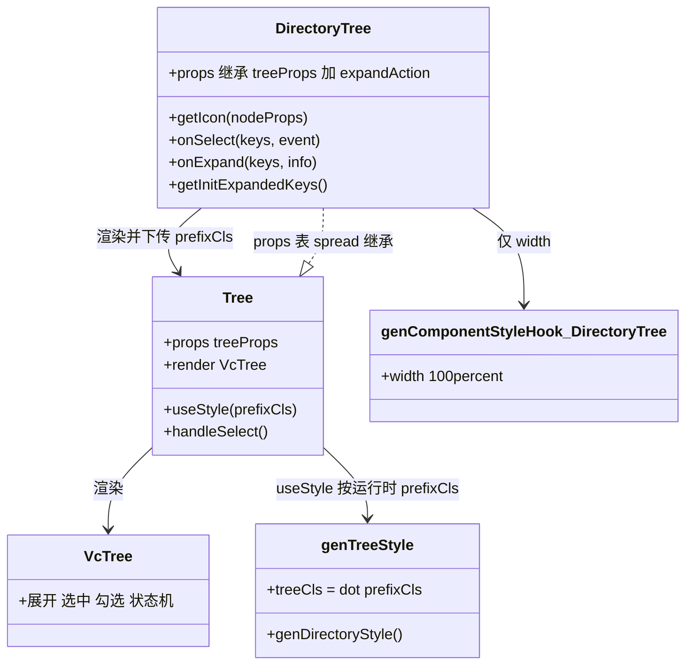
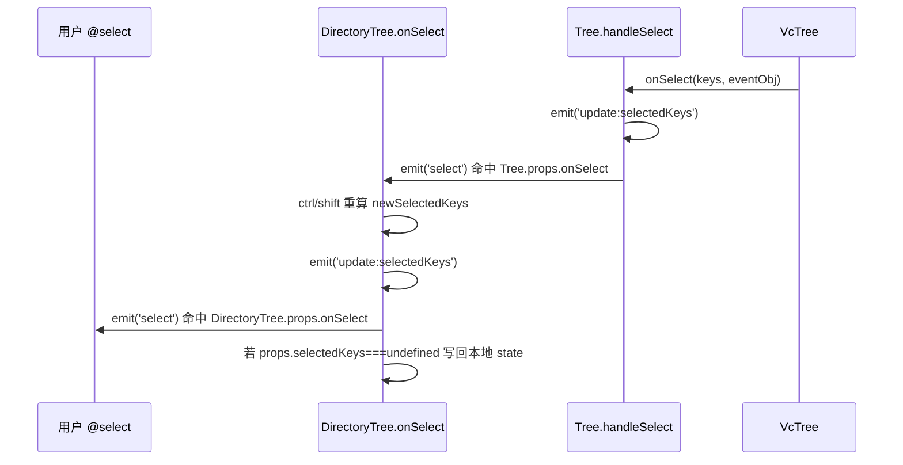
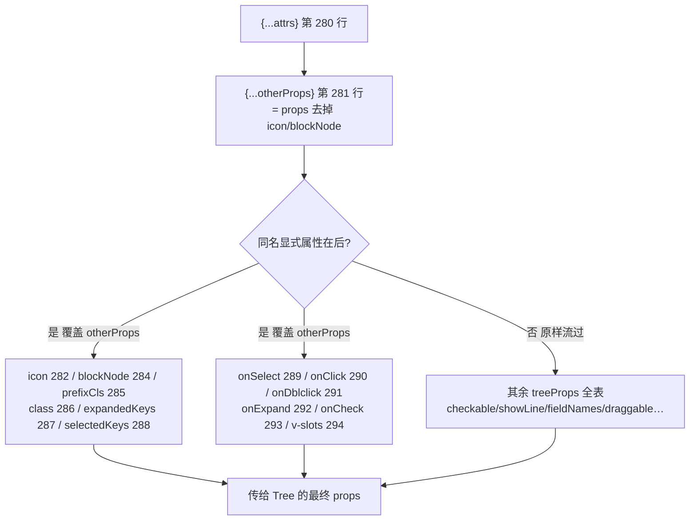

# C09-02 DirectoryTree 目录树

> **本篇解决**：`src/directory-tree/` 把 `tree` 装成「文件浏览器」这一预设形态时，props 透传链在哪一行被改写、被谁覆盖，以及为封装而硬编码的图标与 `-directory-rtl` 类在暗色 / RTL 语境下如何与下层样式脱节。
> **前置**：C09-01《Tree 树形控件》　**读者坐标**：`03-components/09-tree` 第 3/3 篇

## 一、职责与边界

`packages/xiaoye-ui/src/directory-tree/` 只有 5 个实现文件、340 行（不含测试），比它所封装的 `tree` 层还小一个数量级。它的全部产品语义就三件事：**把 `showIcon` 与 `expandAction` 补成默认值**（`packages/xiaoye-ui/src/directory-tree/DirectoryTree.tsx:49-52`），**把节点图标换成文件夹 / 文件这一组固定图标**（`:36-42`），以及**把选中逻辑改写成「点一个就单选、ctrl 追加、shift 连选」的文件浏览器模型**（`:189-258`）。除此之外它几乎是一层壳——props 表整体继承自 `tree`，渲染时把 `<Tree>` 原样铺上去（`:279-295`）。

正因如此，本篇关心的是「封装层最容易出问题的三个点」：

- **透传链的形状**：`directoryTreeProps` 用 `{ ...treeProps(), expandAction }` 直接继承下层的整张 props 表（`:28-31`），渲染时又用 `{ ...attrs }` + `{ ...otherProps }` 两段展开把 props 铺给 `<Tree>`（`:280-281`）。哪些名字被拆出来重新装配（`icon`、`blockNode`、`expandedKeys`、`selectedKeys`、五个事件回调），哪些名字原样流过，逐条要能对上行号。
- **封装为「目录树」而硬编码的东西**：三个图标组件在模块顶层静态 import（`:4`），`getIcon` 只消费 `isLeaf` 与 `expanded` 两个状态（`:36-42`）；`-directory-rtl` 这个类名被生成但全仓没有任何样式规则匹配它（`:272`，对照 `packages/xiaoye-ui/src/tree/style/index.ts:372-447` 的 directory 分支）。
- **受控 / 非受控的装配点**：`expandedKeys`、`selectedKeys` 在渲染里被本地 `ref` 覆盖下层的 props（`:287-288`），初始值由 `getInitExpandedKeys()` 依 `defaultExpandAll` / `defaultExpandParent` 计算（`:99-118`），运行期靠两个 `watch` 回灌（`:123-141`）。

本篇**不负责**：`tree` 本体如何把 `vc-tree` 装成 `xy-tree`、`showLine` / `checkStrictly` / `draggable` / 异步 `loadData` 的装配点——这些在 C09-01 已逐条论证，本篇按「论点 1」直接引用 C09-01 论点 1 的「改名 + 补默认值 + 注入渲染器 + 二次 emit」结论。树数据规范化 `convertDataToEntities` / `fillFieldNames`、`conductExpandParent` 的算法归 C09-00。`tree/utils/dictUtil.ts`（`calcRangeKeys`、`convertDirectoryKeysToNodes`）虽被本篇 `:16` 消费，但其实现细节见 C09-01 源码地图，本篇只讲它如何接进目录树的 shift 连选。

依赖清单（本篇范围内被引用 / 引用他人的事实）：

| 关系 | 证据 |
| --- | --- |
| props 表整体继承自 `tree` | `packages/xiaoye-ui/src/directory-tree/DirectoryTree.tsx:6-7`、`:28-31` |
| shift 连选的算法住在 `tree/utils/dictUtil.ts` | `packages/xiaoye-ui/src/directory-tree/DirectoryTree.tsx:16` |
| `dictUtil.ts` 全仓仅被 `directory-tree` 与 `tree/util.test.js` 消费 | `packages/xiaoye-ui/src/tree/util.test.js:1`、`DirectoryTree.tsx:16` |
| `tree/DirectoryTree.tsx` 只是 7 行 re-export 垫片 | `packages/xiaoye-ui/src/tree/DirectoryTree.tsx:1-7` |
| 组件真实注册标签是 `xy-directory-tree` | `packages/xiaoye-ui/src/directory-tree/DirectoryTree.tsx:46`、`packages/xiaoye-ui/src/_util/registerComponent.ts:6-9` |
| 目录视觉寄生在 `tree` 的样式 hook 上，靠 `prefixCls` 下传触发 | `DirectoryTree.tsx:285`、`packages/xiaoye-ui/src/tree/style/index.ts:451`、`:473` |

## 二、源码地图

| 文件 | 行数 | 职责 | 关键锚点 |
| --- | --- | --- | --- |
| `directory-tree/DirectoryTree.tsx` | 299 | 唯一实现（本篇主文件） | props 表 `:28-31`；`getIcon` `:36-42`；`defineComponent` `:44-52`；`setup` `:60`；`getInitExpandedKeys` `:99-118`；受控 watch `:123-141`；`onSelect` `:189-258`；渲染 `:268-297` |
| `directory-tree/directoryTreeTypes.ts` | 6 | 兼容旧 import 路径的类型转发垫片 | `:5` 转发 `directoryTreeProps`；`:6` 转发 `ExpandAction`、`DirectoryTreeProps` |
| `directory-tree/index.ts` | 16 | 入口与全局注册 | 仅导出独有命名符号避免聚合歧义 `:7-8`；`install` 走 `registerComponent` `:11-14`；默认导出 `:16` |
| `directory-tree/style/index.ts` | 25 | 目录树自己的样式（只有一条规则） | `genDirectoryTreeStyle` 只设 `width: 100%` `:12-20`；hook `genComponentStyleHook('DirectoryTree', …)` `:23-25` |
| `directory-tree/__tests__/directory-tree.test.tsx` | 94 | 单元测试 | 6 个 `it` + `mountTest` `:26`；directory class `:46`；blockNode `:56`；showIcon `:66`；treeData 透传 `:70-78`；`update:expandedKeys` `:80-93` |

主实现入口：`packages/xiaoye-ui/src/directory-tree/DirectoryTree.tsx:44`（`defineComponent`）到 `:279`（渲染 `<Tree>`）。被依赖的下层锚点集中在 `packages/xiaoye-ui/src/tree/Tree.tsx:88-140`（props 表）、`:211-274`（渲染与类名装配）、`packages/xiaoye-ui/src/vc-tree/props.ts:120-251`（`treeData` / `fieldNames` / `direction` / 事件声明）与 `packages/xiaoye-ui/src/tree/style/index.ts:372-447`（`genDirectoryStyle`）。

值得单独记一笔：仓里有两个都叫 `DirectoryTree` 的文件。真正在干活的是 `directory-tree/DirectoryTree.tsx`；而 `tree/DirectoryTree.tsx` 是一份 7 行 re-export 垫片（`packages/xiaoye-ui/src/tree/DirectoryTree.tsx:5-7`），只为保住 `from '../tree'` 这条历史导入路径。`directoryTreeTypes.ts` 又是同一套名字的第二层转发（`:5-6`）。同一份 `directoryTreeProps` / `ExpandAction` 从实现往外被转发了两次，改签名时这三处要一起动。

## 三、架构与数据流

### 3.1 静态结构：封装继承 + 运行时下传 prefixCls

先看分层静态关系。DirectoryTree 不重新实现任何树逻辑，它在**类型层**通过 `{ ...treeProps() }` 继承整张 props 表（`DirectoryTree.tsx:28-31`），在**渲染层**把 `<Tree>` 当作唯一子节点铺上（`:279`），并做一件关键的事：把 `useConfigInject('directory-tree', props)` 得到的 `prefixCls`（即 `xy-directory-tree`）作为 prop 下传给 `<Tree>`（`:285`）。正是这一步让目录树「寄生」在 `tree` 的样式 hook 上——`tree` 的样式工厂 `genTreeStyle(prefixCls, token)` 用运行时传入的 `prefixCls` 拼 `treeCls = '.' + prefixCls`（`packages/xiaoye-ui/src/tree/style/index.ts:451`），于是同一套 `genBaseStyle` + `genDirectoryStyle`（`:466-468`）会在 `.xy-directory-tree` 前缀下被重新生成一份。DirectoryTree 自己的 hook（`packages/xiaoye-ui/src/directory-tree/style/index.ts:12-25`）只贡献一条 `width: 100%`。



图里两条向下箭头代表运行时的父子渲染（`DirectoryTree.tsx:279` 的 `<Tree>`、`Tree.tsx:242` 的 `<VcTree>`）；`..|>` 那条虚线是 props 表在定义时的展开继承（`DirectoryTree.tsx:29` 的 `...treeProps()`）。样式那条 `DirectoryTree --> genTreeStyle` 是「间接」的——DirectoryTree 自己不 import `genTreeStyle`，而是通过把 `prefixCls` 塞进 `<Tree>`（`:285`）触发 `Tree` 的 `useStyle`（`Tree.tsx:171`）。这条「借下层的 hook 渲染自己的外观」的链路是后面「坑 3」的根源。

### 3.2 数据流：一次选中事件如何穿过两层再回到调用方

DirectoryTree 给 `<Tree>` 绑的是它自己的 `onSelect`（`:289`）。但 `Tree` 并不会直接用它——`Tree` 在渲染 `<VcTree>` 时把 `onSelect={handleSelect}` 写在 `{...newProps}` 之后（`packages/xiaoye-ui/src/tree/Tree.tsx:249`、`:266`），于是 `VcTree` 实际回调的是 `Tree` 的 `handleSelect`（`:207-210`），后者再 `emit('select', …)`。这个 `emit` 命中的是 `Tree` 实例上的 `props.onSelect`，也就是 DirectoryTree 传下去的那个函数。DirectoryTree 的 `onSelect` 跑完 ctrl/shift 逻辑后，又 `emit('select', …)` 一次（`DirectoryTree.tsx:254`），这才落到用户写的 `@select` 上。整条链是「VcTree → Tree 内部 handle → Tree.emit → DirectoryTree.onSelect → DirectoryTree.emit → 用户」，两跳 re-emit，与 C09-01 论点 1 描述的 `tree` 层二次派发是同一族机制。



图里最后一步（`DirectoryTree.tsx:255-257`）是受控 / 非受控的分水岭：只有当用户没有传 `:selected-keys`（即 `props.selectedKeys === undefined`）时，新选中的 key 才回灌进本地 `selectedKeys` ref。注意 `Tree` 在链路里也 `emit('update:selectedKeys')`（`Tree.tsx:208`），但那个 emit 命中的是 `Tree.props['onUpdate:selectedKeys']`，而 DirectoryTree 在渲染 `<Tree>` 时并没有把 `onUpdate:selectedKeys` 显式接上，它靠的是 `{...otherProps}`（`:281`）里带的用户 `onUpdate:selectedKeys`——这就带来「同一个 v-model 会被上下两层各写一次」的隐患，见「坑 4」。

### 3.3 渲染期的 props 优先级

渲染函数最后一段决定了「谁能覆盖谁」。`{...attrs}`（`:280`）最先到，`{...otherProps}`（`:281`）其次，之后是一串**显式属性**：`icon`（`:282`）、`blockNode`（`:284`）、`prefixCls`（`:285`）、`class`（`:286`）、`expandedKeys`（`:287`）、`selectedKeys`（`:288`）、五个事件回调（`:289-293`）、`v-slots`（`:294`）。JSX 里后写的属性覆盖先写的，因此写在 `{...otherProps}` **之后**的这些显式属性，用户无法通过 props 直接改写——它们从 `otherProps` 里被解构剔除，或以同名覆盖。`expandedKeys` / `selectedKeys` 正是这样被本地 state 劫持的。



这张图是本篇的读图钥匙：**「漏传」在这层几乎不可能发生**（`otherProps` 是除 `icon`/`blockNode` 外的全量展开），真正会发生的是**「被上层显式覆盖」**——用户想直接喂给内层 `<Tree>` 的 `selectedKeys`、`onSelect` 都被挡在门外，只能改走 DirectoryTree 自己的受控 state 与 emit 面。论点 1 逐条把这批显式属性核对一遍。

## 四、核心机制精读

### 论点 1：透传链不会「漏传」，风险全在「被上层显式覆盖」——除 `icon`/`blockNode` 外全量展开，随后八个同名属性硬覆盖

**断言**：DirectoryTree 这一层几乎不可能出现「下层某个 prop 被忘记转发」的漏传缺陷，因为它的 props 表与渲染都是「整体继承 + 整体展开」；真正会咬人的是八个写在展开之后的显式属性，它们把用户的同名输入挡在外面。

先看 props 表怎么继承：

```tsx
// packages/xiaoye-ui/src/directory-tree/DirectoryTree.tsx:28
export const directoryTreeProps = () => ({
  ...treeProps(),
  expandAction: someType<ExpandAction>([Boolean, String]),
});
```

`...treeProps()`（`:29`）把 `tree` 的整张表原样铺开（`packages/xiaoye-ui/src/tree/Tree.tsx:88-140` 定义，本身又是 `...vcTreeProps()` 的超集，`Tree.tsx:89-91`）。DirectoryTree 只往上加了一个 `expandAction`（`:30`）。默认值只有两个：`showIcon: true`、`expandAction: 'click'`（`:49-52` 的 `initDefaultProps`）。也就是说 `checkable`、`checkStrictly`、`showLine`、`draggable`、`fieldNames`、`treeData`、`loadData` 等等全部沿用下层的声明，这一层不改名、不改类型。这与 C09-01 论点 1 给 `tree` 下的判词一致——封装层「其余 props 一律整体透传」。

再看渲染端怎么铺：

```tsx
// packages/xiaoye-ui/src/directory-tree/DirectoryTree.tsx:277
      const { icon = slots.icon, blockNode = true, ...otherProps } = props;
      return wrapSSR(
        <Tree
          {...attrs}
          {...otherProps}
          icon={icon || getIcon}
          ref={treeRef}
          blockNode={blockNode}
          prefixCls={prefixCls.value}
          class={connectClassName}
          expandedKeys={expandedKeys.value}
          selectedKeys={selectedKeys.value}
          onSelect={onSelect}
          onClick={onClick}
          onDblclick={onDoubleClick}
          onExpand={onExpand}
          onCheck={onCheck}
          v-slots={slots}
        />,
      );
```

`otherProps`（`:277`）是 `props` 去掉 `icon` 和 `blockNode` 之后的**全量**，在 `:281` 整份展开给 `<Tree>`。凡是没被下面点名的 prop——`treeData`、`fieldNames`、`checkable`、`showLine`、`draggable`、`selectable`、`loadData`……都从这里原样流下去，因此「漏传」需要有人显式把它们删掉才会发生，而这里没有。

风险在顺序。`:279` 到 `:294` 这十六行里，写在 `{...otherProps}` **之后**的有八个（类）同名属性：`icon`（`:282`）、`blockNode`（`:284`）、`prefixCls`（`:285`）、`class`（`:286`）、`expandedKeys`（`:287`）、`selectedKeys`（`:288`）、五个事件回调 `onSelect`/`onClick`/`onDblclick`/`onExpand`/`onCheck`（`:289-293`）、`v-slots`（`:294`）。JSX 后写覆盖先写，所以这八个属性是**用户从 props 侧无法绕过的**：`icon` 与 `blockNode` 已在 `:277` 被解构出 `otherProps`，用户传的 `icon`/`blockNode` 只能经这条解构路径进来（`icon = slots.icon`、`blockNode = true` 的解构默认值仅在 `undefined` 时生效，写法是安全的）；而 `expandedKeys`/`selectedKeys` 与五个回调是直接用同名 JSX 属性把 `otherProps` 里的同名值覆盖掉。判形命令：`grep -n "otherProps\|={onSelect}\|expandedKeys={" packages/xiaoye-ui/src/directory-tree/DirectoryTree.tsx`。

**结论回扣**：这一层的透传是「全量 + 少数强覆盖」，不存在散落的漏传。要改封装行为，改动面不在「补一个没传的 prop」，而在「动了 `:282`-`:294` 里某个显式属性」。

### 论点 2：节点图标被 `getIcon` 写死成「文件夹 / 打开的文件夹 / 文件」三态，它只读 `isLeaf` 与 `expanded`，不读 `loading`

**断言**：目录树的「文件浏览器外观」来自一个模块级硬编码图标函数 `getIcon`，它在 `props` 与 `slot` 都没给图标时才兜底生效，且它只消费两个状态位，异步加载态在这条兜底路径上被丢掉。

```tsx
// packages/xiaoye-ui/src/directory-tree/DirectoryTree.tsx:35
// 根据节点状态返回文件夹/文件图标
function getIcon(props: XyTreeNodeAttribute) {
  const { isLeaf, expanded } = props;
  if (isLeaf) {
    return <FileOutlined />;
  }
  return expanded ? <FolderOpenOutlined /> : <FolderOutlined />;
}
```

三个图标在文件顶部静态导入：`import { FolderOpenOutlined, FolderOutlined, FileOutlined } from '@xiaoye-ui/icons';`（`:4`），符合本仓「图标必须从 `@xiaoye-ui/icons` 命名导入」的硬约束。`getIcon` 的解构只有 `isLeaf, expanded`（`:37`）——它没有读 `loading`，因此当一个非叶子节点正在异步展开时，节点图标仍是 `FolderOutlined`，不会变成加载态。加载反馈在 `tree` 层本由 `switcher` 箭头承担（`packages/xiaoye-ui/src/tree/Tree.tsx:267-269` 的 `renderSwitcherIcon`），但那属于 switcher 位、不是 icon 位；`getIcon` 顶替的是 icon 位，所以「icon 位显示 loading」在这条兜底链上确实缺省。

`getIcon` 何时生效，看 `:282` 的 `icon={icon || getIcon}`。`icon` 的来源是 `:277` 的 `icon = slots.icon`——优先级是「`props.icon` 有值用 `props.icon`；否则 `props.icon` 为 `undefined`，解构取 `slots.icon`」。这里有个细节值得点破：`:277` 写的是 `icon = slots.icon`，即**只有当 `props.icon` 是 `undefined` 时**才回落到插槽；若用户显式传了 `:icon="null"`（非 undefined 的假值），解构不会触发，随后 `null || getIcon` 又落到 `getIcon`。而 `getIcon` 一旦被选中，作为函数传入 `<Tree>`，Tree 会用它渲染每个节点的 icon（`packages/xiaoye-ui/src/tree/Tree.tsx:216` 的 `icon = slots.icon`、`:237` 的 `icon`）。

配合默认 `showIcon: true`（`:50`）——这是 DirectoryTree 相对 `tree` 的一个语义翻转：`tree` 自己默认 `showIcon: false`（`packages/xiaoye-ui/src/tree/Tree.tsx:151`），到目录树被改成了 `true`。于是开箱即用的目录树一定带图标，且一定是文件夹 / 文件那三个。想整体关掉图标得显式传 `:show-icon="false"`，此时 Tree 会挂 `-icon-hide` 类（`packages/xiaoye-ui/src/tree/Tree.tsx:256`）。

**结论回扣**：硬编码集中在三处——静态 import（`:4`）、`getIcon` 的两态判定（`:36-42`）、`showIcon` 默认值翻转（`:50` 对 `Tree.tsx:151`）。这三处共同决定了「不传 icon 就是 VSCode 风文件夹图标」，也决定了「异步节点在 icon 位没有加载反馈」。它们不构成 bug，但是改动暗色 / 自定义图标语义时的唯一落点。

### 论点 3：`-directory-rtl` 是被生成、但全仓没有任何样式规则匹配的「死类」；目录模式的 RTL 实际全靠下层通用 `-rtl` 兜住

**断言**：DirectoryTree 在根节点上挂了一个 `-directory-rtl` 类，但从实现到样式没有任何一条规则读取它——它是个假的可扩展点。同时，这层对 RTL 的**注入**是对的（不是 `rate` 那类默认值短路），所以 RTL 视觉仍然生效，只是靠的是通用 `-rtl`，不是目录专属的。

类名在这里生成：

```tsx
// packages/xiaoye-ui/src/directory-tree/DirectoryTree.tsx:268
    return () => {
      const connectClassName = classNames(
        `${prefixCls.value}-directory`,
        {
          [`${prefixCls.value}-directory-rtl`]: direction.value === 'rtl',
        },
        attrs.class,
        hashId.value,
      );
```

`prefixCls` 来自 `useConfigInject('directory-tree', props)`（`:265`），所以该类展开后是 `xy-directory-tree-directory-rtl`。这个类经 `class={connectClassName}`（`:286`）传给 `<Tree>`，因为 `Tree` 是 `inheritAttrs: false`（`packages/xiaoye-ui/src/tree/Tree.tsx:147`），它最终被并入 `Tree` 根节点的 class（`Tree.tsx:255` 的 `attrs.class`）。

可样式端只认 `-directory`，没有 `-directory-rtl` 分支：

```tsx
// packages/xiaoye-ui/src/tree/style/index.ts:372
export const genDirectoryStyle = (token: TreeToken): CSSObject => {
  const { treeCls, treeNodeCls, treeNodePadding } = token;

  return {
    [`${treeCls}${treeCls}-directory`]: {
```

`genDirectoryStyle` 的选择器只拼到 `${treeCls}-directory`（`:376`），其内部（`:376-446`）没有 `&-rtl`、没有任何 direction 条件。用一条命令即可证伪「有目录专属 RTL 样式」这个猜测：`grep -rn "directory-rtl" packages/xiaoye-ui/src`——结果是**仅命中 `DirectoryTree.tsx:272` 这一处**，即只有生产方、没有消费方。这是共则 §3 列的「生成但从不渲染的类名 / 死 CSS」的又一活例。

那 RTL 到底靠什么生效？靠下层通用 `-rtl`。`Tree` 在自己的根 class 里独立挂了 `${prefixCls.value}-rtl`：

```tsx
// packages/xiaoye-ui/src/tree/Tree.tsx:254
          class={classNames(
            {
              [`${prefixCls.value}-icon-hide`]: !showIcon,
              [`${prefixCls.value}-block-node`]: blockNode,
              [`${prefixCls.value}-unselectable`]: !selectable,
              [`${prefixCls.value}-rtl`]: direction.value === 'rtl',
            },
            attrs.class,
            hashId.value,
          )}
```

`Tree` 的样式里 `${treeCls}-rtl` 是真有规则的（`packages/xiaoye-ui/src/tree/style/index.ts:78` 的 `&${treeCls}-rtl` 与 `:139-140` 的 `&-rtl: { direction: 'rtl' }`）。因为 DirectoryTree 把 `prefixCls` 下传成 `xy-directory-tree`（`:285`），`Tree` 的 `useStyle(prefixCls)`（`Tree.tsx:171`）会用运行时前缀重新生成样式——`genComponentStyleHook` 返回的工厂接收组件传进来的 `_prefixCls` ref（`packages/xiaoye-ui/src/theme/util/genComponentStyleHook.ts:47-48`），内部把 `componentCls` 拼成 `.` + 运行时 `prefixCls.value`（`packages/xiaoye-ui/src/theme/util/genComponentStyleHook.ts:87`），`genTreeStyle` 里的 `treeCls` 也随之为 `.xy-directory-tree`（`packages/xiaoye-ui/src/tree/style/index.ts:451`），于是 `.xy-directory-tree-rtl` 这套规则确实存在、也确实命中 `Tree` 渲染出的根节点。

还要澄清一个容易误报的点：**DirectoryTree 不是 `rate` 那类「direction 默认值短路全局配置」的坑**（共则 §3 的 rate 活例是 `rate/index.tsx:54` 给了 `direction: 'ltr'`，使 `useConfigInject.ts:15` 的 `props.direction ?? configProvider.direction?.value` 右侧永不生效）。这里 `props.direction` 来自 `vc-tree/props.ts:251` 的 `direction: { type: String as PropType<Direction> }`，**没有 default**；`initDefaultProps(directoryTreeProps(), { showIcon: true, expandAction: 'click' })`（`:49-52`）也没给 `direction` 填默认值。所以 `props.direction` 恒为 `undefined`（用户未显式传时），`??` 右侧的全局 RTL 能正常灌进来，`direction.value === 'rtl'` 会真为真。RTL 的传播是通的，唯独目录专属的 `-directory-rtl` 样式是空的。

**结论回扣**：症状是「看着像有 RTL 开关，实际那半句 class 无人认领」。若哪天要给目录模式加 RTL 专属微调（例如目录缩进、选中条的 `inset-inline` 方向），落点是 `genDirectoryStyle`（`tree/style/index.ts:372`）而不是去改 `DirectoryTree.tsx:272`——后者已经把类挂上了，缺的只是样式端。

### 论点 4：展开态是「本地 state 恒定受控」，`defaultExpandAll` / `defaultExpandParent` 的初始化被上提到 DirectoryTree 自己做，下层 Tree 只收到一份已算好的 `expandedKeys`

**断言**：普通 `tree` 的「受控 / 非受控」由 `vc-tree` 内部判定；但 DirectoryTree 抢先算好初始展开集合并用一个本地 `ref` 恒定地向 `<Tree>` 传 `expandedKeys`，把 `vc-tree` 的非受控分支绕开了。

```tsx
// packages/xiaoye-ui/src/directory-tree/DirectoryTree.tsx:98
    // 计算初始展开的节点
    const getInitExpandedKeys = () => {
      const { keyEntities } = convertDataToEntities(treeData.value, {
        fieldNames: fieldNames.value,
      });

      let initExpandedKeys: any;
      if (props.defaultExpandAll) {
        // 默认展开全部
        initExpandedKeys = Object.keys(keyEntities);
      } else if (props.defaultExpandParent) {
        // 默认展开父节点
        initExpandedKeys = conductExpandParent(
          props.expandedKeys || props.defaultExpandedKeys || [],
          keyEntities,
        );
      } else {
        initExpandedKeys = props.expandedKeys || props.defaultExpandedKeys;
      }
      return initExpandedKeys;
    };

    const selectedKeys = ref(props.selectedKeys || props.defaultSelectedKeys || []);
    const expandedKeys = ref<Key[]>(getInitExpandedKeys());
```

`defaultExpandAll`（`:105`）与 `defaultExpandParent`（`:108`）这两个「默认值语义」在这里被**主动求值**：前者取所有 key 的并集（`:107`），后者调用 `conductExpandParent`（`:110-113`，来自 `packages/xiaoye-ui/src/vc-tree/util.tsx`）把选中/展开的 key 向上补齐父链。求值结果灌进 `expandedKeys` ref（`:121`）。之后运行期靠两个 `watch` 维持与 props 的同步：

```tsx
// packages/xiaoye-ui/src/directory-tree/DirectoryTree.tsx:133
    watch(
      () => props.expandedKeys,
      () => {
        if (props.expandedKeys !== undefined) {
          expandedKeys.value = props.expandedKeys;
        }
      },
      { immediate: true },
    );
```

注意 `if (props.expandedKeys !== undefined)`（`:136`）这个守卫：`expandedKeys` 在 `treeProps` 里是 `arrayType<Key[]>()`（`packages/xiaoye-ui/src/tree/Tree.tsx:110`），无默认值，非受控时恒为 `undefined`，于是守卫为假、watch 不覆盖本地 state。这是三元式 `X !== undefined ? X : Y` 家族的**正确写法**（对照共则 §3 里 `color-picker` 那种「X 自带非 undefined 默认值 → 兜底恒不可达」的反例）——这里 X 确实可能是 undefined，回落分支可达。`selectedKeys` 的 watch（`:123-131`）同构。

真正把机制锁死的是渲染端。`expandedKeys={expandedKeys.value}`（`:287`）与 `selectedKeys={selectedKeys.value}`（`:288`）写在 `{...otherProps}`（`:281`）之后，**无条件覆盖**下层的同名 props。也就是说：无论用户传没传 `:expanded-keys`，`<Tree>` 收到的永远是 `expandedKeys.value`（本地 ref）；而 `onExpand`（`:156-169`）在 `props.expandedKeys === undefined` 时才把新 keys 写回本地 ref（`:164-166`），受控时则不写、等 props 变化经 watch 回灌。

**结论回扣**：这套设计让「初始展开」语义（`defaultExpandAll`/`defaultExpandParent`）在封装层就被消化成一份确定的 `expandedKeys`，`Tree` 只当纯受控用。代价是 `defaultExpandedKeys` 只在 `getInitExpandedKeys` 求值那一瞬被读一次（`:111`、`:115`），后续 props 里 `defaultExpandedKeys` 再变不会影响；且用户想直接给内层 `Tree` 喂 `expandedKeys` 做微调是喂不进去的（`:287` 挡着）。

还有一层时序坑藏在 `treeData` 的装配里。`treeData` 有一个**本地 `ref`**（`:62-64`）：初值取 `props.treeData`，缺省时用 `convertTreeToData(filterEmpty(slots.default?.()))` 兜住旧的 `<xy-tree-node>` 写法（`:63`）。`watch(() => props.treeData, …)`（`:66-71`）只更新这个本地 `ref`，`onUpdated` + `nextTick`（`:72-78`）则在 `props.treeData === undefined` 且有 `default` 插槽时重新抽取。而 `getInitExpandedKeys()` 是在 `setup` 顶层被**同步调用一次**（`:121`），它读的 `treeData.value` 是那一刻的值。于是形成一条明确缺口：若 `treeData` 是异步到达的（首帧 `props.treeData` 为 `undefined`、稍后才赋值），或来自首帧尚未渲染完成的 `default` 插槽，`getInitExpandedKeys` 拿到的是空数据，`defaultExpandAll` 算出的 `initExpandedKeys` 就是空数组（`:107` 的 `Object.keys(keyEntities)` 为空）；后续 `props.treeData` 变化只会更新 `treeData.value`（`:69`），**不会重跑** `getInitExpandedKeys`。结果：异步数据 + `defaultExpandAll` 组合下，目录树首屏不展开，得再触发一次 `onExpand` 才有展开态。这条路径由 `:121` 与 `:66-71` 的不对称（一个是 setup 一次性、一个是运行期增量）造成。

### 论点 5：`onSelect` 把树的选中改写成文件浏览器模型——ctrl/cmd 追加、shift 连选、单击恒单选，且上报事件里 `selected` 被写死为 `true`

**断言**：目录树的多选不是 `tree` 的 checkbox 语义，而是「点击即选中、修饰键决定集合」的列表选择语义；这套逻辑整体住在 `onSelect` 里，且它上报给用户的 `event.selected` 永远是 `true`。

```tsx
// packages/xiaoye-ui/src/directory-tree/DirectoryTree.tsx:189
    const onSelect = (
      keys: Key[],
      event: {...},
    ) => {
      const { multiple } = props;
      const { node, nativeEvent } = event;
      const key = node[fieldNames.value.key];

      const newEvent: any = {
        ...event,
        selected: true, // 目录树选中始终为 true
      };

      const ctrlPick: boolean = nativeEvent?.ctrlKey || nativeEvent?.metaKey;
      const shiftPick: boolean = nativeEvent?.shiftKey;

      let newSelectedKeys: Key[];
      if (multiple && ctrlPick) {
        newSelectedKeys = keys;
        lastSelectedKey.value = key;
        cachedSelectedKeys.value = newSelectedKeys;
        ...
      } else if (multiple && shiftPick) {
        newSelectedKeys = Array.from(
          new Set([
            ...(cachedSelectedKeys.value || []),
            ...calcRangeKeys({
              treeData: treeData.value,
              expandedKeys: expandedKeys.value,
              startKey: key,
              endKey: lastSelectedKey.value,
              fieldNames: fieldNames.value,
            }),
          ]),
        );
        ...
      } else {
        newSelectedKeys = [key];
        lastSelectedKey.value = key;
        cachedSelectedKeys.value = newSelectedKeys;
        ...
      }

      emit('update:selectedKeys', newSelectedKeys);
      emit('select', newSelectedKeys, newEvent);
      if (props.selectedKeys === undefined) {
        selectedKeys.value = newSelectedKeys;
      }
    };
```

三条分支的语义（`:212` / `:222` / `:241`）：`multiple && ctrl/cmd` 走追加，直接信任 `Tree` 传上来的 `keys` 全集（`:214`）；`multiple && shift` 走连选，把 `cachedSelectedKeys` 与 `calcRangeKeys(...)` 的区间并起来（`:224-235`），`calcRangeKeys` 来自 `packages/xiaoye-ui/src/tree/utils/dictUtil.ts`（`:16` 引入；该 util 全仓仅被本组件与 `tree/util.test.js` 消费，见 §一 依赖表）；否则就是**单击单选**——`newSelectedKeys = [key]`（`:243`），永远只有一个、且不带取消语义。三个分支末尾都重建 `newEvent.selectedNodes`（`:217-221` 等，用 `convertDirectoryKeysToNodes`）。

关键取舍在 `:205` 的 `selected: true`。普通 `tree` 的 `onSelect` 里 `event.selected` 表示「本次点击是选中还是取消选中」；目录树把点一个节点当作「选中它」，因此恒置 `true`，注释也写明「目录树选中始终为 true」。副作用是：在非 `multiple` 下再次点击已选中的节点，`newSelectedKeys` 仍是 `[key]`（`:243`），**无法反选**——这是文件浏览器的预期行为（始终保留一个选中项），但对习惯 `tree` toggle 语义的调用方是反直觉的。`multiple` 门控在 `props.multiple`（`:199`），而 `multiple` 本身是继承自 `tree` 的 prop（`packages/xiaoye-ui/src/tree/Tree.tsx:94`），没有默认值，非受控 `undefined` 时走单选分支。

**结论回扣**：`onSelect` 是目录树唯一真正「造」逻辑的地方（其余都是受控 state 与透传）。它读三类外部状态——`props.multiple`、`nativeEvent` 的修饰键、以及模块内 `lastSelectedKey`/`cachedSelectedKeys` 两个 ref（`:81-82`）。这两个 ref 是组件实例级的，多实例互不串扰，但它们只在 `onSelect` 路径被写，`onCheck` 完全不碰（`:260-263` 只是 re-emit）。

## 五、对外契约如何生效

**props → 渲染**：入口 `directoryTreeProps`（`DirectoryTree.tsx:28-31`）在 `defineComponent` 里经 `initDefaultProps(..., { showIcon: true, expandAction: 'click' })`（`:49-52`）落为组件 props。渲染时 `props` 被拆成 `icon`、`blockNode` 与 `otherProps`（`:277`），`otherProps` 整份展开到 `<Tree>`（`:281`），八个显式属性随后覆盖（`:282-294`，论点 1）。`prefixCls` 不走 `otherProps`，而是取 `useConfigInject('directory-tree', props)` 的结果（`:265`）再显式下传（`:285`）——这是目录树视觉能在 `xy-directory-tree` 前缀下生成的前提（论点 3）。

**slots → 渲染**：`slots` 声明为 `{ icon, title, switcherIcon, titleRender, default }`（`:53-59`），整份以 `v-slots={slots}` 交给 `<Tree>`（`:294`）。此外两处直接读 slots：`treeData` 缺失时用 `convertTreeToData(filterEmpty(slots.default?.()))` 兼容旧 `<xy-tree-node>` 写法（`:62-64`、`:72-78`）；`icon` 的解构默认值是 `slots.icon`（`:277`）。也就是说 `default` 插槽既当数据源又当渲染源，两处都消费它。

**events → 调用方**：组件选项里**没有 `emits` 声明**（`:44-52` 只有 `compatConfig`/`name`/`inheritAttrs`/`__XY_DIRECTORY_TREE`/`props`/`slots`）。所有对外事件靠 `emit(...)` 直接派发：`update:expandedKeys`+`expand`（`:167-168`）、`click`（`:176`）、`doubleclick`+`dblclick`（`:184-185`）、`update:selectedKeys`+`select`（`:253-254`）、`update:checkedKeys`+`check`（`:261-262`）。因 `inheritAttrs: false`（`:47`）且这些名字里除 `onClick`/`onDblclick`/`onSelect`/`onCheck`/`onExpand`（继承自 vc-tree，`packages/xiaoye-ui/src/vc-tree/props.ts:163-183`）外没有对应的显式 prop，`@click` 之类会进 `attrs` 或 `props`；无论落哪，最终都靠对应的 `emit` 命中用户 handler。注意 `doubleclick` 与 `dblclick` 被同一次双击各发一遍（`:184-185`），是刻意的双名兼容，调用方二选一即可，两个都监听会各触发一次。

**expose → 实例方法**：`expose`（`:88-96`）交出一个 `scrollTo`（转发 `treeRef.value?.scrollTo`，`:85-87`）与六个从 `treeRef` 上取的 `computed`——`selectedKeys`/`checkedKeys`/`halfCheckedKeys`/`loadedKeys`/`loadingKeys`/`expandedKeys`（`:90-95`）。这里的 `treeRef` 指向 `<Tree>` 实例（`:283` 绑定），而这些字段本身又是 `Tree` 用 `expose` 从 `vc-tree` 转发上来的（`packages/xiaoye-ui/src/tree/Tree.tsx:177-189`）。所以 DirectoryTree 的实例暴露是**三层转发**：`ref → DirectoryTree.expose → Tree.expose → vc-tree 内部状态`。`expandFolderNode` 也依赖这条链，调用 `treeRef.value!.onNodeExpand(...)`（`:150`，`onNodeExpand` 由 Tree 暴露于 `Tree.tsx:179-181`）。

## 六、设计取舍

**用本地 state 恒定受控，而非把非受控交给 `vc-tree`**。`getInitExpandedKeys` + `expandedKeys.value` 覆盖（论点 4）意味着封装层放弃了 `vc-tree` 自带的非受控展开管理，换来的是「`defaultExpandAll`/`defaultExpandParent` 在目录树语境下能立刻算准」——代价是 `defaultExpandedKeys` 变成一次性初值（`:111`/`:115`），以及用户无法把内层 `Tree` 的展开态直接接管（`:287` 挡着）。对一个「点开哪个文件夹就展开哪个」的形态，这套自管 state 是划算的；对一个想做复杂受控的调用方，它是限制。

**`selected` 恒为 `true`（`:205`）与「单击不可反选」（`:243`）**。文件浏览器的心智是「总有一个选中项、点击即选中」，因此反选被取消。代价是与 `tree` 的 toggle 语义不连续：同一份 `onSelect` 载荷在 `tree` 里 `selected` 会变，在目录树里恒真，跨组件迁移监听逻辑时要特别注意。

**把 `-directory-rtl` 挂出来却无样式消费**。更诚实的说法是：这不像权衡，更像遗留——`genDirectoryStyle`（`tree/style/index.ts:372-446`）本就只做了目录态的 hover/selected 配色，没规划 RTL 分支，而组件端预先埋了个 `-rtl` 类名占位（`DirectoryTree.tsx:272`）。它换来的是「将来要加目录专属 RTL 微调时不用再动组件」，赔上的是「读代码的人会误以为已有 RTL 逻辑」。当前 RTL 视觉由通用 `Tree` 的 `-rtl` 承担（论点 3），没有功能性破损。

**图标硬编码而非 token 化**。`getIcon`（`:36-42`）直接返回三个图标组件、不接 Design Token、不接暗色专门分支。好处是目录树开箱即得统一外观、无额外配置；代价是暗色 / 自定义语义下必须整体用 `icon` prop 或 `slot` 接管（`:282` 的 `icon || getIcon` 优先级），没有中间档。

## 七、坑与改动指南

> 每条按「触发 → 症状 → 原因 → 定位」组织。

**坑 1：混用受控 `expandedKeys` 与 `defaultExpandAll`，出现双数据源。**
触发：既 `:expanded-keys="x"` 又 `default-expand-all`。症状：初值由 `getInitExpandedKeys` 用 `defaultExpandAll` 算出全量 key（`:105-107`），随后 `immediate` 的 watch 因 `props.expandedKeys !== undefined` 立刻把它覆盖成 `x`（`:136-137`），`defaultExpandAll` 形同被 `x` 抹掉。原因：受控与非受控初值在这层是「后写覆盖」而非「二选一互斥」。定位：`packages/xiaoye-ui/src/directory-tree/DirectoryTree.tsx:99-118`、`:123-141`。

**坑 2：想用 `icon` 关掉 / 换掉目录图标，踩到 `icon || getIcon` 的假值边界。**
触发：传 `:icon="null"` 或依赖 `slots.icon`。症状：`null` 时解构默认值不触发（`icon = slots.icon` 仅在 `props.icon === undefined` 生效，`:277`），`null || getIcon` 仍落回 `getIcon`（`:282`），图标没被换掉。原因：目录图标的兜底是「逻辑或」，任何假值都会被 `getIcon` 覆盖。定位：`packages/xiaoye-ui/src/directory-tree/DirectoryTree.tsx:36-42`、`:277`、`:282`。

**坑 3：给目录模式写 RTL 专属样式没生效。**
触发：在 `xy-directory-tree-directory-rtl` 上写规则，或以为改了 `-directory` 就自动 RTL。症状：类名被渲染（`:272`）但样式不命中——`genDirectoryStyle` 只生成 `.X.X-directory`（`tree/style/index.ts:376`），无 `&-rtl`。原因：组件挂的目录专属 RTL 类与样式端选择器对不上（死类，论点 3）。定位：`packages/xiaoye-ui/src/directory-tree/DirectoryTree.tsx:272` 与 `packages/xiaoye-ui/src/tree/style/index.ts:372-446`。安全改法是往 `genDirectoryStyle` 里补 `${treeCls}-directory${treeCls}-directory-rtl` 或复用通用 `-rtl`。

**坑 4：`v-model:selected-keys` 每次选择被写两遍，ctrl/shift 下中间值抖动。**
触发：`v-model:selected-keys="x"` + 多选 ctrl/shift 点击。症状：`x` 在一次点击内被同步赋值两次——第一次来自 `Tree.handleSelect` 的 `emit('update:selectedKeys', selectedKeys)`（`packages/xiaoye-ui/src/tree/Tree.tsx:208`，值是 vc-tree 原始 `keys`），第二次来自 `DirectoryTree.onSelect` 的 `emit('update:selectedKeys', newSelectedKeys)`（`packages/xiaoye-ui/src/directory-tree/DirectoryTree.tsx:253`，值是重算后的集合）。两值在 ctrl/shift 分支可能不同。原因：`onUpdate:selectedKeys` 既随 `otherProps`（`:281`）进了 `Tree`、又被 DirectoryTree 自己 `emit`，两层各发一次。定位：`packages/xiaoye-ui/src/directory-tree/DirectoryTree.tsx:253`、`:281` 与 `packages/xiaoye-ui/src/tree/Tree.tsx:208-209`。该双发路径**无测试保护**（见测试现状）。

**坑 5：把 `expandAction` 当布尔用，或误以为双击不会连带单击展开。**
触发：`expandAction='click'` 时快速双击。症状：`onClick` 每次单击都调 `onDebounceExpand`（`:171-176`），debounce 为 `leading: true`（`:152-154`），第一次单击即展开/收起；`expandAction='dblclick'` 与 `'doubleclick'` 是两个同义字符串（`:26`、`:181`）。原因：`ExpandAction` 允许 `false | 'click' | 'doubleclick' | 'dblclick'` 四种，只有 `false` 才完全不自动展开。定位：`packages/xiaoye-ui/src/directory-tree/DirectoryTree.tsx:26`、`:152-186`。

**坑 6：异步节点在 icon 位没有加载态。**
触发：`loadData` 展开一个大目录，期待图标转圈。症状：图标仍是 `FolderOutlined`（`getIcon` 只读 `isLeaf`/`expanded`，`:36-41`）。原因：加载反馈挂在 `switcher` 不在 `icon`，而 `getIcon` 顶替了 `icon` 位。定位：`packages/xiaoye-ui/src/directory-tree/DirectoryTree.tsx:36-42`。

**坑 7：`treeData` 异步到达时 `defaultExpandAll` 首屏不展开。**
触发：`:tree-data="x"` 的 `x` 初值为空、挂载后才填充，同时开 `default-expand-all`。症状：首屏全收起，手动点一次后才出现展开态。原因：`getInitExpandedKeys()` 在 `setup` 顶层同步跑一次（`:121`），读的是那一刻的 `treeData.value`（`:62-64` 初值此时为空）；`props.treeData` 后续变化只更新本地 `ref`（`:69`），不重跑初始化。定位：`packages/xiaoye-ui/src/directory-tree/DirectoryTree.tsx:99-121`、`:66-71`。安全改法：把 `getInitExpandedKeys` 改成对 `treeData` 的 `watch` 里重算，或在 `defaultExpandAll` 为真时监听 `props.treeData` 补齐 `expandedKeys.value`。

**测试现状**：`packages/xiaoye-ui/src/directory-tree/__tests__/directory-tree.test.tsx` 有 6 个 `it` 加 `mountTest`（`:26`），断言覆盖 `__XY_DIRECTORY_TREE` 标志（`:33`）、`install`（`:37`）、`-directory` 类（`:46`）、`-block-node`（`:56`）、`showIcon` 默认（`:66`）、`treeData` 透传到 `XYTree`（`:70-78`）、`update:expandedKeys`（`:80-93`）。**未覆盖**：`onSelect` 的 ctrl/shift 三分支（`:212-251`）、坑 4 的双发、`-directory-rtl`、`getIcon` 三态、`onCheck` 透传。判定测试是否被实跑要按 `packages/xiaoye-ui/vitest.config.mts` 的 glob（`src/**/*.test.{js,ts,jsx,tsx}`），本文件后缀 `.tsx` 在范围内。

## 附：本篇可证伪的三个检查点

1. **`-directory-rtl` 是死类**：跑 `grep -rn "directory-rtl" packages/xiaoye-ui/src`——若论点 3 成立，结果只应有 `DirectoryTree.tsx:272` 一行（生产方），没有任何样式文件匹配；再对照 `grep -n "directory" packages/xiaoye-ui/src/tree/style/index.ts` 只有 `${treeCls}-directory`（`:376`）而无 `directory-rtl`。
2. **受控 state 覆盖 props**：跑 `grep -n "otherProps\|expandedKeys={\|selectedKeys={" packages/xiaoye-ui/src/directory-tree/DirectoryTree.tsx`——`{...otherProps}`（281）必须先于 `expandedKeys={expandedKeys.value}`（287）与 `selectedKeys={selectedKeys.value}`（288），证明确是「后写显式属性覆盖展开」，用户无法从 props 直接改写内层这两个键（论点 1、论点 4）。
3. **v-model 双发链**：读 `packages/xiaoye-ui/src/tree/Tree.tsx:207-209`（`handleSelect` 先 `emit('update:selectedKeys')` 后 `emit('select')`）与 `packages/xiaoye-ui/src/directory-tree/DirectoryTree.tsx:253-254`（`onSelect` 再各发一次），确认一次选择对 `onUpdate:selectedKeys` 触达两次（坑 4）；这条路径在 `__tests__/directory-tree.test.tsx` 里没有对应断言（`:80-93` 只测 `update:expandedKeys`）。
