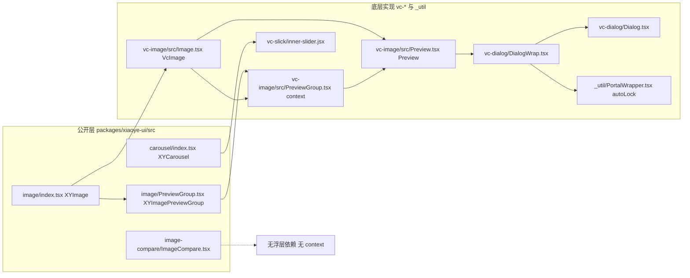

# C10-00 类横写：图片组的预览与对比关系

> **本篇解决**：图片类组件（Image / PreviewGroup / ImageCompare / Carousel）共享的「预览层容器与层级从哪来、多图切换状态归属、加载/错误/骨架态取舍、transform 缩放拖拽实现位置」这四个横切问题，在源码里分别落在哪一层。
> **前置**：A07《交互基础设施总览：一个浮层是怎么拼起来的》、C12-06《Portal》　**读者坐标**：`03-components/10-media` 第 1/9 篇（类横写）

## 一、职责与边界

本篇是 `10-media` 的横写篇，只回答四个问题，而且只回答它们在**源码里的落点**：

1. 图片预览层的容器与层级从哪来；
2. 多图之间的「当前是哪一张」这个状态归谁持有；
3. 加载态 / 错误态 / 骨架（placeholder）态分别在哪一层落地；
4. transform 缩放、旋转、拖拽的实现被压在哪一层，越界回正算法在哪。

覆盖范围限定在四个目录：`image`、`vc-image`、`image-compare`、`carousel`（含 `vc-slick`）。同类组件篇 C10-01《Image 图片》、C10-02《ImageCompare 图片对比》、C10-04《Carousel 走马灯》只写各自专属逻辑，**不得重复展开本篇已讲的共性抽象**。

明确不负责：

- 浮层基座本身（Trigger / Portal / 层级编排的内部实现）——见 A07《交互基础设施总览：一个浮层是怎么拼起来的》与 C12-06《Portal》。本篇只讲图片类**如何调用**它们，以及调用方式上的分歧。
- FocusTrap 与 Ripple 的实现——归 C12-07《FocusTrap》与 C12-05《Ripple》，本篇不展开。（原画廊组件曾是库内唯一 focus-trap 运行时消费者，该组件已于 2026-10-02 移除，现全库没有 focus-trap 的运行时消费点。）
- 虚拟滚动与动效系统本身——见 I08、I09。本篇只在图片类**是否**使用它们的层面上立论。
- Props 清单与用法：`> 属性清单见 [apps/docs/components/image.md](../../../apps/docs/components/image.md)。`

五个目录之间的实际依赖（不是想象出来的分层）：

- `image` 是薄封装：把 `vc-image` 的 props 原样接过来再导出（`packages/xiaoye-ui/src/image/index.tsx:20`），自己只做前缀类名、图标集、过渡名与样式 hashId 的注入。
- `image` 与 `vc-image` **共用同一个 context 单例**（`packages/xiaoye-ui/src/vc-image/src/PreviewGroup.tsx:51`），这意味着 `XYImage` 的预览项注册与 `XYImage.PreviewGroup` 的注册表是同一份数据。
- `image-compare` 不依赖 `vc-image`，只依赖 `useConfigInject`（`packages/xiaoye-ui/src/image-compare/ImageCompare.tsx:3`）与自身样式，**没有预览层**。
- `carousel` 走 `vc-slick`（`packages/xiaoye-ui/src/carousel/index.tsx:6`），无浮层、无预览。

## 二、源码地图

主实现入口是 `packages/xiaoye-ui/src/vc-image/src/Preview.tsx:58`（`Preview` 组件定义处），本篇多数论点围绕它展开。

| 文件 | 行数 | 职责 | 关键锚点 |
| --- | --- | --- | --- |
| `packages/xiaoye-ui/src/vc-image/src/Preview.tsx` | 426 | 预览浮层本体：缩放/旋转/翻转/拖拽/切换/键盘 | `previewProps`:48、`Preview`:58、渲染 `Dialog`:349 |
| `packages/xiaoye-ui/src/vc-image/src/PreviewGroup.tsx` | 210 | 多图注册表 + context 提供者 + 受控 current | `context`:52、`Group`:83、`registerImage`:139 |
| `packages/xiaoye-ui/src/vc-image/src/Image.tsx` | 306 | 单图壳：加载态、fallback、点击开预览、注册自己 | `imageProps`:28、`ImageInternal`:67、`onPreview`:129 |
| `packages/xiaoye-ui/src/vc-image/src/getFixScaleEleTransPosition.ts` | 61 | 拖拽越界回正的纯函数算法 | `fixPoint`:3、默认导出:38 |
| `packages/xiaoye-ui/src/vc-image/src/hooks/useFrameSetState.ts` | 31 | rAF 节流的 position 合并 | 默认导出:6 |
| `packages/xiaoye-ui/src/vc-image/index.ts` | 4 | 再导出 `ImageInternal` | — |
| `packages/xiaoye-ui/src/image/index.tsx` | 85 | `XYImage` 薄封装，注入 icons/transitionName/hashId | `mergedPreview`:26、`Image.PreviewGroup`:72 |
| `packages/xiaoye-ui/src/image/PreviewGroup.tsx` | 78 | `XYImagePreviewGroup`，注入图标集与样式 hash | `icons`:21、`mergedPreview`:47 |
| `packages/xiaoye-ui/src/image/style/index.ts` | 320 | 预览层与 mask 的 token 化样式 | — |
| `packages/xiaoye-ui/src/image/index.test.js` | 32 | 只测静态渲染，无预览交互覆盖 | — |
| `packages/xiaoye-ui/src/image-compare/ImageCompare.tsx` | 85 | 双图层 + `input[type=range]`，CSS 变量驱动 | `handleInput`:34、`mergedStyle`:58 |
| `packages/xiaoye-ui/src/image-compare/interface.ts` | 11 | props 定义 | `imageCompareProps` |
| `packages/xiaoye-ui/src/image-compare/style/index.ts` | 151 | 用 CSS 变量裁切右侧图层 | — |
| `packages/xiaoye-ui/src/carousel/index.tsx` | 180 | `XYCarousel` 包 `vc-slick` | `import SlickCarousel`:6 |
| `packages/xiaoye-ui/src/vc-slick/inner-slider.jsx` | 762 | 走马灯状态机与轨道位移 | — |
| `packages/xiaoye-ui/src/vc-slick/utils/innerSliderUtils.js` | 790 | 边界/位移纯函数 | — |
| `packages/xiaoye-ui/src/vc-dialog/Dialog.tsx` | 212 | 被 `Preview` 复用的浮层容器 | `zIndex`:155、`-wrap`:183 |

## 三、架构与数据流

### 3.1 静态结构：图片类的浮层只有一套，且全部经 vc-dialog



读图要点：`image` 到 `vc-image` 是**单向薄封装**，`image` 自己不持有任何预览状态（`packages/xiaoye-ui/src/image/index.tsx:26` 的 `mergedPreview` 只是把图标集和过渡名塞进 props）。真正的预览状态全在 `vc-image` 三个文件里闭环。

图片预览的浮层经 `vc-dialog` 落到 `_util/PortalWrapper`（`packages/xiaoye-ui/src/vc-dialog/DialogWrap.tsx:52`），「出文档流 + 锁滚动 + 回收焦点」全部由基座承担。本类原先并存第二套自拼浮层（Galleria：自有 Portal + `ZIndexManager` 手工层级 + 独立滚动锁），该组件已于 2026-10-02 移除，浮层实现就此只剩 `vc-dialog` 一条路。

`image-compare` 与 `carousel` 在图上是**孤立节点**：`packages/xiaoye-ui/src/image-compare/ImageCompare.tsx:1` 到 `:7` 的 import 列表里没有 `vc-image`，也没有 `portal`；`packages/xiaoye-ui/src/carousel/index.tsx:6` 只引入 `vc-slick`。「图片类组件共享预览层」这个直觉在本库里只对 `image` / `vc-image` 成立。

### 3.2 数据流：一次组内预览从点击到切换

```mermaid
sequenceDiagram
  participant U as 用户
  participant IMG as VcImage Image.tsx
  participant CTX as context PreviewGroup.tsx
  participant GRP as Group PreviewGroup.tsx
  participant PRV as Preview.tsx
  participant DLG as DialogWrap Dialog
  U->>IMG: 点击 wrapper 触发 onPreview
  IMG->>IMG: isControlled 判定 preview.visible 是否传入
  IMG->>CTX: setCurrent(currentId) 写 key 不是索引
  IMG->>CTX: setGroupMousePosition getOffset 得到的 left top
  IMG->>CTX: setGroupShowPreview true
  CTX->>GRP: useMergedState 更新 isShowPreview
  GRP->>PRV: visible 与 src 等于 canPreviewUrls.get(current)
  PRV->>DLG: 透传 transitionName getContainer zIndex
  DLG--->U: PortalWrapper 挂到 body 并锁滚动
  U->>PRV: 点击右箭头或按方向键
  PRV->>CTX: setCurrent previewUrlsKeys 的下一项
  CTX->>PRV: combinationSrc 重算 图片换源
  U->>PRV: 关闭
  PRV->>DLG: onClose 经 Dialog afterClose 回调
  DLG->>PRV: onAfterClose 复位 scale rotate flip position
```

图里四个分支为什么存在：

- `isControlled` 分支（`packages/xiaoye-ui/src/vc-image/src/Image.tsx:92`）：调用方给了 `preview.visible` 就不该再记录 mousePosition，否则缩放动画起点会被内部值覆盖（`:130`）。
- `isPreviewGroup` 分支（同文件 `:133`、`:146`）：组内和组外是两套宿主——组内把状态交给 context 里的 `Group`，组外由 `Image` 自己渲染 `Preview`（`:282`）。这是同一个 `Preview` 组件被两个宿主复用的唯一分岔口。
- `canPreviewUrls` 过滤（`packages/xiaoye-ui/src/vc-image/src/PreviewGroup.tsx:117`）：注册表里保留了 `canPreview: false` 的项（为了保持 key 稳定），渲染层必须再滤一遍。
- `onAfterClose` 复位（`packages/xiaoye-ui/src/vc-image/src/Preview.tsx:103`）：缩放/旋转/拖拽状态**不销毁组件**，只把值写回初值；是否销毁由 `destroyOnClose` 决定（`packages/xiaoye-ui/src/vc-dialog/DialogWrap.tsx:48`）。

## 四、核心机制精读

### 论点 1：预览层的容器与层级完全外包给 `vc-dialog`，`Preview` 自己不写一个 z-index

断言：`Preview` 只把 `getContainer` 与 `zIndex` 当透明参数往下递，真正决定「挂在哪、第几层、锁不锁滚动」的是 `DialogWrap` 与 `_util/PortalWrapper`；把 `getContainer` 设为 `false` 会同时关掉 Portal 与滚动锁，这不是两个独立开关。

```tsx
// packages/xiaoye-ui/src/vc-image/src/Preview.tsx:346
    return () => {
      const { visible, prefixCls, rootClassName } = props;
      return (
        <Dialog
          {...attrs}
          transitionName={props.transitionName}
          maskTransitionName={props.maskTransitionName}
          closable={false}
          keyboard
          prefixCls={prefixCls}
          onClose={onClose}
          afterClose={onAfterClose}
          visible={visible}
          wrapClassName={wrapClassName}
          rootClassName={rootClassName}
          getContainer={props.getContainer}
        >
```

`Preview.tsx:349` 引入的是 `vc-dialog` 的默认导出，而默认导出其实是 `DialogWrap`（`packages/xiaoye-ui/src/vc-dialog/index.ts:2`）。层级最终只落在 wrap 一个节点上：`packages/xiaoye-ui/src/vc-dialog/Dialog.tsx:209` 把 `zIndex` 与 `wrapStyle` 合并成内联样式，遮罩则用同一个 `zIndex`（`packages/xiaoye-ui/src/vc-dialog/Dialog.tsx:203`）。`zIndex` 是普通 `Number` prop、没有默认值（`packages/xiaoye-ui/src/vc-dialog/IDialogPropTypes.ts:31`），所以图片预览若不显式传，层级就来自样式表而不是 JS。

```tsx
// packages/xiaoye-ui/src/vc-dialog/DialogWrap.tsx:36
      // 渲染在当前 dom 里；
      if (getContainer === false) {
        return (
          <Dialog
            {...dialogProps}
            getOpenCount={() => 2} // 不对 body 做任何操作。。
            v-slots={slots}
          ></Dialog>
        );
      }
```

这条分支把 `Dialog` 直接内联渲染，绕过了 `Portal`（`packages/xiaoye-ui/src/vc-dialog/DialogWrap.tsx:52`）。而滚动锁的条件里同时检查 `autoLock`、`visible`、以及**容器是否就是 `document.body`**（`packages/xiaoye-ui/src/_util/PortalWrapper.tsx:112`）：容器不是 body 时不锁滚动，避免把调用方自己的滚动容器一并 freeze。`getOpenCount={() => 2}`（`DialogWrap.tsx:41`）是把「当前有几个浮层占用 body」硬编成大于 1，从而让 body 的滚动恢复逻辑不被触发。

结论：`vc-image` 的预览**没有任何自有的浮层基座**。想要「预览渲染在触发点所在容器内」，正确写法是 `preview.getContainer = false` 而不是传一个自定义节点，因为自定义节点会保留 Portal 但仍不锁滚动（判定见 `PortalWrapper.tsx:116`）。

### 论点 2：「当前是哪一张」用一个自增整数 key 表示，而不是索引；顺序完全依赖 `Map` 的插入序

断言：组内预览的身份标识是模块级自增 `uuid` 产生的 key，`current` 存的是这个 key；渲染层每次都要把 `Map.keys()` 摊成数组再 `indexOf` 才能得到「第几张」。因此切换语义是**按注册先后**，不是按 DOM 顺序，也不是按 `v-for` 的 index。

```tsx
// packages/xiaoye-ui/src/vc-image/src/Preview.tsx:90
    const groupContext = context.inject();
    const { previewUrls, current, isPreviewGroup, setCurrent } = groupContext;
    const previewGroupCount = computed(() => previewUrls.value.size);
    const previewUrlsKeys = computed(() => Array.from(previewUrls.value.keys()));
    const currentPreviewIndex = computed(() => previewUrlsKeys.value.indexOf(current.value));
    const combinationSrc = computed(() => {
      return isPreviewGroup.value ? previewUrls.value.get(current.value) : props.src;
    });
    const showLeftOrRightSwitches = computed(
      () => isPreviewGroup.value && previewGroupCount.value > 1,
    );
```

`Preview.tsx:94` 的 `indexOf` 是左右箭头与键盘方向的唯一基准：`onSwitchLeft` 判的是 `currentPreviewIndex > 0`（`packages/xiaoye-ui/src/vc-image/src/Preview.tsx:152`），`onSwitchRight` 判的是 `< previewGroupCount - 1`（`packages/xiaoye-ui/src/vc-image/src/Preview.tsx:161`）。key 由谁来？由每张图自己。`uuid` 是模块级变量（`packages/xiaoye-ui/src/vc-image/src/Image.tsx:66`），每个 `VcImage` 实例在 setup 时取号（`packages/xiaoye-ui/src/vc-image/src/Image.tsx:119`），所以它是**跨组全局递增**的，同一页面两个 `PreviewGroup` 之间的 key 不会撞。

```tsx
// packages/xiaoye-ui/src/vc-image/src/Image.tsx:171
    let unRegister = () => {};
    onMounted(() => {
      watch(
        [src, canPreview],
        () => {
          unRegister();
          if (!isPreviewGroup.value) {
            return () => {};
          }

          unRegister = registerImage(currentId.value, src.value, canPreview.value);

          if (!canPreview.value) {
            unRegister();
          }
        },
        { flush: 'post', immediate: true },
      );
    });
```

注册发生在 `onMounted` 里的 watch（`packages/xiaoye-ui/src/vc-image/src/Image.tsx:172`），`flush: 'post'` 保证挂载后执行；`src` 或 `canPreview` 变化会先 `unRegister()` 再重新 `set`（`packages/xiaoye-ui/src/vc-image/src/PreviewGroup.tsx:139` 的 `registerImage` 返回删除函数）。这意味着**换 `src` 会把该项从 Map 里删掉再插回末尾**，插入序即变化序。

注册表本身是 `reactive(new Map())`（`packages/xiaoye-ui/src/vc-image/src/PreviewGroup.tsx:100`），暴露给消费者的是过滤后的 `canPreviewUrls`（`packages/xiaoye-ui/src/vc-image/src/PreviewGroup.tsx:117`）。`context.inject()` 带一份**默认值兜底**（`packages/xiaoye-ui/src/vc-image/src/PreviewGroup.tsx:56`），因此 `XYImage` 单独使用时 `isPreviewGroup` 为 `false`、`registerImage` 为 `null`——单图路径绝不会碰注册表。

受控模式下还有第二个写入者：`preview.current` 是**索引**语义（`packages/xiaoye-ui/src/vc-image/src/PreviewGroup.tsx:116` 用 `previewUrlsKeys[preview.current]` 换算成 key），并由 `watchEffect` 在 `isShowPreview && isControlled` 时强制写回 `current`（`packages/xiaoye-ui/src/vc-image/src/PreviewGroup.tsx:166`）。也就是说内部 key 与外部索引是两套坐标系，`current: 0` 的默认值就写在 `packages/xiaoye-ui/src/vc-image/src/PreviewGroup.tsx:94`。

### 论点 3：加载/错误/骨架三态只在单图壳里，预览层对图片是否加载成功毫不知情

断言：`status` 是 `VcImage` 的局部 `ref`，`Preview` 拿到的永远只是一个 `src` 字符串；三态既不会传进预览层，也不会影响预览注册表的 key 集合（只影响 `canPreview` 这个布尔）。

```tsx
// packages/xiaoye-ui/src/vc-image/src/Image.tsx:102
    const status = ref<ImageStatus>(isCustomPlaceholder.value ? 'loading' : 'normal');
    watch(
      () => props.src,
      () => {
        status.value = isCustomPlaceholder.value ? 'loading' : 'normal';
      },
    );
    const mousePosition = ref<null | { x: number; y: number }>(null);
    const isError = computed(() => status.value === 'error');
    const groupContext = context.inject();
    const {
      isPreviewGroup,
      setCurrent,
      setShowPreview: setGroupShowPreview,
      setMousePosition: setGroupMousePosition,
      registerImage,
    } = groupContext;
    const currentId = ref(uuid++);
    const canPreview = computed(() => props.preview && !isError.value);
    const onLoad = () => {
      status.value = 'normal';
    };
    const onError = (e: Event) => {
      status.value = 'error';
      emit('error', e);
    };
```

三个设计决定串在这里：其一，`status` 初值是 `'loading'` 的**前提是你给了自定义 placeholder**（`packages/xiaoye-ui/src/vc-image/src/Image.tsx:87` 的 `isCustomPlaceholder`，判据是 `placeholder` 非 `true` 或存在同名插槽）；默认情况下初值就是 `'normal'`，骨架层根本不渲染。其二，`canPreview` 把错误态排除在外（`packages/xiaoye-ui/src/vc-image/src/Image.tsx:120`），所以坏图点了不会开预览。其三，`src` 变化时状态回到初值（`:103`），这是唯一一处「重新加载」的触发点。

```tsx
// packages/xiaoye-ui/src/vc-image/src/Image.tsx:262
            

            {status.value === 'loading' && (
              <div aria-hidden="true" class={`${prefixCls}-placeholder`}>
                {placeholder || (slots.placeholder && slots.placeholder())}
              </div>
            )}
```

这段是整个图片类里最容易被误改的分支：**一旦切到 `fallback`，`onLoad` 与 `onError` 就不再绑定**（`packages/xiaoye-ui/src/vc-image/src/Image.tsx:264`），于是 fallback 图自己加载失败时不会再次置 `error`，也不会再 `emit('error')`。预览确实取 `mergedSrc`（定义 `packages/xiaoye-ui/src/vc-image/src/Image.tsx:222`，唯一读取点 `:290`），**但本段初稿据此写的「即错误态下预览打开的也是 fallback 图，而不是原图」是错的，已由 C10-01 反证并更正**：`:290` 那行位于 `<Preview>` 元素内部，而该元素整体被 `:282` 的 `canPreview` 守卫包住，`canPreview` 的定义是 `props.preview && !isError.value`（`:120`）——错误态下 `Preview` 压根不渲染，所以 `mergedSrc` 的 `isError && fallback` 那条分支在预览路径上**恒不可达**，用户看到的是「坏图点不开预览」，而不是「预览里看到坏图」。`mergedSrc` 真正生效的地方只有 `:290` 这一处（即非错误态时它等于 `src.value`），这本身也说明它是一个写出来但从未按其设计意图起作用的变量。

骨架层的挂载条件只有 `status === 'loading'`（`packages/xiaoye-ui/src/vc-image/src/Image.tsx:272`），并且带 `aria-hidden="true"`。悬停 mask 则同时要求插槽存在与 `canPreview`（`packages/xiaoye-ui/src/vc-image/src/Image.tsx:278`）——注意这两层「插槽」是不同的东西。**公开层的优先级是 prop 优先、插槽其次、内置 mask 最后**（`packages/xiaoye-ui/src/image/index.tsx:54` 写的是解构默认值 `const { previewMask = slots.previewMask || defaultPreviewMask } = props`，与本篇 §六 第三条一致；本段初稿曾写成「优先级是插槽而非 prop」，方向反了，已由 C10-01 反证并更正），且公开层在下传时把非函数值显式置成 `null`（`packages/xiaoye-ui/src/image/index.tsx:62`），所以下层看到的永远只有「函数插槽」或「空」。默认 mask 由 `EyeOutlined` 加 locale 文案拼出来（`packages/xiaoye-ui/src/image/index.tsx:48`），文案取 `configProvider.locale?.value?.Image || defaultLocale.Image`（`packages/xiaoye-ui/src/image/index.tsx:47`）。

### 论点 4：transform 被拆成两层两个节点——位移在 wrapper，缩放/翻转/旋转在 img

断言：拖拽与缩放故意不写在同一个 `transform` 上。位移走外层 `translate3d`，图像本身的形变走内层 `scale3d() rotate()`，两者各自独立更新，因此不需要在 JS 里做矩阵合成；代价是「先平移再缩放」的视觉锚点永远是图片中心，而不是缩放时的鼠标位置。

```tsx
// packages/xiaoye-ui/src/vc-image/src/Preview.tsx:379
          <div
            class={`${props.prefixCls}-img-wrapper`}
            style={{
              transform: `translate3d(${position.x}px, ${position.y}px, 0)`,
            }}
          >
            
```

翻转的实现是把 `flip.x`、`flip.y` 直接乘进 `scale3d` 的前两个分量（`packages/xiaoye-ui/src/vc-image/src/Preview.tsx:393`），`onFlipX` 只做 `flip.x = -flip.x`（`packages/xiaoye-ui/src/vc-image/src/Preview.tsx:140`）。**负 scale 即镜像**，不需要额外的 `scaleX(-1)`，也不需要新节点。`flip` 用 `reactive`（`packages/xiaoye-ui/src/vc-image/src/Preview.tsx:70`），`scale` 与 `rotate` 用 `shallowRef`（`:68`、`:69`）——三个量都在渲染函数的表达式里被读，写法不统一但都成立。

`position` 不是普通 ref，而是 rAF 节流的合并状态：

```ts
// packages/xiaoye-ui/src/vc-image/src/hooks/useFrameSetState.ts:12
  const setFrameState = (newState: SetActionType<T>) => {
    if (frame.value === null) {
      queue.value = [];
      frame.value = raf(() => {
        let memoState: any;
        queue.value.forEach((queueState: object) => {
          memoState = { ...memoState, ...queueState };
        });
        Object.assign(state, memoState);
        frame.value = null;
      });
    }

    queue.value.push(newState as any);
  };
```

`onMouseMove` 每帧可能触发多次（`packages/xiaoye-ui/src/vc-image/src/Preview.tsx:246`），这里靠「已有帧未落盘就只入队」（`useFrameSetState.ts:13`）把一帧内的多次写入合并成一次 `Object.assign`（`:20`）。要注意 `frame.value` 的清理只在 rAF 回调里做，`onMounted` 里那次 `raf.cancel`（`packages/xiaoye-ui/src/vc-image/src/hooks/useFrameSetState.ts:28`）写的是「挂载时若有挂起帧就取消」，而挂载阶段几乎不可能有帧，这一行是防御性的、实际不生效的路径。

越界回正是独立的纯函数，只吃四个数：

```ts
// packages/xiaoye-ui/src/vc-image/src/getFixScaleEleTransPosition.ts:44
  const { width: clientWidth, height: clientHeight } = getClientSize();

  let fixPos = null;

  if (width <= clientWidth && height <= clientHeight) {
    fixPos = {
      x: 0,
      y: 0,
    };
  } else if (width > clientWidth || height > clientHeight) {
    fixPos = {
      ...fixPoint('x', left, width, clientWidth),
      ...fixPoint('y', top, height, clientHeight),
    };
  }
```

图片整体小于视口时直接归零（`getFixScaleEleTransPosition.ts:48`），大于视口才按轴分别夹边（`:53`）。调用点在 `onMouseUp` 里，并且**旋转 90° 的倍数时把宽高互换**再传进去（`packages/xiaoye-ui/src/vc-image/src/Preview.tsx:215`、`:219`），否则旋转后的包围盒判定会错。缩放按钮与滚轮每次都会把 `position` 重置（`packages/xiaoye-ui/src/vc-image/src/Preview.tsx:119`、`:129`），这是「放大后自动回到居中」的根因，不是 bug 的偶然结果。

### 论点 5：预览的输入事件不走模板绑定，而是「watch 驱动的一组 window 监听器」，且监听集合随 `visible`/`isMoving` 重建

断言：拖拽、滚轮、方向键三类输入都是命令式挂到 `window` 上的，重建时机由 `[props.visible, isMoving]` 这个 watch 决定；这使预览在「鼠标移出图片外继续拖」时仍然工作，代价是每次 moving 状态翻转都要摘掉再挂回 4 个监听器。

```tsx
// packages/xiaoye-ui/src/vc-image/src/Preview.tsx:286
    let removeListeners = () => {};
    onMounted(() => {
      watch(
        [() => props.visible, isMoving],
        () => {
          removeListeners();
          let onTopMouseUpListener: { remove: any };
          let onTopMouseMoveListener: { remove: any };

          const onMouseUpListener = addEventListener(window, 'mouseup', onMouseUp, false);
          const onMouseMoveListener = addEventListener(window, 'mousemove', onMouseMove, false);
          const onScrollWheelListener = addEventListener(window, 'wheel', onWheelMove, {
            passive: false,
          });
          const onKeyDownListener = addEventListener(window, 'keydown', onKeyDown, false);
```

四个监听器都在 `visible` 为真时才挂（`packages/xiaoye-ui/src/vc-image/src/Preview.tsx:289`），并且每个处理函数内部又各自判一次 `props.visible`（`onMouseMove` 见 `:245`、`onWheelMove` 见 `:254`、`onKeyDown` 见 `:261`）。这层重复判定不是冗余：`isMoving` 变化也会重建监听集合（`:289` 的第二个源），而重建的瞬间 `visible` 可能已经是 false。滚轮必须 `passive: false`（`:297`、`:299`），否则 `event.preventDefault()` 无效（`:255`），页面会跟着一起滚。

`window.top` 补偿是为 iframe 场景准备的：

```tsx
// packages/xiaoye-ui/src/vc-image/src/Preview.tsx:302
          try {
            // Resolve if in iframe lost event
            /* istanbul ignore next */
            if (window.top !== window.self) {
              onTopMouseUpListener = addEventListener(window.top, 'mouseup', onMouseUp, false);
              onTopMouseMoveListener = addEventListener(
                window.top,
                'mousemove',
                onMouseMove,
                false,
              );
            }
          } catch (error) {
            /* istanbul ignore next */
            warning(false, `[vc-image] ${error}`);
          }
```

跨域 iframe 里读 `window.top` 会抛异常，所以这段被包在 `try` 中并把失败降级成 `warning`（`packages/xiaoye-ui/src/vc-image/src/Preview.tsx:316`）。清理函数把 4 个基础监听与 2 个顶层监听一起摘掉（`:319`-`:328`），组件卸载时再摘一次（`:342`）。

缩放按钮和滚轮走的是两条不同通路：按钮直接调 `onZoomIn()` / `onZoomOut()`（`:179`、`:184`），滚轮则只记录方向（`packages/xiaoye-ui/src/vc-image/src/Preview.tsx:257`），由另一个 watch 把方向翻译成加减（`:333`-`:340`）。滚轮步长是 0.5 而按钮步长是 1（`:116` vs `:114`），且 `onZoomOut` 在 `scale <= 1` 时什么都不做（`:122`）——**缩小有地板，放大没有天花板**：`onZoomIn` 不检查上限，滚轮持续向内滚可以无限放大。`lastWheelZoomDirection` 每次赋一个新对象（`:257`）正是为了让 watch 在同一 deltaY 连续滚动时仍能触发。

键盘通路有个容易忽略的死分支：`onKeyDown` 第一行就要求 `showLeftOrRightSwitches`（`packages/xiaoye-ui/src/vc-image/src/Preview.tsx:261`），而它是 `isPreviewGroup && count > 1`（`:98`）。单图预览里方向键完全无效，这不是遗漏而是与左右箭头同步的取舍。Esc 与 Tab 则根本不在 `Preview` 内：Esc 由 `Dialog` 的 `keyboard` 处理（`packages/xiaoye-ui/src/vc-dialog/Dialog.tsx:141`），Tab 圈定由 `vc-dialog` 自己的 `changeActive` 处理（`packages/xiaoye-ui/src/vc-dialog/Dialog.tsx:136`）——`Preview` 传入的是硬编码 `keyboard`（`packages/xiaoye-ui/src/vc-image/src/Preview.tsx:354`），调用方无法关掉它。

### 论点 6：`ImageCompare` 与 `Carousel` 压根没有浮层，媒体类的浮层只有 `Preview` 一套且层级只是可选 prop

断言：`ImageCompare` 把对比状态压成一个 CSS 变量交给样式层；`Carousel` 的位移用的是 `left` 偏移，不是 transform。两者与 `Preview` 一起构成三套不同写法。

`ImageCompare` 走的是另一个极端——状态只有 0 到 100 一个数，渲染层只写一个自定义属性：

```tsx
// packages/xiaoye-ui/src/image-compare/ImageCompare.tsx:58
    const mergedStyle = computed<CSSProperties>(() => ({
      ...(attrs.style as CSSProperties),
      '--xy-image-compare-scope-x': `${internalValue.value}%`,
    }));
```

消费它的只有样式层：`clipPath` 的两个 `polygon()` 直接读这个变量（`packages/xiaoye-ui/src/image-compare/style/index.ts:51`、`:52`），RTL 下换成镜像多边形（`:55`-`:57`）。交互输入是原生 `input[type=range]`（`packages/xiaoye-ui/src/image-compare/ImageCompare.tsx:72`-`:81`），`handleInput` 同时发 `update:value` 与 `change`（`:44`、`:45`）。整条链没有浮层、没有 context、没有注册表。

`Carousel` 的位移也不在 transform 上：轨道用绝对偏移定位 `style.left = -spec.index * parseInt(spec.slideWidth) + 'px'`（`packages/xiaoye-ui/src/vc-slick/track.jsx:57`），配合 `style.position = 'relative'`（`:53`）。对外控制是命令式转调 `vc-slick` 内部方法（`packages/xiaoye-ui/src/carousel/index.tsx:84`-`:86`、`:93`-`:97`），而不是把当前 index 提到 Vue 的响应式状态里。

## 五、对外契约如何生效

图片类的契约不是「组件声明了哪些 prop」，而是**四条透传管道**，理解管道比理解清单有用。

**第一条：props 借用。** `XYImage` 的 props 就是 `vc-image` 的 `imageProps()`（`packages/xiaoye-ui/src/image/index.tsx:20`），公开层没有新增任何字段；渲染时把 attrs 与 props 合流后覆盖 `prefixCls`（`packages/xiaoye-ui/src/image/index.tsx:57`）。`preview` 这个对象的类型契约更露骨：`ImagePreviewType` 直接是 `Omit<IDialogChildProps, 'mask' | 'visible' | 'closable' | 'prefixCls' | 'onClose' | 'afterClose' | 'wrapClassName'>` 再并上几个自有字段（`packages/xiaoye-ui/src/vc-image/src/Image.tsx:16`-`:26`）——**调用方传给 `preview.*` 的任意 Dialog 字段都会被摊开**：`Image.tsx:217` 解构掉 `icons`/`maskClassName` 后把剩余 `...dialogProps` 整体 spread 进 `Preview`（`:284`），组内路径同理（`packages/xiaoye-ui/src/vc-image/src/PreviewGroup.tsx:189`、`:194`）。这解释了为什么手册里没写的字段有时也能生效。

**第二条：样式 hash 走 `rootClassName`。** 公开层拿到的 `hashId` 不是加在自己根节点，而是拼进 `rootClassName`（`packages/xiaoye-ui/src/image/index.tsx:59`），再经 `Preview.tsx:360` 交给 `Dialog` 的 `rootClassName`。CSS-in-JS 的类名必须跟着**浮层节点**而不是触发节点，否则预览层拿不到样式；组内路径则靠 `mergedPreview.rootClassName = hashId.value`（`packages/xiaoye-ui/src/image/PreviewGroup.tsx:56`）。

**第三条：插槽即 prop。** `previewMask` 既可以是函数 prop 也可以是同名插槽，公开层的优先级是「prop 优先，其次插槽，最后内置 mask」（`packages/xiaoye-ui/src/image/index.tsx:54`、默认 mask 见 `:48`），并且在下传时把非函数值显式置成 `null`（`:62`）以免底层把它当插槽渲染两次。语言文案不在组件里硬编码，而是 `configProvider.locale?.value?.Image || defaultLocale.Image`（`packages/xiaoye-ui/src/image/index.tsx:47`）。

**第四条：事件与 expose。** `VcImage` 只声明 `click` 与 `error`（`packages/xiaoye-ui/src/vc-image/src/Image.tsx:72`），其中 `click` 有个分支陷阱：可预览时由 `onPreview` 代发（`:151`），不可预览时走 wrapper 的另一条分支再代发（`:252`-`:254`）——两条路都发，调用方无需判断。`Preview` 声明的是 `close` 与 `afterClose`（`packages/xiaoye-ui/src/vc-image/src/Preview.tsx:63`），前者是用户意图、后者是动画结束，复位逻辑只挂在后者上（`:103`）。组内预览的可见性事件不经过组件，而是 `preview.onVisibleChange`（`packages/xiaoye-ui/src/vc-image/src/PreviewGroup.tsx:105`）配合 `useMergedState`（`:108`）。

跨组件的多图状态**完全靠 context**：`Symbol('previewGroupContext')`（`packages/xiaoye-ui/src/vc-image/src/PreviewGroup.tsx:51`）是唯一句柄，`image` 与 `vc-image` 复用同一份模块实例才让 `XYImage` 能看见 `XYImage.PreviewGroup` 的注册表。注册关系不靠插槽扫描、也不靠 `children` 遍历，因此把 `xy-image` 放进任意包装组件里也能注册成功——只要它仍在 `PreviewGroup` 的 provide 树内。

对比类用的是另一种契约：`ImageCompare` 把 `attrs` 直接铺到根 `div`（`packages/xiaoye-ui/src/image-compare/ImageCompare.tsx:65`）并把 `attrs.class` 手工并入类名数组（`:51`），值走 `update:value` + `change` 双事件（`:44`、`:45`）。`Carousel` 的 `expose` 是纯命令式转发（`:89`-`:103`）。

## 六、设计取舍

**取舍一：预览层复用 `vc-dialog`，而不是抽一个 `vc-preview` 基座。** 收益是 `Preview` 只有 426 行且一行没写「出文档流、锁滚动、层级、Esc、Tab 圈定」（全部由 `DialogWrap`/`PortalWrapper`/`Content` 承担，见 `packages/xiaoye-ui/src/vc-dialog/DialogWrap.tsx:52`、`packages/xiaoye-ui/src/_util/PortalWrapper.tsx:109`、`packages/xiaoye-ui/src/vc-dialog/Dialog.tsx:136`）。代价是**契约泄漏**：`preview` 对象的类型直接是 Dialog props 的子集（`packages/xiaoye-ui/src/vc-image/src/Image.tsx:16`），Dialog 以后加字段会静默变成图片的公开 API。遮罩也是同一处泄漏的两侧：类型层把 `mask` `Omit` 掉了（`packages/xiaoye-ui/src/vc-image/src/Image.tsx:18`），运行时 `Dialog` 却仍按 `mask && visible` 决定遮罩是否渲染（`packages/xiaoye-ui/src/vc-dialog/Dialog.tsx:200`），而 `Preview` 的显式 prop 列表里没有 `mask`（`packages/xiaoye-ui/src/vc-image/src/Preview.tsx:349`-`:362`）——它只能从 `{...attrs}`（`:350`）漏进来，或者由样式层的背景实现。被放弃的另一条路（自建预览容器）要重写滚动锁与焦点管理，收益只是类型收敛，库没有走。

**取舍二：注册表用自增 key 而不是 index。** 好处是 `v-for` 增删、`v-if` 切换、异步插入都不会让「当前预览项」跟丢，因为身份跟着实例（`packages/xiaoye-ui/src/vc-image/src/Image.tsx:119`）。代价是**顺序语义变成插入序**，每帧都要 `Array.from(...keys())` + `indexOf`（`packages/xiaoye-ui/src/vc-image/src/Preview.tsx:93`、`:94`），并且受控索引必须再做一次换算（`packages/xiaoye-ui/src/vc-image/src/PreviewGroup.tsx:116`）。用 index 会更直观，但无法处理「列表中某张图因错误态被剔除」（`canPreviewUrls` 的过滤，`:117`）后索引全部错位的问题——这正是它选 key 的原因。

**取舍三：拖拽位移用 rAF 合并状态，而不是直接 `ref`。** 换来的是 `mousemove` 高频写入被压到每帧一次（`packages/xiaoye-ui/src/vc-image/src/hooks/useFrameSetState.ts:13`），赔上的是「读到的 position 最多滞后一帧」，以及越界回正必须在 `mouseup` 之后异步补偿（`packages/xiaoye-ui/src/vc-image/src/Preview.tsx:219`）。库没有做 transform 合成，所以回正只能用 `getOffset` 读实际布局值（`:214`），这让旋转态必须手工交换宽高（`:215`）。

**取舍四：对比功能下沉到 CSS 变量。** `--xy-image-compare-scope-x`（`packages/xiaoye-ui/src/image-compare/ImageCompare.tsx:60`）让 JS 只负责一个数字，裁切交给样式层（`packages/xiaoye-ui/src/image-compare/style/index.ts:51`）。收益是拖动时不触发任何 Vue 重渲染之外的工作、且 RTL 有独立多边形（`:55`）；代价是**样式层与组件层强耦合**：改了变量名必须同步改样式，且 SSR 抽取静态样式时这个变量不出现在 CSS 里，只在行内 style 上。

## 七、坑与改动指南

**坑 1：组内预览的 `aria-hidden` 拼成了 `ria-hidden`。**
触发条件：用读屏软件或 E2E 断言 `preview` 根节点的 `aria-hidden`。症状：组内（`xy-image-preview-group`）路径下该属性**根本不存在**，隐藏时的预览层仍被无障碍树读到；单图路径正常。定位位置：`packages/xiaoye-ui/src/vc-image/src/PreviewGroup.tsx:195`（拼错的）对照 `packages/xiaoye-ui/src/vc-image/src/Image.tsx:285`（写对的）。改法就是把键名补成 `aria-hidden`，但要注意 `Dialog` 也是 `inheritAttrs: false`（`packages/xiaoye-ui/src/vc-dialog/Dialog.tsx:48`），它会经 `attrs` 落到 wrap 上，改完需要重跑快照。

**坑 2：拖拽时的 `-moving` 类永远不会加上。**
触发条件：依赖 `.xy-image-preview-moving`（例如把 cursor 切成 `grabbing`）做样式或做 E2E 等待。症状：类名一次都不出现。定位位置：`packages/xiaoye-ui/src/vc-image/src/Preview.tsx:166`——`wrapClassName` 是在 setup 顶层用当时的 `isMoving.value`（此时恒为 `false`）算出的**字符串常量**，渲染函数只是引用它（`packages/xiaoye-ui/src/vc-image/src/Preview.tsx:359`）。同文件 `:65` 的注释已经承认这类「解构/求值丢响应性」是历史包袱。改成 `computed` 即可，但 `isMoving` 用的是 `shallowRef`（`:89`），改动后每次 `mousedown` 都会触发 `visible/isMoving` 那个 watch 重建监听（`:289`），有性能副作用，需要一并评估。

**坑 3：改 `src` 会把该图挪到注册表末尾，切换顺序跟着变。**
触发条件：懒加载占位换成真图、或 `:src` 绑定响应式变量。症状：预览里点「下一张」跳到了列表开头/另一张图。定位位置：注册 watch `packages/xiaoye-ui/src/vc-image/src/Image.tsx:174`（源是 `[src, canPreview]`）+ 删除重插 `packages/xiaoye-ui/src/vc-image/src/PreviewGroup.tsx:141`；消费侧的顺序基准在 `packages/xiaoye-ui/src/vc-image/src/Preview.tsx:93`。安全改法是保留 key 顺序（只在首次注册时 `set`，后续只更新 `url`）。

**坑 4：受控模式下点开第二张图，看到的仍是第一张。**
触发条件：`preview={{ visible, onVisibleChange, current }}` 三个都传，然后用户点击非首张图。症状：预览打开的是 `current` 对应的那张（默认 0）。定位位置：`packages/xiaoye-ui/src/vc-image/src/PreviewGroup.tsx:166` 的 `watchEffect` 依赖 `isShowPreview`，可见性一旦转真就把 `current` 覆写成 `currentControlledKey`（换算在 `:116`），而 `Image.tsx:134` 的 `setCurrent(currentId.value)` 早于它。**该分支无测试保护**（`packages/xiaoye-ui/src/image/index.test.js` 只有 `:6`、`:19` 两个尺寸用例）。

**坑 5：`fallback` 生效后就再也报不出错。**
触发条件：`fallback` 指向的地址也失效。症状：图区停在错误态但显示空白，`error` 事件不再发第二次，外层重试逻辑收不到信号。定位位置：`packages/xiaoye-ui/src/vc-image/src/Image.tsx:264`——三元分支里 fallback 只给 `src`，丢掉了 `onLoad`/`onError`。**本坑初稿还写过「预览层拿到的也是 fallback（`:222`），因此预览里看到的就是那张坏图」，该句已由 C10-01 反证并删除**：`mergedSrc` 的唯一读取点 `:290` 在 `<Preview>` 内部，而该元素被 `:282` 的 `canPreview`（`:120` 定义为 `props.preview && !isError`）挡住，错误态下预览根本不渲染，所以症状止于「外层重试收不到信号」，不存在「预览里看到坏图」这一层。

**坑 6：`watch(() => img, ...)` 监听的是 ref 对象本身。**
触发条件：图片命中缓存或在水合阶段已完成加载，且使用了自定义 `placeholder`。症状：骨架层可能不消失。定位位置：`packages/xiaoye-ui/src/vc-image/src/Image.tsx:162`——源写成 `() => img` 而不是 `() => img.value`，getter 返回的始终是同一个 ref 实例；照 Vue 的 watch 语义该回调不会被元素就绪触发，实际兜底完全依赖原生 `onLoad`（`:121`）。运行时后果属按语义推断，**本库无任何 `vc-image` 测试可证实**（`find packages/xiaoye-ui/src/vc-image -name "*test*"` 为空）。

**测试现状。** `image/index.test.js`（32 行）只覆盖尺寸；`image-compare/__tests__/image-compare.test.js` 覆盖默认值、变更、受控、禁用四类（`:5`、`:19`、`:32`、`:43`）；`carousel/index.test.js` 测的是命令式桥接（`:16`、`:28`）。`vc-image` 与 `vc-dialog` 目录下无测试文件。**预览交互（缩放、旋转、拖拽、切换、键盘）目前 0 覆盖**，这是本篇所有「坑」缺少回归网的原因。

**改动安全边界。** 可以安全改的：`Preview.tsx` 的纯计算函数（`onZoomIn`/`onFlipX`/`getFixScaleEleTransPosition.ts` 全文件），它们是纯值操作、无 DOM 依赖。谨慎改的：`packages/xiaoye-ui/src/vc-image/src/Image.tsx:171`-`:192` 的注册 watch（改语义等于改切换顺序契约）、`PreviewGroup.tsx:166` 的 `watchEffect`（受控/非受控边界）。禁止顺手改的：`image/index.tsx:20` 的 props 借用关系——它会同时改变 `xy-image` 与 `xy-image-preview-group` 两个公开入口的类型面（生成物 `src/components.ts` 由 `pnpm gen:entries` 产出，不要手工编辑）。

**验证命令。**

```bash
pnpm --filter xiaoye-ui test:unit -- image
node -e "const s=require('fs').readFileSync('packages/xiaoye-ui/src/vc-image/src/PreviewGroup.tsx','utf8');console.log(s.includes('ria-hidden'))"
grep -n "aria-hidden\|ria-hidden" packages/xiaoye-ui/src/vc-image/src/*.tsx
pnpm typecheck
```

## 附：本篇可证伪的三个检查点

1. **组内预览的无障碍属性是坏的（论点 1 与坑 1）。** 执行 `grep -n "ria-hidden" packages/xiaoye-ui/src/vc-image/src/PreviewGroup.tsx` 应命中 `:195`，而 `grep -n "aria-hidden" packages/xiaoye-ui/src/vc-image/src/Image.tsx` 应命中 `:285`。若第一条也返回 `aria-hidden`，说明该拼写已被修掉，坑 1 作废。
2. **预览层的外包链路与 transform 分层（论点 1、论点 4）。** `grep -n "translate3d\|scale3d" packages/xiaoye-ui/src/vc-image/src/Preview.tsx` 应得到 `:382`（wrapper 位移）与 `:393`（img 形变）两处且分别属于两个节点；`grep -n "DialogWrap" packages/xiaoye-ui/src/vc-dialog/index.ts` 应显示默认导出的是 `DialogWrap` 而非 `Dialog`；`grep -c "zIndex" packages/xiaoye-ui/src/vc-image/src/Preview.tsx` 应为 0——即 `Preview` 全文不写层级。任一条不符，论点 1 或论点 4 需要重写。
3. **媒体类的图片组件无人参与全局层级账本（论点 6）。** `grep -rln "ZIndexManager" packages/xiaoye-ui/src/image packages/xiaoye-ui/src/vc-image packages/xiaoye-ui/src/image-compare packages/xiaoye-ui/src/carousel` 必须为空输出（曾有一处例外：画廊组件以 `ZIndexManager` 手工分配层级，该组件已于 2026-10-02 移除）。同时 `find packages/xiaoye-ui/src/vc-image -name "*test*"` 应为空，用来支撑「预览交互 0 覆盖」；若将来补了 `vc-image` 测试，本篇「测试现状」段需同步更新。
