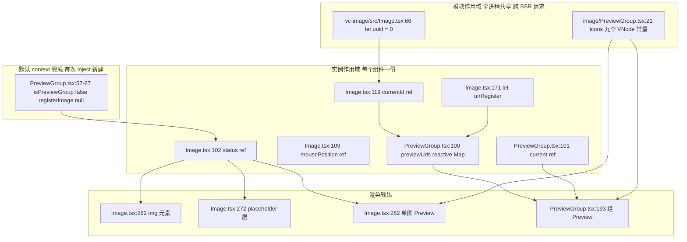
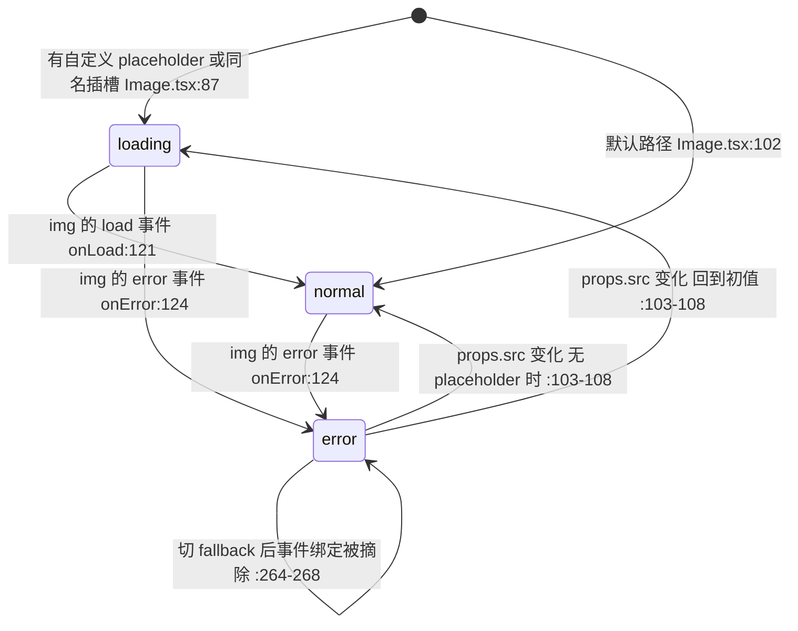
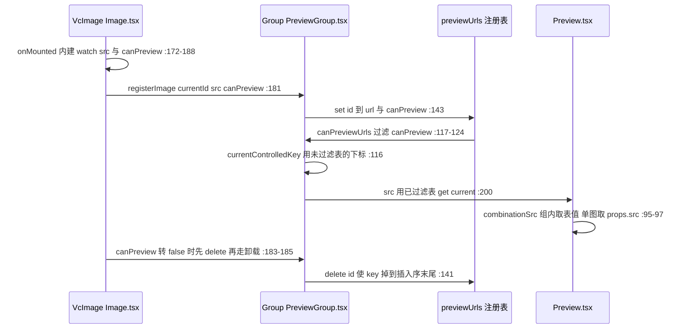

# C10-01 Image 图片

> **本篇解决**：`Image` 的加载态与错误态到底靠什么判定、`fallback` 在哪些条件下真的生效、图片自身生命周期与预览注册表之间有哪些接线是断的；以及「预览组的多实例状态挂在哪儿」这个具体问题的可复核答案。
> **前置**：C10-00 类横写：图片组的预览与对比关系　**读者坐标**：`03-components/10-media` 第 2/9 篇

## 一、职责与边界

`image` 负责一件事：把一张 `` 的**自身生命周期**（未加载／已加载／加载失败）翻译成三种可视输出（骨架占位、正常图、`fallback` 图），并决定这张图**有没有资格**进入预览。它不负责预览层的定位、层级、滚动锁与动画——那些在 `vc-dialog` 与 `_util/PortalWrapper` 里，见 A07 论点 7（浮层的层级是三套互不知情的账本）与 I10（z-index 层级编排）；本篇只登记 `Image` 侧把哪些值递下去的接线行号。预览的多图注册顺序、切换与 transform 分层已在 C10-00 论证，本篇不重述，只在需要处引用其编号。

依赖清单（`grep` 可复核，见 §七 检查点 1）：

- 向上被依赖：`packages/xiaoye-ui/src/image/index.tsx:3` 引 `../vc-image`，`:4` 引 `../vc-image/src/Image` 的 `imageProps`；`packages/xiaoye-ui/src/image/PreviewGroup.tsx:2` 引 `../vc-image/src/PreviewGroup`。`vc-image` 之外无人引它（全仓仅这两处）。
- 向下依赖：`../../_util/hooks/useMergedState`（`Image.tsx:7`）、`../../vc-util/Dom/css` 的 `getOffset`（`Image.tsx:6`）、`./Preview`（`Image.tsx:8`、`PreviewGroup.tsx:14`）、`vc-dialog`（经 `Preview` 的 `dialogPropTypes`，`Preview.tsx:49`）、`@xiaoye-ui/icons`（`image/index.tsx:8`、`image/PreviewGroup.tsx:7-16`）。
- 同级 `image-compare`、`carousel` 不依赖 `vc-image`（C10-00 §3.1 已定性为孤立节点）。

## 二、源码地图

主实现入口是 `packages/xiaoye-ui/src/vc-image/src/Image.tsx:67`（`ImageInternal` 定义处）；`packages/xiaoye-ui/src/image/index.tsx:17` 只是把图标与过渡名塞进 props 的薄封装。两个目录合计十个文件、1553 行。

| 文件 | 行数 | 职责 | 关键锚点 |
| --- | --- | --- | --- |
| `packages/xiaoye-ui/src/vc-image/src/Image.tsx` | 306 | 单图生命周期状态机、fallback 换源、组注册、点击开预览 | `imageProps`:28、`mergeDefaultValue`:57、`let uuid`:66、`status`:102、`onLoad`:121、`onError`:124、`onPreview`:129、注册 watch:172-189、渲染:197 |
| `packages/xiaoye-ui/src/vc-image/src/PreviewGroup.tsx` | 210 | 组注册表、context 提供、`current` 解析 | `context`:52、`previewUrls`:100、`currentControlledKey`:116、`canPreviewUrls`:117、`registerImage`:139、渲染:188 |
| `packages/xiaoye-ui/src/vc-image/src/Preview.tsx` | 426 | 预览层本体（本篇只取它与图片生命周期的接缝） | `previewProps`:48、`combinationSrc`:95、`onAfterClose`:103、`img`:385-397 |
| `packages/xiaoye-ui/src/vc-image/src/getFixScaleEleTransPosition.ts` | 61 | 拖拽越界回正纯函数 | 默认导出:38 |
| `packages/xiaoye-ui/src/vc-image/src/hooks/useFrameSetState.ts` | 31 | rAF 节流的 position 合并 | 默认导出:6 |
| `packages/xiaoye-ui/src/vc-image/index.ts` | 4 | 再导出，首行注明血统 `based on rc-image 4.3.2` | `:1` |
| `packages/xiaoye-ui/src/image/index.tsx` | 85 | `XYImage`：注入 icons、过渡名、locale 文案 | `mergedPreview`:26、mask 兜底:54、`:62` |
| `packages/xiaoye-ui/src/image/PreviewGroup.tsx` | 78 | `XYImagePreviewGroup`：**模块级 icons VNode 集** | `icons`:21、`previewGroupProps`:32、`mergedPreview`:47 |
| `packages/xiaoye-ui/src/image/style/index.ts` | 320 | 单图层与预览层 token 化样式 | `ComponentToken`:9、`ImageToken`:16、`-img-placeholder`:263、`-placeholder`:277 |
| `packages/xiaoye-ui/src/image/index.test.js` | 32 | 只有尺寸与挂载用例 | `mountTest(Image)`:5 |

## 三、架构与数据流

### 3.1 静态结构：状态分别挂在哪一层作用域上



读图要点：图片自己那套生命周期状态（`status`／`mousePosition`／`unRegister`）与组的注册表（`previewUrls`／`current`）都在 `setup` 里，**每个组件实例一份**，这部分的多实例隔离是干净的。真正挂在模块作用域的只有两个：`uuid`（`packages/xiaoye-ui/src/vc-image/src/Image.tsx:66`）与图标集 `icons`（`packages/xiaoye-ui/src/image/PreviewGroup.tsx:21`）。二者的后果不同，见论点 4。第三层 `DEF` 说明无组时的兜底不是模块单例而是 `inject` 的默认值字面量——每次调用重新分配（`packages/xiaoye-ui/src/vc-image/src/PreviewGroup.tsx:57-67`），代价见论点 5。

### 3.2 状态机：status 的四个入口与一个不可逆出口



三条边界要看清：其一，进入 `loading` 的唯一条件是「调用方给了自定义占位」（`packages/xiaoye-ui/src/vc-image/src/Image.tsx:87-89`），图片真实是否在加载**不参与判定**；其二，`error` 没有自愈路径，只有 `props.src` 变化会让状态回到初值（`packages/xiaoye-ui/src/vc-image/src/Image.tsx:103-108`）；其三，`loading` 的退出只靠 DOM 的 `load` 事件（`packages/xiaoye-ui/src/vc-image/src/Image.tsx:268`），组件为「图片已在浏览器缓存里」准备的那条补偿路径从未执行过——见论点 1。

### 3.3 一次注册：从挂载到组解析出 src



图中三个分岔的存在理由：`onMounted` 门控（`packages/xiaoye-ui/src/vc-image/src/Image.tsx:172`）让注册整段发生在客户端，SSR 阶段组是空的（后果见论点 4）；`currentControlledKey` 读未过滤表、`src` 读已过滤表（`packages/xiaoye-ui/src/vc-image/src/PreviewGroup.tsx:116` 与 `:200`）是两个不同的下标空间（后果见论点 3）；`canPreview` 转假时先退登（`packages/xiaoye-ui/src/vc-image/src/Image.tsx:183-185`）会让 Map 插入序重排（论点 3 的另一半）。

## 四、核心机制精读

### 论点 1：进入 `loading` 只由「有没有自定义占位」决定，而为缓存命中准备的补偿分支是一个永不触发的 watcher

断言：`status` 的初值不来自图片的真实加载进度，而来自 `isCustomPlaceholder`（`packages/xiaoye-ui/src/vc-image/src/Image.tsx:87-89`）；组件确实为「`load` 事件已经错过」写过一条 `img.complete` 兜底（`packages/xiaoye-ui/src/vc-image/src/Image.tsx:161-170`），但这条 watcher 的 source 写成 `() => img`——getter 返回 ref 对象本身、从不读 `.value`，因此依赖图里没有任何追踪项，回调一次也不会跑。于是 `loading` 的唯一出口是 DOM 的 `load` 事件（`packages/xiaoye-ui/src/vc-image/src/Image.tsx:268`）。

```tsx
// packages/xiaoye-ui/src/vc-image/src/Image.tsx:86
    const src = computed(() => preview.value.src ?? props.src);
    const isCustomPlaceholder = computed(
      () => (props.placeholder && props.placeholder !== true) || slots.placeholder,
    );
```

```tsx
// packages/xiaoye-ui/src/vc-image/src/Image.tsx:102
    const status = ref<ImageStatus>(isCustomPlaceholder.value ? 'loading' : 'normal');
    watch(
      () => props.src,
      () => {
        status.value = isCustomPlaceholder.value ? 'loading' : 'normal';
      },
    );
```

`placeholder` prop 的类型是 `PropTypes.any`（`packages/xiaoye-ui/src/vc-image/src/Image.tsx:41`），所以 `placeholder={true}` 是「我要内置灰底骨架」而不是「我要自定义占位」——`props.placeholder !== true` 这一条把布尔真排除（`:88`），内置态走的是 `` 自己的类名 `xy-image-img-placeholder`（`packages/xiaoye-ui/src/vc-image/src/Image.tsx:235`，样式在 `packages/xiaoye-ui/src/image/style/index.ts:263-270` 给灰底加一张 base64 山形图标）。只有传节点或用同名插槽时才产生 `loading` 初值，此时渲染的是覆盖层 `xy-image-placeholder`（`packages/xiaoye-ui/src/vc-image/src/Image.tsx:272-276`，样式 `packages/xiaoye-ui/src/image/style/index.ts:277-279` 即 `position:absolute; inset:0`，见 `packages/xiaoye-ui/src/image/style/index.ts:24-27` 的 `genBoxStyle`）。这个区别决定了后面所有时序问题的严重程度：**默认配置下没有骨架层，也就没有「骨架撤不掉」的风险；给了自定义占位，才把撤除动作交给一个事件。**

```tsx
// packages/xiaoye-ui/src/vc-image/src/Image.tsx:161
    const img = ref<HTMLImageElement>(null);
    watch(
      () => img,
      () => {
        if (status.value !== 'loading') return;
        if (img.value.complete && (img.value.naturalWidth || img.value.naturalHeight)) {
          onLoad();
        }
      },
    );
```

三处细节一起看：其一，`img` 在 `:161` 是 `const`，`:163` 的 getter 闭包读的是这个绑定而不是 `img.value`，Vue 的 `watch` 对函数型 source 不做 ref 解包，所以既没有追踪到任何响应式来源、返回值也永远同一引用；其二，仓库自带的 Vue 实测可复核（`node --input-type=module -e` 里 `watch(() => img, cb)` 与 `watch(img, cb)` 对照赋值后 `await nextTick()`，前者回调 0 次、后者 1 次）；其三，`if (status.value !== 'loading') return;`（`:165`）说明这段代码的**设计意图**就是「已经在 loading 且图其实早好了 → 直接置 normal」，即作者明确知道存在错过 `load` 事件的时序。意图存在、实现死亡。

后果需要限定条件：CSR 纯客户端挂载时，Vue 在创建 `` 元素阶段就绑好 `onLoad`（`packages/xiaoye-ui/src/vc-image/src/Image.tsx:268-270`），浏览器派发 `load` 要到插入文档之后，所以监听器一般来得及，缓存命中不出问题。真正暴露这条死路的是 **SSR／水合**：服务端 HTML 里已经有 ``，客户端 hydrate 之后才补事件绑定，此时命中缓存的图 `complete` 已是 `true` 且 `load` 不会再发一次——按源码，唯一能救场的就是 `:161-170`，而它不触发，于是自定义占位层永久停在 `inset:0` 的覆盖位上，且没有任何测试能发现它（`packages/xiaoye-ui/src/image/index.test.js` 全文只有 `mountTest(Image)` 与两个尺寸断言，实跑 3 个用例）。

### 论点 2：`error` 是单向门，且 `fallback` 永远进不了预览——`mergedSrc` 的 fallback 分支不可达

断言：`status` 一旦被置为 `error` 就只有换 `src` 才能离开；换源的同时组件把 `onLoad`／`onError` 从 `` 上摘掉，于是 fallback 自身失败无人知晓。更关键的是 `mergedSrc`（`packages/xiaoye-ui/src/vc-image/src/Image.tsx:222`）那个「错误态就用 fallback 去预览」的三元，在唯一的读取点上恒为假分支——因为预览层的挂载条件与 `isError` 互斥。

```tsx
// packages/xiaoye-ui/src/vc-image/src/Image.tsx:110
    const isError = computed(() => status.value === 'error');
    // ...
// packages/xiaoye-ui/src/vc-image/src/Image.tsx:120
    const canPreview = computed(() => props.preview && !isError.value);
    const onLoad = () => {
      status.value = 'normal';
    };
    const onError = (e: Event) => {
      status.value = 'error';
      emit('error', e);
    };
```

```tsx
// packages/xiaoye-ui/src/vc-image/src/Image.tsx:219
      const wrappperClass = cn(prefixCls, wrapperClassName, rootClassName, {
        [`${prefixCls}-error`]: isError.value,
      });
      const mergedSrc = isError.value && fallback ? fallback : src.value;
```

```tsx
// packages/xiaoye-ui/src/vc-image/src/Image.tsx:262
            
```

逐段解释：

1. `:264-268` 是**同一条件驱动的两个分支**：`isError && fallback` 为真时只设 `src`，不绑事件。因此 `fallback` 图 404 时既不会二次置 `error`（本来已是 `error`），也不会再 `emit('error')`——调用方拿不到「兜底也坏了」这个信号，`onError` prop（`packages/xiaoye-ui/src/vc-image/src/Image.tsx:50-52`）声明的 `HTMLImageElement['onerror']` 签名在这里彻底静默。
2. `:268` 绑的是 `src: imgSrc`，即 `props.src`（`:202` 从 `{ ...props, ...attrs }` 里解出的原名），**不是** `:86` 那个带 `preview.src` 兜底的 `src` computed。而注册表与预览用的是 `src.value`（`:181`、`:222`）。所以 `preview.src` 换源时（`apps/docs/examples/image/preview-src.vue:5-7` 是官方用法），状态机追踪的是缩略图，预览打开的是另一张 URL。
3. 于是组合出一个空窗：`preview.src` 指向的图 404，`status` 仍是 `normal`（因为只有缩略 `` 绑了 `onError`），`canPreview` 仍为真，而预览层的 `` 没有任何 `onLoad`／`onError` 绑定（`packages/xiaoye-ui/src/vc-image/src/Preview.tsx:385-397`）——预览里出现浏览器默认破图，组件既不知道也不上报。这与 C10-00 论点 3 定性的「预览层对图片是否加载成功毫不知情」是同一机制，此处补的是它的两条具体触发路径与 `fallback` 的失效范围。
4. `mergedSrc` 只被读一次：`packages/xiaoye-ui/src/vc-image/src/Image.tsx:290` 的 `src={mergedSrc}`，而它所在的条件块是 `packages/xiaoye-ui/src/vc-image/src/Image.tsx:282` 的 `{!isPreviewGroup.value && canPreview.value && (`。`canPreview` 含 `!isError.value`（`:120`），故进入 `:290` 时 `isError.value` 必为 `false`，三元右支恒成立，**`mergedSrc` 在语义上等价于 `src.value`**。组路径同理：注册进表的是 `src.value`（`:181`），错误项被 `canPreview` 过滤掉（`packages/xiaoye-ui/src/vc-image/src/PreviewGroup.tsx:117-124`），预览取 `canPreviewUrls.get(current)`（`packages/xiaoye-ui/src/vc-image/src/PreviewGroup.tsx:200`）。两条路都不会把 `fallback` 送进预览。

5. `error` 的离开条件只有一个：`props.src` 变化触发 `:103-108` 的 watch 回到初值。注意它 watch 的是 `props.src` 而非 `src` computed，所以「只换 `preview.src`」不会复位状态。
6. `xy-image-error` 类名（`packages/xiaoye-ui/src/vc-image/src/Image.tsx:220`）被生成但样式表里没有对应规则——`grep -rn "image-error" packages apps` 与 `grep -n -- "-error" packages/xiaoye-ui/src/image/style/index.ts` 双双零命中（第二种方法：对该文件 `grep -c error` 返回 0）。所以「错误态」在视觉上只由换源本身表达，调用方无法用 `xy-image-error` 写覆盖样式，因为本库自己也没写。

**与 C10-00 论点 3 末段的结论冲突（双方行号登记在此，本篇不改他人文档）**。对方原文在 `docs/column/03-components/10-media/C10-00-overview-类横写.md:293`（该篇论点 3 的标题在 `docs/column/03-components/10-media/C10-00-overview-类横写.md:238`），末句断言「预览取的是 `mergedSrc`（`packages/xiaoye-ui/src/vc-image/src/Image.tsx:222`），即错误态下预览打开的也是 fallback 图，而不是原图」。本节第 4 点的取证与之相反：`mergedSrc` 全仓只有一个读取点 `packages/xiaoye-ui/src/vc-image/src/Image.tsx:290`，而它整块处在 `packages/xiaoye-ui/src/vc-image/src/Image.tsx:282` 的 `canPreview.value` 守卫之内，`canPreview` 的定义（`packages/xiaoye-ui/src/vc-image/src/Image.tsx:120`）含 `!isError.value`，故错误态下预览层根本不渲染、`:222` 的 fallback 分支不可观测；组路径取的是过滤后的表（`packages/xiaoye-ui/src/vc-image/src/PreviewGroup.tsx:200`），错误项在 `packages/xiaoye-ui/src/vc-image/src/PreviewGroup.tsx:117-124` 就被滤掉。判据可复现：`grep -rn "mergedSrc" packages/xiaoye-ui/src` 只回 `packages/xiaoye-ui/src/vc-image/src/Image.tsx:222` 与 `:290` 两行。C10-00 论点 3 的其余结论（三态只在单图壳里、预览层对加载成功毫不知情、fallback 后事件解绑、骨架层挂载条件与 mask 的双条件）与本篇一致。同一论点还有一处待裁决：`docs/column/03-components/10-media/C10-00-overview-类横写.md:295` 写「mask 的内容优先级是插槽而非 prop」，而 `packages/xiaoye-ui/src/image/index.tsx:54` 是解构默认值，只在 `props.previewMask` 为 `undefined` 时才求值右侧，所以真实优先级是 prop 高于插槽高于内置默认（论证在本篇论点 5 末段）；`packages/xiaoye-ui/src/image/index.tsx:62` 更把非函数的 prop 值置 `null`，连插槽那一路一起撤掉，即 prop 的支配力比「插槽优先」更强。**2026-09-29 复裁：本篇两处均正确，C10-00 的 `:293`（含其 §七 坑 5 的同句）与 `:295` 已按此更正**，双方行号与判据保留在上面供回归核对。

### 论点 3：`preview.current` 是「未过滤注册表」的下标，而导航与取 src 走「已过滤表」——两个下标空间，且插入序会重排

断言：组内存在两套 `previewUrlsKeys`，同名不同源：`packages/xiaoye-ui/src/vc-image/src/PreviewGroup.tsx:115` 摊的是**原始** `previewUrls`（含 `canPreview: false` 的项），`packages/xiaoye-ui/src/vc-image/src/Preview.tsx:93` 摊的是 context 里提供的**已过滤** `canPreviewUrls`（`packages/xiaoye-ui/src/vc-image/src/PreviewGroup.tsx:179` 把过滤表当 `previewUrls` 名字提供出去）。于是 `preview.current` 与左右箭头的「第几张」根本不是同一个坐标系。

```tsx
// packages/xiaoye-ui/src/vc-image/src/PreviewGroup.tsx:113
    const mousePosition = ref<{ x: number; y: number }>(null);
    const isControlled = computed(() => previewVisible.value !== undefined);
    const previewUrlsKeys = computed(() => Array.from(previewUrls.keys()));
    const currentControlledKey = computed(() => previewUrlsKeys.value[preview.value.current]);
    const canPreviewUrls = computed(
      () =>
        new Map<number, string>(
          Array.from(previewUrls)
            .filter(([, { canPreview }]) => !!canPreview)
            .map(([id, { url }]) => [id, url]),
        ),
    );
```

```tsx
// packages/xiaoye-ui/src/vc-image/src/Preview.tsx:92
    const previewGroupCount = computed(() => previewUrls.value.size);
    const previewUrlsKeys = computed(() => Array.from(previewUrls.value.keys()));
    const currentPreviewIndex = computed(() => previewUrlsKeys.value.indexOf(current.value));
    const combinationSrc = computed(() => {
      return isPreviewGroup.value ? previewUrls.value.get(current.value) : props.src;
    });
```

关键在 `previewUrls` 这个名字指向什么：`PreviewGroup.tsx:179` 提供的是 `canPreviewUrls`，所以 `Preview.tsx:92-94` 的 `count`／`keys`／`index` 全在过滤表上；而 `PreviewGroup.tsx:116` 的 `currentControlledKey` 在未过滤表上取 `preview.current` 下标。两条推论都可自行复核：

1. 若组里第 0 张图 `preview={false}` 或加载失败（论点 2 的 `canPreview` 为假），`preview.current = 0` 解析出的 key 是一个**被过滤掉的 id**，于是 `packages/xiaoye-ui/src/vc-image/src/PreviewGroup.tsx:200` 的 `canPreviewUrls.value.get(current.value)` 返回 `undefined`，预览层的 `` 为空（`packages/xiaoye-ui/src/vc-image/src/Preview.tsx:390`）——不报错、不回落，直接空白。
2. `watch(currentControlledKey, val => setCurrent(val), { immediate: true, flush: 'post' })`（`packages/xiaoye-ui/src/vc-image/src/PreviewGroup.tsx:156-165`）把 `current` 钉在这个下标上；再加一个 `watchEffect`（`:166-175`）在「已显示且 visible 受控」时反复钉回去。

第二套钉回逻辑的可观测后果来自插入序。子图注册的唯一入口在 `onMounted` 里的 watch，且每次触发都先退登再注册：

```tsx
// packages/xiaoye-ui/src/vc-image/src/Image.tsx:172
    onMounted(() => {
      watch(
        [src, canPreview],
        () => {
          unRegister();
          if (!isPreviewGroup.value) {
            return () => {};
          }

          unRegister = registerImage(currentId.value, src.value, canPreview.value);

          if (!canPreview.value) {
            unRegister();
          }
        },
        { flush: 'post', immediate: true },
      );
    });
```

`unRegister` 执行 `previewUrls.delete(id)`（`packages/xiaoye-ui/src/vc-image/src/PreviewGroup.tsx:140-142`），随后 `registerImage` 再 `set`（`:143-146`）。`Map` 的语义是「删除后重新插入即排到末尾」，所以**任何一张子图的 `preview.src` 或 `canPreview` 变化都会让它从插入序的第 k 位跳到末位**。`previewUrlsKeys` 因而重排，`currentControlledKey` 变值，`:156` 的 watch 立刻 `setCurrent`——用户正在看的图被换掉。触发条件写实地存在：`apps/docs/examples/image/placeholder.vue:15` 那种「点按钮换 `src` 重新加载」的用法，在组里就会命中这条链。C10-00 论点 2 已经定性「顺序完全依赖 Map 的插入序」，本节补的是**插入序会被这个退登再注册的动作改写**，以及两个下标空间的具体错位点。

### 论点 4：跨实例共享的只有两样——`uuid` 计数器与模块级 icons VNode 集

断言：注册表与 `current` 都是实例作用域（`packages/xiaoye-ui/src/vc-image/src/PreviewGroup.tsx:100-101`），所以多个预览组互不污染；但 `let uuid = 0` 与图标集 `icons` 挂在模块作用域，前者每次 `setup` 都自增（含 SSR 阶段），后者是一批被多个 `Preview` 实例共享的 VNode 对象。

```tsx
// packages/xiaoye-ui/src/vc-image/src/Image.tsx:66
let uuid = 0;
const ImageInternal = defineComponent({
  // ...
// packages/xiaoye-ui/src/vc-image/src/Image.tsx:119
    const currentId = ref(uuid++);
```

`uuid` 在全仓只有两个位置（声明 `:66` 与自增 `:119`，`grep -rn "uuid" packages/xiaoye-ui/src/vc-image` 只回这两行）。它不进标记，因此不会造成水合结构错位，`error`／`normal` 的渲染结果与它无关；真实影响是：一个 Node 进程服务多个请求时它是**跨请求单调增长**的共享可变量，任何「用 id 做快照或断言」的测试都拿不到稳定值（`packages/xiaoye-ui/src/image/index.test.js` 目前没有任何此类断言）。这与 I14 论点 4 记的「能力探测结果缓存在被探测模块里、SSR 与首帧一律给 false」是同族问题：模块级状态在 SSR 下不再是纯函数。同族可变量还有一处：`let unRegister`（`packages/xiaoye-ui/src/vc-image/src/Image.tsx:171`）——但它在 `setup` 内，实例作用域，写法正确。

图标集的共享更值得注意：

```tsx
// packages/xiaoye-ui/src/image/PreviewGroup.tsx:21
export const icons = {
  rotateLeft: <RotateLeftOutlined />,
  rotateRight: <RotateRightOutlined />,
  zoomIn: <ZoomInOutlined />,
  zoomOut: <ZoomOutOutlined />,
  close: <CloseOutlined />,
  left: <LeftOutlined />,
  right: <RightOutlined />,
  flipX: <SwapOutlined />,
  flipY: <SwapOutlined rotate={90} />,
};
```

九个 VNode 在**模块求值时**创建一次，然后被 `packages/xiaoye-ui/src/image/PreviewGroup.tsx:70` 传给组、被 `packages/xiaoye-ui/src/image/index.tsx:35` 塞进每张单图的 `mergedPreview`。同一批对象因此会同时存在于页面上所有预览实例的渲染树里。而 `Preview.tsx` 对它们的两种处置不一致——工具条走克隆：

```tsx
// packages/xiaoye-ui/src/vc-image/src/Preview.tsx:365
              {tools.value.map(({ icon: IconType, onClick, type, disabled }) => (
                <li
                  // ...
                  onClick={onClick}
                  key={type}
                >
                  {cloneVNode(IconType, { class: iconClassName })}
                </li>
              ))}
```

左右切换按钮不克隆：`packages/xiaoye-ui/src/vc-image/src/Preview.tsx:406` 是 `{icons.value.left}`、`:417` 是 `{icons.value.right}`。`cloneVNode` 的存在说明「复用同一 VNode 需要复制」这一点在本文件内是被意识到的，只有这两处漏了。后果我没有可挂行号的源码证据，也不在本仓测试范围内，故只作条件句：若 Vue 在 patch 过程中依赖 VNode 自身携带的 `el`／`component` 字段，多个实例共享同一对象时可能相互覆盖；单预览组页面上观察不到问题，因为它一次只 mount 一个 `Preview`。改造建议见 §七 坑 5。

### 论点 5：`preview` 的三种取值在两层封装里被折叠，组层的 `preview={false}` 关不掉预览

断言：`preview` 的类型是布尔与 `ImagePreviewType` 的联合，默认 `true`（`packages/xiaoye-ui/src/vc-image/src/Image.tsx:43-46`）。但公开层永远把它换成对象（`packages/xiaoye-ui/src/image/index.tsx:26-44`），而 vendor 层只认对象（`packages/xiaoye-ui/src/vc-image/src/Image.tsx:76-85`），于是「布尔 `true`」这个默认值在真实调用链上从不出现，「布尔 `false`」在**组**这一层被静默丢弃。

```tsx
// packages/xiaoye-ui/src/vc-image/src/Image.tsx:76
    const preview = computed<ImagePreviewType>(() => {
      const defaultValues = {
        visible: undefined,
        onVisibleChange: () => {},
        getContainer: undefined,
      };
      return typeof props.preview === 'object'
        ? mergeDefaultValue(props.preview, defaultValues)
        : defaultValues;
    });
```

`typeof props.preview === 'object'` 是唯一的形状判定：`false` 不是对象、`true` 也不是，两者都落到 `defaultValues`。差别只在于 `canPreview` 用的是**原始 prop**（`packages/xiaoye-ui/src/vc-image/src/Image.tsx:120` 的 `props.preview &&`），所以单图层的 `preview={false}` 确实能关掉预览——这一层是对的。组层没有对应的短路：

```tsx
// packages/xiaoye-ui/src/vc-image/src/PreviewGroup.tsx:89
    const preview = computed<PreviewGroupPreview>(() => {
      const defaultValues = {
        visible: undefined,
        onVisibleChange: () => {},
        getContainer: undefined,
        current: 0,
      };
      return typeof props.preview === 'object'
        ? mergeDefaultValue(props.preview, defaultValues)
        : defaultValues;
    });
```

`props.preview === false` 在这里同样被换成 `defaultValues`，`isControlled`（`packages/xiaoye-ui/src/vc-image/src/PreviewGroup.tsx:114`）因此为假、`setShowPreview` 可用，而组自己那个 `<Preview>` 是**无条件渲染**的（`packages/xiaoye-ui/src/vc-image/src/PreviewGroup.tsx:193`，与单图 `Image.tsx:282` 的 `canPreview` 守卫形成对照）。子图那边也不看组的配置：`canPreview` 只读自己的 `props.preview`（`packages/xiaoye-ui/src/vc-image/src/Image.tsx:120`），而 `context.provide`（`packages/xiaoye-ui/src/vc-image/src/PreviewGroup.tsx:177-186`）里根本没有 `preview` 这个键——尽管接口 `GroupConsumerProps` 声明了它（`packages/xiaoye-ui/src/vc-image/src/PreviewGroup.tsx:32`）。结论：`<xy-image-preview-group :preview="false">` 不产生任何效果，公开层的 `mergedPreview` 还会把 `false` 原样透下去（`packages/xiaoye-ui/src/image/PreviewGroup.tsx:49-51`），让「已经处理过」的假象保留到最后。这是共则 §3 记的「API 面存活、实现死亡」在媒体类的实例。

顺带纠正一个优先级口径，`packages/xiaoye-ui/src/image/index.tsx:54` 的原文是：

```tsx
// packages/xiaoye-ui/src/image/index.tsx:54
      const { previewMask = slots.previewMask || defaultPreviewMask } = props;
```

解构默认值只在 `props.previewMask === undefined` 时求值，所以真实优先级是 **prop 大于插槽大于内置默认**。`:62` 再把结果塞回 vendor 的 `previewMask` 插槽（非函数就置 `null`），vendor 侧 `packages/xiaoye-ui/src/vc-image/src/Image.tsx:278` 只认插槽存在性，于是 prop 与插槽两条路最终都汇成同一个插槽。

### 论点 6：注册整段被 `onMounted` 门控，因此组的受控预览在 SSR 与首帧必然拿到空 `src`

断言：子图进表这件事只发生在客户端（`packages/xiaoye-ui/src/vc-image/src/Image.tsx:172` 的 `onMounted` 包裹），组自己的钉回 watch 却在 `setup` 里就 `immediate` 跑一次（`packages/xiaoye-ui/src/vc-image/src/PreviewGroup.tsx:161-164`）——此时表是空的。

```tsx
// packages/xiaoye-ui/src/vc-image/src/PreviewGroup.tsx:156
    watch(
      currentControlledKey,
      val => {
        setCurrent(val);
      },
      {
        immediate: true,
        flush: 'post',
      },
    );
    watchEffect(
      () => {
        if (isShowPreview.value && isControlled.value) {
          setCurrent(currentControlledKey.value);
        }
      },
      {
        flush: 'post',
      },
    );
```

服务端渲染时 `previewUrlsKeys` 为空数组，`currentControlledKey`（`:116`）为 `undefined`，`current` 被置成 `undefined`，`:200` 的 `get(current.value)` 返回 `undefined`，于是 SSR 输出的预览层里 `` 是空的（`packages/xiaoye-ui/src/vc-image/src/Preview.tsx:390`）。这不破坏「组内预览只在客户端才有意义」的常识，但它决定了一个具体行为差异：**单图的受控预览可以在首帧就有内容**（`src` 走 `mergedSrc`，`packages/xiaoye-ui/src/vc-image/src/Image.tsx:290`，不依赖注册表），**组的受控预览不行**（`apps/docs/examples/image/preview-group-visible.vue:9` 这类 `visible` 受控用法在 SSR 下首帧是空白，靠水合后子图 `onMounted` 注册 + `:166-175` 的 `watchEffect` 补上）。`getOffset` 只在点击回调里调（`packages/xiaoye-ui/src/vc-image/src/Image.tsx:131`），window 监听整块在 `onMounted` 内（`packages/xiaoye-ui/src/vc-image/src/Preview.tsx:287-300`，输入事件家族的机制归 C10-00 论点 5，此处只登记接线），所以本组件没有「服务端访问 window」这类 SSR 硬错误；SSR 风险集中在论点 1 的 `complete` 死路与本论点的空 `src`。

## 五、对外契约如何生效

属性清单不在本篇（见 `apps/docs/components/image.md`）。这一节只画「一个 prop 从入口到 DOM 的通路」以及它在哪些地方**换形状或断掉**。

**prop 面。** 公开层 `XYImage` 直接复用 vendor 的 `imageProps()` 作 props（`packages/xiaoye-ui/src/image/index.tsx:20`），自己没有增加任何键；`ImageProps` 类型则额外并入 `ImgHTMLAttributes`（`packages/xiaoye-ui/src/image/index.tsx:13-16`），靠 `inheritAttrs: false`（`:19`）＋ `{ ...attrs, ...props, prefixCls }` 的手工摊平（`:57`）送到 vendor。这条摊平有两个可验证的后果：原生 `alt`／`crossorigin`／`srcset` 等只能经 attrs 进入，而 vendor 侧的解构源是 `{ ...props, ...attrs }`（`packages/xiaoye-ui/src/vc-image/src/Image.tsx:216`）——attrs 覆盖 props，与公开层的 props 覆盖 attrs（`:57`）方向相反；两处方向相反的合并叠在一起，`prefixCls` 这类同名键的最终来源取决于谁被显式赋值（公开层在 `:57` 硬写了 `prefixCls: prefixCls.value`，所以它赢）。

`preview` 的通路最脆：`image/index.tsx:26-44` 把布尔 `true` 展开成对象、把 `false` 原样返回，vendor 再用 `typeof === 'object'` 判定形状（`packages/xiaoye-ui/src/vc-image/src/Image.tsx:82-84`），默认值折叠已在论点 5 论证。`placeholder`／`fallback` 两条 prop 只作用于缩略 ``，不进注册表（论点 2 第 4 点）。`onError`／`onClick` 走 `emits: ['click','error']`（`packages/xiaoye-ui/src/vc-image/src/Image.tsx:72`），两个声明都确有触发点（`:126`、`:151`、`:253`），不存在「声明了从不 emit」的死亡事件；但 `:264-268` 的摘绑定让 `error` 只在**第一次**失败时发出。

**slot 面。** `placeholder` 与 `previewMask` 是仅有的两个插槽。`placeholder` 的存在性参与状态机初值（`:88` 短路右侧的插槽存在性），`previewMask` 的存在性参与 mask 挂载（`:278`）。公开层把 prop 形态的 mask 统一塞回插槽（`packages/xiaoye-ui/src/image/index.tsx:60-63`），其中非函数值一律置 `null`（`:62`），于是 `previewMask={false}` 与「没传」殊途同归——两条路都靠「插槽不存在」这一条判据生效，而不是靠布尔判定。

**context 面。** 唯一的跨层通道是 `previewGroupContext`（`packages/xiaoye-ui/src/vc-image/src/PreviewGroup.tsx:51`），provide 的八个键（`:177-186`）里没有 `preview` 也没有 `mask`，所以子图对组的配置一无所知（论点 5）。inject 的默认值是一次性对象字面量（`:57-67`），其中 `registerImage: null`（`:65`）——它之所以没炸，是因为 vendor 在调用前用 `isPreviewGroup.value` 短路（`packages/xiaoye-ui/src/vc-image/src/Image.tsx:177`），这条守卫与被调用值的不一致是同一处的两个真相：类型 `GroupConsumerValue` 把 `registerImage` 声明成函数（`packages/xiaoye-ui/src/vc-image/src/PreviewGroup.tsx:48`），默认值却给 `null`，靠布尔守卫兜住。

**expose 面。** `ImageInternal` 不写 `expose`（`grep -rn "expose" packages/xiaoye-ui/src/vc-image` 零命中），所以 `ref` 拿到的实例只有 Vue 默认的 props／`$el`，没有「主动打开预览」「触发重新加载」这类命令式入口。受控打开因此只能走 `preview.visible`（`packages/xiaoye-ui/src/vc-image/src/Image.tsx:90-100` 的 `isControlled` ＋ `useMergedState`），这是刻意的：受控值同时短路了 `mousePosition` 记录（`:130`、`:156`），因为动画起点在无头受控场景下无从谈起。

**事件面断点。** `Preview` 声明两个 emit（`packages/xiaoye-ui/src/vc-image/src/Preview.tsx:63`），`close` 有宿主接收（`packages/xiaoye-ui/src/vc-image/src/Image.tsx:288`、`packages/xiaoye-ui/src/vc-image/src/PreviewGroup.tsx:198`），`afterClose` 没有——它在两个宿主文件里的唯一出现是 `ImagePreviewType` 的 `Omit` 列表（`packages/xiaoye-ui/src/vc-image/src/Image.tsx:18`），即「类型层面就禁止调用方传」。于是「预览彻底关闭」这个时机对外不存在，而它恰好是内部复位（`packages/xiaoye-ui/src/vc-image/src/Preview.tsx:103-110`）唯一的锚点：复位逻辑有人消费，同函数里的 `emit('afterClose')` 没人消费。写覆盖动画或做埋点的接手者会在这里卡住。

**RTL 面。** `useConfigInject` 已经合成的 `direction` 在整个 image 家族零读取（`grep -rn "direction" packages/xiaoye-ui/src/image packages/xiaoye-ui/src/vc-image` 无命中；两个宿主只解构 `prefixCls`／`rootPrefixCls`／`configProvider`，见 `packages/xiaoye-ui/src/image/index.tsx:22`、`packages/xiaoye-ui/src/image/PreviewGroup.tsx:44`）。左右箭头的**位置**仍会镜像，因为样式用的是逻辑属性（`packages/xiaoye-ui/src/image/style/index.ts:161` 与 `:165`），但**语义映射**恒定：类名 `switch-left` 绑 `onSwitchLeft`（`packages/xiaoye-ui/src/vc-image/src/Preview.tsx:401-404`，内部走 `setCurrent(前一项)`，`:152-153`）。这与共则 §3 记的 Rate 型缺陷（给了默认值吃掉全局配置）成因不同，是「压根没解构」；实际后果取决于 RTL 下期望是否翻语义，本篇不作定论。

## 六、设计取舍

**用 DOM 元素的 `load`／`error` 事件，而不是 offscreen `new Image()`。** 本仓只有两处用 `new Image()`（`packages/xiaoye-ui/src/watermark/index.tsx:189`、`packages/xiaoye-ui/src/upload/utils.tsx:90`），`vc-image` 一次都没用（判据 `grep -rn --exclude-dir=dist "new Image(" packages apps` 只回那两行源码命中；不加 `--exclude-dir=dist` 会多出 `packages/xiaoye-ui/dist/watermark.mjs` 与 `packages/xiaoye-ui/dist/upload/utils.mjs` 两条编译产物行）。好处是零额外请求对象、状态与真实渲染元素严格同源，且天然不碰服务端（`new Image()` 在 Node 里会直接抛）。赔上的代价是：事件是**一次性**的，任何在水合之后才挂上监听的情形都不可补——组件确实写了补码（`packages/xiaoye-ui/src/vc-image/src/Image.tsx:161-170`），但那条 watcher 死了（论点 1）。如果换成 `new Image()` 预探测，SSR 就必须显式门控，反而更糟；合理的修法是留在 DOM 上、把 watcher 的 source 改对。

**`status` 初值绑「有没有自定义占位」而不是绑「是否已开始加载」。** 这是为了让默认用法（不传 placeholder）不产生一层瞬时覆盖——不传占位时 `status` 直接 `normal`（`:102`），骨架层不进 DOM，也就没有淡出闪烁。代价是「给了占位」与「没给占位」是两条**时序模型完全不同**的路径：前者才存在撤不掉的可能，因而 bug 只在被专门配置的组件上出现，最难被默认测试矩阵覆盖。

**注册走 `onMounted` ＋ `flush: 'post'`。** 保证插入序等于挂载序、且注册时 `src`／`canPreview` 已有确定值（`packages/xiaoye-ui/src/vc-image/src/Image.tsx:172-188`）。换来的问题是双份的：SSR 期表恒空（论点 6）；以及为了让「同一张图换源」生效而采用的**退登再注册**策略直接把插入序打乱（论点 3）。如果改成 `previewUrls.set` 就地更新（同 key 不改变顺序，`packages/xiaoye-ui/src/vc-image/src/PreviewGroup.tsx:143`），重排问题就不存在——`:176` 那次 `unRegister()` 是这个坑的唯一来源。

**预览的 `zIndex` 完全交给样式。** JS 侧零 `zIndex` 字样（`grep -rn "zIndex" packages/xiaoye-ui/src/vc-image packages/xiaoye-ui/src/image/index.tsx` 无命中），层级来自组件 Token `zIndexPopup: token.zIndexPopupBase + 80`（`packages/xiaoye-ui/src/image/style/index.ts:313`，基准 1000 见 `packages/xiaoye-ui/src/theme/themes/seed.ts:68`），并被 `:125`、`:232`、`:243` 消费。好处是预览与遮罩的相对关系在一张表里可读；代价是它落在 CSS 而非 `zIndexManager` 的账本里，运行时调 `zIndexPopupBase` 不会改变 JS 侧任何记录——层级账本互不知情这件事归 A07 论点 7 与 I10 论点 6，本篇不展开。

**样式复用 Modal 的遮罩生成器。** `genModalMaskStyle` 从 `../../modal/style` 直引（`packages/xiaoye-ui/src/image/style/index.ts:3`，调用在 `:308`，并把 `componentCls` 换成 `previewCls`）。省掉一份遮罩实现，代价是 `image/style` 这条 side-effect 入口把 `modal/style` 整个模块拖进依赖图——只想要图片预览样式的消费者无法避开 Modal 的 token 计算。同类耦合还有一处：本组件把 `genBoxStyle`／`genImageMaskStyle` 定义在自己的样式文件里并 `export`（`packages/xiaoye-ui/src/image/style/index.ts:24-27`、`:29`），全仓除本文件外没有第二个引用者（`grep -rn --exclude-dir=dist "genBoxStyle" packages` 只回 `:24`、`:183`、`:198`、`:278` 四处，全在同一文件内），即「导出了一个私有工具」。

## 七、坑与改动指南

**坑 1：自定义 `placeholder` ＋ SSR 或缓存命中，骨架层永久停在图上**

- 触发：`<xy-image :src="…" >` 配 `placeholder` 插槽或节点（`apps/docs/examples/image/placeholder.vue:7-13` 就是这个形状），页面走 SSR／水合，且浏览器缓存已命中。
- 症状：真实图片已可见，但 `xy-image-placeholder` 覆盖层（`position:absolute; inset:0`）一直挂在 DOM 里不撤；`status` 恒为 `loading`。
- 原因：`loading` 的唯一出口是 DOM `load` 事件，水合期错过；为错过准备的 `img.complete` 兜底 watcher 因 source 写成 `() => img` 永不触发。
- 定位：`packages/xiaoye-ui/src/vc-image/src/Image.tsx:102`（初值）、`:161-170`（死 watcher）、`:268`（事件绑定）、`:272-276`（覆盖层）。**该分支无测试保护**——`packages/xiaoye-ui/src/image/index.test.js` 实跑 3 个用例且全是尺寸断言。

**坑 2：靠 `fallback` 兜底后，这张图从画廊里消失**

- 触发：组内一张图 404 且给了 `fallback`。
- 症状：缩略位显示兜底图，但点它不开预览；在组里它**不计入左右切换的序列**，总数少一。
- 原因：`canPreview = props.preview && !isError`（`:120`）为假 → 注册表里 `canPreview: false` 被过滤（`packages/xiaoye-ui/src/vc-image/src/PreviewGroup.tsx:117-124`），同时立即退登（`packages/xiaoye-ui/src/vc-image/src/Image.tsx:183-185`）。
- 定位：`packages/xiaoye-ui/src/vc-image/src/Image.tsx:120`、`:183-185`、`packages/xiaoye-ui/src/vc-image/src/PreviewGroup.tsx:117-124`。附带：`fallback` 自身再失败时不会二次 `emit('error')`（`packages/xiaoye-ui/src/vc-image/src/Image.tsx:264-268` 摘了绑定），调用方拿不到信号。

**坑 3：用 `preview.current` 定位「打开第 n 张」，遇到不可预览的图就错位**

- 触发：组里有任意一张 `preview={false}` 或已失败的图，同时 `preview.current` 传下标（`packages/xiaoye-ui/src/vc-image/src/PreviewGroup.tsx:22-26` 注释承诺的正是 index 语义）。
- 症状：预览打开的不是第 n 张；若第 n 张恰是不可预览项，预览层是空白而不报错。
- 原因：`currentControlledKey` 在**未过滤**表取下标（`:115-116`），`src` 在**已过滤**表取值（`:200`），而 Preview 的导航索引另用过滤表（`packages/xiaoye-ui/src/vc-image/src/Preview.tsx:93-94`）。三个坐标系。
- 定位：`packages/xiaoye-ui/src/vc-image/src/PreviewGroup.tsx:115`、`:116`、`:200`，`packages/xiaoye-ui/src/vc-image/src/Preview.tsx:92-96`。修法方向：把 `:116` 的 source 换成 `canPreviewUrls`，一处即可对齐（改后要重跑 §七 末尾的验证命令）。

**坑 4：组内热换 `src`（reload 类交互）会把正在看的预览跳到别的图**

- 触发：预览打开期间任一子图的 `preview.src`／`props.src`／`canPreview` 变化。
- 症状：`current` 被改写，画布换图；在 `preview.visible` 受控时更明显，因为 `watchEffect` 会持续钉回 `preview.current` 指向的 key。
- 原因：注册是「先 `delete` 再 `set`」，Map 的插入序因此把该 key 移到末尾（`packages/xiaoye-ui/src/vc-image/src/Image.tsx:176`＋`:181`、`packages/xiaoye-ui/src/vc-image/src/PreviewGroup.tsx:140-146`），`previewUrlsKeys` 变值触发 `:156-165` 的 `setCurrent`。
- 定位：同上；`packages/xiaoye-ui/src/vc-image/src/PreviewGroup.tsx:166-175` 是第二根钉回的手。无测试覆盖（`vc-image` 目录下无任何测试文件，`find packages/xiaoye-ui/src/vc-image -name "*.test.*"` 零命中）。

**坑 5：多个预览组同页时共享同一批模块级 VNode**

- 触发：页面出现两个以上 `xy-image-preview-group`，或组与单图混用。
- 症状：本仓没有可复现的失败用例可引；风险面是左右切换按钮渲染的是**同一对象**而非克隆体。
- 原因：`icons` 在模块求值时创建九个 VNode（`packages/xiaoye-ui/src/image/PreviewGroup.tsx:21-31`），经 `:70` 与 `packages/xiaoye-ui/src/image/index.tsx:35` 广播给所有实例；`Preview.tsx:406`、`:417` 直接渲染，而工具条 `:374` 走 `cloneVNode`。
- 定位：`packages/xiaoye-ui/src/image/PreviewGroup.tsx:21-31`，`packages/xiaoye-ui/src/vc-image/src/Preview.tsx:374` 对照 `:406`／`:417`。安全改法：把 `icons` 改成 `getIcons()` 工厂（每次调用返回新 VNode），或在两处补 `cloneVNode`。

**坑 6：想通过 `xy-image-preview-group` 的 `preview={false}` 关掉整组预览**

- 触发：`:preview="false"` 传给组。
- 症状：毫无变化，子图照旧可开预览。
- 原因：组侧 `typeof props.preview === 'object'` 把布尔折成默认对象（`packages/xiaoye-ui/src/vc-image/src/PreviewGroup.tsx:96-98`），组的 `Preview` 无条件渲染（`:193`），provide 出去的 context 又不含 `preview`（`:177-186`），子图只看自己（`packages/xiaoye-ui/src/vc-image/src/Image.tsx:120`）。
- 定位：上述四处，加上公开层的原样透传（`packages/xiaoye-ui/src/image/PreviewGroup.tsx:49-51`）。逐子图传 `preview={false}` 才是当前唯一有效写法。

**坑 7：改 a11y 接线前先知道它本来就是断的**

- 触发：给预览层加／改 `aria-hidden`。
- 症状：DOM 上看不到该属性，屏幕阅读器行为也不受它影响（关闭态实际由 `display:none` 承担，`packages/xiaoye-ui/src/vc-dialog/Dialog.tsx:209`）。
- 原因：`Dialog` `inheritAttrs: false` 且只从 attrs 取 `style`／`class`（`packages/xiaoye-ui/src/vc-dialog/Dialog.tsx:48`、`:167`），而 `Preview` 把所有 attrs 摊给 Dialog（`packages/xiaoye-ui/src/vc-image/src/Preview.tsx:350`）；`vc-dialog` 全文 `grep -rn "aria-hidden"` 零命中。组侧这一路还写错了键名——`ria-hidden`（`packages/xiaoye-ui/src/vc-image/src/PreviewGroup.tsx:195`，源码里唯一一处，`grep -rnw --exclude-dir=dist "ria-hidden" packages apps` 只回这一行；不加排除会多出 `packages/xiaoye-ui/dist/vc-image/src/PreviewGroup.mjs` 里的同一条编译产物），单图侧拼写正确（`packages/xiaoye-ui/src/vc-image/src/Image.tsx:285`）。
- 定位：即上三行。要真隐藏，得让 `Dialog` 转发 attrs 或直接在 `-root` 节点上设属性；只补拼写不解决任何用户可见问题。

**测试与改动安全边界。** `packages/xiaoye-ui/src/vc-image/` 整个目录没有测试文件（`find` 与 `grep -rln "vc-image" --include='*.test.*'` 两种方法相互印证），`packages/xiaoye-ui/src/image/index.test.js` 是唯一入口级保护，实跑 3 个用例：

```bash
cd packages/xiaoye-ui && npx vitest run src/image/index.test.js   # Tests 3 passed (3)
```

改动 §四 任一分支前，最低安全动作是补三例：（a）给 `placeholder` 插槽后把 `status` 从 `loading` 推到 `normal` 的触发路径；（b）`isError` ＋ `fallback` 时注册表的 `canPreview` 与预览挂载条件；（c）`preview.current` 在「组里含不可预览项」时的落点。改 `:176` 的退登顺序、或把 `currentControlledKey` 的 source 换成过滤表，都属于**公开行为变更**（`preview.current` 的下标语义会变），需要一并更新 `apps/docs/components/image.md` 与 `packages/xiaoye-ui/tests/__snapshots__/index.test.js.snap` 涉及的导出面确认。

## 附：本篇可证伪的三个检查点

1. **`vc-image` 不用 offscreen `new Image()` 探测加载，图片生命周期只绑在渲染出的 `` 上。** 命令：`grep -rn "new Image(" packages/xiaoye-ui/src/vc-image packages/xiaoye-ui/src/image` 返回空；再用 `grep -rn -e complete -e naturalWidth packages/xiaoye-ui/src/vc-image` 复核，唯一读点是 `packages/xiaoye-ui/src/vc-image/src/Image.tsx:166`，而它在 `packages/xiaoye-ui/src/vc-image/src/Image.tsx:162-170` 这条 watcher 内。
2. **`watch(() => img, cb)` 这种 source 不会触发回调**（论点 1 的机理）。命令：

   ```bash
   cd /Users/xiaoye/Desktop/publish/xiaoye-ui-vue && node --input-type=module -e "
   import { ref, watch, nextTick } from 'vue';
   const img = ref(null); let a = 0, b = 0;
   watch(() => img, () => { a++; });
   watch(img, () => { b++; });
   img.value = { complete: true };
   await nextTick();
   console.log('getter-returns-ref =', a, '| ref-as-source =', b);"
   ```

   预期 `getter-returns-ref = 0`、`ref-as-source = 1`；若某天改成 1，说明 `Image.tsx:162` 的 source 已被修正，坑 1 随之消失。
3. **`xy-image-error` 与 `preview.afterClose` 都是「生成面存在、消费面为零」。** 命令组：`grep -c error packages/xiaoye-ui/src/image/style/index.ts` 应为 `0`，而类名在 `packages/xiaoye-ui/src/vc-image/src/Image.tsx:220` 生成；`grep -n afterClose packages/xiaoye-ui/src/vc-image/src/Image.tsx packages/xiaoye-ui/src/vc-image/src/PreviewGroup.tsx` 只应回 `packages/xiaoye-ui/src/vc-image/src/Image.tsx:18` 那一行 `Omit` 列表，而 emit 点在 `packages/xiaoye-ui/src/vc-image/src/Preview.tsx:109`。
