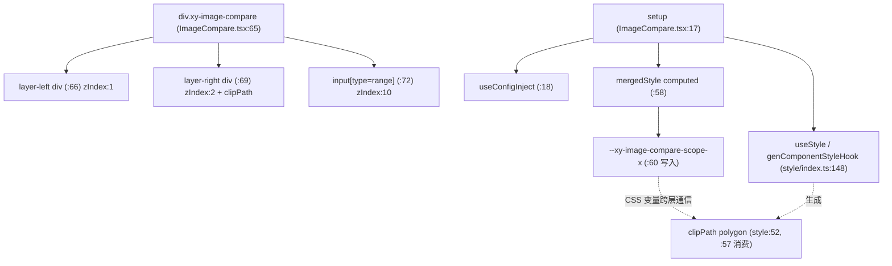
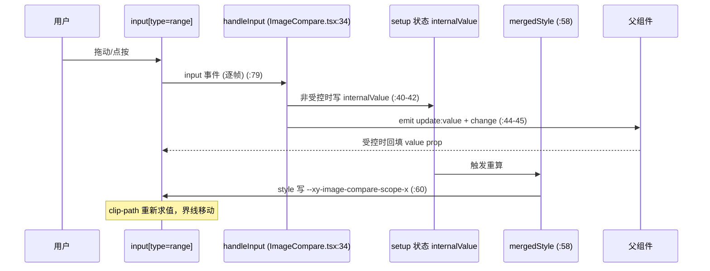
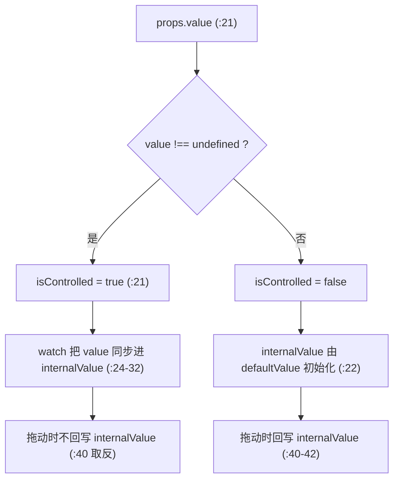

# C10-02 ImageCompare 图片对比

> **本篇解决**：ImageCompare 只有 85 行主实现，它的「拖拽对比」到底靠什么机制工作——滑块是不是自研、裁剪变量是不是死代码、change 事件在什么时机发、disabled 为什么可能是断链。
> **前置**：C10-01 Image 图片　**读者坐标**：`03-components/10-media` 第 2 篇

## 一、职责与边界

ImageCompare 负责的是「两张图等大叠放，中间一条可拖的分界线，界线一侧露 A、另一侧露 B」。它的边界很窄：只接收 `left`、`right` 两个插槽各放一张图（`packages/xiaoye-ui/src/image-compare/ImageCompare.tsx:66-71`），只维护一个 0～100 的百分比位置值，只做一件事——把这个值写进一个 CSS 变量让样式层去裁剪上层图（`packages/xiaoye-ui/src/image-compare/ImageCompare.tsx:60`）。

明确**不负责**的事：它不做图片加载/预览/懒加载（那是 C10-01《Image 图片》的职责，两者没有代码依赖，`grep` 本目录找不到任何 `import` 自 `image`）；它不自带一个可复用的滑块控件，拖拽交互完全交给浏览器原生 `<input type="range">`（`packages/xiaoye-ui/src/image-compare/ImageCompare.tsx:72-81`）；它不管理图片尺寸，靠 `aspectRatio: 16 / 9` 写死容器比例（`packages/xiaoye-ui/src/image-compare/style/index.ts:26`）。

依赖面（谁被它 import）：`useConfigInject`（`packages/xiaoye-ui/src/image-compare/ImageCompare.tsx:3`）、`useStyle`（本组件样式钩子，`packages/xiaoye-ui/src/image-compare/ImageCompare.tsx:4`）、`initDefaultProps`（`packages/xiaoye-ui/src/image-compare/ImageCompare.tsx:6`）、`registerComponent`（`packages/xiaoye-ui/src/image-compare/index.ts:3`）。被依赖面：仅 `packages/xiaoye-ui/src/components.ts:171-173` 的聚合导出与样式副作用导入，仓库内没有任何其它组件 import 它。

主题边界：本层 CSS-in-JS 的共性抽象（`genComponentStyleHook` 如何生成 `hashId`、`wrapSSR` 如何在 SSR 下注入样式）已由 `10-media` 横写篇 C10-00 讲过，本篇只在论点 2 末尾接一句「ImageCompare 不存在 Group/子件传错 prefixCls 的问题」作为差异点，不重述那套机制。与前置 C10-01《Image 图片》也没有实现级耦合：ImageCompare 的两个插槽接受任意内容（`packages/xiaoye-ui/src/image-compare/ImageCompare.tsx:66-71`），文档示例里塞的是裸 ``（`apps/docs/examples/image-compare/basic.vue:4-7`）而非 `<xy-image>`，因此即便不用 Image 也能独立工作——这一点对后文坑 4「改容器比例会牵动裁剪」有影响，因为裸 `` 的自适应完全靠样式的 `objectFit: cover`（`packages/xiaoye-ui/src/image-compare/style/index.ts:37-42`）撑着。

## 二、源码地图

组件极小，全量 315 行、五个源文件即可穷尽。主实现入口是 `packages/xiaoye-ui/src/image-compare/ImageCompare.tsx:9` 的 `defineComponent`。

| 文件 | 行数 | 职责 | 关键导出/符号 |
| --- | --- | --- | --- |
| `packages/xiaoye-ui/src/image-compare/ImageCompare.tsx` | 85 | 主组件：受控/非受控取值、写 CSS 变量、渲染两层与原生滑块 | `setup` `:17`、`handleInput` `:34`、`mergedStyle` `:58` |
| `packages/xiaoye-ui/src/image-compare/interface.ts` | 11 | Props 定义与 `ImageCompareProps` 类型 | `imageCompareProps` `:3` |
| `packages/xiaoye-ui/src/image-compare/index.ts` | 14 | 入口：`install` 与 `registerComponent` | `XYImageCompare.install` `:9` |
| `packages/xiaoye-ui/src/image-compare/style/index.ts` | 151 | CSS-in-JS：层叠、`clip-path` 裁剪、滑块外观、禁用样式 | `genImageCompareStyle` `:9`、`genComponentStyleHook('ImageCompare')` `:148` |
| `packages/xiaoye-ui/src/image-compare/__tests__/image-compare.test.js` | 54 | 四个用例：默认值/回调/受控/禁用 | `describe('ImageCompare')` `:4` |

命名与注册链路核对：组件 `name` 为 `XYImageCompare`（`packages/xiaoye-ui/src/image-compare/ImageCompare.tsx:10`），`prefixCls` 注入名 `'image-compare'`（`packages/xiaoye-ui/src/image-compare/ImageCompare.tsx:18`），因此渲染出的根类名是 `xy-image-compare`（测试断言 `packages/xiaoye-ui/src/image-compare/__tests__/image-compare.test.js:12`）；样式钩子的 token 名是 `'ImageCompare'`（`packages/xiaoye-ui/src/image-compare/style/index.ts:148`），与前缀名不同属正常约定。入口 `install` 走 `registerComponent`（`packages/xiaoye-ui/src/image-compare/index.ts:10`）而非硬编码标签名，符合仓库规范。

## 三、架构与数据流

三张图分别对应：静态结构（谁渲染谁、谁 import 谁）、一次拖动的数据闭环、以及受控/非受控的取值分支。

**图 1（静态结构）**——组件渲染树与模块依赖：



这张图要读者看到的重点：`setup` 层与样式层之间没有函数调用，唯一的通信信道是那一个 CSS 自定义属性 `--xy-image-compare-scope-x`——JS 侧写值（`packages/xiaoye-ui/src/image-compare/ImageCompare.tsx:60`），CSS 侧读值（`packages/xiaoye-ui/src/image-compare/style/index.ts:52`、`:57`）。拖动滑块改变的百分比，不经过任何 JS 重新计算裁剪多边形，全靠浏览器对 `clip-path: polygon(...var(...))` 的重新求值。

**图 2（一次拖动的数据闭环）**——`sequenceDiagram`：



注意 `input` 与 `change` 两条原生事件被绑到了**同一个** `handleInput`（`packages/xiaoye-ui/src/image-compare/ImageCompare.tsx:79-80`），而 `handleInput` 内部又固定同时发 `update:value` 与 `change`（`:44-45`）。所以「拖动过程中每帧一次 input」会被原样翻译成「`change` 每帧触发一次」，这是后文论点 5 与坑 2 的核心。

**图 3（受控/非受控取值分支）**——`flowchart TD`：



分支存在的理由：`value` 默认 `undefined`（`packages/xiaoye-ui/src/image-compare/interface.ts:4`），判据 `props.value !== undefined`（`packages/xiaoye-ui/src/image-compare/ImageCompare.tsx:21`）因此可靠——传 `value=0` 也会正确进入受控（`0 !== undefined` 为真），不受常见「三元 + 带默认值兜底恒不可达」陷阱影响。

## 四、核心机制精读

### 论点 1：滑块不是 Slider，是原生 `input[type=range]`，因此不存在「拖拽期 document 监听与卸载配对」这一类泄漏

派工提示要求「查拖拽期间 document 级监听与卸载是否成对」。结论是：本组件根本没有自建拖拽逻辑，也就没有可泄漏的监听。滑块是一枚原生 range input，铺满整个容器：

```tsx
// packages/xiaoye-ui/src/image-compare/ImageCompare.tsx:72-81
          <input
            type="range"
            min={0}
            max={100}
            value={internalValue.value}
            disabled={props.disabled}
            class={`${prefixCls.value}-slider`}
            onInput={handleInput}
            onChange={handleInput}
          />
```

配合样式把它拉成覆盖两层的透明热区（`packages/xiaoye-ui/src/image-compare/style/index.ts:60-71`，`inset: 0`、`zIndex: 10`、`cursor: ew-resize`、`backgroundColor: transparent`），浏览器原生就负责 pointer 捕获、拖动跟手、键盘方向键步进。判据：在整个组件目录里搜 `addEventListener`、`removeEventListener`、`onMounted`、`onBeforeUnmount` 四个标识符，一条都不命中（`grep -rn "addEventListener" packages/xiaoye-ui/src/image-compare/` 空结果）。这与 C04-07《Slider》是自研拖拽、必须在 pointermove 期间挂 document 级监听并在卸载时摘掉的情形不同——ImageCompare 把这块复杂度整体外包给了浏览器。所以「不成对泄漏」在这里是一个「压根没成对可言」的正向结论，不是坏味道。代价是：能定制的只有 thumb/track 的伪元素外观（`packages/xiaoye-ui/src/image-compare/style/index.ts:85-126` 分别写了 `-webkit-` 与 `-moz-` 两套 thumb），无法像 Slider 那样支持多值手柄、反向、tooltip 之类；本组件也确实只需要单值。

### 论点 2：`--xy-image-compare-scope-x` 是活变量，运行时经内联 style 写入；`var()` 里的 50% 兜底恒不可达

协调者扫到 `--xy-image-compare-scope-x` 并怀疑是死变量。核实结论：它**有人写、也有人读**，是活的，写入方式不是 `setProperty` 手工调用，而是把它塞进组件根节点的 `style` 对象（Vue 的 style 绑定对 `--` 开头的键会以自定义属性形式落到 DOM 上）：

```tsx
// packages/xiaoye-ui/src/image-compare/ImageCompare.tsx:58-61
    const mergedStyle = computed<CSSProperties>(() => ({
      ...(attrs.style as CSSProperties),
      '--xy-image-compare-scope-x': `${internalValue.value}%`,
    }));
```

该 `mergedStyle` 被绑到根 `div`（`packages/xiaoye-ui/src/image-compare/ImageCompare.tsx:65`）。消费点在样式层，`clip-path` 用它当分界线的 x 坐标：

```ts
// packages/xiaoye-ui/src/image-compare/style/index.ts:49-53
      [`${componentCls}-layer-right`]: {
        zIndex: 2,
        clipPath:
          'polygon(0 0, var(--xy-image-compare-scope-x, 50%) 0, var(--xy-image-compare-scope-x, 50%) 100%, 0 100%)',
      },
```

`var(..., 50%)` 的第二参数是「变量缺失时的兜底」。但 `mergedStyle`（`packages/xiaoye-ui/src/image-compare/ImageCompare.tsx:58-61`）无条件写入，只要组件渲染，根节点上就一定带着这个自定义属性，且值来自 `internalValue`（默认 `50`，见 `packages/xiaoye-ui/src/image-compare/interface.ts:5`）。于是 CSS 侧的 `50%` 兜底分支实际永远轮不到——它是「防御性冗余」而非死代码，删了不影响行为，但改组件默认值时要记得这里也写死了一个 50（见坑 6）。真正能证明「变量活着」的最强证据是它同时被两个方向消费：LTR 用 `var`（`packages/xiaoye-ui/src/image-compare/style/index.ts:52`），RTL 用 `calc(100% - var)`（`packages/xiaoye-ui/src/image-compare/style/index.ts:57`），两处都读同一个变量名。

这里还藏着一个不写出来就会被误改的机制：变量写在**根节点**（`packages/xiaoye-ui/src/image-compare/ImageCompare.tsx:65` 的 `<div style=...>`），而消费它的 `clip-path` 在**后代层** `layer-right` 上（`packages/xiaoye-ui/src/image-compare/style/index.ts:50`）——它能跨层生效，靠的是 CSS 自定义属性会沿 DOM 树继承。也就是说写入点与被裁元素之间必须是祖先—后代关系。若有人把 `mergedStyle` 从根 `div` 挪到某个不与 `layer-right` 构成祖先关系的节点（比如贴到 `layer-left` 上），`clip-path` 里的 `var()` 会静默取不到值、回落到 `50%` 兜底，界线就死在中间且不再跟手——这是一种「没有报错、只是不动」的失效，排查成本高。此外 `mergedStyle` 是一个每次 `internalValue` 变化就重算的 `computed`（`packages/xiaoye-ui/src/image-compare/ImageCompare.tsx:58`），Vue 的 style 绑定对 `--` 前缀的键走 `setProperty` 落到 `style` 内联属性上，这是「运行时写入」而非构建期常量，呼应协调者「到底是 setProperty/内联写入还是无人写入」的疑问：答案是内联 style 写入，且有人写、有人读。

渲染整体被 `wrapSSR` 包了一层（`packages/xiaoye-ui/src/image-compare/ImageCompare.tsx:63-64` 的 `return () => wrapSSR(<div .../>)`），`hashId` 由 `useStyle` 返回并被并进 `classes`（`packages/xiaoye-ui/src/image-compare/ImageCompare.tsx:50`）。这是本层所有 CSS-in-JS 组件的共性 SSR/哈希接线，机制细节见 `10-media` 横写篇 C10-00，本篇不重复展开；需要记住的差异点只有一个：ImageCompare 传给 `useStyle` 的 `prefixCls` 就是它自己的（`packages/xiaoye-ui/src/image-compare/ImageCompare.tsx:19` 用 `useConfigInject('image-compare', ...)` 的产物），不存在某些 Group/子件结构里「把父件 prefixCls 传进子件样式钩子导致同一份样式注册成两张表」的问题——因为该组件没有 Group/子件层级。

### 论点 3：裁剪只有 `clip-path` 一条实现，没有与「宽度百分比」混用；但左右两层的裁剪区间在 LTR/RTL 下方向相反

派工提示担心「`clip-path` 与宽度百分比两条裁剪实现混用导致一处失效」。核实：全样式文件里没有任何 `width: var(...)` 式的裁剪，也没有对 `layer-left` 施加任何裁剪，唯一的几何裁剪就是 `clip-path`。两层的分工是：

```ts
// packages/xiaoye-ui/src/image-compare/style/index.ts:45-58
      [`${componentCls}-layer-left`]: {
        zIndex: 1,
      },

      [`${componentCls}-layer-right`]: {
        zIndex: 2,
        clipPath:
          'polygon(0 0, var(--xy-image-compare-scope-x, 50%) 0, var(--xy-image-compare-scope-x, 50%) 100%, 0 100%)',
      },

      [`&${componentCls}-rtl ${componentCls}-layer-right`]: {
        clipPath:
          'polygon(calc(100% - var(--xy-image-compare-scope-x, 50%)) 0, 100% 0, 100% 100%, calc(100% - var(--xy-image-compare-scope-x, 50%)) 100%)',
      },
```

两层都被 `position: absolute; inset: 0` 拉满并等大（`packages/xiaoye-ui/src/image-compare/style/index.ts:28-30`），`layer-left` 恒为完整底图（`zIndex: 1`），`layer-right` 是叠在上面、被裁掉一部分的顶图（`zIndex: 2`）。LTR 下顶图的可见区是多边形 `0 → scope-x` 这一段，即**左半区**（`packages/xiaoye-ui/src/image-compare/style/index.ts:51-52`）；RTL 下改成 `100%-scope-x → 100%` 这一段，即**右半区**（`:56-57`）。因为顶图盖在底图上，所以「露出底图」的一侧就是被裁掉的一侧。把这层几何关系直白写出来：在 LTR（默认）下，左半区看到的是 `right` 插槽的图，右半区看到的是 `left` 插槽的图——这与文档 `apps/docs/components/image-compare.md:76-77` 把 `left` 描述为「左侧」、`right` 描述为「右侧」的直觉是相反的，而 RTL 下反而与直觉一致。这不是「一条实现失效」，而是「唯一实现的方向映射与插槽命名相反」，是坑 3 的根因。之所以能确定只有 `clip-path` 一种机制，是因为 `grep -n -e clipPath -e width packages/xiaoye-ui/src/image-compare/style/index.ts` 命中的 `width` 全是 `100%`（`packages/xiaoye-ui/src/image-compare/style/index.ts:25`、`:33`、`:38`、`:65`、`:74`）这类铺满用途，没有一处是「按 scope 变量取值来裁宽度」。

### 论点 4：受控/非受控是手写的，复刻了仓内 `useMergedState` 而没有用它

取值状态由三段手写代码组成：

```tsx
// packages/xiaoye-ui/src/image-compare/ImageCompare.tsx:21-46
    const isControlled = computed(() => props.value !== undefined);
    const internalValue = ref<number>(props.defaultValue);

    watch(
      () => props.value,
      val => {
        if (isControlled.value && val !== undefined) {
          internalValue.value = val;
        }
      },
      { immediate: true },
    );

    const handleInput = (e: Event) => {
      if (props.disabled) return;

      const target = e.target as HTMLInputElement;
      const value = Number(target.value);

      if (!isControlled.value) {
        internalValue.value = value;
      }

      emit('update:value', value);
      emit('change', value);
    };
```

判据是 `isControlled`（`packages/xiaoye-ui/src/image-compare/ImageCompare.tsx:21`）：`value` 有值即受控，受控时拖动不回写 `internalValue`（`packages/xiaoye-ui/src/image-compare/ImageCompare.tsx:40` 的 `!isControlled` 分支），完全依赖父级把 `value` 回填、再由 `watch`（`packages/xiaoye-ui/src/image-compare/ImageCompare.tsx:24-32`）同步进 `internalValue`；非受控时 `internalValue` 自己消化（`packages/xiaoye-ui/src/image-compare/ImageCompare.tsx:40-42`）。这套「`value`/`defaultValue`/内部态 + 受控不回写」正是仓库通用 hook `useMergedState`（`packages/xiaoye-ui/src/_util/hooks/useMergedState.ts:4`）所抽象的东西——它的初始化分支同样先取 `value.value`、再被 `defaultValue` 覆盖（`packages/xiaoye-ui/src/_util/hooks/useMergedState.ts:16-20`）。ImageCompare 没有 import 它（`packages/xiaoye-ui/src/image-compare/ImageCompare.tsx:1-7` 的 import 列表里没有 `useMergedState`）。手写版与 `useMergedState` 的一个行为差异值得记下：`watch` 里带 `immediate: true` 且条件是 `isControlled.value && val !== undefined`（`packages/xiaoye-ui/src/image-compare/ImageCompare.tsx:27`），从「不传 value」切到「传 value」首帧能同步；但反过来把 `value` 从有改回 `undefined`（受控退回非受控），`watch` 守卫 `val !== undefined`（`packages/xiaoye-ui/src/image-compare/ImageCompare.tsx:27`）会跳过、`internalValue` 停在最后一次受控值。这是「受控↔非受控切换」的边角，`useMergedState` 的 `triggerChange` 语义与此不同。该分支无任何测试保护（测试文件只有 `packages/xiaoye-ui/src/image-compare/__tests__/image-compare.test.js:32-41` 的单向受控断言，从不把 `value` 从有改回无）。

还有一处取值口径的不对称值得记：非受控时 `value` 来自 `Number(target.value)`（`packages/xiaoye-ui/src/image-compare/ImageCompare.tsx:38`），因原生 range 的 `min=0`/`max=100`/默认 `step=1`（`packages/xiaoye-ui/src/image-compare/ImageCompare.tsx:74-75`），这条路径拿到的永远是 `[0,100]` 的整数、天然落在合法域内；而受控时 `watch` 把外部 `val` 原样赋给 `internalValue`（`packages/xiaoye-ui/src/image-compare/ImageCompare.tsx:28`），没有任何 `clamp`。于是如果父级给了个越界的 `value`（如 150 或 -20），`mergedStyle` 会把 `150%` 写进变量（`packages/xiaoye-ui/src/image-compare/ImageCompare.tsx:60`），`clip-path: polygon(0 0, 150% 0, 150% 100%, 0 100%)`（`packages/xiaoye-ui/src/image-compare/style/index.ts:51-52`）的可见区就整块盖过底图、界线跑到容器外——受控与拖拽两条路径的合法性校验不一致，是改这块时容易忽略的口径差。该越界分支同样无测试。

### 论点 5：`change` 在拖动期间被逐帧触发，因为 `input` 与 `change` 绑到了同一个处理函数

`handleInput` 被同时挂到原生 `<input>` 的 `onInput` 与 `onChange`（`packages/xiaoye-ui/src/image-compare/ImageCompare.tsx:79-80`），而函数体内固定连发 `update:value` 与 `change` 两个事件（`packages/xiaoye-ui/src/image-compare/ImageCompare.tsx:44-45`）：

```tsx
// packages/xiaoye-ui/src/image-compare/ImageCompare.tsx:44-45
      emit('update:value', value);
      emit('change', value);
```

`<input type="range">` 的原生语义是：拖动过程中每移动一点发一次 `input`，松手时发一次 `change`。于是「拖动中每帧的 `input`」经 `handleInput` → `emit('change')`，会让用户的 `@change` 回调在**一次连续拖动里被调用上百次**，而不是只在提交时调用一次；松手时原生 `change` 再进来，`change` 又被多发一次。也就是说 `update:value`（为 `v-model:value` 服务、需要每帧）与 `change`（语义上应在松手提交时）被强行绑成同一节奏。更微妙的是：因为两个 emit 在同一个函数里无条件执行（`packages/xiaoye-ui/src/image-compare/ImageCompare.tsx:44-45`），无法把「实时同步」和「提交通知」拆开。测试还把这个行为固化成了期望——`packages/xiaoye-ui/src/image-compare/__tests__/image-compare.test.js:28-29` 用 `setValue(75)` 触发（test-utils 对 range 的 `setValue` 走 `input` 事件），随后断言 `onChange` 被以 75 调用；这条用例能过，恰恰说明「`input` 触发 `change`」被当成了正确行为。这是坑 2 的根因。

把两个 emit 拆开看还有一层影响：`update:value`（`packages/xiaoye-ui/src/image-compare/ImageCompare.tsx:44`）是 `v-model:value` 的驱动源，它本就该逐帧发，所以绑 `onInput` 是对的；问题只在 `change`（`packages/xiaoye-ui/src/image-compare/ImageCompare.tsx:45`）被同一个函数带着一起逐帧发。因此「用 `v-model:value` 实时联动」与「用 `@change` 做提交副作用」这两种官方都写了的用法（`apps/docs/components/image-compare.md:40` 说「非受控拖动时会触发 change 事件」、`:69` 把 change 列为事件），在后者的语义上互相打架：前者要的是每一帧，后者要的是松手那一次，而实现却无法区分进来的到底是 `input` 还是 `change`——`handleInput` 不读 `e.type`（`packages/xiaoye-ui/src/image-compare/ImageCompare.tsx:34-46`）。正确修法是把 `onInput` 与 `onChange` 各接一个函数，`update:value` 在两者都发、`change` 只在 `onChange` 那条发；但那样会改到测试对 `setValue`（触发 `input`）断言 `onChange` 被调的既有契约（`packages/xiaoye-ui/src/image-compare/__tests__/image-compare.test.js:28-29`）。

### 论点 6：`disabled` 是断链的——`useConfigInject` 已合成好的 `disabled` 没被取用，组件直读 `props.disabled`

`setup` 里对 `useConfigInject` 的解构只取了两个字段：

```tsx
// packages/xiaoye-ui/src/image-compare/ImageCompare.tsx:18
    const { prefixCls, direction } = useConfigInject('image-compare', props);
```

而 `useConfigInject` 其实已经把 `disabled` 合好了——它把本组件 `props.disabled` 与全局 `DisabledContext` 用 `??` 串起来（`packages/xiaoye-ui/src/config-provider/hooks/useConfigInject.ts:43`：`const disabled = computed<boolean>(() => props.disabled ?? disabledContext.value);`），并放进返回值（`packages/xiaoye-ui/src/config-provider/hooks/useConfigInject.ts:69`）。ImageCompare 没有把这个 `disabled` 解构出来，转而在三处直接读原始 `props.disabled`：`handleInput` 早退（`packages/xiaoye-ui/src/image-compare/ImageCompare.tsx:35`）、根类名 `-disabled`（`packages/xiaoye-ui/src/image-compare/ImageCompare.tsx:53`）、原生 input 的 `disabled` 属性（`packages/xiaoye-ui/src/image-compare/ImageCompare.tsx:77`）。由于 `disabled` 的 prop 默认值是 `undefined`（`packages/xiaoye-ui/src/image-compare/interface.ts:6`），当用户不在 `<xy-image-compare>` 上直接写 `disabled`、而是指望外层 `<ConfigProvider>` 或 `DisabledContext` 统一禁用时，`props.disabled` 恒为 `undefined`、那三处判断全部落空——全局禁用对 ImageCompare 零效果。这正是派工共则 §3 描述的「断链①：组件 setup 只解构 prefixCls/size/direction，不取 disabled」的同款形状。用 `grep -n -e useConfigInject -e disabled packages/xiaoye-ui/src/image-compare/ImageCompare.tsx` 可复核：第 18 行取 config 但不含 disabled，第 35/53/77 行用 disabled 但不经 config，两条线不相交。测试只覆盖了「显式传 `disabled: true`」这一路径（`packages/xiaoye-ui/src/image-compare/__tests__/image-compare.test.js:43-53`），全局禁用这条路径无测试保护。

## 五、对外契约如何生效

组件声明了五个 prop（`packages/xiaoye-ui/src/image-compare/interface.ts:3-9`）：`value`、`defaultValue`、`disabled`、`onChange`、`onUpdate:value`。其中没有任何一个是「样式类 API」——契约全部围绕那一个百分比值流动，路径如下。

`value` 决定受控与否：进入 `isControlled`（`packages/xiaoye-ui/src/image-compare/ImageCompare.tsx:21`）与 `watch` 源（`packages/xiaoye-ui/src/image-compare/ImageCompare.tsx:25`），最终经 `internalValue` 落到 CSS 变量（`packages/xiaoye-ui/src/image-compare/ImageCompare.tsx:60`），并不直接出现在任何 `v-if`/属性上。`defaultValue` 只在 `ref(props.defaultValue)` 处用一次（`packages/xiaoye-ui/src/image-compare/ImageCompare.tsx:22`），受控时被 `watch` 的 immediate 运行覆盖（`packages/xiaoye-ui/src/image-compare/ImageCompare.tsx:24-32`），与文档 `apps/docs/components/image-compare.md:45` 的「提供 value 时 defaultValue 不再影响当前值」一致。`disabled` 走的是断链路径（论点 6），此处不赘。

两个事件 `onChange` / `onUpdate:value` 值得单独说清：本组件**没有声明 `emits` 选项**（`grep -rn "emits" packages/xiaoye-ui/src/image-compare/` 空结果，`packages/xiaoye-ui/src/image-compare/ImageCompare.tsx:9-17` 的选项里也没有 `emits`）。这里的做法是「事件即 prop」——把回调以 `onChange`（`packages/xiaoye-ui/src/image-compare/interface.ts:7`）与 `'onUpdate:value'`（`packages/xiaoye-ui/src/image-compare/interface.ts:8`）声明成普通 prop，`emit('change', value)`（`packages/xiaoye-ui/src/image-compare/ImageCompare.tsx:45`）在运行时按 Vue 的 `props[toHandlerKey(event)]` 规则解析到 `props.onChange` 并调用它，`emit('update:value', value)`（`packages/xiaoye-ui/src/image-compare/ImageCompare.tsx:44`）解析到 `props['onUpdate:value']`。因此 `v-model:value`（`apps/docs/examples/image-compare/controlled.vue:3`）能成立：`value` prop 进（`packages/xiaoye-ui/src/image-compare/ImageCompare.tsx:21`）、`update:value` 出（`packages/xiaoye-ui/src/image-compare/ImageCompare.tsx:44`）。因为 `onChange`/`onUpdate:value` 是**已声明 prop**，它们不会出现在 `attrs` 里，也就不会被根节点的 `{...attrs}`（`packages/xiaoye-ui/src/image-compare/ImageCompare.tsx:65`）误绑成第二个 DOM 监听器——这一点配合 `inheritAttrs: false`（`packages/xiaoye-ui/src/image-compare/ImageCompare.tsx:11`）才成立。

`inheritAttrs: false` 之后，透传的 `class` 与 `style` 被手工合并：`class` 在 `classes` 里显式带上 `attrs.class`（`packages/xiaoye-ui/src/image-compare/ImageCompare.tsx:51`），`style` 在 `mergedStyle` 里展开 `attrs.style`（`packages/xiaoye-ui/src/image-compare/ImageCompare.tsx:59`），两处都排在 CSS 变量之前，确保用户的类名/内联样式生效且不被变量覆盖。插槽只有 `left`、`right` 两个（`packages/xiaoye-ui/src/image-compare/ImageCompare.tsx:13-16`），分别渲染进底图与顶图层（`packages/xiaoye-ui/src/image-compare/ImageCompare.tsx:66-71`），注意这里没有 `default` 插槽，二者缺一即整层为空。组件没有 `expose`（`packages/xiaoye-ui/src/image-compare/ImageCompare.tsx:17` 的 setup 参数没解构 `expose`），外部拿不到任何实例方法，只能靠 `v-model:value` 从数据面读写。

一个容易被忽略的写法叠影：根节点是 `<div {...attrs} class={classes.value} style={mergedStyle.value}>`（`packages/xiaoye-ui/src/image-compare/ImageCompare.tsx:65`），即把 `attrs` 整体展开、又在其后各写了一遍 `class`/`style`。Vue 的 JSX 编译在「展开 + 同名显式属性」并存时走 `mergeProps`，会把 `attrs.class` 与 `classes.value` 拼成一个数组、把 `attrs.style` 与 `mergedStyle` 合并成数组。而 `classes.value` 内部已经手动并入了 `attrs.class`（`packages/xiaoye-ui/src/image-compare/ImageCompare.tsx:51`）、`mergedStyle` 也并入了 `attrs.style`（`packages/xiaoye-ui/src/image-compare/ImageCompare.tsx:59`）——于是同一份用户类名在最终 `class` 里会出现两次（浏览器去重，行为无害），但「合并 attrs」这件事被写了两遍（一次靠 `mergeProps` 隐式、一次靠 `classes`/`mergedStyle` 显式）。这不是缺陷，但删掉 `:51`/`:59` 那两行手并入并不会立刻报错（`mergeProps` 已兜住），反而容易让后来人误以为那是必需的、进而在改 `{...attrs}` 时漏掉真正的合并责任。

`min`/`max`/`step` 三个本可暴露的滑块参数被硬编码在原生 input 上：`min={0}`（`packages/xiaoye-ui/src/image-compare/ImageCompare.tsx:74`）、`max={100}`（`packages/xiaoye-ui/src/image-compare/ImageCompare.tsx:75`），`step` 未写、取浏览器默认 1。`interface.ts` 的 props 里没有这三个键（`packages/xiaoye-ui/src/image-compare/interface.ts:3-9`），因此用户无法把对比范围限制在某一段（例如只允许 20%~80%）——这与论点 1 的「把复杂度外包给原生 range」是同一个取舍的两面。

## 六、设计取舍

**取舍 1：外包给原生 `input[type=range]`，而不是复用 Slider/自研拖拽。** 换来的是零生命周期管理、零 document 监听、天然键盘可访问（方向键步进由浏览器提供），这也是论点 1 里「查不到 document 监听泄漏」的根本原因——因为它压根不管拖拽。`::-moz-range-thumb` 与 `::-webkit-slider-thumb` 两套伪元素样式（`packages/xiaoye-ui/src/image-compare/style/index.ts:85-104`）是这条路必须付的兼容税。赔上的是：滑块只能单值、只能百分比、外观可定制面窄，且受原生事件语义牵制——正是论点 5 那个「`input` 与 `change` 同函数」问题的来源。若改用 Slider 组件承载，`change` 时机本可由 Slider 内部区分，但代价是把 `xy-slider` 拉进依赖、且要把值域 0-100 与像素拖拽来回换算。

**取舍 2：用一个 CSS 变量跨层通信，而不是把 `clip-path` 也算进内联 style。** 组件其实可以在 `mergedStyle` 里直接写 `clipPath`（`packages/xiaoye-ui/src/image-compare/ImageCompare.tsx:58-61`），但它选择只写变量、把多边形留给样式表（`packages/xiaoye-ui/src/image-compare/style/index.ts:51-52`）。好处是裁剪几何与 token 化样式同处一层、RTL 变体只需再写一条 CSS 规则（`packages/xiaoye-ui/src/image-compare/style/index.ts:55-58`），JS 无需 `direction` 分支。代价是变量名 `--xy-image-compare-scope-x` 成为一个跨文件隐式契约：改样式里的 `var()` 名字或改 JS 里的写入键，任一侧漏改都静默失效（`grep` 两处必须同名，见本篇检查点 2）。

**取舍 3：手写受控态而不接 `useMergedState`。** 见论点 4。省下的是一个 hook 抽象层的间接性，换来 26 行直白代码；赔上是与仓内约定不一致、且受控↔非受控切换的边角语义与 `useMergedState` 悄悄不同。

**取舍 4：可访问性搭原生 range 的便车。** 焦点可见环是纯 CSS 写给伪元素的（`packages/xiaoye-ui/src/image-compare/style/index.ts:106-116` 对 `:focus-visible` 下的 `-webkit-slider-thumb`/`-moz-range-thumb` 各加 `boxShadow` 与 `outline`），悬停放大是 `:hover::-webkit-slider-thumb`（`packages/xiaoye-ui/src/image-compare/style/index.ts:118-126`）。因为交互宿主是原生 `input`，键盘 Tab 聚焦、方向键改值、以及 `disabled` 时的 `:not-allowed`（`packages/xiaoye-ui/src/image-compare/style/index.ts:129-143`）都由浏览器免费给到，组件无需自写 `role`/`aria`/`keydown`。换来的是零 a11y 代码；赔上是「焦点态只能贴在原生 thumb 上」，一旦哪天把 `input[type=range]` 换成自绘 div（为了支持论点 3 提到的方向修正或更宽的定制），这些 `:focus-visible`/`:hover` 伪元素规则会整体失效、且要重新补键盘与 ARIA——这是改这条实现时最容易被漏掉的一整块。

## 七、坑与改动指南

**坑 1｜全局禁用无效。**
- 触发：不写 `<xy-image-compare disabled>`，而靠外层 `ConfigProvider` / `DisabledContext` 统一禁用。
- 症状：滑块仍可拖动、根节点没有 `xy-image-compare-disabled` 类名。
- 原因：`setup` 只解构 `prefixCls, direction`（`packages/xiaoye-ui/src/image-compare/ImageCompare.tsx:18`），没取 `useConfigInject` 合成的 `disabled`（`packages/xiaoye-ui/src/config-provider/hooks/useConfigInject.ts:43`），三处禁用判断全读 `props.disabled`（`packages/xiaoye-ui/src/image-compare/ImageCompare.tsx:35`、`:53`、`:77`），其默认值 `undefined`（`packages/xiaoye-ui/src/image-compare/interface.ts:6`）。
- 定位：改法是把 `disabled` 从 `useConfigInject` 解构出来替换那三处直读；测试需补一条「外层 DisabledContext=true 时滑块禁用」的用例（现有 `packages/xiaoye-ui/src/image-compare/__tests__/image-compare.test.js:43-53` 只测显式 prop）。

**坑 2｜`change` 在拖动中逐帧刷屏。**
- 触发：给组件挂 `@change` 想做「提交时才记一次日志/发请求」。
- 症状：一次拖动里回调被调上百次，松手再补一次。
- 原因：`onInput` 与 `onChange` 绑到同一个 `handleInput`（`packages/xiaoye-ui/src/image-compare/ImageCompare.tsx:79-80`），`handleInput` 无条件 `emit('change')`（`packages/xiaoye-ui/src/image-compare/ImageCompare.tsx:45`）。
- 定位：要把实时与提交拆开，得把 `onInput`/`onChange` 分成两个处理函数，只有原生 `change` 那条才 `emit('change')`；注意现测试 `packages/xiaoye-ui/src/image-compare/__tests__/image-compare.test.js:28-29` 依赖「input 触发 change」，改动会牵动它。

**坑 3｜`left`/`right` 插槽与视觉左右相反。**
- 触发：按文档「`left` 是左侧、`right` 是右侧」（`apps/docs/components/image-compare.md:76-77`）摆放「对比前/对比后」两张图。
- 症状：默认（LTR）下左半显示的是 `right` 插槽的图、右半显示 `left` 插槽的图；一旦切 RTL 又反过来。
- 原因：顶图层 `layer-right` 被 `clip-path` 裁到 `[0, scope-x]` 即左半区（`packages/xiaoye-ui/src/image-compare/style/index.ts:51-52`），盖在底图 `layer-left`（`packages/xiaoye-ui/src/image-compare/style/index.ts:45-47`）之上；RTL 变体裁到右半区（`packages/xiaoye-ui/src/image-compare/style/index.ts:56-57`）。
- 定位：要么改 `clip-path` 的区间与 `zIndex` 归属，要么改文档与插槽命名对齐；这是纯几何问题，别去 `setup` 找方向分支——JS 侧根本没有方向逻辑（`packages/xiaoye-ui/src/image-compare/ImageCompare.tsx:54` 只打了个 `-rtl` 类名）。

**坑 4｜改容器比例/溢出会破坏裁剪。**
- 触发：给组件传 `style` 改高度，或把外层 `overflow` 设成 `visible`。
- 症状：两张图错位，或裁剪边界跑到可视区外。
- 原因：比例被写死 `aspectRatio: 16 / 9`（`packages/xiaoye-ui/src/image-compare/style/index.ts:26`）、`overflow: hidden`（`packages/xiaoye-ui/src/image-compare/style/index.ts:24`）且两层 `inset: 0` 铺满（`packages/xiaoye-ui/src/image-compare/style/index.ts:29-30`），`clip-path` 百分比参考的是这层的盒子尺寸。
- 定位：想自定义比例应改 `style/index.ts:22-26` 的根规则或用 token 化，而不是从外部盖 `height`；该分支无测试。

**坑 5｜受控模式不回填 `value` 就拖不动。**
- 触发：只监听 `update:value`/`change` 但不在回调里更新绑给 `value` 的状态。
- 症状：滑块松手后弹回原位，像「拖不动」。
- 原因：受控时 `handleInput` 不写 `internalValue`（`packages/xiaoye-ui/src/image-compare/ImageCompare.tsx:40` 的 `!isControlled` 才回写），原生 `input` 的 `value` 绑定回读的是 `internalValue`（`packages/xiaoye-ui/src/image-compare/ImageCompare.tsx:76`），父级不回填则重渲染复位。
- 定位：这是受控组件的标准约束，不是 bug；文档 `apps/docs/examples/image-compare/controlled.vue:3` 用 `v-model:value` 才正确。排查时确认外部状态被 `update:value` 更新即可。

**坑 6｜默认值 50 写在三处，改初值要同步。**
- 触发：想把初始分界线从中间挪到别处，只改了一个地方。
- 症状：非受控初值与 CSS 兜底不一致，或某条路径没生效。
- 原因：`interface.ts` 的 `defaultValue: { default: 50 }`（`packages/xiaoye-ui/src/image-compare/interface.ts:5`）、`initDefaultProps(..., { defaultValue: 50 })`（`packages/xiaoye-ui/src/image-compare/ImageCompare.tsx:12`）与样式里 `var(--xy-image-compare-scope-x, 50%)` 的兜底（`packages/xiaoye-ui/src/image-compare/style/index.ts:52`）三处各写了一个 50。前两者对运行时值生效（后者兜底恒不可达，见论点 2），但都是「读起来像默认值」的字面量。
- 定位：改运行时初值只需 `defaultValue` 的默认（前两处任选其一为准）；CSS 兜底可保留但别指望它。

测试现状小结：`packages/xiaoye-ui/src/image-compare/__tests__/image-compare.test.js` 共 4 个 `it`（`:5`、`:19`、`:32`、`:43`），后缀 `.js` 落在 `packages/xiaoye-ui/vitest.config.mts:33` 的 `src/**/*.test.{js,ts,jsx,tsx}` glob 内、确会被执行。覆盖到的是「默认值、change、单向受控、显式禁用」四条，未覆盖：RTL 裁剪方向、全局 disabled 断链、受控↔非受控切换、`change` 逐帧语义的正确性。

## 附：本篇可证伪的三个检查点

1. **滑块非自研、无 document 监听泄漏**：`grep -rn -e addEventListener -e removeEventListener -e onMounted -e onBeforeUnmount packages/xiaoye-ui/src/image-compare/` 应为空结果；滑块就是原生 range（`packages/xiaoye-ui/src/image-compare/ImageCompare.tsx:72-81`）。
2. **`--xy-image-compare-scope-x` 是活变量、两处方向不同**：`grep -rn "xy-image-compare-scope-x" packages/xiaoye-ui/src` 应同时命中写入点 `ImageCompare.tsx:60` 与消费点 `style/index.ts:52`、`style/index.ts:57`；两条消费分别是 `var(...)` 与 `calc(100% - var(...))`，即 LTR/RTL 方向相反。
3. **`disabled` 断链可复核**：`grep -n -e "useConfigInject" -e "props.disabled" packages/xiaoye-ui/src/image-compare/ImageCompare.tsx` 会显示解构行（`:18`）不含 `disabled`，而使用行（`:35`、`:53`、`:77`）读的是 `props.disabled`；对照 `packages/xiaoye-ui/src/config-provider/hooks/useConfigInject.ts:43` 已知 `disabled` 是被合成并返回的（`:69`）。
