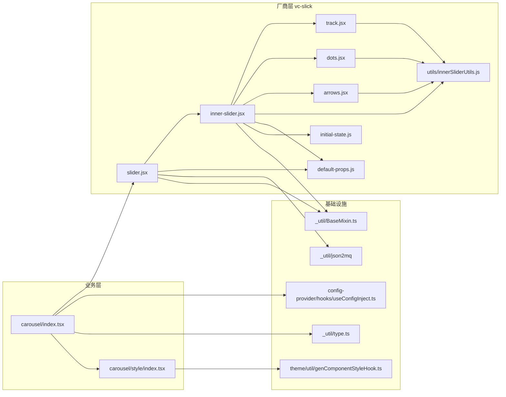
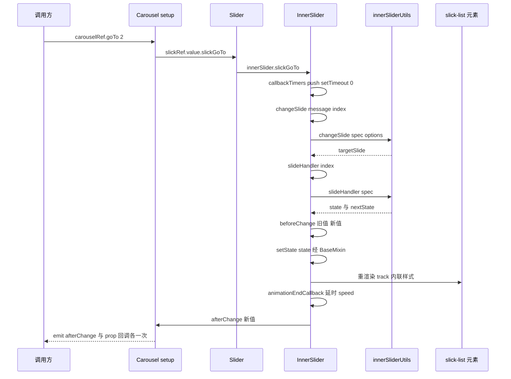
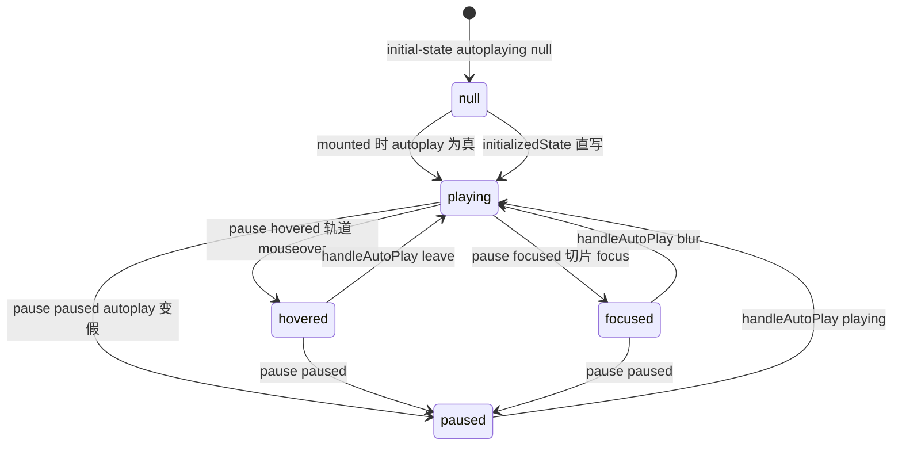
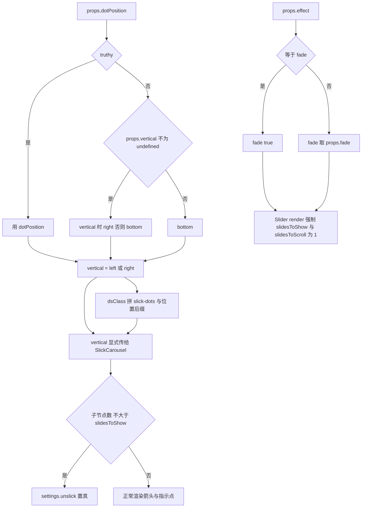

# C10-04 Carousel 走马灯

> **本篇解决**：Carousel 的轮播状态机与自动播放定时器到底活在哪一层、多实例与卸载会互相踩到什么、以及从 `carousel/` 到 `vc-slick/` 的哪些 props 是「API 面存活、实现死亡」。
> **前置**：C10-00 类横写：图片组的预览与对比关系　**读者坐标**：`03-components/10-media` 第 4/9 篇

## 一、职责与边界

`Carousel` 是一个**薄外壳**：它把 XiaoyeUI 的业务语义（`dotPosition`、`effect`、全局 `prefixCls`、全局 `direction`、`expose` 出来的命令式句柄）翻译成 `vc-slick` 那一套 46 个 setting，然后原样摊平转发。真正的轮播状态机、滑动几何、自动播放定时器、响应式断点、DOM 事件绑定，全部在 `packages/xiaoye-ui/src/vc-slick/` 里，业务层一行都不碰——`packages/xiaoye-ui/src/carousel/index.tsx:129-176` 的 render 里除了类名计算，唯一的逻辑就是把 `props` 整体 spread 进 `<SlickCarousel>`（`packages/xiaoye-ui/src/carousel/index.tsx:152`）。

边界之外（明确不负责）：

- 不负责懒加载调度，只把 `lazyLoad` 透下去（`packages/xiaoye-ui/src/carousel/index.tsx:56`），真正起 `setInterval` 的是 `packages/xiaoye-ui/src/vc-slick/inner-slider.jsx:134`。
- 不负责键盘导航实现，只透传 `accessibility`（`packages/xiaoye-ui/src/carousel/index.tsx:39`），按键映射在 `packages/xiaoye-ui/src/vc-slick/utils/innerSliderUtils.js:302-303`。
- 不负责 RTL 数学。业务层的 `direction` 只用于贴一个类名（`packages/xiaoye-ui/src/carousel/index.tsx:136`），`rtl` prop 由用户自己传（`packages/xiaoye-ui/src/carousel/index.tsx:57`），两者互不联动，这一点在论点 5 展开。
- 不负责样式锚点的命名。`vc-slick` 渲染出的类名是全局的 `slick-*`（`packages/xiaoye-ui/src/vc-slick/inner-slider.jsx:602`），业务层样式只能在 `.xy-carousel` 里重新把它们夹住（`packages/xiaoye-ui/src/carousel/style/index.tsx:24-27`）。

反向依赖只有一条：全仓 `vc-slick` 的消费者只有一个文件，`grep -rn "vc-slick" packages apps`（排除 `packages/xiaoye-ui/src/vc-slick` 自身）只命中 `packages/xiaoye-ui/src/carousel/index.tsx:6`。也就是说 `vc-slick` 是 Carousel 的私有厂商层，改动它不会波及其它组件；但也意味着它没有第二个消费者帮它试错。

本篇的落点在三个问题上，顺序即论点顺序：**自动播放的定时器住在哪一层、多实例与卸载会不会互相踩**（论点 2、3、4）、**外壳到厂商层的 props 契约在哪儿断掉**（论点 1、5、6）、**样式与类名链路上有哪些死规则**（论点 6）。图片组（Image 预览、对比、画廊）与轮播的关系不在本篇，见 C10-00 类横写：图片组的预览与对比关系。

## 二、源码地图

业务层三个文件，厂商层八个文件。行数为 `find packages/xiaoye-ui/src/carousel packages/xiaoye-ui/src/vc-slick -type f -print -exec wc -l` 的实测值。

| 文件 | 行数 | 职责 | 关键入口 |
| --- | --- | --- | --- |
| `packages/xiaoye-ui/src/carousel/index.tsx` | 180 | 外壳：props 声明、派生、expose、类名 | 组件定义 `index.tsx:75-79` |
| `packages/xiaoye-ui/src/carousel/style/index.tsx` | 348 | 三张样式表：横向、纵向、RTL | `style/index.tsx:328-347` |
| `packages/xiaoye-ui/src/carousel/index.test.js` | 141 | 本篇唯一测试文件（`.js` 后缀） | `index.test.js:7` |
| `packages/xiaoye-ui/src/vc-slick/index.js` | 4 | 再导出 Slider | `vc-slick/index.js:1-4` |
| `packages/xiaoye-ui/src/vc-slick/slider.jsx` | 200 | 断点、children 组树、unslick 判定 | `vc-slick/slider.jsx:96-199` |
| `packages/xiaoye-ui/src/vc-slick/inner-slider.jsx` | 762 | 状态机、定时器、DOM 绑定 | `vc-slick/inner-slider.jsx:31-52` |
| `packages/xiaoye-ui/src/vc-slick/track.jsx` | 197 | 轨道与克隆片渲染 | `vc-slick/track.jsx:8-43` |
| `packages/xiaoye-ui/src/vc-slick/dots.jsx` | 92 | 指示点计算 | `vc-slick/dots.jsx:5-15` |
| `packages/xiaoye-ui/src/vc-slick/arrows.jsx` | 124 | 前后箭头与自定义箭头 | `vc-slick/arrows.jsx:14-65` |
| `packages/xiaoye-ui/src/vc-slick/default-props.js` | 56 | 46 个 setting 的默认值 | `vc-slick/default-props.js:3-54` |
| `packages/xiaoye-ui/src/vc-slick/initial-state.js` | 27 | 22 个内部状态键 | `vc-slick/initial-state.js:1-25` |
| `packages/xiaoye-ui/src/vc-slick/utils/innerSliderUtils.js` | 790 | 纯函数几何与滑动计算 | `utils/innerSliderUtils.js:102-145` |

主实现入口不是业务层的 `index.tsx`，而是 `packages/xiaoye-ui/src/vc-slick/inner-slider.jsx:31`。外壳里唯一带状态的东西是 `slickRef`（`packages/xiaoye-ui/src/carousel/index.tsx:82`）和一个 `computed` 派生链（`packages/xiaoye-ui/src/carousel/index.tsx:115-128`）。

三处生成物也都登记了本篇主角：`packages/xiaoye-ui/src/components.ts:56-58` 的聚合导出与样式副作用、`packages/xiaoye-ui/package.json:166-170` 的 `./carousel` 与 `./carousel/style` 双入口。这两个文件是 `pnpm gen:entries` 的产物，手写会被 `pnpm check:entries` 打回。

值得单独记住的一行：`packages/xiaoye-ui/src/vc-slick/index.js:1` 的注释 `base react-slick 0.28.2` 标明了血统。下文凡是把 `slick-*` 类名、`react-slick` 式的 `spec` 传参当作描述对象时，说的都是**这个仓库里这份移植后的厂商实现**，不是上游 React 库的现状。

## 三、架构与数据流

### 3.1 静态结构：谁引用谁



图里有两个结构事实决定后面所有结论。第一，**默认值有两份**：`packages/xiaoye-ui/src/vc-slick/default-props.js:3-54` 与 `packages/xiaoye-ui/src/carousel/index.tsx:29-73`，两者数值不一致（论点 1）。第二，`Slider` 与 `InnerSlider` 是 Options API（`packages/xiaoye-ui/src/vc-slick/slider.jsx:10-16`、`packages/xiaoye-ui/src/vc-slick/inner-slider.jsx:31-37`），靠 `_util/BaseMixin.ts` 的 `setState` 与 `__emit` 提供 Vue 2 式手感（论点 6）；业务层 `Carousel` 是 Composition API，两者之间没有任何类型约束——`carouselProps` 与 `defaultProps` 的差集没人检查，全靠人工对齐。

### 3.2 数据流：一次 `goTo` 的完整闭环



闭环里有三处值得停下来看：`slickGoTo` 把真正的跳转塞进 `setTimeout(…, 0)`（`packages/xiaoye-ui/src/vc-slick/inner-slider.jsx:507-520`），所以命令式跳转永远比同帧的 `state` 晚一个宏任务；`beforeChange` 在 `setState` 之前触发且带的是旧索引（`packages/xiaoye-ui/src/vc-slick/inner-slider.jsx:384`），`afterChange` 在 `speed` 毫秒之后触发（`packages/xiaoye-ui/src/vc-slick/inner-slider.jsx:402-409`）；业务层把厂商层的回调同时接成 emit 和 prop 调用（`packages/xiaoye-ui/src/carousel/index.tsx:161-172`），这是本篇唯一一处 JSX 属性顺序**写对了**的地方（论点 6）。

### 3.3 自动播放状态机



这张图的每个箭头都能落到具体行：状态字段的初值在 `packages/xiaoye-ui/src/vc-slick/initial-state.js:3`；`playing` 的两个入口在 `packages/xiaoye-ui/src/vc-slick/inner-slider.jsx:131` 与 `packages/xiaoye-ui/src/vc-slick/utils/innerSliderUtils.js:140-142`；`hovered`/`focused`/`paused` 三个写入点在 `packages/xiaoye-ui/src/vc-slick/inner-slider.jsx:563-574`；恢复入口的三个豁免集合在 `packages/xiaoye-ui/src/vc-slick/inner-slider.jsx:541-553`。为什么需要五个状态而不是一个布尔：因为暂停有三种互不相同的**原因**，恢复时只有「原因与当前状态匹配」才该重新起定时器，否则用户鼠标还停在轨道上就被自动播放推走。这套豁免表是厂商层最容易被改坏的地方，论点 4 给它一份逐条对照。

### 3.4 派生分支：dotPosition、fade、unslick



前两条链在业务层：`packages/xiaoye-ui/src/carousel/index.tsx:115-119` 的 `dotPosition` 三级回落与 `packages/xiaoye-ui/src/carousel/index.tsx:120` 的 `vertical` 派生；`packages/xiaoye-ui/src/carousel/index.tsx:132` 把 `effect === 'fade'` 译成布尔。第三条链在厂商层：`packages/xiaoye-ui/src/vc-slick/slider.jsx:119-132` 在 `fade` 为真时**硬覆盖** `slidesToShow`/`slidesToScroll`，`packages/xiaoye-ui/src/vc-slick/slider.jsx:189-191` 在切片数不超过一屏时把整台轮播降级成静态列表。这两个覆盖都是 `settings` 对象上的局部改写，不回写 props，所以 `packages/xiaoye-ui/src/carousel/index.tsx:133-141` 生成的类名与厂商层实际渲染的几何可能不一致——这是论点 5 的入口。

## 四、核心机制精读

### 论点 1：默认值有两个真源，业务层显式再传的那几个让厂商层默认值在 `xy-carousel` 路径上永远取不到

**断言**：`carouselProps` 给 `arrows`、`draggable`、`dots`、`verticalSwiping` 四个键填了默认值，其中前三个还被外壳**无条件地**显式再传一次（`packages/xiaoye-ui/src/carousel/index.tsx:154-158`），第四个随 `{...props}` 摊下去时值也已解析完成；于是 `default-props.js` 里同名的四个默认值（`arrows: true`、`draggable: true`、`dots: false`、`verticalSwiping: false`）在整个 `xy-carousel` 生命周期里都是死代码。反过来，外壳**不填**默认值的那些键（`autoplay`、`pauseOnHover`、`infinite`、`speed`、`autoplaySpeed`）才真正由厂商层兜底。两套默认值里有三个数值是相反的，所以「改 `default-props.js` 让轮播默认显示箭头」这种改法对业务组件零效果。

```tsx
// packages/xiaoye-ui/src/carousel/index.tsx:150
          <SlickCarousel
            ref={slickRef}
            {...props}
            {...restAttrs}
            dots={!!dots}
            dotsClass={dsClass.value}
            arrows={arrows}
            draggable={draggable}
            fade={fade}
            vertical={vertical.value}
            v-slots={slots}
```

`arrows` 与 `draggable` 直接取自 `props`，而它们的声明带着默认值：

```tsx
// packages/xiaoye-ui/src/carousel/index.tsx:45
  arrows: booleanType(false),
  autoplaySpeed: Number,
  centerMode: booleanType(),
  centerPadding: String,
  cssEase: String,
  dotsClass: String,
  draggable: booleanType(false),
```

厂商层的对应默认值恰好相反：

```js
// packages/xiaoye-ui/src/vc-slick/default-props.js:8
  arrows: { type: Boolean, default: true },
  autoplay: { type: Boolean, default: false },
  autoplaySpeed: PropTypes.number.def(3000),
  beforeChange: PropTypes.any.def(null),
  centerMode: { type: Boolean, default: false },
  centerPadding: PropTypes.string.def('50px'),
  cssEase: PropTypes.string.def('ease'),
  dots: { type: Boolean, default: false },
  dotsClass: PropTypes.string.def('slick-dots'),
  draggable: { type: Boolean, default: true },
```

`booleanType` 的实现只有一行，它解释了「填了默认值」与「没填」的分野：

```ts
// packages/xiaoye-ui/src/_util/type.ts:58
export function booleanType(defaultVal?: boolean) {
  return { type: Boolean, default: defaultVal as boolean };
}
```

不传参数时产出的是 `{ type: Boolean, default: undefined }`——**键存在但值为 `undefined`**。这个形状决定了值能不能穿透到子组件：`arrows: booleanType(false)` 让 `props.arrows` 恒有值 `false`，`index.tsx:156` 把 `false` 显式递给 Slider，Slider 的 `default: true` 就再也没有机会命中；`pauseOnHover: booleanType()`（`packages/xiaoye-ui/src/carousel/index.tsx:42`）让 `props.pauseOnHover` 停在 `undefined`，穿透到厂商层后由 `default-props.js:33` 的 `true` 接管。用一个最小复现可以直接量出这条边界，不需要读组件源码：

```bash
node --input-type=module -e "
import { createSSRApp, h } from 'vue';
import { renderToString } from '@vue/server-renderer';
const Child = { props: { off: { type: Boolean, default: true }, bare: { type: Boolean, default: true } },
  setup(p){ return () => h('i', JSON.stringify(p)); } };
const Parent = { props: { a: { type: Boolean, default: false }, b: { type: Boolean, default: undefined } },
  setup(p){ return () => h(Child, { off: p.a, bare: p.b }); } };
console.log(await renderToString(createSSRApp(Parent)));
"
# 实测输出：<i>{"off":false,"bare":true}</i>
```

输出里 `off:false` 证明「父层显式 `false`」屏蔽了子层 `default:true`，`bare:true` 证明「父层 `undefined`」把决定权交回子层。

**结论回扣**：`xy-carousel` 的默认形态是「有指示点（`dots: booleanType(true)`，`packages/xiaoye-ui/src/carousel/index.tsx:31`）、无箭头、不可拖、无限循环、3000ms 自动播放间隔但默认不播」，其中 `dots`、`arrows`、`draggable`、`verticalSwiping` 四项由业务层决定，`infinite`、`autoplay`、`autoplaySpeed`、`speed`、`pauseOnHover` 五项由厂商层决定。要看清一个默认值到底谁说了算，判据只有一条：这个 prop 名有没有出现在 `index.tsx:154-159` 那六行显式赋值里。`dots={!!dots}` 还额外做了一次强制布尔化，即使用户传 `undefined` 也会变成 `false`——但因为业务层默认已经是 `true`，`!!` 在这里只影响「显式传 `undefined`」这一种冷门写法。

### 论点 2：自动播放定时器是实例字段而非模块级全局，多实例互不干扰；但节奏比 `autoplaySpeed` 慢 50ms

**断言**：`autoplayTimer` 挂在组件实例上（`this.autoplayTimer`），`vc-slick` 目录里没有任何模块级可变全局量，因此同页多个 `xy-carousel` 的定时器彼此独立；真正会影响所有实例的模块级状态只有 `_util/supportsPassive.js:2` 那个一次性特性探测位。代价是间隔被硬编码成 `autoplaySpeed + 50`。

```jsx
// packages/xiaoye-ui/src/vc-slick/inner-slider.jsx:536
    handleAutoPlay(playType) {
      if (this.autoplayTimer) {
        clearInterval(this.autoplayTimer);
      }
      const autoplaying = this.autoplaying;
      if (playType === 'update') {
        if (autoplaying === 'hovered' || autoplaying === 'focused' || autoplaying === 'paused') {
          return;
        }
      } else if (playType === 'leave') {
        if (autoplaying === 'paused' || autoplaying === 'focused') {
          return;
        }
      } else if (playType === 'blur') {
        if (autoplaying === 'paused' || autoplaying === 'hovered') {
          return;
        }
      }
      this.autoplayTimer = setInterval(this.play, this.autoplaySpeed + 50);
      this.setState({ autoplaying: 'playing' });
    },
```

三件事挤在这 20 行里。第一，`this.autoplayTimer` 是**赋值出来的实例属性**，它不在 `data()` 的返回对象里（`packages/xiaoye-ui/src/vc-slick/inner-slider.jsx:38-52` 只声明了 `preProps`、`list`、`track`、`callbackTimers`、`clickable`、`debouncedResize`），也不在 `initial-state.js` 的 22 个键里——这是刻意的：定时器 id 如果被塞进 `$data`，每次 `handleAutoPlay` 都会因响应式变更触发一轮多余的 `$forceUpdate`（`packages/xiaoye-ui/src/_util/BaseMixin.ts:19-22`）。第二，`clearInterval` 与 `setInterval` 在同一个函数里成对出现（`:537-538` 与 `:554`），所以重复调用不会漏定时器，只会重置相位。第三，间隔是 `autoplaySpeed + 50`，`autoplaySpeed` 的默认值来自 `packages/xiaoye-ui/src/vc-slick/default-props.js:10` 的 3000，也就是说默认节奏是 3050ms 而不是 3000ms，且这 50ms 无法通过任何 prop 关掉。

为什么要有这 50ms：`play()` 触发的 `slideHandler` 要等 `speed` 毫秒的动画结束（`packages/xiaoye-ui/src/vc-slick/inner-slider.jsx:402-409`），多给的 50ms 是「动画落地后再排下一次」的缓冲。它并不精确——`speed` 默认 500（`packages/xiaoye-ui/src/vc-slick/default-props.js:41`）远大于 50，所以真实的停留时间是「`autoplaySpeed + 50` 与切换时刻的差」，而不是用户以为的 `autoplaySpeed`。这两个数（`3000` 与 `50`）连同 `lazyLoadTimer` 的 `1000`（`packages/xiaoye-ui/src/vc-slick/inner-slider.jsx:134`）都是 JS 侧裸常量，不在 Design Token 体系里，主题做得再细也动不到轮播节奏——这与 C11-00 §六「周期常量为什么不晋升成 Token」及 C11-00 坑 4 论证的同一族失效（调 `motionDuration*` 改不动循环速度）在 Carousel 上以「改 `autoplaySpeed` 只能整毫秒级地改、那 50ms 永远多出来」的形态重现，本篇不重复展开。一条旁证：C11-00 §六 在全库 `setInterval(` 普查里已把 `packages/xiaoye-ui/src/vc-slick/inner-slider.jsx:134` 与 `:554` 列为该族的两个站点，与论点 2、论点 3 的定位互相印证。

多实例隔离还有一个容易被忽略的加分项：`initializedState` 里那条 `packages/xiaoye-ui/src/vc-slick/utils/innerSliderUtils.js:140-142` 的写入——

```js
// packages/xiaoye-ui/src/vc-slick/utils/innerSliderUtils.js:140
  if (spec.autoplaying === null && spec.autoplay) {
    state['autoplaying'] = 'playing';
  }
```

`autoplaying` 的初值是 `null`（`packages/xiaoye-ui/src/vc-slick/initial-state.js:3`），所以这条只在「尚未被任何 pause/resume 路径写过」时生效，它让 `mounted` 阶段的首次 `updateState` 直接把状态标成 `playing`，不必等 `handleAutoPlay`。这两个入口（`utils:140` 与 `inner-slider.jsx:131`）会同时命中同一实例，但因为 `handleAutoPlay` 自己先 `clearInterval`，重复进入的净效果只是重建一次 interval。

**结论回扣**：这一层是干净的。派工单问的三件事里「定时器是否模块级共享」的答案是**否**，而且可以用一条命令自证：`grep -rn "^let " packages/xiaoye-ui/src/vc-slick` 与 `grep -rn "^var " packages/xiaoye-ui/src/vc-slick` 都无输出。真正会跨实例串味的东西在别处，见论点 3。

### 论点 3：卸载路径的定时器清理是成对的，但全局 `window.ontouchmove` 锁不是；`pauseOnFocus` 的绑定范围还是整份文档

**断言**：`beforeUnmount` 把 `autoplayTimer`、`lazyLoadTimer`、`animationEndCallback`、`callbackTimers` 都清了，唯独没有恢复 `swipeStart` 写下的 `window.ontouchmove = preventDefault`；而 `swipeEnd` 的恢复调用被放在一个提前 `return` 之后，正常交互路径就能漏掉。两者叠加的净效果是：一次纵向滑动的鼠标按下-松开，就能把整页触屏滚动永久关掉，且这个锁是 `window` 级的，跨实例互相覆盖。

先看卸载路径，它是本篇最需要「正面结论」的地方——四类计时资源都在这里收尾：

```jsx
// packages/xiaoye-ui/src/vc-slick/inner-slider.jsx:157
  beforeUnmount() {
    if (this.animationEndCallback) {
      clearTimeout(this.animationEndCallback);
    }
    if (this.lazyLoadTimer) {
      clearInterval(this.lazyLoadTimer);
    }
    if (this.callbackTimers.length) {
      this.callbackTimers.forEach(timer => clearTimeout(timer));
      this.callbackTimers = [];
    }
    if (window.addEventListener) {
      window.removeEventListener('resize', this.onWindowResized);
    } else {
      window.detachEvent('onresize', this.onWindowResized);
    }
    if (this.autoplayTimer) {
      clearInterval(this.autoplayTimer);
    }
    this.ro?.disconnect();
  },
```

`autoplayTimer` 对应 `packages/xiaoye-ui/src/vc-slick/inner-slider.jsx:554`，`lazyLoadTimer` 对应 `packages/xiaoye-ui/src/vc-slick/inner-slider.jsx:134`，`callbackTimers` 的 push 点有六处（`:139`、`:335`、`:405`、`:499`、`:502`、`:507`），`ro` 对应 `packages/xiaoye-ui/src/vc-slick/inner-slider.jsx:136-144`。这一段没有缺陷，值得当作其它组件的对照样本。缺口只有一处：这里**没有** `enableBodyScroll()`。另外 `debouncedResize`（`:212-214` 创建的 lodash debounce）没有 `cancel()`，但它落到 `resizeWindow` 后会先撞 `:217-218` 的 `Boolean(this.track)` 判空，卸载后 `track` 已被 ref 回调置空，所以不会炸。

再看锁的写入与释放：

```jsx
// packages/xiaoye-ui/src/vc-slick/inner-slider.jsx:441
    disableBodyScroll() {
      const preventDefault = e => {
        e = e || window.event;
        if (e.preventDefault) e.preventDefault();
        e.returnValue = false;
      };
      window.ontouchmove = preventDefault;
    },
    enableBodyScroll() {
      window.ontouchmove = null;
    },
    swipeStart(e) {
      if (this.verticalSwiping) {
        this.disableBodyScroll();
      }
      const state = swipeStart(e, this.swipe, this.draggable);
      state !== '' && this.setState(state);
    },
```

```jsx
// packages/xiaoye-ui/src/vc-slick/inner-slider.jsx:473
    swipeEnd(e) {
      const state = swipeEnd(e, {
        // ...
      });
      if (!state) return;
      const triggerSlideHandler = state['triggerSlideHandler'];
      delete state['triggerSlideHandler'];
      this.setState(state);
      if (triggerSlideHandler === undefined) return;
      this.slideHandler(triggerSlideHandler);
      if (this.$props.verticalSwiping) {
        this.enableBodyScroll();
      }
    },
```

`enableBodyScroll()` 在 `:488`，但它前面有两条 `return`：`:481` 和 `:485`。`:485` 这条是致命的，因为厂商层的纯函数在「没有 dragging 状态」时返回的是**空对象而不是 `undefined`**：

```js
// packages/xiaoye-ui/src/vc-slick/utils/innerSliderUtils.js:436
  if (!dragging) {
    if (swipe) safePreventDefault(e);
    return {};
  }
```

空对象是 truthy，所以 `:481` 的 `if (!state) return` 拦不住它，代码继续走到 `:485`，`triggerSlideHandler` 是 `undefined`，于是 `return`——`enableBodyScroll()` 永远执行不到。而 `dragging` 之所以没被设上，是因为 `swipeStart` 纯函数在这种情形返回空串：

```js
// packages/xiaoye-ui/src/vc-slick/utils/innerSliderUtils.js:311
export const swipeStart = (e, swipe, draggable) => {
  e.target.tagName === 'IMG' && safePreventDefault(e);
  if (!swipe || (!draggable && e.type.indexOf('mouse') !== -1)) return '';
```

把这三段串起来就是一条可复现的泄漏路径：`verticalSwiping` 为真（`packages/xiaoye-ui/src/carousel/index.tsx:72` 的默认是 `false`，需要显式打开）+ `draggable` 为假（**这正是 `xy-carousel` 的默认值**，`packages/xiaoye-ui/src/carousel/index.tsx:51`）→ 用户在轮播上按下鼠标，`swipeStart` 方法先执行 `disableBodyScroll()`（`:453-455`），随后纯函数因为 `!draggable && e.type` 含 `mouse` 返回 `''`（`utils:313`），`:457` 的 `state !== ''` 判假、不写 `dragging` → 松开鼠标走 `onMouseup`（`packages/xiaoye-ui/src/vc-slick/inner-slider.jsx:726`）→ `swipeEnd` 拿到 `{}` → 在 `:485` 提前返回 → `window.ontouchmove` 保持为 `preventDefault`。此后整页 `touchmove` 被无条件 `preventDefault`，触屏无法滚动，直到页面上另一个开了 `verticalSwiping` 的轮播完成一次「有效」滑动（`:487-489`）或刷新页面。

第二条泄漏路径更短：纵向滑动进行中组件被卸载（例如轮播挂在 `v-if` 上、或路由切走），`beforeUnmount`（`:157-177`）不会碰 `window.ontouchmove`。

这个锁还有两个附加性质值得记下。一是它**不保存原值**：`enableBodyScroll` 写的是 `null`（`:450`）而不是「进入前的 `window.ontouchmove`」，所以业务方自己挂在 `window.ontouchmove` 上的任何处理器，第一次纵向滑动结束就被清掉。二是它**天然跨实例**：`window` 是单例，两个 `verticalSwiping` 轮播同时存在时，A 的解锁会把 B 仍在生效的锁定一起解除。这与论点 2 的结论并不矛盾——定时器是实例级的、干净；被污染的是 `window` 上那个 DOM 全局属性。

同一份 `mounted` 里还有一处范围写错：

```jsx
// packages/xiaoye-ui/src/vc-slick/inner-slider.jsx:145
      document.querySelectorAll &&
        Array.prototype.forEach.call(document.querySelectorAll('.slick-slide'), slide => {
          slide.onfocus = this.$props.pauseOnFocus ? this.onSlideFocus : null;
          slide.onblur = this.$props.pauseOnFocus ? this.onSlideBlur : null;
        });
```

选择器挂在 `document` 上而不是 `this.list` 上，对照同文件里的 `checkImagesLoad`——它就是把查询限定在自身容器内的（`packages/xiaoye-ui/src/vc-slick/inner-slider.jsx:313-317` 走 `this.list.querySelectorAll('.slick-slide img')`）。后果：页面上第 N 个挂载的轮播会给**所有**轮播的切片重新指派 `onfocus`，指向自己的 `onSlideFocus`，先挂载的实例的处理器被逐个顶掉；而当 `pauseOnFocus` 为假（默认，`packages/xiaoye-ui/src/vc-slick/default-props.js:31`）时，每一次挂载都会把全页 `.slick-slide` 的 `onfocus`/`onblur` 统一置 `null`，把别的实例刚绑上的能力抹掉。注意 `pauseOnFocus` 并不在 `carouselProps` 里（见论点 5 的差集），业务侧只能通过 `xy-carousel` 的 fallthrough attribute 传它，所以这条路径在文档里是隐形的。

**结论回扣**：派工单问的第二件事「卸载路径 `clearInterval` 是否成对」答案是**成对**；但同一层里存在一个未配对的全局写：`disableBodyScroll`/`enableBodyScroll` 只在 `:454`/`:488` 这一对位置出现，卸载与提前返回都不覆盖。这是本篇认为 Carousel 最应该修的一行。

### 论点 4：厂商层用 `__propsSymbol__` 这个假 prop 冒充 `componentWillReceiveProps`，于是每次重渲染都会重算状态并重置自动播放相位

**断言**：`InnerSlider` 的 props 变更响应靠两个 watcher，其中 `__propsSymbol__` 由父级 `Slider` 每次 render 新建一个 `[]` 来触发；这使「任意一次无关的 re-render」都会走到 `updateState` + `handleAutoPlay('update')`/`pause('paused')` 分支，播放中的实例因此被反复 `clearInterval`/`setInterval`，视觉上表现为「只要父组件在重渲染，轮播永远切不到下一张」。

```jsx
// packages/xiaoye-ui/src/vc-slick/inner-slider.jsx:53
  watch: {
    // ...（:54-62 是 autoplay 的 watcher，下文单独摘）
    __propsSymbol__() {
      const nextProps = this.$props;
      const spec = {
        listRef: this.list,
        trackRef: this.track,
        ...nextProps,
        ...this.$data,
      };
      let setTrackStyle = false;
      for (const key of Object.keys(this.preProps)) {
        if (!nextProps.hasOwnProperty(key)) {
          setTrackStyle = true;
          break;
        }
        // ...
      }
      this.updateState(spec, setTrackStyle, () => {
        if (this.currentSlide >= nextProps.children.length) {
          // ...
        }
        if (!this.preProps.autoplay && nextProps.autoplay) {
          this.handleAutoPlay('playing');
        } else if (nextProps.autoplay) {
          this.handleAutoPlay('update');
        } else {
          this.pause('paused');
        }
      });
      this.preProps = { ...nextProps };
    },
  },
```

触发器在 `Slider` 的 render 末尾，每次都新建字面量：

```jsx
// packages/xiaoye-ui/src/vc-slick/slider.jsx:192
    const sliderProps = {
      ...this.$attrs,
      ...settings,
      children: newChildren,
      ref: this.innerSliderRefHandler,
    };
    return <InnerSlider {...sliderProps} v-slots={this.$slots} __propsSymbol__={[]} />;
```

`__propsSymbol__` 本身是个没有任何语义的 prop，声明在 `packages/xiaoye-ui/src/vc-slick/default-props.js:53`（`PropTypes.any`，无默认值），它唯一的用途是让 watcher 的依赖每轮都换一个身份。`this.preProps` 是 `data()` 里以实例字段方式留下的上一份 props 快照（`packages/xiaoye-ui/src/vc-slick/inner-slider.jsx:39`），比对完在 watcher 末尾整体替换（`:105`）——这套 `preProps` + 假 prop 的组合，正是把 React 的 `componentWillReceiveProps` 平移到 Options API 的做法。

关键在 `:99-100`：只要 `autoplay` 为真，任何一次 `Slider` 重渲染都会调用 `handleAutoPlay('update')`。`'update'` 的豁免集合是 `hovered`/`focused`/`paused`（`packages/xiaoye-ui/src/vc-slick/inner-slider.jsx:541-544`），`playing` 不在里面，于是走到 `:537-538` 先 `clearInterval`、再到 `:554` 重新 `setInterval`。**interval 的相位被重置了**：`autoplaySpeed` 计时从头开始。如果父组件因为一个 `setInterval` 驱动的计数器每 100ms 重渲染一次（文档站里给 `xy-carousel` 外面套 `{{ now }}` 这类写法就会这样），`play()` 永远等不到 3050ms 的触发点，自动播放看起来完全失效，但 `autoplaying` 状态一直是 `playing`、控制台毫无告警。同一条链上还有第二处会重置相位的地方：`changeSlide` 结束时无条件补一句 `this.$props.autoplay && this.handleAutoPlay('update')`（`packages/xiaoye-ui/src/vc-slick/inner-slider.jsx:421`），这是设计意图（用户手动切换后重新计时），但也说明 `'update'` 在 `playing` 态下的「重建 interval」行为是有意为之、只是没考虑高频重渲染。

同一份逻辑还有第二个入口：

```jsx
// packages/xiaoye-ui/src/vc-slick/inner-slider.jsx:54
    autoplay(newValue, oldValue) {
      if (!oldValue && newValue) {
        this.handleAutoPlay('playing');
      } else if (newValue) {
        this.handleAutoPlay('update');
      } else {
        this.pause('paused');
      }
    },
```

它与 `:97-103` 的三分支**语义完全相同**，只是判据来源不同（前者的 `oldValue` 来自 Vue 的 watcher 实参，后者来自手工维护的 `this.preProps`）。这是本仓典型的「同一逻辑的多份拷贝」：改一个不记得改另一个。两者的差别会在一种情况下暴露——`autoplay` 由真变假时，`:60` 走 `pause('paused')`，而 `:102` 也走 `pause('paused')`，同一 tick 里被调用两次；`pause` 在 `autoplayTimer` 已为 `null` 时只是重复 `setState({autoplaying:'paused'})`（`:558-564`），无副作用，但第三个调用点 `resizeWindow`（`:226-232`）同样会 `pause('paused')`，于是**一次窗口缩放会把 `hovered` 状态覆盖成 `paused`**：用户鼠标还停在轨道上、resize 一触发，`autoplaying` 从 `hovered` 变成 `paused`，此后 `handleAutoPlay('leave')` 的豁免集合（`:545-548`）里 `paused` 是「不恢复」的一支，鼠标离开后自动播放不会回来。

**结论回扣**：`Carousel` 外壳没有任何节流或合并——它把父级的每次 render 原样转成 `{...props}` 新对象（`packages/xiaoye-ui/src/carousel/index.tsx:152`），厂商层再把它变成一次 `handleAutoPlay('update')`。自动播放的稳定性因此**取决于调用方的重渲染频率**，而调用方无从知晓。这条机制应当写进 Carousel 的文档，目前它只存在于 `packages/xiaoye-ui/src/carousel/index.test.js:61-83` 那段被注释掉的 `it` 里（见「七、坑与改动指南」的测试现状）。

### 论点 5：外壳与厂商层的 props 契约没有任何校验，六个名字在跨层传递中被丢弃，九个名字只能靠 attrs 穿透

**断言**：`carouselProps` 有 41 个键、`defaultProps` 有 46 个键，两者的差集无人对齐。被外壳消费过或不存在的名字里，有 6 个（`effect`、`prefixCls`、`nextArrow`、`prevArrow`、`slickGoTo`、`dotPosition`）在到达厂商层后落进 `$attrs` 并被丢掉；反向有 9 个厂商层能识别的 setting（`asNavFor`、`pauseOnFocus`、`pauseOnDotsHover`、`edgeFriction`、`waitForAnimate`、`useTransform`、`rows`、`slidesPerRow`、`unslick`）在 `carouselProps` 里根本没有声明（这一侧差集实为 11 项，另有 `children` 与 `__propsSymbol__` 两个内部管道键不计入），业务方只能通过 fallthrough attribute 传，`CarouselProps` 类型（`packages/xiaoye-ui/src/carousel/index.tsx:74`）不含它们。

先看厂商层怎么组装箭头——这是「丢掉」的具体现场：

```jsx
// packages/xiaoye-ui/src/vc-slick/inner-slider.jsx:673
    let prevArrow, nextArrow;
    const arrowProps = extractObject(spec, [
      'infinite',
      'centerMode',
      'currentSlide',
      'slideCount',
      'slidesToShow',
    ]);
    arrowProps.clickHandler = this.changeSlide;
    const { prevArrow: prevArrowCustom, nextArrow: nextArrowCustom } = this.$slots;
    if (prevArrowCustom) {
      arrowProps.prevArrow = prevArrowCustom;
    }
    if (nextArrowCustom) {
      arrowProps.nextArrow = nextArrowCustom;
    }
    if (this.arrows) {
      prevArrow = <PrevArrow {...arrowProps} />;
      nextArrow = <NextArrow {...arrowProps} />;
    }
```

`spec` 是 `{ ...this.$props, ...this.$data }`（`packages/xiaoye-ui/src/vc-slick/inner-slider.jsx:606`），而 `prevArrow`/`nextArrow` 不在 `defaultProps` 的 46 个键里（`packages/xiaoye-ui/src/vc-slick/default-props.js:3-54`），所以它们不可能出现在 `$props`；`extractObject` 的白名单里也没有它们。结论：**自定义箭头只有 slot 一条路**（`:682-688`），`PrevArrow` 内部读的正是 `attrs.prevArrow` 并以函数方式调用（`packages/xiaoye-ui/src/vc-slick/arrows.jsx:42-44`、`packages/xiaoye-ui/src/vc-slick/arrows.jsx:96-98`）。业务层 `index.tsx:40-41` 那两行 `nextArrow: PropTypes.any` / `prevArrow: PropTypes.any` 于是成为纯装饰：它们随 `{...props}`（`packages/xiaoye-ui/src/carousel/index.tsx:152`）进入 Slider 的 `$attrs`，Slider 把它们并进 `sliderProps` 交给 InnerSlider（`packages/xiaoye-ui/src/vc-slick/slider.jsx:192-198`），InnerSlider 的 render 只从 `$attrs` 里取 `class` 与 `style`（`packages/xiaoye-ui/src/vc-slick/inner-slider.jsx:602`、`:741`），其余的一律不渲染也不读——因为两个组件都写了 `inheritAttrs: false`（`packages/xiaoye-ui/src/vc-slick/slider.jsx:13`、`packages/xiaoye-ui/src/vc-slick/inner-slider.jsx:34`）。文档站的示例恰好只演示可用的一条路：`apps/docs/examples/carousel/customArrows.vue:3-12` 用的是 `#prevArrow`、`#nextArrow` 插槽。

`slickGoTo` 的判形与 `prevArrow` 不同但结局一样：它只在 `carouselProps` 里出现一次（`packages/xiaoye-ui/src/carousel/index.tsx:69`），全仓其余命中都是**方法**——`packages/xiaoye-ui/src/vc-slick/slider.jsx:85` 与 `packages/xiaoye-ui/src/vc-slick/inner-slider.jsx:504` 的定义，以及外壳 `goTo` 里对方法的调用（`packages/xiaoye-ui/src/carousel/index.tsx:85`）。没有任何一处读 `props.slickGoTo`、也没有 `watch` 它，所以「把索引当 prop 传进去就能跳转」这种受控用法在这份实现里不存在。`easing` 更彻底：`grep -rnw easing packages apps` 的全部命中是两处声明（`packages/xiaoye-ui/src/carousel/index.tsx:34`、`packages/xiaoye-ui/src/vc-slick/default-props.js:19`）加上文档站的这一行承诺：

```md
// apps/docs/components/carousel.md:67
| easing | 动画效果 | string | `linear` |  |
```

而真正参与过渡的是 `cssEase`（`packages/xiaoye-ui/src/vc-slick/default-props.js:14`，被读进 transition 字符串的地方是 `packages/xiaoye-ui/src/vc-slick/track.jsx:60-71`）。也就是说文档给了一个零效果开关，没给真正的那个。

反向缺口值得单独列一遍，因为它们的可达性依赖一条四跳的 attrs 链：Carousel 的 `attrs` 先被拆出 `class`/`style`/`aria-label`（`packages/xiaoye-ui/src/carousel/index.tsx:131`），剩下的 `restAttrs` 摊给 Slider（`packages/xiaoye-ui/src/carousel/index.tsx:153`），Slider 因 `inheritAttrs: false` 必须手工把 `$attrs` 并进 `settings`（`packages/xiaoye-ui/src/vc-slick/slider.jsx:192-195`），其中命中 `defaultProps` 声明的名字（如 `pauseOnFocus`、`asNavFor`、`waitForAnimate`）会**升格为 InnerSlider 的真 prop** 并生效，命不中的（如 `effect`）则被丢。这条链有两个实际后果：一是这些能力在类型层面不可见、在文档里不可见；二是 `waitForAnimate` 这类会改变事件时序的开关只能靠读源码发现——把它设成假会走到另一条 `afterChange` 分支：

```jsx
// packages/xiaoye-ui/src/vc-slick/inner-slider.jsx:391
      if (!this.$props.waitForAnimate && this.animationEndCallback) {
        clearTimeout(this.animationEndCallback);
        afterChange && afterChange(this.currentSlide);
        delete this.animationEndCallback;
      }
```

`:393` 传出去的是 `this.currentSlide`，此时 `setState(state)` 还没执行（`:396` 才是），所以这是**离开的那一张**；而正常路径 `:406` 传的是 `state.currentSlide`，是**进入的那一张**。同一个 `afterChange`，因为一个未声明、未文档化的 prop 而换了语义，索引差一。

**结论回扣**：Carousel 与 vc-slick 之间是一份没有校验的字段对照表。判据：`node -e` 把两边的 prop 名取交集差集（本篇用过的命令），或 `grep -c "prefixCls" packages/xiaoye-ui/src/vc-slick` 得到 0——厂商层的类名前缀完全不可定制，`slick-*` 全是字面量（`packages/xiaoye-ui/src/vc-slick/inner-slider.jsx:602`、`packages/xiaoye-ui/src/vc-slick/track.jsx:36-42`、`packages/xiaoye-ui/src/vc-slick/dots.jsx:51`）。

### 论点 6：RTL 在三个地方各说各话，`dir` 属性被硬编码成 `ltr`

**断言**：Carousel 的 RTL 由三份互不联动的状态决定——ConfigProvider 的 `direction` 只贴一个类名；用户传的 `rtl` prop 只改厂商层的数学；而厂商层渲染出的容器 DOM 永远写着 `dir="ltr"`。全局开 RTL 的应用里，`xy-carousel` 得到的是「CSS 反向 + 数学正向 + DOM 声明正向」的组合。

```jsx
// packages/xiaoye-ui/src/vc-slick/inner-slider.jsx:738
    let innerSliderProps = {
      class: className,
      dir: 'ltr',
      style: this.$attrs.style,
    };

    if (this.unslick) {
      listProps = {
        class: 'slick-list',
        ref: this.listRefHandler,
      };
      innerSliderProps = { class: className };
    }
```

`dir: 'ltr'` 是这个文件里唯一的 `dir:` 赋值（`grep -n "dir:" packages/xiaoye-ui/src/vc-slick` 只命中 `packages/xiaoye-ui/src/vc-slick/inner-slider.jsx:740`），它不看 `this.rtl`。而 `this.rtl` 确实被三处数学读走：反向播片（`packages/xiaoye-ui/src/vc-slick/inner-slider.jsx:524-525`）、切片索引镜像（`packages/xiaoye-ui/src/vc-slick/track.jsx:12-16`）、键盘左右键互换（`packages/xiaoye-ui/src/vc-slick/utils/innerSliderUtils.js:302`）。于是 `rtl` 为真时轨道从右往左排，容器却声明自己是 `ltr`，屏读器与 CSS 逻辑属性都按 `ltr` 解释。

上面这段还顺带暴露第二个问题：`unslick` 分支（`:744-750`）把 `innerSliderProps` **整体替换**成只有 `class` 的对象，`style` 一起被丢掉。`unslick` 的触发条件是切片数不超过一屏（`packages/xiaoye-ui/src/vc-slick/slider.jsx:189-191`），对 `xy-carousel` 而言是「只放一张图且没改 `slidesToShow`」这种常见场景。对直接用 `vc-slick` 的人来说这是内联样式丢失；对 `xy-carousel` 的使用者则无影响，因为外壳已经把 `style` 截下来贴在自己的外层 div 上了（`packages/xiaoye-ui/src/carousel/index.tsx:131`、`:145`）。

业务层这一侧的三份状态里，`direction` 的来源是标准做法：

```tsx
// packages/xiaoye-ui/src/carousel/index.tsx:133
      const className = classNames(
        prefixCls.value,
        {
          [`${prefixCls.value}-rtl`]: direction.value === 'rtl',
          [`${prefixCls.value}-vertical`]: vertical.value,
          [`${cls}`]: !!cls,
        },
        hashId.value,
      );
```

`direction` 来自 `useConfigInject('carousel', props)`（`packages/xiaoye-ui/src/carousel/index.tsx:110`），其实现是 `props.direction ?? configProvider.direction?.value`（`packages/xiaoye-ui/src/config-provider/hooks/useConfigInject.ts:15`）。这里可以下一个正面结论：`carouselProps` **没有**声明 `direction`（`packages/xiaoye-ui/src/carousel/index.tsx:29-73` 的 41 个键里没有它），所以 `props.direction` 恒为 `undefined`，`??` 右侧恒生效，全局 RTL 配置对 Carousel 的类名是有效的——这与 C04-08 论点 1 记录的 `rate/index.tsx:54` 给 `direction` 填了 `'ltr'` 默认值、从而吃掉全局配置的情形正好相反。同理，Carousel 也没有 `disabled` prop，`useConfigInject.ts:43` 合成的禁用链路对它无意义，本族的「disabled 断链」两条判据在 Carousel 上都不成立。

**结论回扣**：`xy-carousel` 若要真正支持 RTL，缺的不是类名而是两行：把 `dir` 交给 `rtl` 决定，以及让外壳把 `direction.value === 'rtl'` 折算成 `rtl` prop 传下去。目前文档与方法表都没有承诺这一点，用户能观察到的症状是「CSS 反了但翻页方向没反」。

### 论点 7：样式层有三处「永不命中」，厂商层的 a11y 文案是硬编码中文且绕过了 Vue 事件系统

**断言**：`carousel/style/index.tsx` 的 348 行里有三条规则在当前实现下永远不会命中（`.slick-arrow.slick-hidden` 没有生成者、`.slick-slide{display:none}` 被恒真的 `slick-initialized` 抵消、`carouselDotInline` 是个从未被提供的 token）；指示点与箭头的可访问性名称是写死的中文，`locale/` 里没有 Carousel 的任何键；而厂商层所有事件都不走 `$emit`，走的是 `BaseMixin` 自己拼 `onXxx` 的旁路。

```tsx
// packages/xiaoye-ui/src/carousel/style/index.tsx:95
      '.slick-slide': {
        display: 'none',
        float: 'left',
        height: '100%',
        minHeight: 1,
        // ...
      },

      '.slick-initialized .slick-slide': {
        display: 'block',
      },

      '.slick-vertical .slick-slide': {
        display: 'block',
        height: 'auto',
      },

      '.slick-arrow.slick-hidden': {
        display: 'none',
      },
```

逐条定位。第一条：`slick-hidden` 这个类名在全仓只出现在这一行（`grep -rn "slick-hidden" packages apps` 的命中集就是 `packages/xiaoye-ui/src/carousel/style/index.tsx:119`），厂商层生成的类名全集是 `slick-slider`、`slick-vertical`、`slick-initialized`（`packages/xiaoye-ui/src/vc-slick/inner-slider.jsx:602-605`）、`slick-list`（`packages/xiaoye-ui/src/vc-slick/inner-slider.jsx:721`）、`slick-track`（`packages/xiaoye-ui/src/vc-slick/track.jsx:188`）、`slick-slide`、`slick-active`、`slick-center`、`slick-cloned`、`slick-current`（`packages/xiaoye-ui/src/vc-slick/track.jsx:36-42`）、`slick-arrow`、`slick-prev`、`slick-next`、`slick-disabled`（`packages/xiaoye-ui/src/vc-slick/arrows.jsx:16`、`:72`），加上业务层拼出来的 `slick-dots` 与 `slick-dots-<位置>`（`packages/xiaoye-ui/src/carousel/index.tsx:121-128`）。这里面没有 `slick-hidden`。第二条：`slick-initialized` 是字面量 `true`（`packages/xiaoye-ui/src/vc-slick/inner-slider.jsx:604`），`:110` 的覆盖恒成立，所以 `:96` 的 `display: none` 从来没有可见效果。反向的缺口也存在：`slick-center`、`slick-current`、`slick-cloned` 三个由实现生成的类名，在样式文件里出现次数为 0（`grep -c` 结果为 0），即 `centerMode` 的当前居中切片、以及克隆切片没有任何专属视觉。

第三条在 token 层：

```tsx
// packages/xiaoye-ui/src/carousel/style/index.tsx:11
interface CarouselToken extends FullToken<'Carousel'> {
  carouselArrowSize: number;
  carouselDotOffset: number;
  carouselDotInline: number;
}
```

而唯一给 `CarouselToken` 补值的 `mergeToken` 只提供两个键（`packages/xiaoye-ui/src/carousel/style/index.tsx:332-335`），`carouselDotInline` 全仓仅出现在上面这一行（`grep -rn "carouselDotInline" packages`），既不赋值也不读取。它不报错的原因是 `mergeToken` 实际是 `theme/util/statistic.ts` 的 `merge`，经 `packages/xiaoye-ui/src/theme/internal.ts:20` 引入、`:43` 转出，签名对第二个参数不做完整性检查；真正的组件默认值走 `genComponentStyleHook` 的第三个入参（`packages/xiaoye-ui/src/carousel/style/index.tsx:343-346` 给出 `dotWidth: 16`、`dotHeight: 3`、`dotWidthActive: 24`）。这些裸数字能变成合法 CSS，靠的是样式注册器里的一条单位规则（`packages/xiaoye-ui/src/_util/cssinjs/hooks/useStyleRegister/index.tsx:249`）：不在 `@emotion/unitless` 名单里的键遇到 number 就补 `px`，所以 `minHeight: 1` 与 `dotWidth: 16` 都能落地。

a11y 与事件旁路各一处：

```ts
// packages/xiaoye-ui/src/_util/BaseMixin.ts:27
    __emit() {
      // 直接调用事件，底层组件不需要vueTool记录events
      // eslint-disable-next-line prefer-rest-params
      const args = [].slice.call(arguments, 0);
      let eventName = args[0];
      eventName = `on${eventName[0].toUpperCase()}${eventName.substring(1)}`;
      const event = this.$props[eventName] || this.$attrs[eventName];
```

`init`、`reInit`、`lazyLoad`、`lazyLoadError` 全部经这个方法派发（`packages/xiaoye-ui/src/vc-slick/inner-slider.jsx:109`、`:180`、`:190`、`:341`、`:366`、`:389`），它查的是 `$props`/`$attrs` 里的 `onXxx` 而不是调用 `$emit`——注释里「底层组件不需要 vueTool 记录 events」就是设计意图。后果有两层：这些事件在 `vc-slick` 里没有任何 `emits:` 声明（`grep -rn "emits:" packages/xiaoye-ui/src/vc-slick` 无命中），业务层的 `emits: ['beforeChange', 'afterChange', 'swipeEvent']`（`packages/xiaoye-ui/src/carousel/index.tsx:80`）也只覆盖三个名字；所以 `@init`、`@lazy-load` 这类写法能生效（它们作为 attr 一路穿透，见论点 5），但在测试里用 `wrapper.emitted('init')` 永远取不到，必须换成 spy 或 `onInit` prop。同一批 `__emit('lazyLoad')` 的载荷还不一致：`packages/xiaoye-ui/src/vc-slick/inner-slider.jsx:389` 与 `:366` 带 `slidesToLoad` 数组，而 `updated` 钩子里的 `packages/xiaoye-ui/src/vc-slick/inner-slider.jsx:190` 不带任何参数，于是绑了 `@lazy-load` 的调用方会在每次重渲染后收到一个 `undefined`。

指示点的可读名称则完全是硬编码：`packages/xiaoye-ui/src/vc-slick/dots.jsx:77` 写 `` `第 ${i + 1} 张` ``，`packages/xiaoye-ui/src/vc-slick/arrows.jsx:33` 与 `:87` 写 `'上一张'`、`'下一张'`。`grep -rln "carousel" packages/xiaoye-ui/src/locale` 无任何命中，而 `ls packages/xiaoye-ui/src/locale/*.ts` 有 65 个文件，即所有语言包里都没有 Carousel 的键——这与 `pointer-events` 那组规则（`packages/xiaoye-ui/src/carousel/style/index.tsx:56-57`、`:63-64`：非激活切片不可点击、其内 radio/checkbox 直接 `visibility: hidden`）一起，构成「Carousel 里的表单控件在多页形态下点不到」这条常见工单的完整原因链。

## 五、对外契约如何生效

**props 的通路只有一条，而且是「整体摊平 + 六点覆写」。** 外壳把 41 个键一次 spread 给厂商层（`packages/xiaoye-ui/src/carousel/index.tsx:152`），紧接着用六行显式赋值把 `dots`、`dotsClass`、`arrows`、`draggable`、`fade`、`vertical` 覆写回来（`packages/xiaoye-ui/src/carousel/index.tsx:154-159`），最后把用户写在标签上的非 prop 属性再摊一次（`packages/xiaoye-ui/src/carousel/index.tsx:153`，位于 `{...props}` 之后、六行显式赋值之前）。JSX 里后出现的属性覆盖先出现的，所以这条链的实际优先级是 **显式覆写 > restAttrs > props**：用户在标签上写 `dotsClass="x"` 压不过 `:155`，它只会作为第三项被追加进合并结果（`packages/xiaoye-ui/src/carousel/index.tsx:121-128`）；但写一个厂商层认识的陌生键（如 `pauseOnFocus`）能直达。`class`、`style`、`aria-label` 在 `packages/xiaoye-ui/src/carousel/index.tsx:131` 就被摘出 `restAttrs`，贴到外壳自己的 div 上（`:144-148`），所以用户永远改不到厂商层的 `slick-slider` 那层 div 的类名，只能改外壳的。`role="region"` 与 `aria-roledescription="carousel"` 是写死的外壳属性（`packages/xiaoye-ui/src/carousel/index.tsx:146-147`），厂商层的容器另有 `dir="ltr"`（`packages/xiaoye-ui/src/vc-slick/inner-slider.jsx:740`），两者不在同一层 DOM 上。

**slot 的通路有两条完全不同的命运。** 默认插槽经 `v-slots={slots}`（`packages/xiaoye-ui/src/carousel/index.tsx:160`）落到 Slider 上，由 `getSlot(this)` 取出（`packages/xiaoye-ui/src/vc-slick/slider.jsx:135`，其定义 `packages/xiaoye-ui/src/_util/props-util/index.ts:75` 的第二参数默认就是 `default`），先滤掉空串与假值（`packages/xiaoye-ui/src/vc-slick/slider.jsx:139-144`），再按 `rows × slidesPerRow` 做三层循环重新装箱（`packages/xiaoye-ui/src/vc-slick/slider.jsx:153-184`）。装箱时每个子节点都被 `cloneElement` 加了三个属性：

```jsx
// packages/xiaoye-ui/src/vc-slick/slider.jsx:162
          row.push(
            cloneElement(children[k], {
              key: 100 * i + 10 * j + k,
              tabindex: -1,
              style: {
                width: `${100 / settings.slidesPerRow}%`,
                display: 'inline-block',
              },
            }),
          );
```

`cloneElement` 的 `override` 默认为真且把 `nodeProps` 覆盖进 `node.props`（`packages/xiaoye-ui/src/_util/vnode.ts:12-26`），而 `key` 会被 Vue 的 `cloneVNode` 采纳，于是**调用方在 `v-for` 上写的 `:key` 在这里被无条件替换成 `100*i+10*j+k`**——即「按当前位置算出来的序号」。这一条可以直接量出来：`node -e "const v=require('vue'); console.log(v.cloneVNode(v.h('div',{key:'user'}),{key:'slick'}).key)"` 打印 `slick`。替换的后果是切片列表变成位置序：动态插入或删除中间一张图时，Vue 的 diff 认为「同一个位置的 key 没变」而复用节点，而厂商层的 `slideCount`、`lazyLoadedList`、克隆片索引全是按内容序算的，两者一旦错位，`currentSlide` 就会指向另一张图。`tabindex: -1` 与内联 `width`/`display` 也是同一处硬塞的，用户在切片上写的 `style.width` 会被这条覆盖（`slidesPerRow` 默认为 1，所以宽度恒为 `100%`）。

命名插槽 `prevArrow`、`nextArrow`、`customPaging`、`appendDots` 走另一条路：InnerSlider 直接从 `$slots` 取（`packages/xiaoye-ui/src/vc-slick/inner-slider.jsx:656-662` 与 `:682-688`），而 prop 那一条路根本不存在（论点 5）。这就解释了分工——箭头与分页**只有插槽入口**，`carouselProps` 里那两行 `nextArrow`/`prevArrow`（`packages/xiaoye-ui/src/carousel/index.tsx:40-41`）是空位。

**expose 的是五个成员，厂商层的两个方法接不上。** `packages/xiaoye-ui/src/carousel/index.tsx:88-102` 交出 `goTo`、`autoplay`、`prev`、`next`、`innerSlider`。前四个都是对 `slickRef` 的一层转发（`packages/xiaoye-ui/src/carousel/index.tsx:84-86` 与 `:93-98`），而 `slickRef` 指向 Slider 实例，Slider 没有调用 `expose`（`packages/xiaoye-ui/src/vc-slick/slider.jsx:10` 起整个文件无 `expose`），所以外壳拿到的是 Slider 的完整公共实例，`slickGoTo`/`slickPrev`/`slickNext` 都可直接调。但反过来的两个方向都断：Slider 上另外定义的 `slickPause`/`slickPlay`（`packages/xiaoye-ui/src/vc-slick/slider.jsx:88-93`）没有任何调用点——`grep -rn "slickPause" packages apps` 与 `grep -rn "slickPlay" packages apps` 都只回定义那一处，外壳的 `expose` 里也没有暂停键，所以「暂停/恢复自动播放」只能绕道 `carouselRef.innerSlider.pause('paused')`，即 `packages/xiaoye-ui/src/vc-slick/inner-slider.jsx:557` 那个方法。`innerSlider` 本身是包在 `computed` 里交出去的（`packages/xiaoye-ui/src/carousel/index.tsx:99-101`），`expose` 的对象经 Vue 的 `proxyRefs` 处理，因此读取时会自动解包成实例——这不是推断，`packages/xiaoye-ui/src/carousel/index.test.js:24-25` 直接断言了 `typeof innerSlider.slickNext === 'function'`。文档站的方法表（`apps/docs/components/carousel.md:72-78`）只列了 `goTo`/`next`/`prev`，`autoplay(playType)` 这个真实存在的第四方法（`packages/xiaoye-ui/src/carousel/index.tsx:90-92`）没写进去，而且它的参数名在公开类型里拼成了 `palyType`（`packages/xiaoye-ui/src/carousel/index.tsx:24`），会随 `CarouselRef` 一起发进 d.ts。

**事件是双通道，顺序是对的。** `emits: ['beforeChange', 'afterChange', 'swipeEvent']`（`packages/xiaoye-ui/src/carousel/index.tsx:80`）三个都真有触发点（`:162`、`:166`、`:170`），不存在「声明了从不 emit」的死亡事件。每个包装函数都先 `emit` 再调 prop 回调（`packages/xiaoye-ui/src/carousel/index.tsx:161-172`），两者都会执行，调用方按模板写法还是按 prop 写法都能收到。关键细节是这三个箭头函数写在 `{...props}` **之后**（`packages/xiaoye-ui/src/carousel/index.tsx:152` 先展开、`:161-172` 后出现），因此覆盖生效，不会出现「prop 回调被调用两次」——这是本仓 JSX 属性顺序家族里的正确写法样本。

**没有 v-model，也没有自有 context。** `carouselProps` 里没有 `modelValue`/`current`，`expose` 也没有 `getCurrentSlide`，当前索引只能通过 `beforeChange`/`afterChange` 回调或 `carouselRef.innerSlider.currentSlide` 读——最后这个入口是无类型的，因为厂商层不在类型系统里（见六）。跨组件联动的官方机制是 `asNavFor`：InnerSlider 在 `slideHandler` 里直接调对端实例的方法（`packages/xiaoye-ui/src/vc-slick/inner-slider.jsx:397-399`），并用一个非响应式实例字段 `this.asNavForIndex` 防止回环。它要求把**组件实例**当 prop 传，而 `asNavFor` 不在 `carouselProps` 里（只能靠 attrs 穿透），同时外壳 `expose` 出的 `innerSlider` 恰好就是它需要的形状（`packages/xiaoye-ui/src/carousel/index.tsx:99-101`）——两个半截的接口正好能对上，但没有任何文档或类型把它们接起来。

**`vertical` 的兼容层是纯计算，不写状态。** `packages/xiaoye-ui/src/carousel/index.tsx:115-120` 用两级 `computed` 把废弃的 `vertical` 折成 `dotPosition` 再折回 `vertical`：先看 `props.dotPosition`，再看 `props.vertical !== undefined`（`booleanType()` 不填默认值，所以这里能区分「没传」与「传了 false」，`packages/xiaoye-ui/src/_util/type.ts:58-60`），最后回落 `'bottom'`。告警挂在 `watchEffect` 里（`packages/xiaoye-ui/src/carousel/index.tsx:103-109`），只有 `vertical` 被显式使用才打印，实测文案与断言在 `packages/xiaoye-ui/src/carousel/index.test.js:125-140`。

**SSR 与首屏。** 服务端渲染时 `InnerSlider` 的 `data()` 就调 `ssrInit()`（`packages/xiaoye-ui/src/vc-slick/inner-slider.jsx:45`、实现 `:251-311`），它只用 props 与子节点数量算出百分比制的 `trackStyle`/`slideWidth`（`packages/xiaoye-ui/src/vc-slick/inner-slider.jsx:294-310`），完全不碰 DOM；所有 DOM 相关动作都在 `mounted` 与 `mounted` 里的 `$nextTick` 回调中（`packages/xiaoye-ui/src/vc-slick/inner-slider.jsx:108-156`），自动播放的 `setInterval` 也在其中（`:131`），所以服务端不会留下任何定时器。响应式断点这一层还有显式的 `canUseDOM()` 守卫（`packages/xiaoye-ui/src/vc-slick/slider.jsx:42`、`:52`，定义在 `packages/xiaoye-ui/src/vc-slick/utils/innerSliderUtils.js:789-790`）。这一族的结论是正面的：Carousel 的 SSR 安全性靠「首帧纯数学 + 副作用全在 mounted」达成，代价是服务端首帧的 `slideWidth` 是百分比（`packages/xiaoye-ui/src/vc-slick/inner-slider.jsx:297-308`）而客户端 `updateState` 用 `getWidth` 量出的是像素（`packages/xiaoye-ui/src/vc-slick/utils/innerSliderUtils.js:108-118`），水合后必然有一次样式重写。

**后台标签页。** 没有任何 `visibilitychange` 处理：`grep -rn "visibilitychange" packages apps` 与 `grep -rn "document.hidden" packages apps` 两条命令在全仓 `packages` 与 `apps` 下都零命中（另以 `grep -rn "pagehide" packages/xiaoye-ui/src` 复核，同样零命中）。`packages/xiaoye-ui/src/vc-slick/inner-slider.jsx:554` 用的是裸 `setInterval`，而后台节流的具体幅度属浏览器平台行为、在本仓内不可取证（C11-00 论及同类问题时亦按此口径处理），本节只断言可取证的部分：代码里没有任何一条路径会因为「页面被切走」而改变 `autoplaying`，也不会像 `pauseOnHover` 那样把它标成某个暂停态——`hovered`/`focused`/`paused` 三种暂停原因里没有「页面被切走」这一种，`pause` 的分支表（`packages/xiaoye-ui/src/vc-slick/inner-slider.jsx:557-575`）也只认这三种 `pauseType`（第四个 `forGORP` 分支在本仓不存在，`grep -rn "forGORP" packages/xiaoye-ui/src/vc-slick` 零命中）。可观测症状是：切走再切回来时，轮播可能停在用户离开前的那一帧，而 `afterChange` 序列的时间间隔被拉长到与用户离开时长相当。这是行为缺失而非缺陷，但目前没有任何文档声明它。

## 六、设计取舍

**取舍一：整体摊平转发，而不是显式白名单。** `packages/xiaoye-ui/src/carousel/index.tsx:152` 的一行 `{...props}` 换来的是「厂商层新增一个 setting，业务层零改动就能用」——`edgeFriction`、`waitForAnimate`、`useTransform` 这些外壳根本没声明的键，用户仍可通过 attrs 命中（论点 5 的四跳链）。赔上的是三件事：外壳自己的专有键（`effect`、`dotPosition`、`prefixCls`）被一起摊下去，变成厂商层的无效 attrs；默认值谁说了算变得需要跨文件推理（论点 1）；以及新增业务键时不会有任何工具提醒命名撞车。**这条取舍本身是合理的，不合理的是它没有任何校验兜底**，原因见取舍二。

**取舍二：厂商层留在 Options API 与 JS，不重写。** 这条是本篇所有「类型面失明」的根源，而且是可量化的：`npx tsc --noEmit --listFilesOnly -p packages/xiaoye-ui/tsconfig.json` 打印的 2504 个文件里，`vc-slick` 命中数为 0。原因是仓库根 `tsconfig.base.json:3-22` 的选项里没有 `allowJs`（默认 false），而 `packages/xiaoye-ui/tsconfig.json:15` 的 `include` 只有 `src/**/*` 与 `tests/**/*`——被展开的只有 `.ts`/`.tsx`/`.d.ts`。Carousel 依赖的厂商层 2252 行实现（`vc-slick/` 下九个文件全部是 `.js`/`.jsx`，`find packages/xiaoye-ui/src/vc-slick -type f -name "*.ts" -o -type f -name "*.tsx"` 返回零行）因此完全不在 `packages/xiaoye-ui/package.json:41` 的 `vue-tsc --noEmit` 覆盖范围内。换来的收益是这层可以逐字平移上游实现（`packages/xiaoye-ui/src/vc-slick/index.js:1` 的 `base react-slick 0.28.2` 就是这个决心的自白），跟进上游补丁的成本极低；赔上是 `carouselProps`（`packages/xiaoye-ui/src/carousel/index.tsx:29-73`）与 `defaultProps`（`packages/xiaoye-ui/src/vc-slick/default-props.js:3-54`）之间没有任何形式的一致性检查，而外壳拿到的 `SlickCarousel` 与 `slickRef` 都是无类型的（`packages/xiaoye-ui/src/carousel/index.tsx:6`、`:82`），`{...props}` 摊给一个 `any` 组件不会产生任何告警。论点 5 里那六个被丢弃的名字，在其它分层里通常由 `defineProps` + 类型检查当场拦下，在这里只能靠运行时用户报错。

**取舍三：`autoplaying` 用五态字符串而不是布尔。** 收益是「暂停有原因」被显式建模，`hovered` 与 `focused` 与 `paused` 之间不会互相覆盖恢复（`packages/xiaoye-ui/src/vc-slick/inner-slider.jsx:541-553` 的三张豁免表就是为此而写）。赔上是状态机与 `autoplay` prop 的耦合点变成三处（`:54`、`:97`、`:226`），任何一处漏改就出现论点 4 里「resize 把 `hovered` 写成 `paused`、此后鼠标离开不再恢复」这一类组合bug；而且少了一个「页面不可见」的状态（见五）。

**取舍四：用 `window.ontouchmove` 而不是 `touch-action: CSS`。** 纵向滑动时为了阻止页面跟着滚，`packages/xiaoye-ui/src/vc-slick/inner-slider.jsx:447` 直接在 window 上挂 handler。样式层其实已经有等价手段——`packages/xiaoye-ui/src/carousel/style/index.tsx:31` 与 `:37` 给 `.slick-slider` 和 `.slick-track/.slick-list` 都写了 `touchAction: 'pan-y'`，横向轮播靠它就够了。选择 JS 锁的代价就是论点 3 的两条泄漏路径（提前 return 与卸载不解锁）、不保存前值、以及天然跨实例。收益仅在「纵向轮播且父级可滚」这一窄场景。**这是本篇认为应该改的一条**：把 `disableBodyScroll`/`enableBodyScroll` 换成对 `this.list` 设 `touch-action: none`，或者至少在 `beforeUnmount` 里补一句解锁。

**取舍五：样式锚点是 `slick-*`，不复用 `xy-*` 前缀。** `packages/xiaoye-ui/src/carousel/style/index.tsx:27`、`:41`、`:56`、`:172` 全部直接写厂商类名字面量，嵌在自己的 `componentCls` 下（`:24`），所以最终选择器形如 `.xy-carousel .slick-slide`，不会污染全局，主题定制仍走 token（`:343-346` 的三个 Component Token）。代价是 `slick-*` 这一族名字**不受 `prefixCls` 约束**（`grep -c "prefixCls" packages/xiaoye-ui/src/vc-slick` 为 0），两个Carousel 实例无法用不同前缀区分，且用户想覆盖厂商层结构类时必须知道 `slick-` 这套上游命名，而它既不在 `AGENTS.md` 的 `xy-` 规范里也没有文档列表。这是与「`vc-*` 层是私有实现」这条边界一致的选择，但它让论点 7 里的死规则（`.slick-arrow.slick-hidden`）永远无人核对——没人会去 grep 一个不属于本库命名体系的类名有没有被生成。

## 七、坑与改动指南

**坑 1：开了 `verticalSwiping`，一次鼠标点击后整页触屏滚不动**

- 触发：`<xy-carousel vertical-swiping>`（该键在 `packages/xiaoye-ui/src/carousel/index.tsx:72` 默认 `false`，需显式打开），保持默认 `draggable`（`packages/xiaoye-ui/src/carousel/index.tsx:51` 默认 `false`），在轮播上按下鼠标再松开；或纵向拖动进行中组件被卸载。
- 症状：页面上所有 `touchmove` 被 `preventDefault`，触屏无法滚动页面，直到刷新；若另有第二个轮播也在纵向模式，它的解锁会连带把这一处的锁去掉。
- 原因：`swipeStart` 先无条件加锁，纯函数随后因 `!draggable && mouse` 返回空串使 `dragging` 未被置真；`swipeEnd` 在 `triggerSlideHandler === undefined` 处提前 `return`，解锁语句被跳过。卸载路径不清锁。
- 定位：`packages/xiaoye-ui/src/vc-slick/inner-slider.jsx:452-457`（加锁与空串）、`:473-489`（解锁在 `:488`，两条 return 在 `:481`/`:485`）、`packages/xiaoye-ui/src/vc-slick/utils/innerSliderUtils.js:436-439`（返回 `{}` 是 truthy）、`:157-177`（`beforeUnmount` 无解锁）。**该分支无测试保护**——`packages/xiaoye-ui/src/carousel/index.test.js` 全文没有 touch 相关用例。

**坑 2：父组件重渲染频繁时，自动播放看起来完全失效**

- 触发：`<xy-carousel autoplay>`，且其任一祖先因定时器/滚动/输入等高频响应式数据反复重渲染。
- 症状：轮播永远停在第一张不前进；`carouselRef.innerSlider.autoplaying` 恒为 `'playing'`；控制台无任何告警。
- 原因：`Slider` 每次 render 都给 `__propsSymbol__` 换新数组，InnerSlider 的 watcher 于是每次都跑到 `handleAutoPlay('update')`，而 `'update'` 在 `playing` 态不早退，导致 `clearInterval` 后重新 `setInterval`，3050ms 计时被反复清零。
- 定位：`packages/xiaoye-ui/src/vc-slick/slider.jsx:198`（`__propsSymbol__={[]}`）、`packages/xiaoye-ui/src/vc-slick/inner-slider.jsx:63-106`（watcher 与 `:99-100` 分支）、`:537-555`（先清后设与 `+50`）。原本覆盖该路径的测试整块被注释：`packages/xiaoye-ui/src/carousel/index.test.js:61-83`，同文件 `:9-15` 的 `vi.useFakeTimers()` 也被注释掉了，所以现在没有任何用例对定时器断言。

**坑 3：用 prop 传自定义箭头，箭头直接消失或毫无变化**

- 触发：`<xy-carousel :prev-arrow="MyArrow" :next-arrow="MyArrow" arrows>`。
- 症状：不报错，仍渲染默认 `Previous`/`Next` 按钮；只有 `arrows` 为真时才有箭头可见（默认关闭）。
- 原因：`prevArrow`/`nextArrow` 不在厂商层 props 里（`grep -n "prevArrow" packages/xiaoye-ui/src/vc-slick/default-props.js` 零命中），`extractObject` 的白名单也不含它们，`PrevArrow` 只从 `attrs` 读，而 attrs 只在插槽存在时被填入。
- 定位：`packages/xiaoye-ui/src/carousel/index.tsx:40-41`（空声明）、`packages/xiaoye-ui/src/vc-slick/inner-slider.jsx:673-692`（抽取表与 `:682-688` 插槽覆盖）、`packages/xiaoye-ui/src/vc-slick/arrows.jsx:42`、`:96`（`attrs.prevArrow` 以函数方式调用）。可用写法见 `apps/docs/examples/carousel/customArrows.vue:3-12`。

**坑 4：文档里的 `easing` 是零效果开关，真正生效的是没写进文档的 `cssEase`**

- 触发：按 `apps/docs/components/carousel.md:67` 设 `easing="cubic-bezier(...)"`。
- 症状：动画曲线完全不变。
- 原因：`easing` 在两个文件里被声明（`packages/xiaoye-ui/src/carousel/index.tsx:34`、`packages/xiaoye-ui/src/vc-slick/default-props.js:19`）后没有任何读取点；过渡字符串由 `cssEase` 拼出。
- 定位：`grep -rnw easing packages/xiaoye-ui/src` 只回上面两行；真实生效处见 `packages/xiaoye-ui/src/vc-slick/track.jsx:60-71` 与 `packages/xiaoye-ui/src/vc-slick/default-props.js:14`。同族还有 `slickGoTo`（`packages/xiaoye-ui/src/carousel/index.tsx:69`，无读取点）与 `initialSlide` 的运行期改动（`packages/xiaoye-ui/src/vc-slick/utils/innerSliderUtils.js:121-123` 的兜底只在 `mounted` 那条 spec 上可达，因为另两个 `updateState` 调用点 `:89`、`:226` 都并了 `$data`，见 `:64-70` 与 `:219-225`）。

**坑 5：切片上的 `:key` 失效，动态增删图后 `currentSlide` 指向错片**

- 触发：`v-for` 渲染切片并在 `v-if`/数组splice 中改变集合。
- 症状：Vue 复用了错误的 DOM，克隆片数量与内容不匹配，自动播放跳到相邻的另一张图。
- 原因：装箱阶段用位置序覆盖 key，同时强制写入 `tabindex` 与内联 `style`（`width`、`display`），用户样式被盖掉。
- 定位：`packages/xiaoye-ui/src/vc-slick/slider.jsx:153-184`（三层循环与 `:164` 的 `key`）、`packages/xiaoye-ui/src/_util/vnode.ts:12-26`（`override` 默认真）。改法要么保留原 key（把 `key` 从 `cloneElement` 的 nodeProps 移到外层 `<div>` 上），要么在文档里明确「Carousel 不支持动态切片列表」。

**坑 6：轮播里的表单控件在视觉上可见却点不到**

- 触发：`slidesToShow > 1` 或非 `fade` 形态下，切片内含 `xy-radio`/`xy-checkbox`/按钮。
- 症状：第二张之后的切片一切交互无效；其内单选/复选框直接不可见。
- 原因：样式层对非激活切片设 `pointer-events: none`，其内 `input.xy-radio-input`/`input.xy-checkbox-input` 被 `visibility: hidden`，只有 `.slick-active` 才恢复。
- 定位：`packages/xiaoye-ui/src/carousel/style/index.tsx:56-57`、`:59-62`、`:63-67`；配合厂商层的 `pointerEvents` 无例外逻辑（`packages/xiaoye-ui/src/vc-slick/inner-slider.jsx:723` 的 `onClick` 只在外壳 `clickHandler` 里做去重）。同族的可见性问题：`packages/xiaoye-ui/src/carousel/style/index.tsx:202` 的 `textIndent: -999` 与 `:212-213` 的 `color: transparent; fontSize: 0` 把指示点数字藏起来，因此 `packages/xiaoye-ui/src/vc-slick/dots.jsx:77` 的 `aria-label` 是唯一的可读名称来源，而它是写死的中文、无 locale 键（`grep -rln "carousel" packages/xiaoye-ui/src/locale` 零命中）。

**坑 7：`afterChange` 的索引含义会随一个未文档化的 prop 改变**

- 触发：给 `xy-carousel` 传 `wait-for-animate="false"`（`carouselProps` 没有这个键，只能作为 attr 穿透）。
- 症状：`afterChange` 收到的是**离开的那张**索引，与默认路径差一；用它同步外部指示器会整体错位一张。
- 原因：`waitForAnimate` 为假时走 `:391-394` 提前补发 `afterChange(this.currentSlide)`，此时 `setState` 尚未执行；正常路径在动画结束后发 `afterChange(state.currentSlide)`。
- 定位：`packages/xiaoye-ui/src/vc-slick/inner-slider.jsx:391-394`、`:396`、`:402-409`；外壳的转发在 `packages/xiaoye-ui/src/carousel/index.tsx:165-168`（emit 与 prop 回调同值，所以两条通道一起错）。

**测试现状与安全边界。** Carousel 只有一个测试文件 `packages/xiaoye-ui/src/carousel/index.test.js`（`.js` 后缀，命中 `packages/xiaoye-ui/vitest.config.mts:33` 的 include glob，确实被执行）。数一下表面：文件里 `it(` 字面出现 6 次（`:16`、`:28`、`:62`、`:85`、`:107`、`:125`），其中 `:62` 整块被注释掉、`:107` 是 `:105-123` 的 `forEach` 里那句、会展开成 4 个用例，于是实跑 8 个用例，再加 `mountTest` 贡献的 1 个「不抛异常」用例（`packages/xiaoye-ui/tests/shared/mountTest.js:3-22`）共 9 个；而这 4 个 `dotPosition` 用例的正文里**一条断言都没有**（只 mount 加 `sleep(100)`，见 `packages/xiaoye-ui/src/carousel/index.test.js:107-121`），文件里的 12 个 `expect(` 有两处位于注释块内（`:80`、`:82`）。也就是说本篇所有关于自动播放与滑动的结论都没有测试背书。改动厂商层后的最低验证集：`pnpm --filter xiaoye-ui test:unit`（本轮实测全量 148 个测试文件通过、1296 用例通过、32 跳过）、`pnpm typecheck`（但如六所述它看不见 vc-slick）、`pnpm check:entries`（因为 `packages/xiaoye-ui/package.json:166-170` 与 `packages/xiaoye-ui/src/components.ts:56-58` 是生成物）。真正的行为验证只能手工：起 `apps/docs/examples/carousel/autoplay.vue` 与 `position.vue`，并在 DevTools 里检查 `window.ontouchmove` 与 `document.querySelector('.slick-slider').getAttribute('dir')`。

## 附：本篇可证伪的三个检查点

1. **自动播放定时器不是模块级共享的。** 跑 `grep -rn -e "^let " -e "^var " packages/xiaoye-ui/src/vc-slick` 应当零输出；再开 `packages/xiaoye-ui/src/vc-slick/inner-slider.jsx:554` 与 `packages/xiaoye-ui/src/vc-slick/inner-slider.jsx:173-175` 对照，即可确认 `autoplayTimer` 是实例字段且卸载有 `clearInterval`。本篇论点 2 与论点 3 的正面结论完全依赖这两条。
2. **`easing` 与 `slickGoTo` 是零实现开关。** 跑 `grep -rnw "easing" packages/xiaoye-ui/src` 应当只回 `packages/xiaoye-ui/src/carousel/index.tsx:34` 与 `packages/xiaoye-ui/src/vc-slick/default-props.js:19` 两行声明；跑 `grep -rn "slickGoTo" packages/xiaoye-ui/src/carousel` 只应命中两处：声明行 `packages/xiaoye-ui/src/carousel/index.tsx:69` 与调用**方法**的行 `packages/xiaoye-ui/src/carousel/index.tsx:85`，不应出现任何 `props.slickGoTo` 的读取。若哪天出现 `props.easing` 的读取点，论点 5 需要改写。
3. **vc-slick 不在类型检查范围内。** 跑 `npx tsc --noEmit --listFilesOnly -p packages/xiaoye-ui/tsconfig.json | grep -c vc-slick`，本轮实测输出 `0`（同命令总行数 2504）；配合 `grep -n "allowJs" tsconfig.base.json packages/xiaoye-ui/tsconfig.json` 零命中即可复核。若某天 `allowJs` 被打开，论点 5 与取舍二里「差集无人校验」的口径要重新评估——那时 `{...props}` 摊平转发会立刻暴露出类型错误，属于好消息。
