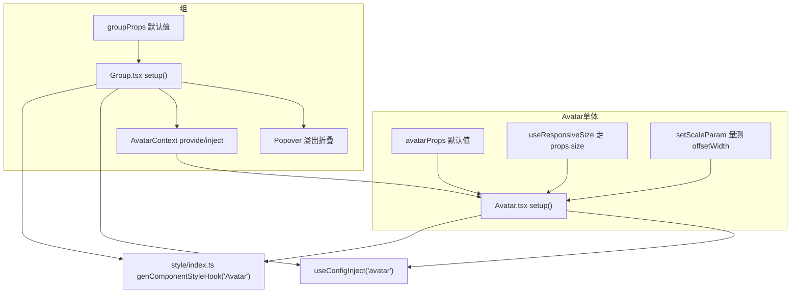
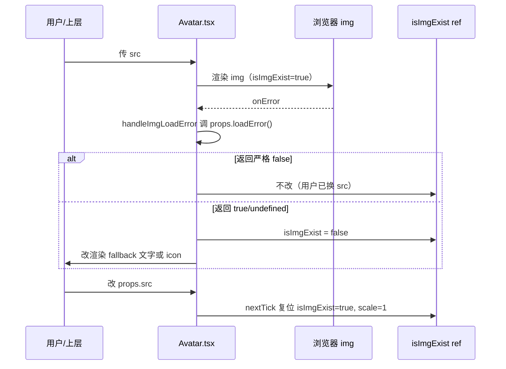
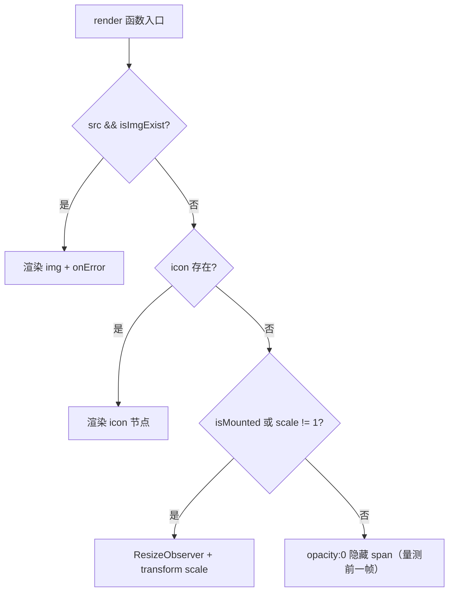

# C10-05 Avatar 头像

> **本篇解决**：Avatar 的三层图片回退链在 jsdom/SSR 下如何退化；Group 通过 provide 下发 shape 时为什么把子件的 `shape` 静默吃掉；文字自适应缩放为什么在初次渲染时必须靠 `opacity: 0` 藏一帧；改哪一行会同时打破以上三条。
> **前置**：C01-05 Badge 徽标　**读者坐标**：`03-components/10-media` 第 6/9 篇

## 一、职责与边界

Avatar 只负责一件事：在给定尺寸内呈现「图片 / 图标 / 文字」三种回退形态之一，并在图片加载失败时按可插拔策略向下一级回退。它不负责：图片本身的懒加载与预览（归 `image`）、气泡弹出容器（`Group` 借用 `popover`，见 `packages/xiaoye-ui/src/avatar/Group.tsx:4`）、跨组件的统一尺寸注入（Avatar 只吃自己的 `AvatarContext`，不吃 `SizeContext`，见 `packages/xiaoye-ui/src/avatar/AvatarContext.ts:9`）。

被谁依赖：仓内已无组件以相对路径引用 Avatar（原有 `page-header` 与 `rich-text-editor` 两个引用方均已于 2026-10-02 随组件移除）；聚合入口 `packages/xiaoye-ui/src/components.ts` 通过 `export * from './avatar'` 与副作用导入 `./avatar/style` 把 `Avatar`/`AvatarGroup` 都暴露到包根。依赖谁：`useConfigInject`（`packages/xiaoye-ui/src/avatar/Avatar.tsx:57`）、`useBreakpoint` + `responsiveArray`（`packages/xiaoye-ui/src/avatar/Avatar.tsx:7-9`）、`ResizeObserver`（`packages/xiaoye-ui/src/avatar/Avatar.tsx:11`）、`eagerComputed`（`packages/xiaoye-ui/src/avatar/Avatar.tsx:12`）、`genComponentStyleHook`（`packages/xiaoye-ui/src/avatar/style/index.ts:172`）。

同类机制（图片回退的公共抽象、预览与画廊关系）见 `C10-00 类横写：图片组的预览、对比与画廊关系`，本篇不重复。

## 二、源码地图

| 文件 | 行数 | 职责 | 关键导出 |
| --- | --- | --- | --- |
| `packages/xiaoye-ui/src/avatar/Avatar.tsx` | 222 | 单体头像主实现，回退链 + 文字缩放 | `avatarProps`、`Avatar`（默认）主实现在 `packages/xiaoye-ui/src/avatar/Avatar.tsx:40` |
| `packages/xiaoye-ui/src/avatar/Group.tsx` | 99 | 头像组，maxCount 溢出折叠 + 上下文下发 | `groupProps`、`Group`（`packages/xiaoye-ui/src/avatar/Group.tsx:31`） |
| `packages/xiaoye-ui/src/avatar/AvatarContext.ts` | 16 | size/shape 的 provide/inject 通道 | `useAvatarInjectContext`、`useAvatarProviderContext` |
| `packages/xiaoye-ui/src/avatar/index.ts` | 21 | 入口：`Avatar.Group = Group` 挂载 + install | `Avatar`、`AvatarGroup`（`packages/xiaoye-ui/src/avatar/index.ts:17`） |
| `packages/xiaoye-ui/src/avatar/style/index.ts` | 211 | Design Token → 组件样式 | `genComponentStyleHook('Avatar', …)`（`packages/xiaoye-ui/src/avatar/style/index.ts:172`） |
| `packages/xiaoye-ui/src/avatar/Avatar.test.js` | 202 | 单测（`.js` 后缀，非 `.tsx`） | 13 个 `it` |

主实现入口是 `packages/xiaoye-ui/src/avatar/Avatar.tsx:40` 的 `defineComponent`；组的入口是 `packages/xiaoye-ui/src/avatar/Group.tsx:31`。测试文件后缀是 `.js`（`packages/xiaoye-ui/src/avatar/Avatar.test.js`），符合 `packages/xiaoye-ui/vitest.config.mts` 的 glob，会被执行；若只按 `.test.tsx` 搜索会误判「Avatar 无测试」。

## 三、架构与数据流

**图 1：静态结构（模块与依赖）** —— 这张图交代「谁把什么喂给谁」：`Group` 通过 `AvatarContext` 单向把 `size`/`shape` 注给子 `Avatar`，而子件之间互不认识；样式侧只有一个 `style/index.ts`，被两个组件用**同一个** `prefixCls` 调用（这是本篇论点 5 的落点）。



`Avatar.tsx` 与 `Group.tsx` 各自 `useConfigInject('avatar', props)`（`packages/xiaoye-ui/src/avatar/Avatar.tsx:57`、`packages/xiaoye-ui/src/avatar/Group.tsx:37`），拿到同一个 base prefixCls；再各自 `useStyle(prefixCls)`（`packages/xiaoye-ui/src/avatar/Avatar.tsx:58`、`packages/xiaoye-ui/src/avatar/Group.tsx:39`）。注意 `Group` 没有把 `groupPrefixCls` 传进样式 hook——这是与 `checkbox/Group.tsx:23` 相反的正确写法（论点 5）。

**图 2：时序（图片回退链的完整闭环）** —— 触发条件是 `` 的 `onError`；关键分支是 `loadError()` 的返回值；复位条件是 `props.src` 引用变化。



`handleImgLoadError` 的判据是 `errorFlag !== false`（`packages/xiaoye-ui/src/avatar/Avatar.tsx:105`）——只有**严格 `=== false`** 才不回退；用户若写了 `onerror` 式处理器但忘了 `return false`，返回值是 `undefined`，`undefined !== false` 为真 → 仍然回退。复位由 `watch(() => props.src)` 完成（`packages/xiaoye-ui/src/avatar/Avatar.tsx:110-118`），且写在 `nextTick` 里，不在同一 tick 生效。

**图 3：渲染分支决策（flowchart）** —— 三种形态互斥，选哪一支取决于 `src && isImgExist` / `icon` / `isMounted || scale !== 1` 三段串联。



分支 3 的 `isMounted.value || scale.value !== 1`（`packages/xiaoye-ui/src/avatar/Avatar.tsx:177`）是关键：初次挂载前 `isMounted=false` 且 `scale=1`，走「隐藏」支（`packages/xiaoye-ui/src/avatar/Avatar.tsx:201-206`），让文字以自然宽度在 `opacity: 0` 下被量测；`onMounted` 后 `isMounted` 单向置真（`packages/xiaoye-ui/src/avatar/Avatar.tsx:129-134`），才切到带 `transform` 的支。这一步是「防跳变」，也是「jsdom 下测不到」的直接原因（论点 2）。

## 四、核心机制精读

### 论点 1：回退链靠单一 `isImgExist` 位，复位只挂在 `props.src` 的 watch 上，且被塞进 `nextTick`——这既避免了 onError 死循环，也带来一帧「新 src 仍显示旧回退」的空窗

断言：Avatar 的图片回退不是「渲染时判断 URL 有效性」，而是**一个 `shallowRef<boolean>` 的单向熄灭 + 一个只对 `src` 变化响应的复位**。防死循环的关键在于复位入口只有 `watch(() => props.src)`，onError 自身不会把它重新点亮。

```tsx
// packages/xiaoye-ui/src/avatar/Avatar.tsx:50
const isImgExist = shallowRef(true);
…
// packages/xiaoye-ui/src/avatar/Avatar.tsx:102
const handleImgLoadError = () => {
  const { loadError } = props;
  const errorFlag = loadError?.();
  if (errorFlag !== false) {
    isImgExist.value = false;
  }
};

// packages/xiaoye-ui/src/avatar/Avatar.tsx:110
watch(
  () => props.src,
  () => {
    nextTick(() => {
      isImgExist.value = true;
      scale.value = 1;
    });
  },
);
```

逐段解释：

1. `isImgExist` 初值 `true`（`packages/xiaoye-ui/src/avatar/Avatar.tsx:50`）——首帧默认相信图片能加载，直接渲染 ``（`packages/xiaoye-ui/src/avatar/Avatar.tsx:164`，判据 `src && isImgExist.value`）。
2. `handleImgLoadError` 只在 `errorFlag !== false` 时熄灭（`packages/xiaoye-ui/src/avatar/Avatar.tsx:104-107`）。这里 `loadError` 的类型是 `() => boolean`（`packages/xiaoye-ui/src/avatar/Avatar.tsx:33-35`），但判据用 `!== false` 而非 `if (errorFlag)`：`loadError` 未传时 `loadError?.()` 得 `undefined`，`undefined !== false` 为真 → 回退（正确）；`loadError` 传了但用户没 `return` → 同样 `undefined` → 回退（见坑 2）。
3. 复位只由 `props.src` 变化触发（`packages/xiaoye-ui/src/avatar/Avatar.tsx:111`），**onError 不写 `isImgExist = true`**，所以同一 URL 反复报错不会「熄灭-点亮-再报错」成环。测试 `should show image on success after a failure state` 正是验证「失败后再换 src → 图片重新出现」这条链（`packages/xiaoye-ui/src/avatar/Avatar.test.js:100-133`）。
4. 代价在 `nextTick`（`packages/xiaoye-ui/src/avatar/Avatar.tsx:113`）：src 变新值的当帧，`isImgExist` 仍是 `false`，于是渲染函数先按旧回退出图，下一次微任务才把 `` 放回来。对「失败态 → 直接换成功 URL」的场景，用户会看到一帧文字回退闪一下。若把复位改为同步（去掉 `nextTick`），会破坏 onError 与复位在同一微任务批次里的相对顺序，测试 `packages/xiaoye-ui/src/avatar/Avatar.test.js:126-132` 依赖这个异步性才成立。

`srcset` 不参与这条链：watch 只监听 `props.src`（`packages/xiaoye-ui/src/avatar/Avatar.tsx:111`），单独换 `srcset` 不换 `src` 时 `isImgExist` 不复位，图片不会重试（见坑 6）。

### 论点 2：文字自适应缩放依赖 `offsetWidth` 量测，jsdom/SSR 下量测恒为 0 使缩放分支不可达；测试靠 monkey-patch `offsetWidth` 才把这条支跑起来

断言：`setScaleParam` 是「读 DOM 宽度算比例」，它有两个「0 即放弃」的守卫，任何让 `offsetWidth` 归零的环境（jsdom 默认、SSR、字体未加载）都会让 `scale` 恒为 `1`，即**自适应缩放静默失效**。

```tsx
// packages/xiaoye-ui/src/avatar/Avatar.tsx:86
const setScaleParam = () => {
  if (!avatarChildrenRef.value || !avatarNodeRef.value) {
    return;
  }
  const childrenWidth = avatarChildrenRef.value.offsetWidth; // offsetWidth avoid affecting be transform scale
  const nodeWidth = avatarNodeRef.value.offsetWidth;
  // denominator is 0 is no meaning
  if (childrenWidth !== 0 && nodeWidth !== 0) {
    const { gap = 4 } = props;
    if (gap * 2 < nodeWidth) {
      scale.value =
        nodeWidth - gap * 2 < childrenWidth ? (nodeWidth - gap * 2) / childrenWidth : 1;
    }
  }
};

// packages/xiaoye-ui/src/avatar/Avatar.tsx:129
onMounted(() => {
  nextTick(() => {
    setScaleParam();
    isMounted.value = true;
  });
});
```

逐段解释：

1. 两个提前返回：ref 未就绪直接 return（`packages/xiaoye-ui/src/avatar/Avatar.tsx:87-89`）；`childrenWidth`/`nodeWidth` 任一为 0 也不写 `scale`（`packages/xiaoye-ui/src/avatar/Avatar.tsx:93`）。jsdom 不做布局，`offsetWidth` 恒 0 → 永远命中「为 0」这条 → `scale` 保持 `1`。这就是任务提示里说的「jsdom 下量测恒为 0 导致分支不可测」。
2. 测试为了让这条支可达，直接改写了 `HTMLElement.prototype` 的 `offsetWidth` getter：当 `className === 'xy-avatar-string'` 返回 100，否则返回 80（`packages/xiaoye-ui/src/avatar/Avatar.test.js:14-32`），并在缩放用例里再改一次返回 40（`packages/xiaoye-ui/src/avatar/Avatar.test.js:144-151`）。也就是说，**缩放算法本身在测试里从未用真实布局验证**，只验证了「不抛异常」。
3. `gap` 的默认值来自解构默认 `const { gap = 4 } = props`（`packages/xiaoye-ui/src/avatar/Avatar.tsx:94`），而 prop 声明是裸 `gap: Number`、**没有** default（`packages/xiaoye-ui/src/avatar/Avatar.tsx:30`）。这个写法是**正确**的兜底形状（对照反例 `color-picker/ColorPicker.tsx:56`）：因为 `props.gap` 未传时确实是 `undefined`，解构默认才可达。缩放余量 `gap * 2`（`packages/xiaoye-ui/src/avatar/Avatar.tsx:95-97`）只在文字支用到，图片支与图标支完全不看 `gap`。
4. 缩放触发点有三处：`onMounted` 的 `nextTick`（`packages/xiaoye-ui/src/avatar/Avatar.tsx:131`）、`watch(() => props.gap)` 的 `nextTick`（`packages/xiaoye-ui/src/avatar/Avatar.tsx:120-127`）、以及文字 span 外包的 `<ResizeObserver onResize={setScaleParam}>`（`packages/xiaoye-ui/src/avatar/Avatar.tsx:191`）。第三处负责字体晚加载后的重算——但前提是首次已进入 `isMounted` 分支（`packages/xiaoye-ui/src/avatar/Avatar.tsx:177`）。
5. 应用缩放的是内联 `transform`（`packages/xiaoye-ui/src/avatar/Avatar.tsx:178-183`，`scale(...) translateX(-50%)`），配合样式表里 `.avatar-string` 的 `left: 50%` 与 `transformOrigin: '0 center'`（`packages/xiaoye-ui/src/avatar/style/index.ts:91-98`）完成居中；`left` 值标了 `_skip_check_: true`（`packages/xiaoye-ui/src/avatar/style/index.ts:93-96`）以绕过 RTL 逻辑属性改写。字体未加载时 `childrenWidth` 偏小 → 首轮算出 `scale=1`（不缩），字体加载完 ResizeObserver 再触发一次才缩到位——这一「先 1 后缩」的跳变，正是 `opacity: 0` 那一帧（论点见 `packages/xiaoye-ui/src/avatar/Avatar.tsx:201-206`）要掩盖的对象。

### 论点 3：`mergeShape = avatarCtx.shape ?? shape` 的兜底分支在 Group 内**恒不可达**——因为 Group 的 `shape` prop 自带默认值 `'circle'`，子头像显式写的 `shape="square"` 被静默吞掉

断言：这是共则 §3「`X ?? Y` 且 `X` 带非 `undefined` 默认值 ⇒ 兜底不可达」的一个活例。`shape` 的回退方向还**反了**：上下文的值盖住了子件的显式声明。

```tsx
// packages/xiaoye-ui/src/avatar/Avatar.tsx:137
return () => {
  const { shape, src, alt, srcset, draggable, crossOrigin } = props;
  const mergeShape = avatarCtx.shape ?? shape;
  …
  [`${pre}-${mergeShape}`]: true,   // packages/xiaoye-ui/src/avatar/Avatar.tsx:146
```

```tsx
// packages/xiaoye-ui/src/avatar/Group.tsx:26
shape: { type: String as PropType<'circle' | 'square'>, default: 'circle' },
…
// packages/xiaoye-ui/src/avatar/Group.tsx:40
watchEffect(() => {
  const context = { size: props.size, shape: props.shape };
  useAvatarProviderContext(context);
});
```

逐段解释：

1. Group 的 `shape` prop 声明了 `default: 'circle'`（`packages/xiaoye-ui/src/avatar/Group.tsx:26`），因此用户不给 Group 写 `shape` 时，`props.shape` 已经是 `'circle'`，**不是 `undefined`**。
2. Group 用 `watchEffect` 把这个 `props.shape` 原样放进 context（`packages/xiaoye-ui/src/avatar/Group.tsx:41`），子头像 `useAvatarInjectContext()` 注入到的 `avatarCtx.shape` 于是恒为 `'circle'`（除非 Group 显式写了别的值）。
3. 子头像 `mergeShape = avatarCtx.shape ?? shape`（`packages/xiaoye-ui/src/avatar/Avatar.tsx:138`）：`??` 只在**左侧为 `null`/`undefined`** 时才取右侧。`avatarCtx.shape` 恒是 `'circle'` 字符串 → 永远走左侧 → 子头像自己的 `props.shape`（哪怕用户显式写了 `shape="square"`）在这一行被丢弃。类名最终落在 `packages/xiaoye-ui/src/avatar/Avatar.tsx:146` 的 `${pre}-${mergeShape}`。
4. 独立使用（不在 Group 内）时不受影响：`useAvatarInjectContext()` 的注入默认是空对象 `{}`（`packages/xiaoye-ui/src/avatar/AvatarContext.ts:12`），`avatarCtx.shape` 为 `undefined` → `??` 落回子件自身 `shape` → 正常。**所以这是一个只在「头像组内」才复现的缺陷**。
5. 对照 `size` 的处理（`packages/xiaoye-ui/src/avatar/Avatar.tsx:60-62`）：`size.value = props.size === 'default' ? avatarCtx.size : props.size`——它用「哨兵值 `'default'`」判「子件没显式写」，让子件显式值优先。`shape` 本该用同样形状（判哨兵、子件优先），却误用了 `??` + 带默认值的 context，方向与判据都错了。
6. 测试面：`packages/xiaoye-ui/src/avatar/Avatar.test.js` 里没有任何 `AvatarGroup`/`Group` 用例（全文件搜 `Group` 零命中），这条链**无测试保护**。

### 论点 4：`size` 是「同名 computed 遮蔽同名 prop」，但遮蔽方向正确；真正的问题是 `responsiveSize` 只读 `props.size` 不读合并后的 `size.value`，于是 Group 传入的响应式尺寸对象对子件完全无效

断言：`const size = computed(...)`（`packages/xiaoye-ui/src/avatar/Avatar.tsx:60`）与 prop `size`（`packages/xiaoye-ui/src/avatar/Avatar.tsx:21`）同名，符合共则 §3 的 grep 判形，但它**读了** `props.size`，所以不是 `progress` 那种「用户传值失效」的死遮蔽。同一函数里的 `responsiveSize` 却绕开这个 computed 直接读裸 `props.size`，两者口径不一致，导致 Group 的响应式（`ScreenSizeMap`）尺寸丢失。

```tsx
// packages/xiaoye-ui/src/avatar/Avatar.tsx:59
const avatarCtx = useAvatarInjectContext();
const size = computed(() => {
  return props.size === 'default' ? avatarCtx.size : props.size;   // :60-62
});
const screens = useBreakpoint();
const responsiveSize = eagerComputed(() => {
  if (typeof props.size !== 'object') {          // :65  读的是 props.size，不是 size.value
    return undefined;
  }
  const currentBreakpoint: Breakpoint = responsiveArray.find(screen => screens.value[screen])!;
  const currentSize = props.size[currentBreakpoint];
  return currentSize;
});
```

逐段解释：

1. `size` computed 的优先级是「子件显式 size > 组 context size」：子件 `props.size` 不等于哨兵 `'default'` 就用子件值，否则用 `avatarCtx.size`（`packages/xiaoye-ui/src/avatar/Avatar.tsx:61`）。渲染侧的尺寸类名 `-lg`/`-sm`（`packages/xiaoye-ui/src/avatar/Avatar.tsx:144-145`）与数字内联样式（`packages/xiaoye-ui/src/avatar/Avatar.tsx:152-160`）都读 `size.value`，一致。
2. 但 `responsiveSize` 判的是 `typeof props.size === 'object'`（`packages/xiaoye-ui/src/avatar/Avatar.tsx:65`）。子件通常不带 `size`，`props.size` 是字符串 `'default'`（默认值，`packages/xiaoye-ui/src/avatar/Avatar.tsx:23`）→ 早退 `undefined` → `responsiveSizeStyle` 返回 `{}`（`packages/xiaoye-ui/src/avatar/Avatar.tsx:75-83`）。
3. 后果：把响应式尺寸对象交给 **Group**（`groupProps.size` 允许 `[Number, String, Object]`，`packages/xiaoye-ui/src/avatar/Group.tsx:22-25`），context 里下发的 `avatarCtx.size` 是个对象，`size.value` 会等于该对象（`packages/xiaoye-ui/src/avatar/Avatar.tsx:61`），但 `typeof size.value === 'number'` 为假 → `sizeStyle` 是 `{}`（`packages/xiaoye-ui/src/avatar/Avatar.tsx:152-160`）；而 `responsiveSize` 又只看裸 `props.size`（字符串）→ `undefined`。**两条内联尺寸都不产出，Group 的响应式尺寸对每个子头像零效果**。测试 `packages/xiaoye-ui/src/avatar/Avatar.test.js:169-181` 只测了「直接把对象 size 传给单个 Avatar」，没测经由 Group 下发，因此覆盖不到这个组合。
4. 另有一处非响应式隐患（结构可读，运行时后果为按 `provide`/`inject` 语义的推断，无测试覆盖）：Group 在 `watchEffect` 里 `provide` 的是**每次新建的普通对象快照** `{ size: props.size, shape: props.shape }`（`packages/xiaoye-ui/src/avatar/Group.tsx:40-43`），而 `useAvatarProviderContext` 只是裸 `provide(key, context)`（`packages/xiaoye-ui/src/avatar/AvatarContext.ts:14-16`），未包 `reactive`/`ref`。子件的 `avatarCtx` 在 setup 期一次性 `inject` 得到初值对象（`packages/xiaoye-ui/src/avatar/Avatar.tsx:59`）。Group 后续因 `props.size` 变化而重跑 `watchEffect`、再次 `provide` 一个新对象时，已挂载子件不会重新 `inject`，仍握着旧快照。据此推断：**运行时改 Group 的 `size`/`shape`，已挂载的子头像不会更新**（首帧因 `watchEffect` 同步执行而正确，仅后续更新丢）。

> ⚠️ 未在源码中找到对应实现：上述「运行时丢更新」是我基于 `provide`/`inject` 语义对本仓代码结构的推断，`packages/xiaoye-ui/src/avatar/Avatar.test.js` 中没有对 Group 动态改 props 的用例来证实或证伪它；快照对象、裸 provide、一次性 inject 三个代码事实本身可直接读到。

`eagerComputed` 的 `flush: 'sync'`（`packages/xiaoye-ui/src/_util/eagerComputed.ts:12`）保证 `responsiveSize` 在依赖变化时同步更新，与这里的丢值无关，丢的是**读取源选错**（`props.size` 而非 `size.value`）。

### 论点 5：Avatar 族把「喂给样式 hook 的 prefixCls」用对了——`Group` 传的是自己的 base `prefixCls` 而非 `groupPrefixCls`，所以整组只注册一张样式表；但同文件里藏着一个从不赋值的死 token `avatarBgColor`

断言：这是共则 §3 最后一条检查点在 Avatar 上的落点，且结论是**正例**。样式缓存键含 `prefixCls`，若把 `-group` 的 prefixCls 传进 hook 就会另生成一张表（`checkbox/Group.tsx:23` 的 `groupPrefixCls` 就是反例，`radio/Group.tsx:54` 与本组件是正例）。

```tsx
// packages/xiaoye-ui/src/avatar/Group.tsx:37
const { prefixCls, direction } = useConfigInject('avatar', props);
const groupPrefixCls = computed(() => `${prefixCls.value}-group`);   // :38
const [wrapSSR, hashId] = useStyle(prefixCls);   // :39  传的是 base prefixCls，不是 groupPrefixCls
```

```ts
// packages/xiaoye-ui/src/theme/util/genComponentStyleHook.ts:69
const componentInfo = computed(() => {
  return {
    theme: theme.value,
    token: token.value,
    hashId: hashId.value,
    path: [component, prefixCls.value, iconPrefixCls.value],   // :74
  };
});
```

逐段解释：

1. `genComponentStyleHook('Avatar', …)`（`packages/xiaoye-ui/src/avatar/style/index.ts:173`）里 `component` 恒为 `'Avatar'`，缓存 `path` 的三段是 `[component, prefixCls.value, iconPrefixCls.value]`（`packages/xiaoye-ui/src/theme/util/genComponentStyleHook.ts:74`）。Avatar 与 Group 都用 `useConfigInject('avatar', props)` 拿到同一个 base `'xy-avatar'`（`packages/xiaoye-ui/src/avatar/Avatar.tsx:57`、`packages/xiaoye-ui/src/avatar/Group.tsx:37`），`useStyle(prefixCls)` 传入的都是这个 base（`packages/xiaoye-ui/src/avatar/Avatar.tsx:58`、`packages/xiaoye-ui/src/avatar/Group.tsx:39`）→ 两段 `path` 完全相同 → 只命中一张注册表。
2. Group 的 `-group` 类名走的是渲染层：`groupPrefixCls` 只用来拼 `cls`（`packages/xiaoye-ui/src/avatar/Group.tsx:53-54`）和 Popover 的 `overlayClassName`（`packages/xiaoye-ui/src/avatar/Group.tsx:78`），从不进 `useStyle`。而 group 的样式规则本身就是用 `${componentCls}-group` 在**同一张表**里生成的（`packages/xiaoye-ui/src/avatar/style/index.ts:153`、`:164`）。所以 `genGroupStyle` 与 `genBaseStyle` 一起返回（`packages/xiaoye-ui/src/avatar/style/index.ts:180`），一次注册覆盖两者。
3. 判形复用命令：`grep -n "useStyle(" packages/xiaoye-ui/src/avatar/Group.tsx` → 只看传入参数是不是本组件 base prefixCls。这里是 `prefixCls`，合规。
4. 反面：`avatarBgColor` 声明在私有 token 类型里（`packages/xiaoye-ui/src/avatar/style/index.ts:57`），但 `mergeToken` 只写入了 `avatarBg` 与 `avatarColor`（`packages/xiaoye-ui/src/avatar/style/index.ts:176-179`），全目录再无第二处出现（`grep -rn "avatarBgColor" packages/xiaoye-ui/src` 只回 `style/index.ts:57` 一行）——一个「类型里有、运行时不产生、样式不消费」的死键，属共则 §3「生成但从不消费的键」族。它不影响渲染，但会误导后来者以为可用 `components.Avatar.avatarBgColor` 覆写。

## 五、对外契约如何生效

属性清单见 [apps/docs/components/avatar.md](../../../apps/docs/components/avatar.md)。本节只讲「声明的契约如何流到渲染/回调」，以及哪些声明其实不通。

- **`src`/`srcset`/`alt`/`crossOrigin`/`draggable`**：从 `props` 解构（`packages/xiaoye-ui/src/avatar/Avatar.tsx:137`）→ 只在 `src && isImgExist` 分支落到 ``（`packages/xiaoye-ui/src/avatar/Avatar.tsx:164-174`）。一旦回退到文字/图标支，这些属性整体消失——`alt` 不产生 `aria-label`，`crossOrigin`（渲染成小写 `crossorigin`，`packages/xiaoye-ui/src/avatar/Avatar.tsx:172`）也随之丢失。
- **`icon`**：既走 prop 也走 slot，经 `getPropsSlot(slots, props, 'icon')` 合并（`packages/xiaoye-ui/src/avatar/Avatar.tsx:139`）→ 命中图标支（`packages/xiaoye-ui/src/avatar/Avatar.tsx:175-176`），并在 `classString` 里打 `-icon`（`packages/xiaoye-ui/src/avatar/Avatar.tsx:148`）。
- **`size`**：先被 `size` computed 合并 context（`packages/xiaoye-ui/src/avatar/Avatar.tsx:60-62`）再消费；对象形态另走 `responsiveSize` → `responsiveSizeStyle`（`packages/xiaoye-ui/src/avatar/Avatar.tsx:74-84`），最终拼进 `style` 数组（`packages/xiaoye-ui/src/avatar/Avatar.tsx:213`）。`attrs.style` 排在数组末位，故用户 style 能覆盖内联尺寸（顺序即优先级，见坑 4 讨论）。
- **`loadError`**：不是事件而是 **prop 形态的回调**，`avatarProps` 声明为 `Function as PropType<() => boolean>`（`packages/xiaoye-ui/src/avatar/Avatar.tsx:33-35`），仅在 `handleImgLoadError` 里同步调用一次（`packages/xiaoye-ui/src/avatar/Avatar.tsx:103-104`）。Avatar **没有任何 `emits` 声明**（`packages/xiaoye-ui/src/avatar/Avatar.tsx:40-49` 的 `defineComponent` 无 `emits` 字段），因此不存在 `onError`/`onImgError` 事件，唯一对外钩子就是 `loadError`。
- **`Group` 的 `maxCount`/`maxStyle`/`maxPopoverPlacement`/`maxPopoverTrigger`**：`maxCount < numOfChildren` 时切片并把超出项塞进 `<Popover>` 的 `content`（`packages/xiaoye-ui/src/avatar/Group.tsx:75-82`），触发/放置透传给 Popover（`packages/xiaoye-ui/src/avatar/Group.tsx:76-77`）。注意 `maxPopoverPlacement` 在 props 默认 `'top'`（`packages/xiaoye-ui/src/avatar/Group.tsx:16`）之外又在解构处再写一次默认（`packages/xiaoye-ui/src/avatar/Group.tsx:46`），而 `maxPopoverTrigger` 无 props 默认、只有解构默认 `'hover'`（`packages/xiaoye-ui/src/avatar/Group.tsx:17`、`:49`）——两种默认混用。
- **context 契约**：Group 单向 `provide`，Avatar 单向 `inject`（`packages/xiaoye-ui/src/avatar/AvatarContext.ts:11-16`），无 expose、无事件回流。`Avatar` 未 `expose` 任何方法（`packages/xiaoye-ui/src/avatar/Avatar.tsx:49` 的 setup 形参没解构 `expose`）。
- **attrs 透传**：两个组件都 `inheritAttrs: false`（`packages/xiaoye-ui/src/avatar/Avatar.tsx:43`、`packages/xiaoye-ui/src/avatar/Group.tsx:34`），根节点手动 `{...attrs}`（`packages/xiaoye-ui/src/avatar/Avatar.tsx:210`、`packages/xiaoye-ui/src/avatar/Group.tsx:84`/`:91`），并把 `attrs.class` 并进 class 对象（`packages/xiaoye-ui/src/avatar/Avatar.tsx:142`、`packages/xiaoye-ui/src/avatar/Group.tsx:56`）。

## 六、设计取舍

**文字缩放为什么必须是 JS 量测而不是纯 CSS。** 目标效果是「任意长度文字在固定圆形/方形内水平居中且不溢出，放不下就整体等比缩小」。纯 CSS 做不到「按内容自然宽 / 容器宽」反推 `scale`，只能靠读 `offsetWidth` 现算（`packages/xiaoye-ui/src/avatar/Avatar.tsx:90-97`）。代价是这套逻辑天然依赖真实布局，于是 SSR 首帧与 jsdom 下 `offsetWidth` 为 0、`scale` 退回 1（论点 2），文字可能溢出后 hydration 才纠正。为把这条「先溢出后缩」的跳变藏起来，组件在量测前用 `opacity: 0` 的隐藏 span 占位、`onMounted` 后才显示（`packages/xiaoye-ui/src/avatar/Avatar.tsx:201-206` 与 `:129-134`）。这是一个明确的权衡：牺牲无 JS 环境下的缩放正确性，换取浏览器端「看不到跳变」。被放弃的替代是 `font-size` 自适应或 `text-overflow: ellipsis`，两者都改变视觉语义（截断 / 字号不统一），故未采用。

**回退状态为什么是单个 boolean 而不是「每个 URL 的失败集合」。** `isImgExist` 只是一个 `shallowRef<boolean>`（`packages/xiaoye-ui/src/avatar/Avatar.tsx:50`），复位挂在 `watch(() => props.src)`（`packages/xiaoye-ui/src/avatar/Avatar.tsx:110-118`）。好处是实现极简、天然无死循环（onError 不复位自己）；代价是「失败」这个事实不持久——同一 src 若因 `loadError` 返回 `false` 被换掉、又换回，会重新尝试加载且当作新图。这是刻意的：头像 URL 通常一次定终身，不值得维护失败缓存。

**`loadError` 用「返回 boolean 的 prop 回调」而非「事件」。** 判据 `errorFlag !== false`（`packages/xiaoye-ui/src/avatar/Avatar.tsx:105`）让调用方能在回调里同步换 `src` 并用 `return false` 否决回退（测试 `packages/xiaoye-ui/src/avatar/Avatar.test.js:62-98` 演示这条）。换来的是「一个钩子同时承担『是否回退』与『补救动作』」，赔上的是语义隐蔽：只有严格 `false` 才否决，漏写 `return` 的调用方会拿到与直觉相反的默认回退（坑 2）。

**size/shape 下发为什么走 provide/inject 而不是 `cloneElement` 注入 props。** Group 只给子节点补 `key`（`packages/xiaoye-ui/src/avatar/Group.tsx:61-65`），尺寸/形状靠 context（`packages/xiaoye-ui/src/avatar/Group.tsx:40-43`）。好处是嵌套任意层级、slot 数量不定都能透传，且不用把用户写的 `shape` 覆盖掉。但实现里两个决定各错一半：`shape` 用了 `??` + 带默认值 context 导致子件显式值被吞（论点 3），`size` 用哨兵判据本应更稳却在 `responsiveSize` 处口径不一（论点 4）。理想做法是让 context 携带「是否被显式设置」的信息，并下发响应式对象——本仓没做，才留下这两处坑。

## 七、坑与改动指南

**坑 1：头像组内子头像的 `shape="square"` 不生效**

- 触发：在 `AvatarGroup` 里放一个显式写了 `shape="square"` 的 `Avatar`（组自己没写 shape）。
- 症状：该头像仍是圆形，子件的 `shape` 声明被静默忽略。
- 原因：Group 的 `shape` prop 有默认 `'circle'`，经 context 下发后 `avatarCtx.shape` 恒非 `undefined`，`avatarCtx.shape ?? shape` 永远取左值（详见论点 3）。
- 定位：`packages/xiaoye-ui/src/avatar/Group.tsx:26`、`packages/xiaoye-ui/src/avatar/Group.tsx:41`、`packages/xiaoye-ui/src/avatar/Avatar.tsx:138`。改法：把 `mergeShape` 改成 `shape ?? avatarCtx.shape` 之外还需让 Group 的默认值可区分「未设」——最稳是去掉 `packages/xiaoye-ui/src/avatar/Group.tsx:26` 的 `default: 'circle'`，让 context 携带 undefined 时子件默认值才生效。无测试覆盖（`packages/xiaoye-ui/src/avatar/Avatar.test.js` 无 Group 用例）。

**坑 2：`loadError` 回调漏写 `return false` 导致意外回退**

- 触发：给 `loadError` 传一个只改 `src` 但 `return` 值为 `undefined` 的函数。
- 症状：图片被判定失败、切到文字/图标回退，而调用方本想「换成备用 URL 继续显示图片」。
- 原因：判据是 `errorFlag !== false`（`packages/xiaoye-ui/src/avatar/Avatar.tsx:105`），只有严格 `false` 才否决回退；`undefined` 落入「回退」分支。
- 定位：`packages/xiaoye-ui/src/avatar/Avatar.tsx:102-108`。正确写法参照测试 `packages/xiaoye-ui/src/avatar/Avatar.test.js:73-77`（`handleImgError` 显式 `return false`）。改判据前要先确认这不会破坏 `packages/xiaoye-ui/src/avatar/Avatar.test.js:62-98` 的语义。

**坑 3：SSR / jsdom / 字体未加载时文字缩放恒不生效**

- 触发：服务端渲染头像放的是长文字，或单测环境未 mock `offsetWidth`。
- 症状：文字按自然字号溢出容器不被缩放（SSR），或缩放分支根本跑不到（测试）。
- 原因：`setScaleParam` 在 `offsetWidth === 0` 时直接跳过写 `scale`（`packages/xiaoye-ui/src/avatar/Avatar.tsx:92-93`），`scale` 保持 `1`。
- 定位：`packages/xiaoye-ui/src/avatar/Avatar.tsx:86-100`。测试用 monkey-patch 让分支可达：`packages/xiaoye-ui/src/avatar/Avatar.test.js:14-32`、`:144-151`，但这只证明「不抛异常」，不证明缩放值正确——改动缩放公式时该分支无有效断言保护。

**坑 4：`onMounted` 未触发时文字恒不可见（`opacity: 0`）**

- 触发：Avatar 被放进一个挂载即被条件移除/切换的分支，或 `onMounted` 的 `nextTick` 回调被打断。
- 症状：文字头像一片空白——`isMounted` 仍 `false` 且 `scale` 为 `1`，渲染函数走隐藏支。
- 原因：`isMounted` 只在 `onMounted` 的 `nextTick` 里单向置真（`packages/xiaoye-ui/src/avatar/Avatar.tsx:129-134`），而隐藏支 `opacity: 0` 的判据是 `!(isMounted || scale!==1)`（`packages/xiaoye-ui/src/avatar/Avatar.tsx:177`、`:201-206`）。`isMounted` 无任何复位路径。
- 定位：`packages/xiaoye-ui/src/avatar/Avatar.tsx:51`、`:132`、`:177`、`:201-206`。改动时注意这是组件内状态、非模块级全局量，SSR 多实例不互串，但「单向 latch」使得复用实例（`v-if` 反复挂载）时依赖 `onMounted` 每次都触发。

**坑 5：Group 传响应式尺寸对象（`ScreenSizeMap`）对子头像无效**

- 触发：`<AvatarGroup :size="{ xs: 24, md: 40 }">`，子 `Avatar` 不带自己的 `size`。
- 症状：子头像不随断点变尺寸，落到 CSS 默认尺寸。
- 原因：`responsiveSize` 只读裸 `props.size`（子件是字符串 `'default'`），不读合并了 context 的 `size.value`；而 `sizeStyle` 又要求 `typeof size.value === 'number'`，对象两者都不满足（详见论点 4）。
- 定位：`packages/xiaoye-ui/src/avatar/Avatar.tsx:64-72`、`:152-160`。改法：把 `responsiveSize` 的读取源从 `props.size` 换成 `size.value`。现有响应式测试 `packages/xiaoye-ui/src/avatar/Avatar.test.js:169-181` 只覆盖「单 Avatar 直传对象」，改完需补一条 Group 用例。

**坑 6：只换 `srcset` 不换 `src` 时失败图片不重试**

- 触发：图片因某分辨率加载失败回退，之后仅更新 `srcset`（`src` 不变）期望重试。
- 症状：仍显示回退内容，`` 不重新出现。
- 原因：复位 `isImgExist` 的 watch 只监听 `props.src`（`packages/xiaoye-ui/src/avatar/Avatar.tsx:110-111`），`srcset` 不在依赖里。
- 定位：`packages/xiaoye-ui/src/avatar/Avatar.tsx:110-118`。该分支无测试保护。

**坑 7：误以为可用 `components.Avatar.avatarBgColor` 覆写背景**

- 触发：在 `ConfigProvider` 的 `theme.components.Avatar` 里写 `avatarBgColor`。
- 症状：毫无效果，背景仍由 `avatarBg`（来自 `colorTextPlaceholder`，`packages/xiaoye-ui/src/avatar/style/index.ts:177`）决定。
- 原因：`avatarBgColor` 只在 token 类型里声明（`packages/xiaoye-ui/src/avatar/style/index.ts:57`），`mergeToken` 从不赋值、样式从不消费（论点 5）。
- 定位：`packages/xiaoye-ui/src/avatar/style/index.ts:57`。要么补进 `mergeToken`（`packages/xiaoye-ui/src/avatar/style/index.ts:176-179`），要么删除该声明以免误导。

**改动安全边界**：动 `setScaleParam` 或 `isImgExist` 逻辑后，至少跑 `pnpm --filter xiaoye-ui test:unit -- Avatar`；`loadError` 判据与回退链耦合，改 `!== false` 语义前务必看 `packages/xiaoye-ui/src/avatar/Avatar.test.js:62-133` 两条用例。`useStyle(prefixCls)` 一处（`packages/xiaoye-ui/src/avatar/Group.tsx:39`）不要改成 `groupPrefixCls`，否则复现 `checkbox/Group.tsx:23` 的双表注册问题。

## 附：本篇可证伪的三个检查点

1. **死 token `avatarBgColor` 只有声明没有赋值。** 跑 `grep -rn "avatarBgColor" packages/xiaoye-ui/src` → 应只回 `packages/xiaoye-ui/src/avatar/style/index.ts:57` 一行（类型声明），没有 `mergeToken` 写入点、没有样式消费点。若某天出现第二行且是赋值，则论点 5 的「死键」结论作废。
2. **`isImgExist` 的复位只挂在 `src` 上，`srcset` 不参与。** 跑 `grep -n "isImgExist.value = true" packages/xiaoye-ui/src/avatar/Avatar.tsx` → 只命中 `nextTick` 内那一处（`packages/xiaoye-ui/src/avatar/Avatar.tsx:114`），且其外层 `watch` 源是 `props.src`（`packages/xiaoye-ui/src/avatar/Avatar.tsx:111`）。若出现监听 `srcset` 的复位，坑 6 作废。
3. **Group 喂给样式 hook 的是 base prefixCls，不是 groupPrefixCls（正例）。** 跑 `grep -n "useStyle(" packages/xiaoye-ui/src/avatar/Group.tsx` → 唯一一行是 `useStyle(prefixCls)`（`packages/xiaoye-ui/src/avatar/Group.tsx:39`），参数不含 `groupPrefixCls`。对照 `grep -n "useStyle(" packages/xiaoye-ui/src/checkbox/Group.tsx` 应见 `useStyle(groupPrefixCls)`（`packages/xiaoye-ui/src/checkbox/Group.tsx:23`）。若 Avatar 这行被改成传 groupPrefixCls，论点 5 的「正例」结论作废、退化为双表注册。

（旁注：坑 1 的 `shape ?? ` 与论点 4 的 `responsiveSize` 读源，都可用 `grep -n "mergeShape = avatarCtx.shape ?? shape" packages/xiaoye-ui/src/avatar/Avatar.tsx` 与 `grep -n "typeof props.size !== 'object'" packages/xiaoye-ui/src/avatar/Avatar.tsx` 现场定位；但它们的「用户可见后果」需要真实浏览器 + Group 用例才能证实，本篇已在论点 3/4 分别标注哪些是代码事实、哪些是推断。）
