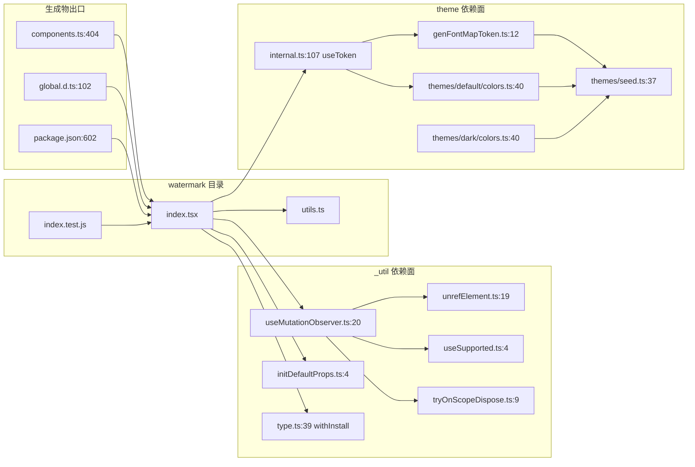
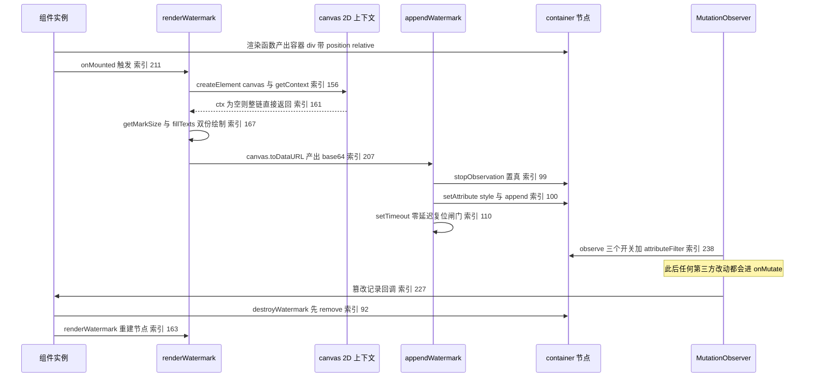
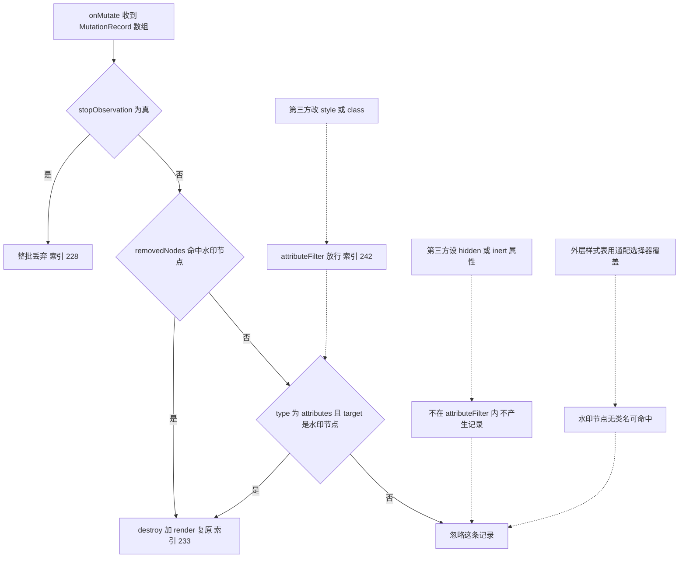

# C10-06 Watermark 水印

> **本篇解决**：Watermark 的「防篡改」到底由哪几段代码保证，观察配置与写入方式不匹配时会在哪一行失守。
> **前置**：I14 运行时约束与静态检查　**读者坐标**：`03-components/10-media` 第 6 篇

## 一、职责与边界

Watermark 负责在默认插槽外面套一层容器，并在容器内**追加**一个铺满的覆盖层，覆盖层的视觉内容是一张由 `<canvas>` 现绘的 PNG data URL 背景图。它不负责内容的可访问性、不负责层序协调（`grep -rn "zIndexManager" packages/xiaoye-ui/src/watermark` 零命中，而同为覆盖层语义的 BlockUI 走的是 `packages/xiaoye-ui/src/_util/zIndexManager.ts:10` 的 `set`，调用点见 `packages/xiaoye-ui/src/block-ui/BlockUI.tsx:176`）、也不负责在绘制能力缺失时给出任何降级——这三件事在源码里都能找到「明确没写」的行号。

它的真实定位是「防篡改」语义下的一个对抗性组件：水印节点不由渲染函数产出，而由 `document.createElement` 手工造出并 `append` 进容器（`packages/xiaoye-ui/src/watermark/index.tsx:163` 与 `packages/xiaoye-ui/src/watermark/index.tsx:108`），再靠 `MutationObserver` 把被第三方删掉或改掉的节点复原（`packages/xiaoye-ui/src/watermark/index.tsx:238`）。本篇的主线就是把这条「写入方式」与「观察方式」是否真的匹配讲清楚，以及它在异步产物、缺省输入、测试环境三处的失配。

依赖清单（全部是本仓文件）：

- 样式令牌：`packages/xiaoye-ui/src/theme/internal.ts:107` 的 `useToken`，只取两个 Map Token（`packages/xiaoye-ui/src/watermark/index.tsx:56`、`:60`）。
- 观察器：`packages/xiaoye-ui/src/_util/hooks/_vueuse/useMutationObserver.ts:20`，其内部依赖 `packages/xiaoye-ui/src/_util/hooks/_vueuse/unrefElement.ts:19`、`packages/xiaoye-ui/src/_util/hooks/_vueuse/useSupported.ts:4`、`packages/xiaoye-ui/src/_util/hooks/_vueuse/tryOnScopeDispose.ts:9`。
- Props 工具：`packages/xiaoye-ui/src/_util/type.ts:83`（`arrayType`）、`packages/xiaoye-ui/src/_util/type.ts:54`（`objectType`）、`packages/xiaoye-ui/src/_util/type.ts:91`（`someType`）、`packages/xiaoye-ui/src/_util/type.ts:39`（`withInstall`）、`packages/xiaoye-ui/src/_util/props-util/initDefaultProps.ts:4`。
- 自有工具：`packages/xiaoye-ui/src/watermark/utils.ts:7`（`getStyleStr`）、`:14`（`getPixelRatio`）、`:19`（`rotateWatermark`）、`:31`（`reRendering`）。
- 不负责：主题切换以外的 Token 联动、跨实例层序、SSR 期水印（见本篇 §六）。同类共性机制见 C10-00 类横写篇，本篇不重述。

## 二、源码地图

| 文件                                                     | 行数 | 职责                                                       | 关键导出                                                           |
| -------------------------------------------------------- | ---- | ---------------------------------------------------------- | ------------------------------------------------------------------ |
| `packages/xiaoye-ui/src/watermark/index.tsx`             | 259  | 主实现：props、几何计算、canvas 绘制、观察器、渲染函数      | 默认导出 `withInstall(Watermark)`，见 `index.tsx:259`                |
| `packages/xiaoye-ui/src/watermark/utils.ts`              | 42   | 样式串拼接、像素比、旋转、篡改判定                          | `getStyleStr` `getPixelRatio` `rotateWatermark` `reRendering`       |
| `packages/xiaoye-ui/src/watermark/index.test.js`         | 28   | 仅 1 条自有用例加 1 条工厂用例，见本篇 §七 测试现状          | —                                                                  |
| 生成物 `src/components.ts`                               | —    | 聚合入口两行，见 `packages/xiaoye-ui/src/components.ts:403` | `Watermark`                                                        |
| 生成物 `typings/global.d.ts`                             | —    | `GlobalComponents` 声明，见 `packages/xiaoye-ui/typings/global.d.ts:102` | `XYWatermark`                                              |
| 生成物 `package.json` 的 `exports`                       | —    | 子路径入口，见 `packages/xiaoye-ui/package.json:602`        | `./watermark`                                                      |

三个「没有」比「有」更能定位这个组件的形状：

1. **没有 `watermarkTypes.ts`**——props 就地写在主文件 `packages/xiaoye-ui/src/watermark/index.tsx:23`，与仓库规范（AGENTS.md 的组件模板）不同形。
2. **没有 `style/` 目录**——`git ls-files packages/xiaoye-ui/src/watermark` 只回上面三个文件；`grep -rn -e prefixCls -e useConfigInject -e useStyle packages/xiaoye-ui/src/watermark` 计数为 0。它是组件库里少见的完全不接入 CSS-in-JS 组件样式链路的实现。
3. **没有 `defineExpose`、没有 `emits`、没有 slots 类型声明**——`setup` 只解构 `props, { slots, attrs }`（`packages/xiaoye-ui/src/watermark/index.tsx:45`），公开面上既无方法也无事件。

主实现入口的四个关键函数按调用深度排列：`renderWatermark`（`packages/xiaoye-ui/src/watermark/index.tsx:155`）→ `getMarkSize`（`:119`）与 `fillTexts`（`:135`）→ `appendWatermark`（`:97`）；反向删除路径只有一个 `destroyWatermark`（`:90`）。

## 三、架构与数据流

### 3.1 静态结构：谁依赖谁



这张图要说的是三件事。第一，`index.tsx` 对 `theme` 的依赖只有一个口子（`packages/xiaoye-ui/src/watermark/index.tsx:46` 的 `useToken`），且只读两个值——`fontSizeLG`（`packages/xiaoye-ui/src/theme/themes/shared/genFontMapToken.ts:12`）与 `colorFill`（`packages/xiaoye-ui/src/theme/themes/default/colors.ts:40`）；没有任何 `genComponentStyleHook` 节点，因为这条链路在本组件里根本不存在。第二，`_util` 侧最重的依赖是观察器三件套，而 `useMutationObserver` 自身要经过 `unrefElement` 把 `shallowRef` 解成 DOM 节点（`packages/xiaoye-ui/src/_util/hooks/_vueuse/unrefElement.ts:23`），再经 `tryOnScopeDispose` 挂卸载清理（`packages/xiaoye-ui/src/_util/hooks/_vueuse/tryOnScopeDispose.ts:11`）。第三，出口三行全是生成物（`packages/xiaoye-ui/src/components.ts:403`、`packages/xiaoye-ui/typings/global.d.ts:102`、`packages/xiaoye-ui/package.json:602`），手工添加组件目录不会让水印消失，但漏跑 `pnpm gen:entries` 会让这三处漂移。

### 3.2 首次挂载与一次篡改



顺序里有一个容易被忽略的分叉：观察器的建立与水印的写入是两条独立的效果链——前者由 `useMutationObserver` 内部 `immediate: true` 的 watch 在容器 ref 就位时挂上（`packages/xiaoye-ui/src/_util/hooks/_vueuse/useMutationObserver.ts:36`），后者由 `onMounted` 触发（`packages/xiaoye-ui/src/watermark/index.tsx:211`）。图中 `ctx 为空则整链直接返回` 那一步是真实发生过的：本仓跑 `npx vitest run src/watermark/index.test.js` 时 jsdom 就打印了 `Not implemented: HTMLCanvasElement.prototype.getContext`，调用栈正落在 `index.tsx:157` 与 `:212`，而两条用例仍然全绿（见 §七）。

### 3.3 篡改判定树：哪条通路会走到复原



三个出口对应三种命运：`Z` 是自写自护的闸门（组件自己写 DOM 时不响应），`R` 是防篡改闭环唯一真正的复原分支，`N` 是静默放行。这张图的重点在虚线部分——判定函数 `reRendering` 只有两个判据（`packages/xiaoye-ui/src/watermark/utils.ts:34` 与 `:38`），而它们能被触发的前提是记录**存在**；记录是否存在由 `packages/xiaoye-ui/src/watermark/index.tsx:239`-`:242` 的四个开关决定。换句话说，本组件的「防篡改强度」不在 `reRendering` 里，而在观察选项里，这也是本篇论点 2 的全部内容。

## 四、核心机制精读

### 论点 1：水印层是一个「无类名的裸节点」，它靠不进样式链路来免疫 CSS 篡改，代价是脱离 Design Token 治理

本仓几乎所有组件都走 `useConfigInject` 与 `genComponentStyleHook` 两步，例如邻篇的 QRCode：`packages/xiaoye-ui/src/qrcode/index.tsx:30` 取 `prefixCls`、`packages/xiaoye-ui/src/qrcode/index.tsx:31` 拿样式 hook、`packages/xiaoye-ui/src/qrcode/style/index.ts:2` 注册组件样式。Watermark 三样都没有——`grep -rn -e prefixCls -e useConfigInject -e useStyle packages/xiaoye-ui/src/watermark` 的计数为 0，目录里也没有 `style/`。水印节点是手工造的：`packages/xiaoye-ui/src/watermark/index.tsx:163` 用 `document.createElement('div')` 造出它，`packages/xiaoye-ui/src/watermark/index.tsx:100` 用一次 `setAttribute('style', ...)` 写入全部外观，样式对象由 `packages/xiaoye-ui/src/watermark/utils.ts:7` 的 `getStyleStr` 拼成字符串。

```tsx
// packages/xiaoye-ui/src/watermark/index.tsx:90
    const destroyWatermark = () => {
      if (watermarkRef.value) {
        watermarkRef.value.remove();
        watermarkRef.value = undefined;
      }
    };

    const appendWatermark = (base64Url: string, markWidth: number) => {
      if (containerRef.value && watermarkRef.value) {
        stopObservation.value = true;
        watermarkRef.value.setAttribute(
          'style',
          getStyleStr({
            ...markStyle.value,
            backgroundImage: `url('${base64Url}')`,
            backgroundSize: `${(gapX.value + markWidth) * BaseSize}px`,
          }),
        );
        containerRef.value?.append(watermarkRef.value);
        // Delayed execution
        setTimeout(() => {
          stopObservation.value = false;
        });
      }
    };
```

逐段看：`:99` 在写 DOM 前把闸门 `stopObservation` 拉起来（它的语义在论点 3 展开）；`:100`-`:107` 把 `markStyle` 连同 `backgroundImage` 与 `backgroundSize` 一次写进 `style` 属性——注意这是**整串覆写**，不是 `style.setProperty` 的单键修改，所以任何第三方对 `style` 属性的改动（哪怕是删掉一个键）都会落进 `attributes` 记录；`:108` 的 `append` 是节点入 DOM 的唯一动作，容器就是它的父节点，这一行决定了论点 2 里「删除能否被观察到」的答案。

渲染函数侧同样干净：`packages/xiaoye-ui/src/watermark/index.tsx:244`-`:255` 只产出一个容器 div，`packages/xiaoye-ui/src/watermark/index.tsx:249` 写的是 `class={[attrs.class, props.rootClassName]}`——里面没有 `xy-watermark`，也没有 `hashId`。也就是说，全仓搜不到 `xy-watermark` 这个类名并不意外：`grep -rn "xy-watermark" packages/xiaoye-ui/src` 零命中，只有文档示例的**标签**用了连字符写法（`apps/docs/examples/watermark/custom-style.vue:4` 的 `<xy-watermark>`）。

结论回扣：这个「缺位」同时是它的防御手段与它的负债。防御面在于——想用水印节点的类名写一条 `.xy-watermark { display: none }` 来隐藏水印，在结构上没有可写的选择器（属性选择器只能猜 `div[style*="background-image"]` 这类宽泛模式，会顺带打死页面上其它背景图元素）；负债面在于——它没有 Component Token、没有 `hashId`、不响应 `ConfigProvider` 的 `prefixCls` 与 `direction`，所有外观决策都硬编码在 `markStyle` 里（`packages/xiaoye-ui/src/watermark/index.tsx:61`-`:89`），主题能渗透到的只有 `packages/xiaoye-ui/src/watermark/index.tsx:56` 与 `:60` 那两个 Token 读取点。RTL 场景下水印的 `backgroundPosition`（`packages/xiaoye-ui/src/watermark/index.tsx:86`）用的是物理左偏移而非逻辑属性，这一点在其它组件由 `direction` 注入兜底，而本组件因为不调 `useConfigInject` 而无从兜底。

### 论点 2：观察选项是一个手写白名单，它与写入方式逐条对齐后只剩一个缺口——不改 `style` 也不改 `class` 的隐藏手段不会触发复原

先看两端的原文。观察端：

```tsx
// packages/xiaoye-ui/src/watermark/index.tsx:227
    const onMutate = (mutations: MutationRecord[]) => {
      if (stopObservation.value) {
        return;
      }
      mutations.forEach(mutation => {
        if (reRendering(mutation, watermarkRef.value)) {
          destroyWatermark();
          renderWatermark();
        }
      });
    };
    useMutationObserver(containerRef, onMutate, {
      attributes: true,
      subtree: true,
      childList: true,
      attributeFilter: ['style', 'class'],
    });
```

判定端：

```ts
// packages/xiaoye-ui/src/watermark/utils.ts:31
export const reRendering = (mutation: MutationRecord, watermarkElement?: HTMLElement) => {
  let flag = false;
  // Whether to delete the watermark node
  if (mutation.removedNodes.length) {
    flag = Array.from(mutation.removedNodes).some(node => node === watermarkElement);
  }
  // Whether the watermark dom property value has been modified
  if (mutation.type === 'attributes' && mutation.target === watermarkElement) {
    flag = true;
  }
  return flag;
};
```

把「组件怎么写」与「组件怎么看」并排核对，可以逐条判定：

- **删除节点**：`packages/xiaoye-ui/src/watermark/index.tsx:108` 把水印节点 `append` 进容器，容器正是 `packages/xiaoye-ui/src/watermark/index.tsx:238` 的观察目标，所以删除发生在被观察节点自己身上，`childList: true`（`:241`）直接放行，`utils.ts:34`-`:36` 的 `removedNodes` 判据命中。这条链是闭合的——「删掉水印节点会被复原」在本实现里成立，不需要额外条件。
- **改内联样式**：水印节点是容器的**子**节点，不是观察目标本身，所以它的属性变更只有靠 `subtree: true`（`:240`）才可见；再靠 `attributeFilter` 里的 `'style'`（`:242`）产生记录，最后由 `utils.ts:38` 的 `mutation.target === watermarkElement` 命中。两条开关缺一不可，这是本实现里最容易被误删的两行——`packages/xiaoye-ui/src/_util/hooks/_vueuse/useMutationObserver.ts:9` 的选项类型直接继承 `MutationObserverInit`，`:25` 原样剥掉 `window` 后在 `:43` 交给 `observer.observe`，中间没有任何默认补全，所以调用方少写一个开关就是少一层防护，hook 不会兜底。
- **加/改 class**：`'class'` 也在白名单里（`:242`），但水印节点从头到尾没有被赋过 `class`（`packages/xiaoye-ui/src/watermark/index.tsx:100` 只写 `style`）。这一项是为「攻击者自己给它加个类名再配规则」准备的，属于合理的冗余。
- **缺口**：白名单是排它语义。若以 `el.hidden = true`、`el.setAttribute('inert','')` 之类方式让水印不可见，既不动 `style` 也不动 `class`，按 `attributeFilter` 的语义就不会产生任何 `MutationRecord`，于是 `onMutate` 根本不会被调用，`utils.ts:38` 的判据也就没有机会执行。**「不删除、只加一个白名单外的属性即可让水印永久消失」这条通路在本实现的选项下是可达的**（结论基于 `:242` 的白名单字面量与 `utils.ts` 只有两个判据这两处源码，我未在浏览器里实测）。要补它有两种写法：把 `attributeFilter` 换成 `attributeOldValue: true` 级别的「全属性观察」，或者把 `reRendering` 的判据从「记录类型」升级为「直接比对水印节点的 `checkVisibility()` / `getComputedStyle`」——后者需要轮询，前者代价更大，取舍见 §六。

顺带一个隐含机制值得记录：`utils.ts:35` 用 `node === watermarkElement` 做恒等比对，而不是比类名或比 `contains`。复原流程会先 `destroyWatermark()` 造出一条「旧节点被移除」的记录（`packages/xiaoye-ui/src/watermark/index.tsx:92`），这条记录回灌时 `watermarkRef.value` 已经指向 `packages/xiaoye-ui/src/watermark/index.tsx:163` 新建的节点，恒等比对自然为假，于是**复原动作不会因为自己的删除动作而无限递归**。这是除 `stopObservation`（`:228`）之外的第二道自激防护，且它是隐式的——没有注释说明，删掉 `:93` 的 `watermarkRef.value = undefined` 或改判据成 `contains` 都会让它失效，该分支无任何测试保护（见 §七）。

### 论点 3：防自激闸门靠「同步开、宏任务关」的一对 `shallowRef`，而 `image` 分支把闸门推迟到了 `onload` 里，于是留下一段既无水印也不设防的窗口

闸门本体只有四个触点：`packages/xiaoye-ui/src/watermark/index.tsx:49` 声明 `stopObservation`，`packages/xiaoye-ui/src/watermark/index.tsx:99` 在写 DOM 前置真，`packages/xiaoye-ui/src/watermark/index.tsx:110`-`:112` 用**不带延迟**的 `setTimeout` 复位，`packages/xiaoye-ui/src/watermark/index.tsx:228`-`:230` 在回调最外层早退。

```tsx
// packages/xiaoye-ui/src/watermark/index.tsx:185
        ctx.save();
        rotateWatermark(ctx, rotateX, rotateY, rotate);

        if (image) {
          const img = new Image();
          img.onload = () => {
            ctx.drawImage(img, drawX, drawY, drawWidth, drawHeight);
            /** Draw interleaved pictures after rotation */
            ctx.restore();
            rotateWatermark(ctx, alternateRotateX, alternateRotateY, rotate);
            ctx.drawImage(img, alternateDrawX, alternateDrawY, drawWidth, drawHeight);
            appendWatermark(canvas.toDataURL(), markWidth);
          };
          img.crossOrigin = 'anonymous';
          img.referrerPolicy = 'no-referrer';
          img.src = image;
        } else {
          fillTexts(ctx, drawX, drawY, drawWidth, drawHeight);
          /** Fill the interleaved text after rotation */
          ctx.restore();
          rotateWatermark(ctx, alternateRotateX, alternateRotateY, rotate);
          fillTexts(ctx, alternateDrawX, alternateDrawY, drawWidth, drawHeight);
          appendWatermark(canvas.toDataURL(), markWidth);
        }
```

文字分支（`:202`-`:207`）是同步的：`renderWatermark` 返回之前 `appendWatermark` 就已经执行完，所以闸门与写入天然同处一个宏任务，组件自己造的记录被 `:228` 吞掉。图片分支（`:188`-`:201`）不同：`appendWatermark` 藏在 `img.onload` 回调里（`:196`），而 `renderWatermark` 本身在 `:200` 赋值 `img.src` 之后就返回了。由此得出三条结构性后果：

1. **闸门只在真正写 DOM 的那一瞬间才开**。从 `renderWatermark` 被调用到 `onload` 触发之间，`:99` 从未执行，观察器一直是「不设防」状态。这段窗口在纯文字模式下是零长（同宏任务），在图片模式下取决于解码耗时——`packages/xiaoye-ui/src/watermark/index.tsx:198` 还额外设了 `crossOrigin = 'anonymous'`，意味着跨域图源要重走一次带 CORS 校验的取源，缓存未命中时窗口会更长。
2. **复原路径在图片模式下有真实的空窗**。`onMutate` 命中时先 `destroyWatermark()`（`packages/xiaoye-ui/src/watermark/index.tsx:233`，其 `:92` 的 `remove()` 立刻让水印消失），再 `renderWatermark()`（`:234`）。新节点在 `packages/xiaoye-ui/src/watermark/index.tsx:163` 只是被 `createElement` 出来并赋给 `watermarkRef.value`，**要等 `:196` 的 `appendWatermark` 才进 DOM**。所以若图源需要网络或解码，每次篡改复原都会在页面上留一段看得见的水印真空——这与「防篡改」的产品语义正好相反，且没有任何占位或骨架逻辑。
3. **窗口里 `watermarkRef.value` 指向一个不在 DOM 上的节点**。此时若再有记录进来（例如上一次 `destroy` 造的旧节点移除记录），`packages/xiaoye-ui/src/watermark/utils.ts:35` 的恒等比对会因为「旧节点 ≠ 新节点」而判假，行为是对的，但对的原因完全是巧合——它依赖 `packages/xiaoye-ui/src/watermark/index.tsx:93` 把 ref 置 `undefined` 后又在 `:163` 重建的先后次序。

值得记为正面结论的两处边界处理：卸载时 `packages/xiaoye-ui/src/watermark/index.tsx:224`-`:226` 调 `destroyWatermark`，观察器由 `packages/xiaoye-ui/src/_util/hooks/_vueuse/useMutationObserver.ts:54` 的 `tryOnScopeDispose(stop)` 断开（`stop` 定义在 `:49`-`:52`，先 `cleanup()` 再 `stopWatch()`）；即使有悬挂的 `img.onload` 在卸载后才触发，`packages/xiaoye-ui/src/watermark/index.tsx:98` 的 `if (containerRef.value && watermarkRef.value)` 会因为两个 ref 都被清空而短路，不会把节点 append 到已脱离文档的容器上。这类「已考虑」的分支在源码里没有注释，只能靠读 `:98` 才能确认。

### 论点 4：重绘触发面被写成「整个 props 的深比较」，而产物没有任何缓存层，于是异步图片路径既被放大成每次输入都重取图源，也没有先后序保护

触发器只有两处，且都是全量：

```tsx
// packages/xiaoye-ui/src/watermark/index.tsx:211
    onMounted(() => {
      renderWatermark();
    });
    watch(
      () => [props, token.value.colorFill, token.value.fontSizeLG],
      () => {
        renderWatermark();
      },
      {
        deep: true,
        flush: 'post',
      },
    );
```

`packages/xiaoye-ui/src/watermark/index.tsx:215` 把 **`props` 整个对象**放进 getter，再配 `deep: true`（`:220`），于是「哪个字段变了」在这条链上根本不参与判断。后果是 `rootClassName` 这种只影响容器类名的字段变化，也会走一遍 `document.createElement('canvas')`（`packages/xiaoye-ui/src/watermark/index.tsx:156`）、`getContext('2d')`（`:157`）、`getMarkSize` 里的 `measureText`（`:129`）、两次绘制与一次 `canvas.toDataURL()`（`:196`、`:207`）。文档示例正在生产环境规模地演示这个形状：`apps/docs/examples/watermark/custom-style.vue:8`-`:12` 用**内联对象字面量**传 `font`，父组件每次重渲染都会产出一个新对象引用；`:51`、`:54` 用 `xy-slider` 直接改写 `form.gap[0]`/`gap[1]`，拖动时每个输入事件都命中那条 deep watch。这里没有节流——本目录内 `grep -rn -e debounce -e throttle -e requestAnimationFrame packages/xiaoye-ui/src/watermark` 零命中。

派工提示问的第二件事「异步产物的缓存键是否含内容参数」，在本实现里的答案是**没有缓存层**：`grep -rn -e "new Map" -e cache -e memo packages/xiaoye-ui/src/watermark` 计数为 0，全文件不存在以参数为键的产物表。所以讨论「键里少不少一个字段」没有对象，风险换了形态：**同参数的重复请求每次都会真的重跑**。图片模式尤其明显——`packages/xiaoye-ui/src/watermark/index.tsx:189` 每次都 `new Image()` 再在 `:200` 赋 `src`，没有把 `image` 字符串映射到已解码位图或已生成 base64 的中间表。

没有缓存之外，也没有先后序保护。`renderWatermark` 里没有取消令牌、没有自增序号、也没有在 `img.onload` 回调里比对「我还是不是最后一次调用的那一个」（整段 `:188`-`:201` 都能核对这一点）。两次快速变更会并行起两个 `Image` 实例，二者的 `onload` 各自调用 `appendWatermark`，而 `appendWatermark` 写的是**同一个** `watermarkRef.value` 节点的 `style`（`:100`）。因此若两次 `onload` 的完成顺序与发起顺序相反（图片尺寸不同、命中不同缓存层级时完全可能），最终留在 DOM 上的就是**旧参数画出的水印**，而组件内部状态与 props 已经指向新参数——下一次任何变更才会把它纠正回来。这条竞态在文字模式下不存在，因为文字模式全程同步。

还有一个由「样式写入被绑进绘制链」带来的次级问题：`markStyle` 是 computed（`packages/xiaoye-ui/src/watermark/index.tsx:61`），但它唯一的落盘时机是 `appendWatermark` 里那次 `setAttribute`（`:100`-`:107` 展开 `...markStyle.value` 与 `backgroundImage` 一起写）。几何量（`offset`、`gap`，见 `:74`-`:86`）与图像内容是**同一次覆写**的两个部分，所以纯几何调整也无法绕过绘制链生效：图片模式下改 `offset`，界面上的偏移要等这张图的 `onload` 跑完才更新。文字模式下同一行因为同步而无感。

### 论点 5：同一个文件里并存两种 `??` 兜底写法，判定哪条分支恒不可达的唯一依据是 `initDefaultProps` 有没有为该 prop 填 `default`

```tsx
// packages/xiaoye-ui/src/watermark/index.tsx:39
  props: initDefaultProps(watermarkProps(), {
    zIndex: 9,
    rotate: -22,
    font: {},
    gap: [100, 100],
  }),
```

```tsx
// packages/xiaoye-ui/src/watermark/index.tsx:50
    const gapX = computed(() => props.gap?.[0] ?? 100);
    const gapY = computed(() => props.gap?.[1] ?? 100);
    const gapXCenter = computed(() => gapX.value / 2);
    const gapYCenter = computed(() => gapY.value / 2);
    const offsetLeft = computed(() => props.offset?.[0] ?? gapXCenter.value);
    const offsetTop = computed(() => props.offset?.[1] ?? gapYCenter.value);
    const fontSize = computed(() => props.font?.fontSize ?? token.value.fontSizeLG);
    const fontWeight = computed(() => props.font?.fontWeight ?? 'normal');
    const fontStyle = computed(() => props.font?.fontStyle ?? 'normal');
    const fontFamily = computed(() => props.font?.fontFamily ?? 'sans-serif');
    const color = computed(() => props.font?.color ?? token.value.colorFill);
```

`packages/xiaoye-ui/src/_util/props-util/initDefaultProps.ts:16` 先浅拷贝 props 定义表，`:17`-`:26` 逐个把默认值写进 `prop.default`（`zIndex: Number` 这类裸构造函数走的是 `:25` 的 `{ type: prop, default: ... }` 包装分支，因为它既没有 `.type` 也没有 `.default`）。Vue 在解析 prop 时，值为 `undefined` 就取 `default`，所以**被 `:39`-`:44` 填过的四个 prop 在 setup 里恒为已定义**。逐条判：

- `packages/xiaoye-ui/src/watermark/index.tsx:159` 的 `const rotate = props.rotate ?? -22;`——右侧永远取不到。同一个字面量 `-22` 在 `:41` 已经写过一次，这是「同一逻辑的两份拷贝」而不是兜底。
- `packages/xiaoye-ui/src/watermark/index.tsx:63` 的 `zIndex: props.zIndex ?? 9`——同理，`9` 也在 `:40` 出现过一次。
- `packages/xiaoye-ui/src/watermark/index.tsx:50`-`:51` 的 `props.gap?.[0] ?? 100`——**可达但条件苛刻**：默认值 `[100, 100]`（`:43`）保证 `gap` 本体有值，只有调用方显式传短数组（如 `:gap="[80]"` 或空数组）时右侧才生效。这是第三个 `100` 的副本。
- `packages/xiaoye-ui/src/watermark/index.tsx:54`-`:60` 六条——全部是真兜底。`offset` 没进 `initDefaultProps`（`:39`-`:44` 里查不到它），而 `packages/xiaoye-ui/src/_util/type.ts:83`-`:85` 的 `arrayType()` 在不传参时产出 `{ type: Array, default: undefined }`，所以 `props.offset` 本身就是 `undefined`；`font` 虽有默认值 `{}`（`:42`），但默认值里不含 `fontSize`/`color` 这些键，兜底照样生效。

判形命令（本篇实测）：`grep -n "?? " packages/xiaoye-ui/src/watermark/index.tsx` 拿到全部 `??` 行，再对照 `:39`-`:44` 的键名集合；出现在默认值表里的 prop，其 `??` 右侧即可疑死分支。这与 AGENTS.md 里「Props 必须用 `initDefaultProps` 初始化」的规范叠在一起会放大风险——被规范鼓励的那一步恰好让 `??` 变成哑分支。本仓的正面反例是同一层的 `qrcode/index.tsx:30` 那种形态：默认值交给 `useConfigInject` 与 props 声明本身，setup 内不再重复写字面量。

需要注意的边界：`??` 只在左侧为 `undefined` 或 `null` 时取右侧，而 Vue 的默认值只补 `undefined`。因此调用方**显式传 `null`** 时（例如 `:z-index="null"`），`:63` 的右侧会生效——这是这条「死分支」唯一的活口，也是把它写成「恒不可达」时必须补的限定条件。

### 论点 6：三类「缺省或有问题的输入」——拿不到 2D 上下文、没传 `content`、传了不合法的 `fontWeight` 与 `fontStyle`——在源码里都没有分支，而且测量侧与绘制侧对同一输入的处理不一致

```tsx
// packages/xiaoye-ui/src/watermark/index.tsx:119
    const getMarkSize = (ctx: CanvasRenderingContext2D) => {
      let defaultWidth = 120;
      let defaultHeight = 64;
      const content = props.content;
      const image = props.image;
      const width = props.width;
      const height = props.height;
      if (!image && ctx.measureText) {
        ctx.font = `${Number(fontSize.value)}px ${fontFamily.value}`;
        const contents = Array.isArray(content) ? content : [content];
        const widths = contents.map(item => ctx.measureText(item!).width);
        defaultWidth = Math.ceil(Math.max(...widths));
        defaultHeight = Number(fontSize.value) * contents.length + (contents.length - 1) * FontGap;
      }
      return [width ?? defaultWidth, height ?? defaultHeight] as const;
    };
```

**其一，`ctx` 缺失即整链静默。** `packages/xiaoye-ui/src/watermark/index.tsx:157` 取 `getContext('2d')`，`packages/xiaoye-ui/src/watermark/index.tsx:161` 一个 `if (ctx)` 包住全部后续逻辑，`else` 分支不存在——于是既没有水印节点，也没有 `_util/warning` 提示（`grep -rn -e warning -e console packages/xiaoye-ui/src/watermark` 计数为 0）。对一个安全语义组件来说，「静默地没有水印」是最坏的失败模式：调用方无法从 DOM 或控制台区分「参数导致透明」与「绘制能力缺失」。这条有实测支撑：本仓 `packages/xiaoye-ui/vitest.config.mts:31` 指定 `environment` 为 `jsdom`，而 `packages/xiaoye-ui/tests/setup.ts:1` 起的全文没有 canvas 相关桩（`grep -rn -e canvas -e getContext packages/xiaoye-ui/tests` 计数为 0），跑 `npx vitest run src/watermark/index.test.js` 会打印 `Not implemented: HTMLCanvasElement.prototype.getContext (without installing the canvas npm package)`，调用栈落在 `packages/xiaoye-ui/src/watermark/index.tsx:157` 与 `:212`，测试仍显示 2 passed。同一条链在服务端也走不通：`renderWatermark` 只由 `packages/xiaoye-ui/src/watermark/index.tsx:211` 的 `onMounted` 触发，SSR 产出的 HTML 里不含水印层。

**其二，`content` 缺省时测量侧与绘制侧不一致。** `packages/xiaoye-ui/src/watermark/index.tsx:29` 用 `someType` 声明 `content`，而 `packages/xiaoye-ui/src/_util/type.ts:91`-`:92` 在不传默认值时产出 `default` 为 `undefined`，文档也把 `content` 的默认值列为横杠（`apps/docs/components/watermark.md:69`）。不传时 `packages/xiaoye-ui/src/watermark/index.tsx:128` 的 `contents` 变成「只有一个 `undefined` 的数组」，`:129` 直接把 `item!` 交给 `measureText`——那个 `!` 只是 TS 断言，运行时不做任何转换；而绘制侧 `packages/xiaoye-ui/src/watermark/index.tsx:152` 写的是 `ctx.fillText(item ?? '', ...)`，显式回落空串。两侧对同一个缺省值给出两种处置，净效果是：瓦片尺寸按「`undefined` 被当作字符串量宽」算出来，画布上却什么都不画，最终产出一块尺寸与占位都存在、内容完全透明的铺满层。**这一步已于 2026-09-30 用真实浏览器实测（playwright 的 chromium，`canvas.getContext('2d')`，`ctx.font = '16px sans-serif'`）：`measureText(undefined).width` 与 `measureText('undefined').width` 完全相等，都是 `73.08792114257812`，而 `measureText('').width` 是 `0`**——规范推导里「`undefined` 转成字面量 `"undefined"` 再量宽」这条成立，所以缺省时瓦片宽约 73px（再经 `Math.ceil`，`:130`）而像素上一个字都不画。结构事实照旧：两处对同一缺省值的处理不同（`:129` 与 `:152`）。

**其三，`font` 的字重与字型取值域与 canvas 的 `font` 简写不匹配。** `packages/xiaoye-ui/src/watermark/index.tsx:19`-`:20` 把类型写成 `fontWeight` 取值 `normal`、`light`、`weight` 或 number，`fontStyle` 取值 `none`、`normal`、`italic`、`oblique`，文档 API 表照抄（`apps/docs/components/watermark.md:81`、`:83`），示例更把 `weight` 直接当作 bold 档暴露给用户（`apps/docs/examples/watermark/custom-style.vue:70`）。而 `packages/xiaoye-ui/src/watermark/index.tsx:145` 把两者插值进一条 CSS font 简写，顺序是「字型、字面量 `normal`、字重、字号除行高、字族」。`light`、`weight`、`none` 都不是 `<font-weight>` 或 `font-style` 的合法关键字，简写一旦解析失败，Canvas 的 `font` setter 按规范忽略整条赋值而不是只忽略出错的那一段——用户选这一档，得到的不是粗体也不是正常，而是画布默认字体。这里还有第二层后果：测量侧 `packages/xiaoye-ui/src/watermark/index.tsx:127` 拼的是**另一条字符串**（只有字号与字族，不含字型、字重与行高），所以量宽与绘制用的字体本来就是两套；当 `font` 取值使 `:145` 整条失效时，`:129` 量出的宽度对应原设定字号，画布上画的却是默认字号，二者不再匹配。**「简写解析失败被整条忽略」已于 2026-09-30 在真实浏览器里实测**（同一台 playwright chromium，先 `ctx.font = '10px monospace'` 立基线，再赋值）：`ctx.font = 'none normal weight 16px/64px sans-serif'` 之后读回 `ctx.font` 仍是 `'10px monospace'`——**整条被丢弃，不是只丢出错那一段**；`'normal normal light 16px/64px sans-serif'` 同样被整条丢弃（`light` 在 canvas 的 font 解析器里不合法，虽然它在 CSS Fonts 4 的 `font-weight` 里合法），所以 `light` / `weight` / `none` 三档全部命中这条。对照组：默认取值拼出的 `'normal normal 16px/64px sans-serif'` **能**解析，读回 `'16px sans-serif'`（序列化时省略了 `normal` 与行高，属正常表现）——也就是说本坑只影响那三个非法档，不影响默认路径。失效的直接后果可用同一个探针量到：非法赋值之后 `ctx.font` 还是 `10px monospace`，此时 `measureText(undefined).width` 变成 `54.0087890625`，与 16px 下的 `73.08792114257812` 差 19px，正是「瓦片按 A 字号算、像素按 B 字号画」的数值形状。结构事实照旧：同一份 `font` 输入被拼成两条不同字符串、喂给同一个 setter 两次（`:127` 与 `:145`），以及 props 表里没有任何 `validator`——见 `packages/xiaoye-ui/src/watermark/index.tsx:23`-`:34` 全段无校验函数。

## 五、对外契约如何生效

`packages/xiaoye-ui/src/watermark/index.tsx:23`-`:34` 声明了十个 prop，本篇逐个核对了运行时读取点，结论是**这个组件没有「API 面存活、实现死亡」的残留**——十个全部被读：`zIndex` 在 `:63`、`rotate` 在 `:159`、`width` 与 `height` 在 `:124`-`:125` 与 `:133`、`image` 在 `:126` 与 `:158` 与 `:188`、`content` 在 `:122` 与 `:143`、`font` 的五个键分别在 `:56`-`:60`、`rootClassName` 在 `:249`、`gap` 在 `:50`-`:51`、`offset` 在 `:54`-`:55`。嵌套的 `WatermarkFontType`（`packages/xiaoye-ui/src/watermark/index.tsx:16`-`:22`）四个可选键与 `color` 一起全部有读者。复现命令：对每个键名跑 `grep -n "props.<键名>" packages/xiaoye-ui/src/watermark/index.tsx`，十条都能回至少一行。

但要区分「被读」与「生效」。契约面有三处错位：

**其一，`rootClassName` 只作用于容器，不作用于水印层，且它没进文档。** 声明在 `packages/xiaoye-ui/src/watermark/index.tsx:31`，唯一读取点是容器的 class 数组（`:249`）；`apps/docs/components/watermark.md:62`-`:72` 的 API 表里查不到这一行，`grep -rn -e rootClassName apps/docs/examples/watermark apps/docs/components/watermark.md` 也无命中。想靠它给水印上色的人会发现选不到节点——水印节点根本没有类名（论点 1）。

**其二，`font` 的默认值不是常量而是 Token，文档把它写成常量。** `packages/xiaoye-ui/src/watermark/index.tsx:56` 取 `token.value.fontSizeLG`，源头是 `packages/xiaoye-ui/src/theme/themes/seed.ts:37` 的 `fontSize: 14` 经 `packages/xiaoye-ui/src/theme/themes/shared/genFontSizes.ts:5` 派生后由 `packages/xiaoye-ui/src/theme/themes/shared/genFontMapToken.ts:12` 取第三档；`packages/xiaoye-ui/src/watermark/index.tsx:60` 取 `colorFill`，浅色主题下是 `packages/xiaoye-ui/src/theme/themes/default/colors.ts:40` 的 0.15 alpha，深色主题下换成 `packages/xiaoye-ui/src/theme/themes/dark/colors.ts:40` 的 0.18 alpha。文档表 `apps/docs/components/watermark.md:79` 与 `:80` 分别写作 `rgba(0,0,0,.15)` 与 `16`——数值在默认主题下确实对得上，但它们是跟着 Token 走的，改 seed 或切深色主题就会变。也正因如此，`packages/xiaoye-ui/src/watermark/index.tsx:215` 的 watch 里必须显式列出这两个 Token，主题切换才能重绘——这是本组件与主题体系**仅有**的两处耦合。

**其三，`attrs` 与 `props` 在容器上的合并顺序决定了用户能否撬开定位。** `packages/xiaoye-ui/src/watermark/index.tsx:38` 设了 `inheritAttrs: false`，渲染函数在 `:247` 先展开 `{...attrs}`，再在 `:249`-`:250` 显式写 `class` 与 `style`。按「显式属性写在展开之后则不可被覆盖」的顺序规则，用户传的 `class` 不会丢（`:249` 又把 `attrs.class` 并回数组），而 `style` 走的是数组：`packages/xiaoye-ui/src/watermark/index.tsx:250` 写的是 `[{ position: 'relative' }, attrs.style]`，后者优先，因此调用方一句 `style="position: static"` 就能把容器的定位基座撤掉——水印层自身是 `position: absolute`（`:64`）加四边 `0`（`:65`-`:68`），它定位到的是更外层的含块，直接表现为水印跑出容器。**用户可覆写容器定位是这条顺序规则的必然结果**（结构事实来自 `:247` 与 `:250` 的字面顺序；页面上的具体错位形态取决于外层布局，本篇未实测）。

其余契约面是空的，且空得有道理：没有 `emits`、没有 `defineExpose`（`setup` 的第二个参数只解构了 `slots` 与 `attrs`，见 `packages/xiaoye-ui/src/watermark/index.tsx:45`），所以外部既拿不到「立即重绘」的方法，也不需要；没有 `slots: Object as CustomSlotsType<...>` 声明（`defineComponent` 的选项只有 `:37` 的 `name`、`:38` 的 `inheritAttrs`、`:39` 的 `props`、`:45` 的 `setup`），因此默认插槽（`:252`）在类型层面是隐形的，IDE 不会给提示；不 inject 任何 context（`useConfigInject` 零命中），也不 provide。`ConfigProvider` 的 `prefixCls`、`direction`、`disabled`、`getPopupContainer` 对它全部无作用——由于它本来就没有类名与禁用态，这条「不接入」是自洽的，但它意味着 `<xy-config-provider prefix-cls="my">` 下做样式回归测试时，水印是唯一一个不会带上 `my-` 前缀的可见层。

标签名与注册走统一链路：`packages/xiaoye-ui/src/watermark/index.tsx:259` 的 `withInstall`（定义在 `packages/xiaoye-ui/src/_util/type.ts:39`-`:46`）内部调用 `packages/xiaoye-ui/src/_util/registerComponent.ts:16`，由 `packages/xiaoye-ui/src/_util/registerComponent.ts:22` 把 `:37` 的 `XYWatermark` 转成 `xy-watermark` 标签，并在 `:23` 判重。命名合规，没有 `AXxx` 残留。

最后一个契约缺口在注释与实现之间：`packages/xiaoye-ui/src/watermark/index.tsx:9`-`:12` 的注释写着 `BaseSize` 是「1 用于平铺布局、2 用于交错布局，当前只支持交错布局」，而 `:13` 把它定成常量 `2`，使用点在 `packages/xiaoye-ui/src/watermark/index.tsx:105` 与 `:170`-`:171`。也就是说「平铺布局」这条能力**既没有实现分支也没有开关 prop**，注释描述的是一种不存在的模式。

## 六、设计取舍

**取舍一：水印层做成「无类名的内联样式裸节点」，而不是走 `genComponentStyleHook` 的常规组件。** 这是本篇最值得记住的一次权衡。收益是三条：不产出任何 CSS 规则（包体积与样式表规模都是零成本）；外部样式表找不到可锚定的选择器（见论点 1 与 `packages/xiaoye-ui/src/watermark/index.tsx:163`）；`setAttribute('style', ...)` 的整串覆写让「改一个键」也必须落进 `attributes` 记录（`:100`）。赔上的是整套 Token 治理能力——没有 Component Token、没有 `hashId`、不响应 `prefixCls` 与 `direction`，几何与外观决策全在 `markStyle` 的字面量里（`:63`-`:86`）；同时静态样式抽取对它零覆盖：`packages/xiaoye-ui/src/_util/static-style-extract/index.tsx:2` 把全量组件导入、`:83` 用 `renderToString` 跑一遍，水印在这个流程里既不注册样式也不产出水印节点（因为绘制入口在 `packages/xiaoye-ui/src/watermark/index.tsx:211` 的 `onMounted`）。替代方案是「走样式 hook 出规则，再给规则加一层 `!important` 抗覆盖」，但 `!important` 只防作者样式、不防节点删除，防御收益不如现在的做法，所以这一步在本组件的语义下是划算的。

**取舍二：篡改判定用「记录驱动」，而不是「状态巡检」。** 记录驱动的好处是零轮询、零定时器，也就不会有本仓反复出现的模块级可变全局量问题（`let timeout` 一族，见共则 §3）；代价就是论点 2 那条白名单缺口——判定强度等于 `packages/xiaoye-ui/src/watermark/index.tsx:239`-`:242` 四行的字面配置，写漏一个开关就少一层防护，而 `packages/xiaoye-ui/src/_util/hooks/_vueuse/useMutationObserver.ts:43` 不会补你。另一条路是每帧比对 `getComputedStyle` 或 `checkVisibility()`，能覆盖白名单外的属性通路，但要引入定时器与可见性 API 兼容判断，且天然破坏 SSR。本仓选了前者，并在 `packages/xiaoye-ui/src/watermark/index.tsx:242` 用 `['style', 'class']` 把记录量压到最小——注意这两个值恰好等于「组件自己的写入方式」（`:100` 只写 `style`）与「最常见的覆盖手法」（加类名），是**按已知攻击面**而非**按属性全集**收窄的。

**取舍三：水印节点绕过 vnode 树，用 `createElement` 加 `append` 手工挂载。** 如果它是渲染函数里的一个子 vnode，Vue 的 patch 会在每次更新时按 vnode 去「纠正」DOM，与外部删除动作形成拉锯（删了又被 patch 恢复、恢复又被删），而且 `packages/xiaoye-ui/src/watermark/index.tsx:100` 的整串样式覆写会被 Vue 的 style 差异化更新逻辑接管，失去「一次写入全部键」的原子性。代价是组件内部要同时维护「`watermarkRef` 里的节点」与「DOM 里真实的节点」两份事实，二者的一致性只靠 `packages/xiaoye-ui/src/watermark/index.tsx:90`-`:95` 与 `:98` 的判空维持；`packages/xiaoye-ui/src/watermark/index.tsx:93` 那句 `watermarkRef.value = undefined` 因此不是清理而是**状态同步**，删掉它会同时影响论点 2 的自激防护。

**取舍四：产物用 `canvas.toDataURL()`，不用 `toBlob()` 加 `URL.createObjectURL`。** 收益是同步：文字模式下整条链在一个宏任务里走完（`:202`-`:207`），因此闸门 `stopObservation`（`:99`）能精确覆盖写入瞬间，也省掉 revoke 义务——本目录 `grep -rn -e revoke -e toBlob packages/xiaoye-ui/src/watermark` 零命中，确实没有泄漏面。赔上两点：base64 字符串形式比同源二进制表示更大、且编码是在主线程同步完成的（`:196`、`:207` 两处调用都落在同步路径上）；以及图片分支被迫保留 `img.onload` 这个异步层（`:190`），于是论点 3 的空窗只在图片模式出现。如果当初把图源预取也纳入缓存表，空窗与竞态都会消失——这是最该补的一处。

**取舍五：触发器写成「一个 `deep: true` 的 watch」而不是十个字段级 getter。** `packages/xiaoye-ui/src/watermark/index.tsx:215` 一行覆盖了全部 props 与两个 Token，写起来最省事、也不会有漏项（本组件确实十个 prop 都有绘制意义……除了 `rootClassName`）。赔上的是论点 4 的放大效应与「变更来源不可区分」——回调里拿不到「变了什么」，所以无法做「只更新几何、不重绘图像」的分流，`markStyle` 与 `backgroundImage` 只能捆在一起重写（`:100`-`:107`）。反例可对照 `packages/xiaoye-ui/src/watermark/index.tsx:54`-`:60` 那六个已经算得很细的 computed：它们本来可以各自驱动一次样式更新，但因为唯一的落盘时机在 `appendWatermark`，这些细粒度响应最终都被折叠成一次全量重绘。

## 七、坑与改动指南

**坑 1：不改 `style` 也不改 `class`，水印被隐藏后永不复原。**

- 触发：第三方脚本或被注入的样式对水印节点动 `attributeFilter` 白名单之外的属性（例如把 `hidden` 或 `inert` 设上），使它在视觉上不可见但 `style` 属性未被改动。
- 症状：水印消失且**不会再回来**——`onMutate` 根本不被调用，所以连一次重绘都没有；用户看到的是一段完全无标识的内容，而组件状态、控制台、DOM 都显示「水印正常挂载着」。
- 原因：观察选项是排它白名单，而判定函数只认两类记录，二者取交集后覆盖的属性面就是 `style` 与 `class`。
- 定位：`packages/xiaoye-ui/src/watermark/index.tsx:242`（白名单字面量）、`packages/xiaoye-ui/src/watermark/index.tsx:239`-`:241`（三个开关）、`packages/xiaoye-ui/src/watermark/utils.ts:34`-`:40`（两个判据）。该分支无测试保护（见下「测试现状」）。**这条是按源码选项字面量推出的可达通路，未在浏览器实测**。

**坑 2：给容器传 `style` 或改容器定位，水印整块跑偏。**

- 触发：调用方写 `<xy-watermark style="position: static">`，或用外部样式表给 `rootClassName` 指向的容器覆盖 `position`。
- 症状：水印不再铺在内容上，而是相对更外层的含块定位，表现为偏到页面其它区域、或被 `overflow` 裁掉；参数里没有任何一项报错。
- 原因：`position: relative` 是渲染函数里数组的第一项，用户 `attrs.style` 在第二位；`{...attrs}` 又写在显式属性之前，所以显式的 `style` 一定生效。
- 定位：`packages/xiaoye-ui/src/watermark/index.tsx:250`（数组顺序）、`packages/xiaoye-ui/src/watermark/index.tsx:247`（展开位置）、水印层的绝对定位与四边零在 `packages/xiaoye-ui/src/watermark/index.tsx:64`-`:68`。

**坑 3：实时调参面板把重绘成本乘满，图片模式还会显示旧参数。**

- 触发：像文档示例那样用滑块驱动 `gap`/`font`/`rotate`，且 `font` 用内联对象字面量传入。
- 症状：拖动时每个输入事件触发一次完整绘制链（含 `toDataURL` 同步编码）；图片模式额外每次重新 `new Image` 取源，可能出现「面板显示新参数、水印还是旧样式」的一次性错位。
- 原因：watch 的 getter 是「整个 `props` 加 `deep: true`」，产物无缓存表，异步分支无序号与取消。
- 定位：`packages/xiaoye-ui/src/watermark/index.tsx:215`（getter）与 `:220`（`deep`）、`packages/xiaoye-ui/src/watermark/index.tsx:189`-`:200`（图源重建）、示例侧 `apps/docs/examples/watermark/custom-style.vue:8`-`:12` 与 `:51`。

**坑 4：图片模式下的篡改复原有一次可见空窗。**

- 触发：`image` 模式（尤其跨域图源，`crossOrigin` 已设为 anonymous）下删掉水印节点。
- 症状：水印先消失、过一小段才回来；如果图源加载失败，`onload` 永不触发，则**永远回不来**（`:190` 的回调是唯一的重建出口，源码里没有 `onerror` 分支）。
- 原因：复原流程同步执行 `remove()`，而重新入 DOM 被推迟到异步回调；闸门 `stopObservation` 也在同一时刻才置位。
- 定位：`packages/xiaoye-ui/src/watermark/index.tsx:233`-`:234`（destroy 加 render）、`:92`（同步移除）、`:196`（延迟写入）、`:190`（只有 `onload`）。

**坑 5：`fontWeight` 与 `fontStyle` 的文档取值会静默毁掉整条字体设置。**

- 触发：按类型定义或文档表选 `light`、`weight`、`none`，例如直接照抄示例的 bold 档。
- 症状：字号、字族、字重一起失效，画布回落到默认字体；同时瓦片宽度仍按设定字号算，于是出现「文字比格子小一大截」或裁切。
- 原因：两个取值被插值进一条 CSS font 简写，简写解析失败时 setter 忽略整条赋值；测量侧与绘制侧用的还是两条不同字符串。
- 定位：`packages/xiaoye-ui/src/watermark/index.tsx:145`（绘制侧简写）、`:127`（测量侧简写）、取值域 `:19`-`:20`、文档 `apps/docs/components/watermark.md:81` 与 `:83`、示例 `apps/docs/examples/watermark/custom-style.vue:70`。props 表没有任何 `validator`（`:23`-`:34`）。

**坑 6：删掉 `watermarkRef.value = undefined` 或把判据改成包含关系，会造成自激重绘。**

- 触发：重构 `destroyWatermark`，或把 `reRendering` 的节点比对从恒等改成 `contains` 一类。
- 症状：一次篡改引发连续多次重建，严重时循环不止（每轮重绘又造一条「旧节点被移除」的记录）。
- 原因：当前不循环靠的是两条同时成立——记录回灌时 `watermarkRef` 已指向新节点（恒等判假），且 `stopObservation` 在写入瞬间压住闸门并在宏任务边界复位。
- 定位：`packages/xiaoye-ui/src/watermark/index.tsx:93`（置空）、`:163`（重建赋值）、`packages/xiaoye-ui/src/watermark/utils.ts:35`（恒等比对）、`packages/xiaoye-ui/src/watermark/index.tsx:110`-`:112`（`setTimeout` 复位）。**这两处都没有注释说明其作用，也没有测试锁住。**

**坑 7：在测试里给水印加断言，会得到恒假的结果。**

- 触发：在本仓跑 `npx vitest run src/watermark/index.test.js`（工作目录 `packages/xiaoye-ui`），或新写一条「容器里应有水印子节点」的断言。
- 症状：用例照样全绿但什么都没验；新断言恒定失败或恒为 `null`，看起来像组件坏了。
- 原因：jsdom 未装 `canvas` 包，`getContext('2d')` 返回空，`if (ctx)` 直接跳过整段；目录里没有 canvas 桩，也没有 `toDataURL` 的替身。
- 定位：`packages/xiaoye-ui/src/watermark/index.tsx:157`（取值）、`:161`（跳过点）、`packages/xiaoye-ui/vitest.config.mts:31`（jsdom）、`packages/xiaoye-ui/tests/setup.ts:130`-`:135`（只桩了 `ResizeObserver`，可作补桩位置的样板）、现有断言面 `packages/xiaoye-ui/src/watermark/index.test.js:26` 与 `packages/xiaoye-ui/tests/shared/mountTest.js:17`-`:20`。

**测试现状。** 水印的测试面由两种方法交叉核过：文件侧 `packages/xiaoye-ui/src/watermark/index.test.js` 共 28 行、1 个自有 `it`；工厂侧 `packages/xiaoye-ui/tests/shared/mountTest.js:4` 有 1 个 `it`；运行结果 `Tests 2 passed (2)`。`grep -rn -i watermark packages/xiaoye-ui/tests` 只有两处命中，都在公开导出面的快照里（`packages/xiaoye-ui/tests/index.test.js:27`-`:28` 那条「增删公开名必须显式评审」的用例，快照内容见同目录 `__snapshots__/index.test.js.snap` 的第 210 行与 382 行，分别是 `Watermark` 与 `watermarkProps`）——也就是说测试锁住了它的**导出名**，但没锁住任何行为。机制本体零断言：`onMutate`、`reRendering`、`appendWatermark`、`stopObservation`、`getMarkSize`、`fillTexts` 六段**没有任何一条断言触达**；`packages/xiaoye-ui/src/watermark/index.test.js:7`-`:12` 那两段对 `Image.prototype.src` 的桩属于死脚手架——它要生效必须走进 `packages/xiaoye-ui/src/watermark/index.tsx:188` 的图片分支，而该分支在 `ctx` 为空时根本进不去。附带一条：`watermarkProps` 因为 `packages/xiaoye-ui/src/components.ts:403` 的 `export *` 成了包根公开名，删它或改名要过快照这一关（口径归 A02 组件目录契约与 gen:entries 生成物链路）。

**改动安全边界。** 三类改动可以直接做：加 `attributeFilter` 的项、给图源加缓存表与序号、把 watch 拆成分字段 getter。两类改动要连带验证：动 `packages/xiaoye-ui/src/watermark/index.tsx:99`-`:112` 的闸门时序（连带坑 6），动 `packages/xiaoye-ui/src/watermark/utils.ts:31`-`:42` 的判据（连带坑 1 与论点 3 的重建次序）。改完必跑三条：`node docs/column/tools/verify-refs.mjs --excerpt` 与 `check-doc`（本篇口径）、`npx vitest run src/watermark`（回归不应变成 3 passed 之外的数字，除非你补了桩）、`pnpm typecheck`。若真要给目录补 `style/` 并接入样式 hook，必须重跑 `pnpm gen:entries`——现状是 `packages/xiaoye-ui/package.json:602`-`:684` 只有 `./watermark` 一个键、没有 style 子入口，而同文件 `:680` 的 `./virtual-scroller/style` 就是双入口的样子，这个差异本身就是「本组件不产样式」的机器证据（口径归 A02 组件目录契约与 gen:entries 生成物链路）。

## 附：本篇可证伪的三个检查点

1. **「Watermark 完全不接入组件样式链路」可一条命令证伪。** 跑 `grep -rn -e prefixCls -e useConfigInject -e useStyle packages/xiaoye-ui/src/watermark`，期望**无任何输出**；再跑 `grep -c "useToken" packages/xiaoye-ui/src/watermark/index.tsx`，期望回 `2`（`:7` 的 import 与 `:46` 的调用）。只要前者出现任何一行命中，论点 1 与 §二 的「三个没有」即被推翻。
2. **「复原能力被观察选项的白名单封顶」可以直接读出来。** 跑 `grep -n "attributeFilter" packages/xiaoye-ui/src/watermark/index.tsx`，期望只回一行、值是 `style` 与 `class` 两项；再跑 `grep -n "watermarkRef.value.setAttribute" packages/xiaoye-ui/src/watermark/index.tsx`，期望**只回 `:100` 一行**（组件对水印节点的属性写入只有 `style` 这一处；文件里另有 `:170`-`:171` 两处 `setAttribute`，但那是给画布设宽高，可用 `grep -n "canvas.setAttribute" packages/xiaoye-ui/src/watermark/index.tsx` 区分）。同时 `grep -n "onerror" packages/xiaoye-ui/src/watermark/index.tsx` 必须无输出——这几条一起读，坑 1 与坑 4 的成因就是同一个字面配置。
3. **「测试从未触达绘制链」可以跑出来验证。** 工作目录切到 `packages/xiaoye-ui`，执行 `npx vitest run src/watermark/index.test.js --reporter=verbose`，期望看到 `Tests 2 passed (2)` **并且**输出里有 `Not implemented: HTMLCanvasElement.prototype.getContext (without installing the canvas npm package)`，调用栈含 `packages/xiaoye-ui/src/watermark/index.tsx:157`。这两件事同时出现就是「绿色但零覆盖」的直接证据；若某天输出变成 `Error` 或栈消失，说明有人补了 canvas 桩或改了 `:161` 的守卫，此时坑 7 的口径需要重写。
