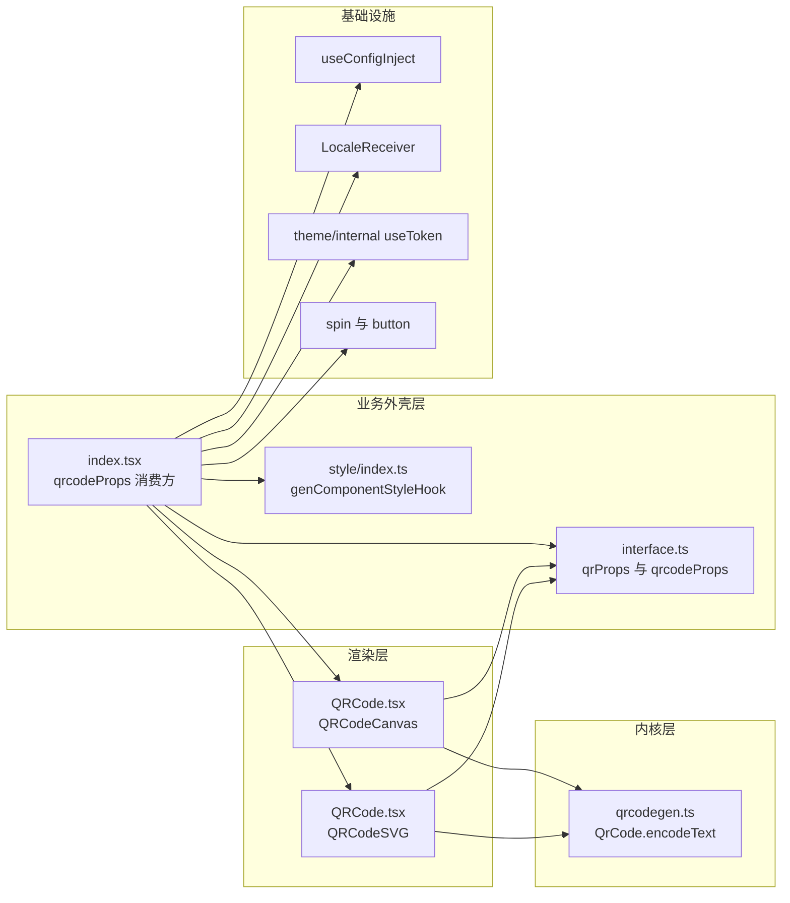
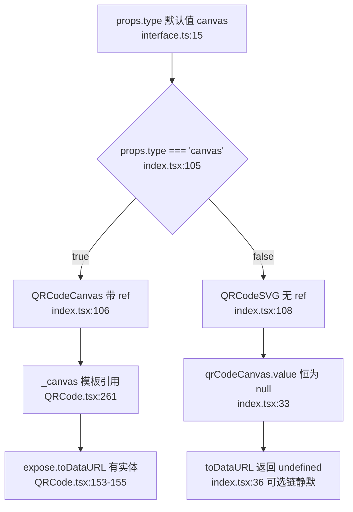
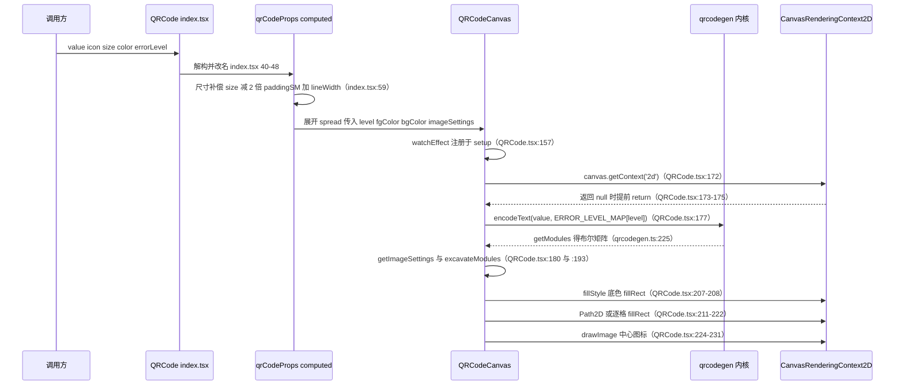
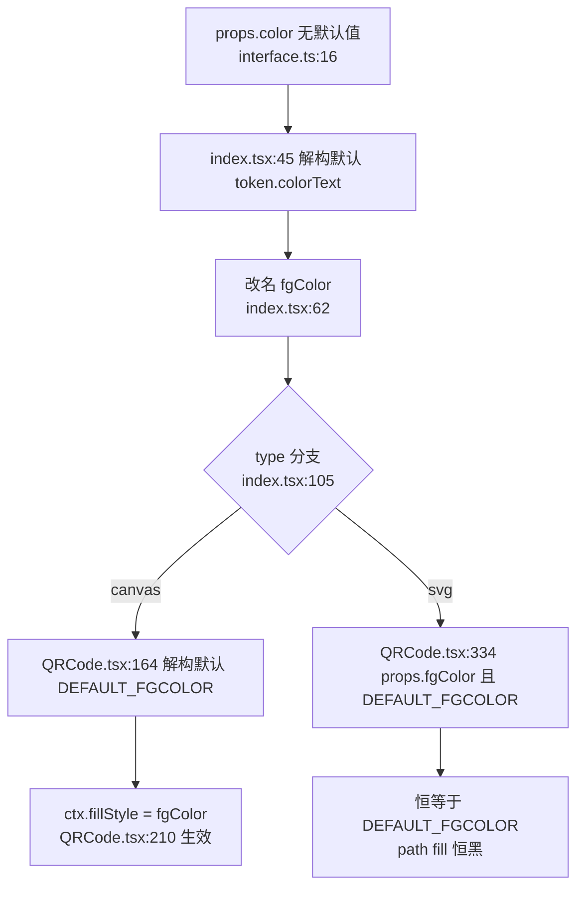

# C10-07 QRCode 二维码

> **本篇解决**：QRCode 的二维码生成内核到底是自家实现还是第三方封装，选项被仓内谁读取，渲染为什么走 canvas 与 SVG 两条路径以及分支判据是什么。
> **前置**：C10-06 Watermark 水印　**读者坐标**：`03-components/10-media` 第 8/9 篇

## 一、职责与边界

QRCode 负责三件事：把一段文本交给编码内核换成布尔矩阵、把矩阵绘制成可扫描的图形（canvas 或 SVG 两种介质二选一）、在图形之上叠一层与业务状态绑定的遮罩（`active` / `expired` / `loading` / `scanned`）与一个中心图标。它对外还提供一个导出接口 `toDataURL`，用于把当前二维码变成可下载的位图 URL。

它明确**不负责**的事，每一条都能在源码里找到"确实没做"的证据：

- 不做版本（version）、掩码（mask pattern）、字符模式的选择。这些全部发生在内核里，业务层唯一的输入是文本与纠错等级两个参数（`packages/xiaoye-ui/src/qrcode/QRCode.tsx:177` 与 `:300` 的 `qrcodegen.QrCode.encodeText(value, ERROR_LEVEL_MAP[level])`）。
- 不保证纠错等级原样生效。内核注释自己声明结果可能被提升（`packages/xiaoye-ui/src/qrcode/qrcodegen.ts:40-41` 的 "The ECC level of the result may be higher than the ecl argument if it can be done without increasing the version"）。
- 不做静区（quiet zone）。二维码规范要求的四周留白在本库里不由内核的 margin 提供，而由外层容器的 CSS `padding` 提供（`packages/xiaoye-ui/src/qrcode/style/index.ts:20`），这条边界直接决定了 `toDataURL` 导出物的可用性，见论点 6。
- 不做图片 URL 的校验或消毒。`icon` 的值原样落进 ``（`packages/xiaoye-ui/src/qrcode/QRCode.tsx:249`）和 SVG 的 `xlinkHref`（`packages/xiaoye-ui/src/qrcode/QRCode.tsx:313`），中间没有本仓 `_util/safeUrl.ts` 这类设施。
- 不做下载。文档示例里下载是调用方自己造 `<a>` 元素（`apps/docs/examples/qrcode/download.vue:13-18`）。

依赖清单（按导入语句逐条核实，`packages/xiaoye-ui/src/qrcode/index.tsx:1-13` 与 `packages/xiaoye-ui/src/qrcode/QRCode.tsx:1-6`）：

| 依赖 | 入口位置 | 用途 |
| --- | --- | --- |
| `./qrcodegen` | `packages/xiaoye-ui/src/qrcode/QRCode.tsx:6` | 编码内核，vendored 单文件 |
| `../config-provider/hooks/useConfigInject` | `packages/xiaoye-ui/src/qrcode/index.tsx:3` | 取 `prefixCls` |
| `./style` | `packages/xiaoye-ui/src/qrcode/index.tsx:4` | CSS-in-JS 样式 hook |
| `../locale/LocaleReceiver` | `packages/xiaoye-ui/src/qrcode/index.tsx:5` | 遮罩文案三键 |
| `../spin`、`../button` | `packages/xiaoye-ui/src/qrcode/index.tsx:7-8` | 遮罩内的加载与刷新控件 |
| `@xiaoye-ui/icons` 的 `ReloadOutlined` | `packages/xiaoye-ui/src/qrcode/index.tsx:9` | 刷新按钮图标 |
| `../theme/internal` 的 `useToken` | `packages/xiaoye-ui/src/qrcode/index.tsx:10` | 取 `colorText` 与尺寸补偿量 |
| `../_util/warning` | `packages/xiaoye-ui/src/qrcode/index.tsx:12` | 开发期等级告警 |

被谁依赖：包根聚合入口 `packages/xiaoye-ui/src/components.ts:262-263` 同时给出 `export * from './qrcode'` 与 `export { default as Qrcode }`；样式引擎侧 `packages/xiaoye-ui/src/theme/interface/components.ts:64` 引它的 `ComponentToken`、`:153` 注册 `QRCode?` 键。除这两处与自身目录外，全仓没有任何组件导入 `qrcode` 目录（判据见附 检查点 2），即它是一个**纯叶子**：只被全局注册，不被兄弟组件复用。这一点与 Watermark 族不同——后者在 C10-06 里被论证为存在遮罩复用关系，本篇不涉及。

## 二、源码地图

`find packages/xiaoye-ui/src/qrcode -type f | xargs wc -l | sort -n` 的实测结果（6 个文件，1644 行，其中 974 行即 59% 是内核副本）：

| 文件 | 行数 | 职责 | 关键导出 |
| --- | --- | --- | --- |
| `packages/xiaoye-ui/src/qrcode/qrcodegen.ts` | 974 | 编码内核（第三方源码副本） | `export default qrcodegen`，`:974` |
| `packages/xiaoye-ui/src/qrcode/QRCode.tsx` | 349 | 两条渲染路径与矩阵后处理 | `QRCodeCanvas`、`QRCodeSVG`，`:143` 与 `:269` |
| `packages/xiaoye-ui/src/qrcode/index.tsx` | 115 | 业务外壳、选项转译、遮罩 | `withInstall(QRCode)`，`:115` |
| `packages/xiaoye-ui/src/qrcode/style/index.ts` | 65 | CSS-in-JS 样式表 | `genComponentStyleHook('QRCode', …)`，`:58` |
| `packages/xiaoye-ui/src/qrcode/interface.ts` | 51 | 两层 props 与内核选项类型 | `qrProps`、`qrcodeProps`，`:11` 与 `:23` |
| `packages/xiaoye-ui/src/qrcode/index.test.js` | 90 | 7 条用例 | 无导出 |

三层分读法必须记住的入口行号：业务层入口是 `packages/xiaoye-ui/src/qrcode/index.tsx:16` 的 `defineComponent`，渲染层入口是 `packages/xiaoye-ui/src/qrcode/QRCode.tsx:143`（canvas）与 `:269`（SVG）两个平级导出，内核入口是 `packages/xiaoye-ui/src/qrcode/qrcodegen.ts:34` 的 `export class QrCode`。

注意本组件的目录结构偏离 `AGENTS.md` 的组件模板两处，且都不是无害的偏离：主实现叫 `index.tsx` 而不是 `QRCode.tsx`（后者是渲染层），props 类型文件叫 `interface.ts` 而不是 `qrcodeTypes.ts`。前者意味着"公开 API 的真相在 index 里"，后者意味着它同时装了两层 props（`packages/xiaoye-ui/src/qrcode/interface.ts:11` 给渲染层、`:23` 给业务层），这个双栈设计是下文所有"传了没效果"问题的结构性根源。

## 三、架构与数据流

图 1 是静态结构图，先钉死"谁 import 谁"，后面所有论点都在这个拓扑上定位。



三点说明。第一，`QRCodeCanvas` 与 `QRCodeSVG` 同处一个文件但**互不引用**，是两份平行实现，它们共享的只有 `packages/xiaoye-ui/src/qrcode/QRCode.tsx:33`、`:73`、`:87`、`:122` 这四个模块级纯函数；这决定了"改一条路径不会带动另一条"，也是坑 1 能长期存活的结构性原因。第二，业务层对渲染层是**单向转译**关系：`packages/xiaoye-ui/src/qrcode/index.tsx:39-65` 的 `qrCodeProps` computed 是唯一通道，凡这条通道没写出的键，渲染层就拿不到（论点 3）。第三，内核层没有任何 Vue 依赖，`packages/xiaoye-ui/src/qrcode/qrcodegen.ts` 全文不出现 `vue` 导入，因此它可以被单测直接调用——但本仓没有任何针对它的测试文件，判据见论点 5。

图 2 画出介质选择的完整判据链，包括一个容易被忽略的分岔：`ref` 只挂在一侧。



这条链的关键在于**判定用的是严格等号而不是不等**：任何非 `'canvas'` 的取值（包括拼错的 `'Canvas'`）都会落到 SVG 分支，而 SVG 分支没有 `ref`，于是同一个 `<xy-qrcode ref>` 句柄在两种介质下能力不同——canvas 下 `toDataURL()` 是可用 API，SVG 下它静默返回 `undefined`。两层都用可选链（`packages/xiaoye-ui/src/qrcode/index.tsx:36` 与 `packages/xiaoye-ui/src/qrcode/QRCode.tsx:154`），所以**不会抛错**，调用方拿到 `undefined` 继续赋给 `a.href`（`apps/docs/examples/qrcode/download.vue:15`）才暴露症状。

图 3 是 canvas 路径的完整时序，注意 `flush: 'post'` 这个选择。



`watchEffect` 带 `{ flush: 'post' }`（`packages/xiaoye-ui/src/qrcode/QRCode.tsx:235`）是这条链的前提条件：绘制必须在 `<canvas>` 元素进入 DOM 之后，否则 `_canvas.value` 为 null、整个 `if (_canvas.value != null)` 体（`:169`）跳过。副作用是**这段逻辑在服务端渲染时不产出任何像素**，SSR 首屏的 canvas 是一张空白画布，只有遮罩与容器边框能被服务端渲染出来（遮罩与容器在 render 函数里，`:66-112`，不依赖 post-flush）。SVG 分支没有这个问题，它的 `watchEffect` 是默认 pre 刷新（`packages/xiaoye-ui/src/qrcode/QRCode.tsx:290`），初值在 setup 期同步算出，因此 `type="svg"` 反而是 SSR 友好的那一档——这个不对称性在文档里没有写。

图 4 把同一份颜色输入在两条路径上的求值差异画成对照，它是本篇最重要的一张图，因为分岔点是**一个运算符**。




## 四、核心机制精读

### 论点 1：生成内核既不是包依赖也不是自家算法，而是一份带原始版权头的第三方源码副本（vendored），业务层只消费它的一个静态方法

这是 `OUTLINE.md`「已知待办」第 3 条里悬着的「二维码生成内核待核实」项，本篇结案：**核到的是 `packages/xiaoye-ui/src/qrcode/qrcodegen.ts` 这 974 行文件本身，它带着上游的 SPDX 声明，全仓没有任何 npm 二维码依赖，业务层对它的全部用法是一行。**

内核文件头三条证据：

```ts
// packages/xiaoye-ui/src/qrcode/qrcodegen.ts:1
/* eslint-disable @typescript-eslint/no-unused-vars */
/* eslint-disable @typescript-eslint/no-namespace */
/**
 * @license QR Code generator library (TypeScript)
 * Copyright (c) Project Nayuki.
 * SPDX-License-Identifier: MIT
 */

'use strict';

namespace qrcodegen {
  type bit = number;
  type byte = number;
  type int = number;
```

逐段看：`:1`-`:2` 两条 `eslint-disable` 是搬入痕迹——本仓的 lint 规则不允许裸 `namespace`，也不允许未使用变量，而上游这份代码两者都违反，改代码不如改规则；`:3`-`:7` 保留的是上游的许可证头，即"这是第三方代码"这件事**只写在这个文件的注释里**；`:11` 的 `namespace qrcodegen` 是上游 TypeScript 版本的原始结构（用命名空间充当模块），`:974` 的 `export default qrcodegen` 才是本仓加的适配层——上游发布的是 `qrcodegen` 命名空间本身，没有默认导出，这一行是为了让 `packages/xiaoye-ui/src/qrcode/QRCode.tsx:6` 的 `import qrcodegen from './qrcodegen'` 能成立。

负面结论用两种方法交叉核过。方法一，读包清单：`node -e "console.log(Object.keys(require('./packages/xiaoye-ui/package.json').dependencies))"` 的输出里含 `chart.js`、`dayjs`、`@tiptap/core`、`vditor`、`@ctrl/tinycolor` 等第三方运行时依赖，**不含任何名字带 qr 的包**，`dependencies`、`peerDependencies` 与主库 `devDependencies` 三处都没有。方法二，读引用面：`grep -rn "qrcodegen" packages apps --include='*.ts' --include='*.tsx' --include='*.js' --include='*.vue' --include='*.json'`（排除 `node_modules` 与 `dist`）的全部命中只有 15 行，其中 6 行在 `packages/xiaoye-ui/src/qrcode/QRCode.tsx`（`:6`、`:8`、`:11`-`:15`、`:177`、`:300`），其余 9 行都在 `qrcodegen.ts` 自身内部（`:11`、`:43`、`:52`、`:912`、`:939`、`:974` 等命名空间声明与内部转发）。也就是说，**没有任何第二消费者**，也没有配置文件（如 `vite.config.mts` 的 alias、`tsconfig.json` 的 paths）指向它。

再看业务层实际调用了内核的哪一部分。`packages/xiaoye-ui/src/qrcode/QRCode.tsx:11-16` 建立等级表，`:177` 与 `:300` 是两次同样的调用：

```tsx
// packages/xiaoye-ui/src/qrcode/QRCode.tsx:11
const ERROR_LEVEL_MAP: { [index: string]: qrcodegen.QrCode.Ecc } = {
  L: qrcodegen.QrCode.Ecc.LOW,
  M: qrcodegen.QrCode.Ecc.MEDIUM,
  Q: qrcodegen.QrCode.Ecc.QUARTILE,
  H: qrcodegen.QrCode.Ecc.HIGH,
};

const DEFAULT_SIZE = 128;
const DEFAULT_LEVEL = 'L';
const DEFAULT_BGCOLOR = '#FFFFFF';
const DEFAULT_FGCOLOR = '#000000';
const DEFAULT_INCLUDEMARGIN = false;

const SPEC_MARGIN_SIZE = 4;
const DEFAULT_MARGIN_SIZE = 0;
```

`grep -n "QrCode\.\|QrSegment\." packages/xiaoye-ui/src/qrcode/QRCode.tsx` 的结果只有上面这 5 行映射加 `:177`、`:300` 两个调用点，即：**内核对外被用到的表面是 `QrCode.Ecc` 四个常量、`QrCode.encodeText()` 一个静态方法、`getModules()` 一个实例方法**。而 `qrcodegen.ts` 导出的公开面远大于此——`packages/xiaoye-ui/src/qrcode/qrcodegen.ts:51` 的 `encodeBinary`、`:67` 的 `encodeSegments`、`:220` 的 `getModule`、`:161` 的构造函数，以及 `:668`、`:670` 的 `MIN_VERSION`/`MAX_VERSION`，在本仓零读取点。

结论回扣：所以"QRCode 的生成内核"这个问题有三个可分别验证的答案——**算法实现是第三方（Project Nayuki QR Code generator library，MIT）**、**装载方式是源码副本而非包依赖**、**消费面是单点（`encodeText().getModules()`）**。对维护者的实际含义是两条：其一，内核升级没有 lockfile 可依，只能整文件替换，替换时 `packages/xiaoye-ui/src/qrcode/qrcodegen.ts:974` 那行默认导出必须手工补回，否则 `QRCode.tsx:6` 直接编译失败；其二，`ERROR_LEVEL_MAP`（`:11`-`:16`）是内外唯一的契约面，上游若重命名 `Ecc.LOW` 一族，编译期就会在这四行爆掉，这是好事——它比"依赖版本号"更早暴露不兼容。至于渲染层那四个 `DEFAULT_*` 常量与 `SPEC_MARGIN_SIZE`（`:18`-`:25`）为什么有两个恒不可达，见论点 3 与论点 6。

### 论点 2：canvas 与 SVG 是同一个文件里的两份平行实现，分支判据是一个严格等号，代价是 `ref` 与 `toDataURL` 只在其中一侧存在

分支发生在业务层渲染函数的最后一段，位置就在 `wrapSSR` 的返回值内部：

```tsx
// packages/xiaoye-ui/src/qrcode/index.tsx:33
    const qrCodeCanvas = ref();
    expose({
      toDataURL: (type?: string, quality?: any) => {
        return qrCodeCanvas.value?.toDataURL(type, quality);
      },
    });
    const qrCodeProps = computed(() => {
      // ...
    });
    return () => {
      const pre = prefixCls.value;
      return wrapSSR(
        <div
          {...attrs}
          style={[
            attrs.style as CSSProperties,
            {
              width: `${props.size}px`,
              height: `${props.size}px`,
              backgroundColor: qrCodeProps.value.bgColor,
            },
          ]}
          // ...
        >
          {/* ... */}
          {props.type === 'canvas' ? (
            <QRCodeCanvas ref={qrCodeCanvas} {...qrCodeProps.value} />
          ) : (
            <QRCodeSVG {...qrCodeProps.value} />
          )}
        </div>,
      );
    };
```

这段里 `:33`-`:38` 是一个**对称性缺陷的完整生成过程**：`qrCodeCanvas` 这个 `ref()` 声明在 setup 里，`expose` 的 `toDataURL` 无条件暴露给外部（`:35`），但承载它的模板引用只写在三元表达式的第一支（`:106`），第二支（`:108`）没有任何 `ref`。于是 `type="svg"` 时 `qrCodeCanvas.value` 恒为 `null`，`index.tsx:36` 的可选链把这件事变成一个**没有信号的成功调用**——返回 `undefined`，不抛错、不告警。这个静默链在渲染层还会再叠一次：`packages/xiaoye-ui/src/qrcode/QRCode.tsx:152-156` 的 `expose.toDataURL` 内部同样是 `_canvas.value?.toDataURL(...)`，两层都用可选链，所以从公开组件实例一路到 DOM 元素，任何一环缺失都只表现为 `undefined`。文档侧唯一的下载示例 `apps/docs/examples/qrcode/download.vue:2` 恰好只演示了默认介质（不写 `type`），`:12` 直接 `await qrcodeCanvasRef.value.toDataURL()`，`:15` 把结果赋给 `a.href`——如果这个例子换成 `type="svg"`，症状会是一个名为 `QRCode.png` 的空文件或浏览器导航到 `undefined`，而代码一行都不用改就会坏。

第二层判据要留意：`packages/xiaoye-ui/src/qrcode/interface.ts:15` 写的是 `type: stringType<'canvas' | 'svg'>('canvas')`，`stringType` 展开后带 `default`（本仓 `_util/type.ts` 的 `stringType` 实现形如 `{ type: String as PropType<T>, default: defaultVal as T }`），所以 `props.type` 在业务层恒有值，`:105` 的三元不会有"两侧都不匹配"的第三种情况。类型参数把取值域收在 `'canvas' | 'svg'` 是为了 IDE 提示，运行时并不校验——`type="SVG"` 会静默走 SVG 分支（因为判据只问"等不等于 canvas"），`type="canvas "`（尾空格）反而会走 SVG。这个不对称是**判据只写了一半**造成的：如果要让介质成为真正可控的开关，判据应当是 `props.type === 'svg' ? SVG : Canvas`，把默认档放在 else 侧，或者在 dev 下 `warning` 一次未识别取值（本仓已有 `packages/xiaoye-ui/src/qrcode/index.tsx:22-28` 这条现成的 dev 分支可以搭）。

两份实现的"平行"体现在 props 表上，值得逐字对照：canvas 侧是 `packages/xiaoye-ui/src/qrcode/QRCode.tsx:146` 的 `props: { ...qrProps(), level: String, bgColor: String, fgColor: String, marginSize: Number }`，SVG 侧是 `:272-280` 的 `{ ...qrProps(), color: String, level: String, bgColor: String, fgColor: String, marginSize: Number, title: String }`。SVG 比 canvas 多两个键：`color`（`:274`）与 `title`（`:279`）。`color` 在整个 `QRCode.tsx` 里**没有任何读取点**（`grep -n "props.color" packages/xiaoye-ui/src/qrcode/QRCode.tsx` 零命中，读取的永远是 `fgColor`），是一条纯声明的死 prop；`title` 有读取点（`:337` 的 `{!!props.title && <title>{props.title}</title>}`），但业务层的转译通道（`index.tsx:57-64`）从不产出 `title` 这个键，因此这条无障碍标签在本库的公开用法下**永不渲染**。`qrProps()` 里的 `type`（`interface.ts:15`）也被这两张表各继承了一次，而在渲染层两侧都无人读取——它是纯粹为业务层准备的键，却被 spread 进了不该有它的 props 表。

结论回扣：`type` 不是"两种渲染风格的开关"，而是"两个互不继承缺陷的组件的开关"。任何按 canvas 路径建立的直觉（有 ref、颜色生效、图标要等加载）到 SVG 路径都要重新核一遍，判据位置就是 `:105` 这一行等号与 `:272-280` 这张 props 表。

### 论点 3：公开 props 到内核选项的转译只有一个 computed，它的键名改写表决定了哪些 prop 生效、哪些 prop 是类型面存活而实现面死亡

`packages/xiaoye-ui/src/qrcode/index.tsx:39-65` 是全组件唯一的出口，把它逐行读三遍就能看到"QRCode 的公开 API 到底有几个真键"：

```tsx
// packages/xiaoye-ui/src/qrcode/index.tsx:39
    const qrCodeProps = computed(() => {
      const {
        value,
        icon = '',
        size = 160,
        iconSize = 40,
        color = token.value.colorText,
        bgColor = 'transparent',
        errorLevel = 'M',
      } = props;
      const imageSettings: QRCodeProps['imageSettings'] = {
        src: icon,
        x: undefined,
        y: undefined,
        height: iconSize,
        width: iconSize,
        excavate: true,
      };
      return {
        value,
        size: size - (token.value.paddingSM + token.value.lineWidth) * 2,
        level: errorLevel,
        bgColor,
        fgColor: color,
        imageSettings: icon ? imageSettings : undefined,
      };
    });
```

它做四类事，每一类都有对应代价。

第一类是**改名**：`errorLevel` 变 `level`（`:60`，对应渲染层的 `ERROR_LEVEL_MAP[level]`，`QRCode.tsx:177`）、`color` 变 `fgColor`（`:62`）。这两组是同一个概念的两套词汇，来源是上游实现的命名习惯（渲染层的 `level`/`fgColor` 形状见 `QRCode.tsx:27-31` 那段英文注释的措辞）。改名本身没问题，问题是**改名表没有覆盖全部键**，见第三类。

第二类是**尺寸补偿**：`:59` 的 `size - (token.value.paddingSM + token.value.lineWidth) * 2`。它的对端是样式表里的 `padding: token.paddingSM`（`packages/xiaoye-ui/src/qrcode/style/index.ts:20`）与 `border: ${token.lineWidth}px ${token.lineType} ${token.colorSplit}`（`:23`），加上 `resetComponent(token)` 带来的 `boxSizing: 'border-box'`（`packages/xiaoye-ui/src/style/index.ts:16`）。三处合起来解释了为什么内层图形要比外层 div 小 `2 × (paddingSM + lineWidth)`：外层 div 的宽高由内联样式写死为 `props.size`（`index.tsx:74-75`），在 border-box 语义下内容盒要扣掉双侧 padding 与双侧 border，所以补偿量正好是这个和的两倍。这条补偿链有一个隐含前提——**同一个 `props.size` 被当作两个不同用途的值读**：外层用原值（`:74`），内层用扣减值（`:59`）。而 `token.value.paddingSM` 与 `token.value.lineWidth` 是从主题 Token 现取的，不来自样式表的实际计算结果，因此一旦有人只改样式表（比如把 `paddingSM` 换成 `padding`）而不同时改 `index.tsx:59`，内层图形就会与容器内容盒错位——这是"同一个量在两个文件里各写一遍"的家族问题，判据成对：`index.tsx:59` 与 `style/index.ts:20`。

第三类是**漏项**，这是本篇最需要记住的一条。`packages/xiaoye-ui/src/qrcode/interface.ts:18-19` 在公开 props 里声明了 `includeMargin: Boolean` 与 `imageSettings: objectType<ImageSettings>()` 两个键，而上面的转译函数**既没有从 `props` 里解构它们，也没有在返回对象里写出它们**（对照：`:41`-`:47` 的解构清单是 `value`、`icon`、`size`、`iconSize`、`color`、`bgColor`、`errorLevel` 七个键，正好等于返回对象的七个键减去 `imageSettings` 的重组）。可复现判据：`grep -n -e props.includeMargin -e props.imageSettings packages/xiaoye-ui/src/qrcode/index.tsx` 零命中。后果是两件事同时成立——

- 用户写的 `:image-settings="{ src: '/logo.png', excavate: false }"` 会被 Vue 接受（`QRCodeProps` 类型里有这个键，`index.tsx:15` 用 `Partial<ExtractPropTypes<...>>` 把它带进公开类型面），然后被丢弃；`excavate` 在 `:55` 被硬编码为 `true`，中心图标永远挖空。
- 用户写的 `include-margin` 同样被丢弃，于是渲染层 `packages/xiaoye-ui/src/qrcode/QRCode.tsx:165` 与 `:295` 解构到的 `includeMargin` 只能是 Vue 对 Boolean prop 的缺省值 `false`（不是 `undefined`），`getMarginSize(false, undefined)` 走 `:126` 的第二条分支返回 `DEFAULT_MARGIN_SIZE` 即 `0`（`:25`）。静区话题见论点 6。

`:49-56` 用局部变量名 `imageSettings` 遮蔽了这个事实——`:49` 写的是 `const imageSettings: QRCodeProps['imageSettings'] = {`，即"借用公开类型，但值是新建的"。这一行是读代码时最容易看错的地方：`grep -n "imageSettings" index.tsx` 会命中 `:49` 与 `:63` 两行，看起来像"读了 imageSettings"，实际读的是 `props.icon`（`:50` 的 `src: icon`）与 `props.iconSize`（`:53`-`:54`）。

第四类是**兜底重复**。`:43` 的 `size = 160`、`:44` 的 `iconSize = 40`、`:47` 的 `errorLevel = 'M'` 三个解构默认值全部恒不可达，因为 `interface.ts:13`（`size: { type: Number, default: 160 }`）、`:29`（`iconSize: { type: Number, default: 40 }`）、`:26`（`errorLevel: stringType<…>('M')`）已经给这三个 prop 填了 `default`，而 `default` 填了值之后 `props.xxx` 就不可能是 `undefined`。判据与共则 §3 那条一致，只是这里落点不同：不是三元表达式而是解构默认值，后果不是行为错误而是**两处默认值必须同步维护**（今天两处数值相同，改了 `interface.ts` 不改 `index.tsx` 就会出现"文档说 160 实际画 128"这类漂移）。对照组在同一段里：`:45` 的 `color = token.value.colorText` 与 `:46` 的 `bgColor = 'transparent'` **是可达的**，因为 `interface.ts:16`-`:17` 把这两个键写成裸 `String`、没有 `default`。这两条对照就是"要不要给 prop 填默认值"的判形样本，机制层面归 C10-06 论点 5 与 A06，本篇不重述。

结论回扣：判断"某个 prop 有没有实现"，最快的路径不是读渲染层，而是读 `index.tsx:39-65` 这个 computed 的**返回对象字面量**——它写了几个键，公开 API 就有几个键；`interface.ts:23-34` 声明的七个键里，`includeMargin` 与 `imageSettings` 不在其中，所以它们是纯类型面的存在。

### 论点 4：SVG 路径的两个颜色键用 `&&` 而非 `??` 做兜底，求值结果与输入相反，导致 `color` 与 `bgColor` 在 `type="svg"` 下恒为零效果

这是本篇唯一的"一行改一个运算符即可修复"的缺陷，位置在 `QRCodeSVG` 的渲染函数开头两行：

```tsx
// packages/xiaoye-ui/src/qrcode/QRCode.tsx:332
    return () => {
      const bgColor = props.bgColor && DEFAULT_BGCOLOR;
      const fgColor = props.fgColor && DEFAULT_FGCOLOR;
      return (
        <svg height={props.size} width={props.size} viewBox={`0 0 ${numCells} ${numCells}`}>
          {!!props.title && <title>{props.title}</title>}
          <path
            fill={bgColor}
            d={`M0,0 h${numCells}v${numCells}H0z`}
            shape-rendering="crispEdges"
          />
          <path fill={fgColor} d={fgPath} shape-rendering="crispEdges" />
          {image}
        </svg>
      );
    };
```

`:333` 与 `:334` 的语义是纯 JS 的，不需要运行时就能定死：`A && B` 在 `A` 为真值时返回 `B`。于是当 `props.bgColor` 是**任何非空字符串**时，局部变量 `bgColor` 得到的都是常量 `DEFAULT_BGCOLOR`（`:20` 的 `'#FFFFFF'`）；`props.fgColor` 同理恒被替换为 `DEFAULT_FGCOLOR`（`:21` 的 `'#000000'`）。用户传的颜色不是"被覆盖"，而是**被用作存在性判据后丢弃**。

这条求值在业务层的默认配置下必然命中真值分支，两个输入点都可以现读：`packages/xiaoye-ui/src/qrcode/index.tsx:46` 给 `bgColor` 的兜底是字符串 `'transparent'`，`:45` 给 `color` 的兜底是 `token.value.colorText`（Token 字符串），两者都是非空串；`index.tsx:61-62` 把它们原名/改名放进转译结果。因此从 `<xy-qrcode type="svg">` 出发，无论用户是否显式设色，`:339` 与 `:343` 两个 `<path>` 的 `fill` 恒为白与黑。若用户传空串（`bg-color=""`），`'' && DEFAULT_BGCOLOR` 返回 `''`，`fill` 拿到空值——这是同一行写法带来的第二种、更少见的不确定状态，本篇只把它标为"写法未区分"，不在源码层面断言其渲染结果。

对照组就在 canvas 侧，同一对键的处理方式完全不同：

```tsx
// packages/xiaoye-ui/src/qrcode/QRCode.tsx:159
        const {
          value,
          size = DEFAULT_SIZE,
          level = DEFAULT_LEVEL,
          bgColor = DEFAULT_BGCOLOR,
          fgColor = DEFAULT_FGCOLOR,
          includeMargin = DEFAULT_INCLUDEMARGIN,
          marginSize,
          imageSettings,
        } = props;
```

`:163`-`:164` 用的是解构默认值，语义是"缺省才取常量"，与 `&&` 恰好相反，所以 canvas 侧的颜色是**生效的**（消费点在 `:207` 的 `ctx.fillStyle = bgColor` 与 `:210` 的 `ctx.fillStyle = fgColor`）。同一个组件文件里，同一个输入，两种兜底写法，两种结果——这正是共则 §3 那条「兜底分支恒不可达」家族的**第三型**：第一型是三元 `X !== undefined ? X : Y` 配带默认值的 prop，第二型是 `??` 左侧来自带默认值的 prop（本仓的实例见 C10-06 论点 5 与 OUTLINE 台账里 avatar 那条），本篇这一型更糟，因为它连"左侧有没有值"都反了——**有值时取常量，没值时取那个没值的东西**，正确的 `??` 写法在两种输入下都不会出错。

还有一处旁证说明这不是笔误而是半途改造留下的：`packages/xiaoye-ui/src/qrcode/QRCode.tsx:291-298` 的 SVG `watchEffect` 解构清单里**没有** `bgColor` 与 `fgColor`（只有 `value`、`size`、`level`、`includeMargin`、`marginSize`、`imageSettings`），而 canvas 侧的对应清单（`:159-168`）有。也就是说 SVG 的颜色决策被单独挪到了渲染函数里，而挪过去时用了 `&&`。另外 SVG 的 props 表比 canvas 多声明了一个 `color`（`:274`）却从不读它，可以合理推测这一层曾经想直接吃业务层的 `color` 键名、后来改成 `fgColor`，而这两行没有跟着改。这个推测只作为动机解释提出，不作为结论。

结论回扣：`type` 开关的隐藏语义是"颜色 API 的开关"。文档 `apps/docs/components/qrcode.md:88-89` 把 `color` 与 `bgColor` 写成无条件生效的 API（且把 `color` 默认值写成 `#000`，与 `index.tsx:45` 的 `token.value.colorText` 不符），而 `apps/docs/examples/qrcode/customType.vue:4` 正在并列渲染两种介质——把这两行并排看，能观察到 SVG 那一侧带着一块由 `:339` 强制画出的白底，而 canvas 那一侧的外层容器底色被 `index.tsx:76` 的内联 `backgroundColor: 'transparent'` 覆写，二者观感不同却都没有报错。

### 论点 5：7 条用例全部通过，但五条是对 DOMWrapper 的壳断言、其中一条断言的结构在默认介质下不可能存在，而内核调用在测试里一次都没有执行

测试文件是 `packages/xiaoye-ui/src/qrcode/index.test.js`，它被 `packages/xiaoye-ui/vitest.config.mts:33` 的 glob（`src/**/*.test.{js,ts,jsx,tsx}`）覆盖，实测 7 条全绿：`npx vitest run src/qrcode/index.test.js`（工作目录 `packages/xiaoye-ui`）输出 `Tests 7 passed (7)`。全绿不等于有保护，逐条看断言形态：

```jsx
// packages/xiaoye-ui/src/qrcode/index.test.js:6
  it('should correct render', () => {
    const wrapper = mount({
      render() {
        return <QRCode value="test" />;
      },
    });
    expect(wrapper.find('.xy-qrcode')).toBeTruthy();
    expect(wrapper.find('canvas')).toBeTruthy();
  });

  it('support custom icon', () => {
    const wrapper = mount({
      render() {
        return <QRCode value="test" icon="test" />;
      },
    });
    expect(wrapper.find('.xy-qrcode')).toBeTruthy();
    expect(wrapper.find('image')).toBeTruthy();
  });
```

第一个问题是 `wrapper.find()` 的返回类型。`@vue/test-utils` 的 `find` 在**未命中时返回一个空的 DOMWrapper 而不是 null**，对这样一个对象做 `toBeTruthy()` 永远为真——`:12`、`:13`、`:23` 三条断言因此不携带任何信息，即"断言数为 0 的用例"这一族（共则 §3 的测试面假象）。把它们换成 `expect(wrapper.find('canvas').exists()).toBe(true)` 才会真的把关。这意味着前两条用例即使组件返回 `null` 也照样通过。

第二个问题更实质：`:23` 期望的 `<image>` 元素在默认介质下**从结构上就不可能出现**。`icon="test"` 会走 `index.tsx:63` 生成 `imageSettings`，而 `props.type` 默认 `'canvas'`（`interface.ts:15`）使 `index.tsx:105` 选 canvas 分支；canvas 分支渲染的中心图是**隐藏的 ``**（`packages/xiaoye-ui/src/qrcode/QRCode.tsx:248` 的 ``。SVG 的那个节点在 `:312`（`<image xlinkHref={imageSettings.src} ...>`），而测试从未传 `type="svg"`（`grep -rn "svg" packages/xiaoye-ui/src/qrcode/index.test.js` 零命中）。所以这条用例的名字叫"support custom icon"，实际断言的是"存在一个只有 SVG 分支才会画的标签"，而它因为壳断言而常绿——这类"测试与实现各错一半"的组合是本仓最容易长期潜伏的一类。

第三个问题是内核执行面为零，这条我实测过。jsdom 不实现 canvas 2D 上下文，而 `packages/xiaoye-ui/vitest.config.mts:31` 设的就是 `environment: 'jsdom'`，主库 `devDependencies` 里只有 `jsdom`、没有 `canvas` 包（判据：`node -e "const p=require('./packages/xiaoye-ui/package.json');console.log(Object.keys(p.devDependencies).filter(d=>/canvas|jsdom/i.test(d)))"` 只回 `['jsdom']`）。跑测试时 stderr 反复打印：

```
Error: Not implemented: HTMLCanvasElement.prototype.getContext (without installing the canvas npm package)
    at flush (/Users/xiaoye/Desktop/publish/xiaoye-ui-vue/packages/xiaoye-ui/src/qrcode/QRCode.tsx:172:30)
```

栈帧落点正是 `packages/xiaoye-ui/src/qrcode/QRCode.tsx:172` 的 `const ctx = canvas.getContext('2d')`，返回 `null` 后 `:173-175` 的 `if (!ctx) { return; }` 提前退出，于是**紧随其后的 `:177` 内核调用 `qrcodegen.QrCode.encodeText(...)` 在测试里一次都没执行过**，`:179`-`:232` 的整段绘制（挖空、缩放、Path2D、drawImage）同样从未被覆盖。合起来，这个测试文件对"编码是否正确"的保护面积是 0，对"遮罩与类名是否正确"的保护面积才有几条（`:32`-`:33` 的宽高、`:43`-`:44` 的 refresh 事件、`:66` 的 loading 态、`:75` 的 `-borderless` 类名、`:85-87` 的 dev 告警文案，这五条是真断言）。

顺带一条与测试无关但同源的事实：`packages/xiaoye-ui/src/qrcode/qrcodegen.ts` 目录下没有配套测试（`find packages/xiaoye-ui/src/qrcode -name '*.test.*'` 只有 `index.test.js` 一个文件），也没有任何 `tests/` 下的文件引用它（判据见附 检查点 3）。所以 974 行内核的正确性完全依赖上游，本仓没有回归网。

结论回扣：这一篇里最严重的两个缺陷（论点 4 的 `&&`、论点 2 的 ref 单侧挂载）都落在"无测试覆盖"的区域，而且 `index.test.js` 现有的两条绿色用例给人"渲染与图标都测过了"的错觉。补测试的正确起点不是加用例数，而是把 `toBeTruthy()` 改成 `exists()` 判定、再加一条 `type="svg"` 的 HTML 快照——后者会当场暴露 `fill` 恒黑恒白。

### 论点 6：中心图标在两条路径上有不同的时序闸门，坏图 URL 时 canvas 保留完整码、SVG 留下永久空洞

同一个 `imageSettings`，两条路径挖孔的**时机条件**不一样。canvas 侧有一整套加载闸门：

```tsx
// packages/xiaoye-ui/src/qrcode/QRCode.tsx:182
          const image = _image.value;
          const haveImageToRender =
            isImgLoaded.value &&
            calculatedImageSettings != null &&
            image !== null &&
            image.complete &&
            image.naturalHeight !== 0 &&
            image.naturalWidth !== 0;

          if (haveImageToRender) {
            if (calculatedImageSettings.excavation != null) {
              cells = excavateModules(cells, calculatedImageSettings.excavation);
            }
          }
```

`:183`-`:189` 的合取有六个条件，`isImgLoaded`（`:151` 的 `shallowRef(false)`，由 `:252` 的 `onLoad` 置真）只是其中之一，另外还查 `image.complete` 与 `naturalWidth/Height !== 0`——后两条正是"图片加载失败"的特征（浏览器对 `naturalWidth` 为 0 的失败图保持 `complete === true`）。只有六个条件全真，`:191`-`:195` 才执行挖孔；配合 `:224`-`:231` 的 `drawImage` 也在同一闸门内，净效果是：**图挂了就是没图，二维码矩阵完整**。`packages/xiaoye-ui/src/qrcode/QRCode.tsx:237-239` 还有一条 `watch(imgSrc, ...)` 把 `isImgLoaded` 复位，保证换图期间不会用旧图尺寸画新图。

SVG 侧没有这层闸门：

```tsx
// packages/xiaoye-ui/src/qrcode/QRCode.tsx:306
      if (imageSettings != null && calculatedImageSettings != null) {
        if (calculatedImageSettings.excavation != null) {
          cells = excavateModules(cells, calculatedImageSettings.excavation);
        }

        image = (
          <image
            xlinkHref={imageSettings.src}
            height={calculatedImageSettings.h}
            width={calculatedImageSettings.w}
            x={calculatedImageSettings.x + margin}
            y={calculatedImageSettings.y + margin}
            preserveAspectRatio="none"
          />
        );
      }
```

`:306` 的判据只看"有没有传 imageSettings"，不看加载结果——SVG 的 `<image>` 元素由浏览器异步取图，组件侧拿不到 `onload`（这个文件里也确实没有为 SVG 图挂任何加载回调）。于是在 `type="svg"` 且 `icon` 指向不可达地址时，`:308` 已经无条件把中心区域 `excavateModules` 挖成 `false`，而 `:311-319` 画的 `<image>` 显示不出来，症状是**二维码中心永久缺一个方块的白洞**：中心区域恰好是定位图形之外信息密度最高的地方，配合 `errorLevel` 只有 `'L'` 时（`packages/xiaoye-ui/src/qrcode/index.tsx:22-28` 的告警正是针对这个组合）可扫描性下降最明显。同一个错误输入在两种介质下一个安全一个危险，这是"两份平行实现"（论点 2）在时序维度的代价。

`excavateModules` 本身的实现值得单独记一行，因为两条路径都调它：

```tsx
// packages/xiaoye-ui/src/qrcode/QRCode.tsx:73
function excavateModules(modules: Modules, excavation: Excavation): Modules {
  return modules.slice().map((row, y) => {
    if (y < excavation.y || y >= excavation.y + excavation.h) {
      return row;
    }
    return row.map((cell, x) => {
      if (x < excavation.x || x >= excavation.x + excavation.w) {
        return cell;
      }
      return false;
    });
  });
}
```

`:74` 的 `slice()` 是浅拷贝（只复制外层数组），`:75`-`:77` 让不受挖孔影响的行**直接复用内核对象的行数组**，只有落在 `excavation` 纵向区间的行走 `:78`-`:83` 的 `row.map` 生成新数组。这个写法之所以安全，前提是后续没有任何一处就地改写 `cell`——全文件确实只有 `:82` 的 `return false` 这一条写入路径，且写在新生成的数组里。为什么必须这样谨慎：`packages/xiaoye-ui/src/qrcode/qrcodegen.ts:225` 的 `getModules()` 返回的是 `QrCode` 实例的 `private readonly modules`（`:150`）本体引用而不是副本，一旦被就地改写，同一个实例在 canvas 侧重绘时就会拿到已被挖孔的数据，形成"图标每换一次、码就残缺一圈"的累积损坏。这是维护 `QRCode.tsx` 时最不该顺手简化的一处。

结论回扣：中心图标不是"加一张图"这么简单，它是两条路径行为分岔的第二现场（第一现场是颜色，论点 4）。判据成对：`QRCode.tsx:183-189` 有六条件合取，`QRCode.tsx:306` 只有两条件合取。

### 论点 7：二维码的静区在业务层不可达，白色留白由容器 padding 冒充，导出物因此没有静区

渲染层其实实现了规范要求的静区，只是从公开 API 走不到它：

```tsx
// packages/xiaoye-ui/src/qrcode/QRCode.tsx:122
function getMarginSize(includeMargin: boolean, marginSize?: number): number {
  if (marginSize != null) {
    return Math.floor(marginSize);
  }
  return includeMargin ? SPEC_MARGIN_SIZE : DEFAULT_MARGIN_SIZE;
}

// For canvas we're going to switch our drawing mode based on whether or not
// the environment supports Path2D. We only need the constructor to be
// supported, but Edge doesn't actually support the path (string) type
// argument. Luckily it also doesn't support the addPath() method. We can
// treat that as the same thing.
const SUPPORTS_PATH2D = (function () {
  try {
    new Path2D().addPath(new Path2D());
  } catch (e) {
    return false;
  }
  return true;
})();
```

`:122`-`:127` 有三级来源：显式 `marginSize`（`:123`-`:124`）、布尔 `includeMargin` 决定的规范值 4 模块（`:126` 用到 `:24` 的 `SPEC_MARGIN_SIZE = 4`）、以及零（`:25` 的 `DEFAULT_MARGIN_SIZE = 0`）。三级里公开 API 能到达的只有第三级：`marginSize` 只声明在渲染层两张 props 表（`packages/xiaoye-ui/src/qrcode/QRCode.tsx:146` 与 `:278`），`interface.ts` 的两层 props（`:11-21`、`:23-34`）都没有它，`index.tsx` 也从不传（`grep -n "marginSize" packages/xiaoye-ui/src/qrcode/index.tsx` 零命中）；`includeMargin` 虽然在 `interface.ts:18` 声明了，却因论点 3 的漏项而恒为 `false`。两条通道都断，`:178` 与 `:302` 两次 `getMarginSize` 调用恒返回 0，`SPEC_MARGIN_SIZE`（`:24`）因此是死常量。

留白于是被移到了 CSS 层：`packages/xiaoye-ui/src/qrcode/style/index.ts:20` 的 `padding: token.paddingSM` 与 `:23` 的 `border`，配上 `packages/xiaoye-ui/src/style/index.ts:16` 的 `boxSizing: 'border-box'`，再配上 `packages/xiaoye-ui/src/qrcode/index.tsx:59` 那个扣减式补偿，共同做出"白边包裹黑码"的视觉结果。视觉上等价，语义上不等价，差别在导出物上暴露：`packages/xiaoye-ui/src/qrcode/QRCode.tsx:153-155` 的 `toDataURL` 走的是 canvas 自身的像素，`margin` 恒 0 意味着**导出的位图紧贴模块边缘、没有静区**，而 CSS 的 padding 只存在于页面上、不可能进 canvas。扫码器对静区的容忍度是它解码成功率的一部分，所以 `apps/docs/examples/qrcode/download.vue:12` 演示的"下载二维码"产物，与页面上看到的产物不是同一张图——少了 4 模块白边。要补齐这件事的改动位置在 `:178`（让 `margin` 可被业务层设成 4）而不是在导出前重新合成一张带边距的 canvas，这就是把 `includeMargin` 接回 `index.tsx:57-64` 返回对象的价值所在。

顺带把同一段里的 `SUPPORTS_PATH2D`（`:134`-`:141`）也定性一下，因为它是本文件唯一在**模块加载期**执行的环境探测：IIFE 在 `import` 时就跑，`new Path2D()` 在 Node/SSR 下会抛 `ReferenceError`，被 `:137`-`:139` 的 `catch` 吞掉返回 `false`——所以它在 SSR 下"恰好安全"，代价是这个结果被永久冻结：同一份模块若先在 Node 里被加载（例如 SSR 预热、单元测试首次 import），再去浏览器里执行（HMR、或同一份 module cache 跨环境复用），`SUPPORTS_PATH2D` 仍为 `false`，绘制会退回 `:215-221` 的逐格 `fillRect` 分支。逐格分支与 `:213` 的 `Path2D` 分支在视觉上有差别，源码注释自己写了（`:197`-`:200` 的 "result in some potentially unwanted single pixel issues between blocks"）。这是共则 §3「模块级不可变环境探测」这一形状，与 `window.devicePixelRatio`（`:201`）的读取时机配合起来看更清楚：后者在 post-flush 的 effect 内、每次重绘现取，前者在 import 期、一次定终身。

结论回扣：静区不是"没做"，而是"做了但公开 API 接不到"。三层判据一次给全：`marginSize` 不在公开 props（`interface.ts:23-34` 无此键）、`includeMargin` 在公开 props 但不在转译返回对象（`index.tsx:57-64`）、`SPEC_MARGIN_SIZE` 因此在业务层不可达（`QRCode.tsx:24`）。

## 五、对外契约如何生效

**props 的进入点只有一处，出口也只有一处。** 进入是 `packages/xiaoye-ui/src/qrcode/index.tsx:19` 的 `props: qrcodeProps()`——注意这里**没有走 `initDefaultProps`**，与 `AGENTS.md` 的组件模板（`initDefaultProps(buttonProps(), { type: 'default' })`）不同；本组件的默认值全部内联在 prop 定义里（`packages/xiaoye-ui/src/qrcode/interface.ts:13`、`:15`、`:26`、`:29`、`:32`）。这个差异带来一个可观察后果：默认值在 Vue 的 prop 规范化阶段就填好，`props.xxx` 恒不为 `undefined`，于是共则 §3 那条"带默认值的 prop 让兜底恒不可达"在本组件命中三处（论点 3 第四类）。出口是 `index.tsx:39-65` 的 `qrCodeProps` computed，它在 `:106` 与 `:108` 被 spread 进渲染层，是公开 API 到实现层唯一的通道。

**`prefixCls` 无法按实例覆盖。** `useConfigInject` 的第一行读的是 `props.prefixCls`（`packages/xiaoye-ui/src/config-provider/hooks/useConfigInject.ts:14`），而 `qrProps()`（`interface.ts:11-21`）与 `qrcodeProps()`（`:23-34`）**都没有声明 `prefixCls`**——同族的正确写法可对照 `packages/xiaoye-ui/src/button/buttonTypes.ts:22`、`packages/xiaoye-ui/src/avatar/Avatar.tsx:19`、`packages/xiaoye-ui/src/avatar/Group.tsx:13` 都显式列了 `prefixCls: String`。后果不是崩溃而是**静默错位**：因为 `inheritAttrs: false`（`index.tsx:18`）且 `{...attrs}` 写在 div 上（`:70`），用户写 `prefix-cls="myqr"` 会作为普通 DOM 属性落到 div 元素上，`props.prefixCls` 始终 undefined，`getPrefixCls('qrcode', undefined)` 恒回全局配置值。想改前缀只能上 `ConfigProvider` 全局改。

**`direction` 接了但没解构，本组件后果良性。** `index.tsx:30` 只写 `const { prefixCls } = useConfigInject('qrcode', props)`，`direction`、`size`、`disabled` 都没接——这是共则 §3 那条判据 ① 的形状。之所以这里不致命，是因为遮罩层的定位用的是逻辑属性（`packages/xiaoye-ui/src/qrcode/style/index.ts:30` 的 `insetBlockStart: 0` 与 `:31` 的 `insetInlineStart: 0`），RTL 下天然正确；而二维码矩阵本身是镜像无关的。要留意的是 `style/index.ts:42` 的 `textAlign: 'center'` 是物理属性，居中文本在 RTL 下无差别，所以整条 RTL 通路目前是"不需要 direction 也对"，而不是"direction 生效"。

**用户 `class` 被丢弃，`style` 只部分存活。** 渲染函数里 `{...attrs}` 在 `:70`，显式 `class={[hashId.value, pre, {...}]}` 在 `:79`——按 JSX 的字面顺序，显式属性在 spread **之后**，因此 `attrs.class` 被整体覆盖，而 `:79`-`:85` 的数组里没有把 `attrs.class` 塞回去（`grep -n "attrs.class" packages/xiaoye-ui/src/qrcode/index.tsx` 零命中）。对照写法在同族的 Watermark：`packages/xiaoye-ui/src/watermark/index.tsx:249` 写的是 `class={[attrs.class, props.rootClassName]}`。`style` 侧则做了这件事（`:72` 把 `attrs.style` 放数组第一位），但第二位 `:76` 的 `backgroundColor: qrCodeProps.value.bgColor` 会覆盖同名键——而它的值是 `:46` 给的 `'transparent'`。于是文档 `apps/docs/components/qrcode.md:49` 那句"通过设置 `style` 自定义背景颜色"，在用户不显式传 `bgColor` 时**结构上不成立**（写 `style="background-color:#eee"` 一定被覆盖）。顺带一提，同一个 demo 的正文引用的是 `apps/docs/examples/qrcode/customColor.vue`，而它 `:7` 实际用的是 `:bg-color` 而不是 `style`——文档描述与示例代码本身就分岔了。另外这条覆盖链还有一个更隐蔽的后果：样式表 `packages/xiaoye-ui/src/qrcode/style/index.ts:21` 的 `backgroundColor: token.colorWhite` 在默认档下被内联 `transparent` 压住，卡片白底实际不出现；canvas 侧此时画布自身的底色也取自同一个值（`packages/xiaoye-ui/src/qrcode/QRCode.tsx:163` 解构、`:207` 赋给 `ctx.fillStyle`），`'transparent'` 作为 fillStyle 是一次不改变像素的填充，于是**默认状态下码的浅色模块完全依赖页面背景**。文档 `apps/docs/components/qrcode.md:89` 把 `bgColor` 的默认值写成 `transparent` 是准确的，但它与 `:21` 的 `colorWhite` 意图相反，二者必有一个是待清理项。

**事件只有一条，且必须经过 Button。** `emits: ['refresh']` 声明在 `index.tsx:20`，唯一触发点是 `:95` 的 `onClick={e => emit('refresh', e)}`，挂在遮罩里的 `<Button type="link">`（`:93`-`:99`）上。所以 `@refresh` 只在 `status="expired"`（`:90` 的分支判据）时可达，其余三种状态不产生任何事件。用户自己传 `onClick` 走 `attrs` 到外层 div（`:70`），与内部按钮的点击是两条独立通路，不构成冲突。

**没有 slots，遮罩文案不是 slot 而是 locale。** `defineComponent`（`index.tsx:16-21`）没有 `slots` 字段，渲染函数里也没有任何 `slots.default?.()` 调用（`grep -n "slots" packages/xiaoye-ui/src/qrcode/index.tsx` 只命中 `:96`，那是给 Button 传 icon 的 `v-slots`）。因此"过期"提示无法按实例定制，只能改语言包：`useLocaleReceiver('QRCode')`（`index.tsx:29`）取三键，实现在 `packages/xiaoye-ui/src/locale/en_US.ts:136-140` 与 `packages/xiaoye-ui/src/locale/zh_CN.ts:135-139`。这里有一个覆盖面缺口值得登记：`grep -rl "QRCode" packages/xiaoye-ui/src/locale/*.ts` 只回 5 个文件（en_US、ru_RU、zh_CN、zh_HK、zh_TW），而目录里有 65 个语言包，即 60 个包没有 `QRCode` 块。这不会渲染成空白——`packages/xiaoye-ui/src/locale/LocaleReceiver.tsx:39-47` 的合并把 en_US 的同名块作为基底（`:3` 的 `defaultLocaleData`），缺块时 `{...undefined}` 是空操作，于是回落英文文案。症状是**60 种语言的遮罩文案是英文**，机制与口径归 I11，本篇只登记证据。

**`expose` 面是单点且有条件失效。** `index.tsx:34-38` 只暴露 `toDataURL`，其可达性完全取决于论点 2 的 ref 挂载分支。这条契约在类型面上没有痕迹——`QRCodeProps`（`index.tsx:15`）只描述 props，模板 ref 拿到的实例形状要靠读源码或文档示例才知道，因此 `type="svg"` 时调用它属于"类型检查通过、运行时返回 undefined"的一类。

## 六、设计取舍

**取舍一：编码内核用 vendored 源码副本，而不是加一条 npm 依赖。** 这是 `OUTLINE.md`「已知待办」第 3 条里"二维码生成内核待核实"的结案说明。选它的理由在盘面上能读到三条：内核对外只需 `encodeText().getModules()` 一个入口（`packages/xiaoye-ui/src/qrcode/QRCode.tsx:177`），单文件零 Vue 依赖（`qrcodegen.ts` 全文无 `vue` 导入），因此 tree-shaking 与打包链路都不用为它开特例；副本自带许可证头（`packages/xiaoye-ui/src/qrcode/qrcodegen.ts:3-7`），MIT 允许这样搬。赔上的代价同样具体：第一，没有版本追溯性，`packages/xiaoye-ui/package.json` 里搜不到它的上游版本号（该文件与 qrcode 相关的 4 行命中全是生成物 `exports`，见 `:483`-`:487`，不是依赖声明），升级只能整文件替换并手工补回 `:974` 那行本仓添加的默认导出；第二，许可证义务只落在源码注释上，`packages/xiaoye-ui/LICENSE` 是项目自己的 MIT（首三行是 `MIT License` 与 `Copyright (c) 2024-present xiaoye-ui`），而 `grep -rln -i "nayuki" packages apps` 排除 `node_modules` 与 `dist` 后**只命中这一个源码文件**，即没有任何 NOTICE 或第三方清单收录它——判据命令：`grep -rln -e "Project Nayuki" -e "SPDX-License-Identifier" packages/xiaoye-ui/src`，结果同样只有 `qrcode/qrcodegen.ts` 一个，说明这不是本库的通行做法而是孤例；第三，974 行代码进入 `pnpm typecheck` 与 lint 面，靠 `:1`-`:2` 两条 disable 注释豁免，任何后续 lint 规则收紧都要重新处理这两行。

**取舍二：保留 canvas 与 SVG 两份平行实现，而不是统一成一种介质。** 两条路径各自的最优表示确实不同：SVG 把整张码压成 2 个 DOM 节点（`packages/xiaoye-ui/src/qrcode/QRCode.tsx:323-328` 的注释把这件事说得很清楚，"For level 1, 441 nodes -> 2"），靠 `viewBox` 用模块数当单位（`:336`）实现矢量缩放；canvas 则必须处理像素比（`:201`-`:204` 的 `devicePixelRatio` 与 `ctx.scale`），换来的是可以直接 `toDataURL`（`:153-155`）。合并成一种必然失去另一半。真正的设计失误不在"两份实现"，而在两份实现**共享 props 声明却不共享实现约定**：`qrProps()` 被两张表各 spread 一次（`:146` 与 `:273`），但默认值处理一份用解构（`:159-168`）、一份用 `&&`（`:333-334`），图标时序一份有闸门（`:183-189`）、一份没有（`:306`）。如果只保留一份公共的"取值函数"（把 `size`/`level`/`bgColor`/`fgColor` 的兜底集中算一次），论点 4 与论点 6 两个缺陷都没有生存空间。被放弃的替代方案是"让业务层直接输出渲染层的中性词汇"（即公开 `level`/`fgColor`/`marginSize`），那样确实少一层转译，但代价是公开 API 变成上游实现的形状而不是本库的形状——`errorLevel`、`color`、`bgColor` 这套命名是本库对外的一致约定。

**取舍三：静区交给容器 CSS padding，而不是交给内核 margin。** 收益是白边宽度跟随 Design Token（`packages/xiaoye-ui/src/qrcode/style/index.ts:20` 的 `paddingSM`、`:23` 的 `lineWidth`），与 `bordered` 开关（`index.tsx:83` 的 `-borderless` 类名）天然联动，且不需要为 QR 规范常量在公开 API 里多开一个键。赔上两点：导出物丢静区（论点 7），以及那套补偿公式必须与样式表逐值同步（`index.tsx:59` 对 `style/index.ts:20` 与 `:23`），这是一条跨文件的隐式契约，本仓没有任何测试或注释把它写下来。另一条路是保留 `includeMargin` 的公开语义（把它接进转译返回对象），同时让 `bordered` 控制可见边框而不控制留白，代价是"卡片留白"与"规范静区"两个概念要在文档里分清，改动面比现在的实现大。

**取舍四：遮罩复用 `Spin` 与 `Button`，而不是自绘或开放 slot。** `index.tsx:89`-`:102` 把三种非活跃态分别交给 `<Spin />`、`<p>` 加 `<Button type="link">`、`<p>`。收益是加载态与刷新按钮的外观、焦点、wave 动效都由被复用组件保证，且刷新按钮走 `Button` 的 `icon` 插槽（`:96`）就拿到了 `ReloadOutlined`。赔上的是扩展性：没有 slot（`grep -n "slots" packages/xiaoye-ui/src/qrcode/index.tsx` 只命中 `:96` 的 `v-slots` 传参），所以过期态想加一行"最后更新时间"或换一张图就只能改组件源码；文案的可定制面被限制成"换语言包"（`locale/en_US.ts:139-143`），并且由于 60 个语言包没有 `QRCode` 块（证据见 §五），非中英文用户看到的永远是英文。这里也可以对照 Watermark 的处理——它同样不产类名，但动机是防御性的，见 C10-06 论点 1；本组件的取舍是省事，两者不该混为一种风格。

**取舍五：绘制色直接吃 Alias Token，而不开 Component Token 旋钮。** `index.tsx:45` 用 `token.value.colorText` 作前景色默认值、`:59` 用 `token.value.paddingSM` 与 `token.value.lineWidth` 做补偿，都是即时从 Token 现取，所以换主题会让 canvas 的前景色跟着变（SVG 侧不会，因为被 `&&` 劫持，论点 4）。代价是组件级配置面是空的：`packages/xiaoye-ui/src/qrcode/style/index.ts:5` 写的是 `export interface ComponentToken {}`，`packages/xiaoye-ui/src/theme/interface/components.ts:146` 仍把它注册成 `QRCode?: QRCodeComponentToken`，于是 `theme.components.QRCode` 是一条**类型检查通过但没有任何键可填**的公开覆盖面；而真正需要覆盖的两个值 `QRCodeTextColor` 与 `QRCodeMaskBackgroundColor` 被硬编码在 `style/index.ts:61`-`:62` 的字面量 `'rgba(0, 0, 0, 0.88)'` 与 `'rgba(255, 255, 255, 0.96)'` 里，暗色主题只能整体换 Alias Token、无法单独调遮罩。这两行硬编码与 `AGENTS.md`「禁止在组件样式中硬编码颜色」直接冲突，是本组件最该补成 Component Token 的两处。

## 七、坑与改动指南

**坑 1：`type="svg"` 时 `color` 与 `bgColor` 完全无效，码恒为白底黑码。**

- 触发：写 `<xy-qrcode type="svg" :color="token.colorSuccessText" :bg-color="token.colorBgLayout">`，或任何在 SVG 介质下自定义颜色的场景（暗色主题配 `type="svg"` 同属此列）。
- 症状：颜色设置全部无效果，码呈纯黑白；同一份代码切回 `type="canvas"` 就正常，容易被误判成"主题 Token 没传进来"。控制台无任何告警。
- 原因：`props.bgColor && DEFAULT_BGCOLOR` 在输入为真值时返回常量，把用户值当存在性判据后丢弃，正确的兜底运算符应是 `??`。
- 定位：`packages/xiaoye-ui/src/qrcode/QRCode.tsx:333` 与 `:334`（两行字面量），常量在 `:20`-`:21`，注入的真值来源在 `packages/xiaoye-ui/src/qrcode/index.tsx:45`-`:46` 与 `:61`-`:62`。该分支无测试保护（`packages/xiaoye-ui/src/qrcode/index.test.js` 从未传 `type="svg"`）。

**坑 2：`type="svg"` 时 `toDataURL()` 返回 `undefined`，下载静默产出空文件。**

- 触发：按文档示例 `apps/docs/examples/qrcode/download.vue:11`-`:18` 写下载逻辑，然后把介质改成 `type="svg"`。
- 症状：`a.href` 拿到 `undefined`，点击后下载一个空文件或页面导航到 `undefined`；不抛错、不告警，`await` 也"成功"。
- 原因：`ref={qrCodeCanvas}` 只挂在三元表达式的第一支，第二支没有 ref，于是 `qrCodeCanvas.value` 恒 null，两层可选链把失败折叠成 undefined。
- 定位：`packages/xiaoye-ui/src/qrcode/index.tsx:105`（判据）、`:106`（唯一 ref 挂载）、`:108`（SVG 分支无 ref）、`:35`-`:37`（静默的 expose）与 `packages/xiaoye-ui/src/qrcode/QRCode.tsx:152`-`:156`。修法要么给 SVG 提供一条序列化路径（`new XMLSerializer().serializeToString(svgEl)`），要么在 dev 下对 `props.type !== 'canvas'` 时调用 `toDataURL` 给一条 warning——本组件已有现成的 dev 分支可搭（`index.tsx:22-28`）。该分支无测试保护。

**坑 3：传 `includeMargin` 或 `image-settings` 静默无效果。**

- 触发：想让二维码带规范静区，或想通过 `:image-settings` 精确控制中心图标的位置与 `excavate`。
- 症状：属性被 Vue 接受、类型检查通过（两个键都在公开 props 里），但画面毫无变化；`excavate: false` 也一样挖孔。这是共则 §3「API 面存活、实现死亡」在本篇的两例。
- 原因：`index.tsx:39-65` 这个唯一通道的解构清单与返回对象都没有这两个键，而 `:49`-`:56` 用同名局部变量重新造了一个 `imageSettings`，`:55` 把 `excavate` 写死 `true`。
- 定位：声明侧 `packages/xiaoye-ui/src/qrcode/interface.ts:18`-`:19`，通道侧 `packages/xiaoye-ui/src/qrcode/index.tsx:40`-`:64`，下游后果在 `packages/xiaoye-ui/src/qrcode/QRCode.tsx:126`（margin 恒 0）与 `:178`、`:302`。判据命令：`grep -n -e props.includeMargin -e props.imageSettings packages/xiaoye-ui/src/qrcode/index.tsx` 零命中。

**坑 4：`<xy-qrcode class="...">` 落不上，`style` 里的背景色被顶掉。**

- 触发：给组件加类名做外部布局（例如 `class="mx-auto"`），或按文档 `apps/docs/components/qrcode.md:49` 那句"通过设置 `style` 自定义背景颜色"写内联背景。
- 症状：类名完全不出现在 DOM 上，外部样式表选不中；内联 `background-color` 出现但被组件值覆盖，视觉上"背景色设不上"。同一份代码给 `<xy-button class>` 是正常的，容易误判为选择器写错。
- 原因：显式 `class` 写在 `{...attrs}` 之后且数组里没有回塞 `attrs.class`；`style` 数组第一位虽是 `attrs.style`，第二位却是组件的 `backgroundColor`（默认 `'transparent'`）。
- 定位：`packages/xiaoye-ui/src/qrcode/index.tsx:70`（spread 位置）、`:79`-`:85`（class 数组）、`:71`-`:78`（style 数组顺序）、`:46`（transparent 来源）；正确回塞写法对照 `packages/xiaoye-ui/src/watermark/index.tsx:249`。该分支无测试保护——`index.test.js:75` 只断言 `-borderless` 这个组件自产类名。

**坑 5：坏图标 URL 在 SVG 介质下把二维码中心挖成永久空洞。**

- 触发：`type="svg"` 且 `icon` 指向 404、跨域被拦、或离线环境下的外链图（文档示例 `apps/docs/examples/qrcode/icon.vue:5` 正是外链）。
- 症状：码中心缺一块白，且不会随加载失败而恢复；配 `error-level="L"` 时扫描失败率明显上升。canvas 介质下同样的坏 URL 不会有这个症状。
- 原因：SVG 分支的挖孔判据只问"有没有 imageSettings"，不问图片是否加载成功，而 `<image>` 元素的取图是浏览器异步行为、组件拿不到回调。
- 定位：`packages/xiaoye-ui/src/qrcode/QRCode.tsx:306`-`:321`（无闸门），对照 canvas 侧的六条件合取 `:183`-`:195` 与复位 `:237`-`:239`。等级告警在 `packages/xiaoye-ui/src/qrcode/index.tsx:22`-`:28`，但它只在 setup 期判一次且不看介质。

**坑 6：改 padding 或 border 不改补偿公式，内层图形与容器错位。**

- 触发：调 `packages/xiaoye-ui/src/qrcode/style/index.ts:20` 的 `padding`、`:23` 的 `border`，或改主题里的 `paddingSM` 派生链，或把 `bordered` 的默认值改成 `false`（`interface.ts:32`）。
- 症状：二维码在卡片里偏移或溢出几个像素；`borderless` 档下尤为明显，因为边框宽度没了但补偿照扣。
- 原因：补偿公式硬读 Token 而不是样式表实际值，且与 `bordered` 开关无关联——`index.tsx:83` 只切类名、`:59` 的扣减量不随之变化。
- 定位：`packages/xiaoye-ui/src/qrcode/index.tsx:59`（公式）、`packages/xiaoye-ui/src/qrcode/style/index.ts:20` 与 `:23`（对端）、`:52`-`:54`（borderless 只改 `borderColor`，不改宽度）、`packages/xiaoye-ui/src/style/index.ts:16`（border-box 前提）。

**测试现状与改动安全边界。** 本篇只有一个测试文件，7 条用例全绿但覆盖面见论点 5：五条壳断言（`index.test.js:12`、`:13`、`:22`、`:23`、`:66`）、`type` 分支从未走过 SVG、内核调用因 jsdom 无 canvas 上下文而一次未执行。改动的安全边界因此分三档：`interface.ts` 的默认值与 `index.tsx` 的解构兜底必须成对改（论点 3 第四类）；`QRCode.tsx` 的 `:333`-`:334`、`:306`、`:122`-`:127` 四处属于"改了会立刻改变渲染结果但测试不会红"的高危静区，动它们之前先补一条 `type="svg"` 的 HTML 快照用例；`qrcodegen.ts` 属于第三方副本，除 `:974` 的默认导出行外不应有任何本仓定制，改动它的 diff 就是一次上游偏离。验证命令：`cd packages/xiaoye-ui && npx vitest run src/qrcode/index.test.js`，并对照 stderr 里 `Not implemented: HTMLCanvasElement.prototype.getContext` 是否仍指向 `QRCode.tsx:172`——如果哪天这行报错消失，说明有人装了 `canvas` 包，届时 `:177`-`:232` 整段首次进入覆盖范围，本篇论点 5 的结论要重新核。

**与 OUTLINE 台账的交叉项。** 协调者已登记的那条"`--xy-*` 变量恒回落 CSS 规范初始值 unset"的台账结论与本篇无交集：`grep -rn -e "--xy-" packages/xiaoye-ui/src/qrcode` 零命中，QRCode 的样式表全部通过 Token 字面量取值（`packages/xiaoye-ui/src/qrcode/style/index.ts:20`-`:23`、`:39`-`:44`），不经过那套变量映射。此处只引用、不重述。

## 附：本篇可证伪的三个检查点

1. 内核是第三方源码副本而非包依赖。跑 `node -e "const p=require('./packages/xiaoye-ui/package.json');console.log(Object.entries({...p.dependencies,...p.devDependencies,...p.peerDependencies}).filter(([k])=>/qr/i.test(k)))"` 应得 `[]`；再跑 `head -7 packages/xiaoye-ui/src/qrcode/qrcodegen.ts` 应看到 `Copyright (c) Project Nayuki` 与 `SPDX-License-Identifier: MIT`；再跑 `grep -rln "qrcodegen" packages apps`（排除 `node_modules` 与 `dist`）应只有 `QRCode.tsx` 与 `qrcodegen.ts` 两个文件。三条中任何一条反了，论点 1 即被推翻。

2. SVG 的颜色兜底是 `&&` 而非 `??`。跑 `grep -n "&& DEFAULT_" packages/xiaoye-ui/src/qrcode/QRCode.tsx`，当前应恰好返回两行，即 `QRCode.tsx:333` 的 `bgColor` 求值与 `:334` 的 `fgColor` 求值；若将来变成 `??` 或整段被删，论点 4 与坑 1 同时失效。这条命令的命中数就是该缺陷是否仍在的口测。

3. 现有测试对渲染与图标只做了壳断言。跑 `grep -c "toBeTruthy" packages/xiaoye-ui/src/qrcode/index.test.js` 当前得 5，且 `grep -n "svg" packages/xiaoye-ui/src/qrcode/index.test.js` 零命中；再跑 `cd packages/xiaoye-ui && npx vitest run src/qrcode/index.test.js`，当前输出 `Tests 7 passed (7)` 并在 stderr 打印指向 `src/qrcode/QRCode.tsx:172` 的 `Not implemented: HTMLCanvasElement.prototype.getContext`。三者同时成立意味着论点 5 的结论（内核调用零执行、SVG 分支零覆盖）未被推翻。
