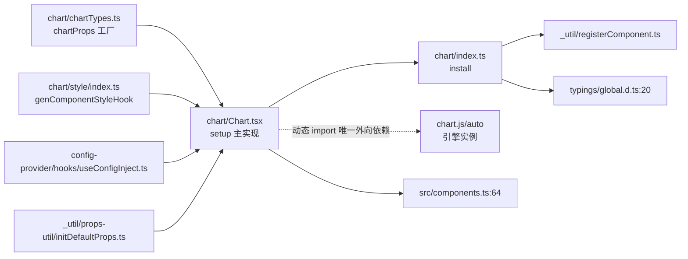
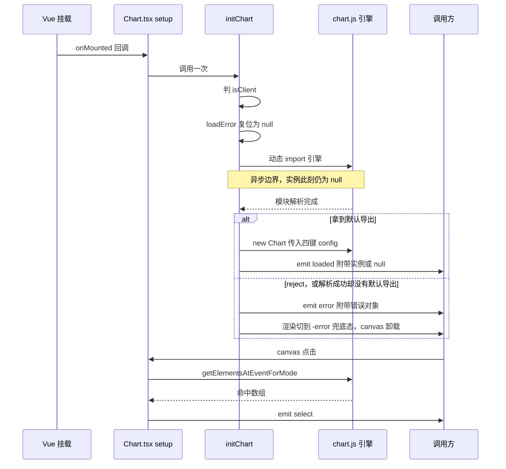
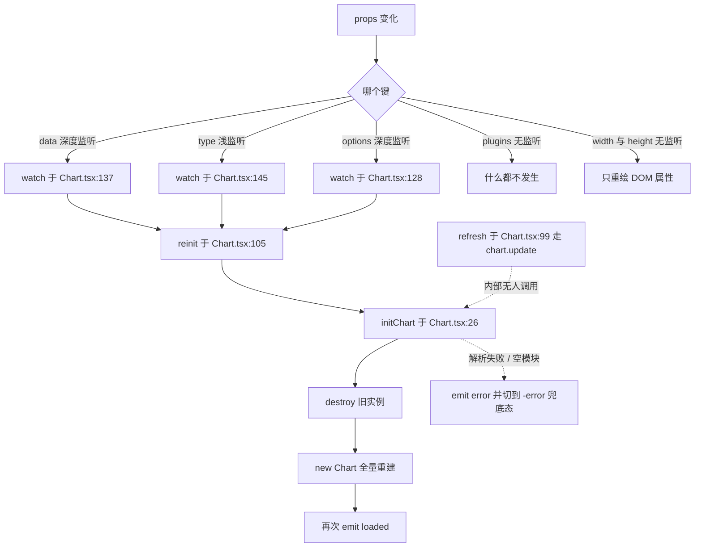

# C10-08 Chart 图表

> **本篇解决**：Chart 的渲染内核到底是谁、它声明在哪一块依赖里（结案：`chart.js`，在主库 `dependencies` 而不是 `devDependencies`，本层零绘制代码）；这层 180 行的套壳在 props、`expose`、事件、样式四张契约上各自兑现到什么程度，`ConfigProvider` 的哪三个开关对它完全无效；以及接手前必须知道的十个静默失效点与三条一键证伪判据。
> **前置**：C10-00 类横写：图片组的预览与对比关系　**读者坐标**：`03-components/10-media` 第 9/9 篇

## 一、职责与边界

Chart 是本轮专栏里遇到的**最薄的一层套壳**：主实现 `packages/xiaoye-ui/src/chart/Chart.tsx` 只有 180 行，它做的事情可以完整枚举——在浏览器端动态加载 chart.js（`packages/xiaoye-ui/src/chart/Chart.tsx:29`）、把 `<canvas>` 交给引擎构造函数（`packages/xiaoye-ui/src/chart/Chart.tsx:76`）、在 props 变化时销毁重建（`packages/xiaoye-ui/src/chart/Chart.tsx:137`）、把 canvas 的点击译成 `select` 事件（`packages/xiaoye-ui/src/chart/Chart.tsx:125`）、卸载时调 `destroy`（`packages/xiaoye-ui/src/chart/Chart.tsx:166-179`）。2026-09-30 起多了第六件：加载失败时把渲染切到兜底态并发出 `error`（`packages/xiaoye-ui/src/chart/Chart.tsx:36-42` 与 `:57-60`）。除这六件事之外，它什么都不做。这句话不是修辞，而是本篇的全部论点来源：**薄到「公开 props 与引擎 option 之间不存在映射层」这件事本身成为可审计的缺陷**。

本层负责的部分：

- **实例归属**。引擎实例只活在 `setup` 闭包里的一个普通变量 `let chart`（`packages/xiaoye-ui/src/chart/Chart.tsx:22`），没有被 `ref` 或 `reactive` 包装，因此实例不进响应式系统、不会被深度代理。这是套壳类组件唯一正确的写法，见论点 6。
- **端判定**。`isClient` 在 setup 阶段求值一次（`packages/xiaoye-ui/src/chart/Chart.tsx:19`），`initChart` 首行就据此返回（`packages/xiaoye-ui/src/chart/Chart.tsx:27`），因此服务端渲染路径不会触碰 `document`。
- **事件面**。声明了三个事件 `emits: ['select', 'loaded', 'error']`（`packages/xiaoye-ui/src/chart/Chart.tsx:13`），三者都真的被触发（`packages/xiaoye-ui/src/chart/Chart.tsx:125`、`:55`、`:40` 与 `:59`），本篇没有发现「声明但从不触发」的事件——这点与同层多数组件不同，要如实记下。`error` 是 2026-09-30 补的第三个，补它的理由见论点 6 的修后段。
- **暴露面**。六个方法通过 `expose` 交出（`packages/xiaoye-ui/src/chart/Chart.tsx:148-155`），但其中至少一个在当前依赖版本下必然抛错，见论点 5。

本层明确**不负责**的部分（这就是与厂商引擎的责任边界）：

- `options` 的全部语义由 chart.js 解释。本层对 `responsive`、`maintainAspectRatio`、`animation`、`plugins.legend`、`scales`、`interaction` 这些键零感知——既不读、不校验、也不与自己的 props 做任何协调。config 对象在 `packages/xiaoye-ui/src/chart/Chart.tsx:46-51` 就是四个键的字面搬运。
- **不注册引擎、不裁剪引擎**。动态引入的是 `chart.js/auto`（`packages/xiaoye-ui/src/chart/Chart.tsx:29`），即自带全部控制器与 element 的注册入口；本层没有提供按需注册的口子。
- **不接主题**。Design Token 只进了本层自己的两个盒子——容器（`packages/xiaoye-ui/src/chart/style/index.ts:10-16`）与加载失败兜底态（`:22-31`，取 `colorError`/`fontSize`/`padding`），图表内部的颜色、字号、网格线一个都没从 token 体系取值；切换主题不会重绘。
- 不做数据获取与格式化、不做无障碍语义（兜底态的 `role="alert"` 是 2026-09-30 才有的，见坑 6 修后）、**不做加载态**（引擎到达之前屏幕上就是一只默认尺寸的 canvas，没有任何骨架或 spinner）。

依赖清单（本层引入谁）：`initDefaultProps`（`packages/xiaoye-ui/src/chart/Chart.tsx:3`，实现见 `packages/xiaoye-ui/src/_util/props-util/initDefaultProps.ts:4`）、`useConfigInject`（`packages/xiaoye-ui/src/chart/Chart.tsx:4`，实现 `packages/xiaoye-ui/src/config-provider/hooks/useConfigInject.ts:14`）、样式 hook（`packages/xiaoye-ui/src/chart/Chart.tsx:5` → `packages/xiaoye-ui/src/chart/style/index.ts:7`）、props 工厂（`packages/xiaoye-ui/src/chart/Chart.tsx:6` → `packages/xiaoye-ui/src/chart/chartTypes.ts:18`）；外部运行时依赖 `chart.js`，声明位置 `packages/xiaoye-ui/package.json:59`（位于 `dependencies` 块内，该块起于 `packages/xiaoye-ui/package.json:46`，而 `peerDependencies` 只有 vue，见 `packages/xiaoye-ui/package.json:43`）。

被谁依赖（谁引入本层）：没有任何组件依赖它。引用它的只有生成物与文档——聚合入口 `packages/xiaoye-ui/src/components.ts:64`、具名再导出 `packages/xiaoye-ui/src/components.ts:65`、样式副作用导入 `packages/xiaoye-ui/src/components.ts:66`、全局类型声明 `packages/xiaoye-ui/typings/global.d.ts:20`、子路径导出 `packages/xiaoye-ui/package.json:176-180`、文档 `apps/docs/components/chart.md` 与六个示例（例如 `apps/docs/examples/chart/line.vue:2`）。

## 二、源码地图

| 文件 | 行数 | 职责 | 关键导出 |
| --- | --- | --- | --- |
| `packages/xiaoye-ui/src/chart/Chart.tsx` | 180 | 主实现：生命周期、config 组装、事件回流、失败兜底 | 默认导出 `defineComponent`，组件名见 `Chart.tsx:9` |
| `packages/xiaoye-ui/src/chart/chartTypes.ts` | 39 | props 工厂与四个类型别名 | `chartProps`（`chartTypes.ts:18`）、`ChartProps`（`chartTypes.ts:35`）、`ChartSelectEvent`（`chartTypes.ts:38`） |
| `packages/xiaoye-ui/src/chart/style/index.ts` | 33 | 容器、canvas 与兜底态的 CSS-in-JS | `genComponentStyleHook('Chart', ...)`（`style/index.ts:7`） |
| `packages/xiaoye-ui/src/chart/index.ts` | 21 | 包入口与安装函数 | 默认导出组件、`chartProps` 再导出（`index.ts:5`） |
| `packages/xiaoye-ui/src/chart/index.test.js` | 73 | 正常路径测试（引擎被整包 mock） | 无导出，用例见 `index.test.js:16` |
| `packages/xiaoye-ui/src/chart/load-error.test.js` | 91 | 失败路径测试（mock 成空模块，验 `@error` 与 `#error`，末条验恢复） | 无导出，用例见 `load-error.test.js:37` |
| `packages/xiaoye-ui/package.json` | — | 依赖声明与子路径导出 | `packages/xiaoye-ui/package.json:59`、`packages/xiaoye-ui/package.json:176` |

主实现入口是 `packages/xiaoye-ui/src/chart/Chart.tsx:8` 的 `defineComponent`，setup 首行 `packages/xiaoye-ui/src/chart/Chart.tsx:14`。渲染函数在 `packages/xiaoye-ui/src/chart/Chart.tsx:157-178`，它是全文件唯一一处 DOM 输出：**一个 div，里面按 `loadError` 二选一——兜底态 div 或 canvas**（`:160-176`）。除 `error` 这一个插槽外没有别的插槽出口，也没有 loading 占位（修前这里是「一个 div 套一个 canvas，没有插槽、没有 fallback」，2026-09-30 补上失败分支后作废）。测试文件后缀是 `.js` 而不是 `.tsx`，按 `packages/xiaoye-ui/vitest.config.mts:33` 的 glob 确实会被执行，但 `index.test.js` mock 掉了引擎——后果见论点 5；失败路径由 `load-error.test.js` 单独覆盖。

## 三、架构与数据流

### 3.1 静态结构：六个文件与一条外向依赖



图里有三条线值得单独说。第一条是 `chart.js/auto` 那条**虚线**：它是本层唯一的运行时外部依赖，而且是异步的（`packages/xiaoye-ui/src/chart/Chart.tsx:29`），这决定了整条数据流不是同步的——`onMounted` 触发之后实例还不存在，中间隔着一个微任务队列（见 3.2 的时序）。第二条是 `registerComponent`（`packages/xiaoye-ui/src/chart/index.ts:17` → `packages/xiaoye-ui/src/_util/registerComponent.ts:16`），它把 `XYChart` 折算成标签名 `xy-chart`（折算规则 `packages/xiaoye-ui/src/_util/registerComponent.ts:6-11`），所以文档示例里写的标签（`apps/docs/examples/chart/line.vue:2`）不是手工约定的。第三条是 `components.ts` 与 `global.d.ts` 这两条**生成物**边：本组件的公开面由 `packages/xiaoye-ui/src/components.ts:64-66` 三行决定，而这三行是机器写出来的，改目录名就会变，不能手改。

### 3.2 一次挂载的完整时序（含真实的失败分支）



这条链上最关键的是 `emit('loaded', chart)` 的位置。它写在 `packages/xiaoye-ui/src/chart/Chart.tsx:79`，**落在 `if (module && module.default && canvasRef.value)` 判断（`packages/xiaoye-ui/src/chart/Chart.tsx:44`）之外**。也就是说：canvas ref 已被卸载清空（或那一轮还没渲染出 canvas）时照样发出 `loaded`，只是携带的 `chart` 是 `null`。文档对事件的描述是「图表实例创建完成后触发」（`apps/docs/components/chart.md:78`），与源码行为不完全一致——括号里补的「加载失败时不会发出」只覆盖了 `error` 那两条出口，`loaded(null)` 这条路今天仍然通着。为什么这里是异步的、为什么不做成同步 `await`：因为 `import()` 返回 Promise，本层没有 `async` 化 `initChart`（`packages/xiaoye-ui/src/chart/Chart.tsx:26` 是普通函数），所以「组件挂载完成」与「图表可用」之间必然存在一个可观测的空窗，调用方唯一能依赖的信号就是这个事件——而它现在仍会在实例没建起来的情况下带着 `null` 发出。**修前这条链上还多两种情形**：模块没解析出来时 Promise 直接 reject、整条链无 `.catch`，既不 emit 也不渲染任何东西；模块解析成功但默认导出缺失时走 `:44` 的判空失败、发一个 `loaded(null)`。2026-09-30 之后前者落到 `:57-60` 的 `.catch`、后者被 `:36-42` 的提前 return 接管，两种都改发 `error`，`loaded` 只剩「canvas 缺席」这一种带 `null` 的路径。

### 3.3 更新通道：三条 watch 全部指向同一个终点



这张图是本篇的核心：**套壳层的「update」并不是引擎意义上的增量更新，而是销毁重建**。三条 watch（`packages/xiaoye-ui/src/chart/Chart.tsx:137`、`:121`、`:128`）的回调体一模一样，都是 `reinit()`（`packages/xiaoye-ui/src/chart/Chart.tsx:81-83`），而 `reinit` 只是 `initChart` 的别名转发。真正会走引擎 `chart.update()` 的 `refresh`（`packages/xiaoye-ui/src/chart/Chart.tsx:99-103`）在内部没有任何调用点，只挂在 `expose` 上（`packages/xiaoye-ui/src/chart/Chart.tsx:186`）。图中那条虚线（`refresh` 不参与任何自动路径）与那两个终止框（`plugins`、`width`/`height` 不在监听名单）是两处最容易在阅读时被忽略的形状，论点 2 与论点 3 分别展开。新加的 `ERR` 虚线是本轮修的产物：三条 watch 的重建路径同样会经过失败分支，所以数据变化触发的重建一旦赶上加载失败，也会把画面切成兜底态——`loadError.value = null` 的复位点在 `packages/xiaoye-ui/src/chart/Chart.tsx:28`，它排在 `import()` 之前。这个先后不是顺手的：复位先发生，Vue 把「重新挂载 canvas」的渲染任务排进微任务队列，而 `.then` 的续体排在它之后注册，于是 `:44` 的 `canvasRef.value` 判空在恢复场景下能拿到元素。**这条顺序已实测**（`packages/xiaoye-ui/src/chart/load-error.test.js:72-90`：先让 mock 没有默认导出、断言进入失败态，再把 `default` getter 翻成有构造函数，改一次 `data` 触发重建，断言兜底态消失、canvas 回来了、构造函数收到的第一个参数 `tagName === 'CANVAS'`、`loaded` 的载荷非 null）。也就是说一次瞬时的加载失败不会把图表永久锁死。

## 四、核心机制精读

### 论点 1：本层与引擎之间没有映射层，只有四个键的字面搬运；凡不在这四键里的公开 props 永远到不了引擎

断言：`Chart` 的 props 面实际上分成两类，而分类标准与调用方的直觉不一致——第一类（`type`、`data`、`options`、`plugins`）被原样塞进引擎构造函数；第二类（`width`、`height`、`canvasProps`）只作用于 DOM，**没有任何一行代码把它们译成引擎可读的键**。所以「公开 props 有一半到不了引擎」这一族的成因在这里不是「漏读」，而是从声明那一刻就没接线。

```tsx
// packages/xiaoye-ui/src/chart/chartTypes.ts:18
export const chartProps = () => ({
  prefixCls: String,
  type: anyType<ChartType>(),
  data: anyType<ChartData>(),
  options: anyType<ChartOptions>(),
  plugins: anyType<ChartPlugins>(),
  width: { type: Number, default: 300 },
  height: { type: Number, default: 150 },
  canvasProps: { type: Object as PropType<CanvasHTMLAttributes>, default: null },
});
```

```tsx
// packages/xiaoye-ui/src/chart/Chart.tsx:44
        if (module && module.default && canvasRef.value) {
          // chart.js 构造参数类型较为严格，这里放宽为 any 避免侵入业务类型
          const config: any = {
            type: props.type,
            data: props.data,
            options: props.options,
            plugins: props.plugins,
          };
          chart = new module.default(canvasRef.value, config);
        }
```

第一段是全部七个公开 props（`packages/xiaoye-ui/src/chart/chartTypes.ts:19-32`），第二段是全部四个进引擎的键（`packages/xiaoye-ui/src/chart/Chart.tsx:46-51`）。两段的交集只有四键，且这四处是**无脑搬运**：没有键名翻译（引擎叫 `data` 所以这里也叫 `data`）、没有默认值注入、没有结构校验、没有把 `width`/`height` 折算进 `options.aspectRatio` 或 `options.maintainAspectRatio`。`config` 的类型直接写成 `any`（`packages/xiaoye-ui/src/chart/Chart.tsx:46`），注释给出的理由是「避免侵入业务类型」（`packages/xiaoye-ui/src/chart/Chart.tsx:69`）——这一句注释恰好把本篇要指出的问题说穿了：类型层主动退出，就没有任何东西能提醒你某个 props 没接线。

逐条核对「声明了但从不读取」（DISPATCH §3 判据一）：

- `prefixCls` 被 `useConfigInject` 经 `getPrefixCls` 消费（`packages/xiaoye-ui/src/config-provider/hooks/useConfigInject.ts:14`），有效。
- `type`、`data`、`options`、`plugins` 在 `packages/xiaoye-ui/src/chart/Chart.tsx:47-50` 被读，但只在 `initChart` 这一次读，之后是否再生效取决于监听名单（论点 2）。
- `width`、`height` 在 `packages/xiaoye-ui/src/chart/Chart.tsx:171-172` 被读，落点是 canvas 的 DOM 属性。唯一的测试甚至把这一点钉死了：断言读的是 `canvas.attributes('width')`（`packages/xiaoye-ui/src/chart/index.test.js:32-33`），而不是任何引擎侧的值——这条断言本身就成了「props 只到 DOM」的证据。
- `canvasProps` 在 `packages/xiaoye-ui/src/chart/Chart.tsx:174` 被读，展开进 vnode props（它的展开位置有讲究，见论点 4）。

结论：本层**没有**零读取的死 prop。它的缺陷形态是「读到了错误的位置」，比死键更隐蔽，因为 `grep props.width` 有命中，读代码的人会以为这条路是通的。

核对「只写不读」（DISPATCH §3 判据二）：文件里的可变量只有引擎句柄 `let chart`（`packages/xiaoye-ui/src/chart/Chart.tsx:22`）与模板 ref `canvasRef`（`packages/xiaoye-ui/src/chart/Chart.tsx:21`），两者在渲染、事件与生命周期三处都被读；`isClient` 在 `packages/xiaoye-ui/src/chart/Chart.tsx:19` 求值后于 `packages/xiaoye-ui/src/chart/Chart.tsx:27` 被读。**没有模块级可变全局量**，也没有 SSR 多实例串味的风险——这一点要如实记下，它比本仓多个同类组件干净。

第三条线是类型面本身是装饰性的。`anyType` 的返回体（`packages/xiaoye-ui/src/_util/type.ts:66-67`）只有 `validator` 与 `default` 两个键，**运行时根本没有 `type` 字段**：

```ts
// packages/xiaoye-ui/src/_util/type.ts:66
export function anyType<T = any>(defaultVal?: T, required?: boolean) {
  const type = { validator: () => true, default: defaultVal as T } as unknown;
  return required
    ? (type as {
        type: PropType<T>;
        default: T;
        required: true;
      })
    : (type as {
        default: T;
        type: PropType<T>;
```

`as unknown` 之后再 `as { type: PropType<T>; ... }`（`packages/xiaoye-ui/src/_util/type.ts:74-77`）是给 TypeScript 看的，Vue 运行时收到的是「无类型约束 + 默认 undefined」。因此 `anyType<ChartType>()`（`packages/xiaoye-ui/src/chart/chartTypes.ts:21`）里的 `ChartType = string`（`packages/xiaoye-ui/src/chart/chartTypes.ts:7`）不产生任何运行期校验；同理 `ChartSelectEvent`（`packages/xiaoye-ui/src/chart/chartTypes.ts:38-42`）从包入口导出（`packages/xiaoye-ui/src/chart/index.ts:12`）却在实现里从未被引用——`emit('select', { originalEvent, element, dataset })`（`packages/xiaoye-ui/src/chart/Chart.tsx:125`）的形状与该接口一致只是巧合，改动任一侧字段都不会触发类型报错。**责任边界落到一句话**：本层不保证「你传的开关会被引擎看到」，也不保证「引擎看到的和类型声明的是同一个东西」；四键之外的一切，要么走 `options` 透传，要么就是 DOM 属性。

### 论点 2：更新通道只有「销毁重建」这一种，`refresh()` 在内部是死路径；四条映射键里只有三条接了更新通道

断言：本层没有「增量更新」这条路径。三条 watch 的回调体是同一行 `reinit()`，终点是 `destroy` 加 `new Chart`；而真正会调 `chart.update()` 的 `refresh()` 只作为对外方法存在，内部零调用点。第四个能进引擎的键 `plugins` 压根不在监听名单里。

```tsx
// packages/xiaoye-ui/src/chart/Chart.tsx:83
    function refresh() {
      if (chart) {
        chart.update();
      }
    }

    function reinit() {
      initChart();
    }
```

```tsx
// packages/xiaoye-ui/src/chart/Chart.tsx:137
    watch(
      () => props.data,
      () => {
        reinit();
      },
      { deep: true },
    );

    watch(
      () => props.type,
      () => {
        reinit();
      },
    );

    watch(
      () => props.options,
      () => {
        reinit();
      },
      { deep: true },
    );
```

**同一逻辑的三份拷贝**（DISPATCH §3 缺陷族之一）：`packages/xiaoye-ui/src/chart/Chart.tsx:140`、`:124`、`:131` 三处回调体逐字相同，都是 `reinit()`。三份拷贝本身不算错，但它掩盖了一个事实：**没有一条分支是「不重建」**。也就是说 `refresh`（`packages/xiaoye-ui/src/chart/Chart.tsx:99-103`）在 setup 作用域内是死代码，只在 `expose` 名单里活着（`packages/xiaoye-ui/src/chart/Chart.tsx:186`）。这就是套壳层最常见的形状——引擎给了廉价的更新口，套壳层却把昂贵的重建口当成唯一入口。

重建的实际代价，逐项落在源码上：`initChart` 同步阶段的第一件事是 `loadError.value = null`（`packages/xiaoye-ui/src/chart/Chart.tsx:28`，2026-09-30 起），`.then` 里的第一件事才是 `chart.destroy()`（`packages/xiaoye-ui/src/chart/Chart.tsx:31-34`），然后重新构造（`packages/xiaoye-ui/src/chart/Chart.tsx:76`），最后**再发一次 `loaded`**（`packages/xiaoye-ui/src/chart/Chart.tsx:79`）。三件事的后果：引擎的入场动画每次重放；引擎侧运行时状态（展开的 tooltip、被点击隐藏的图例、缩放）随实例一起消失；`loaded` 的语义从「创建完成」漂移成「每次创建都算」，而文档写的是「图表实例创建完成后触发」（`apps/docs/components/chart.md:78`）。调用方在 `loaded` 里做一次性动作（拿实例注册插件、绑外部监听）会被重复执行——这是事件语义漂移最典型的破坏方式。文档 `apps/docs/components/chart.md:103` 甚至把这条路径当成特性写了：「`data`、`type`、`options` 变化时组件会自动重新初始化图表」，说明作者是知道这个选择的，但没写代价。

**`refresh` 为什么不能直接接替 `reinit`**：这是本篇认为最值得接手人记住的一条约束。引擎的 config 是在 `packages/xiaoye-ui/src/chart/Chart.tsx:46-51` 一次性构造、一次性交给构造函数的，`data` 传的是**引用**。所以：调用方原地改数组（`data.datasets[0].data.push(1)`）时，`refresh()` 有效；调用方换成新对象（`:data="newData"`）时，`props.data` 变了但引擎持有的仍是旧引用，`refresh()` 画不出新数据——于是「必须有 reinit 这条重路」看起来成了合理设计。源码、类型（`packages/xiaoye-ui/src/chart/chartTypes.ts:22`）与文档（`apps/docs/components/chart.md:96` 只写「刷新图表（调用 `chart.update()`）」）三处都没有写下这条约束。它属于「只有读实现才知道」的隐性契约，也是七段骨架里「对外契约如何生效」这一节要处理的对象。

**覆盖率是 3/4**：监听名单覆盖 `data`、`type`、`options`（`packages/xiaoye-ui/src/chart/Chart.tsx:138`、`:122`、`:129`），没有覆盖 `plugins`——但 `plugins` 恰恰是四键里唯一有运行期作用的键之一（`packages/xiaoye-ui/src/chart/Chart.tsx:50`）。后果：挂载后更换或增删内联插件，本层不会有任何动作，用户必须自己调用暴露出来的 `reinit`（`packages/xiaoye-ui/src/chart/Chart.tsx:153`）才能生效。这是「公开 props 与引擎 option 之间没有映射层」的第二种表现——不是没接线，而是**接线只接了一半，另外一半的缺失不会报错**。

**深监听的成本与一个条件性风险**：`{ deep: true }` 出现在 `packages/xiaoye-ui/src/chart/Chart.tsx:142` 与 `:133`。`data` 是图表数据集，折线/散点场景动辄上千点，深监听会在每个更新周期递归遍历整个对象树；三处 watch 回调都不带节流、不判 `flush`、也不比较新旧引用是否同一个对象。条件性风险在这里：由于传给引擎的是同一份对象引用，若引擎在绘制过程中回写它持有的 `data`/`options` 上的任何可达字段，深监听就会触发 `reinit`，而 `reinit` 又把同一份对象交回引擎——构成自激环。

> ⚠️ 未在源码中找到对应实现，此处为待核实推断：本层没有任何阻断回写的措施（无 flag、无 `toRaw`、无冻结），但引擎是否会写回这些字段不在本仓取证范围内，本篇不把它当作已证实的缺陷。

### 论点 3：容器尺寸变化在本层没有任何触发通道——不是仓库缺观察器，是这一层没接线

断言：`chart` 目录里 `ResizeObserver`、`addEventListener`、`useElementSize`、`useResizeObserver` 四种写法的命中数是 **0**。本层不会观察任何东西，因此「容器变窄 → 图表重绘」这条链路在套壳层是断的；能接上它的只有引擎内部的响应式机制，而那个机制要用户自己打开。

```tsx
// packages/xiaoye-ui/src/chart/style/index.ts:7
export default genComponentStyleHook('Chart', token => {
  const { componentCls, borderRadius, colorError, fontSize, padding } = token;
  return {
    [componentCls]: {
      position: 'relative',
      display: 'block',
      background: 'transparent',
      borderRadius: `${borderRadius}px`,
      padding: 0,
    },
    [`${componentCls}-canvas`]: {
      display: 'block',
      maxWidth: '100%',
    },
    // 动态 import 失败时的兜底态；类名由 Chart.tsx 的 loadError 分支产出
    [`${componentCls}-error`]: {
      display: 'flex',
      alignItems: 'center',
      justifyContent: 'center',
      minHeight: `3rem`,
      padding: `${padding}px`,
      color: colorError,
      fontSize: `${fontSize}px`,
      textAlign: 'center',
    },
  } as CSSObject;
});
```

```tsx
// packages/xiaoye-ui/src/chart/Chart.tsx:157
    return () =>
      wrapSSR(
        <div class={[prefixCls.value, hashId.value]}>
          {loadError.value ? (
            <div class={`${prefixCls.value}-error`} role="alert">
              {slots.error?.() ??
                String(
                  (loadError.value as any)?.message ?? loadError.value ?? 'chart.js load failed',
                )}
            </div>
          ) : (
            <canvas
              ref={canvasRef}
              class={`${prefixCls.value}-canvas`}
              width={props.width}
              height={props.height}
              onClick={onCanvasClick}
              {...props.canvasProps}
            />
          )}
        </div>,
      );
```

这 3 条样式规则与 22 行渲染就是本层关于尺寸的全部输出。逐处看：容器拿到 `position: relative`（`packages/xiaoye-ui/src/chart/style/index.ts:11`）与 `display: block`（`:12`），**没有 width、没有 height、没有任何比例约束**；canvas 拿到 `max-width: 100%`（`packages/xiaoye-ui/src/chart/style/index.ts:17-20`），而它的绘制缓冲尺寸来自 DOM 属性 `width`/`height`（`packages/xiaoye-ui/src/chart/Chart.tsx:171-172`，默认值在 `packages/xiaoye-ui/src/chart/chartTypes.ts:30-31` 是 300 与 150）。CSS 的 `max-width` 只能**缩放**这块固定分辨率的位图，不能让它重新按新尺寸绘制：容器从 800px 收窄到 400px 时，本层不会重绘，画布被横向压缩，坐标轴文字与线宽一起变形。这就是「观察器没接线」在用户眼前的具体样子。

对照本仓的能力面，这个断链不是技术缺失。仓库有自己的观察器组件，`packages/xiaoye-ui/src/vc-resize-observer/index.tsx:115` 真的执行了 `resizeObserver = new ResizeObserver(onResize)`，组件名见 `packages/xiaoye-ui/src/vc-resize-observer/index.tsx:24`；它的使用者排成一片——`packages/xiaoye-ui/src/vc-table/Table.tsx:57`、`packages/xiaoye-ui/src/avatar/Avatar.tsx:11`、`packages/xiaoye-ui/src/input/ResizableTextArea.tsx:11`、`packages/xiaoye-ui/src/vc-overflow/Overflow.tsx:3`。hook 形态也有两份：`packages/xiaoye-ui/src/_util/hooks/_vueuse/useResizeObserver.ts:52` 与 `packages/xiaoye-ui/src/_util/hooks/_vueuse/useElementSize.ts:20`（后者在本库只有 `packages/xiaoye-ui/src/vc-picker/RangePicker.tsx` 一个消费者）。**Chart 一个都没用**。所以正确的说法不是「组件库不会做自适应」，而是「这一层的职责清单里根本没把尺寸算进来」——这正好是论点 1 那条边界的另一面。

于是重绘触发只剩两个来源，且都不是本层主动提供的：

- **引擎侧**：用户自己往 `options` 里打开响应式。六个文档示例全是这么写的，例如 `apps/docs/examples/chart/line.vue:29-30` 的 `responsive: true` 与 `maintainAspectRatio: false`——也就是说连官方示例都不指望 `:height="240"`（`apps/docs/examples/chart/line.vue:2`）能决定高度，而是把它当成初始位图尺寸、真正的高度交给引擎覆写 canvas 样式。本层在这条路上提供的只有一个 `position: relative` 的盒子（`packages/xiaoye-ui/src/chart/style/index.ts:11`）和零测量代码；父盒没有确定高度时引擎最终取什么值，属于厂商语义，本篇不在源码范围内断言。
- **人工侧**：调用 `expose` 出来的 `refresh`（`packages/xiaoye-ui/src/chart/Chart.tsx:99`）或 `reinit`（`packages/xiaoye-ui/src/chart/Chart.tsx:105`）。注意 `reinit` 走的是销毁重建，也就是说「resize 后强制重画」的唯一内置手段是把引擎动画与交互状态一起丢掉（见论点 2）。

一句话写清责任边界：**尺寸这件事，本层只负责交出 canvas 和一个 relative 容器，测量与重绘全部外包给引擎的 `responsive` 开关；用户不开这个开关，容器怎么变都不会有人重画，而本层的 `max-width: 100%` 会让用户误以为「自适应已经做好了」。**

### 论点 4：`inheritAttrs: false` 却从不接 `attrs`——写在标签上的 class 与 style 全部丢失；而 `canvasProps` 展在末位，覆盖关系按键型分岔

断言：本层同时犯了两个方向相反的 attribute 落点错误。第一，它显式关掉了 Vue 的自动 attribute 继承，却没有任何一行把 `attrs` 手工绑回去，于是 `<xy-chart class="foo" style="...">` 上的这些属性**在 DOM 上完全消失**。第二，`canvasProps` 的展开位置在四个显式属性之后，用户传的同名键会参与竞争，而竞争结果**按键的类型分岔**——`width`/`height` 被覆盖，`onClick` 变成两个 handler 都跑，`class` 被合并。

```tsx
// packages/xiaoye-ui/src/chart/Chart.tsx:8
export default defineComponent({
  name: 'XYChart',
  inheritAttrs: false,
  __XY_CHART: true,
  props: initDefaultProps(chartProps(), {}),
  emits: ['select', 'loaded', 'error'],
  setup(props, { emit, expose, slots }) {
    const { prefixCls } = useConfigInject('chart', props);
```

证据链是三条否定的合取：`inheritAttrs: false`（`packages/xiaoye-ui/src/chart/Chart.tsx:10`）、setup 的解构里没有 `attrs`（`packages/xiaoye-ui/src/chart/Chart.tsx:14` 只有 `{ emit, expose, slots }`——2026-09-30 多了第三个，但仍不含 `attrs`）、渲染函数里没有 attrs 的落点（`packages/xiaoye-ui/src/chart/Chart.tsx:157-178`）。用 `grep -n "attrs" packages/xiaoye-ui/src/chart/Chart.tsx` 复核，整个文件只命中第 10 行这一处。对照同仓的正确写法：`packages/xiaoye-ui/src/rate/index.tsx:48` 同样声明 `inheritAttrs: false`，但在 `packages/xiaoye-ui/src/rate/index.tsx:243` 用 `{...attrs}` 把 attribute 显式接到了内部节点上；`packages/xiaoye-ui/src/form/Form.tsx:109` 与 `packages/xiaoye-ui/src/form/Form.tsx:412` 也是同一形状（后者还额外把 `attrs.class` 并进 class 数组）。`inheritAttrs: false` 的语义是「我来手工决定 attrs 落在哪个 DOM 节点」，Chart 把它当成了「attrs 我不想要」。

后果的严重度不对称：**样式与语义类名丢失是静默的**。文档与示例都没有在 `<xy-chart>` 标签上挂 class（例如 `apps/docs/examples/chart/line.vue:2`、`apps/docs/examples/chart/bar.vue:2`），所以这条路径在六个示例里一次都没被走过；测试也没有覆盖（`packages/xiaoye-ui/src/chart/index.test.js:28-36` 断言的是 canvas 自己的类名与属性，不是外部 attrs）。要判断它是否影响自己，读者的可执行判据是：在页面写 `<xy-chart class="demo-x">`，检查 DOM 里是否存在 `demo-x`——按现有源码它不存在。

第二个错误的机理更细，必须拆开。JSX 的 `<canvas A={} {...props.canvasProps} />` 会被编译成对 props 对象的一次 `mergeProps` 合并，展开项在后，因此**后写者参与优先级更高**。但 Vue 的 `mergeProps` 并不是对所有键一视同仁：`class` 与 `style` 走归一化合并（两个值都留下），`on*` 前缀的键走 handler 串接（两个函数都执行，已有者在前），其余键才是直接覆盖。这三条分支可以用下面的命令自行核对，产物路径不挂行号：

```bash
grep -n "function mergeProps" -A 24 node_modules/.pnpm/@vue+runtime-core@3.5.40/node_modules/@vue/runtime-core/dist/runtime-core.cjs.js
```

落到本组件的四个显式属性上（`packages/xiaoye-ui/src/chart/Chart.tsx:168-173`）：

- `class`（`:170`）与 `canvasProps.class` **合并**，`${prefixCls}-canvas`（选择器定义在 `packages/xiaoye-ui/src/chart/style/index.ts:17`）不会丢，这一项安全。
- `width`（`:171`）与 `height`（`:172`）是普通键，会被 `canvasProps` 里的同名键**覆盖**。用户如果既传 `:width="500"` 又在 `canvasProps` 里传 `width: 800`，DOM 上是 800，且没有任何提示。
- `onClick`（`:173`）是 `on*` 键，**不会**被覆盖，而是与 `canvasProps.onClick` 串成数组先后执行。这条与直觉相反：很多人以为传 `canvasProps.onClick` 就能「接管点击、屏蔽 select」，实际上 `onCanvasClick`（`packages/xiaoye-ui/src/chart/Chart.tsx:109`）照跑、`select` 照发。

本仓对「展开位置决定覆盖方向」这件事有现成的正反例，可以当作读这段代码的坐标系：`packages/xiaoye-ui/src/message/useMessage.tsx:148` 把 `...restConfig` 写在最前，`placement: 'top'`（`packages/xiaoye-ui/src/message/useMessage.tsx:159`）与 `class`（`packages/xiaoye-ui/src/message/useMessage.tsx:161`）写在之后，所以外部覆盖不掉；`packages/xiaoye-ui/src/notification/useNotification.tsx:101-102` 反过来，先写 `placement: 'topRight'` 再展开 `...restConfig`，所以外部改得动。Chart 属于后者，但它的后果比「改得动」更绕，因为三条键型的结局各不相同。

**责任边界**：`canvasProps` 是本层唯一的原生属性逃生门（类型见 `packages/xiaoye-ui/src/chart/chartTypes.ts:32`，默认 `null`），它绕过本层的一切约定直达 canvas DOM 节点。它不与 `attrs` 重叠——`attrs` 是「写在标签上的东西」，`canvasProps` 是「写在 prop 里的东西」，而本层只实现了后者的通路、丢掉了前者的通路。

### 论点 5：`generateLegend` 是被依赖版本已经删掉的引擎方法，本层仍在 expose 里直调；唯一的测试用 mock 把这个方法补了回来

断言：`expose` 交出的六个方法里，`generateLegend`（`packages/xiaoye-ui/src/chart/Chart.tsx:106-111`）调的是 chart.js v2 时代的 API，而本库声明的依赖是 v4。运行时不是返回 `null`，而是抛 `TypeError: chart.generateLegend is not a function`。文档在方法表里把它当成可用能力宣传（`apps/docs/components/chart.md:98`「生成图例 HTML」）。更关键的是：**单测看不到这个问题**，因为测试自己 mock 出了这个方法。

```tsx
// packages/xiaoye-ui/src/chart/Chart.tsx:114
    function generateLegend() {
      if (chart) {
        return chart.generateLegend();
      }
      return null;
    }
```

```tsx
// packages/xiaoye-ui/src/chart/index.test.js:6
// mock chart.js/auto 的动态 import，避免 jsdom 下 canvas 报错
vi.mock('chart.js/auto', () => ({
  default: vi.fn().mockImplementation(() => ({
    destroy: vi.fn(),
    update: vi.fn(),
    toBase64Image: vi.fn(() => 'data:image/png;base64,xxx'),
    generateLegend: vi.fn(() => '<ul class="legend"></ul>'),
    getElementsAtEventForMode: vi.fn(() => []),
  })),
}));
```

`packages/xiaoye-ui/src/chart/index.test.js:11` 这一行是本篇最典型的**测试面假象**：mock 的函数清单（`:8-12`）是照着被测代码写出来的，而不是照着引擎的真实接口写出来的。于是 `index.test.js:62` 那句 `expect(typeof vm.generateLegend).toBe('function')` 永远为真——它断言的是本层包了个函数，而不是这个函数能跑。同理被 mock 的还有 `update`（`packages/xiaoye-ui/src/chart/index.test.js:9`）、`toBase64Image`（`:10`）、`getElementsAtEventForMode`（`:12`）：**这个测试文件从不调用真引擎**，因此它对「套壳层与引擎接口是否对齐」这件事的验证能力是零。

负面结论按共则要用第二种方法交叉验证，本篇用了两条独立判据：

```bash
# 判据一：整包（含类型声明）里搜方法名，命中数应为 0
grep -rl "generateLegend" node_modules/.pnpm/chart.js@4.5.1/node_modules/chart.js | wc -l
# 判据二：只搜类型声明里的 Chart 实例方法，另两个方法应在、generateLegend 不应在
grep -n -e toBase64Image -e getElementsAtEventForMode -e generateLegend \
  node_modules/.pnpm/chart.js@4.5.1/node_modules/chart.js/dist/types/index.d.ts
```

两条判据的实际结果：判据一返回 0 个文件；判据二命中 `getElementsAtEventForMode`（返回 `InteractionItem[]`）与 `toBase64Image`，**没有** `generateLegend`。也就是说同文件里另外三个引擎调用（`packages/xiaoye-ui/src/chart/Chart.tsx:96` 的 `toBase64Image`、`:87` 与 `:93` 的 `getElementsAtEventForMode`、`:77` 的 `update`）都对得上，只有 `generateLegend` 是一个孤儿。依赖声明在 `packages/xiaoye-ui/package.json:59`，写的是 `"chart.js": "^4.4.0"`（安装到的是 4.x 系列，见上面命令的路径），版本区间内不存在该方法。

顺带同一段落里的第二个瑕疵：`onCanvasClick` 的守卫写的是 `if (element && element[0] && dataset)`（`packages/xiaoye-ui/src/chart/Chart.tsx:124`），而 `dataset` 是 `getElementsAtEventForMode(event, 'dataset', ...)` 的返回数组（`packages/xiaoye-ui/src/chart/Chart.tsx:117-122`）——空数组在 JS 里恒为真，所以这个条件对 `dataset` **永不构成约束**。真实生效的门槛只有 `element[0]` 一处。文档承诺回调参数里有 `dataset`（`apps/docs/components/chart.md:77`），而当点击落在某个元素上却未命中数据集归属时，`dataset` 会以 `[]` 的形式交出去，调用方按文档写的「获取点击详情」去解构就会拿到空值。

### 论点 6：实例不进响应式、失败原先无人接管、异步窗口至今没有取消标志——本层最干净的地方和最脆的地方是同一条

断言：`chart` 用普通闭包变量而非 `ref` 保存（`packages/xiaoye-ui/src/chart/Chart.tsx:22`），这是本层做对的事；但同一处也意味着它的生命周期完全不在 Vue 的追踪范围内，一旦引擎侧失败，Vue 层原先不会有任何反应。2026-09-30 补的那条通道走的不是 `chart` 变量，而是新增的 `loadError` ref（`packages/xiaoye-ui/src/chart/Chart.tsx:31`）——把「引擎没起来」这件事翻译成一个 Vue 能追踪的状态，渲染端才有分支可走。

```tsx
// packages/xiaoye-ui/src/chart/Chart.tsx:26
    function initChart() {
      if (!isClient) return;
      loadError.value = null;
      import('chart.js/auto')
        .then(module => {
          if (chart) {
            chart.destroy();
            chart = null;
          }

          if (!module?.default) {
            // 被 external 掉、或解析到空模块时 promise 是成功态，只有「拿不到默认导出」这一种表现
            const err = new Error('chart.js module is unavailable (no default export)');
            loadError.value = err;
            emit('error', err);
            return;
          }

          if (module && module.default && canvasRef.value) {
            // chart.js 构造参数类型较为严格，这里放宽为 any 避免侵入业务类型
            const config: any = {
              type: props.type,
              data: props.data,
              options: props.options,
              plugins: props.plugins,
            };
            chart = new module.default(canvasRef.value, config);
          }

          emit('loaded', chart);
        })
        .catch(err => {
          loadError.value = err;
          emit('error', err);
        });
    }
```

修前（本篇初稿摘录的形状）这段只有 `.then` 而没有 `.catch`，`.then` 里也没有 `!module?.default` 这一岔——`import('chart.js/auto')` 是链上唯一一个 awaited 边界，它失败了本层既不留状态也不发声。**2026-09-30 已改**，判据 `grep -n "\.catch" packages/xiaoye-ui/src/chart/Chart.tsx` 现命中 `:57`。

四点逐个看：

- **`.then` 后面原先没有 `.catch`**（修前 `packages/xiaoye-ui/src/chart/Chart.tsx:26-44` 整条链）。项目没装 `chart.js`、构建期被 external 掉、网络失败——这三种情形都会变成未处理的 Promise rejection，而组件既不渲染错误态也不发出事件，页面上就是一个空白 canvas。文档只在备注里写了一句「需确保项目已安装 `chart.js` 依赖」（修前 `apps/docs/components/chart.md:95`），源码侧零防护。渲染函数里也没有任何 loading 或空态节点（修前 `packages/xiaoye-ui/src/chart/Chart.tsx:141-153`）。**这条现已闭合**：reject 走 `:57-60`，「解析成功但没有默认导出」走 `:36-42`（这条不是 rejection，promise 是成功态，所以只加 `.catch` 接不住它——`load-error.test.js` 用 `vi.mock('chart.js/auto', () => ({}))` 打的正是第二条，因为 vitest 的 mock 工厂里抛错或返回 rejected promise 都不会让动态 import 真的失败）。两条出口都写 `loadError`（`:39`、`:58`）并 `emit('error')`（`:40`、`:59`），渲染端 `:160-166` 据此把 canvas 换成 `.xy-chart-error`（`role="alert"`），`slots.error` 优先于兜底文案。
- **`emit('loaded', chart)` 在判空之外**（`packages/xiaoye-ui/src/chart/Chart.tsx:79` 相对 `:44`）。加上 `onMounted` 无条件调用（`packages/xiaoye-ui/src/chart/Chart.tsx:137-139`），最省事的一种失败是：组件被 `v-if` 快速开关，卸载时 `chart` 还是 `null` 所以 `onBeforeUnmount`（`packages/xiaoye-ui/src/chart/Chart.tsx:166-179`）无事可做，随后 Promise 落地，`canvasRef.value` 已被清空、构造被 `:44` 拦住——**没有泄漏，但 `loaded` 仍带 `null` 发出**。这条路径的正确性靠的是模板 ref 在卸载时被置空这一 Vue 行为，而不是本层写了取消标志（文件里没有 `isUnmounted`，`grep -n -e onUnmounted -e isUnmounted packages/xiaoye-ui/src/chart/Chart.tsx` 命中 0）。**修后新增的 `loadError` 也不充当取消标志**：它是渲染用的状态，不是「这一轮 promise 已作废」的标记，所以同一实例上若两次 `initChart` 交错（快速连改 `data`），后到的 `.then` 仍会照常构造并发 `loaded`，与修前同形。
- **零 props 也会构造引擎**。`props` 的四个键默认全是 `undefined`（`packages/xiaoye-ui/src/chart/chartTypes.ts:21-24` 经 `anyType` 展开成 `{ validator, default: undefined }`，见 `packages/xiaoye-ui/src/_util/type.ts:67`），`initDefaultProps(chartProps(), {})` 的第二个参数是空对象，所以一个默认值都没补（`packages/xiaoye-ui/src/chart/Chart.tsx:12`；实现 `packages/xiaoye-ui/src/_util/props-util/initDefaultProps.ts:17` 的循环遍历的是空对象，直接返回浅拷贝 `:16`）。于是 `config` 会是四个 `undefined` 的键（`packages/xiaoye-ui/src/chart/Chart.tsx:47-50`）原样交给引擎。共享测试 `packages/xiaoye-ui/tests/shared/mountTest.js:4-21` 恰好就是「不带任何 props 挂载」这一形状，但它跑在 mock 之上（`packages/xiaoye-ui/src/chart/index.test.js:6`），所以这条最可能被用户踩到的路径从未与真引擎对撞过。
- **无障碍为零**（成功路径依旧如此，失败路径 2026-09-30 起有了一个 `role="alert"`）。canvas 节点上没有 `role`、没有 `aria-label`、也没有后备内容（`packages/xiaoye-ui/src/chart/Chart.tsx:168-175` 逐行核过）。唯一的补救是走 `canvasProps`——讽刺的是这恰好能工作，因为 `canvasProps` 展在末位且 `aria-*` 是普通键（见论点 4），但这条用法在文档与六个示例里都没有出现。对照同一文件里新加的兜底态（`:161` 的 `role="alert"`）可以看出本层的无障碍是「按需补」而不是「成面做」：读屏用户在成功路径上仍然只知道有一个 canvas，不知道里面画了什么。

## 五、对外契约如何生效

**props 的声明面有八个键，运行时读取面也有八个键，但「读到」不等于「到达引擎」。** 逐条对照（读取面判据：`grep -n "props\." packages/xiaoye-ui/src/chart/Chart.tsx` 命中 10 行，去重后是 7 个名字，第 8 个 `prefixCls` 不在 `Chart.tsx` 里读、而是整包交给 `useConfigInject`）：

| props 键 | 声明处 | 运行时读取处 | 契约的落点 |
| --- | --- | --- | --- |
| `prefixCls` | `packages/xiaoye-ui/src/chart/chartTypes.ts:19` | `packages/xiaoye-ui/src/config-provider/hooks/useConfigInject.ts:14` | 类名与样式表缓存键（第 5 段） |
| `type` | `packages/xiaoye-ui/src/chart/chartTypes.ts:21` | `packages/xiaoye-ui/src/chart/Chart.tsx:71` 搬运、`:122` 监听 | 引擎构造参数 |
| `data` | `packages/xiaoye-ui/src/chart/chartTypes.ts:22` | `packages/xiaoye-ui/src/chart/Chart.tsx:72`、`:114` | 引擎构造参数，**按引用**交出（论点 2） |
| `options` | `packages/xiaoye-ui/src/chart/chartTypes.ts:23` | `packages/xiaoye-ui/src/chart/Chart.tsx:73`、`:129` | 引擎构造参数，整包搬运 |
| `plugins` | `packages/xiaoye-ui/src/chart/chartTypes.ts:24` | `packages/xiaoye-ui/src/chart/Chart.tsx:50` | 引擎构造参数，**不在监听名单**（论点 2） |
| `width` | `packages/xiaoye-ui/src/chart/chartTypes.ts:30`，默认 300 | `packages/xiaoye-ui/src/chart/Chart.tsx:171` | 只到 canvas 的 DOM 属性 |
| `height` | `packages/xiaoye-ui/src/chart/chartTypes.ts:31`，默认 150 | `packages/xiaoye-ui/src/chart/Chart.tsx:172` | 只到 canvas 的 DOM 属性 |
| `canvasProps` | `packages/xiaoye-ui/src/chart/chartTypes.ts:32`，默认 `null` | `packages/xiaoye-ui/src/chart/Chart.tsx:174` | 展开进 vnode props 的末位（论点 4） |

这张表有两个方向要同时读。右半边是 DISPATCH §3 第五条的反面：本层**既没有声明了不读的键，也没有读了但没声明的键**——声明用的是对象式 props（`packages/xiaoye-ui/src/chart/Chart.tsx:12`，判据 `grep -n "props:" packages/xiaoye-ui/src/chart/Chart.tsx` 只回这一行），不存在 `props: [...]` 白名单数组漏键那种形状。左半边才是坑所在：前三行落到引擎，第 6、7 行只落到 DOM，而 `grep props.width` 有命中，读代码的人会以为这条路是通的（论点 1 的原话）。文档的 Props 表（`apps/docs/components/chart.md:63-71`）恰好把八个键里的七个列全了（漏 `prefixCls`，那是内部键），**没有列一个源码里不存在的键**——这一点比同层走马灯的文档干净（那个文档宣传过零实现的 `easing`），所以本层的文档问题不在「多写」，全在「少写」：三处语义缺口见第 2、3、6 段。

**`expose` 交出六个键，但「ref 可用」不等于「引擎可用」。** `packages/xiaoye-ui/src/chart/Chart.tsx:148-155` 交出 `getCanvas`、`getChart`、`getBase64Image`、`refresh`、`reinit`、`generateLegend`；setup 作用域里一共八个具名函数（`packages/xiaoye-ui/src/chart/Chart.tsx:26`、`:63`、`:67`、`:71`、`:75`、`:81`、`:85`、`:106`），没交出去的两个是 `initChart` 与 `onCanvasClick`。时序上这条契约是错位的：`expose` 在 setup 的同步阶段就执行完了（`:148`），而引擎句柄要等 `packages/xiaoye-ui/src/chart/Chart.tsx:29` 的 Promise 落地、在 `packages/xiaoye-ui/src/chart/Chart.tsx:76` 才被赋值，所以**挂载同帧**通过模板 ref 调 `getChart()`（`packages/xiaoye-ui/src/chart/Chart.tsx:91-93` 是直接 `return chart`）拿到的是 `null`。文档的方法表（`apps/docs/components/chart.md:91-98`）把返回类型如实写成「Chart 或 null」（`:94`），但没有任何一处告诉读者「null 是常态而不是异常」。六个方法在实例缺席时的行为还分三种，这是读者必须记住的第二层：`getCanvas`（`:64`）与 `getChart`（`:68`）返回 null、`getBase64Image`（`:72`）与 `generateLegend`（`:110`）返回 null、`refresh`（`:76`）静默什么都不做，而 `reinit`（`:82`）是六个里唯一**不需要实例存在也能干活**的——它自己会先 destroy 再构造（`:31-34` 与 `:52`）。另外，按 Vue 的 `expose` 语义，交出这份名单之后模板 ref 拿到的代理就只有这六个键，props 与内部函数都不在公开面上；这条约束在类型面没有任何痕迹——`ChartProps`（`packages/xiaoye-ui/src/chart/chartTypes.ts:35`）只描述 props，ref 的实例形状要靠读 `:148-155` 或文档表格才知道。第九个对外出口是 2026-09-30 新加的 `error` 事件与同名插槽，它们不在 `expose` 名单里、也不属于「实例方法」这一类。

**事件面：三个都真触发，但闸门完全不同。** `emits` 声明在 `packages/xiaoye-ui/src/chart/Chart.tsx:13`，`select` 的唯一触发点是 `packages/xiaoye-ui/src/chart/Chart.tsx:125`，被 `packages/xiaoye-ui/src/chart/Chart.tsx:110` 的 `if (chart)` 整块包住——于是**引擎就绪之前的点击一个事件都不发，且不报错**；`loaded` 的触发点 `packages/xiaoye-ui/src/chart/Chart.tsx:79` 在判空之外（论点 6）；`error` 有两个触发点（`:40` 与 `:59`），分别对应「promise reject」与「解析成功但没有默认导出」，两条互斥、且都在 `loaded` 之前 return，所以同一次失败只会有一种事件。修前这里只有两个闸门（一太严、一太松），第三个方向——「失败了但不吭声」——是不存在的；本轮补的就是这第三种，代价是 `emits` 从两个变成三个、`setup` 的解构多了 `slots`（`:14`），而 `defineComponent` 的选项块仍然没有 `slots` 字段（`:8-13`），所以 `#error` 只在运行时可用、类型面不登记（见下文「没有插槽」条的更正）。载荷的键序与文档描述一致（`apps/docs/components/chart.md:77` 的三元组对 `packages/xiaoye-ui/src/chart/Chart.tsx:125` 的对象字面量），但类型面是空转的：`ChartSelectEvent`（`packages/xiaoye-ui/src/chart/chartTypes.ts:38-42`）从包入口导出（`packages/xiaoye-ui/src/chart/index.ts:12`）却在实现里零引用，改任一侧字段都不会报错（论点 1 末段）。

**样式与 Token 的接入点只有三行，而且组件级旋钮是空的。** 接线在 `packages/xiaoye-ui/src/chart/Chart.tsx:15-16`，落到 `packages/xiaoye-ui/src/chart/style/index.ts:7`；整张样式表对 Token 的读取只有 `packages/xiaoye-ui/src/chart/style/index.ts:8` 一行的五个键（`componentCls`、`borderRadius`，加上 2026-09-30 为兜底态补的 `colorError`、`fontSize`、`padding`）；`wrapSSR` 包住整棵 vnode（`packages/xiaoye-ui/src/chart/Chart.tsx:158`），`hashId` 进容器类名数组（`packages/xiaoye-ui/src/chart/Chart.tsx:159`）。**组件级 Token 面是空的**：`packages/xiaoye-ui/src/chart/style/index.ts:4` 写的是 `export interface ComponentToken {}`，而 `packages/xiaoye-ui/src/theme/interface/components.ts:168` 仍然把 `Chart` 登进可覆盖组件表（值类型是空对象）——于是 `theme.components.Chart` 是一条「在类型里存在、但没有任何键可以填」的公开覆盖面，与二维码同形状（口径见 `C10-07 §六`）。主题切换对本层的实际作用面因此是零：CSS 表会随 Token 重算，但 canvas 里的像素不归 CSS 管，而 `packages/xiaoye-ui/src/chart/Chart.tsx` 的三个 watch（`:113`、`:121`、`:128`）源全是 props、没有一个来自 token（判据 `grep -c "watch(" packages/xiaoye-ui/src/chart/Chart.tsx` 输出 3）。这就是 §一 那句「切换主题不会重绘」的机制侧。唯一被主题改动过的可见像素是兜底态那一句红字——它走 CSS，不属于「重绘画布」。

**喂给样式 hook 的是本组件自己的前缀——这一条本层写对了。** `packages/xiaoye-ui/src/chart/Chart.tsx:16` 传的是 `prefixCls`，它来自 `packages/xiaoye-ui/src/chart/Chart.tsx:15` 的 `useConfigInject('chart', props)`；全目录只有一次 `useStyle` 调用（判据：`grep -n "useStyle(" packages/xiaoye-ui/src/chart/Chart.tsx packages/xiaoye-ui/src/checkbox/Group.tsx packages/xiaoye-ui/src/radio/Group.tsx` 三行输出，第一条就是 `Chart.tsx:16`）。两个对照样本都在同仓：正确写法 `packages/xiaoye-ui/src/radio/Group.tsx:54` 传 `prefixCls`，错误写法 `packages/xiaoye-ui/src/checkbox/Group.tsx:20` 造出带 `-group` 后缀的 `groupPrefixCls`、再在 `packages/xiaoye-ui/src/checkbox/Group.tsx:23` 把它喂进 hook，于是按 `packages/xiaoye-ui/src/theme/util/genComponentStyleHook.ts:74` 的 `[component, prefixCls, iconPrefixCls]` 缓存路径落成两张表（后果归 C04-03 论点 6）。Chart 没有 Group 与子件结构，压根不存在第二个前缀，所以这个缺陷族在本层**零命中**。但要把「实现传错前缀」和「用户自己传前缀」分开，后者是设计后果而不是缺陷：`prefixCls` prop 会经 `packages/xiaoye-ui/src/config-provider/index.tsx:70-74`，其中 `packages/xiaoye-ui/src/config-provider/index.tsx:72` 是「有自定义前缀就原样返回」，**不拼 `xy-`**，所以 `<xy-chart prefix-cls="mychart">` 得到 `mychart` 与 `mychart-canvas` 两个类名（`packages/xiaoye-ui/src/chart/Chart.tsx:159` 与 `:170`；失败态再加一个 `mychart-error`，`:161`），而样式表里的选择器由同一个前缀现算（`packages/xiaoye-ui/src/theme/util/genComponentStyleHook.ts:87`），类名与规则仍然自洽；代价只是同一页面出现两种前缀时按 `packages/xiaoye-ui/src/theme/util/genComponentStyleHook.ts:74` 各生成一张表。

**`ConfigProvider` 对本层的有效作用面只有两项：`prefixCls` 与全局 theme。** `size`、`direction`、`disabled` 三个由 `useConfigInject` 合成的键（`packages/xiaoye-ui/src/config-provider/hooks/useConfigInject.ts:39`、`:15`、`:43`）在整个 chart 目录里**零命中**——`packages/xiaoye-ui/src/chart/Chart.tsx:15` 只解构了 `prefixCls`，而组件本身也没声明这三个 prop（八个键见 `packages/xiaoye-ui/src/chart/chartTypes.ts:18-33`）。判据：`grep -rn -e direction -e size -e disabled packages/xiaoye-ui/src/chart` 返回空。后果是三条全局开关对图表一律无效：`direction` 不改图表（本层不产 `-rtl` 类名，`packages/xiaoye-ui/src/chart/style/index.ts` 全文只有三个选择器），`component-size` 不改画布尺寸，`disabled` 不禁用交互——点击分支的唯一条件是 `packages/xiaoye-ui/src/chart/Chart.tsx:110` 的 `if (chart)`，没有任何一行读禁用态。这三条按「能力整体缺失」登记（坑 10），而不是按「注入被默认值吞掉」登记（族对照第 1 条），因为这里连可被吞的 prop 都不存在。

**注册面与按需面由生成物决定，不由本层决定。** 安装函数在 `packages/xiaoye-ui/src/chart/index.ts:16-19`，它只调 `registerComponent`（`packages/xiaoye-ui/src/chart/index.ts:17` → `packages/xiaoye-ui/src/_util/registerComponent.ts:16`），标签名由 `packages/xiaoye-ui/src/_util/registerComponent.ts:22` 调 `packages/xiaoye-ui/src/_util/registerComponent.ts:6-11` 把组件名 `XYChart`（`packages/xiaoye-ui/src/chart/Chart.tsx:9`）折成 `xy-chart`，重复注册保护在 `packages/xiaoye-ui/src/_util/registerComponent.ts:23-25`。所以文档示例里写的标签（`apps/docs/examples/chart/line.vue:2`）不是手工约定的。另外三处都在生成物里：子路径双入口 `packages/xiaoye-ui/package.json:176-180`、全局类型声明 `packages/xiaoye-ui/typings/global.d.ts:20`、聚合入口与样式副作用 `packages/xiaoye-ui/src/components.ts:64-66`。样式文件本身落在 `packages/xiaoye-ui/package.json:24` 的 `**/style/index.{js,ts}` 白名单里，所以按需引入时它被认作副作用、不会被摇掉（机制归 A01 论点 6）。这三处合起来才是本组件的公开面，改目录名必须重跑 `pnpm gen:entries`。

**插槽只有一个，而且只在失败时用得上（本层修前是「零插槽」，该判据已作废）。** 修前的写法是：`defineComponent` 的选项块（`packages/xiaoye-ui/src/chart/Chart.tsx:8-13`）没有 `slots` 字段，setup 的解构里也没有 `slots`（`:14` 当时只有 `emit, expose`），判据 `grep -n "slots" packages/xiaoye-ui/src/chart/Chart.tsx` 返回空。**2026-09-30 之后同一条判据返回两行**——`:14` 的解构多了一个 `slots`、`:162` 读 `slots.error?.()`。选项块仍然没有 `slots: Object as CustomSlotsType<{...}>` 声明（对照 `packages/xiaoye-ui/src/button/Button.tsx:41` 的写法），所以 `#error` 只有运行时通路、没有类型面，用户写 `#erro` 也不会被任何工具拦下。canvas 元素原生允许写子节点作为「拿不到绘图能力时的后备内容」，也是屏幕阅读器唯一能读到的图内文本，而本层的 canvas 依旧是自闭合的（`packages/xiaoye-ui/src/chart/Chart.tsx:168-175`），`canvasProps` 只能传属性、传不了子节点（`packages/xiaoye-ui/src/chart/Chart.tsx:174`）——新加的兜底态是**整块替换** canvas（`:160-176` 的三元）而不是给它补子节点，所以成功路径的无障碍语义仍然只能靠从外面用 `aria-*` 指到别的节点，这条补救路径既没有类型提示也没有示例。它与 §一 的「不做无障碍语义」是同一件事的两面：一条是责任清单，一条是清单里没有的机制。

## 六、设计取舍

**取舍一（结案 `OUTLINE.md`「已知待办」里那条 chart 内核项）：渲染内核是第三方 npm 运行时依赖 `chart.js`，不是自绘、也不是 vendored 源码副本。** 六条证据把这件事钉死：

1. **依赖块口径要分开算。** `packages/xiaoye-ui/package.json` 的 `dependencies` 块自 `packages/xiaoye-ui/package.json:46` 起（2026-10-02 移除批次后收敛为 26 个键）；`devDependencies` 块自 `packages/xiaoye-ui/package.json:546` 起，只有 **5** 个键（`@types/minimatch`、`@types/node`、`jsdom`、`moment`、`xhr-mock`）；`peerDependencies` 块是 `packages/xiaoye-ui/package.json:43-45`，只有 `vue`。判据命令 `grep -in -e chart -e echarts -e g2 -e d3 packages/xiaoye-ui/package.json` 现命中 5 行，其中**只有 1 行是依赖声明**（`packages/xiaoye-ui/package.json:59` 的 `"chart.js": "^4.4.0"`，落在 `dependencies` 块内），另外 4 行全是生成物 `exports` 里 `chart` 组件的四条入口（`packages/xiaoye-ui/package.json:147`-`:180`；`organization-chart`、`tree-chart` 各自的四行已随组件移除消失）。用 `node -e` 分别过滤三块（命令见附检查点 1）结果是 `deps: ['chart.js']`、`devDeps: []`、`peer: []`。**所以「只在 devDependencies 里出现」这一支不成立——它是硬运行时依赖。**
2. **import 清单里没有第二个引擎。** `packages/xiaoye-ui/src/chart/` 一共 6 个文件（本轮加了 `load-error.test.js`），全部 import 与 re-export 说明符去重后是：`vue`（`packages/xiaoye-ui/src/chart/chartTypes.ts:1`、`packages/xiaoye-ui/src/chart/Chart.tsx:2`、`packages/xiaoye-ui/src/chart/index.ts:1`）、9 条仓内相对路径（`packages/xiaoye-ui/src/chart/Chart.tsx:3-6`、`packages/xiaoye-ui/src/chart/style/index.ts:1-2`、`packages/xiaoye-ui/src/chart/index.ts:2-3`、`packages/xiaoye-ui/src/chart/chartTypes.ts:2`）、测试期的 `@vue/test-utils`（`packages/xiaoye-ui/src/chart/index.test.js:1`），以及**唯一一条外部运行时说明符**：`packages/xiaoye-ui/src/chart/Chart.tsx:29` 的 `import('chart.js/auto')`。新测试文件里的那一条（`packages/xiaoye-ui/src/chart/load-error.test.js:16`）就是 `vi.mock` 本身，不构成第二条运行时通路。
3. **「自己画」这一支被零命中判据排除。** `grep -rn -e getContext -e beginPath -e fillRect -e fillText -e createElementNS -e requestAnimationFrame packages/xiaoye-ui/src/chart` 返回空——本层不取 2D 上下文、不生成任何 SVG 节点、不手写动画帧。canvas 元素在 `packages/xiaoye-ui/src/chart/Chart.tsx:76` 交出之后，绘制完全发生在厂商包里。这一条与同层的二维码/水印是两种形状（那两个是自绘或 vendored，见 C10-07 取舍一 与 `C10-06 §六`）。
4. **包装层的范围可以逐行枚举。** 加载 `packages/xiaoye-ui/src/chart/Chart.tsx:29`、销毁旧实例 `packages/xiaoye-ui/src/chart/Chart.tsx:31-34`、config 搬运 `packages/xiaoye-ui/src/chart/Chart.tsx:46-51`、构造 `packages/xiaoye-ui/src/chart/Chart.tsx:76`、卸载销毁 `packages/xiaoye-ui/src/chart/Chart.tsx:166-179`、回流引擎方法 `packages/xiaoye-ui/src/chart/Chart.tsx:96`、`:77`、`:87`、`:93`、`:108`，2026-09-30 起再加一件：失败兜底 `:36-42`、`:57-60` 与 `:160-166`。除这七处之外 `Chart.tsx` 剩下的都是 Vue 侧的生命周期、监听与渲染——**这就是「包装层在哪几行」的完整答案**。
5. **它是全库唯一的单点读者。** 判据 `grep -rn "chart.js" packages/xiaoye-ui/src` 共 13 行，全部落在 `src/chart/` 目录内（目录外 0 行）。其中**运行时读者只有一行**：`packages/xiaoye-ui/src/chart/Chart.tsx:29`（动态 import）。测试替身两行（`packages/xiaoye-ui/src/chart/index.test.js:6`、`packages/xiaoye-ui/src/chart/load-error.test.js:16`）；注释八行（`packages/xiaoye-ui/src/chart/chartTypes.ts:5`、`:10`、`:13`，`packages/xiaoye-ui/src/chart/Chart.tsx:23` 与 `:45`，`packages/xiaoye-ui/src/chart/style/index.ts:6`，`packages/xiaoye-ui/src/chart/index.test.js:5`，`packages/xiaoye-ui/src/chart/load-error.test.js:6`）；本轮新增的里，`Chart.tsx:23` 与 `load-error.test.js:6` 是注释，`Chart.tsx:57` 与 `:164` 是**给用户看的错误文案**（前者是「没有默认导出」这条出口的 message，后者是兜底态的最后一道 fallback 字符串）。修前这条判据的命中数是 8 行、注释 6 行，「代码级命中只有两行」的说法随本轮修改一并作废，结论不变：全库没有任何第二处读它。
6. **构建配置把这个依赖外部化。** `packages/xiaoye-ui/vite.config.mts:14-17` 把 `dependencies` 与 `peerDependencies` 全表并进 `externalDeps`，`packages/xiaoye-ui/vite.config.mts:41` 的 `source.startsWith(dep + '/')` 让 `chart.js/auto` 也判为 external，于是 dist 里保留 `import('chart.js/auto')` 原样交给应用的打包器（机制归 A01 论点 4，本篇只登记后果）。安装版本实测 4.5.1（`ls node_modules/.pnpm` 与 `node -e "require('./packages/xiaoye-ui/node_modules/chart.js/package.json').version"`），落在声明区间 `^4.4.0` 内。

选它的收益是**用 180 行换一整个图表库**（修前 155 行，本轮的 25 行全部花在失败分支上）：八种类型、全部引擎选项、图例与 tooltip 的交互、导出图片，本层一行算法都没写（`packages/xiaoye-ui/src/chart/chartTypes.ts:4-6` 的注释「实际由 chart.js 定义，这里保持宽松」就是这次决策的自陈）。版本由库锁死，应用侧不会因为它换了大版本而让本层行为突然漂移。

赔上的三条都有行号。**第一，锁版本是双向的，而方法名没有任何自动化校验。** `packages/xiaoye-ui/src/chart/Chart.tsx:132` 调的 `generateLegend` 在 v4 的 `Chart.prototype` 上不存在（附检查点 3 的实测输出是 `undefined`）。这个错误能活到今天，是因为唯一能发现它的两处都被这层自己消掉了：类型侧的 `const config: any`（`packages/xiaoye-ui/src/chart/Chart.tsx:46`）与测试侧的整包 mock（`packages/xiaoye-ui/src/chart/index.test.js:6-14`）。**第二，放在 `dependencies` 而非 `peerDependencies` 意味着不画图的使用方也要为它付安装成本**——55 个键里的 1 个，使用面却是 `grep -rn "chart.js" packages/xiaoye-ui/src` 的那一处。**第三，文档口径与依赖块不一致——这一条已在 2026-09 的依赖口径更正里改掉**：修前 `apps/docs/components/chart.md:95` 写「需确保项目已安装 `chart.js` 依赖」，那句只有在 chart.js 是 peer 时才成立（`packages/xiaoye-ui/package.json:43-45` 的 peer 块里没有它），按现在的声明方式它是多余的；今天同一位置（`apps/docs/components/chart.md:102`）写的是「运行时依赖、随本库一起安装、使用方不需要单独安装，但产物把它 external 化，所以由你的打包器解析」。文档站本身就是反证：`apps/docs/package.json` 连 `dependencies` 字段都没有，`apps/docs/package.json:11` 起的 14 项 devDependencies 里也没有 chart.js，六个示例却能跑——说明解析发生在库文件所在的一侧（这属打包器语义，本篇只给命令、不挂行号断言）。

顺带把「只在 devDependencies 出现不算运行时依赖」这条判据的**存在理由**登记下来：本仓有一个真反例——`dayjs` 在 `dependencies`（`packages/xiaoye-ui/package.json:46`），而 `moment` 只在 `devDependencies`（`packages/xiaoye-ui/package.json:619`），可 `packages/xiaoye-ui/src/vc-picker/generate/moment.ts:3` 是货真价实的运行时 import。那条能活下来只是因为公开导出面里没有 moment 入口（机制归 I07 论点 1）。**chart.js 不属于这一类**：它在 `dependencies`，装本库即装它。

**取舍二：更新通道只留「销毁重建」一条，`refresh` 被降级成对外专用方法。** 三条 watch 的回调体逐字相同（`packages/xiaoye-ui/src/chart/Chart.tsx:140`、`:124`、`:131`），而真正廉价的 `chart.update()` 只活在 `packages/xiaoye-ui/src/chart/Chart.tsx:99-103`。为什么不能直接换成 `refresh`：`data` 是**按引用**交给构造函数的（`packages/xiaoye-ui/src/chart/Chart.tsx:72` 与 `:52`），调用方换成新对象时引擎手里仍是旧引用，`update()` 画不出新数据——所以「必须有一条重路」是被引用语义逼出来的。被放弃的路是把搬运补全一次：`chart.data = props.data; chart.options = props.options; chart.update()`，它能让原地修改与换对象两种写法都走廉价通道，代价是要自己判断「引擎允许哪些键热更新」（厂商语义，本层从未读过 `options` 的键，见 `packages/xiaoye-ui/src/chart/Chart.tsx:73`）。源码、类型（`packages/xiaoye-ui/src/chart/chartTypes.ts:22`）与文档（`apps/docs/components/chart.md:103`）三处都没写下这条约束，所以它是一次**没有记录的取舍**——论点 2 末段把它列为「只有读实现才知道」的隐性契约，就是这个意思。

**取舍三：尺寸完全外包给引擎的 `responsive` 开关，本层零测量。** 收益是不引入第二套尺寸语义：引擎开 `responsive` 时会自己改 canvas 的样式与缓冲区，本层若再测一遍就是两处争同一块画布。赔上的是可控性与直觉——仓库明明有观察器（`packages/xiaoye-ui/src/vc-resize-observer/index.tsx:115` 与 `packages/xiaoye-ui/src/_util/hooks/_vueuse/useResizeObserver.ts:52`，存在性取证见论点 3），本层一个都没用，于是「容器变窄」在本层不是待办而是**不在职责清单**。`packages/xiaoye-ui/src/chart/style/index.ts:19` 那句 `max-width: 100%` 是这次取舍的视觉副作用：它让用户以为自适应已经做好了。第三条路（把 `width`/`height` 折进 `options.aspectRatio`）没走，因为折进去就要引入映射层——那正是论点 1 说「不存在」的东西。连官方示例都不相信本层的尺寸通路：六个示例全部在 `options` 里开 `responsive` 与 `maintainAspectRatio`（`apps/docs/examples/chart/line.vue:29-30`），同时把 `:height="240"`（`apps/docs/examples/chart/line.vue:2`）当初始位图尺寸用。

**取舍四：样式层只包容器，不开组件级 Token 旋钮。** `packages/xiaoye-ui/src/chart/style/index.ts:6` 的注释「Chart 仅作为 chart.js 的容器，样式最小化」是本层唯一的自我说明。这条判断在方向上是对的：图表内部的配色、字号、网格线归引擎，本层再开一套 `ChartToken` 就会出现同一支笔的两个真源，主题切换时谁赢说不清。但它被执行成了另一件事——`packages/xiaoye-ui/src/chart/style/index.ts:4` 的空 `ComponentToken` 配上 `packages/xiaoye-ui/src/theme/interface/components.ts:168` 的空注册项，使 `theme.components.Chart` 成为**结构上存在、内容上无可填键**的公开面（§五 第 4 段）；而最小化之后保留下来的唯一 Token 引用 `borderRadius`（`packages/xiaoye-ui/src/chart/style/index.ts:14`）在这套 DOM 结构下净效果为零（坑 8）。「样式最小化」和「留一条永远看不见的规则」之间只差一行核对，本层没做那次核对。

**取舍五：类型层主动退出。** `packages/xiaoye-ui/src/chart/Chart.tsx:46` 的 `any` 加 `packages/xiaoye-ui/src/chart/Chart.tsx:69` 的注释「避免侵入业务类型」。收益是不与引擎的泛型签名耦合，引擎升大版本时不会把 `pnpm typecheck` 打挂；赔上的是「新增 prop 忘了接线」永远不会红（论点 1 的成因），以及 `ChartSelectEvent`（`packages/xiaoye-ui/src/chart/chartTypes.ts:38-42`）与真实载荷（`packages/xiaoye-ui/src/chart/Chart.tsx:125`）的对应关系只存在于人眼。替代方案是把四键写成引擎的 config 类型并 `import type` 进来——那会把厂商类型透到公开 API（`ChartProps`，`packages/xiaoye-ui/src/chart/chartTypes.ts:35`，会被拖进 chart.js 的泛型里），本库其它组件都没这么做，所以这条取舍与取舍一是同一次决策的两面：**既然渲染归引擎，类型也归引擎，本层就只保留容器形状。**

**取舍六：用动态 `import()` 而不是静态 import。** `packages/xiaoye-ui/src/chart/Chart.tsx:29`。收益写在 `packages/xiaoye-ui/src/chart/Chart.tsx:18` 的注释上：SSR 路径不碰引擎（配合 `packages/xiaoye-ui/src/chart/Chart.tsx:19` 的 `isClient` 与 `:27` 的早退，文档 `apps/docs/components/chart.md:105` 的表述与源码一致），引擎被打成异步 chunk、不进首屏包。赔上两点：「挂载完成」与「图表可用」之间必然存在一个微任务窗口（论点 6），而这条 Promise 原先**既没有 `.catch`（修前 `:26-44` 整链）也没有取消标志**。**这两点的处置状态不同，要分开记**：失败处理已在 2026-09-30 补齐（`:57-60` 接 reject、`:36-42` 接「没有默认导出」，判据 `grep -n "\.catch" packages/xiaoye-ui/src/chart/Chart.tsx` 现命中 `:57`）；取消标志仍然没有（文件里没有 `isUnmounted`，判据 `grep -n -e onUnmounted -e isUnmounted packages/xiaoye-ui/src/chart/Chart.tsx` 空），所以两次 `initChart` 交错时后到的 `.then` 依然会照常构造、照常发 `loaded`。真正的取舍不是「动态 vs 静态」——静态 import 会让 `:19` 的判断延伸到模块加载本身，SSR 更麻烦——而是「**选了动态之后要不要为它的异步性补失败处理与卸载竞态**」：前者本篇初稿登记为缺失、现已修，后者是本轮明确**没有**做的（它要动 `initChart` 的生命周期模型，超出「给用户一条错误出口」的范围）。这是本篇认为接手人剩下的唯一一处该改，也是坑 6 的残余。

## 七、坑与改动指南

**坑 1：`generateLegend()` 一调即抛。**

- 触发：照文档 `apps/docs/components/chart.md:98`「生成图例 HTML」在模板 ref 上调它，且此时引擎实例已经建好（`packages/xiaoye-ui/src/chart/Chart.tsx:76` 已执行）。
- 症状：`TypeError: chart.generateLegend is not a function`，不是返回 null；文档 `apps/docs/components/chart.md:98` 承诺的返回类型「string 或 null」两种都不是。
- 原因：这是 chart.js v2 时代的 API，声明区间 `^4.4.0`（`packages/xiaoye-ui/package.json:59`）内不存在该方法，而本层把它原样转发（`packages/xiaoye-ui/src/chart/Chart.tsx:106-111`）并交进 `expose` 名单（`packages/xiaoye-ui/src/chart/Chart.tsx:154`）。
- 定位：调用点 `packages/xiaoye-ui/src/chart/Chart.tsx:132`；测试看不见它，因为 mock 自己补了这个方法（`packages/xiaoye-ui/src/chart/index.test.js:11`），断言只测 `typeof`（`packages/xiaoye-ui/src/chart/index.test.js:62`）。改法是删掉 `:106-111` 与 `:154` 两处并同步删文档行；若要保留「拿图例 HTML」的能力，必须改用 v4 现存的 `chart.legend` 结构现渲染——属厂商 API，动手前先跑附检查点 3 的命令重新核。

**坑 2：挂载后更换顶层 `plugins` 不生效，而且不发 `loaded`。**

- 触发：`<xy-chart :plugins="list">`，之后把 `list` 换成新数组或增删一项（不改 `data`/`type`/`options`）。
- 症状：画面与交互都不变，不报错、不告警，`loaded` 也不会再发一次，所以调用方连「重新加载完了」这个信号都等不到。
- 原因：`plugins` 是四个进引擎的键之一（`packages/xiaoye-ui/src/chart/Chart.tsx:50`），却不在监听名单里——三条 watch 只覆盖 `data`、`type`、`options`（`packages/xiaoye-ui/src/chart/Chart.tsx:137`、`:121`、`:128`）。
- 定位：声明 `packages/xiaoye-ui/src/chart/chartTypes.ts:24` 对监听 `packages/xiaoye-ui/src/chart/Chart.tsx:137-159`。这条坑在文档里不可见，因为六个示例没有一个用顶层 `plugins` prop：它们的 `plugins` 全写在 `options` 里（`apps/docs/examples/chart/line.vue:31`、`apps/docs/examples/chart/radar.vue:29`，两处都嵌在 `const options = {` 之内），而 `options` 恰好有监听。临时缓解是让用户改完 `plugins` 手动调 `reinit`（`packages/xiaoye-ui/src/chart/Chart.tsx:105`），代价见坑 7。

**坑 3：容器变窄时图不重画，却被 CSS 压扁。**

- 触发：把 Chart 放进会折叠或被响应式收窄的容器，且没有自己往 `options` 里开 `responsive`。
- 症状：画布被横向压缩，坐标轴文字与线宽一起变形；窗口 resize、容器 resize 都不触发任何重绘，`loaded` 也不再发。
- 原因：本层没有任何尺寸观察通道（判据 `grep -rn -e ResizeObserver -e addEventListener -e useElementSize -e useResizeObserver packages/xiaoye-ui/src/chart` 返回空），容器没有宽高与比例约束（`packages/xiaoye-ui/src/chart/style/index.ts:10-16`），canvas 只有 `max-width: 100%`（`packages/xiaoye-ui/src/chart/style/index.ts:19`）——CSS 只能缩放一块固定分辨率的位图，不能让它按新尺寸重绘。
- 定位：绘制缓冲尺寸来自 DOM 属性 `packages/xiaoye-ui/src/chart/Chart.tsx:171-172`，默认值 `packages/xiaoye-ui/src/chart/chartTypes.ts:30-31`。机制与「仓库有观察器而本层不用」的取证见论点 3；示例侧的自证是 `apps/docs/examples/chart/line.vue:2` 传了 `:height="240"` 却仍要在 `apps/docs/examples/chart/line.vue:29-30` 开 `responsive` 与 `maintainAspectRatio`。

**坑 4：写在标签上的 `class` 与 `style` 全部丢失。**

- 触发：`<xy-chart class="demo-x">` 做外部布局（外边距、宽度、定位）。
- 症状：DOM 上不存在 `demo-x`，外部样式表选不中，`style` 同样失效；没有任何告警。同一段代码给 `<xy-rate class>` 是正常的，容易被误判成选择器写错。
- 原因：`inheritAttrs: false`（`packages/xiaoye-ui/src/chart/Chart.tsx:10`）把自动继承关了，而 setup 没有解构 `attrs`（`packages/xiaoye-ui/src/chart/Chart.tsx:14`）、渲染函数也没有 attrs 落点（`packages/xiaoye-ui/src/chart/Chart.tsx:157-178`）。判据：`grep -n "attrs" packages/xiaoye-ui/src/chart/Chart.tsx` 只命中第 10 行。
- 定位：机理与正反例见论点 4（正确写法 `packages/xiaoye-ui/src/rate/index.tsx:48` 配 `:235`）；本层唯一的逃生门是 `canvasProps`（`packages/xiaoye-ui/src/chart/chartTypes.ts:32`），但它作用于 canvas 而不是外层 div，容器尺寸与类名是两回事。该分支无测试保护——`packages/xiaoye-ui/src/chart/index.test.js:28-42` 断言的全是组件自产类名与 canvas 自身属性，没有一条涉及外部 attrs。

**坑 5：`canvasProps` 的覆盖关系按键型分岔，`onClick` 屏蔽不掉 `select`。**

- 触发：想「接管 canvas 的点击」而传 `canvasProps: { onClick }`，或想用它覆盖 `:width`。
- 症状：`width`/`height` 被静默改掉（`:width="500"` 加 `canvasProps.width = 800` 时 DOM 上是 800，没有任何提示）；`onClick` 则**两个都跑**，`select` 照发；`class` 被合并而不是替换。
- 原因：`{...props.canvasProps}` 展在 ref 与四个显式属性之后（`packages/xiaoye-ui/src/chart/Chart.tsx:174` 对 `packages/xiaoye-ui/src/chart/Chart.tsx:169-173`），Vue 的 props 合并对三类键给出三种结局——普通键覆盖、`class`/`style` 归一化合并、`on*` 键串成数组依次执行。canvas 是原生元素，`onClick` 进数组不会触发 prop 类型告警，纯静默。
- 定位：论点 4 末段的三条分支与仓内正反例（`packages/xiaoye-ui/src/message/useMessage.tsx:159` 对 `packages/xiaoye-ui/src/notification/useNotification.tsx:101-102`）。**读代码时的正确预期是：`onCanvasClick`（`packages/xiaoye-ui/src/chart/Chart.tsx:109`）无法被 props 屏蔽，只能靠引擎不存在来屏蔽（`:86`）。**

**坑 6（前半条 2026-09-30 已修）：引擎加载失败时原先只剩一只空白 canvas；四键全空那条仍然通着。**

- 触发：`<xy-chart>` 不带任何 props（六个示例之外的用法）；或构建期把 `chart.js` external 掉又没装；或网络/分包失败。
- 修前症状：空白 canvas 常亮，且没有任何事件、没有 role、没有可读文案；`loaded` 仍会发但载荷是 `null`（`packages/xiaoye-ui/src/chart/Chart.tsx:79` 在判空之外），按文档 `apps/docs/components/chart.md:78`「实例创建完成后触发」写的初始化逻辑会拿到 null 并往下跑。
- 修前原因：`:then` 链没有 `.catch`（修前 `packages/xiaoye-ui/src/chart/Chart.tsx:26-44`），也没有取消标志。
- 现状（加载失败这一半）：`error` 事件已进 `emits`（`packages/xiaoye-ui/src/chart/Chart.tsx:13`），reject 与「没有默认导出」两条出口都写 `loadError` 并发声（`:57-60`、`:36-42`），渲染端切成 `.xy-chart-error`（`:160-166`，样式 `packages/xiaoye-ui/src/chart/style/index.ts:22-31`），`#error` 插槽可覆写。回归测试 `packages/xiaoye-ui/src/chart/load-error.test.js` 四条（用例在 `:37`、`:48`、`:61`、`:72`），文档侧同步在 `apps/docs/components/chart.md:79`、`:85-87` 与 `:106`。
- 现状（四键全空这一半，**未修**）：`props` 的四个键默认全是 `undefined`（`packages/xiaoye-ui/src/chart/chartTypes.ts:21-24` 经 `anyType` 展开，`packages/xiaoye-ui/src/_util/type.ts:67`），而 `initDefaultProps(chartProps(), {})`（`packages/xiaoye-ui/src/chart/Chart.tsx:12`）第二个参数是空对象、一个默认值都没补（`packages/xiaoye-ui/src/_util/props-util/initDefaultProps.ts:16-17`），于是四个 `undefined` 原样进引擎。这条在失败分支之后依然成立——引擎能构造起来，只是拿不到数据，画面是一片空白网格，而 `loadError` 为 `null` 所以兜底态不会亮。
- 定位：论点 6。修前这里还有一句「渲染函数没有 loading 也没有空态节点」，如今渲染函数有空态节点、仍然没有 loading 节点（`packages/xiaoye-ui/src/chart/Chart.tsx:157-178`）；修前文档侧只有一句「需确保项目已安装 `chart.js` 依赖」（原 `apps/docs/components/chart.md:95`，该句已在 2026-09 的依赖口径更正里改写），源码侧零防护的现状已不成立。

**坑 7：任何一次数据变化都会重放入场动画、丢交互状态，并把 `loaded` 变成高频事件。**

- 触发：实时曲线、轮询刷新，或任何把 `data`/`options` 整体换新的写法。
- 症状：图表每次闪一遍入场动画；展开的 tooltip、被点隐藏的图例、缩放状态随旧实例消失；在 `loaded` 里做的一次性动作（注册插件、绑外部监听）被执行 N 次。
- 原因：三条 watch 的回调体都是 `reinit()`（`packages/xiaoye-ui/src/chart/Chart.tsx:140`、`:124`、`:131`）→ `initChart` 先 `destroy`（`packages/xiaoye-ui/src/chart/Chart.tsx:31-34`）再 `new`（`:52`）再发 `loaded`（`:55`），三处都不带节流、不比较新旧引用。
- 定位：论点 2。文档 `apps/docs/components/chart.md:103` 把这条当特性写了出来（「`data`、`type`、`options` 变化时组件会自动重新初始化图表」），但没写代价，也没提 `refresh`（`packages/xiaoye-ui/src/chart/Chart.tsx:99`）在原地修改场景下才是廉价通道。另注意深监听的成本面：`{ deep: true }` 在 `packages/xiaoye-ui/src/chart/Chart.tsx:142` 与 `:133`，上千数据点的折线会每帧递归遍历。

**坑 8：`border-radius` 是一条净效果为零的规则（死 CSS 族的「规则可达但无可见对象」变体）。**

- 触发：改主题圆角，期望图表容器有四角倒角。
- 症状：什么都没变。
- 原因：`packages/xiaoye-ui/src/chart/style/index.ts:14` 给容器写了 `borderRadius`，但同一张表 `packages/xiaoye-ui/src/chart/style/index.ts:13` 把背景显式设成 `transparent`（圆角没有可裁的背景），`packages/xiaoye-ui/src/chart/style/index.ts:10-16` 五条声明里没有 `overflow`（所以不裁剪子节点），而 canvas 自己的规则（`packages/xiaoye-ui/src/chart/style/index.ts:17-20`）里没有圆角。判据：`grep -n -e overflow -e borderRadius -e background packages/xiaoye-ui/src/chart/style/index.ts` 命中三行——`:8` 的解构、`:13` 的背景、`:14` 的圆角，其中没有 `overflow`。新增的兜底态块（`:22-31`）同样不含 `overflow`，所以这条坑的范围没有因为本轮修改而变化。
- 定位：`packages/xiaoye-ui/src/chart/style/index.ts:14`。要修就得同时决定裁谁：给 canvas 补圆角会碰到引擎在 `responsive` 下对 canvas 样式的写入（厂商行为，不在本篇源码范围），给容器加 `overflow: hidden` 则会让 `packages/xiaoye-ui/src/chart/style/index.ts:11` 的 `position: relative` 变成裁剪上下文，需一并核对 tooltip 之类由引擎画在画布内的元素不受影响（它们就在 canvas 里，不受容器裁剪）。

**坑 9：`select` 载荷里的 `dataset` 可能是空数组，而守卫拦不住它。**

- 触发：点击落在某个元素上。
- 症状：调用方按文档 `apps/docs/components/chart.md:77` 与 `apps/docs/components/chart.md:104`「可通过 `element` 与 `dataset` 获取点击详情」去解构 `dataset[0]`，拿到 `undefined`。
- 原因：`packages/xiaoye-ui/src/chart/Chart.tsx:124` 写的是 `if (element && element[0] && dataset)`，而 `dataset` 是 `getElementsAtEventForMode` 的返回**数组**（`packages/xiaoye-ui/src/chart/Chart.tsx:117-122`）——空数组恒为真，所以这个合取项对 `dataset` 永不构成约束，真实生效的门槛只有 `element[0]`。
- 定位：论点 5 末段。改法是把它改成对元素的判据（`dataset[0]`）而不是对数组的判据；但「`'dataset'` 模式在什么条件下返回空数组」属厂商语义，改前请按附检查点 3 的方式实测，别只按本仓代码推断。

**坑 10：全局 `disabled`、`component-size`、`direction` 三个开关对 Chart 一律无效。**

- 触发：`<xy-form disabled>` 或 `<xy-config-provider direction="rtl">` 里放一个 Chart，期望禁用交互或镜像布局。
- 症状：图表照旧可点、照旧发 `select`；`xy-chart-rtl` 这类类名根本不存在；画布尺寸不随全局尺寸变化。
- 原因：本层既没有这三个 prop（八个键见 `packages/xiaoye-ui/src/chart/chartTypes.ts:18-33`），也没有从 `useConfigInject` 解构它们（`packages/xiaoye-ui/src/chart/Chart.tsx:15` 只取 `prefixCls`，而 hook 合成的三个键在 `packages/xiaoye-ui/src/config-provider/hooks/useConfigInject.ts:15`、`:39`、`:43`）；点击分支的唯一条件是 `packages/xiaoye-ui/src/chart/Chart.tsx:110` 的 `if (chart)`。
- 定位：§五 第 6 段。要补禁用态，最小改动是给 `packages/xiaoye-ui/src/chart/chartTypes.ts:18-33` 加一个**不带默认值**的 `disabled`（否则就踩 DISPATCH §3 第一条，见下面族 1），在 `packages/xiaoye-ui/src/chart/Chart.tsx:15` 解构 `disabled`，并在 `packages/xiaoye-ui/src/chart/Chart.tsx:109` 首行早退。

**DISPATCH §3 缺陷族逐条对照（本篇口径）。** 十四条里**八条零命中**（族 1、2、3、7、8、9、10、12）、**四条命中**（族 4、5、11、13）、族 6 只形式命中一半、族 14 是方法层面预先规避——每条都给判据。

**族 1：带默认值的 prop 吃掉 ConfigProvider 注入——零命中。** 判据 `grep -rn -e direction -e size -e disabled packages/xiaoye-ui/src/chart` 返回空，且 `packages/xiaoye-ui/src/chart/Chart.tsx:15` 只解构 `prefixCls`——三个可被吞的注入面在本层根本不被读，所以「默认值让 `??` 短路」没有可作用的对象；`useComponentProps` 这个 hook 版也没被使用（`grep -rn "useComponentProps" packages/xiaoye-ui/src/chart` 空）。**但形状是潜在的**：`packages/xiaoye-ui/src/chart/chartTypes.ts:30-31` 的两个默认值写在 prop 定义里而不是 `initDefaultProps` 的第二参（`packages/xiaoye-ui/src/chart/Chart.tsx:12` 传的是空对象），所以将来任何「没传 `width` 就按容器算」的改动，其兜底分支都恒不可达——改之前先把默认值挪走，或换一个显式哨兵。

**族 2：`X !== undefined ? X : Y` 型兜底恒不可达——零命中，但判据在 2026-09-30 后要先做一次形状甄别。** `grep -rn "!== undefined" packages/xiaoye-ui/src/chart` 仍返回空；`grep -rn -e "??" packages/xiaoye-ui/src/chart` **不再返回空**——它命中 `packages/xiaoye-ui/src/chart/Chart.tsx:162` 与 `:164` 两行。这两处不属于本族：它们兜的是「插槽没给」与「错误对象没有 message」，判据读的是运行时的 `slots.error` / `loadError`，而不是**带默认值的 prop**，所以兜底分支完全可达（`load-error.test.js:48-60` 不给插槽、读到错误对象的 `message`，`:61-70` 给了插槽、`??` 左侧短路，两侧都跑过）。本族的成立条件是「默认值让兜底恒不可达」，对照族 1 的 `width`/`height` 才命中；把这两个 `??` 误记成命中，正是一次典型的「形状像、成因不像」。

**族 3：同名 computed 遮蔽同名 prop——零命中。** 判据 `grep -n "computed" packages/xiaoye-ui/src/chart/Chart.tsx` 返回空——本层一个 computed 都没有，八个函数与三个变量（`packages/xiaoye-ui/src/chart/Chart.tsx:21`、`:22`、`:24`，第三个是 2026-09-30 加的 `loadError`）也不与八个 prop 重名。对照活例形状见 `packages/xiaoye-ui/src/progress/progress.tsx:60`（DISPATCH §3 第二条）。

**族 4：JSX 属性顺序覆盖——命中，且三条键型结局不同。** 见论点 4 与坑 5；`on*` 键要按数组语义读而不是「谁覆盖谁」，这条限定同样来自 DISPATCH §3。

**族 5：props 声明与运行时读取不一致——无死键、无漏声明，但「读到错误的位置」命中。** 逐条对照见 §五 首段；`width`/`height` 只落 DOM（`packages/xiaoye-ui/src/chart/Chart.tsx:171-172`），唯一测试还把这点钉死在 `canvas.attributes('width')` 上（`packages/xiaoye-ui/src/chart/index.test.js:32`）。

**族 6：`disabled` 断链两条判据——判据 ① 形式命中、判据 ② 不成立。** 本层没解构 `disabled`（`packages/xiaoye-ui/src/chart/Chart.tsx:15`），但也没有子控件可硬传（`packages/xiaoye-ui/src/chart/Chart.tsx:157-178` 只输出原生元素），所以净结论按「能力整体缺失」记（坑 10），不按「注入被吞」记——这个区分对改动方式有影响：「注入被吞」那类的修法是解构已有 `disabled`，这里得先加 prop。

**族 7：读 DOM `data-*` 属性——零命中。** 判据 `grep -rn "getAttribute" packages/xiaoye-ui/src/chart` 返回空，本层不读任何属性。

**族 8：locale 供给侧缺失——零命中，且读取点也是零。** 判据 `grep -rn "locale" packages/xiaoye-ui/src/chart` 返回空。相关事实换一种说法是：图表里的文案（图例项、tooltip、坐标轴刻度）100% 由引擎与 `options` 决定，ConfigProvider 的 `locale` 对它没有任何通路（`packages/xiaoye-ui/src/chart/Chart.tsx:73` 是整包搬运，本层不读其中任何键），这与 §一「不接主题」是同一处边界的两面。

**族 9：喂给样式 hook 的 prefixCls 不是自己的——零命中。** 见 §五 第 5 段；对照样本 `packages/xiaoye-ui/src/radio/Group.tsx:54`（正确）与 `packages/xiaoye-ui/src/checkbox/Group.tsx:23`（错误，后果归 C04-03 论点 6）。本层没有 Group 与子件结构，因此不存在第二个前缀。

**族 10：模块级可变全局量——零命中——这是本层最干净的结构性事实。** 引擎句柄是 setup 闭包里的普通变量（`packages/xiaoye-ui/src/chart/Chart.tsx:22`），文件顶部 `packages/xiaoye-ui/src/chart/Chart.tsx:1-7` 除 import 外没有任何声明。判据 `grep -n -e "^let " -e "^var " packages/xiaoye-ui/src/chart/Chart.tsx` 返回空。多实例互不串味、SSR 不共享句柄，图表类组件最容易在实例缓存上踩的坑在这里没踩（论点 1 末段与论点 6 首条）。

**族 11：死类名 / 死 CSS——命中一条，方向相反。** 本层产出的三个类名都有规则（容器 `packages/xiaoye-ui/src/chart/Chart.tsx:159` 对 `packages/xiaoye-ui/src/chart/style/index.ts:10`；canvas `packages/xiaoye-ui/src/chart/Chart.tsx:170` 对 `packages/xiaoye-ui/src/chart/style/index.ts:17`；兜底态 `packages/xiaoye-ui/src/chart/Chart.tsx:161` 对 `packages/xiaoye-ui/src/chart/style/index.ts:33`），所以不是「有类名没规则」那一型；兜底态这一对是 2026-09-30 同时加的两侧，没有留下半条链；命中的是「有规则但无可见对象」——`packages/xiaoye-ui/src/chart/style/index.ts:14` 的圆角（坑 8）。

**族 12：机械副本——本层零命中。** 判据 `find packages apps -name "Chart.tsx"`（排除 `node_modules` 与 `dist`）只回 `packages/xiaoye-ui/src/chart/Chart.tsx` 一个文件。

**族 13：测试面假象——命中，且是本篇最重的一条。** 见下面「测试现状」。

**族 14：负面结论的关键词假阳性——已在方法上规避。** 本篇所有依赖面判据都用 `-e` 多词形式或导入形态（如 `grep -in -e chart -e echarts -e g2 -e d3 packages/xiaoye-ui/package.json`、`grep -rn "chart.js" packages/xiaoye-ui/src`），因此 5 行命中里那 4 行 `exports` 目录名被明确识别为目录名而不是依赖（见取舍一证据第 1 条）。

**测试现状与改动安全边界。** 本篇有两个测试文件，后缀都是 `.js`（`packages/xiaoye-ui/src/chart/index.test.js` 与 2026-09-30 新增的 `packages/xiaoye-ui/src/chart/load-error.test.js`），只 `find -name "*.test.tsx"` 会误判成「这个组件没有测试」；`packages/xiaoye-ui/vitest.config.mts:33` 的 include 数组里有 `src/**/*.test.{js,ts,jsx,tsx}`，所以它们确实会被执行。**用例数要两个方向都数**：字面 `it(` 共 11 处——`index.test.js` 7 处（`packages/xiaoye-ui/src/chart/index.test.js:19`、`:24`、`:28`、`:38`、`:44`、`:54`、`:66`）加 `load-error.test.js` 4 处（`packages/xiaoye-ui/src/chart/load-error.test.js:37`、`:48`、`:61`、`:72`），再加上 `mountTest(Chart)`（`packages/xiaoye-ui/src/chart/index.test.js:17` → `packages/xiaoye-ui/tests/shared/mountTest.js:4`）展开的 1 条，**静态计数 12 条可执行用例**；修前这里是「一个字面 `it(` 7 处 + mountTest 1 条 = 8」，只数文件里的字面 `it(` 会少算 1 条，这与 DISPATCH §3 里「字面为零但实跑 4 条」那个 `rate` 正例是同一族的两端。2026-09-30 跑 `cd packages/xiaoye-ui && npx vitest run src/chart` 的实测输出是 `Test Files 2 passed (2)`、`Tests 12 passed (12)`，与静态计数一致。覆盖面实况：`index.test.js:20-21` 断言组件名与内部标识，`:25` 与 `:57-62` 共七个 `typeof` 断言，`:32-33` 与 `:49-50` 断言 canvas 的 DOM 属性，`:34` 与 `:40` 断言自产类名，`:70` 断言 `instanceof HTMLCanvasElement`，其余一条来自 mountTest 的「不抛错」。**事件面本轮刚补了一半**：`index.test.js` 里仍然一条事件断言都没有（判据 `grep -n -e emitted -e "emit(" packages/xiaoye-ui/src/chart/index.test.js` 返回空），但 `load-error.test.js` 断言了 `error` 的次数与载荷（`packages/xiaoye-ui/src/chart/load-error.test.js:42`、`:44`）、`loaded` 在失败时不发（`:43`）、以及恢复路径上 `loaded` 的载荷非 null（`:88`）；**三个事件里 `select` 仍是零覆盖**（坑 9 的 `dataset` 空数组就落在盲区里）。**没有快照**（`packages/xiaoye-ui/src/chart/__snapshots__` 目录不存在），所以类名改动也不会红。引擎侧的验证格局没有因为本轮改变：`packages/xiaoye-ui/src/chart/index.test.js:6-14` 把 `chart.js/auto` 整包 mock 掉，mock 提供的五个方法（`packages/xiaoye-ui/src/chart/index.test.js:8-12`）逐一对应本层对引擎的五个方法调用——`destroy`（`packages/xiaoye-ui/src/chart/Chart.tsx:51` 与 `:143`）、`update`（`:77`）、`toBase64Image`（`:72`）、`generateLegend`（`:108`）、`getElementsAtEventForMode`（`:87` 与 `:93`）——两份名单一字不差地重合，本身就是「测试替身按实现定制」的证据（论点 5），它让坑 1 与坑 9 都处在测试的盲区里。新文件的 mock 只有 `destroy` 一个方法（`packages/xiaoye-ui/src/chart/load-error.test.js:16-21`），它刻意不提供那五个，为的就是让「默认导出缺席」这一岔真的缺席。

改动的安全边界七条：① `packages/xiaoye-ui/src/chart/chartTypes.ts:30-31` 的 300 与 150 对 `packages/xiaoye-ui/src/chart/index.test.js:32-33` 的两个字面断言 `'300'`、`'150'`，改默认值必改测试；② `packages/xiaoye-ui/src/chart/Chart.tsx:148-155` 的 expose 名单对 `packages/xiaoye-ui/src/chart/index.test.js:57-62` 的六个 `typeof`，加方法要加断言，删方法（坑 1 的建议）要同时删文档 `apps/docs/components/chart.md:98` 这一行；③ 给 `plugins` 补监听（`packages/xiaoye-ui/src/chart/Chart.tsx:137-159`）会让 `data` 与 `plugins` 同时变化时触发两次销毁重建，必须一并合并成一条 watch 或加节流；④ 动任何引擎方法名（`packages/xiaoye-ui/src/chart/Chart.tsx:96`、`:77`、`:87`、`:93`、`:108`）之前和之后各跑一次附检查点 3 的命令；⑤ 补 attrs 落点（坑 4）时不要只把 `{...attrs}` 加在 div 上——`packages/xiaoye-ui/src/chart/Chart.tsx:159` 的类名数组里回塞 `attrs.class` 才是安全写法，`packages/xiaoye-ui/src/form/Form.tsx:412` 是范例；⑥ 改目录名或删除组件必须跑 `pnpm gen:entries`，因为 `packages/xiaoye-ui/src/components.ts:64-66`、`packages/xiaoye-ui/typings/global.d.ts:20`、`packages/xiaoye-ui/package.json:176-180` 三处都是生成物；⑦（本轮新增）动失败分支要四处对齐——`packages/xiaoye-ui/src/chart/Chart.tsx:13` 的 `emits` 名单、`packages/xiaoye-ui/src/chart/load-error.test.js:42-44` 的次数与载荷断言、文档的事件表 `apps/docs/components/chart.md:75-79` 与插槽表 `:83-85`，以及类名两侧成对（`packages/xiaoye-ui/src/chart/Chart.tsx:161` 对 `packages/xiaoye-ui/src/chart/style/index.ts:33`）；只改类名一侧就退回本仓的死 CSS 族，只改代码一侧则 `load-error.test.js` 直接红。

验证命令（本篇按共则只给命令，不把跑测结果当已证事实）：`cd packages/xiaoye-ui && npx vitest run src/chart`，静态计数应得 12 条（修前只跑 `src/chart/index.test.js`、应得 8 条）；`pnpm typecheck`；改过样式或类名再跑 `pnpm check:entries` 确认生成物新鲜。若要验证「本层调用的引擎方法在当前版本都存在」，唯一可行的自动化路径是附检查点 3 那条命令——现有没有任何工具会替你查这件事，这正是坑 1 的存活机制。

## 附：本篇可证伪的三个检查点

1. **内核结案：`chart.js` 是运行时依赖而非开发期依赖，且本层零绘制代码。** 在仓库根跑第一条命令，它把三块依赖分别过滤（刻意不用带竖线的正则，避免 `OUTLINE.md` 与解析器按竖线切列时踩坑）：

   ```bash
   node -e "
   const p = require('./packages/xiaoye-ui/package.json');
   const keys = ['chart', 'echarts', 'g2plot', 'd3', 'd3-', 'plotly', 'highcharts', 'victory', 'konva', 'fabric', 'three', 'zrender'];
   const hit = o => Object.keys(o).filter(k => keys.some(s => k.includes(s)));
   console.log('deps:', hit(p.dependencies));
   console.log('devDeps:', hit(p.devDependencies));
   console.log('peer:', hit(p.peerDependencies));
   "
   ```

   预期 `deps: ['chart.js']`、`devDeps: []`、`peer: []`——即它落在 `packages/xiaoye-ui/package.json:46` 起的 `dependencies` 块里，而不是 `packages/xiaoye-ui/package.json:546` 起的 `devDependencies` 块。第二条命令核「自己画」这一支：`grep -rn -e getContext -e beginPath -e fillRect -e fillText -e createElementNS -e requestAnimationFrame packages/xiaoye-ui/src/chart`，预期零命中。**任何一条反了，取舍一、论点 1 与论点 3 同时过时**：前者说明依赖口径要重写，后者说明本层开始自己画东西、「渲染全外包给引擎」这条边界就不再成立。

2. **前缀接线：`Chart` 喂给样式 hook 的是自己的 `prefixCls`，不是任何带后缀的派生前缀。**

   ```bash
   grep -n "useStyle(" packages/xiaoye-ui/src/chart/Chart.tsx packages/xiaoye-ui/src/checkbox/Group.tsx packages/xiaoye-ui/src/radio/Group.tsx
   ```

   预期恰好三行：`packages/xiaoye-ui/src/chart/Chart.tsx:16`、`packages/xiaoye-ui/src/radio/Group.tsx:54`、`packages/xiaoye-ui/src/checkbox/Group.tsx:25`，三处都传 `prefixCls`（checkbox 修复前曾传 `groupPrefixCls` 而生成双表，2026-09-29 已修，修前取证见 C04-03 论点 6 快照）。判据的敏感点是**第一行的右侧变量名**：哪天它变成任何带 `-` 后缀的派生量（例如 `chartCanvasPrefixCls`），由于 `packages/xiaoye-ui/src/theme/util/genComponentStyleHook.ts:74` 把 prefixCls 写进缓存路径，本层就会立刻复制上「同一份样式注册成两张表」这个坑，§五 第 5 段与族 9 的「零命中」结论同时作废。顺带这条命令也是族 9 的复现路径。

3. **引擎方法面对齐：本层调用的五个引擎方法在当前安装版本上各自存在与否。** 在 `packages/xiaoye-ui` 目录下跑：

   ```bash
   node --input-type=module -e "
   import('chart.js/auto').then(m => {
     ['destroy', 'update', 'toBase64Image', 'getElementsAtEventForMode', 'generateLegend']
       .forEach(n => console.log(n, '->', typeof m.default.prototype[n]));
   });
   "
   ```

   预期四个 `function` 加一个 `generateLegend -> undefined`。左边要与 `grep -n "chart\.[a-zA-Z]*(" packages/xiaoye-ui/src/chart/Chart.tsx` 给出的五个调用点（`packages/xiaoye-ui/src/chart/Chart.tsx:96`、`:77`、`:87`、`:93`、`:108`，另加 `:32` 与 `:143` 两处 `destroy`）做集合差。**判据命令的形态在 2026-09-30 变过**：修前用 `grep -n "chart\."` 就够了，因为文件里 `chart.` 只出现在方法调用上；本轮加了 `load-error` 相关的注释与错误文案（`:23`、`:38`、`:164` 三行含 `chart.js`），宽松的写法会把它们一起捞出来，所以要收成带开括号的形态（它正好 7 行，与上面五个调用点加两处 `destroy` 对齐）。**输出里 `undefined` 的个数就是坑 1 的个数**：今天是一个，若哪天升级依赖后变成零，坑 1 与论点 5 的「必然抛错」结论作废、`packages/xiaoye-ui/src/chart/Chart.tsx:106-111` 可以保留；若变成两个以上，说明这个族的规模比本篇记录的大，而现有没有任何工具会替你查它（`packages/xiaoye-ui/src/chart/index.test.js:8-12` 的 mock 会替所有不存在的方法补上实现）。
