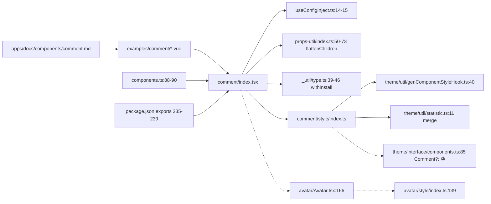
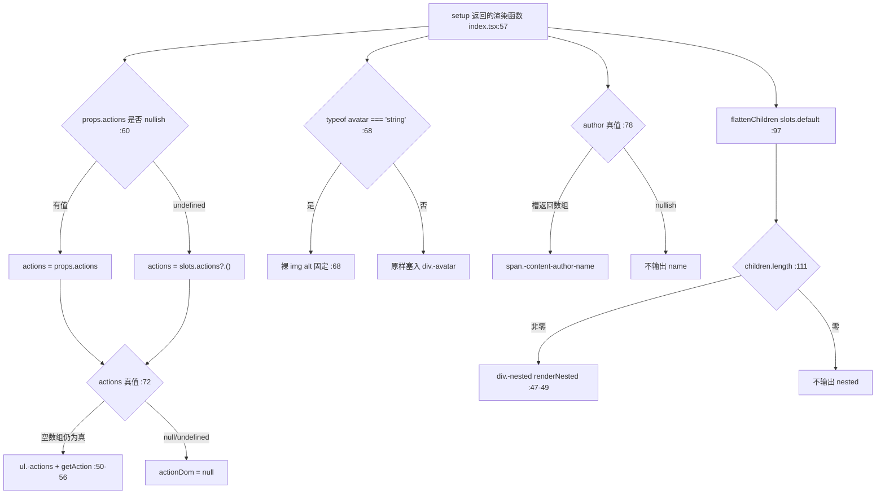
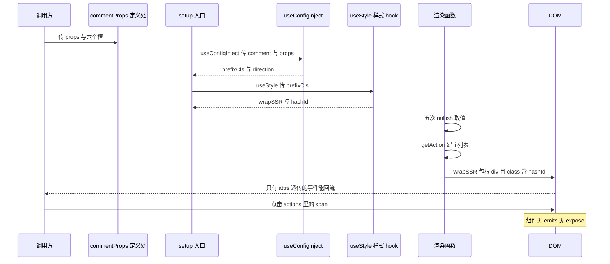

# C10-09 Comment 评论

> **本篇解决**：Comment 这个 118 行的复合件里，「头像 / 内容 / 操作区 / 嵌套列表」四条线各自接没接上——特别是它对 Avatar 的依赖为什么在代码层为零、嵌套的终止条件写在哪一行、以及它的 12 个 Design Token 为什么一个都覆盖不了。改 `comment/style/index.ts` 的任意一行会连带打破哪些跨组件规则，本篇给出行号。
> **前置**：C10-05 Avatar 头像　**读者坐标**：`03-components/10-media` 第 10 篇

## 一、职责与边界

Comment 只负责一件事：把「头像 + 作者 + 时间 + 正文 + 操作区」这五个信息位按一条 flex 布局摆出来，并把 `default` 槽里的任何东西裹进一个带缩进类名的容器。它不负责：头像本身的渲染与失败回退（`packages/xiaoye-ui/src/comment/index.tsx:66-70` 只做一次 `typeof` 分叉，不导入 Avatar）、列表化与分页（文档把这件事推给 `xy-list`，见 `apps/docs/examples/comment/list.vue:2-27`）、操作区的交互语义（`packages/xiaoye-ui/src/comment/index.tsx:28-40` 的 `defineComponent` 里没有 `emits` 键，也没有 `expose`）、嵌套层数的控制（`packages/xiaoye-ui/src/comment/index.tsx:47-49` 是一次性包装而非递归）。

被谁依赖：本仓没有任何组件导入它（判形命令 `grep -rn "from '\.\./comment'" packages/xiaoye-ui/src` 在 `comment/` 目录外零命中）；它只通过三个生成物暴露——`packages/xiaoye-ui/src/components.ts:88-90` 的聚合出口与样式副作用导入、`packages/xiaoye-ui/package.json:206-210` 的 `./comment` 与 `./comment/style` 双入口、`packages/xiaoye-ui/typings/global.d.ts:26` 的 `XYComment` 声明。名字撞车点要提前排除：本包聚合导出里 `Comment` 这个名字没有第二处来源；原 `markdown-editor` 的 vditor 类型里也有一个 `comment` prop（绑第三方 `IComment`），与本篇无关，该组件已于 2026-10-02 移除，此撞车点不复存在。

依赖谁：`useConfigInject`（`packages/xiaoye-ui/src/comment/index.tsx:42`，只取 `prefixCls` 与 `direction` 两个）、`flattenChildren`（`packages/xiaoye-ui/src/comment/index.tsx:97`，实现见 `packages/xiaoye-ui/src/_util/props-util/index.ts:50-73`）、`withInstall`（`packages/xiaoye-ui/src/comment/index.tsx:118`，定义在 `packages/xiaoye-ui/src/_util/type.ts:39-46`）、`genComponentStyleHook` 与 `mergeToken`（`packages/xiaoye-ui/src/comment/style/index.ts:2`，转发链见 `packages/xiaoye-ui/src/theme/internal.ts:19-20`）。

同类共性（媒体类组件的 token 接线与样式注册）见 `C10-00` 类横写篇，本篇不重复；Avatar 内部的三层图片回退链与 `offsetWidth` 量测见 C10-05 Avatar 头像，本篇只讨论 Comment 侧有没有把这条链用上。

## 二、源码地图

| 文件 | 行数 | 职责 | 关键导出 |
| --- | --- | --- | --- |
| `packages/xiaoye-ui/src/comment/index.tsx` | 118 | 唯一的实现文件，props 定义与组件同文件 | `commentProps`、`CommentProps`、默认导出 |
| `packages/xiaoye-ui/src/comment/style/index.ts` | 160 | CSS-in-JS 样式与 12 个组件 token | `ComponentToken`（空）、默认导出样式 hook |
| `packages/xiaoye-ui/src/comment/index.test.js` | 114 | 唯一测试文件（`.js` 后缀） | `describe('Comment')` |
| `apps/docs/components/comment.md` | — | 用法手册，六个 `:::demo` | — |
| `apps/docs/examples/comment/` | 6 个 `.vue` | `basic`/`list`/`nested`/`reply-list`/`nested-reply`/`editor` | — |

主实现入口是 `packages/xiaoye-ui/src/comment/index.tsx:57` 的返回渲染函数，props 面在 `packages/xiaoye-ui/src/comment/index.tsx:12-24`。

两处目录规范偏离要标出来，因为它们决定了改动的落点范围：

1. **没有 `commentTypes.ts`**。仓库规范（根目录 `AGENTS.md`「组件开发模板（强制）」）要求 props 独立成文件，本件把 `commentProps()` 与 `CommentProps` 都写在实现文件里（`packages/xiaoye-ui/src/comment/index.tsx:12` 与 `:26`）。后果是改 props 面必然改渲染函数，两者无法分开审。
2. **没有 `demo/` 目录**。六个示例全在 `apps/docs/examples/comment/`，与规范里的「组件目录内 `demo/`」不一致；`apps/docs/components/comment.md:9-53` 的六节 demo 直接引用这些外部路径。组件目录内因此不存在任何示例级回归资产，唯一的保护是 `packages/xiaoye-ui/src/comment/index.test.js`。

`ComponentToken` 是空接口（`packages/xiaoye-ui/src/comment/style/index.ts:4`），主题层的组件 token 表也给它登记了空对象（`packages/xiaoye-ui/src/theme/interface/components.ts:85` 的 `Comment?: {}`）——这两行合起来是第五节「对外契约」的关键证据：类型面上 Comment 就没有可调 token。

## 三、架构与数据流

### 3.1 静态结构：一条真实的 import 边与两条「只有注释」的虚线边



实线全部对应真实的 `import` 语句：`packages/xiaoye-ui/src/comment/index.tsx:4` 导入 `flattenChildren`、`:6` 导入 `withInstall`、`:7` 导入 `useConfigInject`、`:10` 导入 `useStyle`；`packages/xiaoye-ui/src/comment/style/index.ts:2` 导入 `genComponentStyleHook` 与 `mergeToken`。两条虚线是本篇要论证的重点：**`IDX -.-> AV` 在源码里并不存在**（`comment/` 目录没有任何 `Avatar` 导入），它只是 `packages/xiaoye-ui/src/comment/index.tsx:16` 的 JSDoc 措辞与 `apps/docs/components/comment.md:63` 的 API 说明；`AV -.-> AVS` 则是真实的 CSS 关系——Comment 的后代选择器会命中 Avatar 渲染出的 `img`（`packages/xiaoye-ui/src/comment/style/index.ts:54-58` 对 `packages/xiaoye-ui/src/avatar/style/index.ts:139-144`）。第三条例外值得单独记住：`packages/xiaoye-ui/src/_util/cssinjs/index.ts:12` 导出的 `legacyLogicalPropertiesTransformer` 没有任何组件默认启用，所以 `comment/style/index.ts` 里的物理属性不会被自动改写成逻辑属性。

### 3.2 渲染分支：五个信息位的取值路径与两个空判定



三条判空路径的**严格程度不一样**，这是本件最容易踩的地方：`:111` 用 `children.length`（且 `children` 已经被 `flattenChildren` 过滤过空节点，`packages/xiaoye-ui/src/_util/props-util/index.ts:63` 与 `:213-220`），而 `:72` 的 `actions` 与 `:78-79` 的 `author`/`datetime` 用的是裸真值判断。一个 `v-if` 恒假的槽返回的是**数组**（哪怕数组里只有注释占位符），数组恒为真，于是 `-actions` 与 `-name` 会被渲染成空壳；同一种情况在 `default` 槽上却不会发生。论点 2 展开。

### 3.3 一次渲染的完整闭环



`sequenceDiagram` 的最后两行是本件与「受控组件」的根本差别：Comment 不产生任何自定义事件（`packages/xiaoye-ui/src/comment/index.tsx:28-40` 的选项对象里没有 `emits`），交互完全靠调用方把 `<span @click>` 放进槽里，示例也确实是这么写的（`packages/xiaoye-ui/src/comment/index.test.js` 里没有任何事件断言，对比 `apps/docs/examples/comment/nested-reply.vue:15` 的 `@click="toggleReply(item)"`）。同时 `packages/xiaoye-ui/src/comment/index.tsx:31` 的 `inheritAttrs: false` 与 `:100` 的 `{...attrs}` 手工展开决定了外部事件监听器的落点只能是根 `div`；`attrs.class` 还在 `:106` 被显式补进 class 数组，也就是说源码里 `class` 同时经由展开与显式属性两条路进入同一个元素——JSX 编译对重复 `class` 键做的是拼接还是覆盖，属于运行层合并行为，本篇只登记这两行同时携带 `class`（`:100` 与 `:106`），不判定用户类名会不会在最终属性里出现两次。

## 四、核心机制精读

### 论点 1：Comment 对 Avatar 的「依赖」只写在 JSDoc 和文档措辞里，组件层没有任何 import；字符串形态的 `avatar` 退化成一张无回退的裸 ``，而真的传入 Avatar 时 Comment 的后代 `img` 规则又会压掉 Avatar 自己的尺寸规则

`packages/xiaoye-ui/src/comment/index.tsx:12-24` 是本件唯一的 props 定义，其中 `avatar` 的注释就写着「通常是 Avatar」：

```tsx
// packages/xiaoye-ui/src/comment/index.tsx:12
export const commentProps = () => ({
  actions: Array,
  /** The element to display as the comment author. */
  author: PropTypes.any,
  /** The element to display as the comment avatar - generally an xiaoye-ui Avatar */
  avatar: PropTypes.any,
  /** The main content of the comment */
  content: PropTypes.any,
  /** Comment prefix defaults to '.xy-comment' */
  prefixCls: String,
  /** A datetime element containing the time to be displayed */
  datetime: PropTypes.any,
});
```

但整个 `comment/` 目录里与头像有关的命中只有八行生产代码——`index.tsx` 的 `:16`（JSDoc）、`:17`（prop 名）、`:36`（槽名）、`:62`（取值）、`:66-68`（渲染）加上 `style/index.ts:48`（类名），**没有一行是 import**；测试文件另有两处（`packages/xiaoye-ui/src/comment/index.test.js:35` 与 `:61`）走的都是字符串 URL 形态（判形命令：`grep -rn -e avatar -e Avatar packages/xiaoye-ui/src/comment/`）。渲染侧对 `avatar` 只做了一次「是不是字符串」的分叉：

```tsx
// packages/xiaoye-ui/src/comment/index.tsx:62
      const avatar = props.avatar ?? slots.avatar?.();
      // ...
      const avatarDom = (
        <div class={`${pre}-avatar`}>
          {typeof avatar === 'string' ?  : avatar}
        </div>
      );
```

两个方向都是断的。

**方向一：传字符串（官方 list 示例正是这一形态）。** `packages/xiaoye-ui/src/comment/index.tsx:68` 生成的是裸 ``，它绕开了 Avatar 的全部机制：Avatar 的图片失败回退链与 `nextTick` 复位（见 `packages/xiaoye-ui/src/avatar/Avatar.tsx:164-174` 的 `onError={handleImgLoadError}`）在这里没有对应物，404 的 URL 会直接留一个破图标；`alt` 被硬编码为 `"comment-avatar"`（同 `index.tsx:68`），调用方用 prop 形态时**没有任何出口**改它——`commentProps()` 里没有 `alt` 这个键（`packages/xiaoye-ui/src/comment/index.tsx:12-24`）。文档侧 `apps/docs/examples/comment/list.vue:10` 写的正是 `:avatar="item.avatar"`，即整个「配合 List 组件」示例走的是这条无回退分支。

**方向二：真的传 Avatar（`apps/docs/examples/comment/basic.vue:33-35` 与 `nested-reply.vue:8-10` 用 `#avatar` 槽）。** Avatar 渲染出的 `` 是 `.xy-avatar` 的直接子元素（`packages/xiaoye-ui/src/avatar/Avatar.tsx:166`），Avatar 自己按 `.xy-avatar > img` 给它 `width:100%; height:100%`，让图片跟随外层容器尺寸（`packages/xiaoye-ui/src/avatar/style/index.ts:139-144`）：

```ts
// packages/xiaoye-ui/src/avatar/style/index.ts:139
      '> img': {
        display: 'block',
        width: '100%',
        height: '100%',
        objectFit: 'cover',
      },
```

而 Comment 侧写的是**后代**选择器且不带 `>`：

```ts
// packages/xiaoye-ui/src/comment/style/index.ts:48
      [`${componentCls}-avatar`]: {
        position: 'relative',
        flexShrink: 0,
        marginRight: token.marginSM,
        cursor: 'pointer',

        [`img`]: {
          width: '32px',
          height: '32px',
          borderRadius: '50%',
        },
      },
```

展开后 Comment 的选择器是 `.xy-comment .xy-comment-avatar img`（两个 class 加一个类型），Avatar 的是 `.xy-avatar > img`（一个 class 加一个类型）。hashId 不改变这个对比：`packages/xiaoye-ui/src/_util/cssinjs/hooks/useStyleRegister/index.tsx:85` 在 `hashPriority === 'low'` 时把 hash 类名包进 `:where()`，而本仓默认就是 `low`（`packages/xiaoye-ui/src/_util/cssinjs/StyleContext.tsx:115`），`:where()` 特异性为零。于是 Comment 恒胜，`<xy-avatar :size="48">` 放进 Comment 后是「外层 span 由 `Avatar.tsx:152-159` 的 inline `sizeStyle` 撑到 48px，内部图片被强制成 32px」的错位的图，`object-fit: cover`（`avatar/style/index.ts:143`）因为不是同名声明而继续生效，于是图片贴在内圈左上角而非居中裁切。32px 这个数字还绕开了整套 Token——它是 `style/index.ts:54-58` 里唯三的字面量尺寸之一，与 Avatar 的 `containerSize`（默认值由 token 派生）没有任何同步关系。

顺带一个语义问题：`style/index.ts:52` 给 `.xy-comment-avatar` 设了 `cursor: pointer`，但 `index.tsx:66-70` 生成的容器是裸 `div`，组件没有 `emits`（`index.tsx:28-40` 的 `defineComponent` 里根本没有 `emits` 键），也没有 `tabindex`/`role`。「看起来可点」完全由 CSS 施加，点击语义只能靠调用方自己往槽里塞可交互元素——而 `basic.vue` 与 `list.vue` 都没塞。

**结论回扣**：派工单问的「`avatar` 依赖是否真的接上」，答案是**没有接上，而且两个方向都断**：prop 形态因为组件不导入 Avatar 而退化成一个功能更弱的影子实现；槽形态虽然能放进真的 Avatar，却被本件的 CSS 反向干预。

### 论点 2：只有 `default` 槽经过了 `flattenChildren` 归一化，其余四个槽用裸真值判断 ⇒ 「槽存在但内容为空」会渲染出空壳节点；嵌套的终止条件不是层数而是 `children.length`，组件里根本没有递归函数

五个信息位的取值集中在四行里，全部用 `??`：

```tsx
// packages/xiaoye-ui/src/comment/index.tsx:60
      const actions: any[] = props.actions ?? slots.actions?.();
      const author = props.author ?? slots.author?.();
      const avatar = props.avatar ?? slots.avatar?.();
      const content = props.content ?? slots.content?.();
      const datetime = props.datetime ?? slots.datetime?.();
```

而子级列表这一路单独做了一次归一化：

```tsx
// packages/xiaoye-ui/src/comment/index.tsx:97
      const children = flattenChildren(slots.default?.());
      return wrapSSR(
        <div
          {...attrs}
          class={[
// ...
          ]}
        >
          {comment}
          {children && children.length ? renderNested(pre, children) : null}
        </div>,
      );
```

`flattenChildren` 的第三个分支会丢掉注释占位符、空 Fragment 与纯空白文本（`packages/xiaoye-ui/src/_util/props-util/index.ts:62-67` 配合 `packages/xiaoye-ui/src/_util/props-util/index.ts:213-220` 的 `isEmptyElement`），所以 `<xy-comment>` 里写 `v-for` 且数组为空、或者所有子节点都被 `v-if` 关掉时，`:111` 的 `children.length` 为 0，**`-nested` 这一层 div 根本不生成**。派工单问的「递归路径有没有终止条件保护」，在源码里的答案是：**本件没有递归函数**（`renderNested` 只被调用一次，`packages/xiaoye-ui/src/comment/index.tsx:47` 定义、`:111` 唯一调用点，`grep -rn "renderNested" packages/xiaoye-ui/src/comment/` 只有这两行命中），递归完全外推给调用方——`apps/docs/examples/comment/nested.vue:18` 与 `:34` 是手写第三层，`apps/docs/examples/comment/nested-reply.vue:22` 的注释干脆写着「最多 2 层」。库侧因此既没有栈溢出风险，也**没有任何深度上限、折叠控制或缩进收敛**：深度是一个纯粹由调用方数据决定的开放值。

代价在这条唯一的终止判据上：`flattenChildren` 只保护了 `default`，另外四个槽没有。Vue 3 的槽函数恒返回数组，因此

- `props.author ?? slots.author?.()` 在只写 `<template #author v-if="false">` 时拿到的是 `[注释占位符]`，非 nullish ⇒ `:61` 右侧不生效；
- `:78` 的 `{author && <span class={`${pre}-content-author-name`}>{author}</span>}` 判的是数组真值 ⇒ **一个空的 `-name` span 仍被渲染**。

空 span 不是无害的：`packages/xiaoye-ui/src/comment/style/index.ts:75-79` 给 `.xy-comment-content-author > span` 设了 `padding-right: token.paddingXS` 与 `font-size`，`:81-93` 又给 `-name` 设了颜色与 `transition: color`，于是「没有作者的评论」会在作者行留出一个约 8px 的空白带过渡属性的占位。同理 `:72` 的 `actions ? ... : null`：`<template #actions v-if="false">` 会让 `actions` 成为非空数组，`:73` 建出 `<ul class="-actions">`，`getAction`（`:50-56`）把占位符逐个裹进 `<li>`，最终渲染一个**只有空 li 的 ul**——`packages/xiaoye-ui/src/comment/style/index.ts:109` 的 `marginTop: commentActionsMarginTop` 因此凭空在正文下方加了一段 `marginSM` 的间距。判据用错的地方，恰好都是「有值就渲染」的那四处；用对的地方，恰好是唯一做了归一化的那一处。这一对照值得写成审查点：**凡 `slot ?? prop` 之后紧跟真值判断的组件，都必须确认槽函数是否归一化过。**

还有一处纯命名隐患：`renderNested` 的形参名是 `prefixCls`（`packages/xiaoye-ui/src/comment/index.tsx:47`），而它所在的作用域里已经有一个同名的 `ComputedRef`（`:42` 从 `useConfigInject` 解构而来）。当前调用点传的是字符串 `pre`（`:111`，`pre` 在 `:58` 由 `prefixCls.value` 取出），插值正确；但同名遮蔽意味着「把 `renderNested(prefixCls, ...)` 当作等价改写」的改动不会被 TypeScript 拦住——参数类型标的是 `string`，而 ref 在模板字符串里的隐式 `toString` 可能让误传在运行时也「看起来对」（这一条依赖 Vue 运行时实现，本篇不引 `node_modules` 故不作判定，仅登记为命名风险）。改成 `(cls: string, children: VueNode)` 或不引入局部函数即可消歧。

### 论点 3：操作区的两条入口只有一条能吃到样式——`getAction` 只生成 `<li>`，而全部交互样式挂在 `> li > span` 上，于是 `actions` 的 prop 数组形态拿不到 hover、cursor 与小字号，`commentActionHoverColor` 在这个形态下是死 token

组件侧的生成逻辑最短：

```tsx
// packages/xiaoye-ui/src/comment/index.tsx:50
    const getAction = (actions: VueNode[]) => {
      if (!actions || !actions.length) {
        return null;
      }
      const actionList = actions.map((action, index) => <li key={`action-${index}`}>{action}</li>);
      return actionList;
    };
```

```tsx
// packages/xiaoye-ui/src/comment/index.tsx:72
      const actionDom = actions ? (
        <ul class={`${pre}-actions`}>{getAction(Array.isArray(actions) ? actions : [actions])}</ul>
      ) : null;
```

组件自己**从不产出 `<span>`**。而样式里所有关于「可点」的声明都在 `span` 这一层：

```ts
// packages/xiaoye-ui/src/comment/style/index.ts:113
        [`> li`]: {
          display: 'inline-block',
          color: commentActionColor,

          [`> span`]: {
            marginRight: '10px',
            color: commentActionColor,
            fontSize: commentFontSizeSm,
            cursor: 'pointer',
            transition: `color ${token.motionDurationSlow}`,
            userSelect: 'none',

            [`&:hover`]: {
              color: commentActionHoverColor,
            },
          },
        },
```

两条入口的差别因此是可见的：

- **槽形态**（`packages/xiaoye-ui/src/comment/index.tsx:34` 声明的 `actions` 槽）：调用方必须自己写 `<span>`。`apps/docs/examples/comment/basic.vue:4`、`:17`、`:30` 三个操作项都是 `<span key=...>`，`apps/docs/examples/comment/list.vue:12` 甚至专门把数据里的字符串数组 `v-for` 成 `<span>` 再放进槽——**这份示例的存在本身就是这条缺口的证据**：数据是数组（`apps/docs/examples/comment/list.vue:36` 的 `actions: ['Reply to']`），却宁可在模板里绕一圈也不用 `actions` prop。
- **prop 形态**（`packages/xiaoye-ui/src/comment/index.tsx:13` 的 `actions: Array`，`apps/docs/components/comment.md:61` 的 API 表把类型写成「Array 或 slot」两种都行）：传 `['回复', '删除']` 时 DOM 是 `ul > li{文本}`，`:117-128` 整块一条都命中不了——没有 `cursor: pointer`、没有 `font-size: commentFontSizeSm`、没有 `margin-right` 间距、`color` 只有 `:115` 那条，`:125-127` 的 hover 更不可能触发。**`commentActionHoverColor`（`packages/xiaoye-ui/src/comment/style/index.ts:153` 从 `colorTextSecondary` 派生）在此形态下是从不被使用的 token**。

这与共则 §3 记录的「生成了却从不渲染的类名」是同一族的缺陷，只是变体：类名 `-actions` 渲染了，选择器的**后代层级**却要求一个组件从不生成的元素。修法要么在 `getAction` 里把每项裹一层 `<span>`（会破坏已有槽形态的双层 span），要么把 `:117-128` 的声明并入 `:113` 的 `> li`（`user-select`、`cursor`、`margin-right` 对 li 同样有效，且槽形态的 `<span>` 仍在 li 内，视觉不变），后者是兼容改动。

另外两处小问题挂在同一段代码上。其一，`:73` 的 `Array.isArray(actions) ? actions : [actions]` 兜底分支：槽形态下 `slots.actions?.()` 恒返回数组（Vue 3 槽函数约定），prop 形态下要走这条分支必须先违反 `:13` 的 `actions: Array` 声明并吃一条 Vue 运行时类型告警——它保护的是一个类型面不允许到达的输入。其二，`:54` 的 `key={`action-${index}`}` 用索引作 key，而调用方给槽内容写的 key（`apps/docs/examples/comment/basic.vue:4` 的 `key="comment-basic-like"`）会被这层 `<li>` 包裹架空；当前 `basic.vue` 的点赞/点踩是对同一数组就地改状态、不换顺序，索引 key 不出问题，但一旦调用方按条件插删操作项，索引 key 与内层真实 key 的双轨就会让 diff 落在错误节点上。

### 论点 4：Comment 的 12 个组件 token 全部在样式生成函数内部用 `mergeToken` 硬写，既没走 `genComponentStyleHook` 的第三个参数 `getDefaultToken`，也没读回调的第二个入参 `info.overrideComponentToken` ⇒ 主题层覆盖不进任何一个

先看本件怎么写 token：

```ts
// packages/xiaoye-ui/src/comment/style/index.ts:143
export default genComponentStyleHook('Comment', token => {
  const commentToken = mergeToken<CommentToken>(token, {
    commentBg: 'inherit',
    commentPaddingBase: `${token.paddingMD}px 0`,
    commentNestIndent: `44px`,
    commentFontSizeBase: token.fontSize,
    commentFontSizeSm: token.fontSizeSM,
    commentAuthorNameColor: token.colorTextTertiary,
    commentAuthorTimeColor: token.colorTextPlaceholder,
    commentActionColor: token.colorTextTertiary,
    commentActionHoverColor: token.colorTextSecondary,
    commentActionsMarginBottom: 'inherit',
    commentActionsMarginTop: token.marginSM,
    commentContentDetailPMarginBottom: 'inherit',
  });

  return [genBaseStyle(commentToken)];
});
```

`genComponentStyleHook` 的签名预留了一个「可被覆盖的组件默认 token」入口：

```ts
// packages/xiaoye-ui/src/theme/util/genComponentStyleHook.ts:40
export default function genComponentStyleHook<ComponentName extends OverrideComponent>(
  component: ComponentName,
  styleFn: (token: FullToken<ComponentName>, info: StyleInfo<ComponentName>) => CSSInterpolation,
  getDefaultToken?:
    | OverrideTokenWithoutDerivative[ComponentName]
    | ((token: GlobalToken) => OverrideTokenWithoutDerivative[ComponentName]),
) {
```

用户侧的覆盖值走的是另一条路，它确实会进到传进来的 token 里：

```ts
// packages/xiaoye-ui/src/theme/util/genComponentStyleHook.ts:81
        const defaultComponentToken =
          typeof getDefaultToken === 'function'
            ? (getDefaultToken as any)(proxyToken)
            : getDefaultToken;
        const mergedComponentToken = { ...defaultComponentToken, ...token.value[component] };

        const componentCls = `.${prefixCls.value}`;
        const mergedToken = mergeToken<
          TokenWithCommonCls<GlobalTokenWithComponent<OverrideComponent>>
        >(
          proxyToken,
          {
// ...
          },
          mergedComponentToken,
        );
```

`token.value[component]`（`:85`）就是 `ConfigProvider` 的 `theme.components.Comment`，它被合进 `mergedToken`（`:98`）再交给 `styleFn`（`:100`）。但本件的 `styleFn` 收到 token 后**立刻用第二个入参位置更高的对象把它盖掉**，而 `merge` 的实现就是后写覆盖：

```ts
// packages/xiaoye-ui/src/theme/util/statistic.ts:11
export function merge<T extends object>(...objs: Partial<T>[]): T {
  /* istanbul ignore next */
  if (!enableStatistic) {
    return Object.assign({}, ...objs);
  }
```

`packages/xiaoye-ui/src/comment/style/index.ts:144` 把 12 个键全部列在第二个对象里，于是 `Object.assign` 之后用户值必然消失——**包括那 8 个看起来是「派生」的键**。派生写法（`commentAuthorNameColor: token.colorTextTertiary`）只保证「改 `colorTextTertiary` 会跟着变」，不保证「改 `components.Comment.commentAuthorNameColor` 能生效」。而回调的第二个入参 `info.overrideComponentToken`（`packages/xiaoye-ui/src/theme/util/genComponentStyleHook.ts:105` 明确把 `token.value[component]` 传出来了）在本件的箭头函数里根本不存在——`packages/xiaoye-ui/src/comment/style/index.ts:143` 的形参只有一个 `token`。

这条缺口有两行类型面证据把它坐实：`packages/xiaoye-ui/src/comment/style/index.ts:4` 的 `export interface ComponentToken {}` 是空接口，`packages/xiaoye-ui/src/theme/interface/components.ts:85` 给 Comment 登记的也是 `Comment?: {}`。也就是说，即使把 `mergeToken` 的写法改对，类型层也不允许用户填任何 Comment 键——**三层（类型表 / `getDefaultToken` / `info`）同时缺位，Comment 是一个「主题只读」组件**。

对照要看得更细一层，否则会得出过宽的结论。`getDefaultToken` 这个形参**不是没人用**：`packages/xiaoye-ui/src/divider/style/index.ts:154`、`packages/xiaoye-ui/src/result/style/index.tsx:127`、`packages/xiaoye-ui/src/block-ui/style/index.ts:116` 都是三参调用，第三个实参是对象字面量（divider 传的是 `{ sizePaddingEdgeHorizontal: 0 }`，`packages/xiaoye-ui/src/divider/style/index.ts:164-166`）。关键差别在于**键是否重叠**：divider 的 `styleFn` 内部二次 `mergeToken` 只列了三个 `divider*` 键（`packages/xiaoye-ui/src/divider/style/index.ts:157-161`），与 `getDefaultToken` 里的 `sizePaddingEdgeHorizontal` 不相交，于是那一个键真的可以被 `theme.components.Divider` 覆盖。Comment 的情况相反——`packages/xiaoye-ui/src/comment/style/index.ts:144-157` 把全部 12 个键都列进了第二次的对象里，与任何可能的覆盖值都相交，所以覆盖率为 0。

这里登记的口径冲突**成立，且已由协调者复核确认（2026-09-29）**：A03 论点 4 写的是「`getDefaultToken` 在整个 `src` 中没有任何调用方」，依据是 `grep -rn getDefaultToken packages/xiaoye-ui/src` 只命中 `genComponentStyleHook.ts` 自身。那个 grep 结果没错，但**它结构上无法支撑这个结论**——第三个参数是位置实参，调用点永远不会写出形参名，所以按名字搜必然只命中定义处。反证就是本节上面列的三处，其中 `packages/xiaoye-ui/src/divider/style/index.ts:153`-`:167` 的调用肉眼可读：第一个实参是 `'Divider'`，第二个是 `styleFn`，第三个是 `:164-166` 的对象字面量 `{ sizePaddingEdgeHorizontal: 0 }`。A03 已按此更正。**正确的判据**是数实参个数而不是搜标识符，可复现命令：`grep -rn -A 40 "genComponentStyleHook(" packages/xiaoye-ui/src --include='*/style/index.*'` 后看哪些调用在 `styleFn` 之后还有独立的一段对象/函数。本篇上面「Comment 没走 `getDefaultToken`」这句仍然成立（它的调用只有两个实参），只是原来的证据形态换成了这一条。A03 论点 4 关于「兜底责任在每个组件的 `styleFn` 里而不在框架里」的机制描述本篇照用，不再重述。

### 论点 5：本件不引 `resetComponent`，改用三个 `'inherit'` 现场抹 UA 默认值——但只抹了一半，`<p>` 的上外边距与 `list-style` 都不在其覆盖范围内

同层的 Avatar 用的是标准做法：`packages/xiaoye-ui/src/avatar/style/index.ts:4` 导入 `resetComponent`，`:110` 在根选择器里展开它。Comment 的 import 只有两行（`packages/xiaoye-ui/src/comment/style/index.ts:1-2`），既没有 `resetComponent` 也没有 `genFocusStyle`。而 `resetComponent` 提供的正是 Comment 需要的那几项：

```ts
// packages/xiaoye-ui/src/style/index.ts:15
export const resetComponent = (token: DerivativeToken): CSSObject => ({
  boxSizing: 'border-box',
  margin: 0,
  padding: 0,
  color: token.colorText,
  fontSize: token.fontSize,
  // font-variant: @font-variant-base;
  lineHeight: token.lineHeight,
  listStyle: 'none',
  // font-feature-settings: @font-feature-settings-base;
  fontFamily: token.fontFamily,
});
```

缺失的 reset 由 `mergeToken` 里的三个字符串 `'inherit'` 顶替（`packages/xiaoye-ui/src/comment/style/index.ts:145`、`:154`、`:156`），它们分别落在：

```ts
// packages/xiaoye-ui/src/comment/style/index.ts:102
        [`&-detail p`]: {
          marginBottom: commentContentDetailPMarginBottom,
          whiteSpace: 'pre-wrap',
        },
      },

      [`${componentCls}-actions`]: {
        marginTop: commentActionsMarginTop,
        marginBottom: commentActionsMarginBottom,
        paddingLeft: 0,
```

`margin-bottom: inherit` 在这里的作用不是「继承父级边距」这种语义设计，而是**把 UA 样式表的 `p { margin-block: 1em }` 与 `ul { margin-block-end: 1em }` 中和成 0**（继承链上最近的显式值是 0）。问题是它只中和了 `margin-bottom`：`:102-105` 从未声明 `margin-top`，而 `-content-detail`（`packages/xiaoye-ui/src/comment/index.tsx:86`）与 `-content`（`:83`）都没有 padding 与 border，按 CSS 的盒模型规则段落上边距会向 `-content-detail` 上沿合并、并停在作为 flex item 的 `-content` 内部（这一段是规范推理，本篇没有做浏览器像素实测，可在浏览器里用一行 `<p>` 直接复现）。所有把 `<p>` 写进 `content` 槽的示例都会撞上这一截空隙（`apps/docs/examples/comment/basic.vue:37-41`、`apps/docs/examples/comment/list.vue:15-18`、`nested-reply.vue:12`）。

第二条：`:108-111` 给 `-actions` 只设了 `paddingLeft: 0`，没有 `list-style: none`。当前不出现项目符号纯粹是因为 `> li` 是 `display: inline-block`（`:114`）——只有 `list-item` 才画 marker。一旦有人为了改成竖排操作列表把 `display` 改成 `block`/`flex`，符号就会回来，而这条因果在样式文件里没有任何注释保护。同时 `paddingLeft: 0` 本身是物理属性，与论点 6 同族。

第三条被顺手带上了：`:104` 的 `whiteSpace: 'pre-wrap'` 是加在 `p` 上而不是 `-content-detail` 上，所以只有槽里恰好放 `<p>` 时正文才享受保留换行；放 `<div>` 或直接放文本（`packages/xiaoye-ui/src/comment/index.test.js:74` 走的是 `div > Form.Item` 这条，没有 p）时 `pre-wrap` 完全不生效。反过来，示例里的 `<p>{{ item.content }}</p>` 写法（`apps/docs/examples/comment/list.vue:15-17`）把插值单独放一行：若模板编译按默认策略把这段空白收成单个空格（该收敛规则属于 Vue 编译器行为，本篇不引 `node_modules` 故不作判定），`pre-wrap` 就会把这个空格如实保留，正文首尾各多一个空格——这是「保留换行」策略作用在手工排版模板上的副作用，属于配置该行为时应当一起考虑的取舍。

### 论点 6：`direction` 接的是正确的兜底顺序（本仓 `rate` 反例的正面对照），但 `-rtl` 只有一行 `direction: rtl`，而本件的间距全是物理属性；`44px` 缩进还是「32 硬编码 + marginSM」的手工副本，compact 主题下直接错位

先写清楚它**没有**犯共则 §3 里那条 `direction: 'ltr'` 默认值的错：`packages/xiaoye-ui/src/comment/index.tsx:12-24` 没有声明 `direction` prop，`packages/xiaoye-ui/src/comment/index.tsx:42` 解构出了 `direction`，`:104` 用它挂 `-rtl` 类，`packages/xiaoye-ui/src/config-provider/hooks/useConfigInject.ts:15` 的 `props.direction ?? configProvider.direction?.value` 因此恒走右支。全局 RTL 对 Comment 是有效的；对照活例 `packages/xiaoye-ui/src/rate/index.tsx:54`（Rate 在 `initDefaultProps` 里给了 `direction: 'ltr'`，于是同一个 `??` 的右支永远不生效），两件的差别就是这一行默认值。

但「有效」只到 `direction: rtl` 这一行：

```ts
// packages/xiaoye-ui/src/comment/style/index.ts:132
      [`${componentCls}-nested`]: {
        marginLeft: commentNestIndent,
      },

      '&-rtl': {
        direction: 'rtl',
      },
```

`direction: rtl` 会翻转文本方向与 flex 主轴，却**不会**改写物理边距。本件四处间距全是物理写法：头像与正文之间 `marginRight: token.marginSM`（`packages/xiaoye-ui/src/comment/style/index.ts:51`）、作者行 `paddingRight: token.paddingXS`（`:76`）、操作项 `marginRight: '10px'`（`:118`）、嵌套缩进 `marginLeft`（`:133`）。`-inner` 是 `display: flex`（`:44`），RTL 下头像被翻到右侧，但它右侧的那段 `marginSM`（默认主题 12px）现在落在「头像与容器边缘」之间，头像与正文之间反而没有间隙；`-nested` 的 44px 缩进则整块跑到阅读顺序的**尾侧**，即子级评论相对父级向右而不是向左退。仓库里存在成熟替代写法（全仓 47 个文件出现 `marginInlineStart`，例如 `packages/xiaoye-ui/src/breadcrumb/style/index.ts:73` 与 `packages/xiaoye-ui/src/divider/style/index.ts:131`），而 `packages/xiaoye-ui/src/_util/cssinjs/index.ts:12` 导出的 `legacyLogicalPropertiesTransformer` 是逻辑属性→物理属性的向下兼容变换、且没有任何组件默认挂载，帮不上这条链。

`44px` 这个字面量（`packages/xiaoye-ui/src/comment/style/index.ts:147`）另有一层脆弱性：它等于「硬编码的头像 32px（`:55-56`）+ `marginSM`」。`marginSM` 的真实来源是 `packages/xiaoye-ui/src/theme/util/alias.ts:120` 的 `marginSM: mergedToken.sizeSM`，默认主题下 `sizeSM = sizeUnit * (sizeStep - 1)` = 12（`packages/xiaoye-ui/src/theme/themes/shared/genSizeMapToken.ts:13`，`sizeStep: 4` 见 `packages/xiaoye-ui/src/theme/themes/seed.ts:60`），所以 44 在默认主题下恰好对齐；但 compact 主题把 `sizeSM` 重算成 `sizeUnit * (sizeStep - 2)` = 8（`packages/xiaoye-ui/src/theme/themes/compact/genCompactSizeMapToken.ts:6` 与 `:15`），头像栏宽度随之变成 40px，而 `-nested` 仍然是 44px ⇒ **子级评论比父级正文多缩 4px**。这是一处「同一个数在两个地方各写一遍」的派生副本：一份是 token 表达式，一份是它的求值结果被抄成字面量。

## 五、对外契约如何生效

**`prefixCls` 的双向作用。** `packages/xiaoye-ui/src/comment/index.tsx:21` 声明的 `prefixCls` 是本件唯一的「非内容型」prop，它同时决定两件事：类名前缀与样式表身份。路径是 `packages/xiaoye-ui/src/comment/index.tsx:42` → `packages/xiaoye-ui/src/config-provider/hooks/useConfigInject.ts:14` 的 `configProvider.getPrefixCls(name, props.prefixCls)` → `packages/xiaoye-ui/src/comment/index.tsx:58` 的 `pre` → 十一处类名拼接（`:48`、`:67`、`:73`、`:77`、`:78`、`:79`、`:84`、`:86`、`:92` 与根类 `:102`、`:104`）。另一半是 `packages/xiaoye-ui/src/comment/index.tsx:45` 把同一个 `prefixCls` 交给 `useStyle`，而样式缓存键是 `packages/xiaoye-ui/src/theme/util/genComponentStyleHook.ts:74` 的 `path: [component, prefixCls.value, iconPrefixCls.value]`。这里本件是**正确写法**：传的是自己的 `prefixCls`，不是任何子级/组级前缀，所以一个前缀只对应一张样式表。共则 §3 记录的「Group 把 `groupPrefixCls` 喂给样式 hook ⇒ 同份样式注册成两张表」这条反例，在 Comment 上没有对应物——本件根本没有 Group 或子件目录（`packages/xiaoye-ui/src/comment/` 只有 `index.tsx`、`style/`、`index.test.js` 三项）。改动者若日后补 `CommentGroup`，`:45` 这一行就是必须盯住的点。

**`direction` 只有一条入口。** 见论点 6：全局 `ConfigProvider` 的 `direction` 生效（`packages/xiaoye-ui/src/config-provider/hooks/useConfigInject.ts:15` 的 `??` 右支），但**单实例覆盖不可能**——`packages/xiaoye-ui/src/comment/index.tsx:12-24` 没有 `direction` 这个键，所以 `<xy-comment direction="rtl">` 不会进入 `props.direction`，它经 `packages/xiaoye-ui/src/comment/index.tsx:31` 的 `inheritAttrs: false` 与 `:100` 的 `{...attrs}` 落到根 `div` 上成为一个无 CSS 效果的原生属性。想让一条评论单独翻转方向，只能自己在外层套一个 `ConfigProvider`。

**六个槽，但文档提到第七个。** `packages/xiaoye-ui/src/comment/index.tsx:33-40` 用 `CustomSlotsType` 声明了 `actions/author/avatar/content/datetime/default` 六个槽，渲染侧逐一对应 `:60-64` 与 `:97`。而 `apps/docs/components/comment.md:51` 的 demo 说明写的是「使用 editor slot 自定义评论输入」——**`editor` 既不在槽声明里，也不在任何取值语句里**（`grep -n -e editor -e Editor packages/xiaoye-ui/src/comment/index.tsx` 零命中）。`packages/xiaoye-ui/src/comment/index.tsx:111` 只渲染 `default` 的扁平结果，所以一个写成 `<template #editor>` 的调用方会拿到「什么都不会出现」的结果，而且没有任何告警。文档对应的示例本身绕开了它：`apps/docs/examples/comment/editor.vue:8` 用的是 `#content` 槽，`:77` 的提交后列表也只用 `:author`/`:datetime`。这条属于「API 面在文档里存活、实现里死亡」，修法只有两种：文档改口径（本篇不改他人文件），或组件真的加一个 `editor` 槽。

**事件与实例方法：契约面为空。** `packages/xiaoye-ui/src/comment/index.tsx:28-40` 既无 `emits` 也无 `expose`，`:41` 的 setup 形参只有 `{ slots, attrs }`——连 `emit` 都没解构。因此所有交互必须来自调用方塞进槽的元素，或来自根节点上 attrs 透传的原生监听器。示例与测试都符合这一形状：`apps/docs/examples/comment/nested-reply.vue:15` 的 `@click` 挂在自己的 `<span>` 上，`packages/xiaoye-ui/src/comment/index.test.js:107` 直接 `trigger('click')` 到 `.xy-btn`。

**取值语句本身是仓库 helper 的手工副本。** `packages/xiaoye-ui/src/comment/index.tsx:60-64` 的五行 `??` 与 `packages/xiaoye-ui/src/_util/props-util/index.ts:260-262` 的 `getPropsSlot` 完全同形：

```ts
// packages/xiaoye-ui/src/_util/props-util/index.ts:260
function getPropsSlot(slots: any, props: any, prop = 'default') {
  return props[prop] ?? slots[prop]?.();
}
```

该 helper 在本仓有 14 个文件使用（`grep -rl "getPropsSlot" packages/xiaoye-ui/src | wc -l`），Avatar 自己就在用（`packages/xiaoye-ui/src/avatar/Avatar.tsx:139`）。换用 helper 只是消重，**不改变语义**——它同样不做归一化，所以论点 2 的空槽问题不会因此修好；这反过来说明缺陷的根源在「判真值」而不在「取值」。

**装配面。** 默认导出被 `withInstall` 包了一层（`packages/xiaoye-ui/src/comment/index.tsx:118`），`packages/xiaoye-ui/src/_util/type.ts:39-46` 给它挂 `install` 并交给 `registerComponent` 做 `XYComment` → `xy-comment` 的标签映射；样式必须单独引，`packages/xiaoye-ui/src/components.ts:90` 的 `import './comment/style'` 与 `packages/xiaoye-ui/package.json:210` 的 `./comment/style` 是两条不同链路（前者管包根聚合，后者管按需）。

## 六、设计取舍

**取舍一：props 与 slot 双入口，用 `??` 单向让位，而不是先归一化再判空。** 换来的是调用方可以任意选择写 `:content="text"` 还是 `#content`（两种写法都有真实用户：`packages/xiaoye-ui/src/comment/index.test.js:62` 用 prop，`apps/docs/examples/comment/basic.vue:36` 用槽），赔上的是「空槽被当成有值」这一整类空壳节点（论点 2）。仓库里已经有归一化工具 `isEmptyElement`（`packages/xiaoye-ui/src/_util/props-util/index.ts:213-220`）和 `filterEmpty`，本件只在 `default` 一路用了它（`:97`），因此这不是「没有能力」而是「只补了一处」。

**取舍二：不引 `resetComponent`，靠框架的 `genCommonStyle` 兜住大半。** `packages/xiaoye-ui/src/theme/util/genComponentStyleHook.ts:108` 在每次组件样式注册时顺带注册一份 `genCommonStyle(token.value, prefixCls.value)`，后者用属性选择器 `[class^="xy-..."]`, `[class*=" xy-..."]`（`packages/xiaoye-ui/src/style/index.ts:108`）给出 `fontFamily`、`fontSize`、`boxSizing: border-box`（`:112-114`）。这三项正是 `resetComponent`（`packages/xiaoye-ui/src/style/index.ts:15-26`）的主要内容，所以不引它看起来损失很小。但 `resetComponent` 还含 `margin: 0`、`padding: 0`、`listStyle: 'none'`、`lineHeight`——`genCommonStyle` 一条都没有。Comment 承载的是任意用户内容，缺的恰恰是这三条，于是 `style/index.ts:145`、`:154`、`:156` 用 `'inherit'` 逐条手工补，补得不全（论点 5）。同目录的 Avatar 走的是完全相反的选择：`packages/xiaoye-ui/src/avatar/style/index.ts:4` 导入、`:110` 展开。两者都在同一个框架里，说明这属于「各组件自行决定」的空白区，而不是有约定被违反。

**取舍三：嵌套不做递归组件，而把层级外推给调用方。** 好处是零运行时成本、零栈风险、`-nested` 只在真的有子级时才生成（`packages/xiaoye-ui/src/comment/index.tsx:111`），并且列表化可以完全交给 `list` 组件（`apps/docs/examples/comment/list.vue:2-27`），Comment 不必维护第二套 DOM 契约；代价是深度不受控也没有折叠/虚拟化的挂载点——`apps/docs/examples/comment/nested.vue:18` 与 `:34` 用手工嵌套三层来演示，`apps/docs/examples/comment/nested-reply.vue:22` 直接把「最多 2 层」写进注释，并且该示例的缩进用的是自己 scoped 的 `div`（`:23`）而不是组件提供的 `-nested`。换句话说：**库提供的嵌套能力，官方示例有一半没用上**。

**取舍四：`avatar` 不 import Avatar，保持零依赖。** 这显然是刻意的——`comment/` 没有任何组件依赖，聚合入口因此不会把 Avatar 的样式副作用带进来（`packages/xiaoye-ui/src/components.ts:88-90` 只导入 `./comment/style`），tree-shaking 面干净。代价是 `avatar` prop 退化成影子实现（论点 1），而且影子分支自己写死了 32px（`packages/xiaoye-ui/src/comment/style/index.ts:55-56`），与 Avatar 的尺寸体系没有任何同步通道。两害相权，现状把成本转嫁给了调用方：想正确显示头像就必须用槽，想用 prop 就必须接受一个没有失败回退的 `img`。

**SSR 与多实例：本件没有已知障碍。** 渲染函数无 `window`/`document` 访问，模块级无可变全局量（`packages/xiaoye-ui/src/comment/index.tsx` 里没有模块作用域的 `let`），SSR 走 `wrapSSR`（`:98`）。这一条与共则 §3 的「模块级可变全局量」缺陷族无关，写出来是为了让后续改动者知道：本件的问题全在样式与判空，不在运行时状态。

## 七、坑与改动指南

### 坑 1：`avatar` 传字符串

- 触发：`<xy-comment :avatar="user.avatarUrl">`，而该 URL 失效或尚未返回。
- 症状：破图标加一个改不掉的 `alt="comment-avatar"`；无回退、无占位底色。
- 原因：字符串分支生成裸 ``，不经过 Avatar 的失败回退链，`alt` 是字面量而非 prop。
- 定位：`packages/xiaoye-ui/src/comment/index.tsx:68`（分叉与 `alt`）、`packages/xiaoye-ui/src/comment/index.tsx:12-24`（`commentProps` 无 `alt` 键）；对照 Avatar 的 `packages/xiaoye-ui/src/avatar/Avatar.tsx:164-174`。

### 坑 2：在 Comment 里给 Avatar 传自定义 `size`

- 触发：`<template #avatar><xy-avatar :src="u" :size="48" /></template>`。
- 症状：头像容器 48px，图片仍是 32px 并贴在内圈左上角，`object-fit: cover` 失效于居中裁切。
- 原因：Comment 的后代选择器 `.xy-comment .xy-comment-avatar img` 特异性 0,2,1，压掉 Avatar 的 `.xy-avatar > img`（0,1,1）；`:where()` 化的 hashId 不加分。
- 定位：`packages/xiaoye-ui/src/comment/style/index.ts:54-58` 对 `packages/xiaoye-ui/src/avatar/style/index.ts:139-144`；hash 包装见 `packages/xiaoye-ui/src/_util/cssinjs/hooks/useStyleRegister/index.tsx:85` 与 `packages/xiaoye-ui/src/_util/cssinjs/StyleContext.tsx:115`。改法是把 Comment 的规则限定到直接子代（`> img`）并用逻辑属性＋Token 替换 32px。

### 坑 3：`actions` 用 prop 数组而不是槽

- 触发：`<xy-comment :actions="['回复', '删除']">`（文档 API 表允许的写法）。
- 症状：操作项没有 hover 变色、没有 `cursor: pointer`、字号没降、项间没有 10px 间距，看起来像正文。
- 原因：`getAction` 只生成 `<li>`，全部交互声明挂在 `> li > span`；组件自身从不产出 `span`。
- 定位：`packages/xiaoye-ui/src/comment/index.tsx:50-56` 与 `:72-74` 对 `packages/xiaoye-ui/src/comment/style/index.ts:113-128`；连带死 token `packages/xiaoye-ui/src/comment/style/index.ts:153`。文档口径在 `apps/docs/components/comment.md:61`。

### 坑 4：用 `v-if` 关掉 `author`/`datetime`/`actions` 槽

- 触发：数据缺字段时写 `<template #author v-if="c.author">`。
- 症状：作者行留出一个约 8px 的空白占位（带 `transition: color`）；操作区留一个空 `<ul>`，正文下方凭空多一段 `marginSM`。
- 原因：槽函数恒返回数组，数组恒非 nullish 且恒为真，`:60-64` 的 `??` 右支不生效、`:72`/`:78-79` 的判真值为真；只有 `default` 一路做了归一化。
- 定位：`packages/xiaoye-ui/src/comment/index.tsx:60-64`、`:72`、`:78-79`；归一化实现在 `packages/xiaoye-ui/src/_util/props-util/index.ts:50-73` 与 `:213-220`；样式后果在 `packages/xiaoye-ui/src/comment/style/index.ts:75-79` 与 `:109`。

### 坑 5：想用 `ConfigProvider` 调 Comment 的颜色或缩进

- 触发：`theme: { components: { Comment: { commentNestIndent: '24px', commentBg: '#fff' } } }`。
- 症状：TS 层面就不接受这些键；即便用 `as any` 塞进运行时也没有任何视觉变化。
- 原因：`styleFn` 内的第二次 `mergeToken` 无条件列出全部 12 个键（`Object.assign` 后写覆盖），而组件的 `ComponentToken` 是空接口、主题表里 `Comment?: {}`。
- 定位：`packages/xiaoye-ui/src/comment/style/index.ts:4`、`:144-157`；覆盖入口 `packages/xiaoye-ui/src/theme/util/genComponentStyleHook.ts:85` 与 `:105`；合并语义 `packages/xiaoye-ui/src/theme/util/statistic.ts:11-15`；类型表 `packages/xiaoye-ui/src/theme/interface/components.ts:85`。可覆盖的对照组：`packages/xiaoye-ui/src/divider/style/index.ts:164-166`（键与内部 `mergeToken` 不相交）。

### 坑 6：切 compact 主题或改 `sizeStep` 后嵌套缩进错位

- 触发：`theme: { algorithm: themeCompactAlgorithm }`，或自定义 `sizeStep`。
- 症状：子级评论相对父级正文多缩（或少缩）几像素，头像列与缩进不再对齐。
- 原因：`commentNestIndent` 是 `44px` 字面量，等于「写死的 32px 图片 + `marginSM`」的求值结果被抄了一遍；`marginSM` 随 `sizeSM` 变（compact 下 8），字面量不变。
- 定位：`packages/xiaoye-ui/src/comment/style/index.ts:147` 与 `:55-56`、`:51`；`marginSM` 链路 `packages/xiaoye-ui/src/theme/util/alias.ts:120`、`packages/xiaoye-ui/src/theme/themes/shared/genSizeMapToken.ts:13`、`packages/xiaoye-ui/src/theme/themes/compact/genCompactSizeMapToken.ts:6` 与 `:15`。

### 坑 7：RTL 场景

- 触发：`<ConfigProvider direction="rtl">` 包一层带头像与嵌套的评论。
- 症状：文本与 flex 主轴翻转了，但头像与正文之间没有间隙（默认主题下那 12px 跑到头像外侧），嵌套缩进整块出现在阅读顺序的尾侧。
- 原因：`-rtl` 只声明 `direction: rtl` 一行，而 `marginRight`/`paddingRight`/`marginLeft` 全是物理属性；仓库没有默认挂载的物理→逻辑变换器。
- 定位：`packages/xiaoye-ui/src/comment/style/index.ts:136-138` 对 `:51`、`:76`、`:118`、`:133`；类名挂载点 `packages/xiaoye-ui/src/comment/index.tsx:104`；逻辑属性写法示例 `packages/xiaoye-ui/src/breadcrumb/style/index.ts:73`。补充：单实例 `<xy-comment direction="rtl">` 根本无效（见第五节）。

### 坑 8：正文用 `<p>` 时上方多出一截空隙

- 触发：`<template #content><p>{{ text }}</p></template>`（`apps/docs/examples/comment/basic.vue:37`、`apps/docs/examples/comment/list.vue:15`、`apps/docs/examples/comment/nested-reply.vue:12` 都是这个写法）。
- 症状：作者行与正文之间出现约 1em 的额外间距；同一份内容换成 `<div>` 就没有。
- 原因：`resetComponent` 没被引入，`&-detail p` 只中和了 `margin-bottom`，`margin-top` 从未声明，UA 的段落上边距向 `-content-detail` 上沿合并进 flex item 内。
- 定位：`packages/xiaoye-ui/src/comment/style/index.ts:102-105`；DOM 结构 `packages/xiaoye-ui/src/comment/index.tsx:83-88`；本应引入的 reset 见 `packages/xiaoye-ui/src/style/index.ts:15-26`（同层用例 `packages/xiaoye-ui/src/avatar/style/index.ts:4`、`:110`）。同一段落里 `whiteSpace: 'pre-wrap'`（`packages/xiaoye-ui/src/comment/style/index.ts:104`）只作用于 `p`，换 `div` 即失效——两个问题同源。

### 测试现状与安全边界

`packages/xiaoye-ui/src/comment/index.test.js` 是 114 行的单文件测试，实测 `npx vitest run src/comment/index.test.js` 输出 `2 passed`。但这 2 个用例几乎不构成保护网：

- 整份文件只有 **1 个 `expect(`**（判形命令：`grep -c "expect(" packages/xiaoye-ui/src/comment/index.test.js` 输出 1），位置在 `packages/xiaoye-ui/src/comment/index.test.js:111`，断言的是 `.xy-list-header` 的文本——那是 List 的类名，**Comment 自己的 11 个类名一条都没被断言**。
- 另一个用例来自 `mountTest(Comment)`（`packages/xiaoye-ui/src/comment/index.test.js:97`），helper 内部只有一个 `it` 且以无 props、无槽的方式挂载（`packages/xiaoye-ui/tests/shared/mountTest.js:5-20`），断言是 `not.toThrow()`——因此坑 1 至坑 8 涉及的**每一条分支都没有测试保护**，也没有快照文件（`find packages/xiaoye-ui -name "*.snap" -path "*comment*"` 零命中）。
- 全仓除 `comment/` 外没有任何文件出现 `xy-comment` 字符串（判形命令：`grep -rn "xy-comment" packages/xiaoye-ui/tests packages/xiaoye-ui/src | grep -v "^packages/xiaoye-ui/src/comment/"` 零命中），所以改类名不会撞到别人的测试——反过来说，改类名也没有任何测试会拦。
- 唯一用例的槽传法是 `vSlots`（`packages/xiaoye-ui/src/comment/index.test.js:71`）而不是 VTU 2 的 `slots`，还带了 VTU 1 时代的 `sync: false`（`:100`）。该用例目前真的能跑通（若 `vSlots` 被忽略，`:103` 的 `find('textarea').element` 会直接抛错），但 `vSlots` 并非 VTU 2 的公开契约，而依赖声明是宽松范围 `^2.0.2`（仓库根 `package.json:59`，实装 2.4.11）；升级 VTU 时这个用例最可能变成假绿或假红，改动者要先把 `:111` 的断言换成对 Comment 自身类名的断言，再谈其它。

安全改动顺序建议：先补一条「prop 数组形态的 `actions` 渲染出什么 DOM」的断言，再动 `packages/xiaoye-ui/src/comment/style/index.ts:113-128`（坑 3 的兼容修法）；动 `:45` 与 `:143` 之前先看第五节与论点 4；动 `:68` 之前先决定坑 1 与坑 2 要一起修还是只修一个，因为它们是同一个 `avatar` 契约的两半。验证命令：`npx vitest run src/comment/index.test.js`、`pnpm --filter xiaoye-ui typecheck`、`pnpm gen:entries` 与 `pnpm check:entries`（改目录结构时）、以及跨件回归 `npx vitest run src/avatar` —— 因为坑 2 的修法会同时改变 Avatar 在 Comment 内的表现。

## 附：本篇可证伪的三个检查点

1. **「Comment 不依赖 Avatar」是否仍然成立。** 跑 `grep -n "Avatar" packages/xiaoye-ui/src/comment/index.tsx`，预期只有一条命中且落在 `:16` 的 JSDoc 注释行。若将来出现 `import ... Avatar`，论点 1 的「依赖未接线」即被证伪，坑 1 也同步消失；同时必须回头重跑 `grep -n "width: '32px'" packages/xiaoye-ui/src/comment/style/index.ts`（现命中 `:55`）确认那条后代 `img` 规则是否还在压制 Avatar 自己的 `> img`（`grep -n "'> img'" packages/xiaoye-ui/src/avatar/style/index.ts`，现命中 `:139`）——两行都在，坑 2 就还在。
2. **「Comment 的 DOM 契约没有任何断言保护」是否仍然成立。** 跑 `grep -n "expect(" packages/xiaoye-ui/src/comment/index.test.js`，预期只有一行（现 `:111`），且断言目标是 `.xy-list-header`（List 的类名）。再跑 `grep -rn "xy-comment" packages/xiaoye-ui/src/comment/index.test.js`，预期零命中。只要第二条保持零命中，第五节「改类名不会撞到别人的测试，也没有测试会拦」就成立；一旦有人补上对 `-avatar` / `-nested` / `-actions` 的断言，本篇「测试现状」四条要整体重写。
3. **「主题只读」的判据是键集合是否相交，而不是有没有传第三个参数。** 对照组跑 `grep -n "sizePaddingEdgeHorizontal" packages/xiaoye-ui/src/divider/style/index.ts`，预期四条命中：`:8` 类型、`:19` 解构、`:131` 使用、`:165` 位于 `getDefaultToken` 对象内——注意它**不**出现在 `:157-161` 的内部 `mergeToken` 里，键集合不相交，所以 Divider 的这个键真的可覆盖。本件跑 `grep -n "commentNestIndent" packages/xiaoye-ui/src/comment/style/index.ts`，预期四条命中：`:9` 类型、`:26` 解构、`:133` 使用、`:147` 位于内部 `mergeToken` 的第二个实参里——键集合相交，覆盖被 `Object.assign` 吃掉。若哪天 `:147` 被移到第三个参数位置，论点 4 与坑 5 同时被证伪；反之若 Divider 把 `sizePaddingEdgeHorizontal` 也写进 `:157-161`，则 A03 论点 4 的「形同虚设」对这个键又重新成立。
