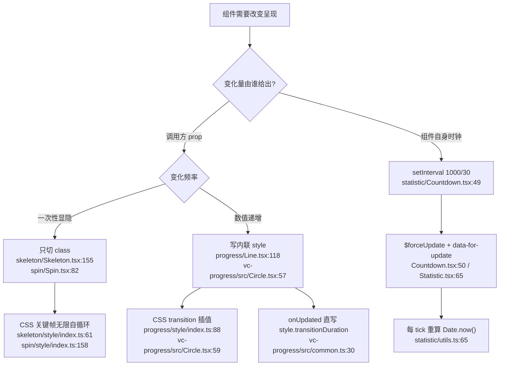
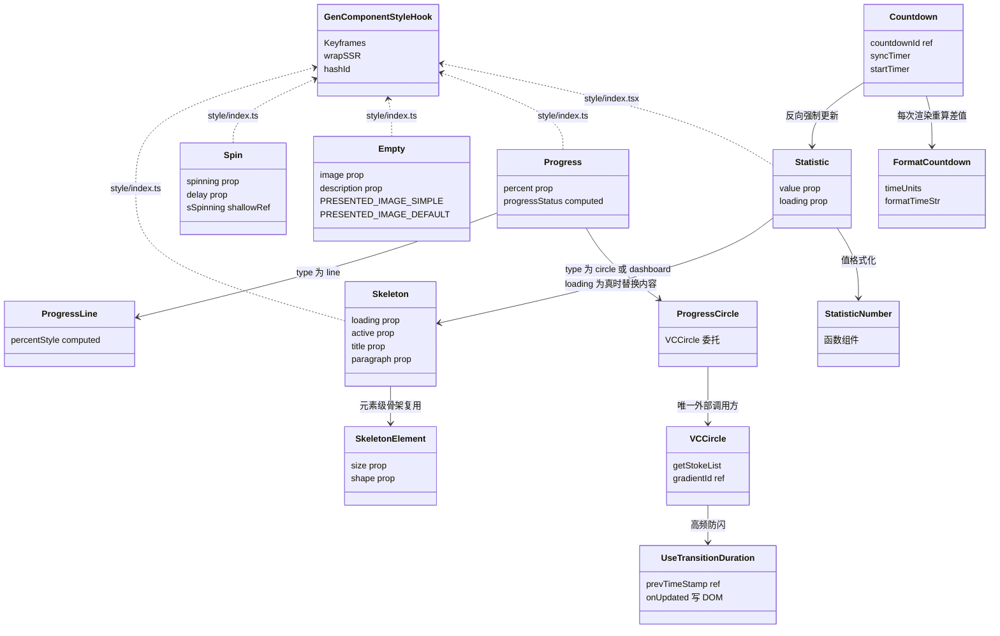
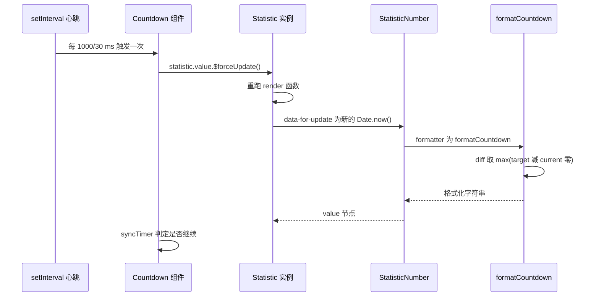
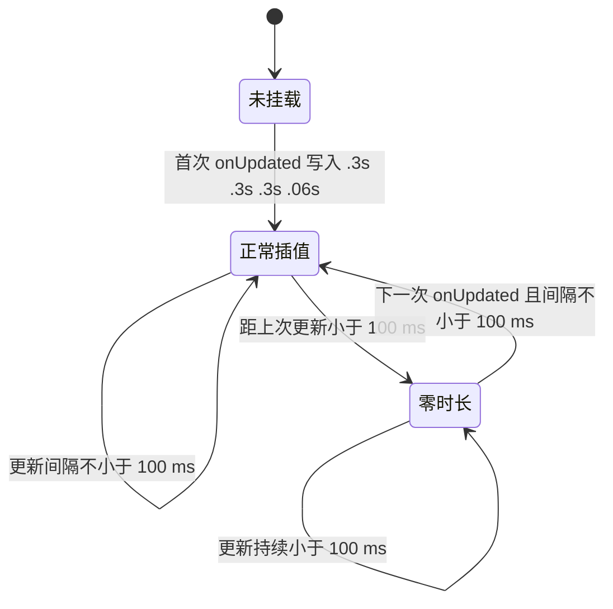

# C11-00 类横写：占位、进度与统计三类的更新频率取舍

> **本篇解决**：占位（Skeleton/Empty）、进度（Progress/Spin）、统计（Statistic/Countdown）这三类组件都在「呈现一个会变的值或状态」，但它们的更新驱动方式为什么分别是 CSS 关键帧、requestAnimationFrame、setInterval 三种？这条「更新频率」轴决定了各自的漂移、精度、reduced-motion 与 SSR 约束边界。
> **前置**：A04《cssinjs 样式引擎与 SSR 注水》　**读者坐标**：`03-components/11-status` 第 0 篇（类横写）

## 一、职责与边界

本篇是 `11-status` 的类横写，负责回答一件组件篇各自回答不了的事：这六个组件（Skeleton、Empty、Progress、Spin、Statistic、Countdown）在用户眼里都是「一块会动的信息区」，但它们在源码里分属**三种完全不同的更新驱动源**——CSS 关键帧自循环、每次 prop 变更触发一次 CSS transition 插值、以及 JS 定时器心跳。这条轴决定了各自的精度上限、漂移行为、可主题化程度与 SSR 可行性，而组件篇各自只会讲自己那一档。

本篇**不负责**：单个组件的 Props 语义与状态机细节（`C11-01`《Spin 加载中》、`C11-02`《Progress 进度》、`C11-03`《Skeleton 骨架屏》、`C11-05`《MeterGroup 仪表组》、`C11-06`《Timeline 时间轴》、`C11-07`《Descriptions 描述列表》、`C11-08`《Typography 排版》 各自覆盖）；Statistic 的格式化与强制更新链路已在 `C11-04`《Statistic 统计数值》论证过，本篇只把结论取到「更新频率」这条轴上并补该篇未覆盖的漂移与闭包快照问题；进出场 motion 协议与 `motionName` 约定归 `I09`《动画与 motion 体系》，样式注水与 `hashId` 归 `A04`《cssinjs 样式引擎与 SSR 注水》，受控/非受控与 `useMergedState` 归 `I13`《响应式内核 hooks》。

依赖清单（本篇取到的直接证据）：

- 样式侧：`genComponentStyleHook` / `mergeToken` / `Keyframes`（`packages/xiaoye-ui/src/skeleton/style/index.ts:2`、`packages/xiaoye-ui/src/spin/style/index.ts:2`）与 `wrapSSR`/`hashId` 二元组（`packages/xiaoye-ui/src/skeleton/Skeleton.tsx:93`、`packages/xiaoye-ui/src/spin/Spin.tsx:43`、`packages/xiaoye-ui/src/progress/progress.tsx:38`、`packages/xiaoye-ui/src/empty/index.tsx:35`、`packages/xiaoye-ui/src/statistic/Statistic.tsx:52`）——六个组件全部走同一条 A04 链路，无一例外。
- 配置侧：`useConfigInject`（`packages/xiaoye-ui/src/skeleton/Skeleton.tsx:92`、`packages/xiaoye-ui/src/spin/Spin.tsx:42`、`packages/xiaoye-ui/src/empty/index.tsx:33`）。
- 跨组件复用：Skeleton 被 Statistic 当作 loading 占位（`packages/xiaoye-ui/src/statistic/Statistic.tsx:6`、`packages/xiaoye-ui/src/statistic/Statistic.tsx:78`），Empty 被 `renderEmpty` 当作全库 notFound 兜底（`packages/xiaoye-ui/src/config-provider/renderEmpty.tsx:15`）。
- 内部 vendor 层：Progress 的 circle 分支依赖 `vc-progress`（`packages/xiaoye-ui/src/progress/Circle.tsx:3`），该目录自称基于上游实现 rc-progress 3.1.4（`packages/xiaoye-ui/src/vc-progress/index.ts:1`），本库现状只取用其中 `Circle` 一个导出。

## 二、源码地图

行数取自 `find <dir> -type f | xargs wc -l`（已排除 `demo/`）。「更新驱动源」列是本篇的分类轴，也是六篇组件篇共同缺失的那一列。

| 文件 | 行数 | 职责 | 关键符号 | 更新驱动源 |
| --- | --- | --- | --- | --- |
| `skeleton/Skeleton.tsx` | 173 | 块级骨架主入口 | `skeletonProps`（`packages/xiaoye-ui/src/skeleton/Skeleton.tsx:17`） | 无心跳，仅切 class |
| `skeleton/Element.tsx` | 42 | size/shape 原子（未对外导出） | `Element`（`packages/xiaoye-ui/src/skeleton/Element.tsx:15`） | 无 |
| `skeleton/Title.tsx` / `Paragraph.tsx` | 24 / 44 | 标题与行块 | `getWidth`（`packages/xiaoye-ui/src/skeleton/Paragraph.tsx:20`） | 无 |
| `skeleton/Avatar.tsx` / `Button.tsx` / `Input.tsx` / `Image.tsx` | 48 / 49 / 47 / 42 | 元素级骨架 | `-element` 类（`packages/xiaoye-ui/src/skeleton/Avatar.tsx:31`） | 无 |
| `skeleton/index.tsx` | 41 | 5 个静态挂载 + `install` | `Skeleton.Button`（`packages/xiaoye-ui/src/skeleton/index.tsx:18`） | 无 |
| `skeleton/style/index.ts` | 387 | 微光关键帧 | `xy-skeleton-loading`（`packages/xiaoye-ui/src/skeleton/style/index.ts:11`） | CSS 关键帧，1.4s 无限 |
| `empty/index.tsx` | 91 | 空状态容器 | `Empty.PRESENTED_IMAGE_SIMPLE`（`packages/xiaoye-ui/src/empty/index.tsx:89`） | 无（一次性渲染） |
| `empty/empty.tsx` / `simple.tsx` | 76 / 41 | 两幅内置插画 | `PRESENTED_IMAGE_DEFAULT`（`packages/xiaoye-ui/src/empty/empty.tsx:74`） | 无 |
| `empty/style/index.ts` | 80 | 静态版式 | — | 无 |
| `progress/progress.tsx` | 163 | 装配、状态推断、文案 | `progressStatus`（`packages/xiaoye-ui/src/progress/progress.tsx:60`） | 每次 prop 变更一次 |
| `progress/Line.tsx` | 161 | div `width:%` 分支 | `percentStyle`（`packages/xiaoye-ui/src/progress/Line.tsx:115`） | CSS transition |
| `progress/Circle.tsx` | 109 | SVG 分支，委托 vendor | `VCCircle`（`packages/xiaoye-ui/src/progress/Circle.tsx:3`） | CSS transition + DOM 写 |
| `progress/Steps.tsx` | 66 | 分段离散进度 | — | 每次 prop 变更一次 |
| `progress/utils.ts` / `props.ts` | 96 / 53 | 夹取与类型 | `validProgress`（`packages/xiaoye-ui/src/progress/utils.ts:6`） | 无 |
| `progress/style/index.ts` | 274 | line 的 `transition: all` | 见 `packages/xiaoye-ui/src/progress/style/index.ts:88` | CSS transition |
| `vc-progress/src/Circle.tsx` | 177 | dasharray/dashoffset 计算 | `getPathStyles`（`packages/xiaoye-ui/src/vc-progress/src/Circle.tsx:18`） | transition 字符串内联 |
| `vc-progress/src/Line.tsx` | 113 | 上游 line 实现（本库无调用方） | `percentListProps`（`packages/xiaoye-ui/src/vc-progress/src/Line.tsx:16`） | 同左，但不可达 |
| `vc-progress/src/common.ts` | 43 | 高频防闪策略 | `useTransitionDuration`（`packages/xiaoye-ui/src/vc-progress/src/common.ts:16`） | `onUpdated` 直写 `style` |
| `spin/Spin.tsx` | 141 | 遮罩、延迟显隐、指示器注入 | `shouldDelay`（`packages/xiaoye-ui/src/spin/Spin.tsx:26`） | 一次性 debounce 定时器 |
| `spin/style/index.ts` | 241 | 两组无限关键帧 | `xySpinMove` / `xyRotate`（`packages/xiaoye-ui/src/spin/style/index.ts:18`） | CSS 关键帧，1s / 1.2s |
| `statistic/Statistic.tsx` | 89 | 值容器与 loading 占位 | `data-for-update`（`packages/xiaoye-ui/src/statistic/Statistic.tsx:65`） | 由父级强制更新 |
| `statistic/Countdown.tsx` | 102 | 倒计时心跳 | `REFRESH_INTERVAL`（`packages/xiaoye-ui/src/statistic/Countdown.tsx:10`） | `setInterval` 1000/30 |
| `statistic/Number.tsx` | 53 | 千分位与精度 | `StatisticNumber`（`packages/xiaoye-ui/src/statistic/Number.tsx:8`） | 无状态函数组件 |
| `statistic/utils.ts` | 69 | 时间单位与格式化 | `formatCountdown`（`packages/xiaoye-ui/src/statistic/utils.ts:62`） | 读 `Date.now()` |
| `statistic/style/index.tsx` | 69 | 静态版式 | — | 无 |

测试分布（按 `packages/xiaoye-ui/vitest.config.mts:33` 的 `src/**/*.test.{js,ts,jsx,tsx}` glob 全部会被执行）：`skeleton/index.test.js`（69 行）、`spin/index.test.js`（45 行）、`spin/delay.test.js`（52 行）、`progress/index.test.js`（294 行）、`empty/index.test.js`（25 行）、`statistic/index.test.js`（91 行）。`vc-progress/` 目录内没有任何测试文件。

## 三、架构与数据流

### 图 1：更新驱动源的分档判定



判定树只有两个真实分叉：第一个分叉问「谁持有时间」——Skeleton、Spin、Empty 完全把时间交给浏览器（CSS 侧），Countdown 是唯一把时间握在组件手里的（`setInterval` 在 `packages/xiaoye-ui/src/statistic/Countdown.tsx:49`）。第二个分叉问「变化是一次性显隐还是连续量值」——前者只产生一个类名（`packages/xiaoye-ui/src/skeleton/Skeleton.tsx:155`、`packages/xiaoye-ui/src/spin/Spin.tsx:82`），后者才需要写内联样式让浏览器做插值（`packages/xiaoye-ui/src/progress/Line.tsx:118`、`packages/xiaoye-ui/src/vc-progress/src/Circle.tsx:57`）。`onUpdated` 直写 DOM 那条支路是第三档里再细分出来的例外：它不是为「变化」服务，而是为「变化太快」服务（`packages/xiaoye-ui/src/vc-progress/src/common.ts:32-34`）。

### 图 2：静态结构（谁持有谁）



这张图里唯一「反向」的箭头是 `Countdown → Statistic`：`Countdown` 不持有自己的 DOM，它渲染一个 `Statistic` 并握住实例引用（`packages/xiaoye-ui/src/statistic/Countdown.tsx:89-96`），心跳到来时从子实例向上调用 `$forceUpdate`（`packages/xiaoye-ui/src/statistic/Countdown.tsx:50`）。这一条边是整类中唯一由 JS 时钟驱动 Vue 渲染的路径，也是后面论点 4 讨论漂移的全部根因所在。另一个结构信号是 `VCCircle → UseTransitionDuration`：`vc-progress` 目录同时导出 `Line` 与 `Circle`（`packages/xiaoye-ui/src/vc-progress/index.ts:5`），但本库只有 `Circle` 被 `progress/Circle.tsx:3` 取用，`Line` 那条实现路径没有任何调用方。

### 图 3：Countdown 一次心跳的闭环



注意这条链里 Vue 的响应式几乎没有参与：`value` 是 prop，但每 tick 变的不是 prop，而是 `Date.now()`。`$forceUpdate()` 让 `Statistic` 无条件重渲染，`data-for-update={Date.now()}`（`packages/xiaoye-ui/src/statistic/Statistic.tsx:65`）再保证子节点 vnode 一定不等旧；真正的数值来自渲染期直接读时钟（`packages/xiaoye-ui/src/statistic/utils.ts:65`）。因此这条链没有「状态」，只有「读取时刻」——这也让它无法被 SSR 复现（论点 5）。

### 图 4：circle 分支 transitionDuration 的取值状态



状态迁移全部发生在 `onUpdated` 回调里，且**不经过 Vue 的 patch**：组件每次更新完成后先无条件把 duration 写回四段值（`packages/xiaoye-ui/src/vc-progress/src/common.ts:30`），再检查距上次更新是否小于 100ms，若小于就覆盖成 `'0s, 0s'`（`packages/xiaoye-ui/src/vc-progress/src/common.ts:32-34`），最后用 `Date.now()` 重新记时间戳（`packages/xiaoye-ui/src/vc-progress/src/common.ts:38`）。`prevTimeStamp` 只在 `updated` 为真时才推进（`packages/xiaoye-ui/src/vc-progress/src/common.ts:37-39`），而 `updated` 初值为假、只有遍历到至少一条持有 DOM 引用的 path 才被置真（`packages/xiaoye-ui/src/vc-progress/src/common.ts:21-28`）。

## 四、核心机制精读

### 论点 1：CSS 关键帧档把更新频率整个外包给浏览器，但类内三处循环时长的可改写程度分成了三层，第三层连改写的入口都没有

断言：Skeleton、Spin、Progress 的 `active` 态各自持有一条 `animation-iteration-count: infinite` 的关键帧循环，浏览器合成线程按 1.4s / 1s+1.2s / 2.4s 的周期自转，组件在运行期不产生任何一次 JS 调用；代价是这三处周期分属三个不同的可改写层级——「取自 Token 派生值」「写在 `mergeToken` 里」「直接内联在样式对象里」，只有第一层能被主题配置影响。

```ts
// packages/xiaoye-ui/src/skeleton/style/index.ts:47
const genSkeletonColor = (token: SkeletonToken): CSSObject => ({
  position: 'relative',
  // https://monshin.github.io/202109/css/safari-border-radius-overflow-hidden/
  /* stylelint-disable-next-line property-no-vendor-prefix,value-no-vendor-prefix */
  zIndex: 0,
  overflow: 'hidden',
  background: 'transparent',
  '&::after': {
    position: 'absolute',
    top: 0,
    insetInlineEnd: '-150%',
    bottom: 0,
    insetInlineStart: '-150%',
    background: token.skeletonLoadingBackground,
    animationName: skeletonClsLoading,
    animationDuration: token.skeletonLoadingMotionDuration,
    animationTimingFunction: 'ease',
    animationIterationCount: 'infinite',
    content: '""',
  },
});
```

逐段看这条频率是怎么落成的。周期本体是 `skeletonClsLoading`（`packages/xiaoye-ui/src/skeleton/style/index.ts:11`），一条 `translateX(-37.5%) → translateX(37.5%)` 的位移（`packages/xiaoye-ui/src/skeleton/style/index.ts:12-17`），加上 `background` 的 25%/37%/63% 三段渐变（`packages/xiaoye-ui/src/skeleton/style/index.ts:374`）就是全部微光效果；时长取自 `token.skeletonLoadingMotionDuration`（`:62`），而这个 Token 是在样式入口的 `mergeToken` 里被赋成字面量 `'1.4s'` 的（`packages/xiaoye-ui/src/skeleton/style/index.ts:375`），接口只声明它为 `string`（`packages/xiaoye-ui/src/skeleton/style/index.ts:33`）——它占了 ComponentToken 的命名位，却不来自 Seed/Map/Alias 任何一层，`motionDurationSlow` 之类的全局时长改到这里不会有联动。第三档的例子在 Spin：`animationDuration: '1s'`（`packages/xiaoye-ui/src/spin/style/index.ts:159`）与 `animationDuration: '1.2s'`（`packages/xiaoye-ui/src/spin/style/index.ts:191`）直接内联在样式对象的 `-dot-item` / `&-spin` 规则里（两组关键帧本体见 `packages/xiaoye-ui/src/spin/style/index.ts:18-24`），连一个 Token 名都不占，主题层完全无法触及这两个周期。Progress 的第三条循环是 `xyProgressActive`（`packages/xiaoye-ui/src/progress/style/index.ts:19`），时长同样落在 `mergeToken` 的字面量上（`packages/xiaoye-ui/src/progress/style/index.ts:267`，值为 `2.4s`）。

第二层证据是「这条循环什么时候才真正开始跑」。Skeleton 的 `::after` 只挂在 `-active` 修饰类命中的五类子块上（`packages/xiaoye-ui/src/skeleton/style/index.ts:340-351`，选择器覆盖 title、paragraph 的 `li`、以及 avatar/button/input/image 四种元素级骨架），而 `-active` 完全由 prop 决定（`packages/xiaoye-ui/src/skeleton/Skeleton.tsx:155`），`active` 的默认值是 `undefined`（`packages/xiaoye-ui/src/skeleton/Skeleton.tsx:18`）。也就是说：调用方不写 `active`，这条 1.4s 的无限循环就一行都不执行——更新频率的开关是**一个类名的存在性**，不是 `animation-play-state`，也不是任何 JS。Spin 的 `active` 等价物是 `-spinning` 类（`packages/xiaoye-ui/src/spin/Spin.tsx:82`）与基础态的 `display: none`（`packages/xiaoye-ui/src/spin/style/index.ts:30`）。Empty 则根本不在这条轴上：它的样式文件里 `transition` 与 `animation` 两种写法命中数为 0（`grep -n "transition\|animation" packages/xiaoye-ui/src/empty/style/index.ts` 返回空，再用 `grep -c` 复核同样为 0），它是频率轴的零档基线——一次渲染、永不更新（`packages/xiaoye-ui/src/empty/index.tsx:50` 起就是纯静态版式）。

回扣主题：第一档（CSS 关键帧自循环）的「取舍」不是性能——它恰恰是三者中最省的，运行期 JS 成本为零——而是**控制权**：组件既不知道自己在以多快的速度被重绘，也没有任何 API 能告诉它慢一点。Skeleton 与 Progress 至少留了一个 `mergeToken` 字面量供改源码时定位，Spin 留的是两处裸字符串，改这三条周期的成本依次递增。

### 论点 2：同为「一次性显隐」，Skeleton 与 Spin 用了两套不同的开关介质，导致同一类无限动画的重启语义不同，而 Spin 唯一那条 transition 声明的是永远不变的属性

断言：类内的两个占位/加载组件都用「让规则不命中」来停止频率，但 Skeleton 停的是类、Spin 在两种用法下分别停类和停节点；由于 CSS 动画的相位由元素首次参与动画的时刻决定，节点级开关会让动画从头重新起相，而 Spin 里那条看起来负责淡入淡出的 `transition` 实际上登记的是从不变化的 `transform`。

```tsx
// packages/xiaoye-ui/src/spin/Spin.tsx:115
      const spinElement = (
        <div {...divProps} class={spinClassName} aria-live="polite" aria-busy={sSpinning.value}>
          {renderIndicator(prefixCls.value)}
          {tip ? <div class={`${prefixCls.value}-text`}>{tip}</div> : null}
        </div>
      );
      if (children && filterEmpty(children).length) {
        const containerClassName = {
          [`${prefixCls.value}-container`]: true,
          [`${prefixCls.value}-blur`]: sSpinning.value,
        };
        return wrapSSR(
          <div class={[`${prefixCls.value}-nested-loading`, props.wrapperClassName, hashId.value]}>
            {sSpinning.value && <div key="loading">{spinElement}</div>}
            <div class={containerClassName} key="container">
              {children}
            </div>
          </div>,
        );
      }
      return wrapSSR(spinElement);
```

同一个 `spinning` prop，在这里分成两条路径。有默认插槽（嵌套用法）时，指示器所在的 `<div key="loading">` 整块按条件挂载（`packages/xiaoye-ui/src/spin/Spin.tsx:128`），关闭时它不在 DOM 里；没有插槽（独立用法）时节点常驻，只换类名（`packages/xiaoye-ui/src/spin/Spin.tsx:135`）。两条路径的分支条件甚至不是某个显式 prop，而是插槽是否有非空内容（`packages/xiaoye-ui/src/spin/Spin.tsx:121` 的 `filterEmpty(children).length`）。结果是一组四个点的 `alternate` 无限动画（`packages/xiaoye-ui/src/spin/style/index.ts:158-162`）配合四个错开的 `animationDelay`（0.4s / 0.8s / 1.2s，见 `packages/xiaoye-ui/src/spin/style/index.ts:169-185`）：节点级开关下每次 loading 打开都重新起相，四个点的错位从第一次循环才开始成形；类名级开关下元素始终参与动画，`display: none` 期间的相位由浏览器决定，两条路径的视觉起步不一致。Skeleton 只有类名级这一种（骨架子树由 `loading` 决定整体是否渲染，`packages/xiaoye-ui/src/skeleton/Skeleton.tsx:98` 的判定是 `loading || props.loading === undefined`，因此 `loading` 缺省时默认渲染骨架而不是隐藏它），一旦 loading 由真转假，整块子树连同 `::after` 一起卸载，下一轮又是全新相位。

再说那条名不副实的 transition。Spin 全目录只声明了一次过渡：`transition: \`transform ${token.motionDurationSlow} ${token.motionEaseInOutCirc}\``（`packages/xiaoye-ui/src/spin/style/index.ts:35`），而 `-spinning` 类切换的三个属性是 `position`、`display`、`opacity`（`packages/xiaoye-ui/src/spin/style/index.ts:37-41` 对照基础态 `:29-34`），没有一个在过渡列表里；`display` 本身也不可插值。用 `grep -n "transform" packages/xiaoye-ui/src/spin/style/index.ts` 复核，命中的四处是旋转关键帧的终值（`:23`）、这条 transition 自己（`:35`）、点元素的静态缩放（`:155`）与 `-spin` 的静态 45 度（`:189`）——后两处是后代元素上的 `transform`，父元素的 transition 管不到它们。结论是 Spin 的显隐是硬切，那条 transition 是一次遗留声明，读代码时把它当成「Spin 有淡入」会得出错误预期。与之对照，Progress 的 transition 就落在真正会变的属性上：`transition: \`all ${token.motionDurationSlow} ${token.motionEaseInOutCirc}\``（`packages/xiaoye-ui/src/progress/style/index.ts:88`）挂在 `-bg` 与 `-success-bg` 上，而这两个节点的内联 `width` 每次都随 prop 重算（`packages/xiaoye-ui/src/progress/Line.tsx:115-123`，值来自 `validProgress(percent)` 的夹取，`packages/xiaoye-ui/src/progress/utils.ts:6`）。

这两条差异合起来是本篇分类学的立足点：**同样是「不连续变化的组件」，是否真的存在补间，取决于被切的那个属性有没有进过 transition 列表**，而不是取决于它属于哪一类组件。

### 论点 3：三档里只有「prop 驱动的 transition 档」在运行期测量自己的更新频率并反向改动画时长，而这个反馈回路只装在 circle 一支上，line 与 steps 拿不到

断言：`useTransitionDuration` 是全类六组件中唯一一段「读自身重绘节奏」的代码，它用两次 `onUpdated` 的墙钟差判定推送频率，超过 10 次/秒就归零补间；由于它的输入是 DOM 引用集合，只有 SVG 分支的 `path` 能被它握住，line 与 steps 两支的 transition 时长被钉死在样式表里，高频推送时只能一路处于追赶态。

```ts
// packages/xiaoye-ui/src/vc-progress/src/common.ts:19
  onUpdated(() => {
    const now = Date.now();
    let updated = false;

    paths.value.forEach(val => {
      const path = (val as any)?.$el || val;
      if (!path) {
        return;
      }
      updated = true;
      const pathStyle = path.style;
      pathStyle.transitionDuration = '.3s, .3s, .3s, .06s';

      if (prevTimeStamp.value && now - prevTimeStamp.value < 100) {
        pathStyle.transitionDuration = '0s, 0s';
      }
    });

    if (updated) {
      prevTimeStamp.value = Date.now();
    }
  });
```

这条回路为什么要存在，`C11-02`《Progress》论点 5 已经论证过（0.3s 的补间追不上 33ms 一次的目标值，圆环会长期停在中间态），本篇不重复，只把它放回频率轴上看清楚三件事。

其一，**频率的测量方式是墙钟差，不是动画进度**。判据是 `now - prevTimeStamp.value < 100`（`packages/xiaoye-ui/src/vc-progress/src/common.ts:32`），两次取值都是 `Date.now()`（`:20` 与 `:38`），代码里没有任何一处读 `getComputedStyle` 或 `transitionrun`/`transitionend` 事件。这意味着它判断的是「调用方推得多快」，而不是「画面是否已经稳定」，两者在有后台节流、组件被 `v-show` 隐藏、或者更新被 Vue 合并的场景下会不一致——但反过来，这个选择的代价很小、实现只有 20 行，属于典型的够用即可。

其二，**这个回路必须命令式**。它写在 `onUpdated` 里并直接赋值 `path.style.transitionDuration`（`packages/xiaoye-ui/src/vc-progress/src/common.ts:29-30`），绕开了 Vue 的 patch：`paths` 来自 `useRefs()` 收集的模板 ref（`packages/xiaoye-ui/src/vc-progress/src/Circle.tsx:79`），紧跟着在 `:80` 调用 `useTransitionDuration(paths)` 装配。原因在频率轴上很清楚——被改的量（补间时长）取决于上一次改动的时刻，这是渲染函数无法表达的自反依赖，声明式内联样式只能表达「这次渲染想要什么」，表达不了「距离上次渲染多久」。`C11-02` 论点 5 的结论正是这一点，本篇只补一句：这条内联 `transition` 串本身是写死的五段（`packages/xiaoye-ui/src/vc-progress/src/Circle.tsx:59-60`），`useTransitionDuration` 覆盖的是它的 duration 列表，两份字符串必须人工保持对齐，少写一项不报错、只会静默按 CSS 简写列表的循环规则补齐（`common.ts:30` 写四项、`:33` 写两项，都是这种情况）。

其三，**同一档位内部的另外两支没有这个能力**。line 分支的内联样式只包含 `width`、`height`、`borderRadius` 与背景相关字段（`packages/xiaoye-ui/src/progress/Line.tsx:115-123`），补间由样式表的 `transition: all ${motionDurationSlow} ${motionEaseInOutCirc}` 提供（`packages/xiaoye-ui/src/progress/style/index.ts:88`），组件里既没有 DOM 引用集合、也没有 `onUpdated`，因此高频推送时 line 只能持续追赶，没有任何归零出口——这不是缺陷被忽略，而是它拿不到可写的节点：`-bg` 这个 `<div>` 连 `ref` 都没挂（`packages/xiaoye-ui/src/progress/Line.tsx:151`）。steps 分支更进一步，它把连续量直接量化成离散格：`current = Math.round(steps * (percent / 100))`（`packages/xiaoye-ui/src/progress/Steps.tsx:23`），每格的着色只取决于 `i <= current.value - 1`（`packages/xiaoye-ui/src/progress/Steps.tsx:42`），所以不管调用方推得多快，视觉状态最多只有 `steps` 个离散档，补间时长是否归零对它毫无影响（样式表里那条 `transition: all ${motionDurationSlow}` 在 `packages/xiaoye-ui/src/progress/style/index.ts:233`，作用在 `-steps-item` 上，量化的结果就是它经常被同一格重复命中而不起作用）。

结论回扣：把三档并排放好之后可以看出，「是否需要感知频率」不是由动画好不好看决定的，而是由**这个组件的更新量能不能超过浏览器一次补间所能消化的速率**决定的。CSS 关键帧档没有目标值，永远追不上这种东西；steps 档把速率量化掉了；只有连续插值的 SVG 描边档需要这个回路，而它恰好是六个组件里唯一直接操作 DOM style 的地方。

### 论点 4：JS 心跳档把「真值」与「采样时刻」解耦，因此它免疫数值漂移、却把失效模式换成了三种更隐蔽的采样问题

断言：`Countdown` 显示的数值不是由心跳累加出来的，而是每次渲染直接读墙上时钟（`packages/xiaoye-ui/src/statistic/utils.ts:65` 的 `const current = Date.now()`），心跳只决定「什么时候允许重看一眼」；这个选择消灭了定时器累加误差，代价是采样稀疏化、毫秒位失真与一处闭包快照。

```tsx
// packages/xiaoye-ui/src/statistic/Countdown.tsx:46
    const startTimer = () => {
      if (countdownId.value) return;
      const timestamp = getTime(props.value);
      countdownId.value = setInterval(() => {
        statistic.value.$forceUpdate();
        if (timestamp > Date.now()) {
          emit('change', timestamp - Date.now());
        }
        syncTimer();
      }, REFRESH_INTERVAL);
    };
```

第一处代价是**频率与视觉需求不匹配**。周期常量 `REFRESH_INTERVAL = 1000 / 30`（`packages/xiaoye-ui/src/statistic/Countdown.tsx:10`），而 `format` 的默认值是 `'HH:mm:ss'`（`packages/xiaoye-ui/src/statistic/Countdown.tsx:30`），一秒只有一位会变——也就是说 30 次 tick 里约 29 次触发的是一次完整重渲染却产出同样的字符串。这一次重渲染不便宜：`$forceUpdate()` 强制的是子实例（`:50`），`Statistic` 的渲染函数每次重建标题、内容容器、`Skeleton` 包裹层与 `StatisticNumber` 的 vnode（`packages/xiaoye-ui/src/statistic/Statistic.tsx:54-86`，其中 `:78` 每次都新建 `<Skeleton paragraph={false} loading={props.loading}>`）。反之当调用方真的要求毫秒位时频率又不够：模板里的最细单位 `['S', 1]` 是 1 毫秒（`packages/xiaoye-ui/src/statistic/utils.ts:32`），靠 `padStart` 的位数决定显示几位（`packages/xiaoye-ui/src/statistic/utils.ts:46-48`），而随仓示例确实开了三位毫秒（`apps/docs/examples/statistic/countdown.vue:28` 与 `apps/docs/examples/statistic/countdown-slot.vue:20` 的 `format="HH:mm:ss:SSS"`）——33ms 的采样意味着毫秒位只能落在约 30 个离散值上，肉眼看到的是每帧跳 30 到 40，而不是连续滚动。这是「心跳档的精度上限等于采样频率」的直接体现，而 `C11-04`《Statistic》论点 5 只论证了三级强制本身。

第二处代价是**闭包快照**，这是本篇新发现的一条，且可以证伪。`timestamp` 在 `startTimer` 里被捕获一次（`:48`），此后每次 tick 用的都是它（`:51`、`:52`）；而 `syncTimer` 判定是否续表时读的是新鲜的 `props.value`（`:36-43`）。于是当调用方在倒计时进行中改掉 `value`（换一个更晚的目标时刻）：`onUpdated` 会再调一次 `syncTimer()`（`packages/xiaoye-ui/src/statistic/Countdown.tsx:80-82`）→ 新时刻仍在未来 → 走 `startTimer()` → 被 `:47` 的 `if (countdownId.value) return` 直接挡回，旧 interval 继续跑。此时**显示的差值是新目标算出来的**（渲染期 `props.value` 进 `formatCountdown`，见 `packages/xiaoye-ui/src/statistic/Countdown.tsx:87` 与 `packages/xiaoye-ui/src/statistic/utils.ts:64`），**`change` 事件报的差值却是旧目标算出来的**，两条数据在同一次 tick 里相互矛盾，并且会一直矛盾到旧目标时刻真正越过 `Date.now()`、`syncTimer` 走 `stopTimer` 分支为止（`packages/xiaoye-ui/src/statistic/Countdown.tsx:41-43`、`:58-69`）。修复只需要把 `timestamp` 改成 tick 内读取，但现阶段的口径要记下来：`change` 不是「当前剩余量」的可靠来源。

第三处代价是**心跳档独有的停止语义与迟到**。`clearInterval` 只发生在两处：`syncTimer` 判定目标已过期（`:42`）与 `onBeforeUnmount`（`packages/xiaoye-ui/src/statistic/Countdown.tsx:83-85`），`finish` 事件在停表时按新鲜 `props.value` 再判一次才发（`:64-67`）。这带来一个 CSS 档不存在的失效模式：`setInterval` 的实际节拍由浏览器调度（调度与节流幅度属平台行为，本仓内不可取证），一旦节流，`finish` 会整体延后一个采样周期以上；而 CSS 关键帧档根本没有「值」，也就不存在迟到。同时它也让心跳档成为三档里**唯一提供真正可停止更新**的一档——`stopTimer` 之后浏览器不再重绘这个组件，而第一档只能靠不挂类或卸载节点来「不看」，第二档只能靠调用方不再推 `percent`。

顺带一句测试现状：`grep -rn "useFakeTimers\|advanceTimers" packages/xiaoye-ui/src/statistic` 命中为 0，`statistic/index.test.js` 用 `MockDate` 冻结了 `Date.now()`（`packages/xiaoye-ui/src/statistic/index.test.js:13`）后只断言首帧文本（同文件 `:67-88` 的 `Countdown` 用例），整条心跳链路（`Countdown.tsx:46-69`）没有任何测试保护，上面那个闭包快照问题在现有测试形态下不可能被发现。

### 论点 5：三档对「环境约束」的敏感度不同——只有 CSS 档能被主题与注水覆盖，只有心跳档在 SSR 下必然不可复现，而 reduced-motion 这一档全类都拿不到

断言：把可移植性三件事（主题改写、SSR 复现、无障碍降级）分别压到三档上，结论是它们各自只覆盖一档，没有一项是全类通用的。

**主题改写**：第一、二档的周期与曲线都写在 `genComponentStyleHook` 产出的样式里（Skeleton 入口 `packages/xiaoye-ui/src/skeleton/style/index.ts:356`、Spin `packages/xiaoye-ui/src/spin/style/index.ts:227`、Progress `packages/xiaoye-ui/src/progress/style/index.ts:257`），因此随 A04 的 cssinjs 链路一起被 `hashId` 注水与主题覆盖；但心跳档的周期是 TS 常量（`packages/xiaoye-ui/src/statistic/Countdown.tsx:10`），既不在 Token 体系里也不在样式表里，主题做得再细也动不到它。`C11-04`《Statistic》论点 7 已经论证 statistic 在 Token 体系里只是类型占位，本篇补上频率这一维：它连「可主题化的动画」这个概念都不参与。

**SSR 复现**：`Statistic` 的 `data-for-update={Date.now()}`（`packages/xiaoye-ui/src/statistic/Statistic.tsx:65`）不只是 vnode 差异兜底，它会作为属性落到 `StatisticNumber` 渲染出的 `<span>` 上（函数组件定义见 `packages/xiaoye-ui/src/statistic/Number.tsx:8`），于是服务端 HTML 里带了一个服务端时刻；同一次渲染里显示的倒计时文本也由 `formatCountdown` 读时钟算出（`packages/xiaoye-ui/src/statistic/utils.ts:65`）。心跳本身倒不会在 SSR 期跑：起表动作挂在 `onMounted`（`packages/xiaoye-ui/src/statistic/Countdown.tsx:77-79`）。结论是 SSR 首帧的文本与属性两处都必然与水合后的客户端不同，属于架构性 mismatch，不是能靠 `nextTick` 绕开的实现细节。第二档的对应例外是渐变 id：`C11-02`《Progress》论点 7 已论证它由模块级自增计数器生成，本篇只指出该计数器在 `setup` 里自增（`packages/xiaoye-ui/src/vc-progress/src/Circle.tsx:74-75`），因此服务端渲染的实例序号与客户端重新 `setup` 后的序号不同域——这是 transition 档里唯一带 SSR 副作用的一支。第一档没有这个问题，关键帧与时长全是静态字符串。

**无障碍降级**：`I09`《动画与 motion 体系》论点 6 已论证本库对 `prefers-reduced-motion` 只有一个孤岛式 helper、零调用点（helper 在 `packages/utils/src/dom/methods/isPrefersReducedMotion.ts:1`，除了 `packages/utils/src/dom/index.ts:70` 的 barrel 再导出之外全仓无调用方；本篇用 `grep -rn "reduced" packages/xiaoye-ui/src` 复核，命中数为 0。**这条命令本身有坑，C11-03 复核时指出并已替换**：它是大小写敏感的，匹配不到驼峰标识符 `isPrefersReducedMotion`，所以即使将来真有采纳，它也照样回 0——不具证伪力。正确的判形是 `grep -rni "reduced" packages/xiaoye-ui/src packages/utils/src`（加 `-i` 并同时扫两个包）与 `grep -rn "prefers-reduced-motion" packages` 两条并跑；按这两条复核，结论不变（命中仅 helper 自身与 barrel 再导出）。这条现状落到本类的后果是：Skeleton 每 1.4s 一次的横扫（`packages/xiaoye-ui/src/skeleton/style/index.ts:61-64`）与 Spin 四个点 `alternate` + 无限旋转（`packages/xiaoye-ui/src/spin/style/index.ts:158-162`、`:190-193`）都是**无条件循环**，没有 `animation-play-state` 的 JS 出口，也没有媒体查询兜底；库内目前唯一的「关动画」开关是点击波纹的 `wave.disabled`（`packages/xiaoye-ui/src/_util/wave/index.tsx:52`、`:58`），它管的是 Button 的 ripple，与这六个组件的循环动画没有任何代码交集。想给前庭敏感用户一条降级路径，改动点只能落在样式生成函数里（给 `-active` / `-dot-item` 的 animation 属性加媒体查询），而不是等某个统一的 motion 协议来接管——这条协议在进出场场景里都不存在（`C11-02` 论点 5 已确认 Progress 目录内没有任何 motion 引用）。

三档并排的总账：CSS 档赢在运行期成本与 SSR，输在控制权与降级；prop 插值档赢在「值一到就动」的语义清晰，输在需要一段命令式回路才能对抗高频；JS 心跳档赢在可停止、可读真值，输在采样精度、闭包快照与 SSR。

## 五、对外契约如何生效

本节只回答一个问题：调用方能通过契约触达「更新频率」的哪一部分。三档给的答案完全不同，且都不是 Props 表能看出来的（属性清单见 `apps/docs/components/skeleton.md` 等手册篇目）。

第一档（Skeleton、Spin、Empty）的契约面**只能决定动画是否存在，不能决定动画多快**。Skeleton 的三个内容开关与 `active`、`loading` 都是 `Boolean` 且默认 `undefined`（`packages/xiaoye-ui/src/skeleton/Skeleton.tsx:17-19`），渲染函数直接把它们变成两件事：子树是否存在（`:98`）与类名集合（`:153-159`），中间没有任何计算层。值得一提的是契约与频率的**并发条数耦合**：`title`、`paragraph`、`avatar` 决定同时有几个块命中 `-active` 下的选择器组（`packages/xiaoye-ui/src/skeleton/style/index.ts:341-348` 把六类子块并列列出），而 `paragraph` 传对象时会展开成多行 `li`（行宽算法在 `packages/xiaoye-ui/src/skeleton/Paragraph.tsx:20`），每行都自带一条独立的 1.4s 无限循环——一个带 avatar、标题与四行段落的骨架屏会同时跑六条独立循环，调用方对此毫无可控手段。Empty 连这一层都没有，它的 `image` 只决定插画内容（`packages/xiaoye-ui/src/empty/index.tsx:40`），两幅内置插画是纯静态 SVG（`packages/xiaoye-ui/src/empty/empty.tsx:74`、`packages/xiaoye-ui/src/empty/simple.tsx:40` 是它们的静态标记位）。Spin 的 `delay` 是唯一带时间的契约，但它只在**开始那一刻**生效：`shouldDelay` 判定后交给 `debounce`（`packages/xiaoye-ui/src/spin/Spin.tsx:26-28`、`:54-57`），到点即弃，不参与之后的任何节奏；组件把 `updateSpinning`（含 `cancel`）与 `spinning` getter 通过 `expose` 交出去（`packages/xiaoye-ui/src/spin/Spin.tsx:67-72`），这是三档里唯一对外暴露的「计时句柄」，但它能取消的只有那一次延迟。

第二档（Progress）的契约面**决定更新频率本身**，因为频率就是调用方推 `percent` 的频率。链路是单向且无缓存的：`percent` → `percentStyle` computed 拼出 `width` 字符串（`packages/xiaoye-ui/src/progress/Line.tsx:115-123`）→ 内联到 `-bg` 节点（`:151`）→ 样式表的 `transition: all` 接管插值（`packages/xiaoye-ui/src/progress/style/index.ts:88`）。契约里唯一的「跨档开关」是 `status`：`active` 是合法状态之一（`packages/xiaoye-ui/src/progress/props.ts:12` 的 `progressStatuses`），它被拼进根类名（`packages/xiaoye-ui/src/progress/progress.tsx:84`）后让 `::before` 的关键帧开始无限循环（`packages/xiaoye-ui/src/progress/style/index.ts:113-125`），随仓示例正是这么用的（`apps/docs/examples/progress/line.vue:3`）。也就是说 Progress 是唯一一个「靠一个 prop 就能从补间档跳进关键帧档」的组件，反过来也成立。文案侧的契约同样落在渲染期：`format` 优先于默认百分比（`packages/xiaoye-ui/src/progress/progress.tsx:104`），且 `format` 或插槽存在时，`exception`/`success` 状态也不会换成图标（`:97-107`）——频率不变，语义变。

第三档（Statistic、Countdown）的契约面**对频率完全无效，只对读法有效**。`value`、`precision`、`decimalSeparator`、`groupSeparator`、`formatter` 全都只在渲染函数里被读一次（`packages/xiaoye-ui/src/statistic/Statistic.tsx:54-68`），没有 watcher、没有合并状态（这与 `I13`《响应式内核 hooks》描述的 `useMergedState` 那条受控路径形成对照：本类没有一处受控状态可言，因为值不是交互产生的）。周期 `REFRESH_INTERVAL` 是模块内常量，`precision` 契约都碰不到它。此外这条链上有一处契约与实现不同步的实例：`Formatter` 类型声明的入参是 `{ value, config }`，`config` 里装着 `precision`/`groupSeparator`/`prefixCls` 等（`packages/xiaoye-ui/src/statistic/utils.ts:6-10`），但实际调用只传了 `{ value }`（`packages/xiaoye-ui/src/statistic/Number.tsx:14`），因此自定义 `formatter` 里的 `config` 恒为 `undefined`。Countdown 自己的包装函数反倒按两参解构（`packages/xiaoye-ui/src/statistic/Countdown.tsx:71-74`），说明这两处代码是按不同时期的契约写的；现有测试只断言了 `value` 键（`packages/xiaoye-ui/src/statistic/index.test.js:29` 用 `expect.objectContaining({ value: 1128 })`），不会因缺 `config` 而失败。事件契约的完整讨论归 `C11-04`《Statistic》论点 8，本篇只补一句：`onChange` 报的是 tick 闭包里的旧目标，不是渲染期的新目标（见论点 4）。

## 六、设计取舍

**心跳档为什么是 `setInterval` 而不是 rAF。** 库里有现成的 rAF 封装（`packages/xiaoye-ui/src/_util/raf.ts`），状态类一处都没用它——`grep -rn "setInterval(" packages/xiaoye-ui/src` 在全库命中 6 处，本类只有 `packages/xiaoye-ui/src/statistic/Countdown.tsx:49` 一处，其余散在 `splitter/Splitter.tsx:276`、`tabs/src/hooks/useTouchMove.ts:70`、`vc-virtual-list/hooks/useMobileTouchMove.ts:37` 与 `vc-slick/inner-slider.jsx:134`、`:554`，全部是手势或轮播类，没有一处属于「按秒读表」。选 `setInterval` 换来的是实现只有 11 行（`:46-56`）、不需要处理可见性与焦点；赔上的是浏览器调度权。关键判断在于：**由于显示值不来自累加而来自渲染期读表（`packages/xiaoye-ui/src/statistic/utils.ts:65`），换成 rAF 不会让显示更准，只会把采样点变密**，同时引入「不可见时是否继续跑」的新问题（rAF 在后台标签页不触发是平台行为、不在本仓取证范围内，若成立则 `finish` 会迟到更久）。真正划算的替代方案不是换时钟源，而是**按 `format` 模板的最细单位算周期**：默认 `'HH:mm:ss'` 时把周期放到 1000ms 附近就能砍掉约 29/30 的无效渲染，代价是要在 `startTimer` 前解析模板、并且 `format` 可变时要重建定时器——这条替代方案没有实现，属于本篇给出的待办判断，不是现状描述。

**CSS 关键帧档为什么不接统一 motion 协议，也不接 reduced-motion。** 接 `I09`《动画与 motion 体系》那套进出场协议对这类动画没有意义——它们没有「进入」和「离开」两个时刻，只有一个持续状态；`C11-02` 论点 5 已就 Progress 得出同一结论。留在 CSS 里换来三件实打实的好处：运行期零 JS、能进 A04 的样式注水与静态抽取链路、不需要组件实例存在即可动画（SSR 首帧就有微光）。赔上的是一件：没有任何降级出口。`prefers-reduced-motion` 的 helper 早就写好并导出了（`packages/utils/src/dom/methods/isPrefersReducedMotion.ts:1`、`packages/utils/src/dom/index.ts:70`），零调用点的现状由 `I09` 论点 6 论证，本篇不重述；但要说清它对本类的**具体**伤害面：受害的是 Skeleton 的横扫与 Spin 的四点循环，共三条 infinite 动画（`packages/xiaoye-ui/src/skeleton/style/index.ts:64`、`packages/xiaoye-ui/src/spin/style/index.ts:160`、`:192`），而 Button 的 ripple 反而有 `wave.disabled` 可控（`packages/xiaoye-ui/src/_util/wave/index.tsx:58`）——同类问题在不同层的可关闭性不一致。

**周期常量为什么不晋升成 Token。** 反方观点是：`skeletonLoadingMotionDuration: '1.4s'`（`packages/xiaoye-ui/src/skeleton/style/index.ts:375`）与 `progressActiveMotionDuration: '2.4s'`（`packages/xiaoye-ui/src/progress/style/index.ts:267`）都写成 `mergeToken` 的字面量，晋升成 ComponentToken 默认值（`genComponentStyleHook` 第三参，Skeleton 已有该参并在里面给了 `color`/`colorGradientEnd`，见 `packages/xiaoye-ui/src/skeleton/style/index.ts:379-385`）只需移动两行。不晋升的既有理由是这类时长与颜色不同：颜色必须跟主题走，周期是「这个动画看起来对不对」的视觉常数，跟 `motionDurationSlow` 绑定会让一次全局节奏调整把微光扫速一起改掉。但现状的问题是它把该理由丢在了注释之外——Spin 更彻底，两个周期连 Token 名都没有（`packages/xiaoye-ui/src/spin/style/index.ts:159`、`:191`），于是同一个「视觉常数」在类内出现了三种写法。这是本篇认为最该统一、也最容易统一的一处。

**分层耦合导致的节流不对称。** 频率反馈回路只能装在 `vc-progress` 里（`packages/xiaoye-ui/src/vc-progress/src/Circle.tsx:80`），因为它是唯一持有 DOM 引用集合的一层；把它复制到本库的 `progress/Line.tsx` 需要给 `-bg` 节点挂 ref 并在本库层引 `onUpdated`，代价是业务层开始直接操纵 DOM，与 `vc-*` 分层的意图（底层实现、业务层只做装配）相冲。现阶段的取舍是宁可 line 与 circle 在高频推送下表现不一致（circle 归零补间、line 一路追赶），也不在业务层开这个口子。

## 七、坑与改动指南

**坑 1：倒计时进行中途改 `value`，显示的差值与 `onChange` 报的差值分属两个目标。**

- 触发条件：`Countdown` 已在跑（旧 `value` 仍在未来），调用方把 `value` 换成另一个更晚的时刻。
- 症状：屏幕上的文本按新目标走，`change` 事件回调里拿到的仍是「旧目标减当前时刻」，两者对不上；直到旧目标真正越过 `Date.now()` 才自动纠正。用 `change` 驱动进度条或埋点的地方会直接写脏数据。
- 定位位置：`packages/xiaoye-ui/src/statistic/Countdown.tsx:48` 的闭包捕获 + `:47` 的早退 + `:80-82` 的 `onUpdated` 重入，显示侧走 `:87` 与 `packages/xiaoye-ui/src/statistic/utils.ts:64`。
- 测试现状：该分支无测试保护。`packages/xiaoye-ui/src/statistic/index.test.js:67-88` 只做首帧挂载断言，全目录 `useFakeTimers`/`advanceTimers` 命中为 0，中途换 `value` 的路径从未被执行。

**坑 2：`format` 开到毫秒位时，毫秒位不是连续滚动的，而是每帧跳 30 到 40。**

- 触发条件：`format` 含 `SSS`（随仓示例 `apps/docs/examples/statistic/countdown.vue:28` 就是这个写法），或自行调小 `REFRESH_INTERVAL` 但未同步调整模板。
- 症状：三位毫秒读数呈离散步长跳变，看起来像「卡」而不是「快」；把它当作毫秒精度用于抢票、竞速类展示会误导用户。
- 定位位置：采样周期 `packages/xiaoye-ui/src/statistic/Countdown.tsx:10`（`1000 / 30`）与最细单位 `packages/xiaoye-ui/src/statistic/utils.ts:32`（`['S', 1]` 即 1 毫秒）之间的量级差；位数由 `packages/xiaoye-ui/src/statistic/utils.ts:46-48` 的 `padStart` 决定。
- 测试现状：`packages/xiaoye-ui/src/statistic/index.test.js:70-76` 的 `HH:mm:ss:SSS` 用例在 `MockDate` 冻结时刻下断言首帧（同文件 `:13`），验证不了采样密度。

**坑 3：给 Spin 加淡入淡出不会生效，因为该类里唯一的 transition 登记的是永远不变的属性。**

- 触发条件：想要 loading 指示器柔和出现，改 `opacity` 相关规则或给 `-spinning` 补 `opacity` 过渡。
- 症状：仍是硬切。基础态与 `-spinning` 之间变化的是 `position`/`display`/`opacity`（`packages/xiaoye-ui/src/spin/style/index.ts:29-41`），而过渡列表里只有 `transform`。**范围要收紧到指示器**：这条只适用于 `.xy-spin` 自身，被包裹内容的容器 `.xy-spin-container` 另有 `transition: opacity …`（`packages/xiaoye-ui/src/spin/style/index.ts:101`），`-blur` 态的 `opacity: 0.5`（`:120-122`）与面纱的 `opacity: 0`（`:113`，其过渡写的是 `all`，`:114`）都是**带补间的**；所以「Spin 的显隐是硬切」这句话不能说成整个组件，详见 C11-01 论点 4。
- 定位位置：`packages/xiaoye-ui/src/spin/style/index.ts:35`；`transform` 在该文件的全部出现处用 `grep -n "transform" packages/xiaoye-ui/src/spin/style/index.ts` 复核，只有关键帧终值 `:23`、这条声明 `:35`、两处后代静态变换 `:155`、`:189`。
- 测试现状：`packages/xiaoye-ui/src/spin/index.test.js:29-42` 只断言类名与 `vm.spinning`，样式层无任何断言；改这条要么补视觉回归，要么无保护。

**坑 4：主题调 `motionDuration*` 不会改变这三条无限循环的速度。**

- 触发条件：为整体降速或适配偏好而调整全局 motion 时长 Token，期望 Skeleton/Spin/Progress 的循环动画跟着变。
- 症状：进出场变慢了，微光与旋转一点没变，容易被误判成「主题没生效」。
- 定位位置：`packages/xiaoye-ui/src/skeleton/style/index.ts:375`（1.4s 字面量）、`packages/xiaoye-ui/src/progress/style/index.ts:267`（2.4s 字面量）、`packages/xiaoye-ui/src/spin/style/index.ts:159` 与 `:191`（连 Token 名都没有）。对照真正跟 Token 的两处：`packages/xiaoye-ui/src/progress/style/index.ts:88` 与 `:232`。
- 测试现状：这三处无任何测试或快照保护，改动只能靠视觉核对；`packages/xiaoye-ui/src/skeleton/index.test.js` 只覆盖结构渲染。

**坑 5：`progress-status` 与 `progressStatus` 是两个不同的东西，后者是死 prop。**

- 触发条件：按 `packages/xiaoye-ui/src/progress/props.ts:50` 的声明传 `:progress-status="'active'"`，或想通过它显式指定状态。
- 症状：完全无效，类名仍由 `status` 与 `percent` 推导（`packages/xiaoye-ui/src/progress/progress.tsx:60-75` 的 computed 与该 prop 同名但只读 `props.status`）。类型层面能过，运行期静默失效——属于 `OUTLINE.md`「已知待办」第 5 条登记的「API 面存活、实现死亡」同类案例。
- 定位位置：声明在 `packages/xiaoye-ui/src/progress/props.ts:50`，读取点为 0（`grep -n "progressStatus" packages/xiaoye-ui/src/progress` 的命中全是 computed 自身与向子组件透传 `:150`）。
- 测试现状：`packages/xiaoye-ui/src/progress/index.test.js:17-27`、`:181-190` 只断言 `-status-success` 类名，未覆盖 prop 面。

**坑 6：自定义 `formatter` 里读 `config` 永远是 `undefined`。**

- 触发条件：按 `packages/xiaoye-ui/src/statistic/utils.ts:6-10` 的 `Formatter` 类型实现一个消费 `config.precision` 或 `config.groupSeparator` 的格式化函数。
- 症状：类型检查通过、运行期拿到 `undefined`，千分位与精度失效或抛错。
- 定位位置：调用点 `packages/xiaoye-ui/src/statistic/Number.tsx:14` 只传 `{ value }`；内部格式化分支（`:17-46`）自己从 props 读 `precision`/`groupSeparator`，所以只有自定义分支缺参。
- 测试现状：`packages/xiaoye-ui/src/statistic/index.test.js:22-31` 用的是 `expect.objectContaining({ value: 1128 })`，刻意不检查其它键，缺参不会被发现。

**坑 7：SSR 场景下倒计时首帧必然 mismatch。**

- 触发条件：服务端渲染含 `Statistic.Countdown`，客户端水合。
- 症状：文本与水合后不同（服务端算出的差值），且 `<span class="xy-statistic-content-value">` 上会带一个服务端时刻的 `data-for-update` 属性；Vue 的水合告警在这两处都会出现。
- 定位位置：`packages/xiaoye-ui/src/statistic/Statistic.tsx:65`（属性）与 `packages/xiaoye-ui/src/statistic/utils.ts:65`（文本）；心跳本身不在服务端跑，起表挂在 `packages/xiaoye-ui/src/statistic/Countdown.tsx:77-79`。
- 测试现状：仓内没有针对这六个组件的 SSR 用例，`grep -rn "useServerPrefetch\|renderToString" packages/xiaoye-ui/src/statistic` 命中 0，该路径无保护。

**测试与改动安全边界。** 现状：`packages/xiaoye-ui/vitest.config.mts:33` 的 glob 会跑 `src/**/*.test.{js,ts,jsx,tsx}`，本类六个目录里 Progress 的覆盖最厚（`progress/index.test.js` 294 行），Empty 最薄（25 行），`vc-progress/` 整个目录内没有任何测试文件——这意味着论点 3 里那段 `onUpdated` 直写 DOM 的代码完全靠人工回归保护，动它之前先跑 `pnpm --filter xiaoye-ui test:unit progress`。安全边界按档划分：第一档改样式（`skeleton/style/index.ts`、`spin/style/index.ts`、`empty/style/index.ts`）风险局限在视觉，不必担心行为，但要同时检查 A04 的静态抽取；第二档的 `vc-progress/src/common.ts`（43 行）是唯一带运行期副作用的文件，改它的判据 `< 100`（`:32`）或串值（`:30`、`:33`）前必须确认 `Circle.tsx:59-60` 的段数是否同步；第三档动 `Countdown.tsx:36-69` 之前，先补一个 fake timers 用例（`vi.useFakeTimers()` + `vi.advanceTimersByTime()`）把心跳链路钉住，否则坑 1 与坑 2 的回归无法察觉。三处验证命令：`pnpm --filter xiaoye-ui test:unit statistic`、`pnpm --filter xiaoye-ui test:unit progress`、`pnpm typecheck`。本篇未改动任何源码，因此无需 `pnpm gen:entries`。

## 附：本篇可证伪的三个检查点

1. 心跳档唯一性：`grep -rn "setInterval(\|\$forceUpdate" packages/xiaoye-ui/src/skeleton packages/xiaoye-ui/src/spin packages/xiaoye-ui/src/progress packages/xiaoye-ui/src/empty packages/xiaoye-ui/src/statistic` 期望只命中 `statistic/Countdown.tsx:49` 与 `:50`（外加 `spin/Spin.tsx` 里来自 `throttle-debounce` 的一次性 `debounce` 调用，`packages/xiaoye-ui/src/spin/Spin.tsx:51`）。若命中出现第二处重复定时器，则「三档分类」需要重画。
2. 闭包快照：在 `packages/xiaoye-ui/src/statistic/` 目录内新增用例（该组件的测试就放在组件目录，如 `index.test.js`，本类没有 `__tests__` 子目录），`vi.useFakeTimers()` 后 mount `Statistic.Countdown`，`value` 设为 `Date.now() + 5000`，`vi.advanceTimersByTime(100)` 后 `setProps({ value: Date.now() + 60000 })`，再前进 100ms，读取 `wrapper.emitted('change')` 最后一次的值与 `.xy-statistic-content-value` 文本。两者相差约 55 秒即证实论点 4 第二处代价；若一致则本篇该段作废。
3. 周期写法分三层：`grep -n "animationDuration\|MotionDuration" packages/xiaoye-ui/src/skeleton/style/index.ts packages/xiaoye-ui/src/spin/style/index.ts packages/xiaoye-ui/src/progress/style/index.ts` 期望同时看到「取 Token 值」（`skeleton/style/index.ts:62`、`progress/style/index.ts:121`）、「`mergeToken` 字面量」（`skeleton/style/index.ts:375`、`progress/style/index.ts:267`）、「样式对象内联字面量」（`spin/style/index.ts:159`、`:191`）三种写法；若某处已被晋升成 ComponentToken 默认值，则论点 1 与坑 4 的分级需要相应修订。
