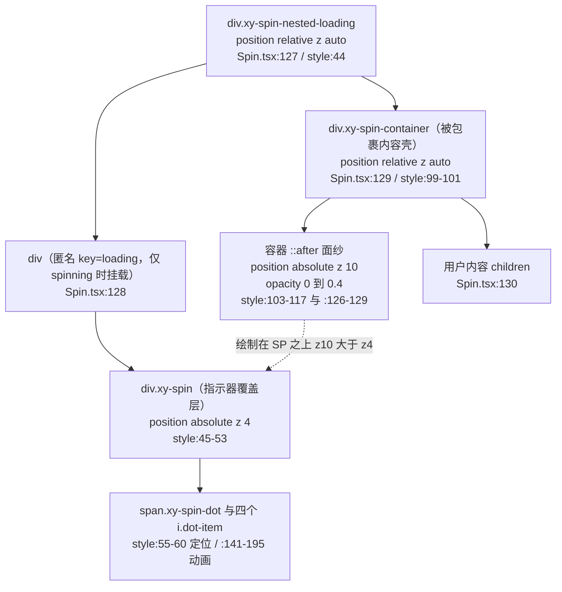
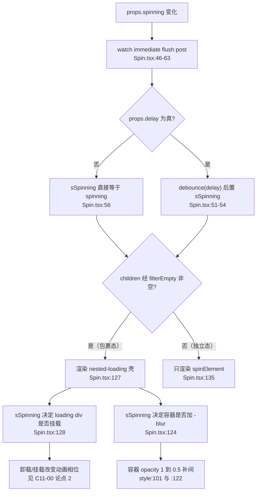
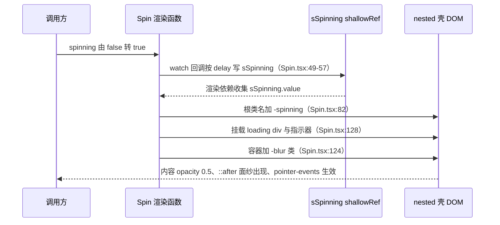

# C11-01 Spin 加载中

> **本篇解决**：Spin 作为「包裹容器」时到底给被包裹内容造了怎样的一层 DOM，这层 DOM 在遮罩开合时如何影响内容的布局、可交互性与焦点？以及它与独立指示器模式的分支边界在哪。
> **前置**：C11-00《类横写：占位、进度与统计三类的更新频率取舍》　**读者坐标**：`03-components/11-status` 第 1/9 篇（组件篇，Spin 单组件）

## 一、职责与边界

Spin 负责一件事：给一小块界面叠加「正在加载」的信号，并在信号存续期间削弱被包裹内容的可操作性。它**不负责**决定何时进入加载态（由调用方的 `spinning` prop 决定），也不负责被包裹内容自身的布局——它只在内容外面套一层定位壳。

本篇只讲 Spin 作为**包裹容器**（有默认插槽、走 `nested` 分支）时的 DOM 结构，以及这层结构如何改变被包裹内容的可交互性。这是 `C11-00`《类横写》没有展开的那一侧：`C11-00` 把 Spin 归入「CSS 关键帧自循环档」并论证了「指示器 `.xy-spin` 的显隐是硬切，因为该类里唯一的 `transition` 登记的是恒不变的 `transform`」（见 `C11-00` 论点 2 与坑 3，源码在 `packages/xiaoye-ui/src/spin/style/index.ts:35`）；本篇接受这条结论，只补它没碰的两件事——遮罩出现时**被包裹内容**那一侧的过渡语义，以及 `pointer-events` 到底挡住了什么、没挡住什么。延迟显示（`delay`）的路径也已在 `C11-00` §五 论证（`shouldDelay` + 一次性 `debounce`，见 `C11-00` 论点 2 末段），本篇不重述，只在数据流图里画出它与包裹分支的交汇点。

依赖清单（本篇取到的直接证据）：

- 样式链路：`genComponentStyleHook('Spin', …)`（`packages/xiaoye-ui/src/spin/style/index.ts:227`）产出的 `wrapSSR`/`hashId` 在渲染里被消费（`packages/xiaoye-ui/src/spin/Spin.tsx:43`、`:129`、`:138`）。
- 配置注入：`useConfigInject('spin', props)` 解构出 `prefixCls`、`size`、`direction`（`packages/xiaoye-ui/src/spin/Spin.tsx:42`），其中 `size` 这一路的兜底被 `initDefaultProps` 的默认值截断（详见论点 5）。
- 内部工具：`filterEmpty` 用于判定「有没有被包裹内容」从而选择包裹分支（`packages/xiaoye-ui/src/spin/Spin.tsx:121`）；`getPropsSlot` 取自定义指示器（`packages/xiaoye-ui/src/spin/Spin.tsx:90`）。
- 全局指示器：模块级 `defaultIndicator`（`packages/xiaoye-ui/src/spin/Spin.tsx:24`）由 `setDefaultIndicator` 写（`packages/xiaoye-ui/src/spin/Spin.tsx:30-33`），并在 `index.ts` 上挂成静态方法 `Spin.setDefaultIndicator`（`packages/xiaoye-ui/src/spin/index.ts:8`）。

明确不负责：不锁焦点、不禁键盘（论点 2）、不改被包裹内容的语义禁用状态（没有 `inert`/`aria-disabled`）。

## 二、源码地图

行数取自 `find packages/xiaoye-ui/src/spin -type f | xargs wc -l`。Spin 是本类里实现最短的一支——一个主文件加一个样式文件，没有 vendor 层、没有子组件目录。

| 文件 | 行数 | 职责 | 关键符号 |
| --- | --- | --- | --- |
| `spin/Spin.tsx` | 141 | 主实现：props、延迟显隐、指示器注入、包裹/独立两分支渲染 | `spinProps`（`packages/xiaoye-ui/src/spin/Spin.tsx:11`）、`shouldDelay`（`:26`） |
| `spin/index.ts` | 19 | 导出与 `install`，把 `setDefaultIndicator` 挂成静态方法 | `Spin.setDefaultIndicator`（`packages/xiaoye-ui/src/spin/index.ts:8`） |
| `spin/style/index.ts` | 241 | 基础态、`-nested-loading` 叠层、`-container`/`-blur` 遮罩、两组无限关键帧、尺寸 | `genSpinStyle`（`packages/xiaoye-ui/src/spin/style/index.ts:26`） |
| `spin/index.test.js` | 45 | 三个 `it`，仅一个有活断言 | 见论点 6 与 §七 测试现状 |
| `spin/delay.test.js` | 52 | 延迟显隐与卸载取消，五个活断言 | `wrapper.vm.updateSpinning.cancel`（`packages/xiaoye-ui/src/spin/delay.test.js:48`） |

主实现入口是渲染函数体内的分支点 `packages/xiaoye-ui/src/spin/Spin.tsx:121`（`if (children && filterEmpty(children).length)`）：它把组件劈成两种互不相同的 DOM 形状，本篇的包裹侧从这一行开始。样式侧的包裹叠层集中在 `packages/xiaoye-ui/src/spin/style/index.ts:43-131` 的 `&-nested-loading` 块内，`-container` 在 `:99`、`-blur` 在 `:120`——这两段是本篇的主证据区。

`contentHeight` 是本组件唯一的 ComponentToken（`packages/xiaoye-ui/src/spin/style/index.ts:8`），默认 `400`（`packages/xiaoye-ui/src/spin/style/index.ts:239`，作为 `genComponentStyleHook` 第三参注入），它约束的是包裹态下指示器覆盖层的最大高度（`packages/xiaoye-ui/src/spin/style/index.ts:53`）——这一点在论点 4 展开。

## 三、架构与数据流

### 图 1：包裹态 DOM 叠层与绘制次序（静态结构）



这是一张结构图，不是流程。要读出三个定位事实：其一，`.xy-spin-nested-loading` 只声明了 `position: relative`（`packages/xiaoye-ui/src/spin/style/index.ts:44`），**没有声明 `z-index`**，因此它不是堆叠上下文，两个孩子各自按自己的 `z-index` 参与更外层的堆叠比较。其二，指示器覆盖层 `.xy-spin` 的 `z-index: 4`（`packages/xiaoye-ui/src/spin/style/index.ts:49`）低于容器面纱 `::after` 的 `z-index: 10`（`packages/xiaoye-ui/src/spin/style/index.ts:109`），于是那条虚线成立——面纱绘制在旋转点之上，这在论点 3 会量化成「点被自己 0.4 alpha 的面纱再罩一层」。其三，那个 `key="loading"` 的匿名 `<div>`（`packages/xiaoye-ui/src/spin/Spin.tsx:128`）没有任何类名，它存在的唯一理由是样式表用 `> div > .xy-spin` 这个「子之孙」组合器定位覆盖层（`packages/xiaoye-ui/src/spin/style/index.ts:45`）——它是一根承重的匿名节点，论点 1 展开。

### 图 2：从 `spinning` 到「挂载/类名」的渲染分支



图 2 把两条独立的门并置：`delay` 只影响 `sSpinning` 何时翻转（一次性 debounce，机制归 `C11-00` 论点 2 末段），而 `filterEmpty(children).length`（`packages/xiaoye-ui/src/spin/Spin.tsx:121`）决定走哪套 DOM。关键在包裹态下 `sSpinning` 一次翻转同时驱动两件事——loading `<div>` 的条件挂载（`:131`）与容器的 `-blur` 类增删（`:127`）——这两件事的过渡语义不同（一个没有过渡、一个有 `opacity` 过渡），是论点 3 的核心。

### 图 3：一次 `spinning` 开关的时序（以包裹态为例）



时序里唯一值得强调的闭环是 `sSpinning` 是渲染函数读取的**内部 shallowRef**（`packages/xiaoye-ui/src/spin/Spin.tsx:44`），不是 `props.spinning` 本身。所以带 `delay` 时，DOM 反映的是延迟后的有效态，而 `props.spinning` 可能早已翻转——`expose` 出去的 `spinning` getter（`packages/xiaoye-ui/src/spin/Spin.tsx:69-71`）返回的正是 `sSpinning.value`，即有效态而非原始 prop（§五 讨论这对契约的影响）。

## 四、核心机制精读

### 论点 1：包裹不是一种模式开关，而是「插槽非空」这一件事的副产物；那个匿名 wrapper 是被 CSS 组合器点名的承重节点

断言：Spin 走「包裹」还是「独立指示器」，判据既不是某个显式 `mode`/`nested` prop，也不是 `spinning`，而是默认插槽经 `filterEmpty` 后是否非空（`packages/xiaoye-ui/src/spin/Spin.tsx:121`）。走包裹分支时，指示器所在的 `<div key="loading">` 是一个**没有任何类名**的匿名节点，但样式表恰恰用 `> div > .xy-spin`（`packages/xiaoye-ui/src/spin/style/index.ts:45`）这个「孙代组合器」定位覆盖层——删掉这层匿名 div，覆盖层的绝对定位会整体失效。

```tsx
// packages/xiaoye-ui/src/spin/Spin.tsx:121
      if (children && filterEmpty(children).length) {
        const containerClassName = {
          [`${prefixCls.value}-container`]: true,
          [`${prefixCls.value}-blur`]: sSpinning.value,
        };
        return wrapSSR(
          <div class={[`${prefixCls.value}-nested-loading`, props.wrapperClassName, hashId.value]}>
            {sSpinning.value && <div key="loading">{spinElement}</div>}
            <div class={containerClassName} key="container">
              {children}
            </div>
          </div>,
        );
      }
      return wrapSSR(spinElement);
```

逐段看。第 5 行的根 `<div class="-nested-loading">` 是包裹态唯一的稳定外壳，它拼了三段类名：`-nested-loading`、用户传入的 `wrapperClassName`、以及 `hashId`（`:130`）；注意它**不吃 `attrs`**（下一论点会说明 `attrs` 去了哪里）。第 6 行 `{sSpinning.value && <div key="loading">{spinElement}</div>}` 是包裹态的承重结构：只有 `sSpinning` 为真时这层匿名 div 才进 DOM，`spinElement`（定义在 `packages/xiaoye-ui/src/spin/Spin.tsx:115`）里的 `.xy-spin` 命中样式表的 `> div > .xy-spin` 变成 `position: absolute` 的覆盖层（`packages/xiaoye-ui/src/spin/style/index.ts:45-53`）。第 7-9 行是被包裹内容自己的壳 `-container`，它和 loading div 是**兄弟**，不是父子——这就是为什么「遮罩」和「内容」能各自定位、互不撑高。第 15 行 `return wrapSSR(spinElement)` 是独立态：没有内容可包，直接把 `.xy-spin` 当普通行内元素渲染，走基础态 `position: static; display: inline-block`（`packages/xiaoye-ui/src/spin/style/index.ts:38-39`），此时它受 `spinning` 的类名切换控制显隐（`packages/xiaoye-ui/src/spin/Spin.tsx:82`）。

两个分支的关断介质因此根本不同：独立态靠**类名**（`.xy-spin` 基础态 `display: none`，`-spinning` 翻成 `inline-block`），包裹态靠**节点挂载/卸载**（`:131` 的条件渲染）。`C11-00` 论点 2 已经论证这条差异会改变无限动画的重启相位（节点级开关每次 loading 打开都从第一次循环重新起相），本篇不重复，只补一个纯结构后果：因为包裹态的 loading div 用 `key="loading"`（`:131`）、容器用 `key="container"`（`:132`），Vue 靠这两个稳定 key 在 `sSpinning` 翻转时决定「插入/移除 loading 子树」而不动 container 子树，被包裹内容自身**不会因为 spinning 变化而重挂载**——内容里的输入框、滚动位置在遮罩开合时得以保留。这是 `key` 在这里的实际作用，不是可选装饰。

结论：判断 Spin 是不是「包裹容器」要去看它有没有非空默认插槽，而不是看任何 prop；而它的包裹叠层依赖一个匿名 wrapper 节点和一个孙代组合器，改 DOM 结构时这两处是硬约束。

### 论点 2：遮罩只挡指针，不挡键盘与焦点——被包裹的可聚焦元素在 loading 期间仍可 Tab 抵达并回车激活

断言：包裹态给内容加的一切「不可交互」效果都建立在 CSS `pointer-events` 上，而 `pointer-events` 语义上只管指针，不管键盘焦点序列。源码里既没有 `inert`，也没有 `tabindex="-1"`，更没有对被包裹内容设 `aria-hidden`/`aria-disabled`——渲染出的容器 `<div>` 携带的属性只有 `class` 和 `key`。

```tsx
// packages/xiaoye-ui/src/spin/Spin.tsx:121
      if (children && filterEmpty(children).length) {
        const containerClassName = {
          [`${prefixCls.value}-container`]: true,
          [`${prefixCls.value}-blur`]: sSpinning.value,
        };
        return wrapSSR(
          <div class={[`${prefixCls.value}-nested-loading`, props.wrapperClassName, hashId.value]}>
            {sSpinning.value && <div key="loading">{spinElement}</div>}
            <div class={containerClassName} key="container">
              {children}
            </div>
          </div>,
        );
      }
```

被包裹内容被放进那个 `class={containerClassName} key="container"` 的 `<div>`（`:132`）里，`containerClassName` 只有两段：`-container` 恒真、`-blur` 随 `sSpinning`（`:125-128`）。整棵分支里没有任何 `inert`、`tabindex`、`aria-hidden` 属性被写到容器或 loading 壳上——用 `grep -n -e inert -e tabindex -e aria-hidden -e aria-disabled packages/xiaoye-ui/src/spin/Spin.tsx` 复核，退出码非 0、零命中。全文件里唯一与无障碍相关的属性在指示器那侧：`aria-live="polite"` 与 `aria-busy={sSpinning.value}`（`packages/xiaoye-ui/src/spin/Spin.tsx:116`），它们描述的是「这块指示区忙」，而不是「把内容置为不可交互」。

后果是可键盘复现的：把 Spin 包一个 `<button>`，令 `spinning=true`。鼠标点这个按钮会被拦（拦停在哪儿是论点 3 的事），但键盘 Tab 仍会把焦点移进被包裹内容，回车/空格仍会触发它——因为 CSS 的 `pointer-events: none`（`packages/xiaoye-ui/src/spin/style/index.ts:124`）从不参与焦点序列计算，Vue 层又没给内容补 `inert`。这跟 Modal 那种会主动做焦点陷阱/`aria-hidden` 其他区域的组件（见 `C07-01`）形成对照：Spin 的「禁用」是纯视觉与纯指针层面的提示，不是一个真正的可访问性禁用态。对维护者来说，这条决定了「用 Spin 盖住一个表单来防重复提交」是**不安全**的——键盘路径没有被盖住。

### 论点 3：「挡点击」是两层协作——容器自身 `pointer-events: none` 加上一张翻转成 `pointer-events: auto` 的 `::after` 面纱，而这张面纱绘制在指示器之上

断言：包裹态拦截鼠标不是单靠「内容不可点」，而是两层叠加：容器 `.xy-spin-blur` 把自身 `pointer-events` 置 `none`，同时容器伪元素 `::after` 在 blur 态从 `none` 翻成 `auto`，成为一张 `z-index: 10` 的实体面纱来吃下点击。由于面纱的 `z-index: 10` 高于指示器覆盖层的 `z-index: 4`，面纱绘制在旋转点**之上**。

```ts
// packages/xiaoye-ui/src/spin/style/index.ts:99
      [`${token.componentCls}-container`]: {
        position: 'relative',
        transition: `opacity ${token.motionDurationSlow}`,

        '&::after': {
          position: 'absolute',
          top: 0,
          insetInlineEnd: 0,
          bottom: 0,
          insetInlineStart: 0,
          zIndex: 10,
          width: '100%',
          height: '100%',
          background: token.colorBgContainer,
          opacity: 0,
          transition: `all ${token.motionDurationSlow}`,
          content: '""',
          pointerEvents: 'none',
        },
      },

      [`${token.componentCls}-blur`]: {
        clear: 'both',
        opacity: 0.5,
        userSelect: 'none',
        pointerEvents: 'none',

        [`&::after`]: {
          opacity: 0.4,
          pointerEvents: 'auto',
        },
      },
```

这段样式（`:99-130`）是整个遮罩机制的心脏，拆开看四件事。

第一，`::after` 默认态是「存在但惰性」的：`opacity: 0`（`:113`）、`pointerEvents: 'none'`（`:116`）、`zIndex: 10`（`:109`）。它在非 blur 时既不遮挡也不吃点击。一旦容器拿到 `-blur`，`:126-128` 把它翻成 `opacity: 0.4` + `pointerEvents: 'auto'`——即出现一层 `background: colorBgContainer`（`:112`，当前主题的中性背景色）的半透明实体，并重新接管指针。

第二，容器自身 `-blur` 上写的是 `pointerEvents: 'none'`（`:124`）。`pointer-events` 可以被后代重新启用，所以「父 `none` + 伪子 `auto`」的组合精确实现了「内容不可点、但点被面纱接走」——点击不会穿透到内容，也不会悬空，而是落在 `::after` 上。这解释了论点 2 里那句「鼠标点会被拦」具体拦在哪：拦在这张 `z-index: 10` 的面纱上，不在内容上。

第三，`-blur` 同时设 `opacity: 0.5`（`:122`）——注意这是把**被包裹内容整块**变半透明，而不是盖一层半透明罩。所以「内容变淡」与「面纱变白」是两个独立效果叠加：内容自身降到 50% 不透明，再被 `::after` 的 40% alpha 背景罩一层。加上 `userSelect: 'none'`（`:123`）禁止选中，`clear: 'both'`（`:121`）为内容里的 float 布局清浮动——最后这条是遗留的 float 时代写法，暗示这套叠层最初假设被包裹内容可能用 float，现代 flex/grid 内容用不到它但无害。

第四，绘制层次：面纱 `::after` 是 `-container` 的伪元素（`z-index: 10`），指示器 `.xy-spin` 是 `-container` 的兄弟节点（`z-index: 4`，`packages/xiaoye-ui/src/spin/style/index.ts:49`），二者共同祖先 `-nested-loading` 只有 `position: relative` 而无 `z-index`（`:44`），不建堆叠上下文。结论是数值层面 `10 > 4` 成立：那张 `colorBgContainer` 的 0.4 面纱压在旋转点之上。实际观感是旋转点会被自己的遮罩背景轻微冲淡——这是这套「面纱盖内容」的设计顺带盖住了指示器本身的副作用。

结论：Spin 的「不可交互」在包裹态是 `pointer-events`（容器 `none` + 面纱 `auto`）与 `opacity`（容器 0.5）与 `user-select`（`none`）三件事同时发生，且都只作用在被包裹内容一侧；挡的是指针与选中，指示器反而被面纱压在下面。

### 论点 4：被包裹内容的「变暗」其实带补间，`C11-00` 论证的硬切发生在指示器那一侧——两者不在同一元素上，别混为一谈

断言：`C11-00` 论点 2 与坑 3 给出的结论是「Spin 显隐是硬切，因为该类里唯一的 `transition` 登记的是恒不变的 `transform`」（见 `C11-00`）。本篇接受这条结论，但要点明它的作用对象：那条 `transition: transform` 挂在 `.xy-spin`（指示器）上（`packages/xiaoye-ui/src/spin/style/index.ts:35`），而**被包裹内容**所在的 `.xy-spin-container` 另有自己的 `transition: opacity`（`packages/xiaoye-ui/src/spin/style/index.ts:101`），它接住的正是 `-blur` 改变的 `opacity: 0.5`（`packages/xiaoye-ui/src/spin/style/index.ts:122`）——所以内容变暗/回亮是插值过的，不是硬切。

```ts
// packages/xiaoye-ui/src/spin/style/index.ts:120
      [`${token.componentCls}-blur`]: {
        clear: 'both',
        opacity: 0.5,
        userSelect: 'none',
        pointerEvents: 'none',

        [`&::after`]: {
          opacity: 0.4,
          pointerEvents: 'auto',
        },
      },
```

把三个元素的过渡声明并排就能看清「谁硬切、谁补间」：

- 指示器 `.xy-spin`：`transition: transform …`（`packages/xiaoye-ui/src/spin/style/index.ts:35`）。而 `-spinning` 改的是 `position`/`display`/`opacity`（`packages/xiaoye-ui/src/spin/style/index.ts:37-41` 对照基础态 `:28-34`），`transform` 从不参与——硬切。这条 `C11-00` 已充分论证，本篇不重复。
- 内容壳 `.xy-spin-container`：`transition: opacity …`（`packages/xiaoye-ui/src/spin/style/index.ts:101`）。`-blur` 把它的 `opacity` 从默认 1 切到 `0.5`（`:122`）——`opacity` 恰在过渡列表里，**补间**。容器基础态没写 `opacity`，浏览器默认 1，所以 1↔0.5 是一次真实的插值。
- 面纱 `::after`：`transition: all …`（`packages/xiaoye-ui/src/spin/style/index.ts:114`）。它的 `opacity` 在 0↔0.4 之间切（`:113` 与 `:127`）——`all` 覆盖 `opacity`，**补间**。

也就是说，包裹态下随 `spinning` 翻转的三块视觉里，只有指示器是硬切，内容变暗和面纱浮现都是补间；而指示器在包裹态本身是「挂载/卸载」而非「切透明度」，所以它那侧根本不需要淡入淡出（它要么整块在、要么整块不在）。这修正了一个容易从 `C11-00` 顺出来的误读——「Spin 一切显隐都硬切」并不对，硬切只限指示器元素，`transition: opacity` 在容器上是实打实生效的。用 `grep -n "transition" packages/xiaoye-ui/src/spin/style/index.ts` 复核，命中三处：`:35`（transform，指示器）、`:101`（opacity，容器）、`:114`（all，面纱），正好对应上面三档，没有第四处。

结论回扣 `C11-00` 的框架：`C11-00` 把 Spin 归入「CSS 关键帧档」讲的是指示器旋转动画的更新驱动；本篇补的是同一次 `spinning` 翻转在**内容侧**引入了 prop 插值档才有的 `opacity` 补间。一个 Spin 在包裹态里同时踩了两档——指示器走关键帧、内容遮罩走补间。

### 论点 5：`initDefaultProps` 给 `size` 填了 `'default'`，把 `useConfigInject` 里靠 `||` 兜底的全局尺寸链路静默截断

> **2026-09-29 已修（size 半边）**：`initDefaultProps` 里的 `size: 'default'` 已删除，现 `Spin.tsx:39-42` 只剩 `spinning: true` 与 `wrapperClassName: ''`，全局尺寸注入接通；`spinning: true` 那半边维持原状。下方摘录为**修复前快照**（`size: 'default'` 一行现不存在）。

断言：Spin 的 `size` 在 `spinProps` 里是无默认值的可选 prop，但 `initDefaultProps` 给它填了 `default: 'default'`（`packages/xiaoye-ui/src/spin/Spin.tsx:40`）。而 `useConfigInject` 解析 `size` 用的是 `(props.size) || sizeContext.value`（`packages/xiaoye-ui/src/config-provider/hooks/useConfigInject.ts:39`）——一个恒真的左侧让 `||` 在读取任何全局尺寸之前就短路，于是外层 `ConfigProvider`/`SizeContext` 设的 `small`/`large` 对 Spin 零效果。

```tsx
// 修复前快照（修后 Spin.tsx:39-42 无 size 一行）
  props: initDefaultProps(spinProps(), {
    size: 'default',
    spinning: true,
    wrapperClassName: '',
  }),
  setup(props, { attrs, slots, expose }) {
    const { prefixCls, size, direction } = useConfigInject('spin', props);
    const [wrapSSR, hashId] = useStyle(prefixCls);
    const sSpinning = shallowRef(props.spinning && !shouldDelay(props.spinning, props.delay));
    let updateSpinning: any;
    watch(
```

这是 `DISPATCH.md` §3 那条「给本应由 `useConfigInject` 兜底的 prop 加运行时默认值 ⇒ 全局配置被静默吃掉」缺陷族在 **`size` 这一路**的实例——此前 `C04-08` 已在 `direction` 上命中过（`rate/index.tsx:54`），本篇把它补到 `size`，机制同形但兜底表达式不同：`direction` 走 `??`（`useConfigInject.ts:15`），`size` 走 `||`（`:39`）。无论哪种，只要 `props.size` 被 `initDefaultProps` 填成非空的 `'default'`，兜底右侧的 `sizeContext.value` 就永远读不到。

渲染端读到的 `size.value` 因此恒为 `'default'`，落到类名判定：`-sm` 仅当 `size.value === 'small'`、`-lg` 仅当 `size.value === 'large'`（`packages/xiaoye-ui/src/spin/Spin.tsx:80-81`）。两个条件都依赖 `size.value` 能变成 small/large，但被默认值钉死后，只有调用方**显式**给 Spin 传 `size` 才能出 `-sm`/`-lg`；靠全局尺寸上下文（例如一个把所有控件调小的 Form）不会让 Spin 的指示器变小。顺带一条同族的默认值效应：`spinning: true`（`:41`）意味着裸写 `<Spin>内容</Spin>` 不传 `spinning` 时默认就在转——`spinProps` 声明的 `spinning: { type: Boolean, default: undefined }`（`packages/xiaoye-ui/src/spin/Spin.tsx:13`）被 `initDefaultProps` 覆盖成了 `true`。这两处默认值都出现在同一个 `initDefaultProps` 调用里（`:39-43`），是本组件「配置兜底与全局注入打架」的两个集中点。

结论：`size` 上这条属于「API 面存活、实现半死亡」——`size` prop 本身能用，但**经全局注入的那半条路是死的**。修法是去掉 `initDefaultProps` 里对 `size` 的默认、或在 `useConfigInject` 把 `size` 兜底改成先判 `props.size === undefined`；但 `useConfigInject` 是全库共用，动它风险大，本篇只登记现状。

### 论点 6：`attrs` 被路由到指示器 `.xy-spin` 而非外壳，`expose` 的 `updateSpinning` 在无 `delay` 时是 `undefined`，而唯一覆盖这些边界的测试恰好被注释掉

断言：`inheritAttrs: false`（`packages/xiaoye-ui/src/spin/Spin.tsx:38`）加上 `const { class: cls, ...divProps } = attrs`（`:77`）把非 class 的透传属性（如内联 `style`）全部收进 `divProps`，再只展开到 `spinElement` 的 `.xy-spin` 上（`:119`）；包裹态的外壳 `-nested-loading`（`:130`）与容器 `-container`（`:132`）都不接 `attrs`。同时 `expose({ updateSpinning, ... })`（`:71`）里的 `updateSpinning` 只在带 `delay` 的分支被赋值（`:54`），无 `delay` 时它是 `let updateSpinning: any;`（`:48`）保持 `undefined`。

```tsx
// packages/xiaoye-ui/src/spin/Spin.tsx:67
    expose({
      updateSpinning,
      get spinning() {
        return sSpinning.value;
      },
    });
    return () => {
      const { class: cls, ...divProps } = attrs;
      const { tip = slots.tip?.() } = props;
      const children = slots.default?.();
      const spinClassName = {
        [hashId.value]: true,
        [prefixCls.value]: true,
        [`${prefixCls.value}-sm`]: size.value === 'small',
        [`${prefixCls.value}-lg`]: size.value === 'large',
        [`${prefixCls.value}-spinning`]: sSpinning.value,
        [`${prefixCls.value}-show-text`]: !!tip,
        [`${prefixCls.value}-rtl`]: direction.value === 'rtl',
        [cls as string]: !!cls,
      };
```

这段（`:70-89`）说明三件事。第一，`expose` 在 `setup` 阶段同步执行，此刻 `updateSpinning` 只有在 `props.delay` 为真时才会被 `watch` 的 immediate 回调赋成 `debounce(...)`（`:53-57`）；不带 `delay` 时它仍是 `undefined`，`expose` 交出去的就是 `undefined`。测试里能 `vi.spyOn(wrapper.vm.updateSpinning, 'cancel')` 成功，正是因为那几个用例都带了 `delay: 100/500`（`packages/xiaoye-ui/src/spin/delay.test.js:8-9`、`:41-42`）；无 `delay` 的 Spin 上这个成员不可用。第二，`get spinning()`（`:72-74`）返回 `sSpinning.value`——是延迟后的**有效态**，不是 `props.spinning`，所以外部通过 ref 读 `spinning` 拿到的是「DOM 当前真实反映的状态」。第三，`spinClassName` 把 `attrs` 的 `class` 并了进来（`:88`），而其余 `attrs`（`divProps`）在 `spinElement` 处展开（`:119`），落点是 `.xy-spin`——不是外壳，也不是内容容器。

这套边界恰好是 `index.test.js` 里被注释掉的那个用例想验证的：`packages/xiaoye-ui/src/spin/index.test.js:16-17` 那两行 `// expect(...'-nested-loading'...).toBe(null)` 与 `// expect(...'.xy-spin'...).background).toBe('red')` 正是断言「内联 style 落在 `.xy-spin` 而非外壳」——即本论点。它被整段注释，导致该用例（`:6-18`）实际零断言。同文件第二个 `it`（`:20-27`，自定义 indicator）也没有任何 `expect`（`const customIndicator` 那行 `:21` 也被注释）。所以 `index.test.js` 名义 3 个 `it`，只有第三个「controlled by spinning」（`:29-44`）有活断言（`packages/xiaoye-ui/src/spin/index.test.js:38`、`:42`）——两个是空壳。`delay.test.js` 相反，3 个 `it` 有 5 处活断言（`packages/xiaoye-ui/src/spin/delay.test.js:16`、`:30`、`:36`、`:49-50`），覆盖了延迟显隐与卸载取消。结论：Spin 的两个「边界契约」（attrs 落点、包裹叠层样式隔离）没有任何活测试保护，注释掉的断言是唯一的证据它们「曾被意识到需要测」。

## 五、对外契约如何生效

本节只追「契约从入口到 DOM 的路径」，属性清单见 [apps/docs/components/spin.md](../../../apps/docs/components/spin.md)。Spin 没有对外事件（`setup` 里没有 `emit`，`spinProps` 里也没有 `onClick` 之类的事件 prop，`packages/xiaoye-ui/src/spin/Spin.tsx:11-19`），所以契约面只剩 props 入、slots 入、context 入、expose 出四条。

`spinning` 是唯一直接决定 DOM 形态的 prop，但它在渲染前被复制进一个内部 `shallowRef`：初值 `props.spinning && !shouldDelay(props.spinning, props.delay)`（`packages/xiaoye-ui/src/spin/Spin.tsx:44`），随后由一个 `immediate + flush: 'post'` 的 `watch` 持续同步（`packages/xiaoye-ui/src/spin/Spin.tsx:46-63`）。渲染函数读的全是 `sSpinning.value`（类名 `:85`、`:127` 与 loading 挂载条件 `:131`），从不读 `props.spinning`——所以「带 `delay` 时 DOM 反映延迟态」这条语义完全靠这层 shallowRef 落地。`delay` 只在 `watch` 里参与 debounce 判定（`packages/xiaoye-ui/src/spin/Spin.tsx:50-54`），到点即弃，这条路径的机制归 `C11-00` 论点 2 末段，本篇不重述。

`size` 与 `direction` 走 `useConfigInject('spin', props)` 的 context 注入（`packages/xiaoye-ui/src/spin/Spin.tsx:42`）：`size.value` 决定 `-sm`/`-lg` 类（`packages/xiaoye-ui/src/spin/Spin.tsx:80-81`），`direction.value === 'rtl'` 决定 `-rtl` 类（`:87`）。`size` 的注入链在 2026-09-29 修复后已接通（`initDefaultProps` 不再填 `'default'`，见论点 5 题注）；`direction` 没有默认值、注入正常。`prefixCls` 则同时喂给 `useStyle`（`packages/xiaoye-ui/src/spin/Spin.tsx:43`）与根类名（`:82`），是本组件唯一喂给自己 prefixCls 的样式 hook 调用（不存在 `checkbox/Group` 那种把别人 prefixCls 传进样式 hook 导致重复建表的问题）。

slots 侧有三个入口。默认插槽是分支开关：`const children = slots.default?.()`（`packages/xiaoye-ui/src/spin/Spin.tsx:76`）经 `filterEmpty(children).length` 决定走包裹叠层还是独立指示器（`:124`），这条已写成论点 1。`tip` 插槽与 `tip` prop 合流：`const { tip = slots.tip?.() } = props`（`packages/xiaoye-ui/src/spin/Spin.tsx:75`）——prop 优先，缺省才取 `tip` 插槽；它非空时加 `-show-text` 类（`:86`）并在指示器下渲染一行文字（`:121`）。`indicator` 经 `getPropsSlot(slots, props, 'indicator')` 取（`packages/xiaoye-ui/src/spin/Spin.tsx:90`），随后有一套回退：显式传 `null` 就不画指示器（`:95-97`）、是 vnode 就 `cloneVNode(indicator, { class: dotClassName })` 强塞 `-dot` 类（`:101-102`）、都没传才落内置四点（`:109-116`）。

expose 出两个成员（`packages/xiaoye-ui/src/spin/Spin.tsx:67-72`）：`spinning` getter 返回 `sSpinning.value`（有效态，非原始 prop），`updateSpinning` 是那条 debounce 句柄——但如论点 6 所证，无 `delay` 时它是 `undefined`。这两个成员正是测试读取的对象（`packages/xiaoye-ui/src/spin/index.test.js:38`、`packages/xiaoye-ui/src/spin/delay.test.js:48`），构成契约可验证的那一面。

## 六、设计取舍

**包裹态为什么让 loading 子树「挂载/卸载」，而不是像独立态那样只切类名。** 现方案（`packages/xiaoye-ui/src/spin/Spin.tsx:128` 的 `{sSpinning.value && <div key="loading">…}`）换来两件实打实的好处：其一，非 spinning 时指示器根本不进 DOM，四个点的无限关键帧（`packages/xiaoye-ui/src/spin/style/index.ts:158-185`）也就完全不跑，省掉一份常驻合成开销；其二，`key="container"`（`packages/xiaoye-ui/src/spin/Spin.tsx:129`）让被包裹内容成为独立且稳定 keyed 的兄弟子树，遮罩开合不会重挂载内容。赔上的是 `C11-00` 论点 2 已经指出的相位问题——每次重新挂载，四点错位动画要从第一轮才成形，和独立态的「类名级、元素始终参与」不一致。另一条不选的路是给 loading 子树也留节点、只切 `display`，那样动画相位稳定，但会让每个 Spin 的包裹区常年挂着一份不跑的合成层，权衡后选择了「宁可不一致也不常驻」。

**遮罩为什么是「改容器自身 opacity + 一张 `::after` 面纱」两层，而不是一张盖到底的半透明罩。** 现方案（`packages/xiaoye-ui/src/spin/style/index.ts:120-130`）里 `opacity: 0.5` 作用在容器本身（`:122`），面纱 `::after` 只负责吃掉指针（`pointerEvents: 'auto'`，`:128`）和叠一层 `colorBgContainer`（`:112`、`:127`）。这样做的收益是「被盖内容变淡」这件事可以带 `transition: opacity`（`:101`）平滑发生，而不是一张罩子做 alpha 淡入时那种把底下所有内容一起糊住的观感。代价就是论点 3 的副作用：面纱 `z-index: 10`（`:109`）高于指示器 `z-index: 4`（`:49`），旋转点被自己的面纱冲淡；且 `opacity: 0.5` 是内容级的，若被包裹内容本身有半透明元素，会叠加出比预期更淡的结果。把它改成「单张带 alpha 的顶层罩」能让指示器回到最上层，但会丢掉内容变淡的可补间性，也没法只让指针停住而不重写内容合成——所以维持双层。

**`size` 走 `initDefaultProps` 填默认值，而不是交给 `useConfigInject` 兜底。** `packages/xiaoye-ui/src/spin/Spin.tsx:40` 的 `size: 'default'` 让 `props.size` 类型上恒为合法 `SpinSize`，渲染判定 `size.value === 'small'`（`:83`）不必处理 `undefined`；这正是 `C04-08` 论点 1 在 `direction` 上给出过的同一权衡——换类型收敛，赔全局配置（见 `C04-08`）。代价由论点 5 量化：`useConfigInject.ts:39` 的 `|| sizeContext.value` 永远轮不到。反例证明这不是全局约定而是各自决定——同库的 `typography` 对 `direction` 就没设默认（`C04-08` 论点 1 已对勘）。要统一，应删掉 `:40` 的 `size` 默认、把尺寸决策交回 `useConfigInject`。

**`contentHeight` 覆盖层为什么不跟随真实内容高度。** `packages/xiaoye-ui/src/spin/style/index.ts:239` 把指示器覆盖层的 `maxHeight` 钉成 ComponentToken 默认 400（作用于 `:53`），换来的是「无论被包裹内容多高，旋转点都落在顶部 400px 区内、不必 JS 量一次容器高度」，SSR 首帧也确定（没有运行期读取真实高度）。赔的是内容超过 400px 时旋转点不再居中（论点见坑 3）。把它改成跟随内容需要给容器加 ref 与 ResizeObserver，把一处纯 CSS 约束变成运行期测量，代价明显更高，所以维持定值且允许主题层覆盖 `contentHeight`。

## 七、坑与改动指南

**坑 1：用 Spin 盖住一个表单来「防重复提交」，键盘路径仍然通。**

- 触发：`<Spin :spinning="loading">` 包住一个含提交按钮的表单，`loading` 为真时用户按 Tab + 回车。
- 症状：鼠标点按钮被面纱吃掉，但键盘能把焦点移进被包裹按钮并触发提交；`spinning` 期间表单照样能提交。
- 原因：遮挡只靠 CSS `pointer-events`（`packages/xiaoye-ui/src/spin/style/index.ts:124`、`:128`），`pointer-events` 不参与焦点序列；组件没给容器加 `inert`/`tabindex="-1"`（`packages/xiaoye-ui/src/spin/Spin.tsx:129` 只有 `class` 与 `key`）。
- 定位位置：`packages/xiaoye-ui/src/spin/Spin.tsx:121-129`（容器无禁用属性）与 `packages/xiaoye-ui/src/spin/style/index.ts:120-130`（只有 pointer/opacity/select 三件套）。
- 测试现状：该分支无测试保护。`packages/xiaoye-ui/src/spin/index.test.js` 的三个 `it` 没有任何一个涉及焦点或被包裹内容可达性。

**坑 2：`ConfigProvider`/Form 把全局尺寸设为 `small`，Spin 的指示器却不会变小。**

- 触发：外层 `<xy-config-provider :size="'small'">` 或一个 `size="small"` 的 Form 里放 `<xy-spin>`，指望 Spin 跟随。
- 症状：Input、Button 都变小，Spin 的四点仍是默认尺寸；只有显式给 `<xy-spin size="small">` 才生效。
- 原因：`initDefaultProps` 把 `size` 默认成 `'default'`（`packages/xiaoye-ui/src/spin/Spin.tsx:40`），`useConfigInject` 的 `props.size || sizeContext.value`（`packages/xiaoye-ui/src/config-provider/hooks/useConfigInject.ts:39`）被恒真左侧短路。
- 定位位置：`packages/xiaoye-ui/src/spin/Spin.tsx:40`（默认值）与 `packages/xiaoye-ui/src/spin/Spin.tsx:80-81`（类名判定读 `size.value`）。机制与 `C04-08` 论点 1 的 `direction` 同形。
- 测试现状：无。两个测试文件都不设全局尺寸上下文。

**坑 3：被包裹内容超过 400px 高时，旋转点偏到内容上部而不是居中。**

- 触发：`<Spin>` 包住一个高度大于 400px 的长列表/长表单。
- 症状：遮罩铺满内容，但四点旋转指示只落在顶部 400px 区域内（`top: 50%` 是相对这个封顶盒子，不是相对整块内容）。
- 原因：覆盖层 `> div > .xy-spin` 有 `maxHeight: token.contentHeight`（`packages/xiaoye-ui/src/spin/style/index.ts:53`），默认 `contentHeight: 400`（`packages/xiaoye-ui/src/spin/style/index.ts:239`）。
- 定位位置：`packages/xiaoye-ui/src/spin/style/index.ts:53` 与 `:239`；点的居中定位在 `:56-60`。
- 测试现状：无，样式层没有任何断言。

**坑 4：给 `<Spin style="…">` 写的内联样式落在指示器上，不在包裹外壳或内容容器上。**

- 触发：`<Spin style={{ background: 'red' }}>内容</Spin>` 想给整块加背景。
- 症状：背景只染到 `.xy-spin` 指示器覆盖层（还在 `z-index: 4`、被面纱盖着），外壳 `-nested-loading` 与容器 `-container` 不受影响。
- 原因：`inheritAttrs: false`（`packages/xiaoye-ui/src/spin/Spin.tsx:38`）+ `const { class: cls, ...divProps } = attrs`（`:77`）+ `{...divProps}` 只展开在 `spinElement`（`:119`）；外壳与容器不接受 `attrs`（`:130`、`:132`）。
- 定位位置：`packages/xiaoye-ui/src/spin/Spin.tsx:74`、`:119`、`:130`、`:132`。
- 测试现状：想验证这条的用例被整段注释（`packages/xiaoye-ui/src/spin/index.test.js:16-17`），当前无活断言保护。

**坑 5：不带 `delay` 的 Spin，通过 ref 拿到的 `updateSpinning` 是 `undefined`。**

- 触发：`ref` 拿到 Spin 实例后调用 `vm.updateSpinning.cancel()` 想取消计时。
- 症状：无 `delay` 时报错 `updateSpinning` 为 `undefined`——它只在带 `delay` 的 watch 分支被赋值成 `debounce(...)`（`packages/xiaoye-ui/src/spin/Spin.tsx:50-54`），而 `expose`（`:71`）在 `setup` 期就把它（此时仍是 `:48` 的 `let` 声明）交了出去。
- 原因：`expose` 读取的 `updateSpinning` 与真正被赋值的时机之间存在「无 delay 则永不赋值」的空档。
- 定位位置：`packages/xiaoye-ui/src/spin/Spin.tsx:45`、`:54`、`:71`。
- 测试现状：`packages/xiaoye-ui/src/spin/delay.test.js:48` 能 `spyOn(...updateSpinning, 'cancel')`，只因为该用例带了 `delay: 100`（`:42`）；无 `delay` 情形没有用例。

**坑 6：删掉 `key="loading"` 那层匿名 `<div>`，覆盖层会丢绝对定位。**

- 触发：重构渲染函数，把 `spinElement` 直接渲染进 `-nested-loading`、去掉中间 `<div key="loading">`。
- 症状：指示器不再是铺满内容的 `position: absolute` 覆盖层，跑到文档流里，遮罩视觉塌了。
- 原因：定位靠组合器 `&-nested-loading > div > .xy-spin`（`packages/xiaoye-ui/src/spin/style/index.ts:45`）点名「子之孙」，中间那层匿名 div（`packages/xiaoye-ui/src/spin/Spin.tsx:128`）是这条选择器命中的唯一 `div`。
- 定位位置：`packages/xiaoye-ui/src/spin/Spin.tsx:128` 与 `packages/xiaoye-ui/src/spin/style/index.ts:45`。
- 测试现状：包裹态叠层无任何样式/结构断言（见坑 4 的注释测试），改动没有回归网。

**测试与改动安全边界。** 本篇判定 Spin 测试面用两种方法交叉：`grep -n "it("` 得 `index.test.js` 3 个、`delay.test.js` 3 个，但再数活断言——`index.test.js` 仅 `:38`、`:42` 两处（另两个 `it` 的断言在 `:16-17`、`:21` 被注释），`delay.test.js` 有 5 处（`:16`、`:30`、`:36`、`:49`、`:50`）；判定它们是否被执行按 `packages/xiaoye-ui/vitest.config.mts:33` 的 glob（`src/**/*.test.{js,ts,jsx,tsx}`），两个文件都会被跑。安全边界：改样式只在 `packages/xiaoye-ui/src/spin/style/index.ts` 内，风险局限于视觉与指针语义，但要同步核对 A04 静态抽取是否吃下新增的 `::after`；改渲染分支 `packages/xiaoye-ui/src/spin/Spin.tsx:121-135` 前，先把 `index.test.js:16-17` 那两行注释恢复成活断言，否则包裹态的 attrs 落点与叠层隔离完全裸奔。验证命令：`pnpm --filter xiaoye-ui test:unit spin`、`pnpm typecheck`。本篇未改源码，无需 `pnpm gen:entries`。

## 附：本篇可证伪的三个检查点

1. 遮罩只挡指针、不挡键盘：跑 `grep -rn -e inert -e tabindex -e aria-hidden -e aria-disabled packages/xiaoye-ui/src/spin/Spin.tsx`，期望零命中（退出码非 0）。命中即说明容器被加了真正的禁用属性，论点 2 与坑 1 作废。
2. 「硬切只在指示器、内容侧有补间」：跑 `grep -n -e transition packages/xiaoye-ui/src/spin/style/index.ts`，期望恰好三处 `:35`（transform，指示器）、`:101`（opacity，容器）、`:114`（all，面纱），且 `-blur` 的 `opacity: 0.5` 在 `:122`。若容器不再有 `transition: opacity` 或 `-blur` 不再改 `opacity`，论点 4 的区分不成立。
3. `size` 全局兜底被默认值截断：跑 `grep -n -e "size: 'default'" packages/xiaoye-ui/src/spin/Spin.tsx` 命中 `:40`，再看 `grep -n "props.size" packages/xiaoye-ui/src/config-provider/hooks/useConfigInject.ts` 命中 `:39` 的 `|| sizeContext.value`。若 `:40` 的默认被删、或 `useConfigInject.ts:39` 改成先判 `props.size === undefined`，论点 5 与坑 2 需要相应改写。
