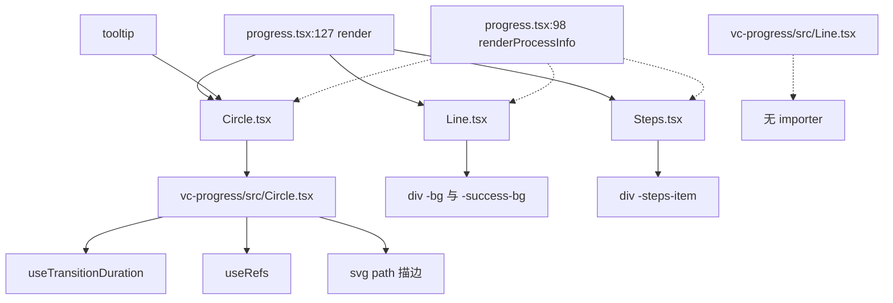
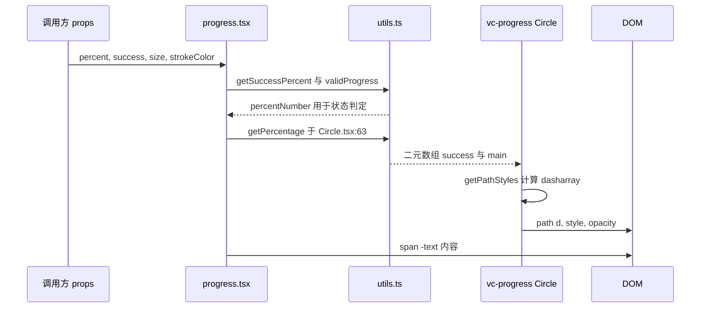
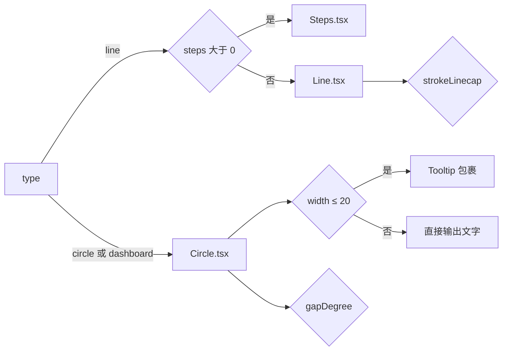

# C11-02 Progress 进度

> **本篇解决**：Progress 的 line 与 circle 两套绘制路径分别怎么算出「完成度」、`success`/`steps` 各自改变的是语义还是画法、以及它的动画为什么不走 `_util/motion`。
> **前置**：I09《动画与 motion 体系》　**读者坐标**：`03-components/11-status` 进度一侧

## 一、职责与边界

`XYProgress` 只做一件事：把一个 0 到 100 的数字变成一条可视轨道，并把「异常 / 成功 / 进行中」这层语义绑到轨道的颜色与尾部文字上。形态由 `type` 决定，共 4 条绘制分支：`line`、`line + steps`、`circle`、`dashboard`（后两者共用同一个 Circle 子组件，只差一个默认缺口角度，`packages/xiaoye-ui/src/progress/props.ts:14`、`packages/xiaoye-ui/src/progress/progress.tsx:133-164`）。

明确不负责的部分，同样能在源码里指出来：

- 数值从哪来、怎么显示，交给 `format` 函数或 `format` 插槽，组件内只有一个默认 `(val: number) => \`${val}%\``（`progress.tsx:104`）。
- 没有可访问性的进度语义播报。全目录内 `aria-` 与 `role` 的唯一命中是根节点的 `role="progressbar"`（`packages/xiaoye-ui/src/progress/progress.tsx:166`），没有 `aria-valuenow` / `aria-valuemin` / `aria-valuemax`，也就是说读屏软件拿不到数值。
- 没有进出场动画协议。`progress/` 目录内不存在 `_util/motion`、`transition-group`、`requestAnimationFrame` 的任何引用，唯一带 `motion` 字面的是三个时长与缓动 Token 名（`packages/xiaoye-ui/src/progress/style/index.ts:88`、`:121`、`:232`）；动画全部由 CSS `transition`、CSS `@keyframes` 与 SVG 描边补间承担（见论点 5）。
- 不管理配色派生。除两个例外（见下节的 `@ant-design/colors`），颜色一律从 Design Token 取。
- `steps` 不是「多段进度」的数据结构，只是把轨道等分成 N 个格子（`progress/Steps.tsx:38-55`），它和 `steps` 组件之间没有依赖关系。

依赖关系（上游消费者 / 下游依赖）：

| 方向 | 对端 | 证据 |
| --- | --- | --- |
| 被依赖 | `steps` 用 `type="circle"` 画进度点 | `packages/xiaoye-ui/src/steps/index.tsx:11`、`packages/xiaoye-ui/src/steps/index.tsx:105-111` |
| 被依赖 | `upload` 的接口类型引用 `ProgressProps` | `packages/xiaoye-ui/src/upload/interface.tsx:5` |
| 依赖 | `vc-progress` 只取了 Circle 一个符号 | `packages/xiaoye-ui/src/progress/Circle.tsx:3` |
| 依赖 | 小尺寸圆环套 Tooltip | `packages/xiaoye-ui/src/progress/Circle.tsx:8`、`packages/xiaoye-ui/src/progress/Circle.tsx:95-98` |
| 依赖 | 图标 4 个（状态符） | `packages/xiaoye-ui/src/progress/progress.tsx:3-8` |
| 依赖 | 直接读原始色板 `presetPrimaryColors` | `packages/xiaoye-ui/src/progress/Line.tsx:2`、`packages/xiaoye-ui/src/progress/utils.ts:1` |

最后一条值得单独标出：在整个 `packages/xiaoye-ui/src` 下，`presetPrimaryColors` 的 importer 只有 progress 的两个文件，可用 `grep -rl "presetPrimaryColors" --include="*.ts" --include="*.tsx" --exclude-dir=dist packages/xiaoye-ui/src` 复现。它是全库唯一一个绕过 Token 层直接取色板默认值的组件（论点 4 会算清这笔账落在哪些像素上）。

## 二、源码地图

公开入口是 `progress/index.ts:1-6`，用 `withInstall` 包一层后导出；`progress/progress.tsx:19-36` 是主实现入口（`defineComponent` 声明在 19 行，`setup` 在 36 行，渲染函数在 118 行）。

| 文件 | 行数 | 职责 | 关键符号 |
| --- | --- | --- | --- |
| `packages/xiaoye-ui/src/progress/progress.tsx` | 163 | 主编排：状态判定、形态分派、文字渲染 | `percentNumber:51`、`progressStatus:60`、`classString:68`、`renderProcessInfo:89` |
| `packages/xiaoye-ui/src/progress/props.ts` | 53 | props 与联合类型 | `progressProps:29`、`progressStatuses:12`、`SuccessProps:22` |
| `packages/xiaoye-ui/src/progress/Line.tsx` | 161 | line 绘制（CSS 宽度）+ 渐变解析 | `sortGradient:28`、`handleGradient:56`、`percentStyle:115` |
| `packages/xiaoye-ui/src/progress/Circle.tsx` | 109 | circle 参数归一化，转交 `vc-progress` | `gapDeg:36`、`circleWidth:55`、`getPercentage` 调用点 `:63` |
| `packages/xiaoye-ui/src/progress/Steps.tsx` | 66 | 分段格子 | `current:23`、`styledSteps:34` |
| `packages/xiaoye-ui/src/progress/utils.ts` | 96 | 4 个纯函数：夹取、切片、配色、尺寸 | `validProgress:6`、`getSuccessPercent:16`、`getPercentage:33`、`getStrokeColor:38`、`getSize:46` |
| `packages/xiaoye-ui/src/progress/style/index.ts` | 274 | CSS-in-JS 与关键帧 | `xyProgressActive:19`、`genBaseStyle:34`、`genCircleStyle:161`、`genStepStyle:215` |
| `packages/xiaoye-ui/src/vc-progress/src/Circle.tsx` | 177 | 弧长内核 | `getPathStyles:18`、`getStokeList:82`、`gradientSeed:8` |
| `packages/xiaoye-ui/src/vc-progress/src/common.ts` | 43 | 默认 props 与补间节流 | `defaultProps:6`、`useTransitionDuration:16` |
| `packages/xiaoye-ui/src/vc-progress/src/Line.tsx` | 113 | 另一套 line 实现，无调用者 | `percentListProps:16`、`pathString:67` |
| `packages/xiaoye-ui/src/progress/index.test.js` | 294 | 26 处 `it`（25 处生效），见第七节 | — |

`vc-progress` 这一层不对外：`grep -n "vc-progress" packages/xiaoye-ui/src/components.ts` 与 `grep -n "vc-progress" packages/xiaoye-ui/package.json` 都是空结果，说明它既不在聚合入口也不在 `exports` 表里，是纯内部封装。`vc-progress/index.ts:1` 的注释 `// based on rc-progress 3.1.4` 标明了它的来源层次。

## 三、架构与数据流

图 1 是装配拓扑（静态结构）。注意三层里只有最右侧的 `path` / `div` 节点是真实 DOM，其余都是渲染函数里的分支；`vc-progress/src/Line.tsx` 画在图里正是为了说明它是一条**接不上任何消费者**的悬垂分支。



三条分支各自分到一个不同的「完成度载体」：`Line` 落到一个 div 的 `width` 百分比（`progress/Line.tsx:118`），`Steps` 落到「前 K 个格子的 class」上（`progress/Steps.tsx:42`），`Circle` 落到 SVG 的 `stroke-dasharray` 长度上（`vc-progress/src/Circle.tsx:57`）。这就是为什么本篇后半要分开论证：同一个 `percent` 数字在三种载体里含义不同，能表达的精度、能否做渐变、是否受 CSS 状态色覆盖，全由载体决定。`progressInfo`（`renderProcessInfo` 的产物）不是子节点树的一部分，而是作为默认插槽分别塞进三者（`progress.tsx:141`、`progress.tsx:150`、`progress.tsx:161`），再由各分支在末尾 `slots.default?.()` 输出（`Line.tsx:157`、`Steps.tsx:62`、`Circle.tsx:102`）。

图 2 是数字流：从 props 到最终 DOM 属性经过 4 次变换，每一步都可能吃掉信息。



`getPercentage` 返回的是**有序二元组** `[successPercent, percent - successPercent]`（`progress/utils.ts:33-36`），这个形状是 `vc-progress` 要求的：它的 `percent` prop 类型是 `number | number[]`（`vc-progress/src/types.ts:14-16`），单值走一段、数组走多段并依次累加偏移（`vc-progress/src/Circle.tsx:102`）。也就是说，上层把「两段成功量」翻译成下层认识的「多段描边」，而下层完全不知道 success 这个词——分层接缝就在这里，是一段**形状协议**而不是语义协议。line 分支不经过这个接缝，它自己再算一次宽度（`progress/Line.tsx:118` 与 `progress/Line.tsx:131`），所以同一份 `success` 语义在两条路径上有两份独立实现（论点 3）。

图 3 是分派决策。四个菱形里有 3 个的判据都不是 `type`，这是阅读这个组件最容易踩的地方：`steps` 存在就把 line 换掉、`size` 宽度 ≤20 就把文字换成 Tooltip 包裹、`status` 缺省时由数字反推。



对应源码：type 分派 `progress.tsx:133-164`、`steps` 判定 `progress.tsx:134`、20 阈值的两处判定 `progress/Circle.tsx:95` 与 `progress.tsx:82`、gapDegree 兜底 `progress/Circle.tsx:36-45`。其中 `-inline-circle` 这个类名分支（`progress.tsx:82`）和 Tooltip 分支（`progress/Circle.tsx:95`）读的是同一个阈值但**算了两次 `getSize`**：前者用 `getSize(size, 'circle').width`，后者用已经算好的 `sizeRef.value.width`（`progress/Circle.tsx:35`）。当调用方传入 `size` 为数组时，前者会走进 `progress/utils.ts:83-89` 的开发告警分支，后者不会——两条路径对同一份输入给出的类名和结构可以不一致。

## 四、核心机制精读

### 论点 1：line 的完成度是 CSS 盒宽度，circle 的是描边长度；`vc-progress` 里那套 SVG line 实现没有任何调用者

断言：公开 API 名为 `type: 'line'` 的分支**根本不画 SVG**，它只是把一个百分数写进 `div` 的 `width`；而 `vc-progress` 内部确实有一套完整的 SVG line 渲染器，但它是死分支。

`packages/xiaoye-ui/src/progress/Line.tsx:115-141`：

```tsx
    const percentStyle = computed<CSSProperties>(() => {
      const { percent } = props;
      return {
        width: `${validProgress(percent)}%`,
        height: `${sizeRef.value.height}px`,
        borderRadius: borderRadius.value,
        ...backgroundProps.value,
      };
    });

    const successPercent = computed(() => {
      return getSuccessPercent(props);
    });
    const successPercentStyle = computed<CSSProperties>(() => {
      const { success } = props;
      return {
        width: `${validProgress(successPercent.value)}%`,
        height: `${sizeRef.value.height}px`,
        borderRadius: borderRadius.value,
        backgroundColor: success?.strokeColor,
      };
    });

    const outerStyle: CSSProperties = {
      width: sizeRef.value.width < 0 ? '100%' : sizeRef.value.width,
      height: `${sizeRef.value.height}px`,
    };
```

`width` 是带 `%` 的字符串，相对父级 `-inner`（`style/index.ts:67-75` 给了 `width: 100%` 与 `overflow: hidden`），`height` 则是 `px` 字符串。也就是说 line 的「精度」由浏览器解析百分比决定，可以是 `37.5%`；`validProgress` 只夹到 `[0, 100]`（`progress/utils.ts:6-14`），不做取整。

对照 `vc-progress/src/Line.tsx` 的做法——同一件事用 SVG 表达：

```tsx
        const pathStyle = {
          strokeDasharray: `${ptg * dashPercent}px, 100px`,
          strokeDashoffset: `-${stackPtg}px`,
          transition:
            transition ||
            'stroke-dashoffset 0.3s ease 0s, stroke-dasharray .3s ease 0s, stroke 0.3s linear',
        };
```

上面是 `packages/xiaoye-ui/src/vc-progress/src/Line.tsx:32-38`。它把线段画成一条 `M x,center L x,center` 的直线，`viewBox` 是 `0 0 100 strokeWidth` 且 `preserveAspectRatio="none"`（`vc-progress/src/Line.tsx:67-72`、`vc-progress/src/Line.tsx:101-102`），于是「100 个单位」被拉伸成整条轨道宽度，`strokeDasharray` 的第一个数就等价于百分比。它还处理了 `strokeLinecap` 造成的端头外溢：`round` 时按 `1 - strokeWidth / 100` 缩短（`vc-progress/src/Line.tsx:20-31`）——这是 div 方案里完全没有的修正，因为 div 的圆角由 `borderRadius: 100` 冒充（`style/index.ts:260` 注释写作 `magic for capsule shape`）。

这条分支为什么接不上，证据是 import 面：

```bash
grep -rn "vc-progress" --exclude-dir=dist --exclude-dir=node_modules packages apps | grep -v "^packages/xiaoye-ui/src/vc-progress/"
```

本仓库当前结果是两行命中：`progress/Circle.tsx:3`（只取 `Circle as VCCircle`）、`vc-progress/src/common.ts:8` 的默认类名字符串，第三行是 I13 篇里对 `useRefs` 调用方的叙述文本。也就是说 `vc-progress/src/index.ts:1-12` 与 `vc-progress/index.ts:2-9` 把 `Line` 导出并再导出一遍，但包内无人 `import`；`lineProps` 里的 `transition` prop（`vc-progress/src/types.ts:27`）因此也是不可达参数。

结论：`type` 的分派点不是「用不用 vc 层」，而是「用不用 SVG」。只有 circle/dashboard 走 `vc-progress`，line 与 steps 都留在 DOM 盒模型里。读这个组件时，把 `vc-progress` 当成「circle 专用内核」比当成「Progress 内核」更准确。

### 论点 2：circle 的 `percent` 是相对「挖掉缺口后的剩余弧长」，不是整圆

断言：`gapDegree` 不是装饰性的旋转参数，它同时改了**分母**（可用弧长）和**起点**（半个缺口）。按默认 circle 尺寸实算：`size` 120 → `strokeWidth` 6 → `radius = 50 - 3 = 47` → `len = 2π·47 ≈ 295.31`；`gapDegree = 75` 把可用弧长压到 `295.31 - 75 = 220.31`，于是 dashboard 上 `percent=50` 画出的长度是 `110.16`，占整圆的 **37.3%** 而不是 50%。

`packages/xiaoye-ui/src/vc-progress/src/Circle.tsx:26-61`：

```tsx
  const radius = 50 - strokeWidth / 2;
  let beginPositionX = 0;
  let beginPositionY = -radius;
  let endPositionX = 0;
  let endPositionY = -2 * radius;
  switch (gapPosition) {
    case 'left':
      beginPositionX = -radius;
      beginPositionY = 0;
      endPositionX = 2 * radius;
      endPositionY = 0;
      break;
    case 'right':
      beginPositionX = radius;
      beginPositionY = 0;
      endPositionX = -2 * radius;
      endPositionY = 0;
      break;
    case 'bottom':
      beginPositionY = radius;
      endPositionY = 2 * radius;
      break;
    default:
  }
  const pathString = `M 50,50 m ${beginPositionX},${beginPositionY}
   a ${radius},${radius} 0 1 1 ${endPositionX},${-endPositionY}
   a ${radius},${radius} 0 1 1 ${-endPositionX},${endPositionY}`;
  const len = Math.PI * 2 * radius;

  const pathStyle = {
    stroke: strokeColor,
    strokeDasharray: `${(percent / 100) * (len - gapDegree)}px ${len}px`,
    strokeDashoffset: `-${gapDegree / 2 + (offset / 100) * (len - gapDegree)}px`,
```

三处要点：

1. `radius = 50 - strokeWidth / 2`（`:26`）。坐标系被钉死在 `viewBox="0 0 100 100"`（`:153`），所以 `strokeWidth` 在这里**不是像素而是 viewBox 单位**。上层传下来的正是百分比语义的宽度：`progress/Circle.tsx:55-57` 计算 `props.strokeWidth ?? Math.max(getMinPercent(sizeRef.value.width), 6)`，`getMinPercent` 是 `(3 / width) * 100`（`progress/Circle.tsx:20-22`）。常量 `CIRCLE_MIN_STROKE_WIDTH = 3` 因此是「真实像素下限」，被换算成相对直径的百分比后再喂给 SVG。
2. 路径是**两段圆弧拼成的闭合整圆**（`:50-52` 两个 `a` 指令，large-arc-flag 都为 1、sweep 都为 1），起点由 `gapPosition` 决定放在 12/3/6/9 点方向。`default` 分支什么都不改，所以 `gapPosition` 未传时起点是正上方（`beginPositionY = -radius`）。注意 `endPositionY` 前面带一元取负（`${-endPositionY}`），这是 SVG 的相对弧线增量，不是绝对坐标；`bottom` 分支把它设成 `2 * radius`（`:44-47`），取负后得到 `-2*radius`，与 `default` 的初值 `endPositionY = -2*radius`（`:30`）取负后 `+2*radius` 恰好相反——这就是「缺口朝下」和「缺口朝上」两个方向的来源。
3. 可用弧长是 `len - gapDegree`（`:57-58`），而偏移是 `gapDegree / 2 + (offset / 100) * (len - gapDegree)`。前半个式子把起笔位置推进半个缺口，后半个按**百分比**推进到当前段的起点。所以 `gapDegree` 的单位在源码里被当成「与弧长同量纲的数」——它写的是角度值（dashboard 默认 75，`progress/Circle.tsx:41-43`），却参与长度减法；沿用上例 `len ≈ 295.31`，75 相当于挖掉 **25.4%** 的周长（若按 `strokeWidth` 极小、`radius → 50` 的极限算则是 23.9%），且这个比例**随 `strokeWidth` 变化**，因为 `len` 依赖 `radius`。也就是说 `gapDegree` 的视觉开口大小并不是固定角度，这是 `rc-progress` 遗留的写法（`vc-progress/index.ts:1` 注明 based on rc-progress 3.1.4），本篇按现状记录：角度与弧长共用一个数轴。

上层只负责决定 `gapDegree` 的有无：

```tsx
    const gapDeg = computed(() => {
      // Support gapDeg = 0 when type = 'dashboard'
      if (props.gapDegree || props.gapDegree === 0) {
        return props.gapDegree;
      }
      if (props.type === 'dashboard') {
        return 75;
      }
      return undefined;
    });
```

即 `progress/Circle.tsx:36-45`。`props.gapDegree === 0` 这个额外条件是必需的，否则 `type="dashboard" gapDegree={0}`（用户想要整圆）会被默认 75 覆盖；`index.test.js:132-155` 有 3 个用例分别覆盖 0、295、296 三个值。`gapPosition` 的默认值同理：`progress/Circle.tsx:58-60` 用 `props.gapPosition || (props.type === 'dashboard' && 'bottom') || undefined`，把 `false` 归一到 `undefined`。

多段圆环的偏移累加在 `getStokeList`：

```tsx
      let stackPtg = 0;
      return percentList.value.map((ptg, index) => {
        // ...
        stackPtg += ptg;
```

`packages/xiaoye-ui/src/vc-progress/src/Circle.tsx:85-102`。`stackPtg` 作为 `offset` 传进 `getPathStyles`，于是第 2 段被推到第 1 段的末端；配合 `:172` 的 `{getStokeList().reverse()}`，DOM 顺序变成「主段在前、success 段在后」，而 SVG 是后绘制者压在上面，所以 success 段落在主段之上。零长度段被显式隐藏（`:110` 的 `opacity: ptg === 0 ? 0 : 1`），这一步不是优化：`strokeLinecap` 默认 `round`（`vc-progress/src/common.ts:10`），长度为 0 的虚线在 round 端头下仍会画出一个点，`success.percent` 未传时那个点就会在 12 点方向凭空出现一段彩色。

### 论点 3：`success` 改变的是「切片」而不是状态，而这条语义在三条绘制路径上有三套互不相干的实现

断言：`success.percent` 表达的是「已完成量里有多少属于成功段」，它是 `percent` 的**子集**而不是并列段。三条路径各自实现了这个子集关系，其中 `steps` 分支把它整段丢掉了。

circle 侧的实现在 `packages/xiaoye-ui/src/progress/utils.ts:33-36`：

```ts
export function getPercentage({ percent, success, successPercent }: ProgressProps) {
  const realSuccessPercent = validProgress(getSuccessPercent({ success, successPercent }));
  return [realSuccessPercent, validProgress(validProgress(percent) - realSuccessPercent)];
}
```

第二项是 `percent - successPercent` 再夹取一次，因此两段之和等于 `percent`（当 `success ≤ percent` 时）。`getPercentage` 的调用方只有一处，`grep -rn "getPercentage" packages/xiaoye-ui/src` 得到三行：定义 `utils.ts:33`、import `progress/Circle.tsx:4`、调用 `progress/Circle.tsx:63`。也就是说 line 分支**不经过**这个函数。

line 侧改用两个兄弟节点表达同一条关系，`packages/xiaoye-ui/src/progress/Line.tsx:143-155`：

```tsx
    return () => (
      <>
        <div
          {...attrs}
          class={[`${props.prefixCls}-outer`, attrs.class]}
          style={[attrs.style as CSSProperties, outerStyle]}
        >
          <div class={`${props.prefixCls}-inner`} style={trailStyle.value}>
            <div class={`${props.prefixCls}-bg`} style={percentStyle.value} />
            {successPercent.value !== undefined ? (
              <div class={`${props.prefixCls}-success-bg`} style={successPercentStyle.value} />
            ) : null}
          </div>
        </div>
```

`-bg` 的宽度是**未减 success 的 `percent`**（`Line.tsx:118`），`-success-bg` 的宽度是 `successPercent`，再由样式把它按绝对定位压回左端（`packages/xiaoye-ui/src/progress/style/index.ts:91-96`）：

```ts
      [`${progressCls}-success-bg`]: {
        position: 'absolute',
        insetBlockStart: 0,
        insetInlineStart: 0,
        backgroundColor: token.colorSuccess,
      },
```

于是两条路径的差别暴露出来：circle 是**并排的两段弧**（第二段从 `successPercent` 处起笔），line 是**覆盖关系**（success 条盖在主条左侧）。这在正常输入下视觉等价，但有一个可判定的分歧：当 `success.percent > percent` 时，line 的 `-bg` 只有 `percent` 宽而 `-success-bg` 有 `success` 宽（`utils.ts:6-14` 只夹到 100，不保证 `success ≤ percent`），成功色会超出主色段的右端；circle 则会算出 `validProgress(percent - success) = 0`（`utils.ts:35`），第二段长度归零并被 `opacity: 0` 隐藏（`vc-progress/src/Circle.tsx:110`），只剩 success 段。两处都不报错，两种画法。

steps 侧完全不认这件事，`packages/xiaoye-ui/src/progress/Steps.tsx:18-32`：

```tsx
export default defineComponent({
  compatConfig: { MODE: 3 },
  name: 'Steps',
  props: stepsProps(),
  setup(props, { slots }) {
    const current = computed(() => Math.round(props.steps * ((props.percent || 0) / 100)));
    const mergedSize = computed(
      () => props.size ?? [props.size === 'small' ? 2 : 14, props.strokeWidth || 8],
    );
    const sizeRef = computed(() =>
      getSize(mergedSize.value as ProgressSize, 'step', {
        steps: props.steps,
        strokeWidth: props.strokeWidth || 8,
      }),
    );
```

`Steps.tsx` 从 `./utils` 只 import 了 `getSize`（`Steps.tsx:7`），`getSuccessPercent` 与 `getPercentage` 都没进来，所以 `success` 在带 `steps` 的 Progress 上是**静默失效**的。同时 `current` 用 `Math.round`（`:23`）把连续量离散成格数，这跟 line 的不取整、circle 的不取整形成第三差：同一个 `percent=50, steps=7` 会点亮 4 格（`round(3.5) = 4`），而 50% 的 line 恰好是一半。

### 论点 4：`null` 与 `undefined` 在这个组件里是「把上色权交回 CSS」的信号

断言：Progress 大量使用「JS 不写这个值，CSS 才有机会生效」的写法。`stroke` 与 `trailColor` 的默认值必须是 `null` 而不是字符串，否则状态色（`exception` 红、`success` 绿）无法覆盖到圆环上。

先看 CSS 侧的三条规则，`packages/xiaoye-ui/src/progress/style/index.ts:78-82`、`:136-156`：

```ts
      [`${progressCls}-inner:not(${progressCls}-circle-gradient)`]: {
        [`${progressCls}-circle-path`]: {
          stroke: token.colorInfo,
        },
      },
      // ...
      [`&${progressCls}-status-exception ${progressCls}-inner:not(${progressCls}-circle-gradient)`]:
        {
          [`${progressCls}-circle-path`]: {
            stroke: token.colorError,
          },
        },

      [`&${progressCls}-status-success`]: {
        [`${progressCls}-bg`]: {
          backgroundColor: token.colorSuccess,
        },
        [`${progressCls}-text`]: {
          color: token.colorSuccess,
        },
      },

      [`&${progressCls}-status-success ${progressCls}-inner:not(${progressCls}-circle-gradient)`]: {
        [`${progressCls}-circle-path`]: {
          stroke: token.colorSuccess,
        },
      },
```

（这三段在文件里不相邻，分别是 `:77-81`、`:136-141`、`:143-150` 与 `:152-156`，中间用注释行略过。）它们全部挂在 class 上，而 class 的选择器优先级打不过 inline `style`。所以 JS 侧必须**留空**，`vc-progress/src/Circle.tsx:55-56` 与 `:104-114` 的关系就是：

```tsx
  const pathStyle = {
    stroke: strokeColor,
    strokeDasharray: `${(percent / 100) * (len - gapDegree)}px ${len}px`,
    // ...
  };
        const pathProps = {
          key: index,
          d: pathString,
          stroke,
          'stroke-linecap': strokeLinecap,
          'stroke-width': strokeWidth,
          opacity: ptg === 0 ? 0 : 1,
          'fill-opacity': '0',
          class: `${prefixCls}-circle-path`,
          style: pathStyle,
        };
```

`strokeColor` 参数的来源是上层的 `getStrokeColor`，`packages/xiaoye-ui/src/progress/utils.ts:38-44`：

```ts
export function getStrokeColor({
  success = {},
  strokeColor,
}: Partial<CircleProps>): (string | Record<string, string>)[] {
  const { strokeColor: successColor } = success;
  return [successColor || presetPrimaryColors.green, strokeColor || null!];
};
```

第二个元素用 `|| null` 兜底，这是刻意的：`null` 让 Vue 在 patch style 时跳过该属性，`-circle-path` 的 class 规则才能命中，状态色才生效。同一段的 `trailColor` 也是同一个套路，而且注释直接写在了源码里，`packages/xiaoye-ui/src/progress/progress.tsx:23-31`：

```tsx
  props: initDefaultProps(progressProps(), {
    type: 'line',
    percent: 0,
    showInfo: true,
    // null for different theme definition
    trailColor: null,
    size: 'default',
    strokeLinecap: 'round',
  }),
```

`progress/Circle.tsx:28-30` 又给 Circle 自己补了一次 `trailColor: null as unknown as string`，两处默认值靠 `null` 让位给 `style/index.ts:166-168` 的 `[progressCls]-circle-trail { stroke: token.progressRemainingColor }`。line 侧对应的是另一种写法——不是给 `null`，而是让 computed 直接返回 `undefined`（`progress/Line.tsx:91-97`），三条路径三种「留空」表达：`null`、`undefined`、以及条件渲染 `successPercent.value !== undefined ? <div/> : null`（`Line.tsx:152-154`）。

代价也在这条链上，并且是可指认的：`getStrokeColor` 第一个元素 `successColor || presetPrimaryColors.green` **永不为空**，于是 success 段的 `style.stroke` 一定是一个来自主色板的绿色内联值，`style/index.ts:152-156` 那条 `token.colorSuccess` 规则对圆环的 success 段永远命中不了。同理 line 的渐变默认色取自 `presetPrimaryColors.blue`（`progress/Line.tsx:60-65` 的解构默认值 `from` / `to`）。这两处是全库唯一直接依赖 `@ant-design/colors` 主色板取默认色的地方（`grep -rl "presetPrimaryColors" --include="*.ts" --include="*.tsx" --exclude-dir=dist packages/xiaoye-ui/src` 仅返回 `progress/utils.ts` 与 `progress/Line.tsx`），后果是切主题（含暗色）时 `-bg`、`-text`、`circle-path` 跟随 Token 变，而 success 段与渐变默认色不变。

同一份样式文件里还有一个可判定的死值：`progressDefaultColor` 在 `ProgressToken` 接口声明（`style/index.ts:13`）并被 `mergeToken` 赋值（`style/index.ts:262`，取 `token.colorInfo`），但全文没有任何样式规则读它（`grep -n "progressDefaultColor" packages/xiaoye-ui/src/progress/style/index.ts` 仅这两行）。

### 论点 5：Progress 的动画由三套机制驱动，`_util/motion` 不在其中；circle 还带一个按更新频率归零补间的节流

断言：Progress 需要的是**值变化补间**，不是进出场，所以它没有走 I09《动画与 motion 体系》描述的 `motionName` 协议（该篇已论证本库的进出场协议与 `prefers-reduced-motion` 现状，本篇不重复展开）。目录内没有任何 motion 相关引用可以用 `grep -rn "motion\|TransitionGroup\|requestAnimationFrame" packages/xiaoye-ui/src/progress` 复核，唯一命中是三行 Token 名（`style/index.ts:87`、`:121`、`:232`），它们用的是 `motionDurationSlow` / `motionEaseInOutCirc` / `motionEaseOutQuint` 这些**时长与缓动 Token**，属于时间参数而非进出场生命周期。

三套机制分别落在：

其一，line 与 steps 走 CSS `transition`，因为它们的完成度写在 inline style 上，改值即触发补间，`packages/xiaoye-ui/src/progress/style/index.ts:84-89`：

```ts
      [`${progressCls}-success-bg, ${progressCls}-bg`]: {
        position: 'relative',
        backgroundColor: token.colorInfo,
        borderRadius: token.progressLineRadius,
        transition: `all ${token.motionDurationSlow} ${token.motionEaseInOutCirc}`,
      },
```

steps 同理但曲线不同、且不带缓动名（`style/index.ts:227-237` 里的 `transition: \`all ${token.motionDurationSlow}\``）。`all` 意味着 `width` 之外连 `background-color` 的状态切换也被同一条 transition 接管，line 上「变红」和「变长」不可分开设时长。

其二，`active` 状态走 CSS 关键帧，用一个 `::before` 覆盖层反复扫过：`packages/xiaoye-ui/src/progress/style/index.ts:19-32`

```ts
const xyProgressActive = new Keyframes('xyProgressActive', {
  '0%': {
    transform: 'translateX(-100%) scaleX(0)',
    opacity: 0.1,
  },
  '20%': {
    transform: 'translateX(-100%) scaleX(0)',
    opacity: 0.5,
  },
  to: {
    transform: 'translateX(0) scaleX(1)',
    opacity: 0,
  },
});
```

挂接条件是根类名 `&${progressCls}-status-active`（`style/index.ts:112-125`），而这个类名来自 `progress.tsx:84` 的 `-status-${progressStatus}`，也就是说 `active` 只能由调用方显式传 `status="active"`（`props.ts:12` 的 4 个合法值之一），没有任何自动进入 active 的逻辑——源码里不存在「percent 在涨就 active」这类推断。时长 `progressActiveMotionDuration` 是本地 Token，硬编码 `'2.4s'`（`style/index.ts:266`）。

其三，circle 走 **JS 内联 + 命令式 DOM 写**。`vc-progress/src/Circle.tsx:59-60` 给每条 path 的 inline style 写死一条 transition 串：

```ts
    transition:
      'stroke-dashoffset .3s ease 0s, stroke-dasharray .3s ease 0s, stroke .3s, stroke-width .06s ease .3s, opacity .3s ease 0s', // eslint-disable-line
```

然后 `packages/xiaoye-ui/src/vc-progress/src/common.ts:16-43` 在每次更新后改写这个串里的时长：

```ts
export const useTransitionDuration = (paths: Ref<RefsValue>) => {
  const prevTimeStamp = ref(null);

  onUpdated(() => {
    const now = Date.now();
    let updated = false;

    paths.value.forEach(val => {
      const path = (val as any)?.$el || val;
      if (!path) {
        return;
      }
      updated = true;
      const pathStyle = path.style;
      pathStyle.transitionDuration = '.3s, .3s, .3s, .06s';

      if (prevTimeStamp.value && now - prevTimeStamp.value < 100) {
        pathStyle.transitionDuration = '0s, 0s';
      }
    });

    if (updated) {
      prevTimeStamp.value = Date.now();
    }
  });

  return paths;
};
```

这段是本组件唯一直接操作 DOM style 的地方，也是它最不像「Vue 声明式渲染」的地方，三个细节必须一起读才讲得通：

- `paths` 来自 `useRefs()`（`vc-progress/src/Circle.tsx:79`），I13《响应式内核 hooks》已把 `vc-progress/src/Circle.tsx:79` 记为 `useRefs` 的调用方之一；`val as any)?.$el || val`（`common.ts:24`）是因为 ref 落到原生 SVG 元素时拿到的是元素本身，而某些封装下会是组件实例。
- `transitionDuration` 是**列表值**，`.3s, .3s, .3s, .06s` 按 `:59-60` 那条串里的属性顺序逐位对应 5 个属性中的前 4 个（第 5 个复用最后一个），所以 `'0s, 0s'`（`:33`）这个只写两项的串会把 dashoffset 与 dasharray 归零、而后面的属性**回落到列表末位**，即 `stroke-width` 的 `.06s` 被推广。这是一段依赖 CSS 简写列表循环规则的手写代码，字符串里少写一项不会报错。
- `< 100ms` 判定用的是两次 `onUpdated` 的墙钟差（`:32`、`:37-39`），不是动画剩余时长。含义是：进度推送频率高于 10 次/秒时直接关闭补间，否则 0.3s 的补间永远追不上目标值、圆环会持续处于「正在追赶」的中间态。这条节流只在 circle 上有，因为 line 的补间由 CSS 自己处理，没有代码可以插进去改时长。

这就是「为什么不走 `_util/motion`」的答案：`_util/motion` 那套是节点增删的生命周期协议，而 Progress 全程只有一个常驻节点在改数值，并且它还必须**根据数值变化的频率反向调整动画时长**——这个动作需要一个更新后的命令式钩子，`onUpdated`（`common.ts:19`）正好是它唯一需要的原语。

### 论点 6：`status` 缺省时由数字反推，而那个数字优先取 `success.percent`，不取 `percent`

> **2026-09-29 已修（同名遮蔽半边）**：`progressStatus` computed 现在优先返回用户显式传入的同名 prop（现 `progress.tsx:60`-`:66` 先解构 `progressStatus: forcedStatus` 并置顶返回），「同名 computed 遮蔽 prop 致用户传值无效」不再成立；数字反推逻辑本身未变。下方摘录为**修复前快照**。

断言：`xy-progress-status-success` 这个类名的出现条件不是「`percent` 到 100」，而是「`successPercent` 或 `percent` 里被选中的那个到 100」。

`packages/xiaoye-ui/src/progress/progress.tsx:48-75`：

```tsx
    const strokeColorNotArray = computed(() =>
      Array.isArray(props.strokeColor) ? props.strokeColor[0] : props.strokeColor,
    );
    const percentNumber = computed(() => {
      const { percent = 0 } = props;
      const successPercent = getSuccessPercent(props);
      return parseInt(
        successPercent !== undefined ? successPercent.toString() : percent.toString(),
        10,
      );
    });

    // 修复前快照（修后先取 props.progressStatus 并置顶返回，见 progress.tsx:60-66）
    const progressStatus = computed(() => {
      const { status } = props;
      if (!progressStatuses.includes(status) && percentNumber.value >= 100) {
        return 'success';
      }
      return status || 'normal';
    });
```

三段连读的关键是 `getSuccessPercent` 的返回值可能是 `undefined`（`progress/utils.ts:16-31`：只有 `successPercent`、`success.progress`、`success.percent` 任一存在才有值），此时 `percentNumber` 才落到 `percent`。于是 `percent={50} success={{ percent: 100 }}` 会让 `progressStatus` 变成 `'success'`，进而把整条 `-bg` 染成 `token.colorSuccess`（`style/index.ts:143-150`）并把尾部文字换成图标（`progress.tsx:114-115`）。这不是推测，`index.test.js:8-29` 就是按这个方向写的断言：

```js
    wrapper.setProps({ percent: 50, success: { percent: 100 } });
    await asyncExpect(() => {
      expect(wrapper.findAll('.xy-progress-status-success')).toHaveLength(1);
    });
```

即 `packages/xiaoye-ui/src/progress/index.test.js:20-23`，同用例在 `:10-18` 先验证 `percent=100, success.percent=50` 时**不出现** success 类名，在 `:25-28` 验证 `success.percent=0` 时也不出现。换句话说，这个反直觉的耦合是被测试钉住的公开契约。

第二个要点是 `progressStatuses.includes(status)` 的前置取反（`:62`）：只要调用方给了一个合法 `status`，自动判定就完全不生效；给了非法值（不在 4 个常量里，`props.ts:12`）则走到 `percentNumber >= 100` 分支。覆盖这条分支的用例在 `index.test.js:193-202` 是**被注释掉的**（整段以 `//` 存在），所以「非法 status + percent 100」的组合当前无测试保护。

`parseInt(..., 10)` 还带来一个副作用：`percent` 允许小数（`props.ts:32` 是 `Number`，无整数约束），但状态判定按取整后的值算，`percent={99.6}` 会被判成 100 并进入 success 态，而 line 的宽度仍然按 `99.6%` 画（`Line.tsx:118` 用的是原始 `percent`，只经 `validProgress` 夹取）。同一个数字在「颜色」与「长度」两条通道上精度不同。

### 论点 7：渐变有第二套实现，两段代码分别落在 CSS 与 SVG 上，且 id 生成方式是全局自增

断言：`strokeColor` 传对象时，line 拼一条 CSS `linear-gradient` 字符串，circle 生成一个 `<linearGradient>` 并用 `url(#id)` 引用；两条路径的排序逻辑各写一遍，而 SVG 那条的 id 来自模块级计数器。

line 侧，`packages/xiaoye-ui/src/progress/Line.tsx:28-41`：

```tsx
export const sortGradient = (gradients: StringGradients) => {
  let tempArr = [];
  Object.keys(gradients).forEach(key => {
    const formattedKey = parseFloat(key.replace(/%/g, ''));
    if (!isNaN(formattedKey)) {
      tempArr.push({
        key: formattedKey,
        value: gradients[key],
      });
    }
  });
  tempArr = tempArr.sort((a, b) => a.key - b.key);
  return tempArr.map(({ key, value }) => `${value} ${key}%`).join(', ');
};
```

同文件 `:56-71`：

```tsx
export const handleGradient = (
  strokeColor: ProgressGradient,
  directionConfig?: Direction,
): CSSProperties => {
  const {
    from = presetPrimaryColors.blue,
    to = presetPrimaryColors.blue,
    direction = directionConfig === 'rtl' ? 'to left' : 'to right',
    ...rest
  } = strokeColor;
  if (Object.keys(rest).length !== 0) {
    const sortedGradients = sortGradient(rest as StringGradients);
    return { backgroundImage: `linear-gradient(${direction}, ${sortedGradients})` };
  }
  return { backgroundImage: `linear-gradient(${direction}, ${from}, ${to})` };
};
```

`from` / `to` 是 `{ from, to }` 形态的两个键，被解构摘走后 `rest` 才是色标表；所以同一个对象里混用 `from` 与 `'50%'` 时，`from`/`to` 不会进入 `rest`，只有纯数字键参与 CSS 渐变（`:66` 的 `Object.keys(rest).length !== 0` 判定）。`direction` 是 line 唯一读 `direction` prop 的地方（`:63`），RTL 下渐变反向而轨道宽度本身不反。这两个函数被测试直接当纯函数调用（`index.test.js:3` import、`:156-174` 两个用例）。

circle 侧完全不同，`packages/xiaoye-ui/src/vc-progress/src/Circle.tsx:154-170`：

```tsx
          {gradient && (
            <defs>
              <linearGradient
                id={`${prefixCls}-gradient-${gradientId.value}`}
                x1="100%"
                y1="0%"
                x2="0%"
                y2="0%"
              >
                {Object.keys(gradient)
                  .sort((a, b) => stripPercentToNumber(a) - stripPercentToNumber(b))
                  .map((key, index) => (
                    <stop key={index} offset={key} stop-color={gradient[key]} />
                  ))}
              </linearGradient>
            </defs>
          )}
```

排序逻辑在这里是第二份实现（`stripPercentToNumber` 定义于 `:10-12`），语义与 `sortGradient` 相同但代码不共用；`x1/y1/x2/y2` 是硬编码的水平方向（`:158-161`），**没有** RTL 分支，所以同一份 `strokeColor` 对象在 line 上会随 `direction` 反向、在 circle 上不会。引用发生在 `:87-92`：

```tsx
        const stroke =
          Object.prototype.toString.call(color) === '[object Object]'
            ? `url(#${prefixCls}-gradient-${gradientId.value})`
            : '';
```

`gradientId` 来自 `vc-progress/src/Circle.tsx:8` 的模块级 `let gradientSeed = 0`，在 `setup` 里 `gradientSeed += 1` 后存进 `ref`（`:74-75`）。这意味着 id 的唯一性依赖「同一进程内的实例创建顺序」，而不是 Vue 的实例 id；本库另有 `_util/hooks/useId.ts:25`，并且 `vc-select/Select.tsx:195`、`vc-cascader/Cascader.tsx:195`、`vc-tour/Mask.tsx:38` 都在用它，而 `grep -rn "useId" packages/xiaoye-ui/src/progress packages/xiaoye-ui/src/vc-progress` 返回空——progress 没有接入这套命名。

还有一层由 class 把关的开关：`progress/Circle.tsx:64-73` 用 `Object.prototype.toString.call(props.strokeColor) === '[object Object]'` 判定渐变，并给容器加 `-circle-gradient`；样式里所有状态色规则都写成 `:not(${progressCls}-circle-gradient)`（`style/index.ts:77`、`:136`、`:152`）。原因是渐变由 SVG 的 `url(#...)` 上色，必须让 CSS 那几条 `stroke` 规则整条退出，否则会把渐变盖掉。

### 论点 8：尾部文字是「插槽伪装成 prop」，并且它的排版靠一个硬编码的 2em 沟槽

断言：`format` 既是 prop 也是 `format` 插槽，prop 优先；而文字容器宽度固定 2em，轨道为它腾出的空间也按 2em 算，两处字面量分属不同语义块。

`packages/xiaoye-ui/src/progress/progress.tsx:98-121`：

```tsx
    const renderProcessInfo = () => {
      const { showInfo, format, type, percent, title } = props;
      const successPercent = getSuccessPercent(props);
      if (!showInfo) return null;

      let text: VueNode;
      const textFormatter = format || slots?.format || ((val: number) => `${val}%`);
      const isLineType = type === 'line';
      if (
        format ||
        slots?.format ||
        (progressStatus.value !== 'exception' && progressStatus.value !== 'success')
      ) {
        text = textFormatter(validProgress(percent), validProgress(successPercent));
      } else if (progressStatus.value === 'exception') {
        text = isLineType ? <CloseCircleFilled /> : <CloseOutlined />;
      } else if (progressStatus.value === 'success') {
        text = isLineType ? <CheckCircleFilled /> : <CheckOutlined />;
      }
```

三点值得停：

1. `isLineType` 的判据是 `type === 'line'`（`:96`），而 `dashboard` 落进「非 line」分支——所以 dashboard 的完成态图标是 `CheckOutlined`（无底的勾）而不是 `CheckCircleFilled`；`exception` 同理（`:104`）。类名侧却是 `progress.tsx:83` 把 `dashboard` 归到 `-circle`，两处对「dashboard 算不算 circle」的答复相反。
2. 默认格式化器只吃第一个参数（`:95` 的 `(val: number) => \`${val}%\``），`successPercent` 只在自定义 `format` 里可用，所以默认视图**不显示 success 段的数字**，尽管它被画了出来（论点 3）。
3. `title` 的兜底条件是 `title === undefined && typeof text === 'string'`（`:111`），`format` 返回 VNode 时不生成 `title`；同时根节点也带 `title={title}`（`:157`），两处 `title` 分别落在根 div 与文字 span 上，是叠加而不是替换。

排版侧的 2em 出现在两个块里，`packages/xiaoye-ui/src/progress/style/index.ts:61-66`：

```ts
      [`&${progressCls}-show-info`]: {
        [`${progressCls}-outer`]: {
          marginInlineEnd: `calc(-2em - ${token.marginXS}px)`,
          paddingInlineEnd: `calc(2em + ${token.paddingXS}px)`,
        },
      },
```

与同文件 `:97-107`：

```ts
      [`${progressCls}-text`]: {
        display: 'inline-block',
        width: '2em',
        marginInlineStart: token.marginXS,
        color: token.progressInfoTextColor,
        lineHeight: 1,
        whiteSpace: 'nowrap',
        textAlign: 'start',
        verticalAlign: 'middle',
        wordBreak: 'normal',
```

`-show-info` 用负 margin 把文字宽度「塞回」轨道占位里，让进度条保持满宽又能挂住文字；但 `-text` 的 `width: '2em'` 与上面 `calc` 里的 `2em` 没有任何共享变量，`whiteSpace: 'nowrap'` 又禁止折行：`format` 返回长串时文字溢出 2em 沟槽，而 `-inner` 的 `overflow: 'hidden'`（`style/index.ts:71`）只裁轨道内部、不裁这个兄弟节点。circle 分支不受这条影响，因为 `-text` 被改为绝对定位居中（`style/index.ts:176-192`，`width: 100%`、`margin: 0`），此时字号由 `progress/Circle.tsx:47-53` 的 `fontSize: width * 0.15 + 6` 跟随直径缩放，保证 60px 与 120px 两种预设下的文字与环宽成比例。

### 论点 9：`size` 是四态联合类型，`-1` 是「宽度交回 CSS」的哨兵

断言：`size` 同时接受 `'default' | 'small' | number | [number, number]`，`getSize` 用 `-1` 表示「未指定宽度」，消费点靠 `width < 0` 把它翻译回 `'100%'`。

`packages/xiaoye-ui/src/progress/utils.ts:46-95`（略去 `step` 支）：

```ts
export const getSize = (
  size: ProgressProps['size'],
  type: ProgressProps['type'] | 'step',
  extra?: { steps?: number; strokeWidth?: number },
): { width: number; height: number } => {
  let width = -1;
  let height = -1;
  // ...
  } else if (type === 'line') {
    const strokeWidth = extra?.strokeWidth;
    if (typeof size === 'string' || typeof size === 'undefined') {
      height = strokeWidth || (size === 'small' ? 6 : 8);
    } else if (typeof size === 'number') {
      [width, height] = [size, size];
    } else {
      [width = -1, height = 8] = size;
    }
  } else if (type === 'circle' || type === 'dashboard') {
    if (typeof size === 'string' || typeof size === 'undefined') {
      [width, height] = size === 'small' ? [60, 60] : [120, 120];
    } else if (typeof size === 'number') {
      [width, height] = [size, size];
    } else {
      if (process.env.NODE_ENV !== 'production') {
        devWarning(
          false,
          'Progress',
          'Type "circle" and "dashboard" do not accept array as `size`, please use number or preset size instead.',
        );
      }

      width = size[0] ?? size[1] ?? 120;
      height = size[0] ?? size[1] ?? 120;
    }
  }
  return { width, height };
};
```

`step` 支里 `width *= steps`（`utils.ts:67`）——step 模式的 `width` 是**整条轨道**宽度，单格在渲染处再除（`Steps.tsx:50` 的 `${sizeRef.value.width / steps}px`）。line 支的 `number` 形态把同一个数同时当宽和高（`:72-73`），对 line 来说「宽度等于高度」几乎不是调用方意图，效果是一条正方形条；circle 支对数组入参会先告警再取 `size[0] ?? size[1] ?? 120`（`:83-92`），即警告了也照样渲染，二者不互斥。

消费端 `packages/xiaoye-ui/src/progress/Line.tsx:99-105`：

```tsx
    const mergedSize = computed(
      () => props.size ?? [-1, props.strokeWidth || (props.size === 'small' ? 6 : 8)],
    );

    const sizeRef = computed(() =>
      getSize(mergedSize.value as ProgressSize, 'line', { strokeWidth: props.strokeWidth }),
    );
```

两个可指认的细节。第一，`props.size` 经 `initDefaultProps` 已是 `'default'`（`progress.tsx:29`），`?? [-1, ...]` 从外部传参路径进不来，只有直接挂载内部 `ProgressLine` 且不传 `size` 时才成立；第二，`props.size === 'small'` 写在 `??` 右侧，只有 `size` 为 `null`/`undefined` 时才会求值，此时它必然不等于 `'small'`，所以三元式的 `6` 是不可达分支，真正的 small 高度判断在 `utils.ts:71`。

还有一处单位处理不一致，可直接核对：`height` 写成 `` `${sizeRef.value.height}px` `` 而 `width` 给的是裸数字（`Line.tsx:138-141`，摘录见论点 3）。数字是否被补上单位取决于 Vue 的 style patch 行为，本篇在 progress 源码里没找到任何补偿逻辑，因此按「同一对象里两行对同类值给出两种写法」记录，像素效果交给附录检查点自行验证。

## 五、对外契约如何生效

**类名前缀的流向跨了两层。** `useConfigInject('progress', props)` 在 `progress.tsx:37` 拿到 `prefixCls` 与 `direction`，随后在三个分派点各传一次：`progress.tsx:138`（Steps）、`:138`（Line）、`:148`（Circle）。Circle 再把它交给 vc 层（`progress/Circle.tsx:84`），vc 层用同一个字符串拼出 `-circle-path`（`vc-progress/src/Circle.tsx:112`）与 `-circle-trail`（`:149`）。也就是说**类名由下层拼、样式由上层配**：`-circle-path` 的 `stroke` 规则写在 `style/index.ts:77-81`。这条接缝没有编译期约束，改 vc 层的类名拼法不会报错，只会让圆环掉色。`vc-progress/src/common.ts:8` 的默认 `prefixCls: 'vc-progress'` 只在独立挂载 vc 组件时生效，此时本库样式表里没有对应规则，渲染出来是无样式的裸 SVG。

**attrs 的处理是手工的，三个子组件做法不同。** 根节点靠 `progress.tsx:22` 的 `inheritAttrs: false` 阻止自动继承，`:120` 把 `class` 从 attrs 里摘出来，`:157` 以 `[classString.value, cls]` 数组形式合并回根 div——这是外部 `class` 的唯一落点。Line 与 Circle 也各自声明 `inheritAttrs: false`（`Line.tsx:76`、`Circle.tsx:27`）并在自己的容器上再合一次 `attrs.class`（`Line.tsx:147`、`Circle.tsx:92`），但 `progress.tsx:134-163` 向下传的是 `{...props}` 加显式 prop，子组件的 `attrs` 在正常调用路径上是空的，这两处合并只在直接挂载 `ProgressLine` / `ProgressCircle` 时起作用。Steps 既不声明 `inheritAttrs` 也不展开 `attrs`（`Steps.tsx:18-22`、渲染体 `:59-64`）。

**事件与实例方法：本组件不提供。** 两种检索方式都无命中——`grep -rn "emits\|expose\|emit(" packages/xiaoye-ui/src/progress` 为空，放宽到 `emits|expose|\bemit\b|onClick|attrs\.on` 后在整个 `progress/` 目录仍只剩 `inheritAttrs` 与两处 `{...attrs}` 展开（`progress.tsx:22`、`Line.tsx:76`、`Line.tsx:146`、`Circle.tsx:27`、`Circle.tsx:91`）。`setup` 的解构里也没有 `emit`（`progress.tsx:36`），所以 `onClick` 之类只能作为原生 attrs 落到根 div，`focus` 一类方法也不存在；对外可交互面只有 props 与两个插槽。

**插槽的形态会被 `size` 改写。** `renderProcessInfo()` 的产物在三个分派点都作为默认插槽传入（`progress.tsx:141`、`:141`、`:152`），由 Line / Steps / Circle 在末尾输出（`Line.tsx:157`、`Steps.tsx:62`、`Circle.tsx:102`）。但 Circle 在 `sizeRef.value.width <= 20` 时把它搬进 Tooltip 的 `title` 插槽（`progress/Circle.tsx:95-98`），此时 `-text` 的样式规则（`style/index.ts:176-192`）作用在弹层内容上而不是圆环中心。`format` 插槽与 `format` prop 的优先级在 `progress.tsx:104` 一处定死（prop 先），二者都不传时走 `progressStatus` 的图标分支（`:103-107`）。

**`status` 的全部对外效果就是一次类名插值。** `progress.tsx:84` 生成 `-status-${progressStatus}`，样式侧对应 `style/index.ts:112`（active）、`:127`（exception）、`:143`（success）三块，外加圆环专用的 `:136` 与 `:152`。`grep -n "active" packages/xiaoye-ui/src/progress/style/index.ts` 只有两行结果：`:112`（其作用对象是 `${progressCls}-bg::before`）与 `:234`（steps 的填充态 `-steps-item-active`，由 `Steps.tsx:42` 的 class 判定驱动，与动画无关）。由于 `-bg` 元素只存在于 line 分支（`Line.tsx:151`），`status="active"` 在 `type="circle"` 与 `type="dashboard"` 上不产生任何视觉变化。

**主题覆盖通道对本组件是关闭的。** `style/index.ts:7` 写的是 `export interface ComponentToken {}`，它经 `theme/interface/components.ts:40` 与 `:151` 进入 `ComponentTokenMap`，于是 `theme.components.Progress` 的类型面是空对象。运行时也补不回来：`genComponentStyleHook` 在 `theme/util/genComponentStyleHook.ts:40` 用 `{ ...defaultComponentToken, ...token.value[component] }` 合并外部覆盖，而 Progress 没有传第三个参数（`style/index.ts:256` 只给了两个实参），`styleFn` 内部又在 `:259-267` 用 `mergeToken` 把 6 个本地 Token 重新赋一遍——即使绕过类型塞进 `progressLineRadius`，也会在这一步被硬编码值盖掉。要改圆角半径、余轨色、active 时长，当前只能改源码。

## 六、设计取舍

**line 放弃 SVG，换来排版可控，赔掉端头精度。** 渐变用 `backgroundImage` 就能覆盖整条轨道并随盒宽伸缩（`Line.tsx:68`、`:70`），文字用一条负 margin 就能挂上（`style/index.ts:60-65`），`viewBox` 拉伸引起的描边缩放问题一个都不存在。代价是 `strokeLinecap` 这个词在 line 分支上是假的——它被翻译成圆角开关（`Line.tsx:87-89`），配合 `progressLineRadius: 100` 这个注释自称 `magic for capsule shape` 的值（`style/index.ts:260`）。SVG 那套的「圆头端点向内收缩 `strokeWidth/100`」（`vc-progress/src/Line.tsx:20-31`）在这里无从表达，于是 `percent=97, strokeLinecap='round'` 在 line 上会顶出胶囊端头、由 `-inner` 的 `overflow: hidden`（`style/index.ts:71`）裁掉。这是一次跨层词汇借用：API 说 SVG 的话，实现做 CSS 的事，而两条实现同时留在仓库里。

**保留 `vc-progress` 层，换来 circle 能力隔离，赔上隐式形状协议。** circle 需要的多段描边、缺口角度、`url(#id)` 渐变、`onUpdated` 节流全部只存在于 `vc-progress/src/Circle.tsx`；内联进上层的话 `progress/Circle.tsx` 的 109 行会翻两倍。代价是两层接口只用形状表达：`percent` 传数组即多段（`vc-progress/src/types.ts:14-16`）、`strokeColor` 传数组即每段一色、传 `null` 即「请让 CSS 上色」（`progress/utils.ts:43`）。这四条约定在类型上都只是 `number[]` / `(string | Record<string, string>)[]`，没有一处注释说明 `null` 的语义，读者只能从 `progress.tsx:27` 的 `// null for different theme definition` 反推。

**渐变 id 用模块级自增而不是 `useId`，换来零配置，赔上顺序耦合。** `vc-progress/src/Circle.tsx:8` 的 `gradientSeed` 在每次 `setup` 自增（`:74`），好处是不必让调用方传 id、也不与外部 id 空间冲突；代价是实例创建顺序不同就会给出不同 id，而 `url(#...)` 引用与 `<defs>` 中的 id 必须逐字符相等。本库已有 `_util/hooks/useId.ts:25`，并被 `vc-select/Select.tsx:195`、`vc-cascader/Cascader.tsx:195`、`vc-tour/Mask.tsx:38` 使用，progress 没有接入，属于可改而未改的取舍。

**把 `success` 建模为子集而不是并列段，换来「已完成里健康部分」能直接画出来，赔上状态反推的歧义。** 若 `success.percent` 是并列段，`getPercentage` 第二项就该是 `percent` 而非 `percent - successPercent`（`utils.ts:35`），`progressStatus` 也不必借用它做 100 判定。当前实现把两件事压进同一个数字：既当绘制切片（`Line.tsx:131`），又当完成度（`progress.tsx:51-58`）。`index.test.js:8-29` 把后者锁成契约，所以现在改不动——这正是它被单列一个论点的原因。

**不做进出场动画，也不响应 `prefers-reduced-motion`。** I09《动画与 motion 体系》已论证本库该偏好的现状（只有一个零调用 helper），本篇补充 Progress 侧事实：它连「可关闭的补间」这个开关都没有。`status="active"` 的无限关键帧（`style/index.ts:112-125`，`animationIterationCount: 'infinite'`，时长 `'2.4s'` 见 `:266`）唯一的停止条件是调用方改掉 `status`。vc 层那个 `transition` prop 也管不到它，因为只被悬垂的 line 实现读取（`vc-progress/src/types.ts:27`、`vc-progress/src/Line.tsx:37`）。

## 七、坑与改动指南

**坑 1：给 `type="line"` 加了 `steps` 之后，`success` 整段失效。**

- 触发：`<Progress :percent="60" :steps="5" :success="{ percent: 30 }" />`。
- 症状：没有出现绿色段，`success.strokeColor` 也不生效；`status` 仍会被反推成 `success`（见坑 2），于是整条变绿。
- 原因：`steps` 存在时分派到 Steps（`progress.tsx:134`），而 `Steps.tsx:7` 只 import 了 `getSize`，`current` 只看 `props.percent`（`:23`），`success` 相关函数一个都没进来。
- 定位：`packages/xiaoye-ui/src/progress/progress.tsx:134-142`、`packages/xiaoye-ui/src/progress/Steps.tsx:7`、`packages/xiaoye-ui/src/progress/Steps.tsx:23`。该组合无测试保护（`index.test.js:204-210` 的 `should support steps` 连 `expect` 都没有）。

**坑 2：`success.percent` 会改写整体 `status`，与 `percent` 抢方向盘。**

- 触发：`success.percent` 达到 100 而 `percent` 未到。
- 症状：根节点出现 `xy-progress-status-success`，`-bg` 整条变 `colorSuccess`，尾部文字变成图标而非数字；上传类「总进度 60%、成功 100%」的场景直接外观跳变。
- 原因：`percentNumber` 优先取 `getSuccessPercent`（`progress.tsx:51-58`），`progressStatus` 用它做 `>= 100` 判定（`:60-66`）。
- 定位：`packages/xiaoye-ui/src/progress/progress.tsx:51-75`；行为由 `packages/xiaoye-ui/src/progress/index.test.js:20-23` 锁定，属既定契约，改动即破坏兼容。

**坑 3：`status="active"` 在 circle / dashboard 上静默无效。**

- 触发：`<Progress type="circle" status="active" />` 或用 active 表达「进行中」。
- 症状：圆环没有任何扫光动画，也不报错。
- 原因：active 规则只作用于 `-bg::before`（`style/index.ts:112-125`），`-bg` 只在 line 分支渲染（`Line.tsx:151`）；`genCircleStyle`（`:161-213`）里没有 active 相关条目。
- 定位：`packages/xiaoye-ui/src/progress/style/index.ts:113-126`、`:161-213`。复现命令见附录检查点 3。

**坑 4：改 `vc-progress/src/Line.tsx` 完全看不到效果。**

- 触发：想给 line 加端头修正、换 transition、调 dasharray。
- 症状：改完没有任何渲染变化，也不会有类型或构建错误。
- 原因：该文件没有 importer（`vc-progress/src/index.ts:1` 与 `vc-progress/index.ts:2` 只是导出它），公开 line 分支实现在 `progress/Line.tsx`。
- 定位：`packages/xiaoye-ui/src/vc-progress/src/Line.tsx`、`packages/xiaoye-ui/src/progress/Line.tsx:115-141`。附录检查点 1 是判定命令。

**坑 5：`theme.components.Progress` 的 token 覆盖被静默丢弃。**

- 触发：`<ConfigProvider :theme="{ components: { Progress: { progressLineRadius: 2 } } }" />`（或绕过类型强塞）。
- 症状：圆角、余轨色、active 时长全部不变；类型检查在 TS 侧直接报无此字段。
- 原因：`ComponentToken` 是空接口（`style/index.ts:7`），覆盖合并发生在 `genComponentStyleHook.ts:85`，但 `styleFn` 又在 `style/index.ts:259-267` 用字面量重新 merge 一遍。
- 定位：`packages/xiaoye-ui/src/progress/style/index.ts:7`、`:256-267`、`packages/xiaoye-ui/src/theme/util/genComponentStyleHook.ts:81-99`。

**坑 6：切主题时 success 段与渐变默认色不跟随 Token。**

- 触发：暗色主题或改 `colorSuccess` / `colorPrimary`，使用 `success` 或对象形态 `strokeColor` 且不显式给色。
- 症状：轨道、文字、圆环主段变色，圆环 success 段仍是同一个绿，line 的 `from`/`to` 渐变仍是同一个蓝。
- 原因：两处默认值取自 `@ant-design/colors` 主色板而非 Token（`progress/utils.ts:43` 的 `presetPrimaryColors.green`、`progress/Line.tsx:61-62` 的 `presetPrimaryColors.blue`），且内联 `style.stroke` 优先级压过 `style/index.ts:152-156` 的 `token.colorSuccess` 规则。
- 定位：`packages/xiaoye-ui/src/progress/utils.ts:1`、`:38-44`、`packages/xiaoye-ui/src/progress/Line.tsx:2`、`:56-71`。

**坑 7：三条 deprecated 告警的触发方向是反的。**

- 触发：使用 `successPercent`、`width`、`strokeWidth` 期望收到废弃提示。
- 症状：控制台没有任何提示。
- 原因：`devWarning(valid, ...)` 只在 `valid` 为假时输出（`packages/xiaoye-ui/src/vc-util/warning.ts:6-8` 与 `:27-29`），而这三处传的是 `'successPercent' in props` 形态（`progress.tsx:40-46`、`progress/Line.tsx:107-113`），即「prop 存在时静默、不存在时才提示」，与文案方向相反。
- 定位：`packages/xiaoye-ui/src/progress/progress.tsx:39-47`、`packages/xiaoye-ui/src/progress/Line.tsx:107-113`。对照正确写法：同目录 `utils.ts:20-24` 与 `utils.ts:84-89` 传的是常量 `false`，这两条会正常输出，`index.test.js:275-294` 覆盖的正是它们。`'x' in props` 在 Vue 里是否恒真（即这三条究竟永不输出、还是输出条件与文档意图完全颠倒），本篇未能在源码中取得直接证据，标注为待核。

**坑 8：`format` 返回长文本会溢出。**

- 触发：`format` 返回超过 2 个字符宽度的串（如「剩余 3 分 24 秒」）且 `type="line"`。
- 症状：文字压到轨道右端之外或与其重叠，容器不裁切。
- 原因：`-text` 固定 `width: '2em'` 且 `whiteSpace: 'nowrap'`（`style/index.ts:97-107`），轨道为文字让出的空间也按 `2em` 硬编码（`:60-65`），两处没有共享变量；`-inner` 的 `overflow: 'hidden'`（`:71`）只裁内部。
- 定位：`packages/xiaoye-ui/src/progress/style/index.ts:61-66`、`:97-107`。

**测试现状。** 唯一测试文件是 `packages/xiaoye-ui/src/progress/index.test.js`（294 行），按 `packages/xiaoye-ui/vitest.config.mts:33` 的 `src/**/*.test.{js,ts,jsx,tsx}` 会被执行。共 26 处 `it(`，其中 1 处整段被注释（`:193-202`，非法 `status` 分支），25 处生效；`:204-210` 只有挂载没有断言。覆盖面集中在 line 与 steps（`:156-174` 是两个纯函数用例、`:204-273` 是 6 个 steps 用例），`vc-progress/src/Circle.tsx` 的弧长计算、`useTransitionDuration` 的 `<100ms` 归零、渐变 `<defs>` 生成、`gapPosition` 四个方向分支都没有测试。改动这些位置时，本地验证命令是 `pnpm --filter xiaoye-ui test:unit src/progress/index.test.js`，它不会替你证明 circle 的正确性。

**安全改动边界。** 可以放心改的：`progress/` 内四个文件的类名插值与夹取逻辑（有测试与快照面）、`style/index.ts` 里已有的 Token 取值。需要连带验证的：`utils.ts:33-36` 的返回顺序（vc 层按索引配对颜色，`vc-progress/src/Circle.tsx:87-88`，调换顺序会同时调换颜色）。不要动的：`vc-progress/src/Circle.tsx:57-58` 的两条 dash 公式——它们与 `viewBox="0 0 100 100"`（`:153`）绑死，任何把 `strokeWidth` 换成真实像素的尝试都要同时改 `radius`、`len` 与 `progress/Circle.tsx:22` 的换算。

## 附：本篇可证伪的三个检查点

1. **`vc-progress` 的 line 实现无人使用，公开 line 分支不走 SVG。** 运行 `grep -rn "vc-progress" --exclude-dir=dist --exclude-dir=node_modules packages apps | grep -v "^packages/xiaoye-ui/src/vc-progress/"`，预期结果不含任何 `import ... Line ... from '.../vc-progress'` 形式的行；若出现，则本篇论点 1 的「死分支」结论作废。
2. **`gapDegree` 参与的是弧长减法而不是角度旋转。** 按 `vc-progress/src/Circle.tsx:26`、`:53`、`:57` 三行公式复算默认 circle（`size` 120 → `strokeWidth` 6）下 `percent=50, gapDegree=75` 占整圆的比例：`node -e "const r=50-6/2,len=2*Math.PI*r;console.log(((50/100)*(len-75))/len)"` 输出 `0.3730…`，与论点 2 的 37.3% 一致。若把 `gapDegree` 当角度理解，同样的输入应得 50%，两者可在浏览器里直接比对。
3. **`status="active"` 只作用于 line 的 `-bg::before`。** 运行 `grep -n "active" packages/xiaoye-ui/src/progress/style/index.ts` 应只得到 `:112` 与 `:234` 两行；再看 `:112-125` 的选择器对象是 `${progressCls}-bg::before`，而 `-bg` 仅由 `packages/xiaoye-ui/src/progress/Line.tsx:151` 渲染。若在 `genCircleStyle`（`style/index.ts:161-213`）中找到任何 active 条目，论点 5 与坑 3 的结论需要改写。
