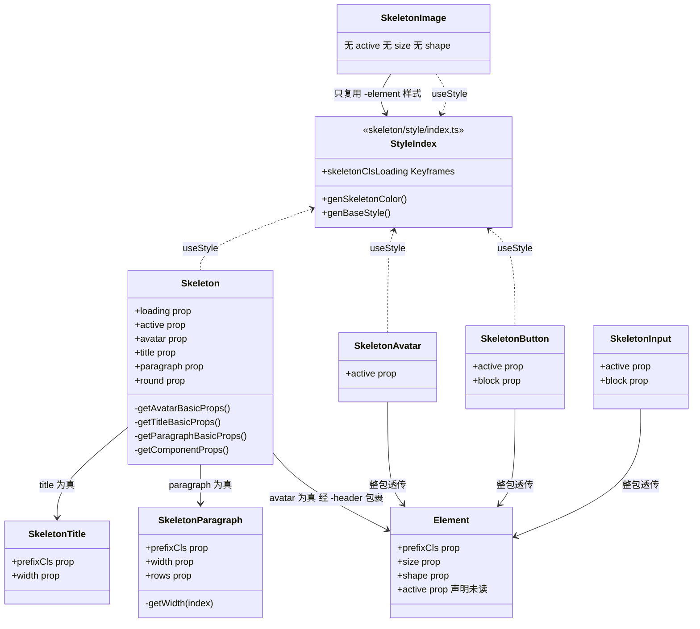
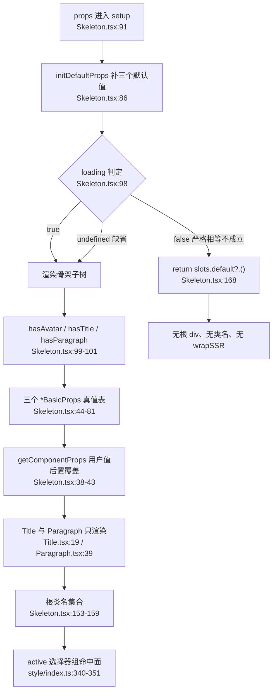
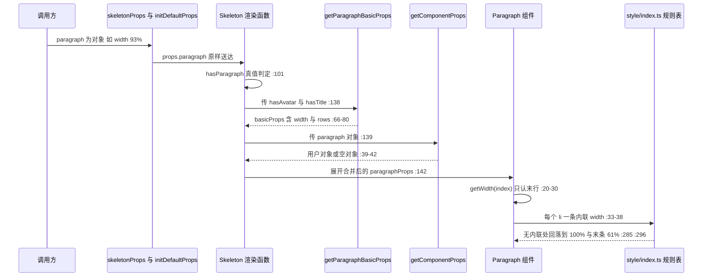

# C11-03 Skeleton 骨架屏

> **本篇解决**：`avatar` / `title` / `paragraph` 三个「布尔或对象」配置到底经过哪几层函数才变成 DOM 上的类名与内联宽度；`loading=false` 时子内容的渲染分支少了哪些东西；以及 Skeleton 目录里哪几条样式规则永远查不到、哪个 prop 从声明到渲染就断了。
> **前置**：C11-00《类横写：占位、进度与统计三类的更新频率取舍》　**读者坐标**：`03-components/11-status` 第 3 篇（组件篇）

## 一、职责与边界

Skeleton 负责把「一块还没到期的内容」画成静态占位图形：一个可选头像块、一个标题块、若干段落行，或者由调用方给出的一个元素级占位（按钮 / 输入框 / 图像 / 头像）。它**不**负责 loading 时序（没有 `delay`，与 Spin 的关键差别）、**不**负责任何数据形状（没有 children 骨架模板协议，只有 `paragraph.rows` 这一维）、也**不**负责进出场动画（`loading` 为假时整棵骨架子树直接消失，无过渡）。

本篇只写 `packages/xiaoye-ui/src/skeleton/` 这 11 个文件。三条边界按 `OUTLINE.md` 的类横写口径划走，不在此展开：

- 「CSS 关键帧自循环这一档的更新频率与可改写层级」「`-active` 选择器组覆盖哪几类子块」→ 见 C11-00 论点 1。本篇只在需要说明配置对象如何决定这些选择器命中面时引用它，不重数循环条数（那个量级推导见 C11-00 §五）。
- 「Skeleton 被 Statistic 当作 loading 占位」→ 见 C11-00 §一 的依赖清单与 `C11-04`《Statistic 统计数值》。本篇只在论点 7 讨论跨组件复用时提到它传的是 `paragraph={false}`，不分析 Statistic 侧。
- 「`wrapSSR` 是恒等函数、SSR 内联体整段被注释」→ 见 C12-07 论点 6。本篇据此把 `wrapSSR` 一律当渲染无副作用的包装处理，不再论证。

依赖清单（本篇取到的直接证据）：配置注入 `useConfigInject`（`packages/xiaoye-ui/src/skeleton/Skeleton.tsx:92`，helper 在 `packages/xiaoye-ui/src/config-provider/hooks/useConfigInject.ts:14` 与 `:15`）、样式生成 `genComponentStyleHook` + `mergeToken` + `Keyframes`（`packages/xiaoye-ui/src/skeleton/style/index.ts:4`、`:2`、`:11`）、默认值装配 `initDefaultProps`（`packages/xiaoye-ui/src/skeleton/Skeleton.tsx:86`，实现 `packages/xiaoye-ui/src/_util/props-util/initDefaultProps.ts:21`）、类名合并 `classNames`（`packages/xiaoye-ui/src/skeleton/Skeleton.tsx:3`）、props 裁剪 `omit`（`packages/xiaoye-ui/src/skeleton/Input.tsx:7`、`packages/xiaoye-ui/src/skeleton/Image.tsx:4`）、注册工具 `registerComponent`（`packages/xiaoye-ui/src/skeleton/index.tsx:8`，实现 `packages/xiaoye-ui/src/_util/registerComponent.ts:16`）。

## 二、源码地图

行数取自 `find packages/xiaoye-ui/src/skeleton -type f | xargs wc -l`（11 个文件合计 966 行，`demo/` 不存在于该目录）。

| 文件 | 行数 | 职责 | 关键导出符号 |
| --- | --- | --- | --- |
| `packages/xiaoye-ui/src/skeleton/Skeleton.tsx` | 173 | 主入口：三态 `loading` 判定 + 配置对象到 DOM 的映射 | `skeletonProps`（`:17`）、默认导出 `XYSkeleton`（`:83-85`） |
| `packages/xiaoye-ui/src/skeleton/Title.tsx` | 24 | 标题块，渲染 `<h3>` | `skeletonTitleProps`（`:4`）、`SkeletonTitle`（`:11`） |
| `packages/xiaoye-ui/src/skeleton/Paragraph.tsx` | 44 | 段落块，渲染 `<ul>` + `rows` 个 `<li>` | `skeletonParagraphProps`（`:5`）、`getWidth`（`:20`） |
| `packages/xiaoye-ui/src/skeleton/Element.tsx` | 42 | size/shape → 类名与内联尺寸的原子（函数式组件） | `skeletonElementProps`（`:4`）、`Element`（`:15`） |
| `packages/xiaoye-ui/src/skeleton/Avatar.tsx` | 48 | 独立头像骨架 | `avatarProps`（`:9`）、`XYSkeletonAvatar`（`:18`） |
| `packages/xiaoye-ui/src/skeleton/Button.tsx` | 49 | 独立按钮骨架 | `skeletonButtonProps`（`:9`）、`XYSkeletonButton`（`:19`） |
| `packages/xiaoye-ui/src/skeleton/Input.tsx` | 47 | 独立输入框骨架 | `SkeletonInputProps`（`:10`，纯 interface，无 props 工厂）、`XYSkeletonInput`（`:15`） |
| `packages/xiaoye-ui/src/skeleton/Image.tsx` | 42 | 独立图像骨架（内置 SVG path） | `SkeletonImageProps`（`:9`）、`XYSkeletonImage`（`:14`） |
| `packages/xiaoye-ui/src/skeleton/index.tsx` | 41 | 5 个静态挂载 + `install` + 类型再导出 | `Skeleton.Button`（`:18`）…`Skeleton.Title`（`:22`） |
| `packages/xiaoye-ui/src/skeleton/style/index.ts` | 387 | 全部样式与那条 1.4s 关键帧 | `ComponentToken`（`:6`）、`genSkeletonColor`（`:47`）、默认导出 hook（`:356`） |
| `packages/xiaoye-ui/src/skeleton/index.test.js` | 69 | 唯一测试文件 | `genSkeleton`（`:7`） |

主实现入口是 `packages/xiaoye-ui/src/skeleton/Skeleton.tsx:95` 的渲染函数（`setup` 返回的闭包），配置对象到 DOM 的全部映射都发生在 `:96-166` 这一段。样式表的主结构在 `packages/xiaoye-ui/src/skeleton/style/index.ts:239` 的 `genBaseStyle` 返回值里。

**没有的东西也要登记**：该目录内没有 `__tests__/` 子目录、没有 `demo/`、没有 `*Types.ts`（props 类型与实现同文件，见 `Skeleton.tsx:17`、`Title.tsx:4`、`Paragraph.tsx:5`、`Element.tsx:4`），也没有 `Skeleton.Paragraph` 静态件（`index.tsx:18-22` 的五个挂载里没有它，`:34` 的具名导出列表里也没有它）——`Paragraph` 只能经由 `Skeleton` 的 `paragraph` prop 到达，这一点在论点 2 里会成为「谁给 `rows` 兜底」的关键。

## 三、架构与数据流

### 图 1：静态结构（谁持有谁，以及三条独立入口）



这张图的承重信息是**汇聚到 `Element` 的四条边**：`Skeleton` 的 avatar 分支（`packages/xiaoye-ui/src/skeleton/Skeleton.tsx:114`）与三个元素级组件（`packages/xiaoye-ui/src/skeleton/Avatar.tsx:41`、`packages/xiaoye-ui/src/skeleton/Button.tsx:42`、`packages/xiaoye-ui/src/skeleton/Input.tsx:40`）都把尺寸与形状语义交给同一个 `Element`，而 `SkeletonImage` 是唯一的例外——它自己画 `<svg>`（`packages/xiaoye-ui/src/skeleton/Image.tsx:28-34`）并因此拿不到 `Element` 的那套 `size`/`shape` 通道。第二条信息是 `Skeleton` 内部那四个私有函数（`packages/xiaoye-ui/src/skeleton/Skeleton.tsx:38-81`）：它们是「配置对象 → DOM」这条路上唯一的一层计算，`Title` 与 `Paragraph` 自己不做任何推导（`packages/xiaoye-ui/src/skeleton/Title.tsx:16-20`、`packages/xiaoye-ui/src/skeleton/Paragraph.tsx:31-40`）。

### 图 2：一次渲染的判定树（loading 三态在前，配置对象在后）



图里两个分支值得先说清存在理由。第一个是 `:98` 的判定写成 `loading || props.loading === undefined` 而不是直接 `loading`：因为 `loading` 的声明带 `default: undefined`（`packages/xiaoye-ui/src/skeleton/Skeleton.tsx:19`），缺省时 prop 值就是 `undefined`，所以这个「或」不是冗余防御而是**默认显示骨架**这件事的唯一实现方式（论点 1 会把它拆到 Vue 的 Boolean 转换层）。第二个是 `E → L` 这条死路：非 loading 分支直接返回插槽，绕过了 `:161` 的 `wrapSSR` 与 `:153` 的类名集合，两个分支的 DOM 形状完全不同构（论点 6 展开）。

### 图 3：一个对象配置落到 `<li style>` 的闭环



这条链上只有一次真分叉：`GC` 的返回值排在 `BA` 的返回值之后展开（`packages/xiaoye-ui/src/skeleton/Skeleton.tsx:137-139` 的字面顺序），因此用户值恒覆盖推导值；而 `prefixCls` 写在两者之前（`:137`），意味着调用方如果往 `paragraph` 对象里塞 `prefixCls`，可以反过来覆盖掉框架自己算出来的类名前缀（论点 2 末尾讨论这个顺序的可利用面）。

## 四、核心机制精读

### 论点 1：`loading` 的「缺省就显示骨架」不是写在判定式里的，而是写在 prop 声明的 `default: undefined` 里——把这两个字删掉，组件语义整体翻转

断言：`packages/xiaoye-ui/src/skeleton/Skeleton.tsx:98` 的 `loading || props.loading === undefined` 常被读成「防御式写法」，但真正承重的是 `packages/xiaoye-ui/src/skeleton/Skeleton.tsx:19` 那句看起来什么都没有声明的 `default: undefined`。把它改成 `loading: Boolean`，第二条件就永远不成立，组件从「默认显示骨架」翻转为「默认显示子内容」。

```tsx
// packages/xiaoye-ui/src/skeleton/Skeleton.tsx:17
export const skeletonProps = () => ({
  active: { type: Boolean, default: undefined },
  loading: { type: Boolean, default: undefined },
  prefixCls: String,
  avatar: {
    type: [Boolean, Object] as PropType<SkeletonAvatarProps | boolean>,
    default: undefined as SkeletonAvatarProps | boolean,
  },
  title: {
    type: [Boolean, Object] as PropType<SkeletonTitleProps | boolean>,
    default: undefined as SkeletonTitleProps | boolean,
  },
  paragraph: {
    type: [Boolean, Object] as PropType<SkeletonParagraphProps | boolean>,
    default: undefined as SkeletonParagraphProps | boolean,
  },
  round: { type: Boolean, default: undefined },
});
```

```tsx
// packages/xiaoye-ui/src/skeleton/Skeleton.tsx:95
    return () => {
      const { loading, avatar, title, paragraph, active, round } = props;
      const pre = prefixCls.value;
      if (loading || props.loading === undefined) {
        const hasAvatar = !!avatar || (avatar as string) === '';
        const hasTitle = !!title || (title as string) === '';
        const hasParagraph = !!paragraph || (paragraph as string) === '';
```

Vue 3 对 prop 的 Boolean 转换有一条前置判据：只有当声明里**不存在** `default` 键时，缺席的 prop 才被折算成 `false`。`loading` 显式写了 `default: undefined`，键存在，于是转换被跳过，缺省值是字面 `undefined`，`:98` 的第二个条件才成立。这不是推测：用本仓 `node_modules` 里的 Vue 3.5.40 做两种声明的对照渲染，`{ type: Boolean, default: undefined }` 的组件收到 `undefined:undefined`，而 `Boolean` 的组件收到 `false:boolean`（可复现命令见附录检查点 1）。同一条转换规则也解释了为什么 `active`（`:18`）与 `round`（`:33`）也用 `default: undefined` 写：它们不需要「缺省即真」，但需要区分「没写」与「写了 false」——不过这两个 prop 的读取点都是纯真值判断（`:155`、`:157`），所以这个区分对它们没有任何效果，属于同形但无用的声明。

**这条判定的两个失效面**。第一，`loading="false"`（不带冒号的静态属性）到达组件时是字符串 `"false"`，类型不是 `Boolean`，Vue 只在开发模式打一条 `Invalid prop` 警告、不做转换；`:98` 走的是第一个条件，字符串非空即真，于是**骨架永远不消失**。仓内为布尔 prop 准备的现成工厂 `PropTypes.looseBool` 也救不了这一种写法——它展开出来就是 `{ type: Boolean, default: undefined }`（`packages/xiaoye-ui/src/_util/vue-types/index.ts:8-11`），与 `:19` 手写的字面量同一形状，差别只在「跳过缺席转换」而不在「转换 `'false'` 字符串」（用它的例子见 `packages/xiaoye-ui/src/_util/BaseInput.tsx:27`）。也就是说 `:19` 等价于 `PropTypes.looseBool`，但绕开了 `_util` 的统一入口（同族的另一种写法是 `withUndefined`，`packages/xiaoye-ui/src/_util/vue-types/index.ts:28-30`）。第二，`:99-101` 那三个 `(x as string) === ''` 子条件不可达。它们想服务的是 `<xy-skeleton avatar>` 这种「空字符串属性」写法，但 `avatar`/`title`/`paragraph` 的类型数组里含 `Boolean`（`:22`、`:26`、`:30`），Vue 的转换规则对 `rawValue === ''` 直接产出 `true`——实测 `{ avatar: '' }` 进入组件时是 `avatar: true`，`{ title: '' }` 同理。因此 `!!avatar` 一侧早已覆盖全部可达情形，`=== ''` 那一支是上游 Vue 2 时代的遗留字面量，运行期一次都不命中。四种写法的效果对照如下（第一列是模板里的写法，第二列是组件 `setup` 实际收到的值）：

| 模板写法 | 组件收到 | `:98` 分支 | 屏幕结果 |
| --- | --- | --- | --- |
| 不写 `loading` | `undefined` | 第二条件真 | 骨架 |
| `loading` | `true` | 第一条件真 | 骨架 |
| `loading="false"` | 字符串 `"false"` | 第一条件真 | 骨架（陷阱） |
| `:loading="false"` | `false` | 都不成立 | 子内容 |

维护含义很清楚：**`:19` 的 `default: undefined` 与 `:98` 的第二条件是同一条语义的两半，删任一半都会翻转默认行为**，而这条语义在 `apps/docs/components/skeleton.md` 的 API 表里是以「loading 是否 loading」一句话带过的，没有任何一处文字说明缺省值是什么。

### 论点 2：段落块的宽度由「JS 只给末行」与「CSS 只给 ≥3 行的末行」两套判据分头决定，两者的交集是巧合、差集就是观感不一致的来源

断言：`paragraph` 对象到 `<li style>` 的路径上只有 `packages/xiaoye-ui/src/skeleton/Paragraph.tsx:20-30` 一次计算，而样式表另有两条各自的宽度规则（`packages/xiaoye-ui/src/skeleton/style/index.ts:285` 的 `width: '100%'` 与 `packages/xiaoye-ui/src/skeleton/style/index.ts:296` 的末条 `61%`）。三者的生效判据不同源，任何一处改动 `rows` 或 `width` 的推导都会改变**哪一行由谁上色**。

```tsx
// packages/xiaoye-ui/src/skeleton/Skeleton.tsx:65
function getParagraphBasicProps(hasAvatar: boolean, hasTitle: boolean): SkeletonParagraphProps {
  const basicProps: SkeletonParagraphProps = {};

  // Width
  if (!hasAvatar || !hasTitle) {
    basicProps.width = '61%';
  }

  // Rows
  if (!hasAvatar && hasTitle) {
    basicProps.rows = 3;
  } else {
    basicProps.rows = 2;
  }

  return basicProps;
}
```

```tsx
// packages/xiaoye-ui/src/skeleton/Paragraph.tsx:19
  setup(props) {
    const getWidth = (index: number) => {
      const { width, rows = 2 } = props;
      if (Array.isArray(width)) {
        return width[index];
      }
      // last paragraph
      if (rows - 1 === index) {
        return width;
      }
      return undefined;
    };
    return () => {
      const { prefixCls, rows } = props;
      const rowList = [...Array(rows)].map((_, index) => {
        const width = getWidth(index);
        return (
          <li key={index} style={{ width: typeof width === 'number' ? `${width}px` : width }} />
        );
      });
      return <ul class={prefixCls}>{rowList}</ul>;
    };
  },
```

先把真值表摊开。`packages/xiaoye-ui/src/skeleton/Skeleton.tsx:99-101` 的三个真值经 `:138` 送进上面第一个函数，产出只有四种组合：无头像有标题 → `width: '61%'` + `rows: 3`；有头像有标题 → **不给 width** + `rows: 2`；无标题（无论有无头像）→ `width: '61%'` + `rows: 2`。注意宽度条件用的是「或」（`:70`），所以「同时有头像与标题」是唯一拿不到 JS 宽度的分支，而这恰好也是 `rows` 被压到 2 的分支——两件事同时发生时，CSS 的末条规则又按 `:not(:nth-child(2))` 明确排除第 2 行（`packages/xiaoye-ui/src/skeleton/style/index.ts:296`），于是这个分支的两行都是满宽。默认分支（无头像、有标题）则是 `rows: 3`，末行既被 JS 写了 `61%` 内联、又落在 CSS 的 61% 规则上（三行时末行是第 3 个子元素，两个 `:not()` 都通过），两条机制**数值刚好相同**，掩盖了它们其实互不知情。

再看 `getWidth` 的第二个判据为什么只认末行。`:26-28` 的结构是「数组优先、否则只给 `rows - 1` 那一行」，也就是说标量 `width` 的语义被定义成「末行宽度」而不是「每行宽度」，非末行返回 `undefined`，`:36` 于是写出 `style={{ width: undefined }}`，Vue 直接不产生内联宽度，回落由 `packages/xiaoye-ui/src/skeleton/style/index.ts:284-285` 的 `'> li': { width: '100%' }` 承担。这条设计一旦遇到数组宽度就变形：`:22-24` 的数组分支**无条件 return**，不再回到「末行取 width」的逻辑，所以 `paragraph: { rows: 4, width: ['28%'] }` 的第 2、3、4 行都拿不到内联宽度，而第 4 行会被 CSS 拉到 `61%`——调用方给了一个长度不足的数组，得到的是「前三行 100% 加末行 61%」，与 `:22-24` 字面上「按索引取」的直觉相反。选择器层面的优先级是成立的：`:296` 的组合是「2 个类 + 3 个结构伪类」，压过 `:285` 的「2 个类 + 1 个类型选择器」，而 `:36` 的内联样式又同时压过两者，所以最终每行的宽度取决于「JS 有没有给它内联值」这一个二值判据。

`Title` 的映射短得多，但同样有两层。`packages/xiaoye-ui/src/skeleton/Title.tsx:16-20` 只做一件事：把 `width` 的数字形式补成 `px` 再写内联，`<h3 class={prefixCls}>` 是它唯一的 DOM。`packages/xiaoye-ui/src/skeleton/Skeleton.tsx:53-63` 给它的默认值只有 `38%`（无头像有段落）与 `50%`（有头像有段落）两种，其余情形返回空对象；空对象时 `width` 为 `undefined`，`:19` 写出 `style={{ width: undefined }}`，此时才轮到样式表的 `width: '100%'`（`packages/xiaoye-ui/src/skeleton/style/index.ts:272`）。所以「标题占多宽」在默认配置下由 JS 决定、在 `title: true` 之外的显式配置下由调用方决定，`title: false` 时整个 `<h3>` 不渲染（`packages/xiaoye-ui/src/skeleton/Skeleton.tsx:123-131`）。

最后是这个顺序带来的一个可利用面，值得登记而不是当缺陷：三处合并都把 `prefixCls` 写在展开的**最前面**（`packages/xiaoye-ui/src/skeleton/Skeleton.tsx:107`、`:125`、`:137`），用户对象排在最后（`:109`、`:127`、`:139`）。因此 `<xy-skeleton :paragraph="{ prefixCls: 'foo' }">` 会让 `Paragraph` 收到 `prefixCls: 'foo'` 并在 `packages/xiaoye-ui/src/skeleton/Paragraph.tsx:39` 渲染出 `<ul class="foo">`——骨架从此不再命中任何一条 `xy-skeleton-*` 规则。这条通道没有被任何类型禁止（`SkeletonParagraphProps` 就是 `ExtractPropTypes` 的产物，含 `prefixCls`，见 `packages/xiaoye-ui/src/skeleton/Paragraph.tsx:11-13`），但它不是特性：它同时会破坏 `packages/xiaoye-ui/src/skeleton/style/index.ts:340-348` 那个 `-active` 选择器组的命中面，因为后代类名被换掉了。

### 论点 3：`avatar` 配置经过 `Element` 时只剩三类信息，其中「方形头像」这一支发出的类名在样式表里没有任何规则，而头像尺寸规则在同一份 CSS 里被抄了两遍

断言：`packages/xiaoye-ui/src/skeleton/Skeleton.tsx:44-51` 专门为「有标题、无段落」构造了一个方形头像，但 `packages/xiaoye-ui/src/skeleton/Element.tsx:25` 产出的 `xy-skeleton-avatar-square` 在整个样式表里查无此规则；同一段头像尺寸则在 `packages/xiaoye-ui/src/skeleton/style/index.ts:84-92`（元素路径）与 `:255-263`（组合路径）各写了一遍，两遍的选择器形态还不相同。

```tsx
// packages/xiaoye-ui/src/skeleton/Skeleton.tsx:44
function getAvatarBasicProps(hasTitle: boolean, hasParagraph: boolean): SkeletonAvatarProps {
  if (hasTitle && !hasParagraph) {
    // Square avatar
    return { size: 'large', shape: 'square' };
  }

  return { size: 'large', shape: 'circle' };
}
```

```tsx
// packages/xiaoye-ui/src/skeleton/Element.tsx:15
const Element: FunctionalComponent<SkeletonElementProps> = props => {
  const { prefixCls, size, shape } = props;

  const sizeCls = classNames({
    [`${prefixCls}-lg`]: size === 'large',
    [`${prefixCls}-sm`]: size === 'small',
  });

  const shapeCls = classNames({
    [`${prefixCls}-circle`]: shape === 'circle',
    [`${prefixCls}-square`]: shape === 'square',
    [`${prefixCls}-round`]: shape === 'round',
  });

  const sizeStyle: CSSProperties =
    typeof size === 'number'
      ? {
          width: `${size}px`,
          height: `${size}px`,
          lineHeight: `${size}px`,
        }
      : {};

  return <span class={classNames(prefixCls, sizeCls, shapeCls)} style={sizeStyle} />;
};
```

`Element` 是这个组件族里唯一的原子，它的函数体只解构三个名字（`:16` 的 `prefixCls, size, shape`），因此它接收的配置信息被压缩成三类：一个尺寸类名（`:18-21`，只有 `large`/`small` 两个取值会产出类，`default` 落到基础尺寸）、一个形状类名（`:23-27`）、一个数字尺寸的 `width/height/lineHeight` 内联三元组（`:29-36`）。第四类信息——**它自己的 `active` prop（`packages/xiaoye-ui/src/skeleton/Element.tsx:8`）没有任何读取点**：`grep -rn "active" packages/xiaoye-ui/src/skeleton/Element.tsx` 在该文件只回一行，就是声明那一行。这条声明是活的、实现是死的，而它的三个调用方都把自己整包 props 透传进来（`packages/xiaoye-ui/src/skeleton/Avatar.tsx:41`、`packages/xiaoye-ui/src/skeleton/Button.tsx:42`、`packages/xiaoye-ui/src/skeleton/Input.tsx:40` 都是 `<Element {...props} prefixCls={...} />`），于是每次渲染都白送一个被丢弃的键。真正决定微光动画的是外层包裹 `<div>` 上的 `xy-skeleton-active`（`packages/xiaoye-ui/src/skeleton/Avatar.tsx:33`、`packages/xiaoye-ui/src/skeleton/Button.tsx:33`、`packages/xiaoye-ui/src/skeleton/Input.tsx:31`）或组合骨架的根 `<div>`（`packages/xiaoye-ui/src/skeleton/Skeleton.tsx:155`），配合 C11-00 论点 1 已归类的那条 `-active` 选择器组（`packages/xiaoye-ui/src/skeleton/style/index.ts:340`）。组合路径甚至连传都没传：`packages/xiaoye-ui/src/skeleton/Skeleton.tsx:106-110` 拼的 `avatarProps` 只有 `prefixCls` + basic + 用户对象，`active` 被类型层挡在外面（`packages/xiaoye-ui/src/skeleton/Skeleton.tsx:15` 的 `Omit<AvatarProps, 'active'>`）。

`shape: 'square'` 这条分支要分两层看。**规则层**：`square` 在整个 `packages/xiaoye-ui/src/skeleton/style/index.ts` 里零命中（目录级检索只回到 `Element.tsx:25`、`Avatar.tsx:12` 的类型与 `index.test.js:43` 的测试数据），所以 `xy-skeleton-avatar-square` 是一个「生成但从不被查询」的类名。**视觉层**：头像基础规则（`packages/xiaoye-ui/src/skeleton/style/index.ts:78-83` 与 `:249-254`）本来就不写 `border-radius`，矩形正是默认外观。两件事叠加的结果是：`getAvatarBasicProps` 的这个特判分支实际只做了 `size: 'large'` 这一半工作，`shape: 'square'` 是零作用的装饰；想给方形头像补描边或圆角差异时，改样式表加一条 `-square` 规则即可让这行代码「活过来」，但那会让 `title && !paragraph` 这一种组合的形状与其它组合不同，而这个差异此前是靠「没有规则」维持的。

尺寸规则的重复是这样的：同一个 `<span class="xy-skeleton-avatar xy-skeleton-avatar-lg">`，在独立用法里由 `${componentCls}${componentCls}-element` 块负责（`packages/xiaoye-ui/src/skeleton/style/index.ts:318-326` 展开时调用 `genSkeletonElementAvatar`，其 `-lg` 规则写作 `packages/xiaoye-ui/src/skeleton/style/index.ts:87-89` 的**复合选择器** `.xy-skeleton-avatar.xy-skeleton-avatar-lg`），在组合用法里由 `-header` 嵌套块负责（`packages/xiaoye-ui/src/skeleton/style/index.ts:243-264`，其 `-lg` 规则写作 `:258-260` 的**后代选择器** `.xy-skeleton .xy-skeleton-header .xy-skeleton-avatar-lg`）。两块的属性集合逐字相同（`display: inline-block`、`verticalAlign: top`、`background: color`、`genSkeletonElementAvatarSize(...)`），差别只在祖先链。也就是说改头像默认尺寸时必须同时改 `:82`/`:88`/`:91` 与 `:253`/`:259`/`:261` 两组六处，漏一侧就出现「`<xy-skeleton-avatar>` 变了、`<xy-skeleton :avatar="{}">` 没变」。`button`/`input` 只有元素路径一份（`packages/xiaoye-ui/src/skeleton/style/index.ts:96-122`、`:157-212`），因为它们不能出现在组合骨架里——组合分支只渲染 `-header`、`-title`、`-paragraph` 三种类名（`packages/xiaoye-ui/src/skeleton/Skeleton.tsx:113`、`:125`、`:137`）。

### 论点 4：`Skeleton.Image` 是唯一不走 `Element` 的元素级骨架，代价是它的三个 prop 被整体删掉、样式表里为它写的三条规则全部查不到

断言：`packages/xiaoye-ui/src/skeleton/Image.tsx:17` 用 `omit` 把 `size`、`shape`、`active` 三个键从 props 里删了，于是 `packages/xiaoye-ui/src/skeleton/style/index.ts:148`、`:152`、`:347` 三条依赖 `xy-skeleton-image-circle` / `xy-skeleton-image-svg-circle` / 根上带 `-active` 的规则永远无法命中。

```tsx
// packages/xiaoye-ui/src/skeleton/Image.tsx:14
const SkeletonImage = defineComponent({
  compatConfig: { MODE: 3 },
  name: 'XYSkeletonImage',
  props: omit(skeletonElementProps(), ['size', 'shape', 'active']),
  setup(props) {
    const { prefixCls } = useConfigInject('skeleton', props);
    const [wrapSSR, hashId] = useStyle(prefixCls);
    const cls = computed(() =>
      classNames(prefixCls.value, `${prefixCls.value}-element`, hashId.value),
    );
    return () => {
      return wrapSSR(
        <div class={cls.value}>
          <div class={`${prefixCls.value}-image`}>
            <svg
              viewBox="0 0 1098 1024"
              xmlns="http://www.w3.org/2000/svg"
              class={`${prefixCls.value}-image-svg`}
            >
              <path d={path} class={`${prefixCls.value}-image-path`} />
            </svg>
          </div>
        </div>,
      );
    };
  },
});
```

三条查不到的规则分别是：

| 规则位置 | 选择器要求 | 渲染侧最接近的输出 |
| --- | --- | --- |
| `packages/xiaoye-ui/src/skeleton/style/index.ts:148-150` | 同一元素上同时有 `xy-skeleton-image-svg` 与 `xy-skeleton-image-svg-circle` | `packages/xiaoye-ui/src/skeleton/Image.tsx:31` 只写 `-image-svg` |
| `packages/xiaoye-ui/src/skeleton/style/index.ts:152-154` | 同一元素上同时有 `xy-skeleton-image` 与 `xy-skeleton-image-circle` | `packages/xiaoye-ui/src/skeleton/Image.tsx:27` 只写 `-image` |
| `packages/xiaoye-ui/src/skeleton/style/index.ts:347` | 根元素带 `xy-skeleton-active` 且其后代有 `xy-skeleton-image` | `packages/xiaoye-ui/src/skeleton/Image.tsx:21-23` 的类名集合里没有 `-active` |

前两行的因果直接：`shape` 被 `omit` 掉了（`:17`），而全目录里唯一产出 `-circle` 类名的地方是 `packages/xiaoye-ui/src/skeleton/Element.tsx:24`，`Image` 又根本不渲染 `Element`。第三行的因果多一层：即使有代码想给图像加动画，也无处可加——`cls` 的三项是写死的（`:21-23`），组件的 props 面里没有 `active` 这一项。所以 `<xy-skeleton-image active>` 的语义现在是「一个没有任何组件级效果的未知属性」：它不在 props 声明里（`:17`），目录内又没有任何一处 `inheritAttrs: false`（`grep -rn "inheritAttrs" packages/xiaoye-ui/src/skeleton` 返回空），于是 `active` 留在 `attrs` 里、按 Vue 的默认透传挂到根 `<div>` 上，成为 DOM 上一个不与任何选择器关联的属性。同一条通道对 `size` 与 `shape` 同样成立，而 `size` 的删除还带来第二重后果：图像骨架的方框尺寸被钉在 `packages/xiaoye-ui/src/skeleton/style/index.ts:139` 的 `imageSizeBase * 2`（其值来自 `packages/xiaoye-ui/src/skeleton/style/index.ts:368` 的 `token.controlHeight * 1.5`），调用方与主题都改不动它——主题能改到 `controlHeight`，但那是全站共用的一档，不是图像骨架的旋钮。

随仓示例恰好把这个不一致摆在同一屏上：`apps/docs/examples/skeleton/element.vue:3`、`:4`、`:5` 给 button、avatar、input 都绑了 `:active="active"`，而 `apps/docs/examples/skeleton/element.vue:12` 的 `<xy-skeleton-image />` 什么都不传——不是漏写，是这个组件没有可传的东西。开关本身由同文件 `:16` 的 `xy-switch` 统一控制，于是拖动它时三个骨架亮起来、第四个始终不动。要修的地方有两处，且方向不同：要么给 `Image` 补一个 `active`（`packages/xiaoye-ui/src/skeleton/Image.tsx:17` 的 omit 列表去掉 `'active'` + `:21-23` 补一条类名判断，`-active` 那条 :347 立刻生效），要么把 `:148`、`:152`、`:347` 三条规则删掉并在文档里说明图像骨架不支持动画与尺寸。当前状态是三处都留着，读者只能靠逐文件对照才知道它们是死的。

### 论点 5：`Skeleton.Title` 挂载了、注册了、导出了，但它的样式只存在于 `-content` 之下，而它的组件名又少了 `XY` 前缀——三重脱节叠在一起，这个静态件在模板与 TSX 里都不是它看起来的样子

断言：`packages/xiaoye-ui/src/skeleton/index.tsx:22` 把 `SkeletonTitle` 挂成静态件、`:31` 把它注册进全局、`:34` 把它具名导出，但 `<h3>` 的样式规则全部嵌套在 `-content` 里（`packages/xiaoye-ui/src/skeleton/style/index.ts:271-279`），而 `packages/xiaoye-ui/src/skeleton/Title.tsx:13` 的 `name: 'SkeletonTitle'` 会让注册标签变成 `skeleton-title` 而不是 `xy-skeleton-title`。

```tsx
// packages/xiaoye-ui/src/skeleton/index.tsx:18
Skeleton.Button = SkeletonButton;
Skeleton.Avatar = SkeletonAvatar;
Skeleton.Input = SkeletonInput;
Skeleton.Image = SkeletonImage;
Skeleton.Title = SkeletonTitle;

/* istanbul ignore next */
Skeleton.install = function (app: App) {
  registerComponent(app, Skeleton);
  registerComponent(app, SkeletonButton);
  registerComponent(app, SkeletonAvatar);
  registerComponent(app, SkeletonInput);
  registerComponent(app, SkeletonImage);
  registerComponent(app, SkeletonTitle);
  return app;
};
export { SkeletonButton, SkeletonAvatar, SkeletonInput, SkeletonImage, SkeletonTitle };
export default Skeleton as typeof Skeleton &
  Plugin & {
    readonly Button: typeof SkeletonButton;
    readonly Avatar: typeof SkeletonAvatar;
    readonly Input: typeof SkeletonInput;
    readonly Image: typeof SkeletonImage;
  };
```

**标签名这一层是确定的字符串运算，不是猜测。** `registerComponent` 取名的优先级是 `customName || comp.displayName || comp.name`（`packages/xiaoye-ui/src/_util/registerComponent.ts:18`），`SkeletonTitle` 没有 `displayName`（`defineComponent` 对象里只有 `name`，见 `packages/xiaoye-ui/src/skeleton/Title.tsx:11-14`），于是走 `name`；`toXYTagName` 先 `replace(/^XY/, 'xy-')`（`packages/xiaoye-ui/src/_util/registerComponent.ts:8`）——`SkeletonTitle` 不以 `XY` 开头，这一步空转——再按小写-大写边界插连字符并转小写（`:9-10`），结果是 `skeleton-title`。对照同目录的四个兄弟：`XYSkeletonAvatar`（`packages/xiaoye-ui/src/skeleton/Avatar.tsx:20`）、`XYSkeletonButton`（`packages/xiaoye-ui/src/skeleton/Button.tsx:21`）、`XYSkeletonInput`（`packages/xiaoye-ui/src/skeleton/Input.tsx:17`）、`XYSkeletonImage`（`packages/xiaoye-ui/src/skeleton/Image.tsx:16`）都带 `XY` 前缀，得到的正是 `xy-skeleton-*`。也就是说 `Title` 一个文件违反了 `AGENTS.md`「组件 `name` 统一使用 `XYXxx`」这条硬约定，而 `registerComponent` 不会报错、只会静默产出一个无前缀标签。这条断裂至今没有被暴露：`grep -rn "skeleton-title" packages apps` 的命中全部落在 `packages/xiaoye-ui/src/theme/convertLegacyToken.ts:920-921` 的旧 LESS 键名上（`'skeleton-title-height'` 与 `'skeleton-title-paragraph-margin-top'`，整个文件无人调用，见 A03 论点 10 的登记表），`apps/docs` 下零命中；文档只讲 `title` prop（`apps/docs/components/skeleton.md:70` 那一行标着默认值 `true`），没有任何一处使用标签形式。

**样式作用域这一层更要命。** `<h3>` 拿到的类名就是传进来的 `prefixCls`（`packages/xiaoye-ui/src/skeleton/Title.tsx:19` 的 `<h3 class={prefixCls} style={{ width: zWidth }} />`），组合路径下它是 `xy-skeleton-title`（`packages/xiaoye-ui/src/skeleton/Skeleton.tsx:125`）。而样式表里给 title 写规则的两处都在祖先选择器内部：`packages/xiaoye-ui/src/skeleton/style/index.ts:265-279` 的 `${componentCls}-content` 嵌套块（提供 `width: 100%`、`height: skeletonTitleHeight`、`background: color`、`borderRadius`）与 `:302` 的 `&-round ${componentCls}-content` 组。把 `SkeletonTitle` 单独放进模板时，DOM 里没有任何 `.xy-skeleton` 祖先，`h3` 因此得不到高度与背景——渲染结果是一个**空的、零高度的 `<h3>`**（`packages/xiaoye-ui/src/skeleton/Title.tsx:19` 不写任何文本内容），既看不到占位条也不会报错。`-active` 组同理，它的前缀是 `${componentCls}${componentCls}-active`（`packages/xiaoye-ui/src/skeleton/style/index.ts:340`），单独使用的 title 连它的后代都算不上。顺带一句 `index.tsx:22` 与 `:35-41` 的键集不一致：默认导出的类型只声明 `Button`/`Avatar`/`Input`/`Image` 四个静态件，`Title` 被挂到了对象上却没进类型，所以 `Skeleton.Title` 在 TSX 里是类型错误、在运行时是可用组件（挂载语句 `:22` 是 any 之外的真实赋值）。

**而 `Paragraph` 走的是另一个方向**：它根本没有静态件（`index.tsx:18-22` 的五个里没有它），也没有具名导出（`:34` 的列表里也没有它），只能从 `paragraph` prop 进入（`packages/xiaoye-ui/src/skeleton/Skeleton.tsx:142`）。这解释了论点 2 里那个看起来无害的 `rows = 2` 解构默认值为什么至今没有造成事故：`packages/xiaoye-ui/src/skeleton/Paragraph.tsx:21` 用 `rows = 2` 决定「哪一行算末行」，而 `:33` 用未经默认值处理的 `rows` 决定「渲染几行」（`[...Array(rows)]`）。今天 `rows` 一定非空，是因为唯一入口 `getParagraphBasicProps` 无条件写了它（`packages/xiaoye-ui/src/skeleton/Skeleton.tsx:74-78`）。哪一天有人照着 `Skeleton.Title` 的先例加一行 `Skeleton.Paragraph = SkeletonParagraph`，这两个 `rows` 就会当场分叉：`[...Array(undefined)]` 的长度是 **1**（JS 侧 `Array` 构造器遇到非数字单参时按「元素列表」处理），于是 `<Skeleton.Paragraph width="50%" />` 渲染出**一行** 50% 宽度的占位条，而那个 `= 2` 让它按「两行的末行规则」去给这一行分配宽度——用户没写 `rows`，得到的是「既不是 0 行也不是默认 2 行」的第三种结果。这条不是猜测，`node -e "console.log([...Array(undefined)].length)"` 输出 `1`，与坑 2 的 `rows: '3'` 是同一个成因的两种表现。

### 论点 6：`loading=false` 的渲染路径只有一行，它丢掉了骨架分支建立的四样东西，其中「属性宿主换人」是唯一会咬到调用方的那一处

断言：`packages/xiaoye-ui/src/skeleton/Skeleton.tsx:168` 的 `return slots.default?.()` 与 `:161-166` 的骨架分支不是「同一棵树的两态」，而是两种不同构的输出——非骨架分支没有根元素、没有类名集合、没有 `hashId`、也没有 `wrapSSR`；由于该目录没有任何 `inheritAttrs: false`，这直接导致调用方的 `class` 与 `style` 在两个分支落到不同 DOM 节点上。

```tsx
// packages/xiaoye-ui/src/skeleton/Skeleton.tsx:153
        const cls = classNames(pre, {
          [`${pre}-with-avatar`]: hasAvatar,
          [`${pre}-active`]: active,
          [`${pre}-rtl`]: direction.value === 'rtl',
          [`${pre}-round`]: round,
          [hashId.value]: true,
        });

        return wrapSSR(
          <div class={cls}>
            {avatarNode}
            {contentNode}
          </div>,
        );
      }
      return slots.default?.();
    };
  },
});
```

先看被丢掉的 `hashId` 为什么在骨架分支里是必需的。`genComponentStyleHook` 产出的每条选择器都会被 `injectSelectorHash` 在**第一个复合段**前插入哈希类（`packages/xiaoye-ui/src/_util/cssinjs/hooks/useStyleRegister/index.tsx:88-98`，其中 `:95` 是插入动作），所以 `.xy-skeleton .xy-skeleton-content .xy-skeleton-title` 实际编译成带 `.css-xxxx` 前缀的形式。`packages/xiaoye-ui/src/skeleton/Skeleton.tsx:158` 把 `hashId.value` 放进根 div 的类名，正是为了让这一串选择器能命中；这也顺带解释了论点 5 里 `Title` 与 `Paragraph` 单独使用为什么一定无样式——它们既不产生 `.xy-skeleton` 祖先（`packages/xiaoye-ui/src/skeleton/Title.tsx:19`、`packages/xiaoye-ui/src/skeleton/Paragraph.tsx:39` 的类名就是传进来的那一个），也不带哈希类。`wrapSSR` 是恒等函数（见 C12-07 论点 6），所以它被不被调用不影响样式登记，登记走的是 `useStyle` 内部的 effect；`:161` 与 `:168` 的差别只在 **DOM 形状**。

`class` 与 `style` 的宿主这一层要看得更细。骨架分支的输出是单个根 `<div>`（`:162`），Vue 的透传属性合并到它身上，调用方写 `<xy-skeleton class="card-skeleton">` 得到 `<div class="xy-skeleton ... card-skeleton">`。非骨架分支输出的是插槽本身（`:168`），同一个 `class` 于是挪到插槽内容的根节点上；如果插槽有多个根节点，透传就没有唯一宿主（Vue 对此会给出一条开发期提示，这属于框架行为、本仓没有测试断言过它，故只作结构性描述）。**同一份用户代码在 `loading` 翻转的两侧拿到不同的 DOM 结构**，这就是「子内容渲染路径有没有条件遗漏」这个提问的实际答案：遗漏不在判据写错，而在这个分支**根本不提供外壳**，导致两侧不对称。对照同类的 Spin：它在同样位置用 `children && filterEmpty(children).length` 分岔，并且两个分支都返回带外壳的结构（`packages/xiaoye-ui/src/spin/Spin.tsx:121-135`，这段代码在 C11-00 论点 2 里被完整摘出），Spin 因此始终有一个可挂类的宿主，Skeleton 没有。

还有两个静默方向。其一，`:168` 不检查插槽是否存在：`<xy-skeleton :loading="false" />` 且不给子内容时，`slots.default` 为 `undefined`，可选链返回 `undefined`，组件什么都不渲染——不报错、不回落骨架。其二，骨架分支从不读 `slots`（`setup` 的第二个参数只在 `packages/xiaoye-ui/src/skeleton/Skeleton.tsx:91` 出现，唯一使用点是 `:168`），所以 `<xy-skeleton :loading="true">已有内容</xy-skeleton>` 会把子内容整块丢掉且毫无提示。这两条合起来意味着 **`loading` 与「有没有子内容」是两个正交输入，而组件只按 `loading` 一个轴决策**。把 Spin 迁到 Skeleton 的页面最容易撞第二向：Spin 的嵌套用法里子内容始终在 DOM 中（只是被加了 `-blur` 类，`packages/xiaoye-ui/src/spin/Spin.tsx:123-128`），Skeleton 的 `loading=true` 则直接不渲染它们，依赖子内容里的 `ref` 或曝光埋点的代码会静默失效。

### 论点 7：Skeleton 的三个环境适配钩子里只有 `-rtl` 这个类名被发出来，而它的样式规则一条都没有；`prefers-reduced-motion` 与 `animation-play-state` 在本组件的采纳面都是零

断言：`packages/xiaoye-ui/src/skeleton/Skeleton.tsx:156` 根据注入的 `direction` 生成 `xy-skeleton-rtl`，但 `packages/xiaoye-ui/src/skeleton/style/index.ts` 全文没有 `-rtl`、也没有任何 `@media`；同一份 RTL 适配实际由逻辑属性完成，因此这个类名是纯冗余的输出点。

`direction` 的来源是 `useConfigInject`（`packages/xiaoye-ui/src/skeleton/Skeleton.tsx:92` 解构出 `prefixCls, direction`，helper 侧在 `packages/xiaoye-ui/src/config-provider/hooks/useConfigInject.ts:15`）。这里有个正面结论值得写下来：`skeletonProps()` **没有**声明 `direction`（`packages/xiaoye-ui/src/skeleton/Skeleton.tsx:17-34` 的七个键里没有它），所以 `useConfigInject.ts:15` 那句 `props.direction ?? configProvider.direction?.value` 的左侧恒为 `undefined`、右侧的全局配置总能生效——Skeleton 不属于 C04-08 记的那类「给自己本该由 `useConfigInject` 兜底的 prop 加默认值 ⇒ 吃掉全局配置」的受害者（那一条的判形命令是 `grep -rn "direction: 'ltr'," packages/xiaoye-ui/src`，在 skeleton 目录内零命中）。同理 `prefixCls` 声明了（`packages/xiaoye-ui/src/skeleton/Skeleton.tsx:20`）并被 `useConfigInject.ts:14` 消费，这条是活的。

但 `xy-skeleton-rtl` 落地为空。**取证用了三种互补方法**：① 目录级 `grep -rn "rtl" packages/xiaoye-ui/src/skeleton` 只回 `Skeleton.tsx:156` 一行，即产出方本身；② 通读样式文件 387 行（`packages/xiaoye-ui/src/skeleton/style/index.ts` 的关键段已在论点 2-4 中逐段引用）确认无 `rtl` 关键字、无 `@media`；③ 该文件表达方向的属性全部是逻辑属性写法，例如微光伪元素的 `insetInlineEnd: '-150%'` 与 `insetInlineStart: '-150%'`（`packages/xiaoye-ui/src/skeleton/style/index.ts:57-59`）、header 的 `paddingInlineEnd`（`:245`）、标题与段落间距的 `marginBlockStart`（`:277`、`:291`、`:313`）。结论：骨架屏的 RTL 表现由逻辑属性自动翻转，那个类名不承担任何职责。它的代价不是功能缺失而是**误导**——接手的人看到 `:156` 会以为存在一条 RTL 专用样式通路，进而把新规则往 `-rtl` 里塞，那时它才第一次生效，而生效范围与逻辑属性通路重叠。

`prefers-reduced-motion` 这一项按派工要求逐行重取证，方向与 C11-00 论点 5 一致，但**它的复核命令有一个方法缺陷需要更正**：C11-00 记录的是 `grep -rn "reduced" packages/xiaoye-ui/src` 命中 0，而 helper 名是驼峰的 `isPrefersReducedMotion`（`packages/utils/src/dom/methods/isPrefersReducedMotion.ts:1`），大小写敏感的 `reduced` 匹配不到 `Reduced`，因此那条命令即使存在采纳也照样回 0——它当时给出的结论成立，但它不是一个能证伪的命令。换两种方法复核后结论仍然成立且更强：`grep -rni "reduced" packages/xiaoye-ui/src`（大小写不敏感，含 ts/tsx/vue）命中 0；`grep -rn "prefers-reduced-motion" packages apps`（排除 `dist` 与 `node_modules`）全仓只命中 helper 自己那一行媒体查询（`packages/utils/src/dom/methods/isPrefersReducedMotion.ts:6`）；`grep -rn "isPrefersReducedMotion" packages apps` 只有两处命中，定义与 barrel 再导出（`packages/utils/src/dom/index.ts:70`）。所以「skeleton 是否采纳 reduced-motion」的答案是否：`packages/xiaoye-ui/src/skeleton/style/index.ts:64` 的 `animationIterationCount: 'infinite'` 没有任何媒体查询或 JS 出口能让它停下，`animation-play-state` 在整个 skeleton 目录内零命中。C11-00 §六 已经判断过改动点应落在样式生成函数里，本篇不重复该判断，只把「helper 调用面为零」这条换成两条可靠的判形命令。

## 五、对外契约如何生效

> 属性清单见 [apps/docs/components/skeleton.md](../../../apps/docs/components/skeleton.md)，本节不重复；这里只写「契约从哪儿进、在哪儿断」。

Skeleton 的对外面只有 props 与一个 `default` 插槽：**没有 `emit`、没有 `expose`、没有任何具名插槽**——`slots` 在整个目录里只出现两次（`packages/xiaoye-ui/src/skeleton/Skeleton.tsx:91` 的解构与 `:168` 的调用），子件全部是空元素（`packages/xiaoye-ui/src/skeleton/Title.tsx:19`、`packages/xiaoye-ui/src/skeleton/Paragraph.tsx:39`、`packages/xiaoye-ui/src/skeleton/Element.tsx:38` 渲染的都是无内容标签）。这个选择本身是合理的：占位物不产生交互，也就没有回流通道；代价是调用方无法在骨架内部塞任何真实节点，只能用 `paragraph.rows` 这一维调形。

顶层 `skeletonProps()` 的七个键在运行时全部被读到，这一点是本组件最干净的地方：`active` → `packages/xiaoye-ui/src/skeleton/Skeleton.tsx:155`、`loading` → `:98`、`prefixCls` → 经 `:92` 进入 `packages/xiaoye-ui/src/config-provider/hooks/useConfigInject.ts:14`、`avatar` → `:99`、`title` → `:100`、`paragraph` → `:101`、`round` → `:157`。断链不在顶层，而在**第二层**：对象配置里的键与 `Element` 的 props 工厂。三种断法各不一样——

| 断法 | 声明处 | 读取处 | 后果 |
| --- | --- | --- | --- |
| 声明了但无人读 | `packages/xiaoye-ui/src/skeleton/Element.tsx:8` 的 `active` | 无（`packages/xiaoye-ui/src/skeleton/Element.tsx:16` 只解构三个名字） | 三个包装组件每次渲染都白传一个键（`packages/xiaoye-ui/src/skeleton/Avatar.tsx:41` 等） |
| 从 props 里剪掉 | `packages/xiaoye-ui/src/skeleton/Image.tsx:17` 的 `omit(...)` | 无从谈起 | 样式表为它写的三条规则（`packages/xiaoye-ui/src/skeleton/style/index.ts:148`、`:152`、`:347`）永久不可达 |
| 类型挡外部、代码不消费 | `packages/xiaoye-ui/src/skeleton/Skeleton.tsx:15` 的 `Omit<AvatarProps, 'active'>` | `packages/xiaoye-ui/src/skeleton/Skeleton.tsx:106-110` 根本不拼这个键 | 组合骨架的头像只能靠根类的 `-active` 起动画，与第二行同因 |

`size` 与 `shape` 的传导是**活的**，且能作为对照组说明上一条是真断链而不是设计：`size` 在 `packages/xiaoye-ui/src/skeleton/Element.tsx:19-20`（类名）与 `:29-36`（数字内联）双路消费，`shape` 在 `:24-26` 三路消费，`block` 在 `packages/xiaoye-ui/src/skeleton/Button.tsx:34` 与 `packages/xiaoye-ui/src/skeleton/Input.tsx:32` 打成根类、由 `packages/xiaoye-ui/src/skeleton/style/index.ts:328-337` 兑现成 `width: 100%`。同一个文件里既有活链又有死链，说明这类问题的成因是**逐个组件手工维护 props 工厂**，而不是抽象本身失效。

另一处值得记的不对称是默认值的来源：`Avatar` 与 `Button` 通过 `initDefaultProps` 把 `size` 定为 `'default'`（`packages/xiaoye-ui/src/skeleton/Avatar.tsx:21-24`、`packages/xiaoye-ui/src/skeleton/Button.tsx:22-24`），而 `Input` 的 props 是裸展开、没有任何默认值（`packages/xiaoye-ui/src/skeleton/Input.tsx:18-22`），于是它的 `size` 缺省是 `undefined`。两者在 `Element` 里的结果相同（`:19-20` 的 `'large'`/`'small'` 判据都不命中，落到基础尺寸 `packages/xiaoye-ui/src/skeleton/style/index.ts:106-112`），但走的是两条不同代码路径——如果哪天给 `sizeCls` 加一条 `size === 'default'` 的显式分支，`Input` 会漏出来。同一份 `initDefaultProps`（`packages/xiaoye-ui/src/_util/props-util/initDefaultProps.ts:34` 走 `prop.default = ...`）在顶层的作用是**给三个内容开关灌默认值**（`packages/xiaoye-ui/src/skeleton/Skeleton.tsx:86-90`），注意它没有覆盖 `loading`/`active`/`round`，这正是论点 1 那套三态语义得以成立的前提。

全局配置的采纳面是两格：`prefixCls`（经 `useConfigInject.ts:14` 的 `getPrefixCls('skeleton', props.prefixCls)`）与 `direction`（`useConfigInject.ts:15`，但产出的是无人查询的 `xy-skeleton-rtl`，见论点 7）。`size` 与 `disabled` 两格是空的：整个目录里 `disabled` 与 `props.size` 零命中（`grep -rn "disabled\|props.size" packages/xiaoye-ui/src/skeleton` 返回空）。这与 `DISPATCH.md` 列的「`disabled` 断链」两判据**不构成**同一缺陷——Skeleton 没有可禁用物，`useConfigInject` 的合成结果（`packages/xiaoye-ui/src/config-provider/hooks/useConfigInject.ts:43`）没有消费方是合理的。写这条是为了防止后来者拿判据机械套用：`<xy-form disabled>` 里放一个 `<xy-skeleton>` 不会也不该有任何变化。

## 六、设计取舍

**内容形状用配置对象，而不是用子组件树。** 现状是 `avatar`/`title`/`paragraph` 三个「布尔或对象」键（`packages/xiaoye-ui/src/skeleton/Skeleton.tsx:21-32`）加一层推导函数（`:44-81`）。被放弃的路是「把 `Title`、`Paragraph` 也做成公开静态件，让调用方自己组合」——仓库里其实已经有半条这条路的痕迹（`packages/xiaoye-ui/src/skeleton/index.tsx:22` 挂了 `Title`，`packages/xiaoye-ui/src/skeleton/Title.tsx:9` 导出了它的 props 类型）。两条路的代价都很具体：走配置对象，组合规则只能集中在 `Skeleton.tsx` 的三个函数里，调用方无法在段落之间插一个自定义块，`paragraph.width` 想表达「第 2 行 30%、第 4 行 80%」只能靠数组按索引对齐（`packages/xiaoye-ui/src/skeleton/Paragraph.tsx:22-24`）；走子组件树，就得先把「无 `.xy-skeleton` 祖先时全部规则不命中」（论点 5）与 `-active` 组的后代判据（`packages/xiaoye-ui/src/skeleton/style/index.ts:340-348`）改成不依赖祖先的写法。现阶段的实际状态是**半只脚踩在两条路上**：`Title` 已挂载但样式不支持独立使用，`Paragraph` 干脆没挂载。真正划算的做法是二选一——要么补齐两个子件的独立样式并导出，要么把 `index.tsx:22` 与 `packages/xiaoye-ui/src/skeleton/Skeleton.tsx:142` 的私有性写进注释、删掉那个静态件。

**`loading` 用三态而不是「默认 `true`」。** 与现写法等价的更直白版本是 `loading: { type: Boolean, default: true }`，那样 `packages/xiaoye-ui/src/skeleton/Skeleton.tsx:98` 只需保留第一个条件。选三态换来的是**「调用方到底写没写」这一位信息**（`props.loading === undefined`），代价是这份信息在组件里被用完即弃——除 `:98` 外没有任何一处读它，也没有注释说明它必须与 `:19` 配对（论点 1）。这条取舍我认为没有挣回成本：现写法把一条语义拆在两个文件位置，删掉任一处都会静默翻转默认行为，而 `default: true` 把同一语义写在一个地方且改不掉。

**共享 `Element` + 各组件手工 `omit`。** 收益是尺寸/形状这套逻辑全库只有一份（`packages/xiaoye-ui/src/skeleton/Element.tsx:18-36`），三个包装组件各自只有十余行（`packages/xiaoye-ui/src/skeleton/Button.tsx`、`packages/xiaoye-ui/src/skeleton/Input.tsx`、`packages/xiaoye-ui/src/skeleton/Avatar.tsx`）。赔上的是**裁剪无法双向生效**：`Image` 剪掉三个键（`packages/xiaoye-ui/src/skeleton/Image.tsx:17`）时，样式表里对应那三条规则不会跟着消失（论点 4 的三条死规则）；`Element` 自己留着 `active` 声明（`packages/xiaoye-ui/src/skeleton/Element.tsx:8`）时，也没有任何机制提醒它没人读。若要收敛，可行的方向不是继续加 `omit`，而是把 `skeletonElementProps()` 拆成「尺寸形状」与「动画」两个工厂（`packages/xiaoye-ui/src/skeleton/Element.tsx:4-9` 现在混在一起），谁需要什么就组什么——这样 `Image` 不需要 omit，`Element` 也不会持有 `active`。这条重构不影响公开 API，是本篇认为性价比最高的一处。

**头像尺寸规则在 CSS 里保留两份。** 元素路径用复合选择器（`packages/xiaoye-ui/src/skeleton/style/index.ts:84-92`）、组合路径用后代选择器（`packages/xiaoye-ui/src/skeleton/style/index.ts:243-264`），两块的属性集合逐字相同。不合并的理由是祖先链不同：合并成一份就得让 `genSkeletonElementAvatar` 不再假设根元素带 `-element` 类，而那个假设正是 `packages/xiaoye-ui/src/skeleton/style/index.ts:318` 这条根选择器的存在意义。真正的代价不是重复本身，而是**没有任何注释把两处标成必须同步**——`packages/xiaoye-ui/src/skeleton/style/index.ts:317` 与 `:248` 各有一行分区注释，但内容互不指涉（论点 3 的坑就出在这里）。

## 七、坑与改动指南

**坑 1：`loading="false"`（不带冒号）会让骨架永远不消失。**

- 触发：模板里写 `loading="false"` 或 `:loading="'false'"` 之类的字符串来源（常见于把开关值塞进 `data-*` 再读回来的写法）。
- 症状：子内容永远不渲染。开发模式只有一条 `Invalid prop` 警告，生产模式连警告都没有。
- 原因：`loading` 的类型是 `Boolean`（`packages/xiaoye-ui/src/skeleton/Skeleton.tsx:19`），Vue 只对「缺席」与空字符串做转换，不转换 `'false'`；字符串 `"false"` 在 `packages/xiaoye-ui/src/skeleton/Skeleton.tsx:98` 的第一个条件上为真。
- 定位：`packages/xiaoye-ui/src/skeleton/Skeleton.tsx:98`；对照 `packages/xiaoye-ui/src/skeleton/Skeleton.tsx:19` 的声明。测试现状：无保护，`packages/xiaoye-ui/src/skeleton/index.test.js:10` 的测试夹具永远传布尔值。

**坑 2：`paragraph.rows` 传非整数会崩，传字符串数字会静默变一行。**

- 触发：`paragraph: { rows: '3' }`（从接口/环境变量拿到的字符串），或 `paragraph: { rows: 2.5 }`、`rows: -1`。
- 症状：前者只渲染出**一行**占位（不是三行），后者直接抛 `RangeError: Invalid array length`，整棵子树白屏。
- 原因：`packages/xiaoye-ui/src/skeleton/Paragraph.tsx:33` 的 `[...Array(rows)]` 没有任何校验，`prop` 声明只有 `rows: Number`（`packages/xiaoye-ui/src/skeleton/Paragraph.tsx:8`）而 Vue 的类型校验不转换值；JS 侧 `Array('3')` 得到的是「长度为 1、元素为 `'3'` 的数组」，`Array(2.5)` 才抛错。
- 定位：`packages/xiaoye-ui/src/skeleton/Paragraph.tsx:33`；上游 `packages/xiaoye-ui/src/skeleton/Skeleton.tsx:74-78` 只会写数字，所以问题只在调用方传对象配置时才出现。测试现状：`packages/xiaoye-ui/src/skeleton/index.test.js:57` 有一个 `rows: 5` 的用例，但它没有任何断言（见坑 7），改不动这条路径。

**坑 3：改头像或标题尺寸只改一处 CSS，会出现「独立骨架变了、组合骨架没变」。**

- 触发：调 `-avatar` 的 `-lg`/`-sm`/基础三档尺寸，或调 title 高度所在的 `-content` 块。
- 症状：`<xy-skeleton-avatar>` 与 `<xy-skeleton :avatar="{}">` 的视觉不一致（或反之）。
- 原因：头像是全目录唯一被写了两份规则的对象——`packages/xiaoye-ui/src/skeleton/style/index.ts:78-92`（元素路径，复合选择器）与 `packages/xiaoye-ui/src/skeleton/style/index.ts:249-263`（组合路径，后代选择器），两块属性逐字相同但祖先不同（论点 3）。
- 定位：先确认要改的是哪条路径，两组都要动；两组的基准值都来自 `token.controlHeight`/`controlHeightLG`/`controlHeightSM`（`packages/xiaoye-ui/src/skeleton/style/index.ts:76`、`:224-226`）。测试现状：无样式层测试，只能视觉核对。

**坑 4：`<xy-skeleton-image>` 不接受 `active`/`size`/`shape`，而样式表里为它们写了三条规则。**

- 触发：想让图像骨架参与微光动画、或想调它的大小与圆角。
- 症状：属性写上去毫无效果（三个键都不在 props 里，会作为普通 attribute 落到根 `<div>`）；改那三条 CSS 规则也无效。
- 原因：`packages/xiaoye-ui/src/skeleton/Image.tsx:17` 的 `omit` 与 `packages/xiaoye-ui/src/skeleton/Image.tsx:21-23` 的写死类名；规则在 `packages/xiaoye-ui/src/skeleton/style/index.ts:148`、`:152`、`:347`。
- 定位：要启用动画，改 `packages/xiaoye-ui/src/skeleton/Image.tsx:17` 去掉 `'active'` 并在 `:21-23` 补类名判断；要禁用，就把三条规则删掉并同步 `apps/docs/examples/skeleton/element.vue:12` 的示例口径。测试现状：`Image` 在本目录唯一测试文件里一次都没被引用。

**坑 5：把 `Skeleton.Title` 当独立组件用，得到的是零高度的空 `<h3>`，而且模板里能用的标签不是 `xy-skeleton-title`。**

- 触发：在页面里直接写 `<Skeleton.Title>` 或标签形式引用标题件。
- 症状：看不到占位条；用 `<xy-skeleton-title>` 时组件根本解析不出来（静默当成未知元素）。
- 原因：标题规则只存在于 `-content` 嵌套块（`packages/xiaoye-ui/src/skeleton/style/index.ts:265-279`）；组件名少了 `XY` 前缀（`packages/xiaoye-ui/src/skeleton/Title.tsx:13`），经 `packages/xiaoye-ui/src/_util/registerComponent.ts:6-11` 得到 `skeleton-title` 标签；默认导出的类型里也没有 `Title`（`packages/xiaoye-ui/src/skeleton/index.tsx:35-41`）。
- 定位：三处要么一起补齐（改 `name` + 加独立样式根 + 补类型），要么删掉 `packages/xiaoye-ui/src/skeleton/index.tsx:22` 与 `:31` 这两行、把它明确为内部件。测试现状：该路径无测试保护。

**坑 6：从 Spin 迁到 Skeleton 时，`loading=true` 一侧的子内容会整块消失。**

- 触发：`<xy-spin :spinning="x"><Chart/></xy-spin>` 改写成 `<xy-skeleton :loading="x"><Chart/></xy-skeleton>`，且下游依赖 `Chart` 的 `ref`、`onMounted` 或曝光埋点。
- 症状：`loading` 为真时 `Chart` 不挂载，`ref` 为 `null`、生命周期不触发；`loading` 反复切换会反复重建子组件。
- 原因：骨架分支从不渲染插槽（`packages/xiaoye-ui/src/skeleton/Skeleton.tsx:161-166`），而 Spin 的嵌套用法始终渲染内容容器（`packages/xiaoye-ui/src/spin/Spin.tsx:129-131`）。
- 定位：`packages/xiaoye-ui/src/skeleton/Skeleton.tsx:98` 与 `:168` 两个分支的不对称（论点 6）。要保留子内容常驻，只能把 `v-show` 自己做在外层。测试现状：`packages/xiaoye-ui/src/skeleton/index.test.js:13` 的夹具**每次**都传子内容 `'Bamboo'`，但没有任何一处断言它在 `loading=true` 时不在 DOM 里。

**坑 7：`index.test.js` 名义 5 个用例、实际断言数为 0。**

- 触发：以「skeleton 有测试」为前置去改 `Paragraph` 的宽度或 `Element` 的类名映射。
- 症状：`vitest` 全绿，回归却不受保护。
- 原因：`packages/xiaoye-ui/src/skeleton/index.test.js` 的 5 个 `it` 全部只调用 `asyncExpect(() => {})`，回调体是空的（该文件里这条空回调出现 10 次，位于 `:24`、`:28`、`:32`、`:36`、`:41`、`:44`、`:51`、`:58`、`:63`、`:66`），因此文件内 `expect(` 计数为 0；真正带断言的那一条来自 `mountTest(Skeleton)`（`packages/xiaoye-ui/src/skeleton/index.test.js:20`）展开出的 `packages/xiaoye-ui/tests/shared/mountTest.js:17-20`，它只保证「能挂载、能卸载、不抛错」。这正是 `OUTLINE.md`「已知待办」第 5 条登记的第三种测试面假象（「断言数为 0 的用例」）的又一实例。
- 定位：`packages/xiaoye-ui/src/skeleton/index.test.js:22-45`。补断言时优先钉三件事：`paragraph` 对象配置的末行内联宽度（`packages/xiaoye-ui/src/skeleton/Paragraph.tsx:36`）、`loading=false` 时子内容存在（`packages/xiaoye-ui/src/skeleton/Skeleton.tsx:168`）、`avatar` 配置的类名集合（`packages/xiaoye-ui/src/skeleton/Element.tsx:38`）。

**改动安全边界。** 这个组件的三条边界分别对应三类验证：改 `packages/xiaoye-ui/src/skeleton/Skeleton.tsx` 的推导函数（`:38-81`）属于行为改动，必须跑 `pnpm --filter xiaoye-ui test:unit skeleton` 并**同时**手工核对 `apps/docs/examples/skeleton/complex.vue` 与 `list.vue` 两个示例（现有测试给不出回归信号，见坑 7）；改 `packages/xiaoye-ui/src/skeleton/style/index.ts` 属于视觉改动，注意它同时服务两条路径（坑 3），并会改变 `-active` 组的命中面（`packages/xiaoye-ui/src/skeleton/style/index.ts:340-348`，语义层结论见 C11-00 论点 1）；改 `packages/xiaoye-ui/src/skeleton/index.tsx` 的静态挂载或 `install` 列表（`:18-33`）会同时动到生成物，必须跑 `pnpm gen:entries` 再 `pnpm check:entries`——`typings/global.d.ts` 只有 `XYSkeleton` 一项（`packages/xiaoye-ui/typings/global.d.ts:76`）是按目录默认导出登记的（`packages/xiaoye-ui/scripts/entry-generator.mjs:453-455`），新增独立目录才会让它多出一项，把子件拆成目录属于公开 API 变更。本篇未改动任何源码。

## 附：本篇可证伪的三个检查点

1. **`:19` 的 `default: undefined` 是否承重**（论点 1）。跑仓库根的 Vue 做两种布尔声明的对照渲染，观察第二个的 `loading` 是否变成 `false`：

   ```bash
   node - <<'EOF'
   const { createSSRApp, h } = require('vue');
   const { renderToString } = require('@vue/server-renderer');
   const A = { props: { loading: { type: Boolean, default: undefined } }, setup: p => () => h('i', String(p.loading) + ':' + typeof p.loading) };
   const B = { props: { loading: Boolean }, setup: p => () => h('i', String(p.loading) + ':' + typeof p.loading) };
   (async () => console.log(await renderToString(createSSRApp({ render: () => h(A) })), await renderToString(createSSRApp({ render: () => h(B) }))))();
   EOF
   ```

   期望 `undefined:undefined` 与 `false:boolean` 并列。若两条相同，则 `packages/xiaoye-ui/src/skeleton/Skeleton.tsx:98` 的第二条件是冗余、论点 1 作废。

2. **死类名与零采纳**（论点 3、论点 4、论点 7）。三条命令：`grep -rn "square" packages/xiaoye-ui/src/skeleton` 与 `grep -rn "rtl" packages/xiaoye-ui/src/skeleton` 与 `grep -rni "reduced" packages/xiaoye-ui/src`。期望前两条的命中全部落在产出方（`packages/xiaoye-ui/src/skeleton/Element.tsx:25`、`packages/xiaoye-ui/src/skeleton/Skeleton.tsx:156`）与类型/测试数据上、`style/index.ts` 零命中，第三条零命中。只要 `packages/xiaoye-ui/src/skeleton/style/index.ts` 里出现 `-square`、`-rtl` 或 `@media` 任一，对应论点就要改写；`isPrefersReducedMotion` 一旦被 skeleton 引入，C11-00 论点 5 的本类结论段同步失效。

3. **测试断言数为 0**（坑 7）。三条计数命令与它们的实测值：`grep -c "it(" packages/xiaoye-ui/src/skeleton/index.test.js` 得 `5`、`grep -c "expect(" packages/xiaoye-ui/src/skeleton/index.test.js` 得 `0`（注意用小写开头的 `expect(`，否则会连 `asyncExpect(` 一起数进去）、`grep -c "asyncExpect(() => {})" packages/xiaoye-ui/src/skeleton/index.test.js` 得 `10`。也就是说本目录唯一的测试文件里没有任何一条断言，实跑用例的断言全部由 `packages/xiaoye-ui/tests/shared/mountTest.js:17-20` 提供。若有人把空回调填上真实断言，坑 7 与「改动安全边界」第一条同时降级为已完成事项。
