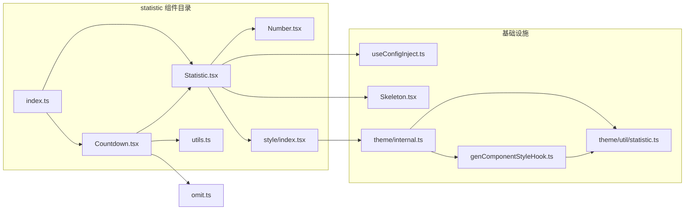
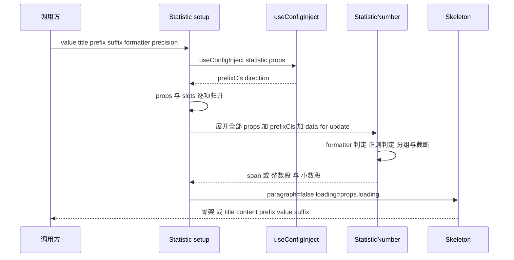
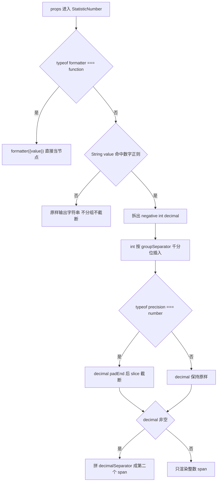

# C11-04 Statistic 统计数值

> **本篇解决**：`<xy-statistic>` 把一个数字变成界面上那行「标题 + 前缀 + 数值 + 后缀」，中间到底经过了哪些代码；`precision` 为什么不四舍五入、`groupSeparator` 跟语言包有没有关系、`Countdown` 靠什么每 33ms 刷新一次却不走响应式；以及仓库里那两个都叫 `statistic` 的文件到底是不是一回事。
> **前置**：A03 Design Token 四层体系　**读者坐标**：`03-components/11-status` 第 4 篇（本类目前唯一成文稿）

## 一、职责与边界

`statistic/` 是一个**纯展示、无内部状态**的组件目录，四个运行时文件构成全部实现：`Statistic.tsx` 负责 DOM 分层与 props/slots 归并，`Number.tsx` 负责把 `value` 变成字符串或两组 `<span>`，`utils.ts` 负责倒计时的时间差格式化，`Countdown.tsx` 负责定时驱动；样式与装配另算（见 §二 的七行地图）。它不做的事同样需要写清楚，因为文档站点的示例会让人误以为它做：

- **不做数值过渡动画**。官方示例自己承认这一点：「Statistic 组件本身不内置数值过渡动画。本示例通过 requestAnimationFrame 自定义实现数值插值」，见 [apps/docs/examples/statistic/animation.vue:55](../../../apps/docs/examples/statistic/animation.vue)，插值逻辑 `tween` 全部写在示例的 `<script setup>` 里（`animation.vue:86`-`:99`）。组件源码里没有任何 `transition`、`animation`、`requestAnimationFrame` 字样。
- **不做暂停/恢复**。`Countdown` 没有暴露任何方法，`setup` 的返回值就是渲染函数（`packages/xiaoye-ui/src/statistic/Countdown.tsx:86`），没有 `expose`。官方倒计时示例的「暂停」是靠 `v-if` 卸载组件实现的（[apps/docs/examples/statistic/countdown.vue:43](../../../apps/docs/examples/statistic/countdown.vue)：「Countdown 内部自动启动定时器，通过 v-if 卸载组件模拟暂停效果」）。
- **不做本地化数字格式**。组件不读 locale，也不调用 `Intl.NumberFormat`，详见 §四 论点 3。
- **不做四舍五入**。`precision` 是字符串截断，详见 §四 论点 2。

依赖清单（出站）：`Skeleton`（`packages/xiaoye-ui/src/statistic/Statistic.tsx:6`，用于 `loading`）、`useConfigInject`（`:7`、`:49`）、`useStyle`（`:10`）、`_util/props-util/initDefaultProps`（`:3`）、`_util/type` 的 `someType`/`anyType`/`vNodeType`（`:11`，定义在 `packages/xiaoye-ui/src/_util/type.ts:91`、`:66`、`:79`）、`_util/omit`（`packages/xiaoye-ui/src/statistic/Countdown.tsx:3`，实现 `packages/xiaoye-ui/src/_util/omit.ts:1`-`:9`）、`_util/registerComponent`（`packages/xiaoye-ui/src/statistic/index.ts:4`，实现 `packages/xiaoye-ui/src/_util/registerComponent.ts:16`-`:27`）。入站依赖：**没有任何组件引用 `statistic/`**。`grep -rn "from '.*statistic'" packages/xiaoye-ui/src apps/docs --include='*.ts' --include='*.tsx' --include='*.vue'` 只命中两处目录外的东西：聚合入口 `packages/xiaoye-ui/src/components.ts:326`-`:359`（配套的样式副作用导入在 `:360`）与按需入口 `packages/xiaoye-ui/package.json:504`-`:577`，外加 `packages/xiaoye-ui/src/theme/internal.ts:20` 这一条**同名不同义**的命中——它指的是 Token 记录器，不是本组件，详见 §二 末尾。这决定了改它的影响面基本局限在本目录内，唯一例外就是那条命名撞车。

## 二、源码地图

> 属性清单与用法见 [apps/docs/components/statistic.md](../../../apps/docs/components/statistic.md)，本篇不重复。

| 文件 | 行数 | 职责 | 关键导出 / 主入口 |
| --- | --- | --- | --- |
| `packages/xiaoye-ui/src/statistic/index.ts` | 21 | 装配 `Statistic.Countdown` 复合结构、`install` | 默认导出 `:18`、`StatisticCountdown` `:16` |
| `packages/xiaoye-ui/src/statistic/Statistic.tsx` | 89 | 主实现：props 声明 + DOM 分层 | `statisticProps` `:14`、组件 `:32` |
| `packages/xiaoye-ui/src/statistic/Number.tsx` | 53 | 数值格式化与两段 `<span>` 渲染 | `StatisticNumber` `:8`（内部组件，不对外导出） |
| `packages/xiaoye-ui/src/statistic/utils.ts` | 69 | 倒计时单位表与 `formatTimeStr` | `formatTimeStr` `:35`、`formatCountdown` `:62` |
| `packages/xiaoye-ui/src/statistic/Countdown.tsx` | 102 | 定时驱动 + 复用 Statistic | `countdownProps` `:15`、组件 `:26` |
| `packages/xiaoye-ui/src/statistic/style/index.tsx` | 69 | CSS-in-JS 样式与三个派生 Token | `genComponentStyleHook('Statistic', …)` `:60` |
| `packages/xiaoye-ui/src/statistic/index.test.js` | 91 | 唯一的测试文件，6 个 `it`（加 `mountTest` 注入 2 条，实跑 8 条） | 见 §七 测试现状 |

**主实现入口**：`packages/xiaoye-ui/src/statistic/Statistic.tsx:32` 的 `defineComponent`，`name: 'XYStatistic'` 在 `:34`，`inheritAttrs: false` 在 `:35`。`Countdown` 的入口是 `packages/xiaoye-ui/src/statistic/Countdown.tsx:26`，`name: 'XYStatisticCountdown'`（`:28`）。

地图之外有三个必须点名的偏差，否则接手的人会按 `AGENTS.md` 的模板找不到文件：

1. **没有 `statisticTypes.ts`**。props 直接写在主组件里（`Statistic.tsx:14`-`:28`），`Countdown` 则用展开语法继承：`packages/xiaoye-ui/src/statistic/Countdown.tsx:17` 的 `...statisticProps()`，再覆盖 `value`/`format` 并追加两个事件（`:18`-`:21`）。这意味着 `Countdown` 的 props 集合与 `Statistic` 完全同源，任何 `Statistic` 新增 prop 会无条件出现在 `Countdown` 上。
2. **样式入口是 `style/index.tsx` 而不是 `style/index.ts`**，但 `packages/xiaoye-ui/package.json:508` 的 `./statistic/style` 与 `packages/xiaoye-ui/src/components.ts:328` 的副作用导入都按目录 `./statistic/style` 解析，扩展名不参与，所以这个偏差只影响人的预期，不影响构建。
3. **测试是 `.js` 而不是 `.tsx`**：`packages/xiaoye-ui/src/statistic/index.test.js`。这一度让人怀疑它是否真的执行，`packages/xiaoye-ui/vitest.config.mts:33` 的 include 模式是 `['tests/**/*.test.{js,ts,jsx,tsx}', 'src/**/*.test.{js,ts,jsx,tsx}']`——`.js` 在列，且 `src/**` 覆盖组件目录，所以这个文件确实在跑；结论见 §七。

### 命名撞车：仓库里有两个 `statistic`

在讲数据流之前先把这个坑拆掉，否则后面每张图都会含糊。`OUTLINE.md:260` 给本篇标注的范围是 `theme/util/statistic.ts`，字面上把两个东西绑在了一起；读完两边源码后的结论是：**它们除了同名之外没有任何职责关系，而且前者不是「统计数值组件」的实现，它是 CSS-in-JS 引擎的 Token 用量记录仪**。

| 名字 | 文件 | 实际职责 | 与 `<xy-statistic>` 的关系 |
| --- | --- | --- | --- |
| `statistic` 组件 | `packages/xiaoye-ui/src/statistic/` | 统计数值展示 | 本篇主体 |
| `statistic` 记录器 | `packages/xiaoye-ui/src/theme/util/statistic.ts` | dev 期记录每个组件样式读过哪些 Token 字段 | 仅间接：组件样式用了 `mergeToken` |

唯一的连接点是一行导入：

```ts
// packages/xiaoye-ui/src/theme/internal.ts:20
import statisticToken, { merge as mergeToken, statistic } from './util/statistic';
```

`theme/util/statistic.ts` 里导出三样东西：`merge`（`:11`，生产环境退化为 `Object.assign`，见 `:13`-`:15`）、`statisticToken`（`:51`，开发环境给 token 套一层 `Proxy` 记录被读过的字段名，`:60`-`:67`）、以及账本本身 `statistic`（`:38`-`:41`）与 `:45` 的 `_statistic_build_` 占位。写入动作发生在 `packages/xiaoye-ui/src/theme/util/genComponentStyleHook.ts:79` 取到 `proxyToken` 与 `flush`，再到 `:107` 的 `flush(component, mergedComponentToken)`。而 `statistic/style/index.tsx:3` 从 `theme/internal` 导入的 `mergeToken`，正是上面那行把 `merge` 改名后的产物——**组件样式与记录仪的唯一交集就是这一次 `mergeToken` 调用**（`packages/xiaoye-ui/src/statistic/style/index.tsx:63`）。组件目录下没有任何文件提到这个记录器；检索时要注意写法：`grep -rn "theme/util/statistic" packages/xiaoye-ui/src` 命中 **0 行**，因为 `internal.ts` 用的是相对路径，换成 `grep -rn "util/statistic" packages/xiaoye-ui/src` 才命中、且只命中 `packages/xiaoye-ui/src/theme/internal.ts:20` 这一处。

这件事是 A02 讲的「包根歧义名」风险的一个活案例，但要按它的真实形态来理解：`packages/xiaoye-ui/src/index.ts:7` 的 `export * from './components'` 会把组件侧的 `Statistic`（大写，`components.ts:359`）带到包根；记录器侧的小写 `statistic` 只从 `theme/internal.ts:41` 再导出，不进入包根，所以两者**不会触发 TS2308**，生成器也就不会为它补定主语句。真正的代价不是类型冲突，而是**检索污染与阅读误判**：任何人 `grep -rn statistic packages/xiaoye-ui/src` 都会同时命中两套完全不同的实现，`find` 出来的目录名与文件名也几乎一样。这类同名不同义还叠加了第二层：`theme/interface/components.ts:125` 里登记的组件 Token 名 `Statistic` 指的是组件，而 A03 已经指出这个键是空对象占位（`docs/column/01-architecture/03-design-token-四层体系.md:131` 段），并在论点 10 里把 `statistic`/`_statistic_build_` 归为「为工具链预留、但本仓库没有工具链」的残留（`docs/column/01-architecture/03-design-token-四层体系.md:589`）。本篇不重复展开记录器机制，只把它当作命名风险登记在案。

## 三、架构与数据流

### 图 1：静态结构（谁调用谁）



`CDW -> STA` 这条边是本篇最重要的一条：`Countdown` 不是「和 Statistic 长得像」，它**直接渲染 Statistic**（`packages/xiaoye-ui/src/statistic/Countdown.tsx:89`），把自己的 props 减掉两个事件后原样透传（`:91`-`:96`），再强行覆盖三个键：`value`（原始时间戳）、`valueRender: valueRenderHtml`（`:76` 定义的恒等函数，目的是占住 Statistic 的 `valueRender` 钩子）、`formatter: formatCountdown`（`:71`-`:74`，把 Statistic 内置的数字格式化整条链路换掉）。`STY -> INT -> TWS` 与 `GCH -> TWS` 是记录器那一路，与组件语义无关。`IDX -> CDW` 之后 `packages/xiaoye-ui/src/statistic/index.ts:8` 把 `Countdown` 挂成 `Statistic.Countdown`，并在 `:10`-`:14` 一次性注册两个标签（`registerComponent` 按 `name` 推导标签名，`XYStatistic` → `xy-statistic`、`XYStatisticCountdown` → `xy-statistic-countdown`，转换规则见 `packages/xiaoye-ui/src/_util/registerComponent.ts:6`-`:11`）。

### 图 2：Statistic 的 props → DOM 闭环



分支解释三处。第一处是 `S -> S` 那步的归并顺序：`packages/xiaoye-ui/src/statistic/Statistic.tsx:57`-`:60` 用 `??` 把四个可选内容位统一成「prop 优先、插槽兜底」，即 `props.title ?? slots.title?.()`。`??` 只在 `null`/`undefined` 时兜底，所以 `title=""` **不会**回落到插槽（空串是合法 prop 值，直接胜出），随后 `:77` 的 `title && <div …>` 判定为空串为假，最终这一层根本不渲染——传空串和没传插槽的结果相同，但传空串会**屏蔽**掉同名插槽。插槽版本 `slots.title?.()` 在插槽不存在时返回 `undefined`，整个表达式仍是 `undefined`，于是 `:77` 同样跳过这一层。第二处是 `formatter` 的兜底写法不同：`:60` 把 `slots.formatter` 断言成 `Formatter` 而不是调用它，因为 `formatter` 契约本身是「函数，接收 `{value, config}` 返回节点」（`packages/xiaoye-ui/src/statistic/utils.ts:6`-`:10`），插槽在这里被当作函数对象复用，调用点在 `packages/xiaoye-ui/src/statistic/Number.tsx:14` 的 `formatter({ value })`。第三处是 `SK`：`loading` 不改变 DOM 结构，只是把整个 content 包进 `Skeleton`（`Statistic.tsx:78`），由 Skeleton 自己决定渲染骨架还是默认插槽。

### 图 3：Number.tsx 的格式化判定



这张图对应 `packages/xiaoye-ui/src/statistic/Number.tsx:12`-`:46` 的五路分支，判定顺序就是代码顺序：自定义 `formatter` 最优先（`:12`-`:14`），其次是「长得像数字」（`:18` 的 `val.match(/^(-?)(\d*)(\.(\d+))?$/)`），不匹配就走兜底原样输出（`:20`-`:21`）。注意 `:9` 的解构给 `groupSeparator` 写了局部默认值 `''`，而 `Statistic` 通过 `initDefaultProps` 给的默认是 `,`（`packages/xiaoye-ui/src/statistic/Statistic.tsx:36`-`:40`）——两处默认值不一致，含义是 `Number` 作为内部组件被设计成「不保证有分隔符」，真正的默认值契约在 `Statistic` 那一层，见 §四 论点 3。

## 四、核心机制精读

### 论点 1：数值格式化是手写的正则拆解，整条链路不碰 `Intl.NumberFormat`

`packages/xiaoye-ui/src/statistic/` 全目录 `grep -rn "Intl\."` 结果为空，格式化完全靠一次 `String()`、一次 `match` 和三次字符串操作：

```tsx
// packages/xiaoye-ui/src/statistic/Number.tsx:17
    const val = String(value);
    const cells = val.match(/^(-?)(\d*)(\.(\d+))?$/);
    // Process if illegal number
    if (!cells) {
      valueNode = val;
    } else {
      const negative = cells[1];
      let int = cells[2] || '0';
      let decimal = cells[4] || '';

      int = int.replace(/\B(?=(\d{3})+(?!\d))/g, groupSeparator);
      if (typeof precision === 'number') {
        decimal = decimal.padEnd(precision, '0').slice(0, precision > 0 ? precision : 0);
      }

      if (decimal) {
        decimal = `${decimalSeparator}${decimal}`;
      }
```

三个细节值得记。第一，`:18` 的正则是**全串锚定**的十进制字面量判定（`^` 与 `$`），只接受「可选负号 + 整数段 + 可选小数段」。它因此天然拒绝三种常见输入：科学计数法字符串 `"1e5"`、已经带分隔符的 `"1,280"`、以及 `NaN`/`Infinity`——三者都走 `:20`-`:21` 的兜底分支原样输出，`groupSeparator`/`precision` 全部失效。这不是 bug，是设计：兜底分支把「不是十进制字面量」当作「调用方自己负责」的信号，所以 `value` 的类型声明里允许 `Object`（`packages/xiaoye-ui/src/statistic/Statistic.tsx:19` 的 `someType<valueType>([Number, String, Object])`，`someType` 定义在 `packages/xiaoye-ui/src/_util/type.ts:91`），传 `Date` 或对象也不会崩，只会显示 `String(...)` 的结果。

第二，千分位用的是零宽断言 `/\B(?=(\d{3})+(?!\d))/g`（`:27`）而不是循环切片：`\B` 排除串首，`(?=(\d{3})+(?!\d))` 要求右侧是「若干个三位且后面不再是数字」。这条正则只对 `int` 施加，小数段不参与分组，所以中文场景要的「每 4 位一隔」在这里改一个 `groupSeparator` 是改不出来的，必须重写 `:27` 的 lookahead。

第三，输出结构是**两个 `<span>` 而不是一个字符串**（`:36`-`:46`）：整数段带 `${prefixCls}-content-value-int` 类名，小数段带 `${prefixCls}-content-value-decimal` 类名，且小数段是 `decimal && (...)` 条件渲染。这是 `Number.tsx` 存在的唯一理由——如果只想要文本，`Statistic` 直接拼字符串就行；分成两个类名是为了让调用方单独给小数部分换字号/颜色。**结论**：改格式化逻辑的正确落点是 `Number.tsx`，但它一旦输出结构变化（合并 span、去掉类名），所有依赖 `-content-value-int`/`-content-value-decimal` 的下游自定义样式都会静默失效，而这两种类名在本仓库内没有任何测试断言（见 §七）。

### 论点 2：`precision` 是字符串截断，不是四舍五入

`Number.tsx:29` 那一行同时做了两件不同的事，理解偏差几乎每个人都踩过：

```tsx
// packages/xiaoye-ui/src/statistic/Number.tsx:28
      if (typeof precision === 'number') {
        decimal = decimal.padEnd(precision, '0').slice(0, precision > 0 ? precision : 0);
      }

      if (decimal) {
        decimal = `${decimalSeparator}${decimal}`;
      }
```

`padEnd(precision, '0')` 把不足位的小数补零（`1.5` 配 `precision=3` 得 `500`），`slice(0, precision)` 把超位的小数**直接砍掉**（`1.987` 配 `precision=2` 得 `98`）。也就是说 `precision` 只保证「显示几位」，不保证「显示值等于四舍五入后的值」：`1.987` 配 `2` 渲染成 `1.98` 而不是 `1.99`；`0.999` 配 `0` 渲染成 `0` 而不是 `1`。对金额、百分比这类看起来「本该四舍五入」的场景，这是可稳定复现的显示偏小。

`precision > 0 ? precision : 0` 这个三元处理的是 `precision=0`：`slice(0, 0)` 得到空串，于是 `:32` 的 `if (decimal)` 为假，小数分隔符也不会输出（`1234.56` 配 `0` 得 `1,234`，没有尾点）。若把三元删掉直接写 `slice(0, precision)`，`precision=0` 的行为其实相同，所以这行防御的真实对象是**负数 `precision`**——`slice(0, -1)` 会砍掉最后一位而不是清空。`precision` 的类型是裸 `Number`（`Statistic.tsx:23`），没有任何取值范围校验。

**结论**：`precision` 的契约是「小数位数补齐与截断」，需要舍入必须在传值前自己做，组件不提供。这条分支目前**没有有效测试**：`packages/xiaoye-ui/src/statistic/index.test.js:54`-`:63` 的 `support negetive number` 用例传了 `value: -112893.12345, precision: 2`，但 `mount` 之后**没有任何 `expect`**（`:62` 就是函数体收尾），等于只验证了「不抛异常」。

### 论点 3：分隔符默认值写死在 `initDefaultProps`，与语言包无关

`Statistic` 唯一读取全局配置的那一行是：

```tsx
// packages/xiaoye-ui/src/statistic/Statistic.tsx:49
    const { prefixCls, direction } = useConfigInject('statistic', props);

    // Style
    const [wrapSSR, hashId] = useStyle(prefixCls);

    return () => {
      const { value = 0, valueStyle, valueRender } = props;
```

`useConfigInject` 的返回对象一共有 22 个键（`packages/xiaoye-ui/src/config-provider/hooks/useConfigInject.ts:50`-`:73`，`prefixCls` 在 `:52`、`direction` 在 `:53`），但**本组件只解构了其中两个**：前缀类名与文字方向。数字分隔符走的是另一条路——组件自己声明的 props 默认值：

```tsx
// packages/xiaoye-ui/src/statistic/Statistic.tsx:36
  props: initDefaultProps(statisticProps(), {
    decimalSeparator: '.',
    groupSeparator: ',',
    loading: false,
  }),
```

也就是说 `decimalSeparator: '.'` 与 `groupSeparator: ','` 是**英文字区常量**，硬编码在组件里（`packages/xiaoye-ui/src/statistic/Statistic.tsx:37`-`:38`），不来自 `ConfigProvider`，也不来自 `navigator.language`。`statistic/` 目录里 `grep -rn "locale"` 命中数为 0、`grep -rn "statistic" packages/xiaoye-ui/src/config-provider` 命中数也为 0，两侧互不认识就是这件事的直接证据。德语、法语、俄语这类「小数点用逗号、千分位用点或空格」的语言环境要正确显示，只有一条路：每个 `<xy-statistic>` 手动传 `decimal-separator`/`group-separator`。这与 [I11 多语言体系](../../02-infrastructure/11-locale-system.md) 的结论是同一件事的两面：语言包解决的是「文案」（`renderEmpty`、`LocaleReceiver` 那条链），从来不覆盖数字格式化，本篇不重复展开。本地化通路缺失在同类组件里不是孤例，但 statistic 是暴露得最直接的一个，因为它整个职责就是显示数字。

**结论**：`<xy-config-provider locale="deDE">` 包住的 `<xy-statistic :value="1234.5">` 仍然显示 `1,234.5`。改这里的安全做法是在 `useConfigInject` 之外新增一层「数字格式配置」（例如 `ConfigProvider` 的 `locale.numberFormat`），让 `Statistic.tsx:36`-`:40` 的默认值变成兜底而非唯一来源，而不是在 `Number.tsx` 里塞 `Intl`——后者会让 `Number.tsx` 从纯函数变成依赖运行环境的行为不确定件，SSR 首屏与客户端 hydration 可能不一致。

### 论点 4：`title`/`prefix`/`suffix`/`formatter` 四类内容位统一走「prop 优先、插槽兜底」

四个内容位共用同一种归并写法，但渲染位置分属三层 DOM：

```tsx
// packages/xiaoye-ui/src/statistic/Statistic.tsx:55
      const { value = 0, valueStyle, valueRender } = props;
      const pre = prefixCls.value;
      const title = props.title ?? slots.title?.();
      const prefix = props.prefix ?? slots.prefix?.();
      const suffix = props.suffix ?? slots.suffix?.();
      const formatter = props.formatter ?? (slots.formatter as unknown as Formatter);
      // data-for-update just for update component
      // fix: data-for-update for component update
      let valueNode: VueNode = (
        <StatisticNumber
          data-for-update={Date.now()}
          {...{ ...props, prefixCls: pre, value, formatter }}
        />
      );
```

`:55` 的 `value = 0` 是渲染函数内部的**第二重默认**：`value` prop 本身没有默认值（`Statistic.tsx:19` 的 `someType` 未传 default），所以未传时解构成 `0` 而不是 `undefined`，界面显示 `0` 而不是空白。这与 `:66` 的 `{...props}` 展开配合时要注意顺序：`prefixCls: pre, value, formatter` 写在展开**之后**，所以三个键覆盖了 props 里的同名值——`prefixCls` 被换成注入后的完整类名（props 上的 `prefixCls` 是用户传入的**片段**，见 `Statistic.tsx:15` 与 `useConfigInject.ts:14` 的 `getPrefixCls(name, props.prefixCls)`），`value` 被换成带 `0` 兜底的值。这两个覆盖是 `Number.tsx` 能直接拼类名的前提。

`:63`-`:64` 上方那两行注释（`:61`-`:62`）指向本篇最需要解释的一个 hack，放在 §论点 5 讲，因为它是倒计时刷新链的一环，普通 Statistic 场景看不出它的作用。

DOM 三层是固定的：根 `div.xy-statistic`（`:73`-`:76`）→ `div.xy-statistic-title`（`:77`，条件渲染）→ `div.xy-statistic-content`（`:79`，带 `valueStyle` 内联样式）→ 内容里再依次是 `-content-prefix`（`:80`）、`-content-value`（由 `Number.tsx:50` 产出）、`-content-suffix`（`:82`）。前缀与后缀都包成 `<span>` 并各自带类名，间距不靠内联而靠样式层的 `margin-inline`（`packages/xiaoye-ui/src/statistic/style/index.tsx:48`-`:53`）。`valueStyle` 只作用在 content 层，所以给数字换色不会影响 title——这是 `animation.vue:11` 那种用法能成立的原因。

`valueRender` 是唯一一个**包装型**钩子（`:69`-`:71`）：它接收已经渲染好的 `valueNode` 并返回新节点，而不是替换格式化函数。`Countdown` 正是用它把自己接管渲染的意图声明出来（`Countdown.tsx:94` 传了恒等函数 `valueRenderHtml`，定义在 `:76`）。这两个钩子的分工是：`formatter` 换「值怎么变成节点」，`valueRender` 换「节点外面再包什么」。

### 论点 5：倒计时的刷新不走响应式，靠 `setInterval` + `$forceUpdate` + 抖动 attr 三级强制

`Countdown` 显示的文本由 `Date.now()` 决定（`packages/xiaoye-ui/src/statistic/utils.ts:65` 的 `const current = Date.now()`），而 `Date.now()` 不是响应式源。**props 没变、内部没有 ref 参与渲染**，所以 Vue 永远不会主动重渲染它。倒计时能跳动，靠的是三重强制：

```tsx
// packages/xiaoye-ui/src/statistic/Countdown.tsx:46
    const startTimer = () => {
      if (countdownId.value) return;
      const timestamp = getTime(props.value);
      countdownId.value = setInterval(() => {
        statistic.value.$forceUpdate();
        if (timestamp > Date.now()) {
          emit('change', timestamp - Date.now());
        }
        syncTimer();
      }, REFRESH_INTERVAL);
    };
```

第一级是 `:50` 的 `statistic.value.$forceUpdate()`——对**子组件实例**（`:90` 用 `ref={statistic}` 挂住的 `<Statistic>`）强制更新。注意它强制的是 Statistic，不是 Countdown 自己。第二级是 `packages/xiaoye-ui/src/statistic/Statistic.tsx:65` 那行看起来多余的 `data-for-update={Date.now()}`：`StatisticNumber` 是无状态函数组件（`packages/xiaoye-ui/src/statistic/Number.tsx:8` 声明为 `FunctionalComponent`），父级每次渲染都会重新执行它，但它的输出只取决于 props；给一个每次都不同的 attr 是**确保 vnode 有差异**的兜底写法，`:61`-`:62` 的原注释 `data-for-update just for update component` 就是这个意思。第三级是 `:54` 每 tick 调一次 `syncTimer()`：

```tsx
// packages/xiaoye-ui/src/statistic/Countdown.tsx:36
    const syncTimer = () => {
      const { value } = props;
      const timestamp = getTime(value);
      if (timestamp >= Date.now()) {
        startTimer();
      } else {
        stopTimer();
      }
    };
```

频率由 `packages/xiaoye-ui/src/statistic/Countdown.tsx:10` 的 `const REFRESH_INTERVAL = 1000 / 30;` 决定，即 **30Hz 的 `setInterval`，不是 `requestAnimationFrame`**。这个选择有两处后果：一是帧率与浏览器刷新率解耦，`format="HH:mm:ss:SSS"` 那种毫秒显示（`packages/xiaoye-ui/src/statistic/utils.ts:32` 的 `['S', 1]` 提供毫秒位）在 60Hz 屏上是「每两帧跳一次」，观感不如 rAF；二是标签页切到后台时 `setInterval` 被浏览器节流（Chrome 对隐藏页可压到 1Hz 甚至更低），而 `formatCountdown` 每次都重新读 `Date.now()`（`utils.ts:65`），所以**文本不会漂移、始终等于真实剩余时间**——这是这套「不用累加器、每次从墙上时钟重算」写法的最大收益：`setInterval` 只决定刷新频率，不参与时间计算，没有累计误差。代价是 `onChange` 的语义（见 §七 坑 3）和 30 次/秒的渲染开销。

清理只有一条路径：`packages/xiaoye-ui/src/statistic/Countdown.tsx:83`-`:85` 的 `onBeforeUnmount(() => { stopTimer(); })`，配合 `stopTimer` 内的 `clearInterval` 与置空（`:60`-`:62`）：

```tsx
// packages/xiaoye-ui/src/statistic/Countdown.tsx:58
    const stopTimer = () => {
      const { value } = props;
      if (countdownId.value) {
        clearInterval(countdownId.value);
        countdownId.value = undefined;

        const timestamp = getTime(value);
        if (timestamp < Date.now()) {
          emit('finish');
        }
      }
    };
```

`emit('finish')` 被塞在「清定时器」里而不是「时间到」里，条件是两个都必须成立：定时器**曾经启动过**（`countdownId.value` 非空）且此刻**已经过期**。这带来两个不对称：挂载时 `value` 就已经是过去时刻，`syncTimer` 走 `:42` 的 `stopTimer()` 分支，但此时 `countdownId.value` 是 `undefined`，于是 `onFinish` **不会触发**；反过来，倒计时在正常跑完的路径上，`finish` 一定触发。而 `onBeforeUnmount` 复用同一个函数，意味着**卸载一个尚未归零的倒计时不会发 `finish`**（`timestamp < Date.now()` 为假），但**卸载一个已过期的倒计时会在卸载过程中再发一次 `finish`**（如果它还没被 `syncTimer` 停掉，即卸载发生在归零后的 33ms 窗口内）。

`onMounted`（`:77`）与 `onUpdated`（`:80`）都调 `syncTimer`。`onUpdated` 这一句才是「外部改 `value` 能生效」的唯一入口——但 `$forceUpdate` 强制的是子组件，不触发 Countdown 自己的 `onUpdated`，所以只有父组件带新 `value` 重新渲染 Countdown 时才会走到它。

### 论点 6：`formatTimeStr` 用固定天数近似年月，长倒计时按模板读会漂

倒计时的时间分解在 `utils.ts`，单位表和分解算法是配套的两个约束：

```ts
// packages/xiaoye-ui/src/statistic/utils.ts:25
const timeUnits: [string, number][] = [
  ['Y', 1000 * 60 * 60 * 24 * 365], // years
  ['M', 1000 * 60 * 60 * 24 * 30], // months
  ['D', 1000 * 60 * 60 * 24], // days
  ['H', 1000 * 60 * 60], // hours
  ['m', 1000 * 60], // minutes
  ['s', 1000], // seconds
  ['S', 1], // million seconds
];
```

`Y` 恒等于 365 天、`M` 恒等于 30 天（`:26`-`:27`），没有闰年、没有大小月。所以 `format="YYYY-MM-DD"` 的跨年倒计时在闰年会差 1 天，跨月的会按 30 天近似。`:32` 的行内注释 `million seconds` 是笔误（上游实现的原文注释，本库未订正），`['S', 1]` 的单位就是 1 毫秒，靠 `padStart` 的位数决定显示几位（`SSS` 得三位毫秒）。

大小写承担语义：**`M` 是月、`m` 是分**（`:27` 与 `:30`），`D` 是天、`d` 未定义，`H` 是时、`h` 未定义。表是有序的，`reduce` 从大到小消费余数（`:42`-`:52` 每次把用掉的量从 `leftDuration` 减掉），因此模板里缺某个大单位时，那部分时间不会丢，而是**并进下一个出现的更大单位**：`format="mm:ss"` 面对 2 小时 5 分只会显示 `125:00`。这是符合直觉的「只格式化你想要的那些位」，也是最常见的误用来源。

占位符替换前先做方括号转义，替换完再还原，这是两段式：

```ts
// packages/xiaoye-ui/src/statistic/utils.ts:38
  const escapeRegex = /\[[^\]]*]/g;
  const keepList: string[] = (format.match(escapeRegex) || []).map(str => str.slice(1, -1));
  const templateText = format.replace(escapeRegex, '[]');

  const replacedText = timeUnits.reduce((current, [name, unit]) => {
    if (current.includes(name)) {
      const value = Math.floor(leftDuration / unit);
      leftDuration -= value * unit;
      return current.replace(new RegExp(`${name}+`, 'g'), (match: string) => {
        const len = match.length;
        return value.toString().padStart(len, '0');
      });
    }
    return current;
  }, templateText);
```

`:38`-`:40` 把 `[Day]` 这类字面量先摘出来存进 `keepList`，模板换成 `[]` 再参与单位替换，`:54`-`:59` 的第二次 `replace` 按顺序把原文填回去。这套转义的必要性在于：`'D [Day]'` 若不转义，`new RegExp('D+','g')` 会把 `Day` 里的 `D` 也吃掉，剩下 `1 a1` 这种结果。`packages/xiaoye-ui/src/statistic/index.test.js:87`-`:89` 的 `format should support escape` 正是钉这条行为的（`formatTimeStr(1000*60*60*24, 'D [Day]')` 断言为 `'1 Day'`）——这也是 `utils.ts` 里唯一被直接单测的导出，`formatCountdown`（`utils.ts:62`）只能通过组件间接覆盖。

还有一个位数语义藏在 `:46` 的 `new RegExp(name + '+', 'g')`：**模板里写几位就补到几位**。`'H:mm'` 得 `9:28`，`'HH:mm'` 得 `09:28`，`packages/xiaoye-ui/src/statistic/index.test.js:69`-`:73` 的四组用例（`H:m:s` → `59:28:9`、`HH:mm:ss` → `59:28:09`、`HH:mm:ss:SSS` → `59:28:09:003`、`DD-HH:mm:ss` → `02-11:28:09`）就是这条规则的唯一测试保护。

### 论点 7：`Statistic` 在 Token 体系里只是类型占位，三个 statisticXxx 是样式层现造的别名

样式入口的结构是标准三段：

```tsx
// packages/xiaoye-ui/src/statistic/style/index.tsx:60
export default genComponentStyleHook('Statistic', token => {
  const { fontSizeHeading3, fontSize, fontFamily } = token;

  const statisticToken = mergeToken<StatisticToken>(token, {
    statisticTitleFontSize: fontSize,
    statisticContentFontSize: fontSizeHeading3,
    statisticFontFamily: fontFamily,
  });
  return [genStatisticStyle(statisticToken)];
});
```

关键在于 `genComponentStyleHook('Statistic', …)` 这个字符串是**类型层面的开关**：`ComponentName` 受 `OverrideComponent` 约束（`packages/xiaoye-ui/src/theme/util/genComponentStyleHook.ts:14`，它等于 `keyof ComponentTokenMap`，见 `:13`），而 hook 内部两处把这个名字还原成组件 Token 类型（`:16`、`:23` 的 `ComponentTokenMap[ComponentName]`），`ComponentTokenMap` 的声明在 `packages/xiaoye-ui/src/theme/interface/components.ts:69`。所以 statistic 必须在那里登记一行，登记内容是：

```ts
// packages/xiaoye-ui/src/theme/interface/components.ts:125
  Statistic?: {};
```

空对象。同批占位还有 `Switch?: {}`（`:132`）、`Tree?: {}`（`:134`）、`TreeSelect?: {}`（`:135`）。它与已登记组件的差别在文件头部就能看到：`packages/xiaoye-ui/src/theme/interface/components.ts:1`-`:6` 那一串 `import type { ComponentToken as ButtonComponentToken } from '../../button/style'` 需要组件样式文件导出一个 `ComponentToken` 接口，而 `packages/xiaoye-ui/src/statistic/style/index.tsx:6` 只声明了一个**没有 `export`** 的 `interface StatisticToken extends FullToken<'Statistic'>`——所以注册表无内容可引，只能填 `{}`。后果是可验证的：`theme.components.Statistic` 这个覆盖入口在类型上存在但**不接受任何组件专属键**，`:64`-`:66` 造出的 `statisticTitleFontSize`/`statisticContentFontSize`/`statisticFontFamily` 无法从外部覆盖，只能覆盖它们各自的 Alias 来源（`fontSizeHeading3` 等）；而覆盖 Alias 会同时影响所有用该字段的组件。这是 [A03 论点 9/10](../../01-architecture/03-design-token.md) 所说「空对象占位」在 statistic 上的具体形态，本篇不重复展开其体系论证。

样式层还有两条**没有 DOM 对应**的选择器，改动时容易误判成有效：

```tsx
// packages/xiaoye-ui/src/statistic/style/index.tsx:33
      [`${componentCls}-skeleton`]: {
        paddingTop: padding,
      },

      [`${componentCls}-content`]: {
        color: colorTextHeading,
        fontSize: statisticContentFontSize,
        fontFamily: statisticFontFamily,
        [`${componentCls}-content-value`]: {
          display: 'inline-block',
          direction: 'ltr',
        },
```

`:33` 编译成 `.xy-statistic-skeleton`，但组件树里没有任何元素带这个类：`Statistic.tsx:78` 渲染 `<Skeleton paragraph={false} loading={props.loading}>` 时没有传 `prefixCls`，Skeleton 自己的类名由它内部的 `useConfigInject('skeleton', props)`（`packages/xiaoye-ui/src/skeleton/Skeleton.tsx:92`）产出 `xy-skeleton` 前缀。`grep -rn "statistic-skeleton" packages` 命中 0，所以这条规则是空转的（它是上游实现里 `padding-top` 规则的遗留，本库保留了选择器但没有对应的 DOM）。同理 `Statistic.tsx:75` 会在 `direction === 'rtl'` 时挂出 `xy-statistic-rtl` 类，而 `style/index.tsx` 全文没有 `rtl` 分支（上面 `grep -rn "rtl" packages/xiaoye-ui/src/statistic` 只命中 `Statistic.tsx:75` 这一处生产端），RTL 的实际效果只来自 `:43` 那条 `direction: 'ltr'`——它把数值本身钉死为左起（避免阿拉伯文环境下 `1,234.56` 被镜像成 `456.23,1` 的错读），title/prefix/suffix 则随文档方向。这两条都属于「看着有、其实没有」，删掉不影响任何渲染结果，但**删除前应跑一次 `pnpm --filter xiaoye-ui test:unit`**，因为 `index.test.js` 没有断言样式，快照也不覆盖它们。

### 论点 8：`onFinish`/`onChange` 同时是 Function 型 prop 和 emit 事件，而 `emits` 声明被注释掉了

```tsx
// packages/xiaoye-ui/src/statistic/Countdown.tsx:19
    value: someType<countdownValueType>([Number, String, Object]),
    format: String,
    onFinish: Function as PropType<() => void>,
    onChange: Function as PropType<(value?: countdownValueType) => void>,
  };
};

export type CountdownProps = Partial<ExtractPropTypes<ReturnType<typeof countdownProps>>>;
export default defineComponent({
  compatConfig: { MODE: 3 },
  name: 'XYStatisticCountdown',
```

组件内部用的是 `emit('change', …)`（`:52`）与 `emit('finish')`（`:66`），而紧挨着的 `:32` 是一行被注释掉的 `// emits: ['finish', 'change']`。两套机制只留一套能生效：Vue 3 的 `emit` 是从 vnode props 里找 `onXxx`，与是否声明 `emits` 无关，所以事件照常工作；但 `onFinish`/`onChange` 是**已声明的 props**，它们因此不会进入 `attrs`。这一点直接决定了 `:92` 那行 `omit` 是否多余——它不多余：

```tsx
// packages/xiaoye-ui/src/statistic/Countdown.tsx:90
          ref={statistic}
          {...{
            ...omit(props, ['onFinish', 'onChange']),
            value,
            valueRender: valueRenderHtml,
            formatter: formatCountdown,
          }}
          v-slots={slots}
```

`omit`（`packages/xiaoye-ui/src/_util/omit.ts:1`-`:9`，实现是 `Object.assign({}, obj)` 后逐键 `delete`）把两个 handler 从透传集合里摘掉，`Statistic` 因此不会收到它们。如果去掉这行 `omit`，两个函数会被当成**未声明的 attr** 交给 `Statistic`，而 `Statistic` 是 `inheritAttrs: false` 且手工 `{...attrs}` 展开到根 `div`（`Statistic.tsx:35`、`:74`），结果就是 `onFinish`/`onChange` 变成 `div` 上的原生事件监听器——不会报错，但语义完全错位。**结论**：`Countdown` 的事件契约由「Function 型 prop + 内部 emit」两半组成，`emits` 那行注释是这条链的第三份残留，删掉它不会有行为变化，但保留它会让后来人以为事件是声明式的。副作用之一是事件名**没有运行时校验**：写成 `@finsh` 只会静默失效，不会有 Vue 的 `Missing required prop` 或 emits 警告。

## 五、对外契约如何生效

契约从装配层开始，`packages/xiaoye-ui/src/statistic/index.ts` 全文 21 行做了四件事：`:2`-`:3` 取两个组件、`:8` 把 `Countdown` 挂成静态属性形成复合结构、`:10`-`:14` 的 `install` 里**分别注册两个标签**（`registerComponent(app, Statistic)` 与 `registerComponent(app, Statistic.Countdown)`，靠组件 `name` 推导标签，规则在 `packages/xiaoye-ui/src/_util/registerComponent.ts:6`-`:11`）、`:16` 额外给一个具名导出 `StatisticCountdown`。同一个能力在公开面上有三个入口：`Statistic.Countdown`、`StatisticCountdown`、标签 `xy-statistic-countdown`。

**类型面比运行时面窄**，这是本篇最需要提醒的一点。`index.ts:6` 只放行了一行 `export type { StatisticProps } from './Statistic';`，而 `packages/xiaoye-ui/src/statistic/Countdown.tsx:25` 的 `CountdownProps`、`:15` 的 `countdownProps`、`packages/xiaoye-ui/src/statistic/utils.ts:6` 的 `Formatter`、`:3` 的 `valueType`、`:12` 的 `FormatConfig` **一个都没被再导出**。聚合入口 `packages/xiaoye-ui/src/components.ts:326` 是 `export * from './statistic'`，它只能转发 `index.ts` 放行的东西，于是 `import type { CountdownProps } from 'xiaoye-ui'` 拿不到类型；想写自定义 formatter 的调用方只能自己复制 `utils.ts:6`-`:10` 那四行联合类型。这是目录扫描式生成器的结构性后果（`packages/xiaoye-ui/scripts/entry-generator.mjs` 只做转发与挑主，不做补全），复合组件的其它成员也会撞上同一面墙。

同一个后果体现在全局标签类型上。`packages/xiaoye-ui/typings/global.d.ts:83` 有 `XYStatistic`，而整个文件里 `Countdown` 命中 0：生成器 `packages/xiaoye-ui/scripts/entry-generator.mjs:453`-`:448` 的循环按**目录名**产出 `XY${pascalName}`，静态子成员不在它的视野里。于是运行时 `<xy-statistic-countdown>` 已被 `index.ts:12` 注册、能正常渲染，模板里却没有 `GlobalComponents` 类型，而文档示例用的正是这个标签（`apps/docs/examples/statistic/countdown.vue:6`）。要补只能补生成器的枚举逻辑（识别 `Xxx.Yyy` 形态的静态成员），**禁止**手改 `global.d.ts`——它是 `pnpm gen:entries` 的产物。

props 的实际流向是一条直线，没有中间层：`Statistic.tsx:36`-`:40` 由 `initDefaultProps` 补三个默认值 → `:49` 注入 `prefixCls`/`direction` → `:55`-`:60` 解构并与插槽归并 → `:66` 整包展开给 `StatisticNumber`（并覆盖 `prefixCls`/`value`/`formatter` 三个键）→ `Number.tsx:9` 再解构成格式化所需的六个字段。样式侧同理：`Statistic.tsx:52` 拿到 `[wrapSSR, hashId]`，`:72` 用 `wrapSSR(...)` 包住整棵子树（SSR 时把样式收集到渲染之外，见 `packages/xiaoye-ui/src/_util/cssinjs` 那条链），`:75` 手工把 `hashId.value` 与 `attrs.class` 并进 class 数组。这三件事是一个整体：`inheritAttrs: false`（`:35`）关掉自动透传，`{...attrs}`（`:74`）手动透传其余 attr，而 `attrs.class` 必须在数组里显式并回来（`:75`）——**少写这一项，调用方的 `class` 会静默丢失**；`attrs.style` 靠 `:74` 的展开自然生效。

插槽面声明在 `Statistic.tsx:41`-`:47`，用 `CustomSlotsType`（`packages/xiaoye-ui/src/_util/type.ts:95`）标注五个：`title`/`prefix`/`suffix`/`formatter`/`default`。其中 `default` **渲染函数从未调用**——`Statistic.tsx:54`-`:87` 里没有 `slots.default?.()`，插槽声明与实现不一致，属于模板套用后的残留；`Countdown` 又用 `v-slots={slots}` 把它整包转发下去（`Countdown.tsx:97`），所以「往 `<xy-statistic>` 里直接写子节点」这种用法是**静默不显示**的。文档站七个示例全部只用具名插槽或 prop（`apps/docs/examples/statistic/unit.vue:5` 的 `#suffix`、`apps/docs/examples/statistic/card.vue:14` 的 `#prefix`），`grep -n "#default\|v-slot" apps/docs/examples/statistic/*.vue` 命中 0，从示例面反证了默认插槽不成立。四个真正生效的内容位里，`formatter` 的语义最特殊：它是「把插槽当函数用」，`Statistic.tsx:60` 取出后交给 `Number.tsx:14` 调用，签名要求见 `utils.ts:6`-`:10`。同一个 `unit.vue:11` 还顺手验证了 `attrs.class` 那一步：它写了 `class="demo-class"`，而这个类能否落到根 `div` 完全取决于 `Statistic.tsx:75` 数组里的 `attrs.class` 一项。

事件与命令面是这套契约里最薄的一段。对外只有 `Countdown` 的两个事件（`Countdown.tsx:52` 的 `change`、`:66` 的 `finish`），`Statistic` 不发任何事件。两个组件的 `setup` 返回值都是**渲染函数本身**（`Statistic.tsx:54`、`Countdown.tsx:86`），没有 `expose`，模板 ref 拿到的实例不提供方法：不能暂停、不能重置、不能读剩余时间。官方示例因此用 `v-if` 卸载来表达暂停（`apps/docs/examples/statistic/countdown.vue:7`、`:43`）。另外 `statistic/` 没有注入 `SizeContext`/`DisabledContext`（`Statistic.tsx:1`-`:12` 的导入清单里没有它们），所以它不响应全局 `disabled`，也不随 `size` 变化——一个 `xy-statistic` 在 `xy-space` 里只有 `margin`，没有紧凑态。

## 六、设计取舍

**手写格式化 vs `Intl.NumberFormat`。** 现状是纯字符串操作（`Number.tsx:18`-`:34`）。换成 `Intl` 能一次性解决本地化分隔符与舍入，但会破坏两个已经存在的 prop 契约：`groupSeparator` 与 `decimalSeparator` 一旦交给 `Intl` 的 locale 规则，用户显式传入的值要么被忽略、要么必须走 `formatToParts` 再手工重排；更要紧的是输出结构——`Number.tsx:36`-`:46` 产出两个带类名的 `<span>`（整数段/小数段分色），`Intl` 只给字符串或 `formatToParts` 数组，分层渲染要么自己重拼、要么丢能力。第三个理由是确定性：`Intl` 的结果取决于运行环境实现与宿主 locale 数据，SSR 首屏与服务端 Node 的 `full-icu` 配置可能给出不一致的字符串，导致 hydration 警告。选手写，赔上的是「组件不支持任何数字本地化」（§论点 3）和「不四舍五入」（§论点 2），这两条都是可感知的功能缺失，不是理论问题。

**`$forceUpdate` + `data-for-update` vs 把 `Date.now()` 装进 ref。** 后者是更 Vue 的写法：`Countdown` 内部持一个 `const now = ref(Date.now())`，interval 里 `now.value = Date.now()`，`formatCountdown` 读它——于是完全不需要 `Countdown.tsx:50` 的跨实例 `forceUpdate`，也不需要 `Statistic.tsx:65` 的时间戳 attr。代价是每个 tick 让 `Countdown` 自身重渲染，连带重建 `<Statistic>` 的整包 props（`:91`-`:96` 的对象字面量）与 `StatisticNumber` 的输出；现写法把更新面压到 Statistic 一层，`Countdown` 组件实例在倒计时期间完全不重渲染（这也是 `onUpdated` 在计时过程中不触发的原因，见 §论点 5）。源码里没留下动机注释，`Statistic.tsx:61`-`:62` 那两行只说明「为了更新组件」；能确证的是**现方案的一个副作用**：`Countdown` 的 `onUpdated` 只在父组件更新它时被调用，计时过程中不触发。

> ⚠️ 未在源码中找到对应实现，此处为待核实推断：`Statistic.tsx:65` 的 `data-for-update` 在今天这条 `$forceUpdate` 链里究竟必需还是冗余，静态阅读判不出来，只能删掉后观察毫秒位是否停跳。

**`setInterval` 30Hz vs `requestAnimationFrame`。** `Countdown.tsx:10` 把频率钉成常量 `1000 / 30`。选 rAF 的收益是与刷新率对齐、后台页自动停摆省电；选 `setInterval` 的收益是**与页面可见性解耦**——隐藏页里 `setInterval` 被节流到 1Hz 时，因为每次渲染都从墙上时钟重算（`utils.ts:65`），文本依然正确，只是刷新变粗；而 rAF 在隐藏页直接不跑，回前台时会出现明显跳变。真正的代价是**浪费**：这个常量不随 `format` 变化，`format="HH:mm"` 这种一分钟才变一次的显示，同样以 30Hz 强制重渲染。改进方向是按最小可见单位推导间隔（模板里有 `S` 用 30Hz、有 `s` 用 4Hz、只有 `m`/`H` 用 1Hz），落点是 `Countdown.tsx:10` 与 `:55` 这对常量。

**`Countdown` 复用 `Statistic` vs 抽出共享层。** 复用方式是渲染级继承（`Countdown.tsx:89` 直接输出 `<Statistic>`），props 用 `...statisticProps()` 拷贝（`:17`）。收益是 DOM 结构、样式、`wrapSSR`、RTL 处理一行都不用重写；赔上是**语义污染**：`Countdown` 因此接受 `precision`、`groupSeparator`、`decimalSeparator`、`loading`、`valueStyle` 等对它并不全都成立的键，其中前三个**完全无效**——因为 `formatter` 被强行替换成函数（`:95`），`Number.tsx:12`-`:14` 直接走自定义分支，`:18` 之后的分组与截断代码在倒计时路径上一行都不执行。给 `<xy-statistic-countdown :precision="2">` 不会有任何效果，也不会报错。

**组件 Token 留空 vs 登记。** `packages/xiaoye-ui/src/theme/interface/components.ts:125` 的 `{}` 是最省事的写法：满足 `OverrideComponent` 的类型约束（`genComponentStyleHook.ts:14`），但不必在样式文件里导出 `ComponentToken`。换来的是零维护成本，赔上的是 `theme.components.Statistic` 这个覆盖入口变成空壳（§论点 7）。同批还有 `Switch?: {}`、`Tree?: {}`、`TreeSelect?: {}`（`:132`、`:134`、`:135`），所以这不是 statistic 独有的技术债：`grep -c "?: {};" packages/xiaoye-ui/src/theme/interface/components.ts` 是 **37**，而注册表里的条目总数约 102，超过三分之一组件处于同一状态；改动它要么单独补 statistic（造成不一致），要么批量补（一次动 30 多个样式文件），后者一直没做。

## 七、坑与改动指南

**坑 1：`precision` 让它四舍五入，它截断。** 触发条件：`value` 的小数位多于 `precision`（金额、汇率、百分比最常见）。症状：显示值系统性偏小，`1.987` 配 `2` 得 `1.98`。原因：`padEnd(precision, '0')` 只负责把不足的小数位补零，`slice(0, precision)` 只负责把超出的位直接丢弃，两步都是字符串操作、既不向整数位进位也不看被丢掉的那一位是几（`packages/xiaoye-ui/src/statistic/Number.tsx:28`-`:30`），整条格式化链路没有任何舍入函数参与。定位：`packages/xiaoye-ui/src/statistic/Number.tsx:29` 的 `padEnd(...).slice(...)`，没有 `toFixed` 或 `Math.round`。**该分支无有效测试保护**——`index.test.js:54`-`:63` 唯一涉及 `precision` 的用例没有任何断言。

**坑 2：`value` 给字符串就以为能分组。** 触发条件：后端返回 `"1,280"`、`"1e5"`，或超过 `Number.MAX_SAFE_INTEGER` 的值被 `String()` 转成科学计数。症状：分隔符与 `precision` 全部静默失效，原样输出。原因：`packages/xiaoye-ui/src/statistic/Number.tsx:18` 的正则是 `^`/`$` 全锚定的「可选负号 + 整数段 + 可选小数段」，逗号、`e` 指数、`NaN` 与 `Infinity` 都匹配不上；一旦 `match` 返回 `null`，`:20`-`:21` 就把 `String(value)` 的结果直接当 `valueNode` 赋走，后面的分组与截断代码一行都不再执行。定位：`Number.tsx:18` 的全锚定正则与 `:20`-`:21` 的兜底分支；`index.test.js:44`-`:52`（`not a number` 用例断言 `'bamboo'` 输出）证明这是**故意的**，不要顺手把它改成抛错或强转。

**坑 3：倒计时跑着改 `value`，`onChange` 就开始说谎。** 触发条件：组件挂载后修改 `value`（服务端续期、用户顺延截止时刻）。症状：显示的剩余时间按新值走，但 `onChange` 回调收到的数值仍按**旧时间戳**计算；一旦旧时刻已过，`onChange` 直接停发，而倒计时还在正常刷新。原因：`packages/xiaoye-ui/src/statistic/Countdown.tsx:48` 把 `timestamp` 闭包在 `setInterval` 回调**之外**捕获，只在定时器真正建立那一次求值；`value` 变更后父级重新渲染触发的 `syncTimer`（`:36`-`:44`）会走到 `startTimer`，而 `:47` 的 `if (countdownId.value) return;` 让它在第一行就返回，既不重建定时器也不刷新这个闭包，于是 `:51`-`:52` 的比较与实参仍是旧 `timestamp`——文本对、回调错，是因为渲染走 `utils.ts:62` 的 `formatCountdown`（每次重读 `Date.now()` 与新 `value`），回调走闭包里的旧值。定位：`Countdown.tsx:48` 的 `const timestamp = getTime(props.value)` 只在定时器真正启动那一次捕获，`:47` 的 `if (countdownId.value) return;` 让后续调用无法刷新它，消费点在 `:51`-`:53`。**该分支完全没有测试保护**：测试里没有任何修改 `value` 的用例。

**坑 4：挂载时 `value` 已经是过去，`onFinish` 不触发。** 触发条件：用已过期时刻初始化（活动早已开始、页面缓存了旧 deadline）。症状：组件显示 `00:00:00`，绑了 `@finish` 的回调一次都不执行。定位：`Countdown.tsx:77`-`:79` 的 `onMounted → syncTimer → stopTimer`，而 `stopTimer` 里的 `emit('finish')` 被 `:60` 的 `if (countdownId.value)` 挡在门外——定时器从未启动过。业务侧要自己判断初始值是否已过期。

**坑 5：卸载时机决定 `onFinish` 会不会补发。** 触发条件：倒计时归零后 33ms 内组件被卸载（例如 `onFinish` 里立刻用 `v-if` 关掉它）。症状：`finish` 在卸载过程中再次触发。定位：`onBeforeUnmount` 复用同一个 `stopTimer`（`Countdown.tsx:83`-`:85`），过期判定在 `:64`-`:67`。回调必须写成幂等。

**坑 6：以为换语言就能换分隔符。** 触发条件：`de`/`fr`/`ru` 等非英文字区。症状：`<xy-config-provider :locale="deDE">` 下的数字仍显示 `1,234.56`。定位：默认值硬编码在 `Statistic.tsx:37`-`:38`，且 `statistic/` 不读 locale（§论点 3）。当前唯一出路是逐个组件传 `decimal-separator`/`group-separator`。

**坑 7：默认插槽写了不显示。** 触发条件：`<xy-statistic :value="1">文本</xy-statistic>`。症状：文本消失，无警告。定位：插槽声明里有 `default`（`Statistic.tsx:41`-`:47`），渲染函数 `:54`-`:87` 却从不读 `slots.default`。

**坑 8：给 `Countdown` 传数字格式化 props。** 触发条件：`<xy-statistic-countdown :precision="2" group-separator=" ">`。症状：毫无效果也不报错——`formatter` 被覆盖成时间格式化函数（`Countdown.tsx:95`），`Number.tsx:12`-`:14` 之后的小数/分组分支一次都不执行。定位：props 隐式继承自 `:17` 的 `...statisticProps()`，这是复用 `Statistic` 的代价（§六）。

**坑 9：`<xy-statistic-countdown>` 在模板里没有类型。** 触发条件：`script setup` 加 `vue-tsc` 严格模板检查。症状：标签被当未知元素，props 无提示。定位：`packages/xiaoye-ui/typings/global.d.ts:83` 只有 `XYStatistic`，生成器 `packages/xiaoye-ui/scripts/entry-generator.mjs:453`-`:448` 按目录产出、不认静态子成员（§五）。修复要动生成器，不能手改生成物。

**坑 10：多条倒计时叠加时的固定刷新成本。** 触发条件：仪表盘一屏放 6 个 `<xy-statistic-countdown>`。症状：约 180 次/秒强制渲染，`$forceUpdate` 逐条打到各自的 `Statistic` 实例（`Countdown.tsx:50`），开销与 `format` 粒度无关。定位：`REFRESH_INTERVAL` 常量在 `:10`。

**坑 11：误以为 `-rtl` 与 `-skeleton` 两条选择器有效。** 触发条件：做 RTL 适配或调整 `loading` 骨架间距。症状：改 `.xy-statistic-rtl`/`.xy-statistic-skeleton` 没有任何视觉变化。定位：`Statistic.tsx:75` 只生产类名，`style/index.tsx` 全文没有 `rtl` 分支；`:33`-`:35` 的 `-skeleton` 规则无 DOM 对应（§论点 7）。

### 测试现状

实测：`pnpm --filter xiaoye-ui exec vitest run statistic` → `Test Files 1 passed (1)`、`Tests 8 passed (8)`（脚本定义在 `packages/xiaoye-ui/package.json:40` 的 `vitest run`，根 `package.json:23` 负责转发）。8 条里 6 条来自 `packages/xiaoye-ui/src/statistic/index.test.js` 的 `it`（`:20`、`:33`、`:44`、`:54`、`:66`、`:87`），2 条来自 `mountTest` 的两次调用（`:9`、`:10`；本体是 `packages/xiaoye-ui/tests/shared/mountTest.js:2`-`:22`，只断言「挂载、`$forceUpdate`、卸载不抛错」）。真正的值断言只有 5 处：自定义 formatter（`index.test.js:29`-`:30`）、`groupSeparator`（`:41`）、非法输入兜底（`:51`）、倒计时四组 format（`:82`）、`formatTimeStr` 转义（`:88`）。没有快照目录（`packages/xiaoye-ui/src/statistic/__snapshots__` 不存在）。

盲区清单，以下改动**不会被任何现有测试挡住**：`precision`（`Number.tsx:28`-`:30`）、两个 `<span>` 的类名与层级（`:36`-`:46`）、`title`/`prefix`/`suffix`/`loading`/`valueRender` 五个分支（`Statistic.tsx:57`-`:83`）、插槽路径（`:57`-`:60`）、`direction === 'rtl'`（`:75`）、`Countdown` 的定时器启动/停止/清理与两个事件（`Countdown.tsx:36`-`:69`）、`onBeforeUnmount` 路径（`:83`-`:85`）。测试自身还有两处缺陷要一并记住：`mountTest(Statistic.Countdown)`（`index.test.js:10`）挂载时不传 `value`，`getTime(undefined)` 得到 `NaN`（`Countdown.tsx:12`-`:14`），`syncTimer` 直接走停止分支，**定时器在整套测试里从未真正跑过一轮**；`:81` 循环挂载 4 个 `Statistic.Countdown` 且全程没有 `wrapper.unmount()`，4 个 33ms 的 `setInterval` 会一直活到 worker 退出。

### 改动安全边界

可以放心改的：`utils.ts:25`-`:33` 的单位表（有 `:87`-`:89` 与 `:66`-`:85` 两处保护，但闰年用例要自己补）、`Countdown.tsx` 的定时器与事件（当前零保护，改前先加测试）。要谨慎的：`Number.tsx:36`-`:46` 的类名与 DOM 层级（下游自定义样式依赖，仓库内零断言）、`Statistic.tsx:66` 的展开顺序（决定 `prefixCls`/`value`/`formatter` 三个覆盖是否成立）、`Countdown.tsx:17` 的 props 继承（直接改变公开类型面）。新增 prop 必须同步 `statistic/index.ts:6` 的类型导出，否则 §五 的类型缺口继续扩大；动过目录名或结构则需重新生成三个生成物。验证顺序：

```bash
pnpm --filter xiaoye-ui exec vitest run statistic   # 只跑本篇范围，实测 0.9s
pnpm --filter xiaoye-ui test:unit                   # 全量单测
pnpm typecheck                                      # 类型面与生成物
pnpm gen:entries                                    # 仅当目录或命名变化时
pnpm check:entries                                  # 只校验生成物是否新鲜
```

## 附：本篇可证伪的三个检查点

1. **两个 `statistic` 之间没有调用关系。** 执行 `grep -rn "theme/util/statistic" packages/xiaoye-ui/src | grep -v dist`，期望**空输出**（组件内部一律用相对路径，没人写全路径）；再执行 `grep -rn "util/statistic" packages/xiaoye-ui/src | grep -v dist`，期望**恰好 1 行**：`packages/xiaoye-ui/src/theme/internal.ts:20`。若组件目录出现对记录器的直接 import，则 §二 的「命名撞车」定性与 §一 的范围划定需要重写。
2. **组件不参与任何本地化。** 执行 `grep -rn "Intl\." packages/xiaoye-ui/src/statistic` 与 `grep -rn "locale" packages/xiaoye-ui/src/statistic`，两条都应为空；再执行 `grep -n "groupSeparator" packages/xiaoye-ui/src/statistic/Statistic.tsx`，期望恰好命中两行（props 声明 `:17`、默认值 `:38`）。一旦出现 `Intl` 或 locale 读取，坑 6 与 §论点 3 作废。
3. **`precision` 是截断不是舍入。** 不依赖组件即可复算：`node -e "console.log('987'.padEnd(2,'0').slice(0, 2 > 0 ? 2 : 0))"` 输出 `98`，与 `packages/xiaoye-ui/src/statistic/Number.tsx:29` 的表达式逐字符一致；把它写成断言放进 `index.test.js` 应直接通过（当前仓库里没有这条断言）。若将来 `:29` 改成 `toFixed`/`Math.round` 形态，本检查点与坑 1 需同步修订。
