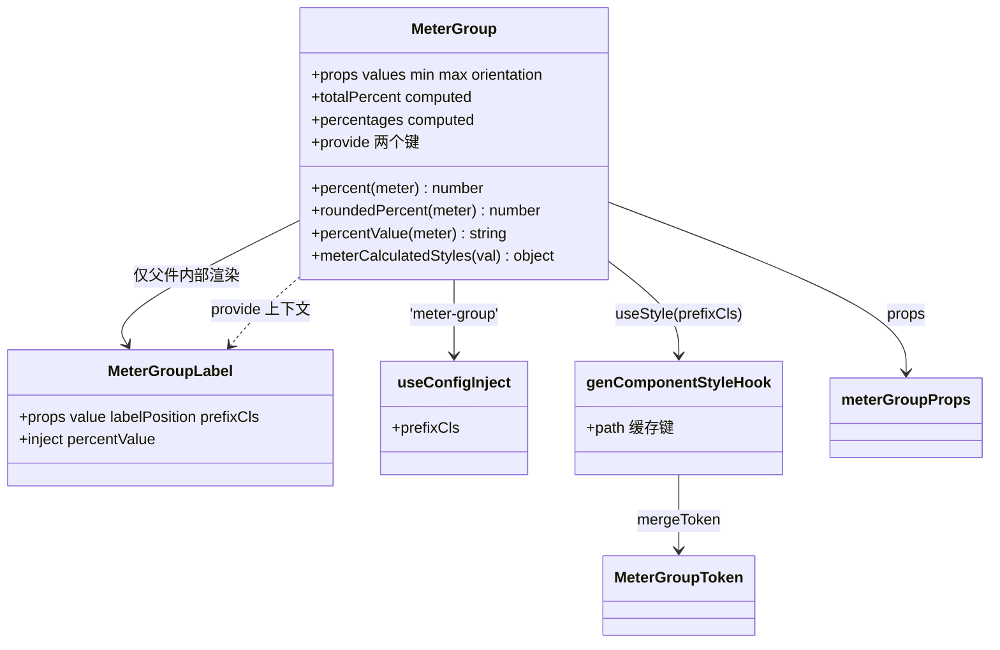
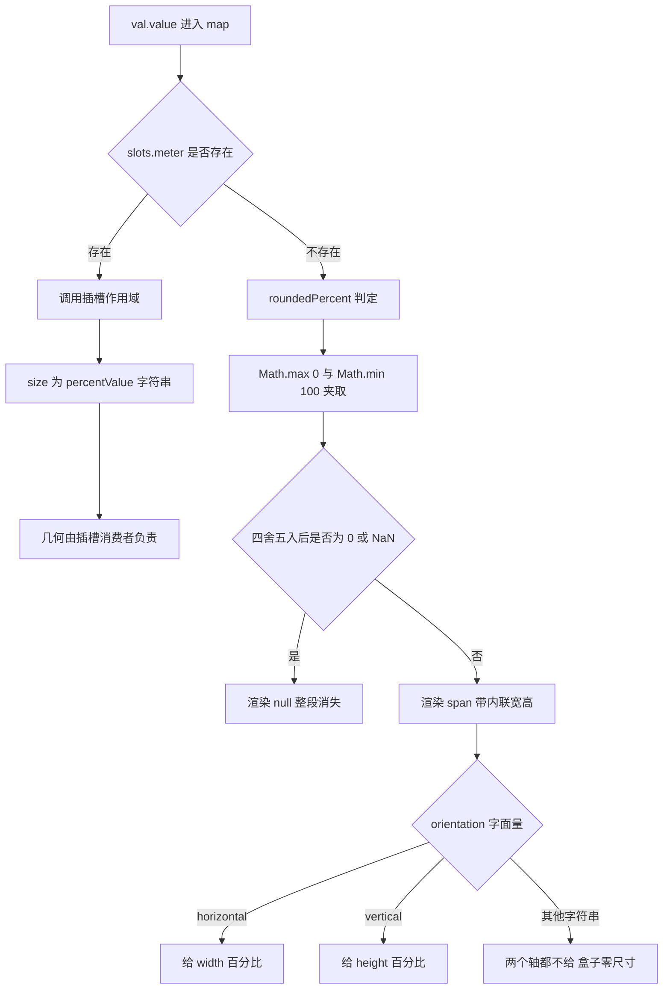
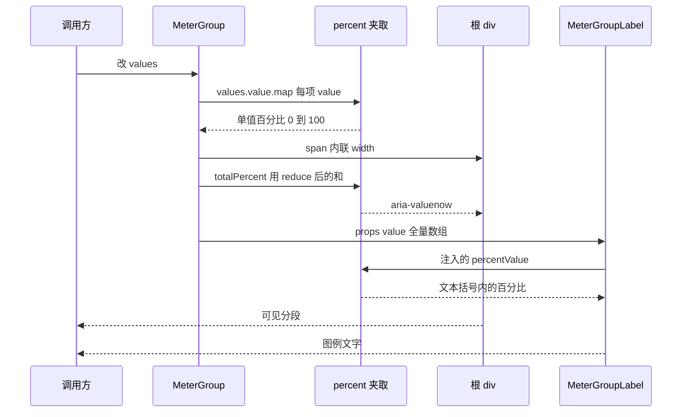

# C11-05 MeterGroup 仪表组

> **本篇解决**：`values` 里的数字到底经过哪几步才变成屏幕上的一段宽度；`min`、`max`、四舍五入与夹取分别在哪些出口产生分歧；子件 `MeterGroupLabel` 从父件拿到了什么、没拿到什么；以及改哪一行会让整组指标静默消失。
> **前置**：C11-02 Progress 进度　**读者坐标**：`03-components/11-status` 第 6/9 篇（含类横写 C11-00）

## 一、职责与边界

`MeterGroup` 负责的是**把一组离散数值映射到同一条轨道上的分段几何**，并且把「谁是哪一段」这件事同时告诉视觉层（内联宽/高）、图例层（`MeterGroupLabel`）和无障碍层（`aria-*`）。它明确不负责：单值的动画补间（Progress 一族负责，见 C11-02 Progress 论点 5 的三档驱动源）、颜色板与状态语义（没有任何 `status`/`exception` 概念，颜色完全来自 `MeterItem.color`）、以及数值的聚合口径（组件不做加权、不做归一化到 100，只做仿射夹取）。

它依赖的外部实现只有四组：`useConfigInject` 取前缀、`genComponentStyleHook` 取样式表、`initDefaultProps` 补默认值、`registerComponent` 做全局注册。它**不**依赖 `vc-progress`，也不复用 `progress/` 的任何换算函数——同一个「数值 → 百分比」的换算在本类（`11-status`）里存在两份互不相干的实现，这是本篇论点 1 的起点。

依赖清单（全部为仓内路径）：`packages/xiaoye-ui/src/config-provider/hooks/useConfigInject.ts`、`packages/xiaoye-ui/src/theme/util/genComponentStyleHook.ts`、`packages/xiaoye-ui/src/_util/props-util/initDefaultProps.ts`、`packages/xiaoye-ui/src/_util/type.ts`、`packages/xiaoye-ui/src/_util/registerComponent.ts`。被谁依赖：只有聚合入口 `packages/xiaoye-ui/src/components.ts:222` 与 `packages/xiaoye-ui/src/components.ts:223`，以及文档站六个示例；组件目录之外没有任何 `.vue`/`.tsx` 引用它（`grep -rn "meter-group" packages apps` 的命中面见二节表格）。

## 二、源码地图

| 文件 | 行数 | 职责 | 关键导出 |
| --- | --- | --- | --- |
| `packages/xiaoye-ui/src/meter-group/index.ts` | 23 | 导出入口 + 插件安装，**注册两个组件** | `default`、`MeterGroupLabel`、`meterGroupProps` |
| `packages/xiaoye-ui/src/meter-group/MeterGroup.tsx` | 159 | 主实现：归一化、上下文注入、双出口渲染 | `default`（`XYMeterGroup`） |
| `packages/xiaoye-ui/src/meter-group/meterGroupTypes.ts` | 43 | Props 与 `MeterItem` 契约 | `meterGroupProps`、`MeterGroupProps`、四个类型别名 |
| `packages/xiaoye-ui/src/meter-group/MeterGroupLabel.tsx` | 65 | 图例子件，注入父件函数渲染 `(xx%)` | `default`（`XYMeterGroupLabel`） |
| `packages/xiaoye-ui/src/meter-group/style/index.ts` | 124 | CSS-in-JS 样式表，三个自定义 Token 声明 | `default`（样式 hook）、`ComponentToken` |
| `packages/xiaoye-ui/src/meter-group/__tests__/meter-group.test.tsx` | 133 | 唯一测试文件，12 个 `it` | — |

主实现入口是 `packages/xiaoye-ui/src/meter-group/MeterGroup.tsx:11`（`defineComponent`），setup 从 `packages/xiaoye-ui/src/meter-group/MeterGroup.tsx:36` 开始，渲染函数返回在 `packages/xiaoye-ui/src/meter-group/MeterGroup.tsx:116`。子件的 render 在 `packages/xiaoye-ui/src/meter-group/MeterGroupLabel.tsx:45`。样式表基准块从 `packages/xiaoye-ui/src/meter-group/style/index.ts:20` 到 `:113` 是**唯一一个**生成函数，注册语句在 `packages/xiaoye-ui/src/meter-group/style/index.ts:115`。

这张地图里有三处「行数很少但语义密度很高」的位置必须提前标记：换算公式在 `packages/xiaoye-ui/src/meter-group/MeterGroup.tsx:43-52` 只有十行，却是全组件的数值入口；上下文对象在 `packages/xiaoye-ui/src/meter-group/MeterGroup.tsx:55-66` 只有十二行，却同时向子件与外部组件族投递；几何样式在 `packages/xiaoye-ui/src/meter-group/style/index.ts:36-74` 只写了轨道与首尾圆角，**没有任何一条规则针对单个 `.xy-meter-group-meter` 的盒模型**。测试面同样偏斜：`packages/xiaoye-ui/src/meter-group/__tests__/meter-group.test.tsx:85-91` 把「0% 不渲染」写成了期望，而 `packages/xiaoye-ui/src/meter-group/__tests__/meter-group.test.tsx:103-112` 的插槽用例只数节点个数。

## 三、架构与数据流

### 图 1：静态结构（谁持有谁、谁注入谁）



图 1 说明四件事。第一，`MeterGroup` 是唯一的数值换算者，子件不持有 `min`/`max`，只能通过注入的函数间接换算（`packages/xiaoye-ui/src/meter-group/MeterGroup.tsx:62`）。第二，`useConfigInject('meter-group', props)` 在 `packages/xiaoye-ui/src/meter-group/MeterGroup.tsx:37`，产出的 `prefixCls` 被原样喂给 `useStyle`（`packages/xiaoye-ui/src/meter-group/MeterGroup.tsx:38`）——这一行是对的，判定依据见论点 6。第三，`MeterGroupLabel` 在 `index.ts:19` 被独立全局注册，但它**不在** `packages/xiaoye-ui/src/meter-group/MeterGroupLabel.tsx:1` 的 import 里引入任何样式 hook，脱离父件时样式链路是断的。第四，`MeterGroupToken` 只在样式文件内部存在，主题登记表里的对应槽位是空对象（论点 6 展开）。

### 图 2：单个数值到几何的完整分支



这张图的关键分支有三条，且**只有一条会产出可见的条**。`slots.meter` 的存在与否决定了换算结果由谁负责（`packages/xiaoye-ui/src/meter-group/MeterGroup.tsx:135-146`），这是论点 4 的主题；`roundedPercent(...)` 作为三元条件把「百分比为 0」与「没有这一项」画了等号（`packages/xiaoye-ui/src/meter-group/MeterGroup.tsx:144`），这是论点 2；`orientation` 的字面量比较只有两个分支有几何输出（`packages/xiaoye-ui/src/meter-group/MeterGroup.tsx:77-78`），第三个分支既不报错也不给尺寸，这是坑 5。

### 图 3：一次 `values` 更新的三出口回流



图 3 里三条箭头分别进了三个出口，但**只有两条经过同一个归一化入口**。条宽用的是逐项 `percent(val.value)`（`packages/xiaoye-ui/src/meter-group/MeterGroup.tsx:77`），`aria-valuenow` 用的是 `totalPercent`（`packages/xiaoye-ui/src/meter-group/MeterGroup.tsx:125`），而 `totalPercent` 的输入是**求和之后的单个标量**（`packages/xiaoye-ui/src/meter-group/MeterGroup.tsx:84-86`）。图例文字又走第三条路：子件调用注入的 `percentValue`（`packages/xiaoye-ui/src/meter-group/MeterGroupLabel.tsx:58`），它与条宽同源。于是「三个出口」实际是「两种口径」，而这两种口径在 `min ≠ 0` 时数学上不等价——这就是论点 1。另外注意 `percentages` 这个作用域字段在图 3 里**没有任何参与者消费它**，它只是被打包给插槽（`packages/xiaoye-ui/src/meter-group/MeterGroup.tsx:103`、`:131`、`:152`），语义与名字相反。

## 四、核心机制精读

### 论点 1：全组件只有一条归一化公式，但它被四个出口以四种不同口径消费，其中「聚合」那条在 `min ≠ 0` 时与其余三条数学不等价

公式本体只有七行，含一次夹取：

```tsx
// packages/xiaoye-ui/src/meter-group/MeterGroup.tsx:42
    // 计算单值百分比（限制在 0~100）
    const percent = (meter = 0) => {
      const range = props.max - props.min;
      if (!range) return 0;
      const percentOfItem = ((meter - props.min) / range) * 100;
      return Math.max(0, Math.min(100, percentOfItem));
    };

    const roundedPercent = (meter = 0) => Math.round(percent(meter));

    const percentValue = (meter: number) => `${roundedPercent(meter)}%`;
```

`percent` 是一个仿射映射再加一次双边夹取：`(v - min) / (max - min) * 100`，落在 `[0, 100]`。`roundedPercent` 只在外面套了 `Math.round`（`packages/xiaoye-ui/src/meter-group/MeterGroup.tsx:50`），`percentValue` 只加了百分号（`packages/xiaoye-ui/src/meter-group/MeterGroup.tsx:52`）。这三个函数构成**唯一的数值入口**，没有任何一处出口绕过它们。问题不在公式，在下游：四个出口对「取不取整」「聚合在前还是聚合在后」做了四种不同选择。

```tsx
// packages/xiaoye-ui/src/meter-group/MeterGroup.tsx:82
    const values = computed<MeterItem[]>(() => props.values || []);

    const totalPercent = computed(() =>
      roundedPercent(values.value.reduce((total, val) => total + val.value, 0)),
    );

    const percentages = computed(() => {
      let sum = 0;
      const sumsArray: number[] = [];
      values.value.forEach(item => {
        sum += item.value;
        sumsArray.push(sum);
      });
      return sumsArray;
    });
```

逐段解释四种口径。

**出口 A（条宽）用未取整的逐项值**：`width: props.orientation === 'horizontal' ? `${percent(val.value)}%` : undefined`（`packages/xiaoye-ui/src/meter-group/MeterGroup.tsx:77`），竖轴同构在 `packages/xiaoye-ui/src/meter-group/MeterGroup.tsx:78`。这里调的是 `percent`，不是 `roundedPercent`，所以 DOM 上会出现 `width: 33.33333333333333%` 这类串。

**出口 B（渲染开关）用取整后的逐项值**：`roundedPercent(val.value) ? <span/> : null`（`packages/xiaoye-ui/src/meter-group/MeterGroup.tsx:144`）。几何用精确值、存在性用舍入值，两者阈值不一致，这是论点 2 的内容。

**出口 C（图例文本）用取整后的逐项值**：子件把注入函数拼进文案 `(${meterGroupCtx.percentValue(val.value)})`（`packages/xiaoye-ui/src/meter-group/MeterGroupLabel.tsx:58`）。于是同一项在条上是 `33.33%` 宽、在图例里是 `(33%)`——这两个数字肉眼一致但 DOM 不一致，做视觉回归快照时会稳定产出两种串。

**出口 D（`aria-valuenow`）用取整后的「先求和再归一化」值**：`aria-valuenow={totalPercent.value}`（`packages/xiaoye-ui/src/meter-group/MeterGroup.tsx:125`），而 `totalPercent` 的输入是 `reduce` 后的标量（`packages/xiaoye-ui/src/meter-group/MeterGroup.tsx:85`）。

关键就在这里：`reduce` 求的是**原始值的和**，随后把这个和当成「一个单值」重新过一遍仿射映射。仿射映射不是线性的，它有常数项 `-min/(max-min)*100`。对 n 个项分别做再加总，常数项被重复了 n 次；对总和做一次，常数项只出现 1 次。两者相差 `(n-1) * min / (max-min) * 100`。当且仅当 `min = 0` 时常数项消失，两条路径退化为同一结果——而 `min` 的默认值恰好是 0（`packages/xiaoye-ui/src/meter-group/MeterGroup.tsx:16` 的 `initDefaultProps` 补的，源头是 `packages/xiaoye-ui/src/meter-group/meterGroupTypes.ts:32` 的 `someType<number>([Number])`，它本身不带默认值，见 `packages/xiaoye-ui/src/_util/type.ts:91-93`）。也就是说：**这个不自洽在默认配置下不可见，只在调用方显式给了非零 `min` 之后才浮现。**

给两组可手算的数。`min=50, max=100, values=[{value:60},{value:60}]`：出口 A 每段 20%，堆叠可见宽度 40%；出口 D 是 `percent(120)` = `(120-50)/50*100` = 140，被 `Math.min(100, …)` 夹成 100（`packages/xiaoye-ui/src/meter-group/MeterGroup.tsx:47`）。读屏播报「100」，画面只填了四成。更极端的是 `min=50, max=100, values=[{value:50},{value:50}]`：出口 A 每项 `percent(50)` = 0，两段都被出口 B 吞掉（详见论点 2），画面**一根条都没有**；而 `totalPercent` = `percent(100)` = 100，`aria-valuenow="100"`（`packages/xiaoye-ui/src/meter-group/MeterGroup.tsx:125`）。无障碍树报告满值，视觉层报告空值，两者由同一个函数族算出。

第三个隐藏口径差是**夹取时机**。出口 A 逐项夹取，所以超过 `max` 的项各自吃满 100%，堆叠总宽可以远超轨道宽度；出口 D 对和夹取，所以超过 `max` 的和被压回 100。这两件事不可能同时为真：要么「每段各自满」，要么「整体满」。样式表里没有 `overflow` 声明兜住前者（`packages/xiaoye-ui/src/meter-group/style/index.ts:36-40` 只给了 `display: flex` 与轨道底色），于是前者变成几何问题，交给论点 5 的 flex 收缩。

结论回扣：`percent` 家族是这条链上唯一的真值来源，这是好设计；坏在它下游的四个消费点各自决定了「取不取整、何时求和、何时夹取」，而**没有任何一处写过这四者之间应当满足的一致性约束**。改 `min`/`max` 的语义，或者把 `totalPercent` 改成 `sum(roundedPercent)`，都会同时牵动无障碍播报与图例文本，属于对外契约变更。

### 论点 2：`roundedPercent(...) ? <span/> : null` 把「百分比舍入为零」当成「这一项不存在」，负值、超小值、`NaN`、`min === max` 四种输入都会静默吞掉整段

```tsx
// packages/xiaoye-ui/src/meter-group/MeterGroup.tsx:133
          <div class={`${prefixCls.value}-meters`}>
            {values.value.map((val, index) =>
              slots.meter ? (
                slots.meter({
                  value: val,
                  index,
                  class: meterClass.value,
                  orientation: props.orientation,
                  size: percentValue(val.value),
                  totalPercent: totalPercent.value,
                })
              ) : roundedPercent(val.value) ? (
                <span class={meterClass.value} style={meterCalculatedStyles(val)} />
              ) : null,
            )}
          </div>
```

`packages/xiaoye-ui/src/meter-group/MeterGroup.tsx:144` 这一行的条件不是 `val.value > 0`，也不是 `percent(val.value) > 0`，而是 `Math.round(...) !== 0`。把它拆成输入类别，可以得到四条不同的失效路径，全部静默、全部无告警。

**其一，正但极小的值。** 夹取后落在 `[0, 0.5)` 的百分比四舍五入为 0，整段消失。也就是说 `min=0, max=100, value=0.4` 不渲染，而 `value=0.5` 渲染出一段 `width: 0.5%` 的条。视觉阈值不是 0 而是 0.5%，但代码面上写的像是「0 就不画」。测试把这条行为固化成了期望：`packages/xiaoye-ui/src/meter-group/__tests__/meter-group.test.tsx:85-91` 用 `value: 0` 断言 `findAll('.xy-meter-group-meter').length === 0`，用例名就叫 `skips rendering meter when value resolves to 0 percent`——它测的是 `0`，被顺带锁定的却是整个 `[0, 0.5)` 区间，而区间内的值没有任何用例覆盖。

**其二，负值。** `Math.max(0, …)`（`packages/xiaoye-ui/src/meter-group/MeterGroup.tsx:47`）把任何低于 `min` 的值压到 0，于是负值同样整段消失。这里没有 `warning` 调用，组件全文不 import 任何告警工具（`packages/xiaoye-ui/src/meter-group/MeterGroup.tsx:1-9` 的 import 清单里没有 `_util/warning`），所以调用方拿不到任何提示。

**其三，`NaN`。** `Math.min(100, NaN)` 返回 `NaN`，`Math.max(0, NaN)` 仍返回 `NaN`，`Math.round(NaN)` 是 `NaN`，`NaN` 为假值，于是该项也不渲染。而 `totalPercent` 走同一条 reduce，`NaN` 会被写进 `aria-valuenow`（`packages/xiaoye-ui/src/meter-group/MeterGroup.tsx:125`），DOM 上得到字面量 `NaN`。条没了，无障碍属性却在播报一个非法值。值得注意 `MeterItem.value` 的类型是 `number`（`packages/xiaoye-ui/src/meter-group/meterGroupTypes.ts:18`），但同一接口带 `[key: string]: any` 索引签名（`packages/xiaoye-ui/src/meter-group/meterGroupTypes.ts:24`），而 props 侧只校验到「是不是数组」这一层（`packages/xiaoye-ui/src/meter-group/meterGroupTypes.ts:30` 展开成 `packages/xiaoye-ui/src/_util/type.ts:84` 的 `{ type: Array, default: undefined }`）——逐项类型在运行时无人校验，接口数据里混进字符串就会踩到这条。

**其四，退化区间。** `if (!range) return 0`（`packages/xiaoye-ui/src/meter-group/MeterGroup.tsx:45`）在 `max === min` 时让**所有**项返回 0，整组指标一根条都不画，而图例照旧全量渲染（`packages/xiaoye-ui/src/meter-group/MeterGroupLabel.tsx:47` 对 `props.value` 无条件 `map`）。同一个 `!range` 判定还顺手把 `NaN` 区间也吞进 0 分支，因为 `NaN` 是假值。另外 `max < min` 时 `range` 为负，任何 `value > min` 的项都会算出负百分比、被 `Math.max(0, …)` 压平，结果同样是全组空白，但没有任何一条声明解释「`max` 必须大于 `min`」。

还有一个几何侧的连带效应值得记一笔：`packages/xiaoye-ui/src/meter-group/MeterGroup.tsx:134-147` 这段 `map` **没有 `key`**，而子件的 `map` 是带 key 的（`packages/xiaoye-ui/src/meter-group/MeterGroupLabel.tsx:48` 的 `key={`${index}_label`}`）。当条件分支会让数组长度与输入长度不一致时，无 key 的列表复用完全按位置对齐，`values` 变更时哪一段颜色留给哪个 DOM 节点取决于夹取结果，容易在 diff 后出现「颜色与条错位」。这一条本篇只作为静态观察记录，未构造运行时用例证明错位方向。

### 论点 3：父件投递的上下文里只有 `percentValue` 一个函数真正被消费，`min`/`max`/`orientation` 都没进上下文，而第二个 `provide` 键与 `data-table` 的同名注入键相撞

```tsx
// packages/xiaoye-ui/src/meter-group/MeterGroup.tsx:54
    // 提供给 MeterGroupLabel 的上下文
    const meterGroupCtx = {
      get $el() {
        return instance.proxy?.$el;
      },
      get $attrs() {
        return instance.attrs;
      },
      percentValue,
    };

    provide('$xyMeterGroup', meterGroupCtx);
    provide('$parentInstance', meterGroupCtx);
```

这个对象有三个成员，读代码时逐个核对读者，结论是三比一。

**`percentValue` 有唯一读者**：子件在拼图文案时调用它（`packages/xiaoye-ui/src/meter-group/MeterGroupLabel.tsx:58`），且带一道 `meterGroupCtx?.percentValue ?` 的存在性守卫。注入点在同文件 `packages/xiaoye-ui/src/meter-group/MeterGroupLabel.tsx:35`，`inject<any>('$xyMeterGroup', null)` 的兜底值是 `null`，所以脱离父件时它安静地退化成「不显示百分比」。

**`$el` 与 `$attrs` 全仓零读者。** 判形命令与结果：`grep -rn "xyMeterGroup" packages apps` 只命中 `packages/xiaoye-ui/src/meter-group/MeterGroup.tsx:65` 与 `packages/xiaoye-ui/src/meter-group/MeterGroupLabel.tsx:35` 两处，子件从头到尾没有触碰 `meterGroupCtx.$el` 或 `meterGroupCtx.$attrs`。这两个 getter 的形状与 `packages/xiaoye-ui/src/data-table/DataTable.tsx:218`、`packages/xiaoye-ui/src/data-table/DataTable.tsx:221` 完全同构——那是「父实例代理」模式的模板，被照搬进来，但 MeterGroup 的子件根本不需要 DOM 引用。这正是共则里「只写不读的内部状态」的组件间版本。

**`$parentInstance` 是第二个 `provide`，键名与 data-table 家族撞车。** `packages/xiaoye-ui/src/data-table/DataTable.tsx:217` 用同一个字符串 `'$parentInstance'` 提供表格实例代理，消费者有三处：`packages/xiaoye-ui/src/data-table/BodyRow.tsx:84`、`packages/xiaoye-ui/src/data-table/TableHeader.tsx:52`、`packages/xiaoye-ui/src/data-table/TableFooter.tsx:16`。`provide` 的作用域是子树，所以只有当一张表被放进 `MeterGroup` 的子树内才会踩到——而 `MeterGroup` 恰好提供了 `#label`、`#start`、`#end`、`#meter` 四个可以把任意组件放进去的插槽（`packages/xiaoye-ui/src/meter-group/MeterGroup.tsx:99-105`、`:128-132`、`:135-143`、`:149-153`）。一旦命中，`packages/xiaoye-ui/src/data-table/BodyRow.tsx:85` 的 `dataTableInstance = computed(() => $parentInstance?.$parentInstance ?? $parentInstance)` 会退回到 MeterGroup 那个对象上——因为 MeterGroup 的 ctx 里**没有** `$parentInstance` 这个自引用 getter，而 DataTable 的 ctx 里有（`packages/xiaoye-ui/src/data-table/DataTable.tsx:224`）。连带后果是 `packages/xiaoye-ui/src/data-table/TableFooter.tsx:65` 与 `packages/xiaoye-ui/src/data-table/TableHeader.tsx:124` 的 `data-xy-scrollable={$parentInstance?.$parentInstance?.scrollable}` 恒为 `undefined`，滚动属性静默丢失。本篇没有构造嵌套用例去复现整条链路，触发条件与失效字段是从上述行号静态读出的。

**上下文缺的恰恰是子件真正需要的东西。** 子件要显示「这一项占多少」，但它自己没有 `min`/`max` props——`packages/xiaoye-ui/src/meter-group/MeterGroupLabel.tsx:18-29` 的 props 只有 `value`、`labelPosition`、`labelOrientation`、`prefixCls` 四项。于是它唯一可行的算法就是借用父件闭包里的函数，这也意味着**子件显示的百分比永远跟随父件的区间参数，无法独立设定**。反过来，`#label` 插槽的作用域同样不含 `min`/`max`，也不含 `percentValue`（`packages/xiaoye-ui/src/meter-group/MeterGroup.tsx:100-104` 只给了 `value`、`totalPercent`、`percentages` 三个键，类型声明在 `packages/xiaoye-ui/src/meter-group/MeterGroup.tsx:23`）。想自定义图例又想要逐项百分比的调用方，只能自己重写一遍 `(v-min)/(max-min)*100` 并自己夹取——这就把「同一逻辑的多份拷贝」这件事外包给了用户，而组件明明已经把 `percentValue` 装进了上下文，只是没在插槽面上暴露它。

最后看子件那侧被消费的第二个字段：

```tsx
// packages/xiaoye-ui/src/meter-group/MeterGroupLabel.tsx:45
    return () => (
      <ol class={labelListClasses.value}>
        {(props.value || []).map((val, index) => (
          <li key={`${index}_label`} class={`${props.prefixCls}-label`}>
            {slots.icon ? (
              slots.icon({ value: val, class: labelIconClass.value })
            ) : val.icon ? (
              <i class={[val.icon, labelIconClass.value]} style={{ color: val.color }} />
            ) : (
              <span class={labelMarkerClass.value} style={{ backgroundColor: val.color }} />
            )}
            <span class={`${props.prefixCls}-label-text`}>
              {val.label}
              {meterGroupCtx?.percentValue ? ` (${meterGroupCtx.percentValue(val.value)})` : ''}
            </span>
```

`packages/xiaoye-ui/src/meter-group/MeterGroupLabel.tsx:57` 的 `val.label` 没有兜底：`MeterItem.label` 是可选字段（`packages/xiaoye-ui/src/meter-group/meterGroupTypes.ts:16`），缺项时图例文本为空，只剩颜色点与括号里的百分比。而 `packages/xiaoye-ui/src/meter-group/MeterGroupLabel.tsx:49-55` 的三态分支里，第一态 `slots.icon` 在父件路径上永远拿不到值——父件渲染子件时是自闭合标签、没有下传任何插槽（`packages/xiaoye-ui/src/meter-group/MeterGroup.tsx:107-113`），尽管父件自己在 slots 类型里声明了 `icon`（`packages/xiaoye-ui/src/meter-group/MeterGroup.tsx:34`）。判形命令：`grep -rn "slots.icon" packages/xiaoye-ui/src/meter-group` 只命中 `packages/xiaoye-ui/src/meter-group/MeterGroupLabel.tsx:49` 与 `:50`，父件一次都没读。

### 论点 4：几何换算有两条互斥的产出路径，`#meter` 插槽一旦存在就把内联宽高整个跳过，而它给的替代字段名叫 `size`、实际是百分比字符串

```tsx
// packages/xiaoye-ui/src/meter-group/MeterGroup.tsx:68
    const rootClasses = computed(() => {
      return [hashId.value, prefixCls.value, `${prefixCls.value}-${props.orientation}`];
    });

    const meterClass = computed(() => `${prefixCls.value}-meter`);

    const meterCalculatedStyles = (val: MeterItem) => {
      return {
        backgroundColor: val.color,
        width: props.orientation === 'horizontal' ? `${percent(val.value)}%` : undefined,
        height: props.orientation === 'vertical' ? `${percent(val.value)}%` : undefined,
      };
    };
```

`meterCalculatedStyles` 是**唯一**把百分比写进 DOM 的地方，而它只在默认分支被调用（`packages/xiaoye-ui/src/meter-group/MeterGroup.tsx:145`）。插槽分支里组件什么都不写，只把换算结果作为字符串塞进作用域：

```tsx
// packages/xiaoye-ui/src/meter-group/MeterGroup.tsx:22
  slots: Object as CustomSlotsType<{
    label?: (scope: { value: MeterItem[]; totalPercent: number; percentages: number[] }) => any;
    meter?: (scope: {
      value: MeterItem;
      index: number;
      class: string;
      orientation: string;
      size: string;
      totalPercent: number;
    }) => any;
    start?: (scope: { value: MeterItem[]; totalPercent: number; percentages: number[] }) => any;
    end?: (scope: { value: MeterItem[]; totalPercent: number; percentages: number[] }) => any;
    icon?: (scope: { value: MeterItem; class: string }) => any;
  }>,
```

这里有四个可核对的事实。

第一，`size` 这个名字与内容不符。它的赋值是 `size: percentValue(val.value)`（`packages/xiaoye-ui/src/meter-group/MeterGroup.tsx:141`），而 `percentValue` 产出的是 `` `${roundedPercent(meter)}%` ``（`packages/xiaoye-ui/src/meter-group/MeterGroup.tsx:52`），即形如 `"25%"` 的**已舍入百分比串**。类型也如实写着 `size: string`（`packages/xiaoye-ui/src/meter-group/MeterGroup.tsx:29`）。它既不是像素也不是尺寸语义，与同一作用域里的 `orientation`、`class` 并列时极易被读成「条的粗细」。

第二，两条路径的**存在性判定不一致**。默认分支要过 `roundedPercent(val.value)` 这道真值关（`packages/xiaoye-ui/src/meter-group/MeterGroup.tsx:144`），插槽分支不需要——`slots.meter` 一旦存在，三元第一个条件就恒走插槽（`packages/xiaoye-ui/src/meter-group/MeterGroup.tsx:135`），0% 项、负值项照样各产出一个节点。于是「自定义模板」与「默认模板」对同一份 `values` 会渲染出不同数量的段，而图例（`packages/xiaoye-ui/src/meter-group/MeterGroupLabel.tsx:47` 无条件 `map`）始终与 `values` 等长。

第三，两条路径的**取整口径也不一致**。内联宽高用未取整的 `percent`（`packages/xiaoye-ui/src/meter-group/MeterGroup.tsx:77-78`），插槽作用域给的是取整后的 `percentValue`（`packages/xiaoye-ui/src/meter-group/MeterGroup.tsx:141`）。用插槽写 `<span :style="{ width: size }">` 的用户，会得到与默认渲染**不同的宽度**（`33%` 与 `33.33333333333333%`），且没有任何注释提示这一层差异。

第四，文档示例本身就是这条断口的活证。`apps/docs/examples/meter-group/custom-meter.vue:4` 只解构了 `{ value, class: meterClass }`，`size` 没有取用；它的 `:style` 对象（`apps/docs/examples/meter-group/custom-meter.vue:7-11`）里只有 `backgroundColor` 与 `position`，没有任何 `width`/`height`。也就是说这个官方示例交回的节点不带任何几何信息，条的长短完全靠内部那个绝对定位子元素撑——而绝对定位且 `inset: 0` 的元素不参与父盒的宽高计算（`apps/docs/examples/meter-group/custom-meter.vue:12-24`）。示例能演示「插槽可替换 DOM 结构」，但演示不出「插槽必须自己负责几何」这一层契约，这正是论点 4 说的一致性缺口。对应测试也不构成保护：`packages/xiaoye-ui/src/meter-group/__tests__/meter-group.test.tsx:103-112` 只断言 `.custom-meter` 的数量为 3，从不检查 `size` 字段，也从不检查宽度。

`packages/xiaoye-ui/src/meter-group/MeterGroup.tsx:72` 的 `meterClass` 还有一层容易被忽略的设计：插槽拿到的是**同一个类名字符串**，被 `packages/xiaoye-ui/src/meter-group/MeterGroup.tsx:139` 逐字传入，作用是让自定义段继续命中样式表里的轨道规则。但样式表里的首尾圆角是靠位置伪类而不是这个类来实现的（`packages/xiaoye-ui/src/meter-group/style/index.ts:46-54`、`:66-74`），一旦插槽产出的元素标签类型与默认 `<span>` 不同，`:first-of-type`/`:last-of-type` 的匹配对象就变了，圆角会落到错误的段上。这是「组件交出类名、CSS 却依赖结构位置」这一类不一致的典型形状。

### 论点 5：几何的后半段在样式表里，而样式表**没有给单个条写任何盒模型规则**——总宽溢出靠 UA 默认收缩兜住，竖排高度则完全依赖调用方给祖先高度

```tsx
// packages/xiaoye-ui/src/meter-group/style/index.ts:24
    [componentCls]: {
      display: 'flex',
      gap: meterGap,

      [`&${componentCls}-horizontal`]: {
        flexDirection: 'column',
      },

      [`&${componentCls}-vertical`]: {
        flexDirection: 'row',
      },
```

```tsx
// packages/xiaoye-ui/src/meter-group/style/index.ts:36
      [`${componentCls}-meters`]: {
        display: 'flex',
        background: meterTrackColor,
        borderRadius,
      },

      [`&${componentCls}-horizontal ${componentCls}-meters`]: {
        height: meterTrackSize,
      },

      [`&${componentCls}-horizontal ${componentCls}-meter:first-of-type`]: {
        borderStartStartRadius: borderRadius,
        borderEndStartRadius: borderRadius,
      },

      [`&${componentCls}-horizontal ${componentCls}-meter:last-of-type`]: {
        borderStartEndRadius: borderRadius,
        borderEndEndRadius: borderRadius,
      },

      [`&${componentCls}-vertical ${componentCls}-meters`]: {
        flexDirection: 'column',
        width: meterTrackSize,
        height: '100%',
      },
```

第一个可核对事实：**这两段摘录里没有出现任何针对 `.xy-meter-group-meter` 的独立规则**。全文件对 `-meter`（单数）的引用只有四条，且全部带 `:first-of-type` 或 `:last-of-type` 后缀（`packages/xiaoye-ui/src/meter-group/style/index.ts:46`、`:51`、`:66`、`:71`）。判形命令 `grep -n "overflow" packages/xiaoye-ui/src/meter-group/style/index.ts` 返回空，`grep -n "flex-shrink" 同一路径` 同样返回空。于是三个几何后果依次成立：

**其一，横向轨道的宽度不是自己声明的。** `-meters` 只写了 `display: flex`（`packages/xiaoye-ui/src/meter-group/style/index.ts:37`），没有任何 `width`。它在横向模式下能占满一行，靠的是根节点 `flex-direction: column`（`packages/xiaoye-ui/src/meter-group/style/index.ts:28-30`）加 flex 交叉轴默认 `stretch`。一旦调用方给根节点覆盖 `align-items`，或者把组件放进一个交叉轴不拉伸的容器，条宽计算所依赖的百分比基准就消失了，而组件内联的 `width: 20%` 会失去参照。

**其二，总宽超过 100% 时由收缩改写实际宽度，而不是由溢出裁切。** 逐项夹取意味着每项最多 100%，而 n 项之和可以是 n*100%（见论点 1 的夹取时机）。内联声明是 `flex-basis: auto` 下的 `width`，样式表既不写 `flex-shrink: 0` 也不写 `overflow: hidden`，于是 UA 初始值 `flex-shrink: 1` 生效，各段按基准尺寸加权收缩到轨道宽度以内。收缩是等比例的，所以**段与段的比例仍然正确，但每段的实际宽度不再等于它内联声明的百分比**——而 `aria-valuenow` 与图例数字都还是内联口径。这就是论点 1 里「夹取时机不一致」在几何层的落点。

**其三，竖排的高度依赖链在组件内部就断了。** `packages/xiaoye-ui/src/meter-group/style/index.ts:56-60` 给 `-meters` 写的是 `height: '100%'`，而它自己没有任何高度来源；往上一层的根节点在 `packages/xiaoye-ui/src/meter-group/style/index.ts:24-34` 里**完全没有** `height` 声明。竖排每段的高度来自内联 `height: ${percent(val.value)}%`（`packages/xiaoye-ui/src/meter-group/MeterGroup.tsx:78`），百分比高度需要一个确定的参照高度才能解析。文档站自己也承认这一点：`apps/docs/examples/meter-group/vertical.vue:3` 在组件外面套了 `<div style="height: 200px; display: inline-flex; align-items: flex-end">`，高度由示例而不是组件提供。

> ⚠️ 未在源码中找到对应实现，此处为待核实推断。缺少外部确定高度时，竖排各段的百分比高度最终解析为何值（塌陷为零还是按内容），本篇不做数值断言；静态可证明的只有「组件样式表在根节点与 `-meters` 两层都没有给出确定高度」（`packages/xiaoye-ui/src/meter-group/style/index.ts:24-34`、`:56-60`）。

轨道底色与圆角也有两处值得记录的取舍。`background: meterTrackColor`（`packages/xiaoye-ui/src/meter-group/style/index.ts:38`）铺在整个 `-meters` 上，所以当论点 2 的条件把所有段都吞掉时，页面上仍然留下一条完整的空轨道，而不是什么都没有——「指标为 0」与「没有指标」这两种状态在视觉上是同一个灰条。圆角则写了两遍：轨道自身 `borderRadius`（`:39`）与首尾段各自的四角（`:47-48`、`:52-53`、`:67-68`、`:72-73`），后者存在的原因是轨道不裁切；这两套圆角必须保持一致才不出缝，而它们共用同一个 `borderRadius` 变量（取自 `packages/xiaoye-ui/src/meter-group/style/index.ts:21` 的解构），这一点是对的。

`first-of-type` 的语义还要单独提醒一次：它匹配的是**同类型元素中的第一个**，而不是「数组里的第一个可见段」。默认分支产出的都是 `<span>`（`packages/xiaoye-ui/src/meter-group/MeterGroup.tsx:145`），所以第一项被 0% 条件吞掉时，剩下的第一个 `<span>` 会拿到首端圆角——行为符合直觉，纯属巧合。而一旦有人用 `#start` 插槽在轨道内部塞进一个 `<span>`（`packages/xiaoye-ui/src/meter-group/MeterGroup.tsx:128-132` 的插槽是在 `-meters` 之外渲染的，但 `#meter` 插槽产出的节点在轨道之内），或者 `#meter` 产出 `<div>`，圆角归属就会错位。这类「位置伪类与条件渲染共存」的结构，改动时无法靠单元测试发现，因为 `packages/xiaoye-ui/src/meter-group/__tests__/meter-group.test.tsx:12-21` 只数类名与节点数，从不检查计算样式。

### 论点 6：喂给样式 hook 的是本组件自己的 prefixCls，这一行做对了；但子件把前缀写死成字面量，且 `ComponentToken` 声明的三个键从未进入主题登记表

```tsx
// packages/xiaoye-ui/src/meter-group/MeterGroupLabel.tsx:15
export default defineComponent({
  name: 'XYMeterGroupLabel',
  inheritAttrs: false,
  props: {
    value: { type: Array as PropType<MeterItem[]>, default: () => [] },
    labelPosition: {
      type: String as PropType<MeterGroupLabelPosition>,
      default: 'end',
    },
    labelOrientation: {
      type: String as PropType<MeterGroupLabelOrientation>,
      default: 'horizontal',
    },
    prefixCls: { type: String, default: 'xy-meter-group' },
  },
```

先说对的那一行。`const { prefixCls } = useConfigInject('meter-group', props)` 与 `const [wrapSSR, hashId] = useStyle(prefixCls)`（`packages/xiaoye-ui/src/meter-group/MeterGroup.tsx:37`、`packages/xiaoye-ui/src/meter-group/MeterGroup.tsx:38`）传入的是本组件自己的前缀，不是任何派生的 group 前缀。判定标准在样式引擎里：

```tsx
// packages/xiaoye-ui/src/theme/util/genComponentStyleHook.ts:69
    const componentInfo = computed(() => {
      return {
        theme: theme.value,
        token: token.value,
        hashId: hashId.value,
        path: [component, prefixCls.value, iconPrefixCls.value],
      };
    });
    return [
      useStyleRegister(componentInfo, () => {
        const { token: proxyToken, flush } = statisticToken(token.value);

        const defaultComponentToken =
          typeof getDefaultToken === 'function'
            ? (getDefaultToken as any)(proxyToken)
            : getDefaultToken;
        const mergedComponentToken = { ...defaultComponentToken, ...token.value[component] };
```

`packages/xiaoye-ui/src/theme/util/genComponentStyleHook.ts:74` 的 `path` 是 `[component, prefixCls.value, iconPrefixCls.value]`，同一个 `component` 名配不同的 `prefixCls` 会生成两张彼此独立的样式表。反面活例在同仓的 `packages/xiaoye-ui/src/checkbox/Group.tsx:23`——它把 `:20` 派生出的 `groupPrefixCls` 传进了 `useStyle`；正面对照是 `packages/xiaoye-ui/src/radio/Group.tsx:54`，传的是 `prefixCls`。MeterGroup 属于后者，而且它的 `-meters`/`-label` 这些派生类名全部靠字符串拼接得到（`packages/xiaoye-ui/src/meter-group/MeterGroup.tsx:133`、`packages/xiaoye-ui/src/meter-group/MeterGroup.tsx:72`），没有参与缓存键，因此这一族结构在 MeterGroup 上不产生重复注册。凡有 Group/子件结构的组件都应核对这一行，本篇把它写成附录检查点 2。

但子件那一侧有两个独立缺陷。

**其一，前缀被写成字面量。** `packages/xiaoye-ui/src/meter-group/MeterGroupLabel.tsx:28` 给 `prefixCls` 设了 `default: 'xy-meter-group'`，而正常链路应该由 `useConfigInject` 通过 `configProvider.getPrefixCls(name, props.prefixCls)` 派生（`packages/xiaoye-ui/src/config-provider/hooks/useConfigInject.ts:14`）。父件渲染它时确实显式传了值（`packages/xiaoye-ui/src/meter-group/MeterGroup.tsx:111` 的 `prefixCls={prefixCls.value}`），所以这条默认值在父件路径上永不生效；真正吃到它的是**独立使用**的场景——`packages/xiaoye-ui/src/meter-group/index.ts:19` 把 `MeterGroupLabel` 也注册成了全局组件（`packages/xiaoye-ui/src/_util/registerComponent.ts:22` 会把它转成 `xy-meter-group-label`）。此时无论 `ConfigProvider` 把前缀改成什么，子件仍然输出 `xy-meter-group-*` 类名。

**其二，子件没有任何样式注册，类名与样式表是断开的。** 看 `packages/xiaoye-ui/src/meter-group/MeterGroupLabel.tsx:1` 的 import 清单：只有 `computed`、`defineComponent`、`inject`、`PropType`、`CustomSlotsType` 与三个类型，**没有** `./style`。而样式表里所有图例规则都嵌在 `[componentCls]` 之下（`packages/xiaoye-ui/src/meter-group/style/index.ts:24` 开始，`packages/xiaoye-ui/src/meter-group/style/index.ts:76` 的 `-label-list`、`:93` 的 `-label`、`:99` 的 `-label-marker`、`:106` 的 `-label-icon` 全在嵌套内）。因此子件单独使用时它拿得到类名却拿不到任何规则——规则要求一个 `.xy-meter-group` 祖先。这两条合起来说明：`index.ts:19` 的这次注册没有配套任何独立可用的样式路径。

顺带核对一个「声明了但从不读取」的类型面。`packages/xiaoye-ui/src/meter-group/style/index.ts:5-12` 导出了一个非空的 `ComponentToken`：

```tsx
// packages/xiaoye-ui/src/meter-group/style/index.ts:115
export default genComponentStyleHook('MeterGroup', token => {
  const meterGroupToken = mergeToken<MeterGroupToken>(token, {
    // 轨道高度：基于字号派生，与文字基线协调
    meterTrackSize: Math.round(token.fontSize / 2),
    meterGap: token.marginMD,
    // 轨道背景色：复用 progress 的剩余色，保持视觉一致
    meterTrackColor: token.colorFillSecondary,
  });
  return [genBaseStyle(meterGroupToken)];
});
```

`ComponentToken` 在本文件里只出现一次，就是它自己的声明行（`packages/xiaoye-ui/src/meter-group/style/index.ts:5`），样式函数实际用的是文件内另写的 `MeterGroupToken`（`packages/xiaoye-ui/src/meter-group/style/index.ts:14`）。而主题登记表里 MeterGroup 的槽位是空对象：`packages/xiaoye-ui/src/theme/interface/components.ts:172` 写的是 `MeterGroup?: {}`，同文件对 Progress 却做了正常接线（import 在 `packages/xiaoye-ui/src/theme/interface/components.ts:40`，登记在 `packages/xiaoye-ui/src/theme/interface/components.ts:144`）。因为 `FullToken` 的定义是把 `ComponentTokenMap[ComponentName]` 交叉进 `GlobalToken`（`packages/xiaoye-ui/src/theme/util/genComponentStyleHook.ts:36-37` 与 `:15-16`），空对象意味着 `theme.components.MeterGroup` 在类型面上不接受任何键。即使绕过类型（引擎确实会把用户覆盖合进 `mergedComponentToken`，见 `packages/xiaoye-ui/src/theme/util/genComponentStyleHook.ts:85` 与 `:100` 的传参位置），`packages/xiaoye-ui/src/meter-group/style/index.ts:116-122` 的 `mergeToken` 也会**无条件**用 `Math.round(token.fontSize / 2)`、`token.marginMD`、`token.colorFillSecondary` 覆写这三个键。结论是双层不可达：类型不通，运行时也被覆写。这与 C11-02 Progress 坑 5 那条「`theme.components.Progress` 的 token 覆盖被静默丢弃」属同一族，但成因不同——Progress 是 `ComponentToken` 接口本身为空（`packages/xiaoye-ui/src/progress/style/index.ts:7`），MeterGroup 是接口非空而登记线没接、且生成处覆写。

## 五、对外契约如何生效

这个组件的对外面是**只进不出**的：`packages/xiaoye-ui/src/meter-group/MeterGroup.tsx:11-35` 的选项块里没有 `emits`，`packages/xiaoye-ui/src/meter-group/MeterGroup.tsx:36` 的 setup 解构只取了 `slots` 与 `attrs`（连 `emit`、`expose` 都没取），所以既没有事件面也没有命令式句柄。`grep -rn -e emits -e expose packages/xiaoye-ui/src/meter-group/` 返回空可以复核这条。所有交互可能性都压在插槽上，调用方要响应点击只能把 `onClick` 作为 attr 传进来，由根节点展开吸收。

默认值的注入路径值得一提，因为它同时决定了两件事。`initDefaultProps(meterGroupProps(), …)` 在 `packages/xiaoye-ui/src/meter-group/MeterGroup.tsx:15-21`，其默认值表逐项写的是 `min: 0`、`max: 100`、`orientation: 'horizontal'`、`labelPosition: 'end'`、`labelOrientation: 'horizontal'`。工具函数对每个键走 `packages/xiaoye-ui/src/_util/props-util/initDefaultProps.ts:20-21` 的分支——只要该 prop 已有 `type` 或 `default` 就直接 `prop.default = defaultProps[k]` 覆写；因此 `packages/xiaoye-ui/src/meter-group/meterGroupTypes.ts:36`、`:38`、`:40` 三处 `stringType` 自带的默认值在这里被**第二次**写入同一个值，属于冗余但无害。真正有用的是另一条：`packages/xiaoye-ui/src/_util/props-util/initDefaultProps.ts:28` 对不在 props 声明里的键直接 `throw new Error('not have … prop')`，也就是说默认值表与 `meterGroupProps()` 的字段名是**模块加载期强一致**的，改名漏改一处不会静默，而是整包 import 失败。

同一处也解释了 `values` 的一个文档偏差：手册写的默认值是 `[]`（`apps/docs/components/meter-group.md:65`），而代码里 `arrayType<MeterItem[]>()` 不带实参时产出 `{ type: Array, default: undefined }`（`packages/xiaoye-ui/src/meter-group/meterGroupTypes.ts:30` 与 `packages/xiaoye-ui/src/_util/type.ts:84`），且 `MeterGroup.tsx:15-21` 的默认值表里没有 `values`。运行时不报错是因为 `packages/xiaoye-ui/src/meter-group/MeterGroup.tsx:82` 有一道 `props.values || []`，可观察行为与文档一致，但 prop 的**真实默认值**是 `undefined`——任何依赖读取 prop 默认值的工具（自动文档、IDE 提示、按 default 生成表单初值的场景）拿到的是 `undefined` 而不是 `[]`。

props 到渲染的路径分四种性质。**区间类**（`min`/`max`）只进 `percent`（`packages/xiaoye-ui/src/meter-group/MeterGroup.tsx:44-46`）与两个 aria 属性（`packages/xiaoye-ui/src/meter-group/MeterGroup.tsx:123-124`），不进任何类名。**方向类**（`orientation`）一次进类名（`packages/xiaoye-ui/src/meter-group/MeterGroup.tsx:69`）、两次进几何判断（`packages/xiaoye-ui/src/meter-group/MeterGroup.tsx:77-78`），三处都用字面量相等比较，而 `stringType` 产出的 prop 定义里没有 `values` 白名单（`packages/xiaoye-ui/src/_util/type.ts:87-89`），所以 Vue 不会对非法值告警。**布局类**（`labelPosition`/`labelOrientation`）走两条不同的路：`labelPosition` 由父件自己消费两次决定渲染次序（`packages/xiaoye-ui/src/meter-group/MeterGroup.tsx:127`、`:154`），`labelOrientation` 则纯粹转交给子件拼类名（`packages/xiaoye-ui/src/meter-group/MeterGroupLabel.tsx:39`）。

这里出现本篇唯一一条「声明了但从不读取」的 prop：子件自己也声明了 `labelPosition`（`packages/xiaoye-ui/src/meter-group/MeterGroupLabel.tsx:20-23`，带 `default: 'end'`），父件也确实每次都在传（`packages/xiaoye-ui/src/meter-group/MeterGroup.tsx:109`），但子件的 render 通篇（`packages/xiaoye-ui/src/meter-group/MeterGroupLabel.tsx:45-63`）没有读过它——判形命令 `grep -n "labelPosition" packages/xiaoye-ui/src/meter-group/MeterGroupLabel.tsx` 只命中类型行 `:11` 与 props 行 `:20`。位置语义完全由父件的两次条件渲染实现，子件收到的是一个空转 prop。它不会造成错误行为，但会让接手人误以为图例子件能自己决定左右。

数据面与几何面的交接如下：

```tsx
// packages/xiaoye-ui/src/meter-group/MeterGroup.tsx:98
    const renderLabel = () => {
      if (slots.label) {
        return slots.label({
          value: values.value,
          totalPercent: totalPercent.value,
          percentages: percentages.value,
        });
      }
      return (
        <MeterGroupLabel
          value={values.value}
          labelPosition={props.labelPosition}
          labelOrientation={props.labelOrientation}
          prefixCls={prefixCls.value}
        />
      );
    };
```

`slots.label` 与默认子件是**互斥**的：一旦提供 `label` 插槽，`MeterGroupLabel` 整个不渲染，连带失去注入函数带来的 `(xx%)` 文本与 `icon`/`marker` 三态分支（`packages/xiaoye-ui/src/meter-group/MeterGroupLabel.tsx:49-55`）。这是插槽的正常语义，但作用域里补不回这些能力（论点 3 末段），所以「只想换个排版、不想丢百分比」的诉求只能自己实现。

渲染根节点这一侧，属性顺序决定了哪些是「可覆盖的」哪些是「不可覆盖的」：

```tsx
// packages/xiaoye-ui/src/meter-group/MeterGroup.tsx:116
    return () => {
      const { class: cls, ...restAttrs } = attrs;
      return wrapSSR(
        <div
          {...restAttrs}
          class={[rootClasses.value, cls]}
          role="meter"
          aria-valuemin={props.min}
          aria-valuemax={props.max}
          aria-valuenow={totalPercent.value}
        >
          {props.labelPosition === 'start' && renderLabel()}
```

`packages/xiaoye-ui/src/meter-group/MeterGroup.tsx:117` 先把 `class` 从 `attrs` 里摘出来，再在 `:121` 显式合并，因此调用方写 `class="my-block"` 是**追加**而不是覆盖——这是 `inheritAttrs: false` 组件应有的写法。相反，`role`（`:122`）与三个 `aria-*`（`:123-125`）写在展开之后，调用方无法用 attr 覆盖它们，也无法关掉 `role="meter"`。就语义而言，`role="meter"` 挂的是聚合值 `aria-valuenow={totalPercent.value}`（`:125`），而每个分段本身是无障碍空洞：默认产出的 `<span>` 没有任何 `role`、`aria-*` 或文本（`packages/xiaoye-ui/src/meter-group/MeterGroup.tsx:145` 是自闭合空元素），逐项数值只存在于图例文本里（`packages/xiaoye-ui/src/meter-group/MeterGroupLabel.tsx:56-58`）。`aria-valuetext` 全文没有出现过，因此读屏拿不到「哪一段是多少」的任何结构化信息。`packages/xiaoye-ui/src/meter-group/__tests__/meter-group.test.tsx:93-101` 只断言了 `role`、`aria-valuemin`、`aria-valuemax` 三个静态属性，`aria-valuenow` 的具体值从未被断言——这解释了为什么论点 1 那类聚合错误能长期存在。

SSR 面相对干净：整棵树由 `wrapSSR` 包裹（`packages/xiaoye-ui/src/meter-group/MeterGroup.tsx:118`），`useStyle` 走的是 `genComponentStyleHook` 的标准注册路径，目录内没有任何 `window`/`document` 引用（`grep -rn -e "window." -e "document." packages/xiaoye-ui/src/meter-group/` 返回空）。`getCurrentInstance()!` 在 `packages/xiaoye-ui/src/meter-group/MeterGroup.tsx:40` 的非空断言只服务于那个零读者的 `$el` getter。

## 六、设计取舍

**取舍一：注入函数而不是把区间参数摊成 props。** 让 `MeterGroupLabel` 通过 `inject` 借用父件的 `percentValue`（`packages/xiaoye-ui/src/meter-group/MeterGroup.tsx:65` 与 `packages/xiaoye-ui/src/meter-group/MeterGroupLabel.tsx:35`）省下四个 prop：`min`、`max`、以及取整与夹取的两个策略开关。收益是子件签名极简，代价是子件的可移植性归零——它必须活在某个 `MeterGroup` 的子树里才能显示百分比，脱离后走 `:58` 的空串分支（`packages/xiaoye-ui/src/meter-group/MeterGroupLabel.tsx:58`），静默少一块内容。而 `packages/xiaoye-ui/src/meter-group/index.ts:19` 又把它单独注册为全局组件，等于对外承认了这条「独立使用」路径却没有为它补齐 prop 面。本仓其实有一条更稳的同族写法：`packages/xiaoye-ui/src/radio/context.ts:5` 用 `Symbol` 建 `InjectionKey<RadioGroupContext>`，并在 `packages/xiaoye-ui/src/radio/Group.tsx:85-91` 把子件真正需要的字段逐项列全（`onChange`、`value`、`disabled`、`name`、`optionType`）。MeterGroup 用的是两个裸字符串键加一个 DOM 代理对象，键名可以撞车（坑 6）、字段清单与实际需求脱节（论点 3）。把 radio 的写法引进来是纯收益：类型化的 `InjectionKey` 会直接把 `$parentInstance` 那类冲突变成编译错误。

**取舍二：几何写内联 style 而不是 CSS 自定义属性。** 现在的写法把百分比直接写进 `style` 属性（`packages/xiaoye-ui/src/meter-group/MeterGroup.tsx:77-78`）。好处是换算结果与 DOM 一一对应、便于调试，插槽也能拿到同一个字符串；代价是**插槽一旦接管结构，组件就没有任何办法再把几何交回去**，于是出现论点 4 那个「官方示例自己不给宽度」的空洞。替代方案是把百分比写成 CSS 变量（形如 `--xy-meter-percent`），由样式表里的 `-meter` 基础规则统一消费——顺带也能顺手解决「没有 `-meter` 基础规则」这个缺口（`packages/xiaoye-ui/src/meter-group/style/index.ts:36-74`），并且让 `flex-shrink` 策略有地方声明。赔上的代价是：CSS 变量方案下内联 style 不再自解释，快照测试读不到宽度值，而这批测试恰恰是类名与内联样式为断言对象（`packages/xiaoye-ui/src/meter-group/__tests__/meter-group.test.tsx:81-82` 就是直接读 `meter.style.width`）。所以这不是「作者没想到」，而是当前测试面把内联写法锁住了：改成 CSS 变量要同时改那条断言。

**取舍三：存在性判定复用取整函数。** `roundedPercent(val.value) ? … : null`（`packages/xiaoye-ui/src/meter-group/MeterGroup.tsx:144`）显然是为了「0 就别画，省一个空 span」。更稳的写法是显式比较 `percent(val.value) > 0`，或者让阈值出现在样式表（`min-width`）。选择复用取整函数省下的是一个条件表达式，赔上的是「区间 `[0,0.5)` 项被吞、负值被吞、`NaN` 被吞、`min===max` 时全组被吞」四条静默路径（论点 2），以及默认分支与插槽分支段数不一致（论点 4）。这条取舍值得在改动时重新评估：它是组件内**唯一**一处把数值语义当成结构语义用的地方。

**取舍四：一份公式四个出口，没有中间层。** 组件把 `percent` 设计成唯一真值来源（`packages/xiaoye-ui/src/meter-group/MeterGroup.tsx:43-52`），这比 `success` 那类「同一条语义在三条绘制路径上有三套互不相干的实现」的情况好（见 C11-02 Progress 论点 3）。但它在出口处没有定义任何「口径契约」：谁该取整、谁该聚合、谁该夹取，全是各处现写。结果就是论点 1 那张四出口对照表。改进方向是把四个出口收成一个 `useMeterModel()` 之类的组合函数，一次产出 `{ segments, legend, aria }` 三个已经互相一致的结构；代价是插槽作用域要重新设计（现在暴露的是 `totalPercent` 与 `percentages`，`packages/xiaoye-ui/src/meter-group/MeterGroup.tsx:23`），属于破坏性变更。

## 七、坑与改动指南

**坑 1：给 `min` 传非零值之后，无障碍播报与画面从此分家。**

- 触发：`<xy-meter-group :values="[{value:60},{value:60}]" :min="50" :max="100" />`。
- 症状：两段各占轨道 20%，合计四成；`aria-valuenow` 却是 `100`。极端情形 `values=[{value:50},{value:50}]` 画面完全空白（配合坑 2），播报仍是满值。
- 原因：`totalPercent` 对**求和后的标量**再走一遍带常数项的仿射映射（`MeterGroup.tsx:84-86` 与 `:43-48`），而条宽走的是逐项映射（`:77`）；两者相差 `(n-1)*min/(max-min)*100`，且结果被 `Math.min(100, …)` 夹平。
- 定位：`packages/xiaoye-ui/src/meter-group/MeterGroup.tsx:43-48`、`:84-86`、`:125`、`:77`。`min=0` 默认值让这条在文档示例里全部隐形（`packages/xiaoye-ui/src/meter-group/MeterGroup.tsx:16`），现有测试也没有 `min ≠ 0` 且多项的用例（`packages/xiaoye-ui/src/meter-group/__tests__/meter-group.test.tsx:75-83` 用的是单一项）。

**坑 2：某项数值很小、为负、为 `NaN`，或者 `max === min` 时，段整块消失而图例还在。**

- 触发：`values` 里存在归一化后落在 `[0, 0.5)` 的项；或接口字段混进字符串/`null`；或 `:min`、`:max` 传成相同值。
- 症状：轨道上少一段或一段不剩，但底色灰条完整保留（`packages/xiaoye-ui/src/meter-group/style/index.ts:38`），看起来像「指标全是 0」；图例数量与 `values` 一致；`aria-valuenow` 可能变成字面量 `NaN`。控制台零告警。
- 原因：`:144` 的存在性判定用舍入值，`:45` 的 `!range` 让退化区间整体归零，`:47` 的双边夹取把负值压到 0；三处都缺校验与告警，且 `MeterItem` 的索引签名让逐项类型形同虚设（`packages/xiaoye-ui/src/meter-group/meterGroupTypes.ts:18-24`）。
- 定位：`packages/xiaoye-ui/src/meter-group/MeterGroup.tsx:144`、`:45`、`:47`。注意 `packages/xiaoye-ui/src/meter-group/__tests__/meter-group.test.tsx:85-91` 已经把「0 不渲染」写成期望，改行为等于改公开契约。

**坑 3：用了 `#meter` 插槽就得自己负责宽高，组件不再写任何几何。**

- 触发：`<template #meter="{ value }">…</template>` 而作用域里的 `size` 没被用（文档示例即如此，`apps/docs/examples/meter-group/custom-meter.vue:4`）。
- 症状：条全部塌成零宽，只剩背景点；同时 0% 项也会各渲染一个节点，段数与默认分支不同。
- 原因：插槽分支与默认分支互斥（`packages/xiaoye-ui/src/meter-group/MeterGroup.tsx:135-146`），`meterCalculatedStyles` 只在默认分支被调用（`:145`）；作用域字段 `size` 名字像尺寸、实际是取整后的百分比串（`:141` 与 `:52`），与默认分支用的未取整值口径不同（`:77`）。
- 定位：`packages/xiaoye-ui/src/meter-group/MeterGroup.tsx:135-146`、`:74-80`、`:141`。该分支无几何断言保护（`packages/xiaoye-ui/src/meter-group/__tests__/meter-group.test.tsx:103-112` 只数节点）。

**坑 4：竖排（`orientation="vertical"`）的长短由外部容器决定，改样式表里的 `height` 要小心。**

- 触发：把 `orientation="vertical"` 的组件直接放进一个没有确定高度的容器。
- 症状：横排正常，竖排的段高不可复现（全塌或全不塌取决于祖先链）；文档站自己是在外层 `div` 上写死 `height: 200px` 才让它成立的。
- 原因：段高是百分比内联值（`packages/xiaoye-ui/src/meter-group/MeterGroup.tsx:78`），轨道高度是 `100%`（`packages/xiaoye-ui/src/meter-group/style/index.ts:56-60`），而根节点没有任何 `height` 声明（`packages/xiaoye-ui/src/meter-group/style/index.ts:24-34`）。
- 定位：`packages/xiaoye-ui/src/meter-group/style/index.ts:56-60`、`:24-34`、`apps/docs/examples/meter-group/vertical.vue:3`。运行时最终解析值本篇未取证（见论点 5 的标注）。

**坑 5：`orientation` 与 `labelPosition` 拼错不报错，且各有一种「静默变成另一种形态」的落点。**

- 触发：`orientation="col"`，或 `labelPosition="bottom"`。
- 症状：前者根类名变成 `xy-meter-group-col`（样式表无此规则，`packages/xiaoye-ui/src/meter-group/style/index.ts:28-34` 只有两个分支），同时宽高两个内联分支都不命中（`packages/xiaoye-ui/src/meter-group/MeterGroup.tsx:77-78`），段退化为零尺寸；后者让 `:127` 与 `:154` 两个条件同时为假，**图例整体消失**。Vue 类型检查之外没有任何运行时校验。
- 原因：`stringType` 不写 `values` 白名单（`packages/xiaoye-ui/src/_util/type.ts:87-89`），组件也不做值校验（`packages/xiaoye-ui/src/meter-group/MeterGroup.tsx:15-21` 只补默认值）。
- 定位：`packages/xiaoye-ui/src/meter-group/MeterGroup.tsx:77-78`、`:127`、`:154`。`packages/xiaoye-ui/src/meter-group/__tests__/meter-group.test.tsx:61-73` 只测了合法值 `start`。

**坑 6：把 `data-table` 放进 MeterGroup 的任意插槽，表格的滚动属性会读到错的父实例。**

- 触发：`<xy-meter-group><template #end><xy-data-table … /></template></xy-meter-group>`（`#label`、`#start`、`#meter` 同理）。
- 症状：表头/表脚的 `data-xy-scrollable` 恒缺失，BodyRow 拿到的实例代理对象没有表格字段。
- 原因：MeterGroup 额外 `provide('$parentInstance', meterGroupCtx)`（`packages/xiaoye-ui/src/meter-group/MeterGroup.tsx:66`）与 DataTable 的注入键同名（`packages/xiaoye-ui/src/data-table/DataTable.tsx:217`），而 MeterGroup 的对象缺少那个自引用 getter（对照 `packages/xiaoye-ui/src/data-table/DataTable.tsx:224`），于是 `packages/xiaoye-ui/src/data-table/BodyRow.tsx:85` 的 `??` 回落到 MeterGroup 的 ctx。
- 定位：`packages/xiaoye-ui/src/meter-group/MeterGroup.tsx:66`、`packages/xiaoye-ui/src/data-table/BodyRow.tsx:85`、`packages/xiaoye-ui/src/data-table/TableFooter.tsx:65`。这条链路无测试保护；`$xyMeterGroup` 那个键没有冲突，可以只删第二行 `provide` 来消除（它在 meter-group 目录内零读者，见论点 3）。

**坑 7：独立使用 `xy-meter-group-label` 时，前缀写死、样式不注册、百分比文本消失。**

- 触发：不套 `xy-meter-group`，直接使用子件标签（它确实被全局注册了）。
- 症状：类名永远是 `xy-meter-group-*`，即 `ConfigProvider` 改了全局前缀也不跟随；且因为规则全部嵌在父类名之下，脱离父件时没有任何规则命中；括号里的百分比也不再出现。
- 原因：`prefixCls: { type: String, default: 'xy-meter-group' }` 绕过了 `getPrefixCls`（`packages/xiaoye-ui/src/meter-group/MeterGroupLabel.tsx:28` 对照 `packages/xiaoye-ui/src/config-provider/hooks/useConfigInject.ts:14`），子件不引样式（`packages/xiaoye-ui/src/meter-group/MeterGroupLabel.tsx:1`），`inject` 兜底为 `null`（`:35`）。
- 定位：`packages/xiaoye-ui/src/meter-group/MeterGroupLabel.tsx:28`、`:1`、`:35`、`packages/xiaoye-ui/src/meter-group/index.ts:19`、`packages/xiaoye-ui/src/meter-group/style/index.ts:76`。另注意 `packages/xiaoye-ui/typings/global.d.ts:58` 只声明了 `XYMeterGroup`，`grep -c "XYMeterGroupLabel"` 在该文件返回 0，即模板类型面上也没有这个组件。

**坑 8：`#icon` 插槽是文档里的死档。**

- 触发：`<xy-meter-group><template #icon="{ value }">…</template></xy-meter-group>`。
- 症状：什么都不渲染，也不报错；图标仍走 `val.icon` 的 `<i>` 分支。
- 原因：父件声明了 `icon` 插槽类型（`packages/xiaoye-ui/src/meter-group/MeterGroup.tsx:34`）却从不读 `slots.icon`，渲染子件时也没下传插槽（`:107-113`），子件的 `slots.icon` 分支在父件路径上不可达（`packages/xiaoye-ui/src/meter-group/MeterGroupLabel.tsx:49-50`）。
- 定位：`packages/xiaoye-ui/src/meter-group/MeterGroup.tsx:34`、`:107-113`。文档 `apps/docs/components/meter-group.md:89` 仍把它列为可用插槽。修复方向是父件把 `slots.icon` 作为子件的 `icon` 插槽传下去，属于纯增量改动。

**测试现状。** 唯一测试文件是 `packages/xiaoye-ui/src/meter-group/__tests__/meter-group.test.tsx`（133 行），按 `packages/xiaoye-ui/vitest.config.mts:33` 的 `src/**/*.test.{js,ts,jsx,tsx}` 会被执行。12 处 `it(`、21 处 `expect(`，没有整块注释掉的用例，也没有零断言用例（用 `grep -c "  it(" 与 grep -c "expect("` 交叉核过）。但覆盖面全部落在类名与节点数量上，唯一的数值断言是 `packages/xiaoye-ui/src/meter-group/__tests__/meter-group.test.tsx:81-82` 那一条 `width: 25%`。零断言的区域包括：聚合口径（`totalPercent` 的 `aria-valuenow` 值从未被读过）、`percentages` 的实际内容、`$el`/`$attrs` 两个上下文成员、`#icon` 不可达、`wrapSSR`、以及所有退化输入（负数、`NaN`、`min===max`、`max<min`、非法枚举串）。

**安全改动边界。** 可以放心改的：类名拼接（`packages/xiaoye-ui/src/meter-group/MeterGroup.tsx:69`、`:72`、`:133`）与样式表内的 Token 取值（`packages/xiaoye-ui/src/meter-group/style/index.ts:116-122`）。改之前必须连带验证的：`percent`/`roundedPercent`/`percentValue` 三个函数（动任何一个都同时影响条宽、图例、`size` 插槽字段与渲染开关四处，见论点 1 的四出口表）；`totalPercent` 的聚合方式（改它就是改 `aria-valuenow` 的公开语义）。不要动的：`packages/xiaoye-ui/src/meter-group/MeterGroup.tsx:66` 这行 `provide` 之外的第一处 `provide`（`:65`）——子件对它有硬依赖；以及 `:117` 摘 `class` 的写法，去掉它就会把调用方的类名整段丢掉。验证命令：`pnpm --filter xiaoye-ui test:unit src/meter-group`，加上附录三条命令；这两者都不校验几何，任何涉及 `style/index.ts` 的改动请在文档站手动看一眼 `apps/docs/examples/meter-group/vertical.vue` 与 `apps/docs/examples/meter-group/custom-meter.vue` 两个页面的实际渲染。

## 附：本篇可证伪的三个检查点

1. **归一化的聚合口径与逐项口径在 `min ≠ 0` 时不等价。** 直接复算组件的两条路径：

   ```bash
   node -e "const min=50,max=100,vs=[60,60];const p=v=>Math.max(0,Math.min(100,(v-min)/(max-min)*100));
   console.log('逐项', vs.map(p), '聚合后aria-valuenow', Math.round(p(vs.reduce((a,b)=>a+b,0))));"
   ```

   预期逐项 `[20,20]`、聚合 `100`。若与 `packages/xiaoye-ui/src/meter-group/MeterGroup.tsx:84-86`、`:125` 的行为不一致，则论点 1 被推翻。

2. **喂给样式 hook 的必须是本组件自己的 prefixCls。** 三条 grep 对照读：

   ```bash
   grep -n "useStyle(" packages/xiaoye-ui/src/meter-group/MeterGroup.tsx \
     packages/xiaoye-ui/src/checkbox/Group.tsx packages/xiaoye-ui/src/radio/Group.tsx
   ```

   三处都应传 `prefixCls`（checkbox 修复前曾传 `groupPrefixCls`，正是该族缺陷的取样点，2026-09-29 已修）。缓存键证据在 `packages/xiaoye-ui/src/theme/util/genComponentStyleHook.ts:74`。若 MeterGroup 改成传派生前缀，论点 6 的「这一行做对了」即失效。

3. **`#icon` 插槽在父件侧零读取。**

   ```bash
   grep -rn "slots.icon" packages/xiaoye-ui/src/meter-group
   ```

   只应命中 `packages/xiaoye-ui/src/meter-group/MeterGroupLabel.tsx:49` 与 `:50` 两行，且 `packages/xiaoye-ui/src/meter-group/MeterGroup.tsx` 一次都不出现。父件一旦开始读 `slots.icon`，坑 8 需要重写。
