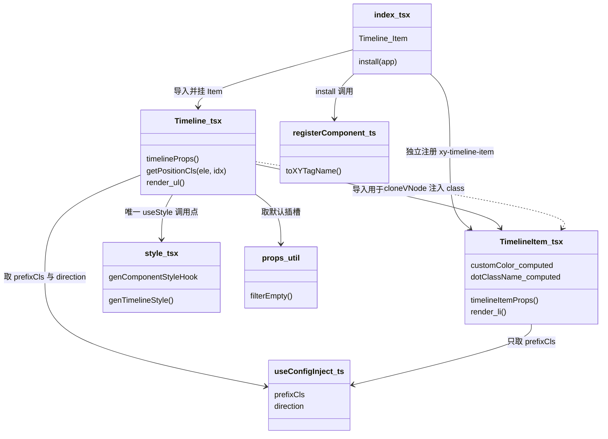
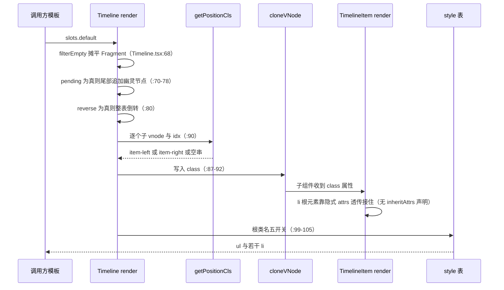
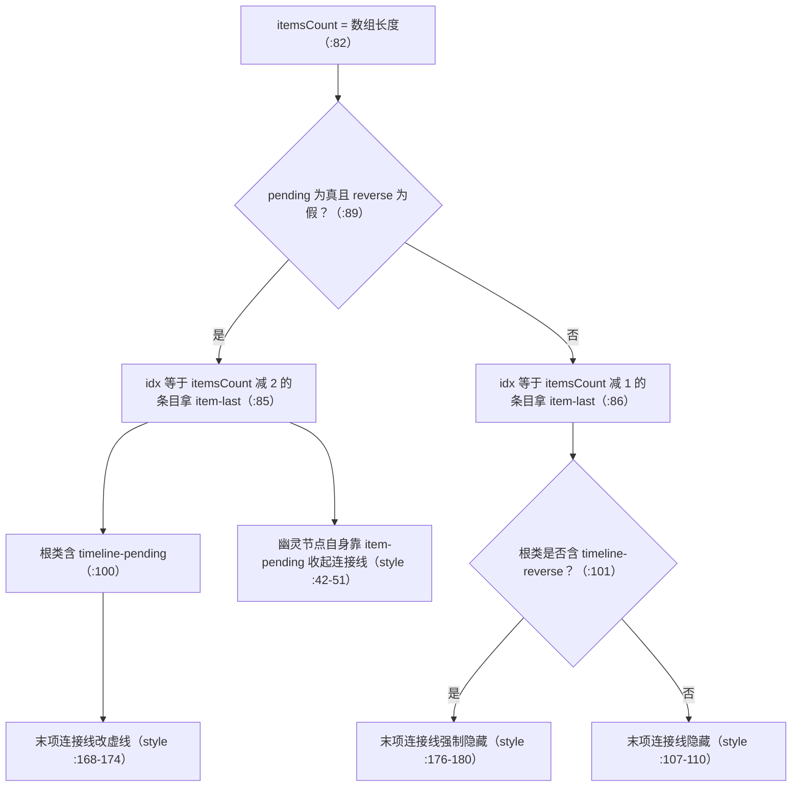
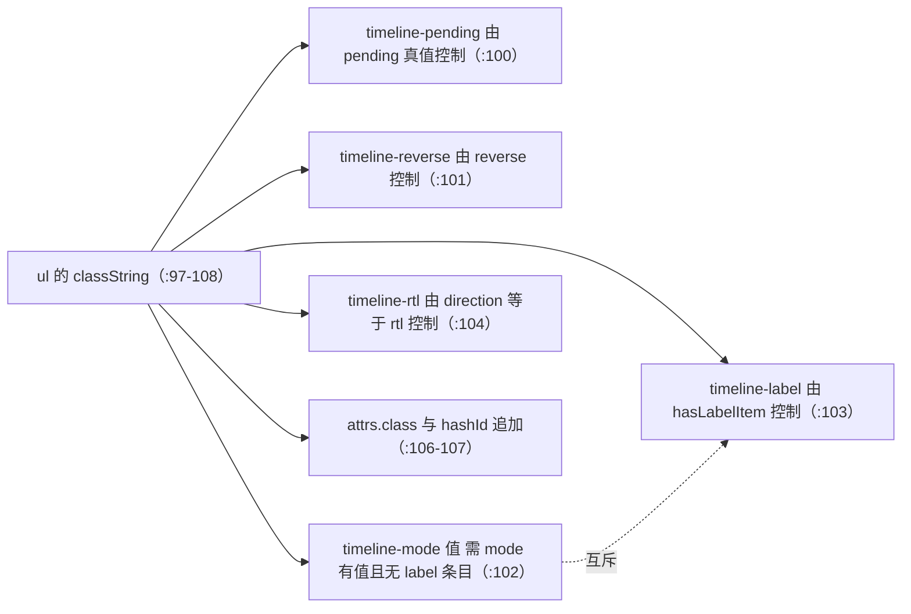

# C11-06 Timeline 时间轴

> **本篇解决**：Timeline 只有 445 行源码、四个文件，为什么它的轴点位置、连接线虚实与颜色三条链路的正确性都不在 JS 里，而在「父组件读子 vnode 原始 props」与「CSS 对象字面量的书写顺序」这两处看不见的约定上；改哪一行会静默回归。
> **前置**：C11-00 占位、进度与统计三类的更新频率取舍　**读者坐标**：`03-components/11-status` 第 7 篇

## 一、职责与边界

Timeline 负责一件事：把调用方给出的一组条目渲染成一条垂直时间轴，并在**轴心左右位置**、**连接线段落的虚实**这两个维度上做出可预测的排布。它的全部状态来自 props 与 slots，没有任何内部响应式状态，也没有任何事件回流——`packages/xiaoye-ui/src/timeline/Timeline.tsx:41` 的 `setup` 只解构了 `props` 与 `slots`、`attrs` 三个上下文，整文件没有 `ref`、没有 `computed`、没有 `emit`（对照同目录 `TimelineItem.tsx:2` 引入了 `computed`，`Timeline.tsx:2` 只引入 `cloneVNode` 与 `defineComponent`）。这条「无状态纯映射」的边界决定了本篇后面所有机制都在**类名计算**这一层，而不在状态管理层。

明确不负责的四件事，逐条给源码位置：

- **不负责时间格式化**。`label` 拿到什么就渲染什么，`packages/xiaoye-ui/src/timeline/TimelineItem.tsx:48` 的解构兜底只区分「有没有」，不做任何值处理，渲染点是 `TimelineItem.tsx:51`。
- **不负责数据的长度、顺序来源与分页**。子项来自默认插槽一次全量读取（`Timeline.tsx:68`），没有虚拟滚动，没有 `v-for` 之外的输入形态。
- **不负责交互态**。`useConfigInject` 已经合成好 `disabled`（`packages/xiaoye-ui/src/config-provider/hooks/useConfigInject.ts:43`）与 `size`（`:39`），而 `Timeline.tsx:42` 只取 `prefixCls` 与 `direction`。对纯展示组件这是**正确取舍**而非断链，判定依据是本组件确实没有可停用的交互；写进这里是为了让后面读到 `disabled` 检查点的人不要误报。
- **不负责子项自己的样式注册**。样式只在容器侧挂钩（`Timeline.tsx:45` 取 `useStyle`、`Timeline.tsx:109` 用 `wrapSSR` 包裹），条目侧完全没有（见论点 6）。

被谁依赖：仓库内只有两处——聚合入口 `packages/xiaoye-ui/src/components.ts:355`（`export * from './timeline'`）、`:388`（具名再导出）、`:389`（样式副作用导入），以及主题类型注册表 `packages/xiaoye-ui/src/theme/interface/components.ts:57` 与 `:137`（把 `ComponentToken` 挂进 `ComponentTokenMap` 的 `Timeline?` 键）。业务侧消费者为零，使用 `xy-timeline` 标签的文件全部在文档示例里（`apps/docs/examples/timeline/` 七个 `.vue` 与 `apps/docs/components/timeline.md`）。也就是说：**这个组件的回归面只由文档示例守护**，改坏了不会有下游包报错。

依赖谁（按导入顺序）：`_util/classNames`（`Timeline.tsx:3`）、`_util/vue-types`（`:4`，该文件是转发 shim，真实类型构造器来自 npm 包 `vue-types`，见 `packages/xiaoye-ui/src/_util/vue-types/index.ts:3`）、`_util/props-util` 的 `filterEmpty`（`:5`，实现 `packages/xiaoye-ui/src/_util/props-util/index.ts:230-242`）、`initDefaultProps`（`:6`，实现 `packages/xiaoye-ui/src/_util/props-util/initDefaultProps.ts:16-31`）、`TimelineItem`（`:7`）、`@xiaoye-ui/icons` 的 `LoadingOutlined`（`:8`，符合本仓图标规范）、`_util/type` 的 `tuple` 与 `booleanType`（`:10` → `packages/xiaoye-ui/src/_util/type.ts:6`、`:58`）、`useConfigInject`（`:11`）、`./style`（`:14`）。

## 二、源码地图

| 文件 | 行数 | 职责 | 关键符号与主证据 |
| --- | --- | --- | --- |
| `timeline/index.tsx` | 21 | 装配层：挂 `Item`、注册两个标签、导出类型面 | `Timeline.Item` 赋值 `index.tsx:9`；`install` 双注册 `:12-16`；默认导出带 `readonly Item` 的交叉类型 `:18-21` |
| `timeline/Timeline.tsx` | 116 | 容器：props 面、类名总装配、幽灵节点注入、倒序、位置判定 | props `:17-24`；默认值 `:32-35`；`getPositionCls` `:47-58`；渲染主体 `:60-114` |
| `timeline/TimelineItem.tsx` | 64 | 条目：四个 `div` 的骨架与颜色分类 | props `:10-17`；默认值 `:24-27`；`customColor` `:40-42`；`dotClassName` `:43-46`；DOM `:50-60` |
| `timeline/style/index.tsx` | 237 | 全部 CSS-in-JS：条目骨架、四色预设、`alternate`/`right`/`label` 共享块、`pending`/`reverse` 补丁、RTL | 根样式 `:21-222`；幽灵与末项规则 `:168-193`；标签块 `:195-211`；导出 hook `:226-237` |
| `timeline/index.test.js` | 7 | 只做挂载与卸载 | `describe` 与两次 `mountTest` `:4-6` |

主实现入口是 `packages/xiaoye-ui/src/timeline/Timeline.tsx:28` 的 `defineComponent`；容器与条目的**唯一耦合点**是 `Timeline.tsx:87` 的 `cloneVNode`，这一点比文件本身更值得记住，因为它是本篇大多数机制的落点（论点 1、论点 2）。

组件名与标签名：`Timeline.tsx:30` 声明 `name: 'XYTimeline'`，`TimelineItem.tsx:24` 声明 `name: 'XYTimelineItem'`，标签名由 `packages/xiaoye-ui/src/_util/registerComponent.ts:6-11` 的 `toXYTagName` 从名字推导（`:8` 把 `XY` 换成 `xy-`、`:9` 在大写字母前插连字符、`:10` 转小写），所以运行时得到 `xy-timeline` 与 `xy-timeline-item` 两个标签，注册动作在 `index.tsx:13` 与 `index.tsx:14`。

## 三、架构与数据流

### 图 1：静态结构（谁持有谁、谁读谁的 props）



这张图的重点是最后那条**虚线**。实线部分都是普通的模块导入，关系一眼可读；虚线是运行期行为：`Timeline.tsx:87` 用 `cloneVNode` 往子 vnode 上追加 `class`，而 `getPositionCls`（`Timeline.tsx:47-58`）读的是子 vnode 的**原始 props**（`Timeline.tsx:48` 的 `ele.props || {}`）。也就是说容器绕过条目的响应式 props，直接从 VNode 层取值；条目侧则完全不读自己被父组件读走的那个 `position`（`TimelineItem.tsx:15` 是该标识符在整个文件里的唯一出现处）。这条虚线是论点 1 与论点 2 的图形化前提。

### 图 2：一次渲染的数据流



逐分支说明为什么存在这一步：`filterEmpty` 那一步（`Timeline.tsx:68`）不是可选的清洁工作，它承担 Fragment 摊平——`_util/props-util/index.ts:235-236` 会把 `child.type === Fragment` 的子节点递归展开，所以 `v-for` 写在 `<template>` 上时条目仍是「直接子项」，位置判定与末项判定才有意义；若调用方用真实元素（例如 `<div>`）包裹条目，那个 `div` 会作为「条目」进入 `cloneVNode`，类名就落到了容器上。追加幽灵节点（`:70-78`）与倒转（`:80`）的**先后顺序不可交换**：先追加再倒转，幽灵节点才会出现在倒序列表的**顶部**，这正是 `style/index.tsx:182-193` 那组规则的前提。

### 图 3：末项类与幽灵节点的判定分支



图中 `B` 那个三元是整套 pending 语义的唯一 JS 开关（`Timeline.tsx:89`），它只决定**哪个下标**拿到 `-item-last`，而**拿到之后长什么样**全部写在样式里（`:107-110`、`:168-174`、`:176-180` 三处）。这条分工是论点 3 的全部内容，也是这张图最想传达的一句话：JS 与 CSS 各持有一半真相，任何一半单独阅读都得不出正确结论。

### 图 4：根类名的五个开关



`S3` 与 `S4` 之间那条互斥关系是 `Timeline.tsx:102` 里 `&& !hasLabelItem` 这半句造成的，而 `hasLabelItem` 的判定读的是**子 vnode 的 props 或插槽**（`:94-96`）。为什么要有这半句、代价是什么，见论点 4。


## 四、核心机制精读

### 论点 1：位置类名由容器读「子 vnode 的原始 props」产出，条目自己从不读 `position`——因此 `position` 是一个被父组件消费、并被 `mode` 无条件短路的 prop

`packages/xiaoye-ui/src/timeline/Timeline.tsx:47`：

```tsx
// packages/xiaoye-ui/src/timeline/Timeline.tsx:47
    const getPositionCls = (ele, idx: number) => {
      const eleProps = ele.props || {};
      if (props.mode === 'alternate') {
        if (eleProps.position === 'right') return `${prefixCls.value}-item-right`;
        if (eleProps.position === 'left') return `${prefixCls.value}-item-left`;
        return idx % 2 === 0 ? `${prefixCls.value}-item-left` : `${prefixCls.value}-item-right`;
      }
      if (props.mode === 'left') return `${prefixCls.value}-item-left`;
      if (props.mode === 'right') return `${prefixCls.value}-item-right`;
      if (eleProps.position === 'right') return `${prefixCls.value}-item-right`;
      return '';
    };
```

四个分支的读取对象各不相同，这是全组件最容易被读错的一段。`ele` 没有任何类型标注（`:47` 只有 `idx: number`），`ele.props` 是 **VNode 上未经 Vue props 解析的原始字面属性**（`:48` 还做了 `|| {}` 兜底，说明作者清楚 `ele.props` 可能整个是 `undefined`，例如注释节点或文本节点混进来时）。所以调用方没写 `position` 时这里是 `undefined`，而不是条目 props 声明里那个 `.def('')` 给的 `''`（`packages/xiaoye-ui/src/timeline/TimelineItem.tsx:15`）——两个「默认值」活在不同的层，`getPositionCls` 谁的默认值都不认，只认字面写没写。

分支可达性逐条数（这是本论点真正要交付的东西）：

| `mode` 值 | 条目写 `position="right"` | 条目写 `position="left"` | 条目不写 `position` |
| --- | --- | --- | --- |
| `'alternate'` | 右（`:50`） | 左（`:51`） | 按下标奇偶轮转（`:52`） |
| `'left'` | **左**（`:54` 先返回，`position` 被吞） | 左 | 左 |
| `'right'` | 右（`:55`） | **右**（`position` 被吞） | 右 |
| `''`（默认，见 `Timeline.tsx:34`） | 右（`:56`） | **空串**（`:57`） | 空串 |

`mode` 为 `'left'` 或 `'right'` 时，`:54`/`:55` 在任何 `eleProps` 检查之前就返回了，所以**整表模式下逐条目反向声明是无效的**；`mode` 为空时 `:56` 只识别 `right`，`position="left"` 走到 `:57` 返回空串。空串在默认档里看起来"没问题"，是因为默认档的轴心本来就在左（`packages/xiaoye-ui/src/timeline/style/index.tsx:37` 把 `-item-tail` 的 `insetInlineStart` 定为 `(timeLineItemHeadSize - timeLineItemTailWidth) / 2`），`-item-left` 类只是把内容推到 50% 处（`:134-140`），两者在没有 label 的场景视觉上重合。

再看条目侧。`position` 在 `TimelineItem.tsx` 全文只出现一次，就是声明处：

```bash
grep -n "position" packages/xiaoye-ui/src/timeline/TimelineItem.tsx
# 15:  position: PropTypes.oneOf(tuple('left', 'right', '')).def(''),
```

也就是说条目声明了这个 prop、把它收进自己的 `props` 对象、然后一次都不读。真正生效的路径是父组件在 `cloneVNode` 时把类名写进 `class`（`Timeline.tsx:87-91`），条目再把 `class` 透传到底（见论点 2）。结论：**`xy-timeline-item` 脱离 `xy-timeline` 单独使用时 `position` 零效果**——而它确实是被单独注册过的全局标签（`packages/xiaoye-ui/src/timeline/index.tsx:14` 的 `registerComponent(app, TimelineItem)`），类型面上也没有任何东西阻止这种用法。同一族的 `color`、`dot`、`label` 都是条目自读自用（`TimelineItem.tsx:41`、`:45`、`:48`、`:54`），只有 `position` 是「声明在子、消费在父」的单向异类，读到这个组件时需要在脑子里把它标成"父级参数"。

顺带一条与 `alternate` 相关的隐含行为：幽灵节点是容器现场造的 `<TimelineItem>`，它的 JSX 属性里只有 `pending` 与 `dot`（`Timeline.tsx:71`），没有 `position`，所以它在 `alternate` 档下走 `:52` 的下标奇偶分支。由于它是 `children.push` 进数组的（`:76-78`），它的下标恒为 `itemsCount - 1`，于是**每加一条真实条目，幽灵节点的左右侧就会翻转一次**。这是分支的直接后果而非笔误，但改动条目数量会连带改变幽灵节点位置，属于改这个组件时必须验证的一项。

### 论点 2：`cloneVNode` 注入的类名靠「子组件不关闭 attrs 透传」才能落地，条目侧一旦按仓库模板补 `inheritAttrs: false` 就会静默丢全部位置类

`packages/xiaoye-ui/src/timeline/Timeline.tsx:84`：

```tsx
// packages/xiaoye-ui/src/timeline/Timeline.tsx:84
      const items = timeLineItems.map((ele, idx) => {
        const pendingClass = idx === itemsCount - 2 ? lastCls : '';
        const readyClass = idx === itemsCount - 1 ? lastCls : '';
        return cloneVNode(ele, {
          class: classNames([
            !reverse && !!pending ? pendingClass : readyClass,
            getPositionCls(ele, idx),
          ]),
        });
      });
```

`cloneVNode(ele, { class })` 的第二个参数是 vnode 的 props 增量，`class` 会与子 vnode 原有 `class` 合并（调用方写在 `<xy-timeline-item class="my-step">` 上的类不会被覆盖）。关键在于：`class` **不是** `TimelineItem` 声明的 prop，所以它进入 `attrs`；而 `TimelineItem` 组件选项里既没有 `inheritAttrs: false`，`setup` 也没有解构 `attrs`：

```tsx
// packages/xiaoye-ui/src/timeline/TimelineItem.tsx:21
export default defineComponent({
  compatConfig: { MODE: 3 },
  name: 'XYTimelineItem',
  props: initDefaultProps(timelineItemProps(), {
    color: 'blue',
    pending: false,
  }),
  slots: Object as CustomSlotsType<{
    dot?: any;
    label?: any;
    default?: any;
  }>,
  setup(props, { slots }) {
```

`inheritAttrs` 默认是 `true`，Vue 会把 `attrs` 里的 `class`/`style` 自动合并到单根元素 `<li>`（`TimelineItem.tsx:50`）上，位置类与 `-item-last` 因此生效。这条通路**完全依赖"没有写东西"**：只要有人照着 `AGENTS.md:200` 的组件模板（`inheritAttrs: false`）"补齐规范"，或者把 `setup` 签名改成 `setup(props, { slots, attrs })` 并显式渲染 `<li {...attrs}>` 之外的结构，`-item-left`/`-item-right`/`-item-last` 三类会同时消失，而且不会有任何报错或类型错误——`cloneVNode` 照常写入了属性，只是没人接。容器侧则是把两件事都做全了的对照样本：

```tsx
// packages/xiaoye-ui/src/timeline/Timeline.tsx:104
          [`${prefixCls.value}-rtl`]: direction.value === 'rtl',
        },
        attrs.class,
        hashId.value,
      );
      return wrapSSR(
        <ul {...attrs} class={classString}>
          {items}
        </ul>,
      );
```

`:106` 手工把外部 `attrs.class` 并进 `classNames`，`:110` 再显式展开 `{...attrs}`，`class` 属性写在展开**之后**所以不被外部覆盖，同时 `style` 等其余属性仍透传。`inheritAttrs: false`（`:31`）与这两行是一套的，缺任一行都会出问题：只声明 `inheritAttrs: false` 而不并 `attrs.class`，外部类名丢；只展开 `attrs` 而把 `class` 写在展开之前，内部类名丢。条目侧没有做这套，它走的是"默认透传"的另一条路，因此它比容器侧脆。

定位这一段时值得同时记住 `filterEmpty` 的作用面（`packages/xiaoye-ui/src/_util/props-util/index.ts:230-242`，容器调用点是 `Timeline.tsx:68`）：`cloneVNode` 是无条件施加的（`:87`），它不知道子 vnode 到底是不是 `TimelineItem`。如果调用方用真实 DOM 元素包住条目（例如 `<xy-timeline><div><xy-timeline-item/></div></xy-timeline>`），那么被 `cloneVNode` 的是那个 `<div>`，位置类与 `-item-last` 会落到 `div` 上，而 `div` 的样式选择器一条都不匹配（所有条目规则都以 `componentCls-item` 为前缀，`style/index.tsx:27`），结果就是轴画了但末项连接线收不掉。这条判定同样没有任何测试保护（见 §七 的测试现状）。

### 论点 3：`pending` 与 `reverse` 的四象限结果由「JS 只挑下标、CSS 靠声明顺序决胜」共同产出，把两条 CSS 规则调换顺序就会翻转一种组合

容器侧只有一行参与决策，`packages/xiaoye-ui/src/timeline/Timeline.tsx:85`：

```tsx
// packages/xiaoye-ui/src/timeline/Timeline.tsx:85
        const pendingClass = idx === itemsCount - 2 ? lastCls : '';
        const readyClass = idx === itemsCount - 1 ? lastCls : '';
        return cloneVNode(ele, {
          class: classNames([
            !reverse && !!pending ? pendingClass : readyClass,
            getPositionCls(ele, idx),
          ]),
        });
```

`:85` 与 `:86` 两个候选**每次都会算出来**，`:89` 的三元才决定用哪一个。注意两个表达式用的都是同一个 `lastCls`（`:83`），差别只有下标偏移一位——`-item-last` 这个名字在 pending 档下其实指的是"最后一个真实条目"，不是"最后一个 DOM 节点"，读代码时很容易在这里误判成 off-by-one。

样式侧三条规则共同解释这个类名，摘出关键部分（原文见 `packages/xiaoye-ui/src/timeline/style/index.tsx:107`）：

```tsx
// packages/xiaoye-ui/src/timeline/style/index.tsx:107
        '&-last': {
          [`> ${componentCls}-item-tail`]: {
            display: 'none',
          },

          [`> ${componentCls}-item-content`]: {
            minHeight: token.controlHeightLG * 1.2,
          },
        },
      },

      [`&${componentCls}-alternate,
        &${componentCls}-right,
        &${componentCls}-label`]: {
        [`${componentCls}-item`]: {
          '&-tail, &-head, &-head-custom': {
            insetInlineStart: '50%',
          },
```

再往后是两条只差一个字面类名、却承担相反语义的补丁（`:168`）：

```tsx
// packages/xiaoye-ui/src/timeline/style/index.tsx:168
      [`&${componentCls}-pending
        ${componentCls}-item-last
        ${componentCls}-item-tail`]: {
        display: 'block',
        height: `calc(100% - ${token.margin}px)`,
        borderInlineStart: `${token.timeLineItemTailWidth}px dotted ${token.colorSplit}`,
      },

      [`&${componentCls}-reverse
        ${componentCls}-item-last
        ${componentCls}-item-tail`]: {
        display: 'none',
      },
```

展开成实际选择器后比较特异度：`:107-110` 生成 `.xy-timeline .xy-timeline-item-last > .xy-timeline-item-tail`（三个类），`:168-174` 生成 `.xy-timeline.xy-timeline-pending .xy-timeline-item-last .xy-timeline-item-tail`（四个类），`:176-180` 生成 `.xy-timeline.xy-timeline-reverse .xy-timeline-item-last .xy-timeline-item-tail`（也是四个类）。四象限逐个走一遍：

- `pending` 真、`reverse` 假：`-item-last` 落在倒数第二个节点（`:85`），根上有 `-pending`（`:100`）。`:168` 四类压过 `:107` 的三类 → 连接线显示为 `dotted`，长度收到 `calc(100% - margin)`，正是"虚线连向幽灵节点"。
- `pending` 假、`reverse` 假：走 `:86`，`-item-last` 落在最后一个真实条目，`:107` 无对抗规则 → 连接线隐藏，`:112-114` 同时把内容最小高度抬到 `controlHeightLG * 1.2`。
- `pending` 真、`reverse` 真：`:89` 选 `readyClass`，`-item-last` 落在 DOM 末位（此时是最早那条真实条目），幽灵节点在 DOM 首位。根类同时含 `-pending` 与 `-reverse`，于是 `:168` 与 `:176` **同时命中且特异度相同**，最终按声明顺序由 `:176` 的 `display: none` 胜出。
- `pending` 假、`reverse` 真：只有 `:107` 与 `:176` 命中，结果同样是隐藏。

第三象限是本论点的关键：**它是靠 CSS 对象字面量的书写顺序定胜负的**，JS 侧看不出任何"reverse 优先于 pending"的意图。如果重构时把 `:176-180` 移到 `:168-174` 之前，倒序加幽灵节点的列表底部就会冒出一段虚线——一个不会报错、不会类型失败、也只会在人眼审查文档站时才被发现的回归。幽灵节点自己那一侧还有一条：`-item-pending` 在 `:42-51` 里被定义为「隐藏 tail、head 背景透明、字号降到 `fontSizeSM`」，而 `:182-193` 又专门为 reverse 把它重新打开成 dotted——同一个类在正序与倒序下含义相反，这两处必须一起读。

结论回扣：这套机制的正确性依赖三个隐含约定（`:89` 的三元分支顺序、`:168` 与 `:176` 的书写顺序、`Timeline.tsx:76-78` 的 push 与 `:80` 的 reverse 先后）。三个约定分散在两个文件、两种介质，是本组件最需要注释却一行注释都没有的地方（全文件唯一注释是 `Timeline.tsx:19` 的 `pending` 文档注释与 `:13`、`:44` 两段分区标记）。

### 论点 4：根类名上 `mode` 与 `label` 互斥，而 label 版式只在根类上生效，导致「有 label 但 `mode` 为默认空串」这一格没有任何补偿规则

判定与拼装都在容器，`packages/xiaoye-ui/src/timeline/Timeline.tsx:94`：

```tsx
// packages/xiaoye-ui/src/timeline/Timeline.tsx:94
      const hasLabelItem = timeLineItems.some(
        item => !!(item.props?.label || item.children?.label),
      );
      const classString = classNames(
        prefixCls.value,
        {
          [`${prefixCls.value}-pending`]: !!pending,
          [`${prefixCls.value}-reverse`]: !!reverse,
          [`${prefixCls.value}-${mode}`]: !!mode && !hasLabelItem,
          [`${prefixCls.value}-label`]: hasLabelItem,
          [`${prefixCls.value}-rtl`]: direction.value === 'rtl',
        },
        attrs.class,
        hashId.value,
      );
```

`:95` 的判定读两路：`item.props?.label` 覆盖 `label="2015-09-01"` 这种属性写法，`item.children?.label` 覆盖 `<template #label>` 这种插槽写法（插槽在编译后是 vnode 的 `children` 对象，键名即插槽名）。这里同样是 VNode 层判定而非组件实例层——**只要列表里有一个条目带 label，整个列表就切成 label 版式**，`:103` 写的是根类而不是条目类。

为什么要 `&& !hasLabelItem` 把 `mode` 类关掉？因为 `mode` 的三个值里 `right` 独占了一个把轴推到最右的块（`:152-166`，`insetInlineStart: calc(100% - ...)`），而 label 版式的轴必须在中间。两者同时挂上会互相打架，所以容器选择"有 label 就只挂 `-label`"。这个取舍是**有效的**，因为 `-label` 与 `-alternate`、`-right` 本来共享同一段规则（`:118-120` 的选择器把三者并写），轴心统一落在 50%（`:122-124`）。而条目左右类仍由 `getPositionCls` 按 `mode` 产出（`:49-56`），所以 `mode="alternate" + label` 与 `mode="left" + label` 都能得到完整补偿——文档示例正是这样用的：`apps/docs/examples/timeline/label.vue:7` 显式绑了 `:mode="mode"`，`:20` 的初始值是 `'left'`，切换器提供 Left/Right/Alternate 三档（`:3-5`）。

问题在没人演示的那一格。`mode` 的默认值是空串（`Timeline.tsx:34`），此时 `getPositionCls` 除了 `position="right"` 之外一律返回空串（`:57`），于是：

- 根上有 `-label` → 轴与 head 被推到 `insetInlineStart: 50%`（`:122-124`）；
- 条目没有 `-item-left`/`-item-right` → 内容 div 保留基础规则的 `marginInlineStart: margin + timeLineItemHeadSize`（`:100`），也就是贴在列表左缘；
- `-item-label` 的基础规则（`:195-202`）只写了 `position: absolute`、`insetBlockStart`、`width: calc(50% - marginSM)` 与 `textAlign: end`，**没有写任何 inline 方向的定位**，全文件唯一给 label 设 `insetInlineStart` 的地方是 `-item-right` 嵌套里（`:204-210`）。

三者叠加的可证伪结论是：`<xy-timeline>` 不写 `mode`、条目写 `label` 时，轴在中间、内容在左边、label 落在绝对定位的静态起点。文档里"使用 `label` 标签单独展示时间"（`apps/docs/components/timeline.md:52`）没有提到 `mode` 是前置条件，所以这一格是用户会真实撞上的。修复方向有两个：在 `:95` 之后把 `hasLabelItem` 与空 `mode` 组合时强制按 `left` 生成位置类，或者在样式里为裸 `-item-label` 补一条 `insetInlineStart` 基线——后者更省事，但 `:195` 那条基线目前对 `-item-left` 情形是"靠默认静态位"，动它会同时改变 alternate 档的 label 位置，需要回归 `label.vue` 的三档切换。

### 论点 5：`customColor` 的正则没有锚点，任何**包含**预设色名的自定义颜色会同时丢掉内联色与类名，落进"两条路都断"的死角

`packages/xiaoye-ui/src/timeline/TimelineItem.tsx:40`：

```tsx
// packages/xiaoye-ui/src/timeline/TimelineItem.tsx:40
    const customColor = computed(() =>
      /blue|red|green|gray/.test(props.color || '') ? undefined : props.color || 'blue',
    );
    const dotClassName = computed(() => ({
      [`${prefixCls.value}-item-head`]: true,
      [`${prefixCls.value}-item-head-${props.color || 'blue'}`]: !customColor.value,
    }));
```

设计上这是一个二选一开关：预设色走类名（`dotClassName` 的 `:45` 只在 `customColor` 为假值时挂类），自定义色走内联样式（`:55` 的 `borderColor` 与 `color` 都取 `customColor.value`）。逻辑本身自洽，坏在 `:41` 的正则没有 `^`、`$` 也没有分组边界，`test` 是子串匹配。实测（可直接复现）：

```bash
node -e "const re=/blue|red|green|gray/; for (const c of ['blue','darkred','lightgreen','bluesky','red-orange','#00CCFF','grey']) console.log(c, re.test(c));"
# blue true / darkred true / lightgreen true / bluesky true / red-orange true / #00CCFF false / grey false
```

被误判成预设的那批值，`customColor` 变成 `undefined` → `:55` 的两个内联样式都拿到 `undefined`，Vue 会直接不写这两个属性；同时 `:45` 挂出 `xy-timeline-item-head-darkred` 这样的类名，而样式表里 `-item-head` 只有四个预设色块（`packages/xiaoye-ui/src/timeline/style/index.tsx:61-79`，分别是 `-blue`、`-red`、`-green`、`-gray`）。**两条路同时断掉**：内联样式被清空，生成的类名查无规则。结果是节点回到 `:53-58` 那个 div 的基础样式——`border: ${timeLineHeadBorderWidth}px ${lineType} transparent`（`:58`）与 `backgroundColor: colorBgContainer`（`:57`），即一个几乎看不见的空心圆。这类"生成但从不匹配的类名"正是本专栏反复登记的那一族，判形命令是 `grep -n -e "'&-blue'" -e "'&-red'" -e "'&-green'" -e "'&-gray'" packages/xiaoye-ui/src/timeline/style/index.tsx`（命中 `:61`、`:66`、`:71`、`:76` 四行，父键是 `:53` 的 `'&-head'`），色名集合就这四个。

反过来说，`'#00CCFF'`、`'grey'` 这类不含子串的值是走对了路的（`apps/docs/examples/timeline/color.vue:25` 用的正是 `#00CCFF`），但也因此拿到的是**字面色**而不是 Token：预设四色在样式里各自绑到 `colorPrimary`、`colorError`、`colorSuccess`、`colorTextDisabled`（`:62`、`:67`、`:72`、`:77`），随主题与 dark/compact 算法平移；内联色则是一个写死的字符串，切到暗色主题不会变。所以「用 `grey` 还是用 `gray`」在这套实现里是两个语义，尽管文档只在 `apps/docs/components/timeline.md:20` 描述了三种颜色的含义，没有提示拼写必须与 `tuple` 之外的正则字面量一致。

修正只需要一个字符级的改动：把 `:41` 的正则改成带锚点的形式，或者干脆换成 `tuple('blue','red','green','gray')` 的 `includes` 判定——后者与本仓 `Timeline.tsx:23` 声明 `mode` 的写法同构，风格上也更一致。改完后 `darkred` 之类会退回内联路径（能显示，只是不吃 Token），而 `-item-head-*` 类名的键也应随之限定在四个预设值内，否则会生成不存在的类名。

### 论点 6：整对组件只有一处样式注册点，条目侧零 `useStyle`——好处是不会生成第二张样式表，代价是被单独注册的 `xy-timeline-item` 拿到的是无 CSS 的裸类名

容器侧的注册与包裹缺一不可，`packages/xiaoye-ui/src/timeline/Timeline.tsx:44`：

```tsx
// packages/xiaoye-ui/src/timeline/Timeline.tsx:44
    // style
    const [wrapSSR, hashId] = useStyle(prefixCls);

    const getPositionCls = (ele, idx: number) => {
      const eleProps = ele.props || {};
```

配套的渲染出口在 `:109-113`（`wrapSSR(<ul …>)`，已在论点 2 摘出）。条目侧则从导入表开始就没有这条路——`TimelineItem.tsx:1-8` 的七条 `import` 里没有 `./style`，`grep -c -e "useStyle" -e "wrapSSR" packages/xiaoye-ui/src/timeline/TimelineItem.tsx` 输出 `0`（第三条检查点复用它）。它只取了 `prefixCls`：

```tsx
// packages/xiaoye-ui/src/timeline/TimelineItem.tsx:33
  setup(props, { slots }) {
    const { prefixCls } = useConfigInject('timeline', props);
    const itemClassName = computed(() => ({
      [`${prefixCls.value}-item`]: true,
      [`${prefixCls.value}-item-pending`]: props.pending,
    }));
```

`:34` 传的组件名是 `'timeline'`，与容器 `Timeline.tsx:42` 完全一致，因此两处 `useConfigInject` 算出的 `prefixCls` 同源（都走 `packages/xiaoye-ui/src/config-provider/hooks/useConfigInject.ts:14` 的 `getPrefixCls(name, props.prefixCls)`）。这一点值得正面记下：样式表的缓存身份是 `fullPath = [tokenKey, ...info.path]`（`packages/xiaoye-ui/src/_util/cssinjs/hooks/useStyleRegister/index.tsx:331`），而 `info.path` 就是 `[component, prefixCls.value, iconPrefixCls.value]`（`packages/xiaoye-ui/src/theme/util/genComponentStyleHook.ts:74`）——只要传给 hook 的 prefixCls 是本组件自己的，同族 Group/子件就不会另生成一张表。Timeline 这一对没有踩那个坑。

代价在装配层。`index.tsx:12-16` 的 `install` 把两个组件都注册成了全局标签：

```tsx
// packages/xiaoye-ui/src/timeline/index.tsx:11
/* istanbul ignore next */
Timeline.install = function (app: App) {
  registerComponent(app, Timeline);
  registerComponent(app, TimelineItem);
  return app;
};
```

`:14` 让 `xy-timeline-item` 成为可直接使用的公开标签，但注册样式表的前提是某个 `Timeline` 实例的 setup 跑过（`genComponentStyleHook.ts:78` 同步调用 `useStyleRegister`，后者在 `useStyleRegister/index.tsx:340-351` 立刻进 `useGlobalCache('style', …)`，未命中缓存才执行 `:363` 的 `styleFn()`）。于是三种场景的结论各不相同：

- 客户端、页面上已有任意一个 `xy-timeline`：条目正常，因为表已经注入过，条目类名是那张表的子选择器（`style/index.tsx:27` 起的所有规则都嵌在 `componentCls` 之下）。
- 客户端、页面上只有 `xy-timeline-item`：`<li>` 与四个 `<div>` 的类名全部没有规则，渲染成一列无缩进、无连接线、无圆点的普通列表项。
- SSR：`wrapSSR` 只在容器调用（`Timeline.tsx:109`），条目侧的类名不在任何 SSR 注水路径里独立成立——它依赖容器把整张表写进首屏，所以条目必须始终是容器的后代。

另外注意 `:11` 那条 `/* istanbul ignore next */`：本仓覆盖率引擎是 v8（`packages/xiaoye-ui/vitest.config.mts:36` 的 `provider: 'v8'`），而全仓 101 处 `istanbul ignore` 注释、0 处 `v8 ignore` 注释（判形：`grep -rn "v8 ignore" packages/xiaoye-ui/src`），说明这类忽略标注是从 istanbul 时期留下的，在当前配置下是否仍被 Vitest 尊重属于引擎行为、不在本仓源码内，此处不下断言。

### 论点 7：`Timeline` 的六个自定义 Token 在类型面与运行面都关不住，还有一个 Token 是纯死值

看导出段，`packages/xiaoye-ui/src/timeline/style/index.tsx:226`：

```tsx
// packages/xiaoye-ui/src/timeline/style/index.tsx:226
export default genComponentStyleHook('Timeline', token => {
  const timeLineToken = mergeToken<TimelineToken>(token, {
    timeLineItemPaddingBottom: token.padding * 1.25,
    timeLineItemHeadSize: 10,
    timeLineItemCustomHeadPaddingVertical: token.paddingXXS,
    timeLinePaddingInlineEnd: 2,
    timeLineItemTailWidth: token.lineWidthBold,
    timeLineHeadBorderWidth: token.wireframe ? token.lineWidthBold : token.lineWidth * 3,
  });

  return [genTimelineStyle(timeLineToken)];
});
```

`:226` 只传了 `genComponentStyleHook` 的前两个参数，第 43-45 行那个 `getDefaultToken` 形参没用上（机制与"全仓无人使用"的结论见 A03 论点 4，此处不重述）。于是 `ConfigProvider` 的 `theme.components.Timeline` 若要生效，只能靠 `genComponentStyleHook.ts:85` 把 `token.value['Timeline']` 并进 `mergedToken`；但 `:88-99` 之后 `styleFn` 又在 `:227` 做了第二次 `mergeToken`，第二次覆盖第一次——用户传进来的同名键被静默吃掉。类型面也关不住：条目侧的 `ComponentToken` 是空接口（`:6`），`theme/interface/components.ts:57` 把它 import 成 `TimelineComponentToken`、`:137` 挂到 `ComponentTokenMap` 的 `Timeline?` 键上，所以任何 `timeLineItemHeadSize` 之类的键在 TS 里都是「该组件没有专属 Token」的空集。两条路都堵，等于 `Timeline` 的六个 Token 实际上是**只读常量**。这与本组件的呈现逻辑是自洽的（时间轴几乎没有需要按业务调的度量），但要清楚它是"没暴露"而不是"不需要"。

真正的问题在 `:231`。`timeLinePaddingInlineEnd` 在接口里声明（`:13`）、在这里赋值（`:231`），但 `genTimelineStyle` 全文（`:17-223`）没有任何一处读它；判形命令：

```bash
grep -rn "timeLinePaddingInlineEnd" packages/xiaoye-ui/src
# 只有 style/index.tsx:13 与 style/index.tsx:231 两处
```

也就是说这条 `2` 是彻底的死值。它大概率对应上游实现里"右侧留白"的某段规则（本仓不可凭此推断具体用途），而本仓 `:97-105` 的 `-item-content` 用的是 `marginInlineStart: token.margin + token.timeLineItemHeadSize`（`:100`）与 `marginInlineEnd: 0`（`:101`），把右侧留白写成了 0——于是 `mode="right"` 的列表里，最后一列内容会一直顶到 `<ul>` 的右边缘（`:163` 给 `-item-right` 的宽度是 `calc(100% - (timeLineItemHeadSize + marginXS)))`，减去的是**左侧**轴点占位，右侧确实没有再留余量）。这是一个"Token 表面对外可选、实际既没接线也没生效"的典型样本：读样式文件的人会因为看到 `timeLinePaddingInlineEnd` 而误以为存在一处 padding 可调。

## 五、对外契约如何生效

**props 面**由两份声明与一次默认值注入拼出来：`Timeline.tsx:17-24` 声明五个键（`prefixCls`、`pending`、`pendingDot`、`reverse`、`mode`），`:32-35` 通过 `initDefaultProps` 给 `reverse` 与 `mode` 补默认值（实现见 `packages/xiaoye-ui/src/_util/props-util/initDefaultProps.ts:16-31`，`:20-21` 分支走的是 `prop.default = defaultProps[k]`，即直接改写描述符对象）。条目侧同构：`TimelineItem.tsx:10-17` 六个键，`:24-27` 只给 `color` 与 `pending` 补默认。这里有一处容易读错的耦合：`timelineProps` 是**每次调用都新建描述符对象**的函数（`Timeline.tsx:17` 的箭头函数体），而 `initDefaultProps` 在 `:16` 做的是浅拷贝、随后 `:21` 改的是内层对象——所以外部消费者再调一次 `timelineProps()` 拿到的是**没有默认值**的原始描述符，与组件实际运行时用的那份不同。类型面 `TimelineProps`（`:26`）与 `TimelineItemProps`（`TimelineItem.tsx:19`）都是 `Partial<ExtractPropTypes<…>>`，默认值不进类型，这正是 `initDefaultProps` 在本仓存在的理由。

**props 与 slots 的双通道**用解构默认值实现，优先级是「props 赢」：`Timeline.tsx:61-66` 的 `pending = slots.pending?.()` 只在 `props.pending === undefined` 时才求值插槽；条目侧 `TimelineItem.tsx:48` 的 `label = slots.label?.()`、`dot = slots.dot?.()` 同理。这一组是本专栏反复登记的那一族缺陷（「`X !== undefined ? X : Y` 型兜底 + `X` 有非 undefined 默认值 ⇒ 兜底恒不可达」）的**正面反例**：`pending`/`pendingDot`（`Timeline.tsx:20-21`）与 `label`/`dot`（`TimelineItem.tsx:13`、`:16`）四个键都没有被 `Timeline.tsx:32-35` 或 `TimelineItem.tsx:24-27` 写进默认值表，因此未传时保持 `undefined`，插槽兜底可达。仓里另有专门用来保持 `undefined` 的工具 `withUndefined`（`packages/xiaoye-ui/src/_util/vue-types/index.ts:28-31`），Timeline 没用它也不需要。

**插槽的声明面在 `slots:` 选项**（`Timeline.tsx:36-40`、`TimelineItem.tsx:28-32`），三个键 `pending`、`pendingDot`、`default` 与 `dot`、`label`、`default`，与运行期实际读取点一一对应，没有声明后不读的插槽，也没有读取却没声明的插槽。`Timeline.tsx:94-96` 的 `hasLabelItem` 是**唯一在容器侧窥探条目插槽**的地方（论点 4）。

**事件与 expose 面是空的**：`grep -rn -e "emits" -e "expose" -e "emit(" -e "inject(" -e "provide(" packages/xiaoye-ui/src/timeline/` 无命中，容器 `setup` 的第二参数只解构了 `slots` 与 `attrs`（`Timeline.tsx:41`），条目只解构了 `slots`（`TimelineItem.tsx:33`）。所以 `<xy-timeline>` 没有 `on-click` 之类的公开事件，也没有 `focus()`/`scrollTo()` 之类的方法面；`attrs` 全部透传给 `<ul>`（`:110`），意味着调用方可以在根元素上直接绑原生事件，这是它唯一的事件通路。同理，`direction` 不需要声明 prop：`useConfigInject.ts:15` 写的是 `props.direction ?? configProvider.direction?.value`，而 Timeline 与 TimelineItem 都没有 `direction` 这个 prop（对照 `Timeline.tsx:17-24`、`TimelineItem.tsx:10-17`），所以 `props.direction` 恒为 `undefined`，右侧的全局配置永远生效——本组件不属于 `rate` 那类"给兜底位加了默认值"的缺陷。

**注册面与类型面不对齐**。`index.tsx:9` 把条目挂成 `Timeline.Item`，`:10` 之后 `<Timeline.Item>` 可用；`:13`、`:14` 两次 `registerComponent` 让两个标签都能全局书写（标签名由 `registerComponent.ts:6-11` 从 `XYXxx` 推导）。但生成物 `packages/xiaoye-ui/typings/global.d.ts` 里只有 `XYTimeline`（`:98`），`grep -c "XYTimelineItem"` 结果是 0，同一形状在 `XYFormItem`、`XYListItem` 等一批子件上也不存在——即「运行时可写的标签」比「`GlobalComponents` 里可解析的标签」多一个。这一条对模板类型检查（`vue-tsc`）有实际影响，但 `global.d.ts` 是 `pnpm gen:entries` 的生成物，禁止手改，要收敛必须回到生成器侧。

**样式入口是两条独立轨**。`packages/xiaoye-ui/package.json:542-546` 给 `./timeline` 与 `./timeline/style` 分别留了入口，聚合入口 `components.ts:389` 的 `import './timeline/style'` 只服务包根导入；按需引入时漏掉样式入口就等于漏掉 `genComponentStyleHook` 的唯一注册方（论点 6），组件能挂载但没有任何 CSS。

## 六、设计取舍

**取舍一：用「父读子 vnode 原始 props」代替 Context 下发。** 另一条路是容器 `provide` 一个 `{ mode, pending, labelIndex }`，条目自己 `inject` 后算类名——这在语义上更干净，`position` 会变成条目自读自用的 prop，脱离容器也能保留类型面。现在这条路（`Timeline.tsx:47-58` + `:87-91`）换来的是**零注入、零额外响应式依赖**：整对组件没有 `provide`/`inject`（§五 的 grep 为证），条目在列表里重渲染时不需要订阅任何上下文；同时容器可以一次性知道 `itemsCount`（`:82`），末项判定才有下标可比。赔上的是三条：`position` 的语义割裂（论点 1）、脱离容器即失效（论点 6）、以及 `getPositionCls(ele, …)` 的 `ele` 完全没有类型（`:47`），改这段代码时 IDE 与 `pnpm typecheck` 都给不了保护。

**取舍二：`label` 版式挂在根类而非条目类。** `:94-96` 扫一遍列表就把整表切成 label 布局，换来"混用有 label 与无 label 的条目"时版式仍是统一的（这也是 `label.vue:10` 允许某条不写 label 的原因），赔上是"一个条目带 label 就劫持全表"，以及 `mode` 类被无条件压制后留下的那格空缺（论点 4）。

**取舍三：组件 Token 的兜底留在 `styleFn` 内部。** 与全仓一致（A03 论点 4 已把 `getDefaultToken` 无人使用这条结论定死），Timeline 的做法是把派生关系写在 `:227-234`，换来 `timeLineHeadBorderWidth` 这种依赖 `wireframe` 的条件派生可以就地表达（`:233`），赔上是 `theme.components.Timeline` 整条覆盖通道名存实亡，外加一个从未接线的 `timeLinePaddingInlineEnd`（论点 7）。

**取舍四：不做虚拟列表、不做状态。** 全量渲染（`:68`）加上无内部状态（§一）让组件对 tree-shaking 与 SSR 都极简，`wrapSSR` 一次包裹即可（`:109`）；代价是长列表（例如日志型时间线）没有任何截断或分页出口，`filterEmpty` 与两次 `map`/`some`（`:84`、`:94`）在每次渲染都会重跑——由于没有 memo，父组件任一响应式依赖变化都会重算整条链。这对一个展示组件是可以接受的，但如果日后要加 `loadMore`，现有结构里没有可插的位置：`children` 是 `filterEmpty` 的新数组（`props-util/index.ts:231` 的 `const res = []`），`:77` 与 `:80` 都对它做原地改写，任何新节点注入都必须保持"先追加、后倒转"的顺序（论点 3 的第三个隐含约定）。

## 七、坑与改动指南

**坑 1：给条目写 `position="left"`，`mode` 用默认值。**
触发：`<xy-timeline><xy-timeline-item position="left">…</xy-timeline-item></xy-timeline>`，不写 `mode`。
症状：`position` 完全没有外观变化；如果同时写了 `label`，还会连带踩坑 3 的错位，看起来像"`position` 与 `label` 互相冲突"。
原因：`getPositionCls` 在 `mode` 为空串时只识别 `right`，其余分支返回空串。
定位：`packages/xiaoye-ui/src/timeline/Timeline.tsx:56`（唯一识别 `right` 的那行）与 `Timeline.tsx:57`（返回空串）；`mode` 的默认空串来自 `Timeline.tsx:34`。同一函数在 `mode="left"`/`"right"` 时会先于 `eleProps` 检查返回（`:54`、`:55`），所以"整表模式下逐条目反向声明"也一律无效。

**坑 2：`color` 传一个包含 `blue`/`red`/`green`/`gray` 子串的值。**
触发：`color="darkred"`、`color="lightgreen"`、`color="bluesky"`、`color="red-orange"`。
症状：轴点变成一个几乎看不见的空心圆，既没有边框色也没有文字色；控制台与类型检查都不报错。
原因：无锚点子串正则把它判成预设色，于是内联样式被赋 `undefined`，同时拼出的类名在样式表里没有对应规则。
定位：`packages/xiaoye-ui/src/timeline/TimelineItem.tsx:41`（正则）、`TimelineItem.tsx:45`（类名拼接）、`TimelineItem.tsx:55`（内联样式取同一值）；可用色块只有 `packages/xiaoye-ui/src/timeline/style/index.tsx:61`、`:66`、`:71`、`:76` 四条。**该分支无测试保护**（见下方测试现状）。

**坑 3：只写 `label`、不写 `mode`。**
触发：条目带 `label`（属性或 `#label` 插槽都行），容器 `mode` 缺省。
症状：连接线居中而内容贴在列表左缘，label 落在最左边一条看不见的静态位上，整体像"版式散架"。
原因：`hasLabelItem` 把根类切成 `-label`，而 `-label` 与 `-alternate`、`-right` 共享"轴推到 50%"这段规则；条目因为坑 1 的同一行拿到空串，于是没有 `-item-left`/`-item-right` 来补偿内容偏移；而 `-item-label` 的基线规则本身不含任何 inline 方向定位。
定位：`packages/xiaoye-ui/src/timeline/Timeline.tsx:102`（`mode` 类被压制）与 `:103`（`-label` 被挂上）；样式侧 `packages/xiaoye-ui/src/timeline/style/index.tsx:118`（三值共享块）、`:100`（内容基础偏移）、`:195-202`（label 基线缺 inline-start）、`:204-210`（只有 `-item-right` 补了 inline-start）。文档示例始终绑了 `mode`（`apps/docs/examples/timeline/label.vue:7`），所以这条路径**没有任何示例覆盖**。

**坑 4：照模板给 `TimelineItem` 补 `inheritAttrs: false`。**
触发：任何"规范化重构"，例如按 `AGENTS.md:200` 的组件模板补选项，或把 `setup(props, { slots })` 改成解构 `attrs` 后只把 `attrs` 挂在内部某个 div 上。
症状：所有位置类与 `-item-last` 同时消失，表现为倒序列表底部多出连接线、`alternate` 变成单边、`pending` 的虚线不见了。
原因：容器是通过 `cloneVNode` 往子 vnode 写 `class`（`Timeline.tsx:87-91`），`class` 不是条目声明的 prop，只能靠默认的 attrs 透传落到 `<li>`（`TimelineItem.tsx:50`）；条目既不声明 `inheritAttrs: false` 也不读 `attrs`（`TimelineItem.tsx:33`）。
定位：`packages/xiaoye-ui/src/timeline/TimelineItem.tsx:21-33`（组件选项与 setup 签名）、`packages/xiaoye-ui/src/timeline/Timeline.tsx:87`（写入点）。容器侧的正确写法可作对照：`Timeline.tsx:31` + `:106` + `:110` 三处必须成套。

**坑 5：重排 pending 与 reverse 的两条 CSS 补丁。**
触发：把 `style/index.tsx:168-174` 与 `:176-180` 换个顺序，或把两者抽成数组后再 spread、或给 `-reverse` 那条加了个额外的选择器前缀导致特异度反超。
症状：`pending` 为真且 `reverse` 为真的列表，**底部**多出一段虚线连接线。
原因：JS 侧此时把 `-item-last` 给了 DOM 末项（`Timeline.tsx:86` 经 `:89` 选中），能否隐藏取决于两条特异度相同的规则谁写在后面，而 `:176` 现在写在 `:168` 之后。
定位：`packages/xiaoye-ui/src/timeline/style/index.tsx:168` 与 `:176`；JS 侧配合读 `Timeline.tsx:85-89`。**这是本组件最脆的一处：语义正确性挂在对象字面量的书写顺序上，没有任何机制保护。**

**坑 6：想通过 `theme.components.Timeline` 调时间轴度量。**
触发：`<xy-config-provider :theme="{ components: { Timeline: { timeLineItemHeadSize: 14 } } }">`。
症状：TS 直接报错（`ComponentToken` 是空接口）；用 `as any` 绕过后运行时也无变化。
原因：`genComponentStyleHook` 在第 4 个形参上接组件默认 Token，但 `Timeline` 没传（`style/index.tsx:226` 只给两参），而 `styleFn` 内部又在 `:227-234` 重新覆盖了同名键；`theme.components` 的合并发生在覆盖之前（`packages/xiaoye-ui/src/theme/util/genComponentStyleHook.ts:85`）。
定位：`packages/xiaoye-ui/src/timeline/style/index.tsx:6`（空 `ComponentToken`）、`:226-234`（二次 `mergeToken`）、`packages/xiaoye-ui/src/theme/interface/components.ts:131`（类型注册位）。机制层结论见 A03 论点 4，本处只是它的一个实例。

**坑 7：单独使用 `xy-timeline-item`。**
触发：不在 `<xy-timeline>` 里写条目（`index.tsx:14` 让它成了合法的全局标签）。
症状：渲染成一列普通 `li`，无圆点、无连接线、无内容缩进。
原因：条目文件从不注册样式（`TimelineItem.tsx:1-8` 无 `./style` 导入，全文无 `useStyle`/`wrapSSR`），整张表只由容器注册一次。
定位：`packages/xiaoye-ui/src/timeline/index.tsx:14`（注册）与 `packages/xiaoye-ui/src/timeline/Timeline.tsx:45`（唯一 `useStyle` 调用点）。同类"子件不挂样式"的写法在本仓是普遍现象（`breadcrumb/BreadcrumbItem.tsx`、`list/Item.tsx`、`transfer/ListItem.tsx` 同样没有 `wrapSSR`），所以修它不要只改 Timeline，但**只要条目仍在 `install` 里独立注册，这个坑就一直在**。

**测试现状（如实写）**。`packages/xiaoye-ui/src/timeline/index.test.js` 全文 7 行，只有两次 `mountTest` 调用（`:5`、`:6`），文件内 `expect(` 计数为 0（判形：`grep -c "expect(" packages/xiaoye-ui/src/timeline/index.test.js`），全部断言来自 `packages/xiaoye-ui/tests/shared/mountTest.js:17-20` 那一条 `not.toThrow()`（该文件 `expect(` 计数 1、`it(` 计数 1）。也就是说 **pending、reverse、mode、color、label 五套语义一条断言都没有**。另有两个附带问题：套件名写成 `describe('Tag', …)`（`index.test.js:4`），与 `packages/xiaoye-ui/src/tag/index.test.js:6` 同名，报告里两篇会并列出现 `Tag`，定位失败用例时容易找错文件；导入名写成 `TimeLine`（`index.test.js:1`），与组件实际拼写 `Timeline` 不一致。这个测试文件确实在跑——`packages/xiaoye-ui/vitest.config.mts:33` 的 include 覆盖 `src/**/*.test.{js,ts,jsx,tsx}`，`.js` 后缀在列，不要因为后缀就判定它没被执行。

**改动安全边界**。这个组件的业务下游消费者为零（§一 已核），改坏了不会有下游包编译失败，唯一的回归面是文档站七个示例（`apps/docs/examples/timeline/`）。因此动 `Timeline.tsx:47-58`、`Timeline.tsx:84-93`、`style/index.tsx:107-193` 这三段中任何一段之前，先把这四种组合人眼过一遍：`basic`（默认）、`pending` 开 `reverse` 关、`pending` 开 `reverse` 开（示例里有开关按钮，`apps/docs/examples/timeline/pending.vue:8-11`）、`label` 三档切换（`apps/docs/examples/timeline/label.vue:2-6`）。验证命令：`pnpm --filter xiaoye-ui test:unit` 与 `pnpm typecheck`；`pnpm dev` 起文档站在 `components/timeline` 页肉眼核对。**不要指望 `pnpm test:unit` 变红来发现上述任何一个坑**，它对这个组件的四个坑（坑 1、坑 2、坑 3、坑 5）完全无感。

## 附：本篇可证伪的三个检查点

1. **`position` 是"声明在子、消费在父"**。跑 `grep -n "position" packages/xiaoye-ui/src/timeline/TimelineItem.tsx`，预期只命中声明行 `:15`；再跑 `grep -n "eleProps.position" packages/xiaoye-ui/src/timeline/Timeline.tsx`，预期命中 `:50`、`:51`、`:56` 三行。两个结果合起来即证明条目自身从不读该 prop，容器是唯一的读取方；若将来条目改成 `inject` 方案，第二条 grep 会变空。
2. **`customColor` 的正则无锚点，误判面可用一行 node 复现**。跑 `node -e "const re=/blue|red|green|gray/; console.log(['darkred','lightgreen','bluesky','red-orange','#00CCFF','grey'].map(c => c + ':' + re.test(c)).join(' '))"`，预期前四个都是 `true`（被当成预设色，从而既无内联色、类名 `xy-timeline-item-head-darkred` 之类又查无规则），后两个是 `false`（走内联样式，正常显示）。与 `grep -n "item-head-" packages/xiaoye-ui/src/timeline/style/index.tsx` 的四个色块（`:61`、`:66`、`:71`、`:76`）对照即闭合。
3. **`timeLinePaddingInlineEnd` 是死 Token**。跑 `grep -rn "timeLinePaddingInlineEnd" packages/xiaoye-ui/src`，预期只有 `timeline/style/index.tsx:13`（接口声明）与 `:231`（赋值）两处命中，无任何读取点；再跑 `grep -c "useStyle\|wrapSSR" packages/xiaoye-ui/src/timeline/TimelineItem.tsx`，预期输出 `0`（条目不注册样式，独立使用时零 CSS）。
