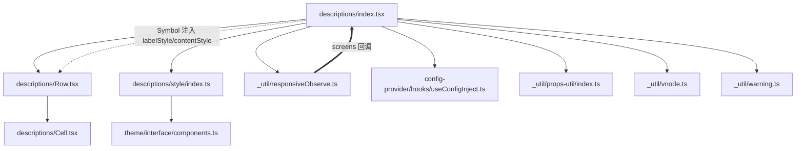
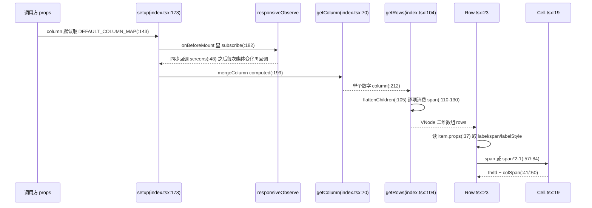
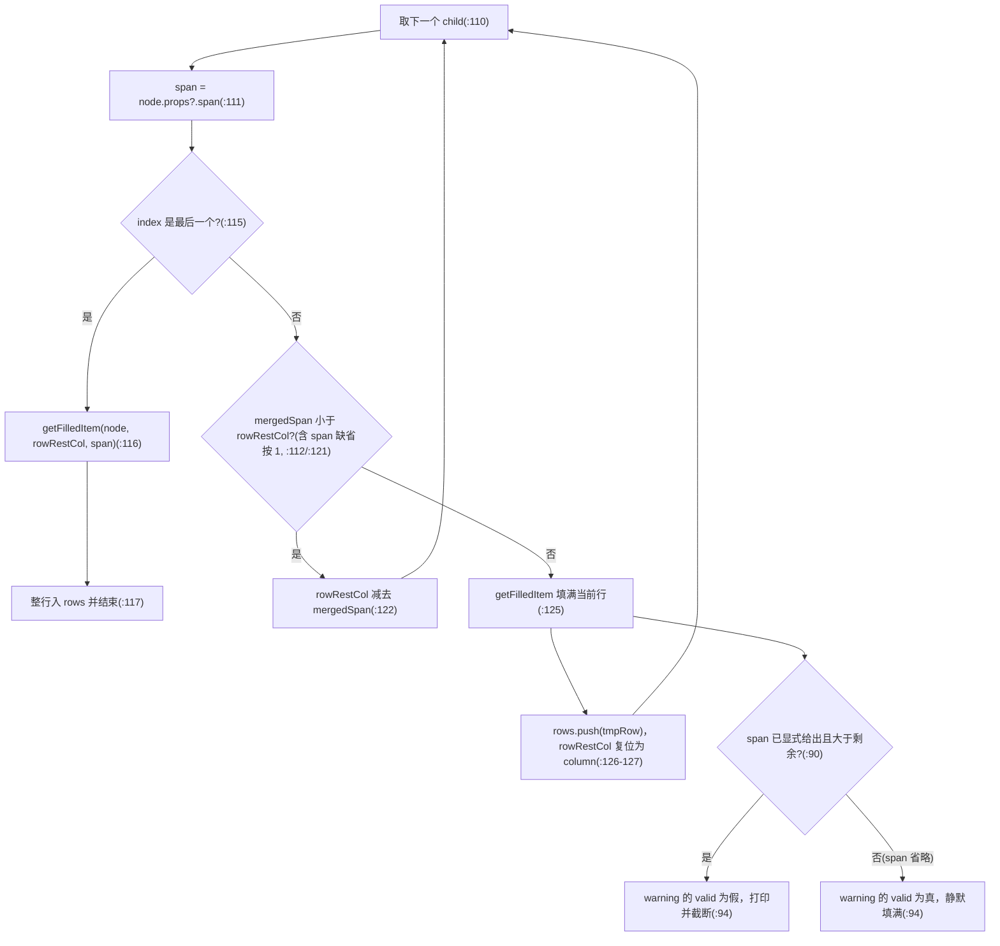

# C11-07 Descriptions 描述列表

> **本篇解决**：`column` 的响应式到底在哪一层被翻译成「一行几格」——它为什么在服务端恒等于 3、`xxxl` 档位为什么写了也没用、`Descriptions.Item` 为什么是一个从不被实例化的空壳、以及 `bordered` 如何把同一份 `span` 算术改成双量纲。
> **前置**：C02-01 Grid 栅格　**读者坐标**：`03-components/11-status` 第 7 篇

## 一、职责与边界

Descriptions 只做一件事：把默认插槽里的一组 `Descriptions.Item` 虚拟节点，按「当前可用列数」切分成若干行，再交给一张 `<table>` 渲染。它的技术含量集中在两处算式上——`column`（响应式对象 → 单个数字）与 `span`（数字 → 每行剩余列宽的消费），其余都是把结果摊成 `th`/`td`。

它明确**不**负责的事，以及对应的真实位置：

- 不负责断点数值与媒体查询本身。7 档定义、`matchMedia` 注册与派发全在 `packages/xiaoye-ui/src/_util/responsiveObserve.ts:13`（`getResponsiveMap`）与 `packages/xiaoye-ui/src/_util/responsiveObserve.ts:63`（`register`），本组件只是消费者（`packages/xiaoye-ui/src/descriptions/index.tsx:24` 一次性导入 `useResponsiveObserve` 与 `responsiveArray`）。
- 不负责栅格。`OUTLINE.md` 给本篇登记的底层是 `row`/`col`，但 `packages/xiaoye-ui/src/descriptions/` 全目录对 `grid` 零引用（`grep -rn "grid" packages/xiaoye-ui/src/descriptions` 无输出）：这里的 `Row`（`packages/xiaoye-ui/src/descriptions/Row.tsx:23`）与 `Cell`（`packages/xiaoye-ui/src/descriptions/Cell.tsx:19`）是本组件私有的表格行/单元格实现，与 `grid/Row.tsx`、`grid/Col.tsx` 只是重名，既不同签名也不同机制（表格语义 vs 弹性栅格）。本篇与 C02-01 的真实公共点只有一个，即 `_util/responsiveObserve`，登记误差已在回报中提交协调者。
- 不负责排版与截断。标题溢出靠 `textEllipsis`（`packages/xiaoye-ui/src/descriptions/style/index.ts:90`），长词换行靠 `wordBreak`（`packages/xiaoye-ui/src/descriptions/style/index.ts:148`）。
- 不负责列宽分配。表格布局整体交给浏览器：`packages/xiaoye-ui/src/descriptions/style/index.ts:107` 对非 `bordered` 写 `tableLayout: 'fixed'`，`packages/xiaoye-ui/src/descriptions/style/index.ts:31` 在有边框时改回 `tableLayout: 'auto'`——这一行翻转正是「同样的 `span` 在两种模式下观感不同」的根因。

依赖清单（全部为 import 实测，见 `packages/xiaoye-ui/src/descriptions/index.tsx:1-31` 与 `packages/xiaoye-ui/src/descriptions/Row.tsx:1-5`）：`_util/responsiveObserve`、`config-provider/hooks/useConfigInject`、`_util/props-util`（`flattenChildren` 在 `packages/xiaoye-ui/src/descriptions/index.tsx:105` 使用，`getSlot`/`getClass`/`getStyle` 在 `packages/xiaoye-ui/src/descriptions/Row.tsx:45-47` 使用）、`_util/vnode` 的 `cloneElement`（`packages/xiaoye-ui/src/descriptions/index.tsx:91`）、`_util/warning`（`packages/xiaoye-ui/src/descriptions/index.tsx:94`）、`_util/vue-types`、`theme/internal` 经 `./style` 间接引入、`_util/registerComponent`（`packages/xiaoye-ui/src/descriptions/index.tsx:258`）。被谁依赖：包根聚合入口 `packages/xiaoye-ui/src/components.ts:112` 的 `export * from './descriptions'` 与 `packages/xiaoye-ui/src/components.ts:114` 的样式副作用导入，组件目录内部之外无其它消费者。

## 二、源码地图

| 文件 | 行数 | 职责 | 关键导出 / 入口行 |
| --- | --- | --- | --- |
| `descriptions/index.tsx` | 265 | 主组件 + Item 声明 + 两套算式 | 主渲染函数 `packages/xiaoye-ui/src/descriptions/index.tsx:201`，`getColumn` 在 `:70`，`getRows` 在 `:104` |
| `descriptions/Row.tsx` | 138 | 把一行 items 摊成 `tr`，bordered 时拆成 `th`+`td` | 函数式组件本体 `packages/xiaoye-ui/src/descriptions/Row.tsx:23`，`renderCells` 在 `:24` |
| `descriptions/Cell.tsx` | 75 | 单个 `th`/`td`，两种空值判据 | `packages/xiaoye-ui/src/descriptions/Cell.tsx:19`，`notEmpty` 在 `:3` |
| `descriptions/style/index.ts` | 208 | CSS-in-JS 样式与 token 合成 | `genComponentStyleHook('Descriptions', …)` 在 `packages/xiaoye-ui/src/descriptions/style/index.ts:184` |
| `descriptions/index.test.js` | 286 | 13 个用例（其中 6 个零断言） | `packages/xiaoye-ui/src/descriptions/index.test.js:20` 起 |

三个容易踩空的事实先登记在此：

1. Item 的 props 有两份定义。导出给外部的 `DescriptionsItemProps`（`packages/xiaoye-ui/src/descriptions/index.tsx:33`，三个键，无默认值）与实际装进组件的 `descriptionsItemProp`（`packages/xiaoye-ui/src/descriptions/index.tsx:39`，五个键、三个默认值）内容不同；前者全仓零消费者（`grep -rn "DescriptionsItemProps" packages apps` 只命中定义行本身），但它是 `export const`，会经 `packages/xiaoye-ui/src/components.ts:112` 进入包根导出面。
2. 组件的 `name` 有两个命名空间：根组件 `XYDescriptions`（`packages/xiaoye-ui/src/descriptions/index.tsx:164`）与子组件 `XYDescriptionsItem`（`packages/xiaoye-ui/src/descriptions/index.tsx:53`），注册由 `install` 一次性完成（`packages/xiaoye-ui/src/descriptions/index.tsx:257-261`），两者都走 `registerComponent`。
3. `ComponentToken` 层是空的。`packages/xiaoye-ui/src/theme/interface/components.ts:92` 登记的是 `Descriptions?: {}`，所以 `packages/xiaoye-ui/src/descriptions/style/index.ts:6-16` 里那 9 个 `DescriptionsToken` 扩展字段不是「Component Token 可覆盖项」，而是 `mergeToken`（`packages/xiaoye-ui/src/descriptions/style/index.ts:195`）在库内算死的派生值——调用方无法从主题层改 `descriptionsDefaultPadding`。

## 三、架构与数据流

静态结构（谁 import 谁，以及数据实际从哪条边流过）：



图上三条边值得单独说明。第一，`Row` 与 `Cell` 都是**函数式组件**（`packages/xiaoye-ui/src/descriptions/Row.tsx:23`、`packages/xiaoye-ui/src/descriptions/Cell.tsx:19`），没有任何自己的状态，`Row` 需要的父级配置一部分来自 props（`packages/xiaoye-ui/src/descriptions/index.tsx:238-246` 传入 `prefixCls`/`colon`/`bordered`/`vertical`/`index`），一部分来自 `inject(descriptionsContext, …)`（`packages/xiaoye-ui/src/descriptions/Row.tsx:95`）。第二，虚线那条 Symbol 通道只在**根组件与 Row** 之间，`Cell` 拿到的是已经被合并过的样式对象（`packages/xiaoye-ui/src/descriptions/Row.tsx:55-56`），因此 Item 无法越过 Row 直接读父配置。第三，`screens` 的回调边（粗线）方向是反的——它由 `_util/responsiveObserve` 在媒体查询变化时**推**给 `packages/xiaoye-ui/src/descriptions/index.tsx:182` 注册的闭包，而不是组件去拉；这条推式边是本篇所有响应式行为的唯一入口，也是它的唯一失效点（见论点 1）。

组件内部的运行顺序：



`sequenceDiagram` 里最要紧的是 `GR->>GR` 那一步：`getRows`（`packages/xiaoye-ui/src/descriptions/index.tsx:104`）不是 computed，它在**每次渲染函数执行时**被调用（`packages/xiaoye-ui/src/descriptions/index.tsx:212`），只吃 `mergeColumn.value` 一个响应式来源。于是「行怎么切」这件事的重算频率等于「根组件重渲染频率」，父级任何 props 变化（`title`、`extra`、`colon`）都会重跑整条分行算术。

分行算法本身的分支：



流程图右下角那两个分支是本组件最反直觉的地方（论点 4 会展开）：`getFilledItem` 的告警条件是 `span === undefined`（`packages/xiaoye-ui/src/descriptions/index.tsx:94-98`），而 `warning(valid, …)` 的语义是 **valid 为假才打印**（`packages/xiaoye-ui/src/vc-util/warning.ts:6`，本组件经 `packages/xiaoye-ui/src/_util/warning.ts:12` 走的是它的去重版 `warningOnce`，同文件 `:41`），所以「用户写了 `span` 且溢出」才响，「用户没写 `span` 被自动填满」永远静默——与函数名 `getFilledItem` 的直觉正好相反。

## 四、核心机制精读

### 论点 1：`column` 的响应式接入点是「推式订阅」，它只在 `onBeforeMount` 建立；服务端与「column 为数字」两条路径拿不到 `screens`，`getColumn` 于是退化为字面量 3，而不是默认档位表里的 3

断言：本组件的响应式没有任何 CSS 参与，全部依赖 `packages/xiaoye-ui/src/descriptions/index.tsx:181` 这一次订阅；`screens` 的初值是空对象（`packages/xiaoye-ui/src/descriptions/index.tsx:176`），一旦订阅没建立或没回传，`getColumn` 的兜底分支返回的是硬编码 `3`（`packages/xiaoye-ui/src/descriptions/index.tsx:84`），与 `DEFAULT_COLUMN_MAP`（`packages/xiaoye-ui/src/descriptions/index.tsx:60-68`）没有派生关系。

订阅段原文（`packages/xiaoye-ui/src/descriptions/index.tsx:174`）：

```tsx
// packages/xiaoye-ui/src/descriptions/index.tsx:174
    const { prefixCls, direction } = useConfigInject('descriptions', props);
    let token: number;
    const screens = ref<ScreenMap>({});

    const [wrapSSR, hashId] = useStyle(prefixCls);
    const responsiveObserve = useResponsiveObserve();

    onBeforeMount(() => {
      token = responsiveObserve.value.subscribe(screen => {
        if (typeof props.column !== 'object') {
          return;
        }
        screens.value = screen;
      });
    });

    onBeforeUnmount(() => {
      responsiveObserve.value.unsubscribe(token);
    });
```

消费段原文（`packages/xiaoye-ui/src/descriptions/index.tsx:70`）：

```tsx
// packages/xiaoye-ui/src/descriptions/index.tsx:70
function getColumn(column: DescriptionsProps['column'], screens: ScreenMap): number {
  if (typeof column === 'number') {
    return column;
  }

  if (typeof column === 'object') {
    for (let i = 0; i < responsiveArray.length; i++) {
      const breakpoint: Breakpoint = responsiveArray[i];
      if (screens[breakpoint] && column[breakpoint] !== undefined) {
        return column[breakpoint] || DEFAULT_COLUMN_MAP[breakpoint];
      }
    }
  }

  return 3;
}
```

逐段解释：

- `getColumn` 的 object 分支要求**两个条件同时成立**才取用该档（`packages/xiaoye-ui/src/descriptions/index.tsx:78`：`screens[breakpoint]` 为真且 `column[breakpoint]` 已定义）。`screens` 是 `{}` 时七个档位全部落空，循环走完直接命中 `packages/xiaoye-ui/src/descriptions/index.tsx:84` 的 `return 3`。
- `screens` 的唯一写入点是订阅回调 `packages/xiaoye-ui/src/descriptions/index.tsx:186`。回调里又有一道守卫 `packages/xiaoye-ui/src/descriptions/index.tsx:183`：`props.column` 不是对象就直接 `return`。这道守卫在渲染上无害（数字形态下 `getColumn` 走 `packages/xiaoye-ui/src/descriptions/index.tsx:71-73` 直接返回），但它并没有把订阅本身省掉——`packages/xiaoye-ui/src/_util/responsiveObserve.ts:47` 仍然把这个永不写状态的闭包放进 `subscribers`，并因为 `packages/xiaoye-ui/src/_util/responsiveObserve.ts:45` 的「队列为空才注册」判据而**参与触发** `register()`。也就是说，满屏 `column={3}` 的页面照样会注册 7 个 `matchMedia` 监听器。
- 浏览器端首帧为什么仍然正确：`subscribe`（`packages/xiaoye-ui/src/_util/responsiveObserve.ts:44-50`）先 `register()` 再 `func(screens)`。`register()` 对 7 个档位逐个 `dispatch`（`packages/xiaoye-ui/src/_util/responsiveObserve.ts:66-79`），每次 `dispatch` 都会把整份 `pointMap` 覆盖到闭包变量 `screens` 上（`packages/xiaoye-ui/src/_util/responsiveObserve.ts:40`），虽然这些次派发时当前回调还没进 Map、收不到通知，但 `packages/xiaoye-ui/src/_util/responsiveObserve.ts:48` 随后同步把**已经填满的**那份交给它。因此订阅建立在 `onBeforeMount`（比渲染早一步），首帧列数就是对的。这一点上 Descriptions 的形状比 `grid/Row.tsx` 好——C02-01 论点 1 记录的是 Row 用 `onMounted` 因而首帧丢响应式，本组件没有那个首帧空窗。
- 服务端则相反。I02《vc-trigger 弹出时序与事件穿透》已用「服务端不跑 `onBeforeMount`」这条性质解释过 Portal 的 `isSSR` 初值恒真（`docs/column/02-infrastructure/02-vc-trigger-弹出时序与事件穿透.md:797`），同一性质搬到本组件就是：服务端 `screens` 停在 `{}`，`column` 的对象形态一律译成 3。后果不是「少了样式」而是**行数不同**——`DEFAULT_COLUMN_MAP.xs` 是 1（`packages/xiaoye-ui/src/descriptions/index.tsx:67`），移动端 SSR 出的 HTML 一行 3 格，客户端首帧一行 1 格，`tr` 个数对不上，水合阶段的 DOM 结构差异由这条退化路径制造，而不是由样式或类名制造。
- 兜底值 `3` 的隐藏代价：`return 3` 与 `DEFAULT_COLUMN_MAP` 的 `md`/`lg`/`xl`/`xxl`/`xxxl` 恰好同值（`packages/xiaoye-ui/src/descriptions/index.tsx:61-65`），所以桌面端看不出差别；只有窄视口会暴露。把 `DEFAULT_COLUMN_MAP` 改成 `{ xs: 1, sm: 2, md: 4, ... }` 时，兜底那行不会跟着变（它不是从表里读的），这是改动该常量时最容易漏的一处。

结论回扣：本篇的「响应式」= 一次 JS 订阅 + 一个降序循环 + 一个字面量兜底。三者任缺其一，`column` 的断点表就整块失效，且失效形态是「静默变 3 列」而不是报错。

### 论点 2：`xxxl` 在本组件是第三份死数据——`DEFAULT_COLUMN_MAP` 自带 `xxxl` 键，`column` 的类型也放行 `xxxl`，但承载它的 `screens.xxxl` 恒为 `false`

断言：`packages/xiaoye-ui/src/descriptions/index.tsx:61` 的 `xxxl: 3` 与调用方写出的 `column={{ xxxl: 6 }}` 都不可达，因为它们的共同前提「`screens.xxxl` 能为真」在 `_util/responsiveObserve` 层已被证伪。

默认表原文（`packages/xiaoye-ui/src/descriptions/index.tsx:60`）：

```tsx
// packages/xiaoye-ui/src/descriptions/index.tsx:60
const DEFAULT_COLUMN_MAP: Partial<Record<Breakpoint, number>> = {
  xxxl: 3,
  xxl: 3,
  xl: 3,
  lg: 3,
  md: 3,
  sm: 2,
  xs: 1,
};
```

类型侧原文（`packages/xiaoye-ui/src/descriptions/index.tsx:141`）：

```tsx
// packages/xiaoye-ui/src/descriptions/index.tsx:141
  column: {
    type: [Number, Object] as PropType<number | Partial<Record<Breakpoint, number>>>,
    default: (): number | Partial<Record<Breakpoint, number>> => DEFAULT_COLUMN_MAP,
  },
```

逐段解释：

- `Breakpoint` 是 7 元联合（`packages/xiaoye-ui/src/_util/responsiveObserve.ts:5`），`responsiveArray` 也把 `xxxl` 排在**第一位**（`packages/xiaoye-ui/src/_util/responsiveObserve.ts:10`），于是 `getColumn` 的循环第一个就试 `xxxl`（`packages/xiaoye-ui/src/descriptions/index.tsx:76-78`）。它永远读不到真值，原因在 `packages/xiaoye-ui/src/_util/responsiveObserve.ts:20` 那一行把 `min-width` 包进了花括号而非圆括号——这条判形、它如何在 `matchMedia` 里恒不匹配、以及 CSS 侧与 Col 侧同样缺 `xxxl`，C02-01 论点 3 已在三个文件里互相印证，本篇不重述，只登记 Descriptions 是这条缺陷的**第三个消费者**。
- 「类型放行、运行时不可达」的组合在 `packages/xiaoye-ui/src/descriptions/index.tsx:142` 完整复现：`Partial<Record<Breakpoint, number>>` 允许调用方写 `xxxl`，IDE 不报错、`ExtractPropTypes` 也带上它，只有运行时静默。与 Grid 的区别是 Grid 的 `align`/`justify` 连类型都不接受 `xxxl`（C02-01 论点 3 末段），而 Descriptions 的 `column` 是全通道接受。
- 死键的可观测证据在仓库自己的文档示例里：响应式示例写的是六档 `:column="{ xxl: 4, xl: 3, lg: 3, md: 3, sm: 2, xs: 1 }"`（`apps/docs/examples/descriptions/responsive.vue:5`），没有 `xxxl`。这说明组件内建的 `xxxl: 3` 与示例作者的直觉不一致，前者是从 `DEFAULT_COLUMN_MAP` 抄来的键序，后者是按实际生效档位写的。
- 顺带一处口径漂移：文档表把 `column` 的默认值写成 `3`（`apps/docs/components/descriptions.md:65`），而源码默认值是整张响应式表（`packages/xiaoye-ui/src/descriptions/index.tsx:143`）。桌面端两者结果相同（表里桌面档全是 3，见 `packages/xiaoye-ui/src/descriptions/index.tsx:61-65`），窄屏不同（`sm` 档为 2、`xs` 档为 1，见 `packages/xiaoye-ui/src/descriptions/index.tsx:66-67`）。所以「默认 3 列」这句描述对 `sm`/`xs` 是错的。
- 与论点 1 的兜底值耦合：即使未来把 `packages/xiaoye-ui/src/_util/responsiveObserve.ts:20` 的花括号改对，`DEFAULT_COLUMN_MAP.xxxl` 与 `column.xxxl` 才第一次可达，届时超宽屏（≥2000px）的默认列数仍写死为 3（`packages/xiaoye-ui/src/descriptions/index.tsx:61`）——这与 `getColumn` 末尾的 `return 3`（`packages/xiaoye-ui/src/descriptions/index.tsx:84`）是两处独立的 3，修一处不会带动另一处。

### 论点 3：`Descriptions.Item` 是一个从不被实例化的 prop 容器——它的 props 声明、默认值与类型校验全部不生效，真实消费点在 `Row` 里直接读虚拟节点原始 props

断言：`packages/xiaoye-ui/src/descriptions/index.tsx:51` 定义的 `DescriptionsItem` 在整个渲染链上没有被挂载过一次，因此 `packages/xiaoye-ui/src/descriptions/index.tsx:39-45` 声明的三个默认值（`labelStyle`、`contentStyle`、`span: 1`）没有任何生效时机；Item 的数据是被 `packages/xiaoye-ui/src/descriptions/Row.tsx:37` 以「读 vnode」的方式取走的。

Item 定义原文（`packages/xiaoye-ui/src/descriptions/index.tsx:39`）：

```tsx
// packages/xiaoye-ui/src/descriptions/index.tsx:39
const descriptionsItemProp = () => ({
  prefixCls: String,
  label: PropTypes.any,
  labelStyle: { type: Object as PropType<CSSProperties>, default: undefined as CSSProperties },
  contentStyle: { type: Object as PropType<CSSProperties>, default: undefined as CSSProperties },
  span: { type: Number, default: 1 },
});

export type DescriptionsItemProp = Partial<
  ExtractPropTypes<ReturnType<typeof descriptionsItemProp>>
>;

export const DescriptionsItem = defineComponent({
  compatConfig: { MODE: 3 },
  name: 'XYDescriptionsItem',
  props: descriptionsItemProp(),
  setup(_, { slots }) {
    return () => slots.default?.();
  },
});
```

Row 的消费原文（`packages/xiaoye-ui/src/descriptions/Row.tsx:36`）：

```tsx
// packages/xiaoye-ui/src/descriptions/Row.tsx:36
    return items.map((item, index) => {
      const itemProps = item.props || {};
      const {
        prefixCls: itemPrefixCls = prefixCls,
        span = 1,
        labelStyle = itemProps['label-style'],
        contentStyle = itemProps['content-style'],
        label = (item.children as any)?.label?.(),
      } = itemProps;
      const children = getSlot(item);
      const className = getClass(item);
      const style = getStyle(item);
      const { key } = item;
```

逐段解释：

- 渲染链上 Item 的去向：根组件把插槽子节点交给 `getRows`（`packages/xiaoye-ui/src/descriptions/index.tsx:212`），`getRows` 返回的还是这些 vnode（只是可能被 `cloneElement` 换掉 `span`，`packages/xiaoye-ui/src/descriptions/index.tsx:91-93`），最后 `Row` 在 `packages/xiaoye-ui/src/descriptions/Row.tsx:51` 与 `:69`、`:80` 三处把它们**替换**成 `Cell`。整棵树里没有任何位置渲染 Item 组件本身，于是 `setup(_, { slots })` 的那个 `_`（`packages/xiaoye-ui/src/descriptions/index.tsx:55`）永远没有机会被调用，`:56` 的 `slots.default?.()` 也是死码——它的唯一残余价值是让 `<xy-descriptions-item>` 在**被直接单独使用**时还能渲染子节点。
- 默认值的三份拷贝因此成立：`span` 的「缺省为 1」在 `packages/xiaoye-ui/src/descriptions/index.tsx:44`（声明，不生效）、`packages/xiaoye-ui/src/descriptions/index.tsx:112`（`span || 1`，生效）、`packages/xiaoye-ui/src/descriptions/Row.tsx:40`（`span = 1` 解构默认，生效）各写一遍。删掉 `:44` 不会改变任何渲染结果，但会改变 `DescriptionsItemProp` 类型（`packages/xiaoye-ui/src/descriptions/index.tsx:47-49`）——这正是「类型面与运行面分离」的样本。
- `packages/xiaoye-ui/src/descriptions/Row.tsx:41-42` 那两行不是冗余。因为 Item 不实例化，Vue 的属性名归一化不发生，模板里写 `label-style` 时 vnode 上的键就是字面量 `'label-style'`，写 `:labelStyle` 时是 `labelStyle`；解构里 `labelStyle = itemProps['label-style']` 的默认表达式恰好接住 kebab 写法。任删一条，对应写法静默丢样式且没有任何告警。
- `label` 有两通道且优先级微妙：prop 优先（`packages/xiaoye-ui/src/descriptions/index.tsx:41` 声明、`packages/xiaoye-ui/src/descriptions/Row.tsx:43` 读取），slot 兜底。解构默认只在 prop 严格 `undefined` 时才启用 `label` 插槽，所以 `:label="''"`（空串）会**压掉**插槽内容——这与「空 label 就不显示」的直觉相反，空串仍会走到 `Cell` 的渲染判据（见论点 5 的两套空值判据）。
- 类型校验同样落空：`packages/xiaoye-ui/src/descriptions/index.tsx:44` 的 `type: Number` 从不执行，`span="2"`（字符串）不会被告警，直接进到 `packages/xiaoye-ui/src/descriptions/index.tsx:111` 那句 `const span: number = node.props?.span;`——这是一条**不做检查的类型断言**，字符串 `"2"` 在此被记为 `number`。后续 `packages/xiaoye-ui/src/descriptions/index.tsx:121` 的 `mergedSpan < rowRestCol` 与 `packages/xiaoye-ui/src/descriptions/Row.tsx:84` 的 `span * 2 - 1` 靠 JS 的隐式转换侥幸算对，而 `packages/xiaoye-ui/src/descriptions/Cell.tsx:41` 的 `colSpan={span}` 落到 DOM 的 IDL 属性上也靠同一层转换兜住。写 `span="abc"` 时三处会各自以不同方式崩掉，而全链路没有一处校验。

结论回扣：Item 的角色不是组件，而是「带类型的属性袋」。理解这一点后，`packages/xiaoye-ui/src/descriptions/index.tsx:33` 那份被导出却无人使用的 `DescriptionsItemProps`（三键、无默认值）也就不必再当作两份定义的「不一致」来修——两份都只是给类型侧看的，运行侧谁都不读。

### 论点 4：`getRows` 的分行算术有两处 `||` 吞值和一条「末项无条件拉伸」特判，且它的告警只在开发期响一次

断言：`packages/xiaoye-ui/src/descriptions/index.tsx:104` 的循环是纯命令式累加，`0` 值与「最后一项」都被静默改写；`packages/xiaoye-ui/src/descriptions/index.tsx:94` 的告警经 `warningOnce` 去重（`packages/xiaoye-ui/src/vc-util/warning.ts:27`），同一页面第二次溢出不再打印。

分行原文（`packages/xiaoye-ui/src/descriptions/index.tsx:87`）：

```tsx
// packages/xiaoye-ui/src/descriptions/index.tsx:87
function getFilledItem(node: VNode, rowRestCol: number, span?: number): VNode {
  let clone = node;

  if (span === undefined || span > rowRestCol) {
    clone = cloneElement(node, {
      span: rowRestCol,
    });
    warning(
      span === undefined,
      'Descriptions',
      'Sum of column `span` in a line not match `column` of Descriptions.',
    );
  }

  return clone;
}

function getRows(children: VNode[], column: number) {
  const childNodes = flattenChildren(children);
  const rows: VNode[][] = [];

  let tmpRow: VNode[] = [];
  let rowRestCol = column;
  childNodes.forEach((node, index) => {
    const span: number = node.props?.span;
    const mergedSpan = span || 1;

    // Additional handle last one
    if (index === childNodes.length - 1) {
      tmpRow.push(getFilledItem(node, rowRestCol, span));
      rows.push(tmpRow);
      return;
    }
```

后半段（`packages/xiaoye-ui/src/descriptions/index.tsx:121`）：

```tsx
// packages/xiaoye-ui/src/descriptions/index.tsx:121
    if (mergedSpan < rowRestCol) {
      rowRestCol -= mergedSpan;
      tmpRow.push(node);
    } else {
      tmpRow.push(getFilledItem(node, rowRestCol, mergedSpan));
      rows.push(tmpRow);
      rowRestCol = column;
      tmpRow = [];
    }
  });

  return rows;
}
```

逐段解释：

- 两处 `||` 吞零：`packages/xiaoye-ui/src/descriptions/index.tsx:112` 的 `span || 1` 让 `span={0}` 变成 1；`packages/xiaoye-ui/src/descriptions/index.tsx:79` 的 `column[breakpoint] || DEFAULT_COLUMN_MAP[breakpoint]` 让 `column={{ md: 0 }}` 变成 3（`packages/xiaoye-ui/src/descriptions/index.tsx:64`）。0 在两者语义里都不合法，所以这不是功能缺陷，但它使「写错成 0」与「没写」不可区分，静默回到默认值。
- 末项特判（`packages/xiaoye-ui/src/descriptions/index.tsx:115-119`）走的是 `getFilledItem(node, rowRestCol, span)`，注意第三个实参是**原始 `span`**（可能是 `undefined`），而不是 `mergedSpan`。后果分两支：末项没写 `span` 时 `span === undefined` 使 `:90` 条件成立，被拉伸到整行剩余宽度（`:91`），且 `warning(span === undefined)` 的 valid 为真 → 不打印；末项写了 `span` 且不超过剩余时 `:90` 两支都不成立 → 原样保留，**该行剩余列留空**。`packages/xiaoye-ui/src/descriptions/index.test.js:240-242` 断言的正是后一支的产物（最后一行 `[3, 1]`，`column={4}`）。
- 告警的实际触发面比文案窄：文案是「一行的 `span` 之和不等于 `column`」（`packages/xiaoye-ui/src/descriptions/index.tsx:97`），但代码只在「显式 `span` 大于本行剩余」这一种情形打印。`span` 之和**小于** `column`（少填）不响；末项导致的留空不响；数字形态 `column` 与对象形态 `column` 算出的行数差异也不响。加上 `packages/xiaoye-ui/src/vc-util/warning.ts:27-30` 的 `warned` 去重表，同一条消息在整个页面生命周期里只播一次——只有测试环境因为 `packages/xiaoye-ui/src/_util/warning.ts:15-17` 每次调用后 `resetWarned()` 才能逐次看到。
- `packages/xiaoye-ui/src/descriptions/index.tsx:127` 的行复位是 `rowRestCol = column`：本行被 `else` 分支闭合后立即用同一个 `column` 复位，因此 `column` 若在渲染中途变化（响应式换档），已在 `tmpRow` 里的部分不补偿、下一行按新值重切。这条与论点 1 的「`screens` 更新即 `mergeColumn` 重算」合起来，意味着换档是**逐行**生效的：一次媒体查询变化会让整棵 `getRows` 重算（因为 `packages/xiaoye-ui/src/descriptions/index.tsx:212` 每次渲染都重跑），所以实际观感是整体重切，不存在半途状态。真正会留半途状态的是 `packages/xiaoye-ui/src/descriptions/index.tsx:183` 的守卫——见坑 3。
- 不可达分支：`cloneElement` 在传入空 vnode 时返回 `null`（`packages/xiaoye-ui/src/_util/vnode.ts:19-21`），此时 `packages/xiaoye-ui/src/descriptions/index.tsx:116` 会把 `null` push 进行数组，`packages/xiaoye-ui/src/descriptions/Row.tsx:37` 读 `item.props` 就会抛错。这条路径在正常用法下不成立，因为 `flattenChildren` 只会放进 VNode 或 `isValid` 通过的原始值（`packages/xiaoye-ui/src/_util/props-util/index.ts:62-70`），而 `isValid`（`packages/xiaoye-ui/src/_util/isValid.ts:1-4`）对 `false` 返回真——真正把 `{cond && <Item/>}` 的 `false` 挡住的是 Vue 把布尔子节点归一成注释节点、再由 `isEmptyElement`（`packages/xiaoye-ui/src/_util/props-util/index.ts:213-220`）过滤掉这两步的组合。该分支**无测试保护**（`packages/xiaoye-ui/src/descriptions/index.test.js:83` 的用例只 `mount` 不 `expect`）。

### 论点 5：`bordered` 会把每个条目拆成两格，`span` 的量纲随之翻倍——同一份 `span` 在「非 bordered / bordered / vertical」三种模式下指向三种不同宽度，而 `Cell` 对这两套模式还各用一套空值判据

断言：`packages/xiaoye-ui/src/descriptions/Row.tsx:127` 按 `bordered` 选择 `component` 的形态（字符串或二元组），`packages/xiaoye-ui/src/descriptions/Row.tsx:84` 在二元组分支里把 content 格的宽度写成 `span * 2 - 1`，于是 bordered 一行的 `colSpan` 总量是 `2 * column`；vertical 分支（`packages/xiaoye-ui/src/descriptions/Row.tsx:99-121`）不做这次翻倍。

拆格原文（`packages/xiaoye-ui/src/descriptions/Row.tsx:49`）：

```tsx
// packages/xiaoye-ui/src/descriptions/Row.tsx:49
      if (typeof component === 'string') {
        return (
          <Cell
            key={`${type}-${String(key) || index}`}
            class={className}
            style={style}
            labelStyle={{ ...rootLabelStyle, ...labelStyle }}
            contentStyle={{ ...rootContentStyle, ...contentStyle }}
            span={span}
            colon={colon}
            component={component}
            itemPrefixCls={itemPrefixCls}
            bordered={bordered}
            label={showLabel ? label : null}
            content={showContent ? children : null}
          />
        );
      }

      return [
        <Cell
          key={`label-${String(key) || index}`}
          class={className}
          style={{ ...rootLabelStyle, ...style, ...labelStyle }}
          span={1}
          colon={colon}
          component={component[0]}
          itemPrefixCls={itemPrefixCls}
          bordered={bordered}
          label={label}
        />,
        <Cell
          key={`content-${String(key) || index}`}
          class={className}
          style={{ ...rootContentStyle, ...style, ...contentStyle }}
          span={span * 2 - 1}
          component={component[1]}
          itemPrefixCls={itemPrefixCls}
          bordered={bordered}
          content={children}
        />,
      ];
```

三处 `class={className}`（`packages/xiaoye-ui/src/descriptions/Row.tsx:53`、`:71`、`:82`）都是条目自身的类名原样搬到 `th`/`td` 上，`Cell` 内部再叠加自己的 `-item-*` 类（`packages/xiaoye-ui/src/descriptions/Cell.tsx:35-40`、`:50`）。

单元格原文（`packages/xiaoye-ui/src/descriptions/Cell.tsx:32`）：

```tsx
// packages/xiaoye-ui/src/descriptions/Cell.tsx:32
  if (bordered) {
    return (
      <Component
        class={[
          {
            [`${itemPrefixCls}-item-label`]: notEmpty(label),
            [`${itemPrefixCls}-item-content`]: notEmpty(content),
          },
        ]}
        colSpan={span}
      >
        {notEmpty(label) && <span style={labelStyle}>{label}</span>}
        {notEmpty(content) && <span style={contentStyle}>{content}</span>}
      </Component>
    );
  }

  return (
    <Component class={[`${itemPrefixCls}-item`]} colSpan={span}>
      <div class={`${itemPrefixCls}-item-container`}>
        {(label || label === 0) && (
```

逐段解释：

- 量纲怎么变：`span={1}`（label 格，`packages/xiaoye-ui/src/descriptions/Row.tsx:73`）加 `span * 2 - 1`（content 格，`:84`）＝ 一个条目占 `2 * span` 个表格单位。所以 `column={3}` 的 bordered 表格实际是一张 6 单位宽的表，`span={2}` 的条目吃掉 4 单位。vertical 分支里 `component` 是字符串 `'th'`/`'td'`（`packages/xiaoye-ui/src/descriptions/Row.tsx:104`、`:113`），走 `packages/xiaoye-ui/src/descriptions/Row.tsx:49` 的单格路径，`colSpan` 直接是 `span`（`:57`）——同一条目在 vertical 下占 `span` 单位、在 bordered 下占 `2*span` 单位。CSS 侧还叠了第三次差异：`packages/xiaoye-ui/src/descriptions/style/index.ts:31` 把 bordered 的 `tableLayout` 设为 `auto`，而 `packages/xiaoye-ui/src/descriptions/style/index.ts:107` 给默认情形设 `fixed`，前者下浏览器会按内容重排行宽，`colSpan` 只是建议值。
- 两套空值判据的差别可观测：bordered 用 `notEmpty`（`packages/xiaoye-ui/src/descriptions/Cell.tsx:3-5`，只挡 `undefined` 与 `null`），非 bordered 用 `label || label === 0`（`packages/xiaoye-ui/src/descriptions/Cell.tsx:52`，`content` 同形在 `:65`）。于是 `label=""` 在 bordered 下**照样**生成 `-item-label` 类和一个空 `<span>`（`packages/xiaoye-ui/src/descriptions/Cell.tsx:37`、`:43`），在非 bordered 下整段不渲染；`label={0}` 两种模式都渲染（后者靠 `=== 0` 特判救回，这条特判由 `packages/xiaoye-ui/src/descriptions/index.test.js:245-258` 锁定，但用例只测了 `bordered`）。
- 结构差异也不是免费的：非 bordered 多包一层 `div.-item-container`（`packages/xiaoye-ui/src/descriptions/Cell.tsx:51`），配套 flex 规则在 `packages/xiaoye-ui/src/descriptions/style/index.ts:151-165`；bordered 直接把类挂在 `th`/`td` 上，所以 `packages/xiaoye-ui/src/descriptions/style/index.ts:144` 的 `flex: 1` 在 bordered 里是惰性声明（父级不是 flex 容器）。
- 样式合并顺序在两条路径上不一致：单格路径是 `{ ...rootLabelStyle, ...labelStyle }`（`packages/xiaoye-ui/src/descriptions/Row.tsx:55-56`），元素自身 `style` 通过独立 prop 传下去（`:54`）；双格路径把三者压进同一个对象 `{ ...rootLabelStyle, ...style, ...labelStyle }`（`packages/xiaoye-ui/src/descriptions/Row.tsx:72`、`:83`）。差别在于条目自身 `style` 与 root 级 `labelStyle` 谁赢：单格路径里两者作用在不同元素（`td` 与内部 `span`），互不覆盖；双格路径里 `labelStyle` 覆盖 `style` 的同名字段。所以「同一段 `label-style` 在 bordered 与非 bordered 下效果不同」是代码结构造成的，不是 CSS 优先级造成的。

结论回扣：`span` 不是列数而是「表格单位」，其换算系数由 `bordered` 与 `layout` 两个开关决定（1 或 2），而这两个开关同时换掉了空值判据与 DOM 结构。三者耦合在同一个 `component` 实参上（`packages/xiaoye-ui/src/descriptions/Row.tsx:127`），改动其中一个必须复核另两个。

### 论点 6：`colon`、`size`、`direction` 三个开关的真实生效边界都比声明窄——`colon` 在有边框时是零效果，`size` 完全绕开全局配置，`direction` 根本没有 prop 入口

断言：`colon` 从根组件下传到 `Cell` 只有两处（`packages/xiaoye-ui/src/descriptions/Row.tsx:58` 单格路径、`:74` bordered 的 label 格），bordered 的 content 格（`packages/xiaoye-ui/src/descriptions/Row.tsx:80-89`）连 `colon` 实参都不接，而 `Cell` 的 bordered 分支（`packages/xiaoye-ui/src/descriptions/Cell.tsx:32-47`）更是一次都没有读它，样式在 bordered 块里又已经把冒号伪元素关掉（`packages/xiaoye-ui/src/descriptions/style/index.ts:44-46`）；`size` 带着硬默认值 `'default'`（`packages/xiaoye-ui/src/descriptions/index.tsx:138`）且 `setup` 未从 `useConfigInject` 解构 `size`（`packages/xiaoye-ui/src/descriptions/index.tsx:174`）；`direction` 在 `descriptionsProps` 里压根没声明（`packages/xiaoye-ui/src/descriptions/index.tsx:135-149`）。

类名合成分支（`packages/xiaoye-ui/src/descriptions/index.tsx:202`）：

```tsx
// packages/xiaoye-ui/src/descriptions/index.tsx:202
      const {
        size,
        bordered = false,
        layout = 'horizontal',
        colon = true,
        title = slots.title?.(),
        extra = slots.extra?.(),
      } = props;

      const children = slots.default?.();
      const rows = getRows(children, mergeColumn.value);

      return wrapSSR(
        <div
          {...attrs}
          class={[
            prefixCls.value,
            {
              [`${prefixCls.value}-${size}`]: size !== 'default',
              [`${prefixCls.value}-bordered`]: !!bordered,
              [`${prefixCls.value}-rtl`]: direction.value === 'rtl',
            },
            attrs.class,
            hashId.value,
          ]}
        >
```

逐段解释：

- `colon`：唯一读取点是 `packages/xiaoye-ui/src/descriptions/Cell.tsx:57` 的 `-item-no-colon` 类，位于函数后半段（`:49` 起），前半段 bordered 分支（`:32-47`）里没有 `colon` 这个标识符。对应的抑制规则在 `packages/xiaoye-ui/src/descriptions/style/index.ts:132-134`（把 `::after` 的 `content` 置空），而 bordered 块在 `packages/xiaoye-ui/src/descriptions/style/index.ts:44-46` 已经把 `&::after { display: 'none' }` 写死。所以 `bordered` 为真时冒号本来就不画，`colon` 无论真假都无差别——文档把 `colon` 的说明写成「配置 `Descriptions.Item` 的 `colon` 的默认值」（`apps/docs/components/descriptions.md:64`）而没有提这一限制。
- `size`：`packages/xiaoye-ui/src/descriptions/index.tsx:138` 的 `default: 'default'` 使 `props.size` 恒有值。`useConfigInject` 合成的 size 规则是 `props.size || sizeContext.value`（`packages/xiaoye-ui/src/config-provider/hooks/useConfigInject.ts:39`），即便本组件将来补上解构，`'default'` 是 truthy 也永远吞掉全局值。当前形态更直接：`:174` 只解构 `prefixCls, direction`，`sizeContext` 这条线在本组件没有任何读者，所以 `<xy-config-provider size="small">` 对 Descriptions 零效果。对照同族的正确写法是 `packages/xiaoye-ui/src/radio/Group.tsx:51`（解构里带 `size`）。
- `size` 的文档口径也偏窄：`apps/docs/components/descriptions.md:70` 写「只有设置 `bordered` 生效」，但样式里 `&-middle` 与 `&-small` 两个块（`packages/xiaoye-ui/src/descriptions/style/index.ts:166-179`）挂在根类上、选择 `> th, > td` 的 `paddingBottom`，与非 bordered 基线（`packages/xiaoye-ui/src/descriptions/style/index.ts:110-113`）形成覆盖，与 bordered 无关；bordered 专属的那份是 `padding`（`packages/xiaoye-ui/src/descriptions/style/index.ts:54-63`）。也就是说非 bordered 下 `size` 改变的是行间距，文档说它不生效。
- `direction`：类名判定在 `packages/xiaoye-ui/src/descriptions/index.tsx:222`，读的是 `useConfigInject` 的 `direction`，而它的取值是 `props.direction ?? configProvider.direction?.value`（`packages/xiaoye-ui/src/config-provider/hooks/useConfigInject.ts:15`）。本组件的 props 表里没有 `direction`（`packages/xiaoye-ui/src/descriptions/index.tsx:135-149` 十个键里没有它），所以 `props.direction` 恒 `undefined`，全局配置是**唯一**入口——这比 `rate` 那个把默认值写死导致全局失效的形状（C04-08 记录的 `packages/xiaoye-ui/src/rate/index.tsx:54`）要好，但代价是单实例 RTL 不可达。又因为组件声明了 `inheritAttrs: false`（`packages/xiaoye-ui/src/descriptions/index.tsx:165`）并把 `attrs` 展开到根 `div`（`:216`），调用方手写的 `direction="rtl"` 不会报错，而是作为未知属性落到 DOM 上，看起来「生效」实际什么都没做。
- 死类名一处：`packages/xiaoye-ui/src/descriptions/style/index.ts:136-141` 为 `${componentCls}-item-no-label` 写了 `&::after` 规则，但全仓唯一的 `no-label` 出现处就是这条样式本身（`grep -rn "no-label" packages/xiaoye-ui/src` 只命中 `packages/xiaoye-ui/src/descriptions/style/index.ts:136`），`Cell` 与 `Row` 都不生成它。这是「生成但从不渲染的类名」在本组件的实例。
- 还有一处易被误读为缺陷、实为正确写法的：`bordered = false`、`layout = 'horizontal'`、`colon = true` 都写在解构默认值里（`packages/xiaoye-ui/src/descriptions/index.tsx:204-206`），而 props 侧对应声明是 `default: undefined`（`packages/xiaoye-ui/src/descriptions/index.tsx:137`、`:146`）。正因为声明里显式写了 `undefined` 而不是布尔默认值，解构默认值才可达；这与共则 §3 列的「`X !== undefined ? X : Y` 且 X 有非 undefined 默认值 ⇒ 兜底恒不可达」是相反的写法，不应误报。

### 论点 7：样式表只注册一份（父件把自己的 `prefixCls` 喂给 hook），但 Item 级的 `prefixCls` 会让类名脱离这张表

断言：`packages/xiaoye-ui/src/descriptions/index.tsx:178` 传给 `useStyle` 的是 `useConfigInject('descriptions', props)` 产出的本组件 prefixCls（`packages/xiaoye-ui/src/descriptions/index.tsx:174`），因此 `packages/xiaoye-ui/src/theme/util/genComponentStyleHook.ts:74` 的缓存路径 `[component, prefixCls.value, iconPrefixCls.value]` 只落一张表，同族的反例是 `packages/xiaoye-ui/src/checkbox/Group.tsx:23`（把 `groupPrefixCls` 传进 hook，C04-03 记录其后果），正例是 `packages/xiaoye-ui/src/radio/Group.tsx:54`。

喂 hook 与下传的两行（`packages/xiaoye-ui/src/descriptions/index.tsx:174`）：

```tsx
// packages/xiaoye-ui/src/descriptions/index.tsx:174
    const { prefixCls, direction } = useConfigInject('descriptions', props);
    let token: number;
    const screens = ref<ScreenMap>({});

    const [wrapSSR, hashId] = useStyle(prefixCls);
```

```tsx
// packages/xiaoye-ui/src/descriptions/index.tsx:238
                  <Row
                    key={index}
                    index={index}
                    colon={colon}
                    prefixCls={prefixCls.value}
                    vertical={layout === 'vertical'}
                    bordered={bordered}
                    row={row}
                  />
```

逐段解释：

- 本组件的 Group/子件结构是「根 + Item」，Item 侧的类名完全由 `itemPrefixCls` 决定：`packages/xiaoye-ui/src/descriptions/Row.tsx:39` 写 `prefixCls: itemPrefixCls = prefixCls`——即 Item 没写 `prefixCls` 时继承 Row 传进来的根 prefixCls（`packages/xiaoye-ui/src/descriptions/index.tsx:242`），写了就用自己那份。而 `Cell` 的**全部**类名都用 `itemPrefixCls`（`packages/xiaoye-ui/src/descriptions/Cell.tsx:37-38`、`:50`、`:55`、`:66`）。于是 Item 上的 `prefixCls`（声明在 `packages/xiaoye-ui/src/descriptions/index.tsx:34` 与 `:40`）一旦非默认，生成的类名就脱离 `packages/xiaoye-ui/src/descriptions/style/index.ts:78` 以 `componentCls` 为根注册的那张表——样式表只有一张，类名却有两个前缀，表现为该条目完全裸奔。根组件自己的 `prefixCls` prop（`packages/xiaoye-ui/src/descriptions/index.tsx:136`）没有这个问题，因为它同时改变了 hook 的输入（`:174` → `:178`），表与类名一起搬走。
- 这条差异正是共则 §3 倒数第三条要核对的那一行在 Descriptions 上的落点：本组件**做对了**主件（`:178`），但留了一个 Item 级的旁路（`packages/xiaoye-ui/src/descriptions/Row.tsx:39`）。旁路没有被任何测试覆盖（`packages/xiaoye-ui/src/descriptions/index.test.js` 全文没有出现过 `prefixCls` 字样），也没有文档入口（`apps/docs/components/descriptions.md:73` 起的 Item 属性表只有 `contentStyle`、`label`、`labelStyle`、`span` 四行）。
- 订阅的生命周期形状与 C02-01 论点 2 同构：`let token: number`（`packages/xiaoye-ui/src/descriptions/index.tsx:175`）存的是**求值当时**那个对象的 key，退订时再读一次 `responsiveObserve.value.unsubscribe(token)`（`packages/xiaoye-ui/src/descriptions/index.tsx:191`）。`useResponsiveObserve` 返回的是每实例一份的 `computed`（`packages/xiaoye-ui/src/_util/responsiveObserve.ts:26`），两次 `.value` 之间只要 Design Token 变过一次，第二次拿到的就是新对象，`subscribers.delete` 落空、`unregister` 打在新对象上（`packages/xiaoye-ui/src/_util/responsiveObserve.ts:51-61`），旧对象那 7 个 `MediaQueryList` 监听器仍引用着回调 `packages/xiaoye-ui/src/descriptions/index.tsx:182`。机制推导在 C02-01 论点 2 已完整做过，本篇只登记「Descriptions 具有同一形状」，并补一条本组件特有的加重因素：`packages/xiaoye-ui/src/descriptions/index.tsx:186` 的回调捕获的是 `screens` 这个 `ref`，泄漏的闭包会连带保住整棵已卸载组件的响应式图，而不是只保住一个对象。
- 生命周期钩子选择也值得记一行对比：本组件用 `onBeforeMount` 订阅（`packages/xiaoye-ui/src/descriptions/index.tsx:181`）、`onBeforeUnmount` 退订（`:190`），两者都在「挂载前/卸载前」，配对正确；风险不在配对，而在上面那条 computed 身份。

## 五、对外契约如何生效

组件没有任何 `emits` 声明、没有 `defineExpose`、也没有命令式方法——`descriptionsProps`（`packages/xiaoye-ui/src/descriptions/index.tsx:135-149`）的十个键与三个插槽（`packages/xiaoye-ui/src/descriptions/index.tsx:167-171`）就是全部契约面。下面按「一条声明 → 它实际抵达哪里」走完。

**流向类名的三个开关。** `size`、`bordered`、`layout` 在渲染函数里被解构（`packages/xiaoye-ui/src/descriptions/index.tsx:203-206`），`size` 只产出一个类（`:220`，条件是 `size !== 'default'`），`bordered` 既出类（`:221`）也作为 prop 下传（`:244`），`layout` 被换算成布尔量 `vertical`（`:243`）后下传。三者都不进样式表：样式表按根类与 `-bordered`/`-middle`/`-small`/`-rtl` 四个后缀铺规则（`packages/xiaoye-ui/src/descriptions/style/index.ts:27`、`:166`、`:173`、`:81`），所以**只要类名不出现在 DOM 上，对应规则就永远不参与匹配**，`size` 的 `'default'` 分支正是如此。

**流向 provide 的两个样式对象。** `labelStyle` 与 `contentStyle` 用 `toRef` 包起来注入（`packages/xiaoye-ui/src/descriptions/index.tsx:194-197`），key 是模块级 `Symbol`（`packages/xiaoye-ui/src/descriptions/index.tsx:159-160`）。消费者只有 `Row`，且带兜底默认值（`packages/xiaoye-ui/src/descriptions/Row.tsx:95-98`）——这意味着 `<xy-descriptions-row>` 形态并不存在（Row 未导出为公开组件），但 `Row` 作为内部组件可以脱离 Descriptions 独立求值而不抛错。注入的是 `Ref`，取用发生在渲染函数里（`packages/xiaoye-ui/src/descriptions/Row.tsx:107`、`:116`、`:131`），因此父级改 `labelStyle` 会直接触发 Row 重渲染。

**双通道的 title 与 extra。** `title = slots.title?.()`、`extra = slots.extra?.()`（`packages/xiaoye-ui/src/descriptions/index.tsx:207-208`）是解构默认值写法：prop 优先，插槽兜底。两者任一存在才渲染 header（`packages/xiaoye-ui/src/descriptions/index.tsx:228`），`title`/`extra` 各自再判一次（`:230`、`:231`）。文档在类型上写的是「string、VNode 或 slot」三种形态（`apps/docs/components/descriptions.md:67`），与源码一致；`packages/xiaoye-ui/src/descriptions/index.test.js:260-285` 是这条通道唯一的用例，也是唯一测 `setProps({ extra: undefined })` 回落的用例——注意 prop 被显式设回 `undefined` 时解构默认值重新生效，插槽才有机会被读，这个行为由该用例锁住。

**流向 Item 的契约不经 props。** `label`、`span`、`labelStyle`、`contentStyle` 四个 Item 属性由 `Row` 直接读 vnode（`packages/xiaoye-ui/src/descriptions/Row.tsx:38-44`），`label` 还多一条插槽通道（同文件 `:43`）；文档的 Item 表（`apps/docs/components/descriptions.md:77-80`）只列了 prop 形态，插槽形态未列。这条「声明与实际生效路径分离」是论点 3 的内容，在契约面上的直接后果是：给 Item 传任何**未在这两处出现**的属性，都会被 `Cell` 通过 `class`/`style` 之外的路径丢掉——`Cell` 除 `class`/`style` 外只接收 `itemPrefixCls`、`span`、`component`、`labelStyle`、`contentStyle`、`bordered`、`label`、`content`、`colon` 九个实参（`packages/xiaoye-ui/src/descriptions/Row.tsx:51-64`），Item 上的其余属性没有任何出口，不会落到 DOM。

**attrs 的透传与可能的重复。** `inheritAttrs: false`（`packages/xiaoye-ui/src/descriptions/index.tsx:165`）后由渲染函数手工展开 `{...attrs}`（`:216`），同时把 `attrs.class` 也放进类数组（`:224`）。这里要留一个条件句：Vue 3 的 JSX 在「展开 + 同名显式属性」时走 `mergeProps`，`class` 属于被合并的键（共则 §3 记录的同族行为是 `on*` 键被收集成数组），如果该合并同样作用于 `class`，那么 `:224` 的手工并入会让调用方的类名在 DOM 上出现两次——重复类名不影响样式，但会影响任何按 `classList` 精确长度做断言的测试。本篇没有为该断言找到仓库内的直接实现证据，故只登记为**待核实的重复风险**，验证方式写在附录检查点 3。

## 六、设计取舍

**取舍一：DOM 结构级响应式（JS 判档）而非 CSS 判档。** 「一行几列」决定 `<tr>` 的切分位置，这是树结构而非样式，CSS 媒体查询做不到，所以只能走 JS：`getColumn`（`packages/xiaoye-ui/src/descriptions/index.tsx:70`）+ `matchMedia` 订阅（`packages/xiaoye-ui/src/_util/responsiveObserve.ts:63`）。换来的是开箱即用的断点表和 `responsiveArray` 的降序优先级复用（`packages/xiaoye-ui/src/descriptions/index.tsx:76`），赔上的是三件事：服务端与首帧的结构性不一致（论点 1）、每个实例七个监听器的成本（`packages/xiaoye-ui/src/_util/responsiveObserve.ts:64`）、以及 `unsubscribe` 打在错误对象上的泄漏面（论点 7）。与同仓 Grid 的分工对照很说明问题：`Col` 的响应式全交给 CSS（C02-01 论点 3 记录其 CSS 侧只有五个媒体键），Descriptions 则完全不碰 CSS 断点——两个组件把同一问题放在链路的两端。

**取舍二：Item 作为「属性袋」而非自注册组件。** 本仓已有现成的自注册路线（`checkbox/Group`、`radio/Group` 通过 context 收集子件，见 `packages/xiaoye-ui/src/radio/Group.tsx:78` 的 `useProvideRadioGroupContext`），Descriptions 没走。理由是它的算术是**全局的**：一行的切分依赖前所有条目的 `span` 累加与剩余列宽（`packages/xiaoye-ui/src/descriptions/index.tsx:108-130`），必须有个「所有条目一次看全」的点。选 vnode 直读让这个点留在父件里，代价是父件必须在渲染函数里做算术，且子件的 props 声明整体失去运行时意义（论点 3）。值得注意的是本仓里没有任何一处机制保证 `packages/xiaoye-ui/src/descriptions/index.tsx:111` 读到的 `node.props.span` 与 `packages/xiaoye-ui/src/descriptions/index.tsx:44` 声明的默认值一致——两个文件之间只隔着「Item 是否被实例化」这一个事实，而这个事实没有注释、没有类型、也没有测试守护，所以后来者很容易以为改了 `:44` 的默认值就能改行为（第七节坑 2 讲的就是这个动作）。

**取舍三：保留 `<table>` 语义。** 渲染产物是 `table > tbody > tr > th/td`（`packages/xiaoye-ui/src/descriptions/index.tsx:235-249`、`packages/xiaoye-ui/src/descriptions/Row.tsx:102`、`packages/xiaoye-ui/src/descriptions/Cell.tsx:41`），并用 `colSpan` 表达跨列。换来可访问性（屏幕阅读器能读出键值对关系）与浏览器原生对齐，赔上是 `colSpan` 的量纲耦合：为了让「label+content」在 bordered 下成为两格，算术必须写成 `span * 2 - 1`（`packages/xiaoye-ui/src/descriptions/Row.tsx:84`），而表格布局又在两种模式下不同（`packages/xiaoye-ui/src/descriptions/style/index.ts:31` 的 `auto` 与 `:107` 的 `fixed`），于是同一个 `span` 在不同模式下宽度不同（论点 5）。替代方案是 div + CSS Grid，`span` 就是纯列数，但会丢掉表格语义与 `vertical` 模式下的两行结构（`packages/xiaoye-ui/src/descriptions/Row.tsx:99-121`）。

**取舍四：默认值放在解构而不是 props。** `bordered`/`layout`/`colon` 的默认值写在渲染函数解构里（`packages/xiaoye-ui/src/descriptions/index.tsx:204-206`），props 侧留 `default: undefined`（`:137`、`:146`）。这让「用户没写」保持可区分，是共则 §3 那条三元陷阱的正确写法；同一组件里 `size` 却用了硬默认值（`:138`），于是同一个文件同时存在两种相反选择——`size` 那份是全局配置被挡的根因（论点 6）。

**取舍五：Component Token 层留空。** `packages/xiaoye-ui/src/theme/interface/components.ts:92` 是 `Descriptions?: {}`，所有组件专属量在 `mergeToken` 里就地派生（`packages/xiaoye-ui/src/descriptions/style/index.ts:185-205`）。好处是这个组件不新增可覆盖项、主题类型面不膨胀；代价是 `descriptionsDefaultPadding` 这类量对外不可见，深色/紧凑主题要改表格内边距只能覆盖 Alias Token（`token.padding`、`token.paddingLG`，见 `packages/xiaoye-ui/src/descriptions/style/index.ts:188-190`），而那会同时改掉别的组件。

## 七、坑与改动指南

**坑 1：SSR 下对象形态的 `column` 恒退化为 3 列。**

- 触发：用 `renderToString` 输出 Descriptions，且 `column` 是对象（含**不写 `column`** 的情形，因为默认值就是对象，`packages/xiaoye-ui/src/descriptions/index.tsx:143`）。
- 症状：服务端 HTML 一律按 3 列切行；窄屏水合后客户端首帧按 `xs` 档切，`tr` 数量与服务端不一致，表现为水合期的结构差异告警或整段替换。
- 原因：`screens` 只在 `onBeforeMount` 的订阅回调里写入（`packages/xiaoye-ui/src/descriptions/index.tsx:181-187`），而该钩子在服务端不执行（I02《vc-trigger 弹出时序与事件穿透》在 `docs/column/02-infrastructure/02-vc-trigger-弹出时序与事件穿透.md:797` 用同一性质论证过 Portal 的 `isSSR` 初值）；`screens` 停在 `{}`（`packages/xiaoye-ui/src/descriptions/index.tsx:176`），`getColumn` 走完循环落进兜底 `return 3`（`packages/xiaoye-ui/src/descriptions/index.tsx:84`）。
- 定位：`packages/xiaoye-ui/src/descriptions/index.tsx:70-85` 与 `packages/xiaoye-ui/src/descriptions/index.tsx:181`。该兜底分支**无测试保护**——仓库里没有针对 Descriptions 的服务端渲染用例（`grep -rln "renderToString" packages --include='*.ts' --include='*.tsx' --include='*.js' --include='*.vue' --include='*.mts'` 去掉 `dist` 后只命中 `packages/xiaoye-ui/src/_util/static-style-extract/index.tsx`），组件目录内仅 13 个用例（见下「测试现状」）。

**坑 2：改 `Descriptions.Item` 的 `span` 默认值没有任何效果。**

- 触发：为了让「不写 `span` 时按 2 格计」而去改 `packages/xiaoye-ui/src/descriptions/index.tsx:44` 的 `default: 1`。
- 症状：行为完全不变，改动像被吞掉；类型上 `DescriptionsItemProp['span']` 却显示有默认值。
- 原因：Item 从不实例化（论点 3），Vue 不会为它套用 prop 默认值；真正决定缺省值的是 `packages/xiaoye-ui/src/descriptions/index.tsx:112` 的 `span || 1` 与 `packages/xiaoye-ui/src/descriptions/Row.tsx:40` 的 `span = 1`。
- 定位：三处同时存在即风险点，要改就得三处一起改（`packages/xiaoye-ui/src/descriptions/index.tsx:44`、`:112`、`packages/xiaoye-ui/src/descriptions/Row.tsx:40`）。

**坑 3：`column` 从数字切回对象后，断点表要等到下一次跨档才生效。**

- 触发：`column` 绑定到可变配置，初值为数字（如 `3`），运行中被改成对象（如 `{ xs: 1, md: 3 }`）。
- 症状：切换瞬间列数变成 3 而不是当前视口对应的档；把窗口拖过断点再拖回来才恢复。
- 原因：订阅回调有一道早退守卫 `packages/xiaoye-ui/src/descriptions/index.tsx:183-185`，`props.column` 非对象时不写 `screens`；`screens` 因此停在 `{}`，而 `mergeColumn`（`packages/xiaoye-ui/src/descriptions/index.tsx:199`）依赖的正是这个 ref。守卫只挡写入、不重新注册，也没有 `watch(props.column)` 补一次同步。
- 定位：`packages/xiaoye-ui/src/descriptions/index.tsx:181-188`。反向路径（对象 → 数字 → 对象）同样中招。该分支无测试。

**坑 4：给 Item 写 `prefixCls` 会让该条目脱离样式表。**

- 触发：`<xy-descriptions-item prefixCls="my-desc">`（属性在 `packages/xiaoye-ui/src/descriptions/index.tsx:40` 有声明，文档没写）。
- 症状：只有这一个条目丢样式，同表其余条目正常；DOM 上出现 `my-desc-item-label` 之类类名。
- 原因：`packages/xiaoye-ui/src/descriptions/Row.tsx:39` 允许 Item 覆盖 prefixCls，`Cell` 的全部类名都基于它（`packages/xiaoye-ui/src/descriptions/Cell.tsx:37-38`、`:50`、`:55`、`:66`），而样式表只以根 prefixCls 注册（`packages/xiaoye-ui/src/descriptions/index.tsx:178` → `packages/xiaoye-ui/src/descriptions/style/index.ts:78`）。这与共则 §3 记录的「喂给样式 hook 的 prefixCls 不是本组件自己的」是同一族缺陷的反向形态：本组件的 hook 输入是对的，错在下传旁路。
- 定位：`packages/xiaoye-ui/src/descriptions/Row.tsx:39`。

**坑 5：`bordered` 下 `span` 是「表格单位」不是「列数」。**

- 触发：同一份数据在 `bordered` 与非 `bordered` 之间切换，或从 `vertical` 改成 `horizontal + bordered`。
- 症状：条目宽度看着翻倍或不齐；改 `span` 数值时 bordered 模式的观感变化是非线性的。
- 原因：拆格时 content 格写成 `span * 2 - 1`（`packages/xiaoye-ui/src/descriptions/Row.tsx:84`），label 格恒 1（`:73`）；而 `vertical` 分支不拆格（`packages/xiaoye-ui/src/descriptions/Row.tsx:99-121`）。CSS 侧再叠一层：bordered 用 `tableLayout: 'auto'`（`packages/xiaoye-ui/src/descriptions/style/index.ts:31`）让浏览器按内容重排，非 bordered 用 `fixed`（`:107`）。文档把 `span` 解释成「包含列的数量」「会占用两个 DescriptionsItem 的宽度」（`apps/docs/components/descriptions.md:80`、`:82`），没有提这个系数。
- 定位：`packages/xiaoye-ui/src/descriptions/Row.tsx:68-90`。

**坑 6：`colon` 在有边框时是零效果开关，空 `label` 在有边框时反而渲染。**

- 触发：`bordered` 与 `colon={false}` 同时使用；或某条目 `label=""` 且开着 `bordered`。
- 症状：冒号本来就没有（有边框时 `::after` 被 `display: none` 关掉），`colon` 改了没反应；同时那个空 label 仍生成一个灰底单元格。
- 原因：`Cell` 的 bordered 分支不读 `colon`（`packages/xiaoye-ui/src/descriptions/Cell.tsx:32-47`，唯一读取点在 `:57`），样式在 bordered 块里先关掉了伪元素（`packages/xiaoye-ui/src/descriptions/style/index.ts:44-46`）；空值判据在两种模式下不同（`packages/xiaoye-ui/src/descriptions/Cell.tsx:3-5` 的 `notEmpty` 对比 `:52` 的 `label || label === 0`），灰底来自 `packages/xiaoye-ui/src/descriptions/style/index.ts:42-43` 的 `backgroundColor: descriptionsBg`。
- 定位：`packages/xiaoye-ui/src/descriptions/Cell.tsx:32-52`。文档对这两个行为都没有说明（`apps/docs/components/descriptions.md:64`）。

**坑 7：全局 `size` 到不了 Descriptions，而文档对 `size` 的描述在两个方向上都与源码不符。**

- 触发：`<xy-config-provider size="small">` 包一整页表单；或按文档以为 `size` 只在 `bordered` 下有用。
- 症状：Descriptions 尺寸不变；反之在非 bordered 下把 `size` 设为 `small`，行间距确实会变（与文档相反）。
- 原因：`setup` 没有解构 `useConfigInject` 的 `size`（`packages/xiaoye-ui/src/descriptions/index.tsx:174`），而 `props.size` 自带 `'default'` 硬默认值（`:138`），即使日后补上解构，`packages/xiaoye-ui/src/config-provider/hooks/useConfigInject.ts:39` 的 `props.size || sizeContext.value` 也会被 `'default'` 短路；文档那句「只有设置 `bordered={true}` 生效」在 `apps/docs/components/descriptions.md:70`，对应样式规则在 `packages/xiaoye-ui/src/descriptions/style/index.ts:166-179`，其选择器不含 `-bordered` 前缀。
- 定位：`packages/xiaoye-ui/src/descriptions/index.tsx:138`、`packages/xiaoye-ui/src/descriptions/index.tsx:174`。

**坑 8：主题切换后，本实例的七个媒体查询监听器永久留在 window 上。**

- 触发：页面存在 `ConfigProvider` 换主题（token 变），期间 Descriptions 被卸载。
- 症状：反复进出该页面后 `matchMedia` 监听累积，媒体变化时旧回调仍在跑。
- 原因：`let token` 存的是旧 computed 的 key（`packages/xiaoye-ui/src/descriptions/index.tsx:175`），退订读的是新 computed 结果（`:191`），机制推导见 C02-01 论点 2；本组件的加重因素是回调闭包持有 `screens` ref（`:186`）。
- 定位：`packages/xiaoye-ui/src/descriptions/index.tsx:190-192` 与 `packages/xiaoye-ui/src/_util/responsiveObserve.ts:51-61`。

**测试现状。** `packages/xiaoye-ui/src/descriptions/index.test.js` 是目录内唯一测试文件（无 `__tests__` 子目录、无快照文件；`find packages/xiaoye-ui/src/descriptions -type f` 共 5 个文件）。本会话实测 `npx vitest run src/descriptions/index.test.js` 为 13 passed，但其中 6 个用例没有任何 `expect`：`:44`、`:83`、`:101`、`:118`、`:132`、`:144`——包括名义上测 `colon` 的 `:132` 与名义上测 Item `class` 的 `:118`。响应式两档用例（`:20`、`:156`、`:182`）的「命中档位」完全由测试环境的 polyfill 决定：`packages/xiaoye-ui/tests/setup.ts:107-117` 里 `matches` 的判据是 `query.includes('max-width')`，与视口宽度无关，因此只有 `xs` 可能为真、其余六档恒假；用例 `:156` 断言 5 个 `tr`（即 column=1）之所以成立，唯一解释就是 `xs` 被判真。结论是 `getColumn` 的降序优先级循环（`packages/xiaoye-ui/src/descriptions/index.tsx:76-81`）在**多档同时为真**这一核心场景上没有任何覆盖，`xxxl` 也没有。

**改动安全边界。** 可以安全改的：`packages/xiaoye-ui/src/descriptions/index.tsx:60-68` 的默认档表（注意与 `:84` 的兜底值是两处，见论点 2 末段）、`packages/xiaoye-ui/src/descriptions/style/index.ts:185-193` 的派生量、`packages/xiaoye-ui/src/descriptions/Cell.tsx:3-5` 的判据（改判据要同时看 `:52`、`:65`）。**不能单独改**的：`packages/xiaoye-ui/src/descriptions/Row.tsx:84` 的 `span * 2 - 1`（与 `:73` 的 `span={1}` 成对，也与 `packages/xiaoye-ui/src/descriptions/index.tsx:112` 的列数语义成对）、`packages/xiaoye-ui/src/descriptions/index.tsx:183` 的守卫（与 `:199` 的 computed 依赖绑定）、`packages/xiaoye-ui/src/descriptions/index.tsx:178` 的 hook 入参（换值即换样式表，见论点 7）。目录结构未动时不需要 `pnpm gen:entries`；一旦新增/改名组件目录或改动 `index.tsx` 的导出名（`packages/xiaoye-ui/src/descriptions/index.tsx:33`、`:47`、`:51`、`:159`、`:135` 都在包根导出面上），必须跑 `pnpm gen:entries` 并用 `pnpm check:entries` 复核。验证命令按风险递增：

```bash
cd packages/xiaoye-ui && npx vitest run src/descriptions/index.test.js   # 现状 13 passed
pnpm typecheck                                                            # 类型面（DescriptionsProps 与两份 Item 定义）
```

## 附：本篇可证伪的三个检查点

1. 「Descriptions 的底层是 `row`/`col`」这句登记（`docs/column/OUTLINE.md:263` 的 C11-07 行）不成立：跑 `grep -rn "grid" packages/xiaoye-ui/src/descriptions`，期望**无任何输出**——本组件的 `Row`/`Cell` 是私有实现，与 `packages/xiaoye-ui/src/grid/` 无 import 关系，与 C02-01 的唯一公共依赖是 `packages/xiaoye-ui/src/descriptions/index.tsx:24` 那一行 `responsiveObserve`。
2. 「`colon` 只影响非 bordered 渲染」可证：跑 `grep -n "colon" packages/xiaoye-ui/src/descriptions/Cell.tsx`，命中的行号是 16（类型声明）、29（解构）、57（唯一使用点），第 32 到 47 行（bordered 分支的返回 JSX）之间**没有**任何 `colon`；再看 `grep -n "no-colon" packages/xiaoye-ui/src/descriptions/style/index.ts` 只命中 `packages/xiaoye-ui/src/descriptions/style/index.ts:132`，而 bordered 块的 `packages/xiaoye-ui/src/descriptions/style/index.ts:44` 已把 `::after` 关掉。
3. 「根组件上外部 `class` 被写入两次」这条在第五节被降级为待核实的条件句，读者可自行判定：起一个 `<xy-descriptions class="probe">` 实例，在 devtools 里看根 `div` 的 `class` 属性中 `probe` 出现一次还是两次。源码侧的两个可能来源是 `packages/xiaoye-ui/src/descriptions/index.tsx:216`（`{...attrs}` 展开）与 `packages/xiaoye-ui/src/descriptions/index.tsx:224`（显式并入 `attrs.class`）；若出现两次，说明 JSX 层的 `mergeProps` 已合并过 `class`，`:224` 属冗余，可以删；若只出现一次，则说明显式 `class` 覆盖了展开值，`:224` 是必需的，**不可删**。仓库内没有能区分这两种情况的用例（`packages/xiaoye-ui/src/descriptions/index.test.js:118` 的 `class` 用例零断言）。
