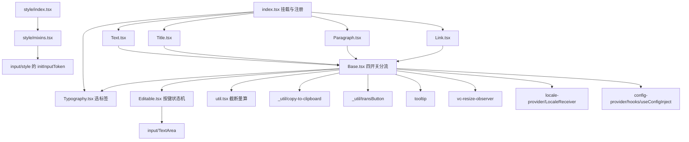
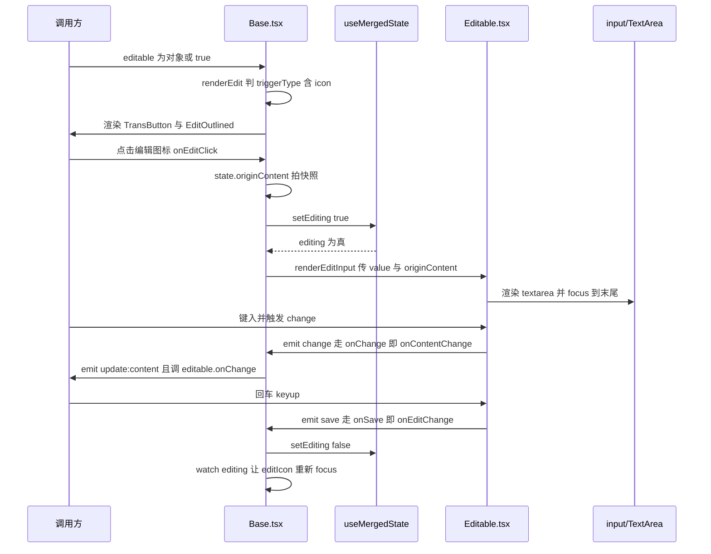
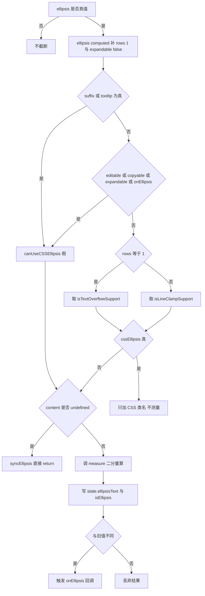

# C11-08 Typography 排版

> **本篇解决**：Typography 把「文本呈现」与「文本操作」揉在同一棵树上，本篇给出四个开关（`editable`/`copyable`/`ellipsis`/`type`）各自的实现落点、走 CSS 还是走 JS、哪一条是自家写的、哪一条已经名存实亡。
> **前置**：I14 运行时约束与静态检查　**读者坐标**：`03-components/11-status` 第 8/9 篇

## 一、职责与边界

Typography 负责的是**排版语义与文本操作**：它把 `article`/`h1`-`h5`/`p`/`div`/`span`/`a` 这些原生语义标签包成统一的 token 化外观，并在文本尾部挂上编辑、复制、展开三个操作区。它明确**不负责**三件事：不负责富文本（编辑态只是一个 `<textarea>`，见论点 1）；不负责真正的剪贴板 API 语义（它 vendored 的是 `document.execCommand` 时代的算法，见论点 2）；不负责布局（`div&, p` 的 `margin-bottom: 1em` 是它给出的唯一间距承诺，`packages/xiaoye-ui/src/typography/style/index.tsx:57-62`）。

被谁依赖：本目录内部自成闭环，对外只有 `packages/xiaoye-ui/src/typography/index.tsx:12-16` 的静态挂载把五个实现绑成一个导出对象。除生成物 barrel（`packages/xiaoye-ui/src/components.ts:387`-`:429` 的三行）之外，`packages/xiaoye-ui/src` 里**没有任何组件 import 或渲染 Typography**——两种方法核过：`grep -rn "from '.*typography'" packages/xiaoye-ui/src --include='*.ts' --include='*.tsx'` 只回生成物那三行；`grep -rn "xy-typography" packages/xiaoye-ui/src --include='*.tsx' --include='*.vue'` 排除本目录后零命中。所以它是纯叶子组件，使用方全部在库外的业务代码与 `apps/docs/examples/typography/`（那里实际用的标签是 `<xy-typography-text>`、`<xy-typography-title>` 等五个，见坑 6 的类型面缺口）。

依赖谁：`config-provider/hooks/useConfigInject`（prefixCls 与 direction）、`locale-provider/LocaleReceiver`（四个操作文案）、`input/TextArea`（编辑态宿主）、`tooltip`（三处浮层）、`vc-resize-observer`（重排触发）、`_util/copy-to-clipboard`（复制）、`_util/raf`、`_util/styleChecker`（能力探测）、`_util/hooks/useMergedState`、`_util/props-util` 的 `findDOMNode`、`@xiaoye-ui/icons` 的三个图标。后五个是本篇「坑」的主要来源。

## 二、源码地图

| 文件 | 行 | 职责 | 关键导出 |
| --- | --- | --- | --- |
| `packages/xiaoye-ui/src/typography/index.tsx` | 41 | 静态挂载与全局注册 | 默认导出 `Typography` |
| `packages/xiaoye-ui/src/typography/Typography.tsx` | 58 | 唯一的 DOM 落地层，选标签 | `typographyProps` |
| `packages/xiaoye-ui/src/typography/Base.tsx` | 624 | **主实现入口**，四个开关全部在此分流 | `baseProps` |
| `packages/xiaoye-ui/src/typography/Editable.tsx` | 160 | 编辑态的 textarea 与按键状态机 | `editableProps` |
| `packages/xiaoye-ui/src/typography/util.tsx` | 226 | JS 截断量算（二分找切点） | 默认导出具名 `measure` |
| `packages/xiaoye-ui/src/typography/Text.tsx` | 44 | span 包装件 | `textProps` |
| `packages/xiaoye-ui/src/typography/Title.tsx` | 39 | h1-h5 包装件，`level` 映射 | `titleProps` |
| `packages/xiaoye-ui/src/typography/Paragraph.tsx` | 23 | div 包装件 | `paragraphProps` |
| `packages/xiaoye-ui/src/typography/Link.tsx` | 35 | a 包装件与 `rel` 补全 | `linkProps` |
| `packages/xiaoye-ui/src/typography/style/index.tsx` | 128 | 样式聚合与 ComponentToken | `genComponentStyleHook` |
| `packages/xiaoye-ui/src/typography/style/mixins.tsx` | 263 | 六组样式生成器 | `getEditableStyles` 等 |
| `packages/xiaoye-ui/src/typography/index.test.js` | 382 | 唯一的测试文件（`.js` 后缀） | — |
| `packages/xiaoye-ui/src/_util/copy-to-clipboard/index.ts` | 120 | 复制算法，**typography 独占** | 默认导出 `copy` |
| `packages/xiaoye-ui/src/_util/copy-to-clipboard/toggle-selection.ts` | 41 | 复制前的选区还原 | 默认导出 `deselectCurrent` |

主实现入口 `packages/xiaoye-ui/src/typography/Base.tsx:124`（`const Base = defineComponent`），组件名 `TypographyBase`（`Base.tsx:126`）。注意一个命名口径：Base 是 `defineComponent`，而它的四个对外包装件全是函数式组件（`Text.tsx:19`、`Title.tsx:16`、`Paragraph.tsx:9`、`Link.tsx:12`），所以「谁是一个 Vue 组件」这个问题在这套目录里有两种答案。

`index.test.js` 是本目录唯一测试文件这一说法，用两种方法核过：`find packages/xiaoye-ui/src/typography -name "*.test.*"` 只回一条；`grep -rn "typography" packages/xiaoye-ui/tests` 零命中。判定它是否被真的执行看 `packages/xiaoye-ui/vitest.config.mts:33` 的 glob（`src/**/*.test.{js,ts,jsx,tsx}`，含 `.js`）。

## 三、架构与数据流

### 图 1：模块静态结构（谁 import 谁）



逐图说明：`Base.tsx` 是唯一的分流点，四个包装件（`Text.tsx:37`、`Title.tsx:32`、`Paragraph.tsx:16`、`Link.tsx:28`）都只是给它补一个 `component` 字符串。`Base.tsx` 同时依赖 `Typography.tsx`（`Base.tsx:584` 渲染它）和包装件依赖它，构成 `index.tsx` → 包装件 → Base → Typography 的四层链，因此 DOM 上永远多出一层 `article`——这是 `Base.tsx:583` 的 `ResizeObserver` 需要观察的目标。右下角 `mixins.tsx:13` 的 `initInputToken` 是一条**跨组件的样式依赖**：Typography 的编辑态外观要用 Input 的 token，`mixins.tsx:190` 直接读 `inputToken.inputPaddingVertical + 1`，Input 改 padding 会连带改动 Typography 编辑框的对齐，详见坑 5。

### 图 2：编辑态的完整闭环（props → 内部状态 → 渲染 → 事件回流）



逐图说明：中间那两条「键入即回流」与「回车再回流」是这个组件最容易读错的地方。`Editable.tsx:67` 每次 change 都 `emit('change')`，而 `Base.tsx:475` 把 `onChange` 直接接到了 `onContentChange` 上，所以 **v-model 在每次键入后就更新**，不是等保存才更新；`Editable.tsx:116` 的 `emit('save', state.current.trim())` 再走 `Base.tsx:474` 的 `onSave → onEditChange → onContentChange`。两次都汇入同一个 `onContentChange`，靠 `Base.tsx:225` 的 `if (value !== props.content)` 去重——这条判等正是 `index.test.js:339` 那句 `toHaveBeenCalledTimes(1)` 能成立的唯一原因。

### 图 3：ellipsis 的分流决策（CSS 路径与 JS 路径）



逐图说明：`Base.tsx:311-326` 的六个条件是串联短路，任一为真即落入 JS 路径；而 `Base.tsx:331-338` 的五条守卫里 `props.content === undefined` 这条最要紧——**JS 截断只在受控写法下工作**。这就是 `Base.tsx:185-198` 的 `watchEffect` 警告存在的原因：它检测的正是「用了 `ellipsis` 但没给 `content`」这一组合。图里 `M` 分支与 `L` 分支产出同一个类名 `-ellipsis`，但只有 `L` 会写 `state.ellipsisContent`，于是 `Base.tsx:548` 那段「把剩余文字挂到 title」的逻辑在 CSS 路径下永不执行（`Base.tsx:580` 的 `showTooltip` 同样要求 `!cssEllipsis`）。

## 四、核心机制精读

### 论点 1：`editable` 是本仓自研的「TextArea + 按键状态机」，不是任何第三方编辑器内核的封装

断言：Typography 的编辑能力由 `typography/Editable.tsx`（160 行，本仓文件）实现，其内部只依赖本仓的 `input/TextArea`；IME 组合输入、Enter/Esc 判定、光标定位这三段最容易外包给第三方逻辑的部分，全部是自己写的。

```tsx
// packages/xiaoye-ui/src/typography/Editable.tsx:1
import KeyCode from '../_util/KeyCode';
import TextArea from '../input/TextArea';
import { EnterOutlined } from '@xiaoye-ui/icons';
// ...
// packages/xiaoye-ui/src/typography/Editable.tsx:14
const editableProps = () => ({
  prefixCls: String,
  value: String,
  maxlength: Number,
  autoSize: { type: [Boolean, Object] as PropType<boolean | AutoSizeType> },
  onSave: Function as PropType<(val: string) => void>,
  onCancel: Function as PropType<() => void>,
  onEnd: Function as PropType<() => void>,
  onChange: Function as PropType<(val: string) => void>,
  originContent: String,
  direction: String as PropType<Direction>,
  component: String,
});
```

逐段解释：

- 依赖清单只有三行（`Editable.tsx:1`、`Editable.tsx:2`、`Editable.tsx:3`），全部指向本仓路径或 `@xiaoye-ui/icons`。没有任何 `node_modules` 里的富文本/内容可编辑库出现在这里。
- props 面（`Editable.tsx:14-26`）里没有 `dangerouslySetInnerHTML`、没有 schema、没有 `extensions` 之类的编辑器内核特征参数——它就是一个纯 `<textarea>` 的黑盒，四个回调 `onSave`/`onCancel`/`onEnd`/`onChange`（`Editable.tsx:19-22`）就是它全部的对外协议。

再看按键状态机：

```tsx
// packages/xiaoye-ui/src/typography/Editable.tsx:78
    function onKeyDown(e: KeyboardEvent) {
      const { keyCode } = e;
      if (keyCode === KeyCode.ENTER) {
        e.preventDefault();
      }
      // We don't record keyCode when IME is using
      if (state.inComposition) return;

      state.lastKeyCode = keyCode;
    }

    function onKeyUp(e: KeyboardEvent) {
      const { keyCode, ctrlKey, altKey, metaKey, shiftKey } = e;

      // Check if it's a real key
      if (
        state.lastKeyCode === keyCode &&
        !state.inComposition &&
        !ctrlKey &&
        !altKey &&
        !metaKey &&
        !shiftKey
      ) {
        if (keyCode === KeyCode.ENTER) {
          confirmChange();
          emit('end');
        } else if (keyCode === KeyCode.ESC) {
          state.current = props.originContent;
          emit('cancel');
        }
      }
    }
```

逐段解释：

- `onKeyDown` 在 `state.inComposition` 为真时直接 return（`Editable.tsx:84`），于是中文输入法候选期间的按键不会写进 `state.lastKeyCode`。组合状态由 `onCompositionStart`/`onCompositionEnd`（`Editable.tsx:70-76`）自己维护。
- `onKeyUp` 的合取条件（`Editable.tsx:93-100`）要求 `lastKeyCode === keyCode`，这是「按下与抬起是同一个键」的去抖；配合 composition 过滤，效果是**候选框里的回车被吞掉、只有真回车才提交**。这套判定是手写的，不是外包的。
- Esc 分支（`Editable.tsx:105`）把 `state.current` 回滚到 `props.originContent`，该值来自 `Base.tsx:215` 在点编辑图标那一刻拍的快照。

结论：`editable` 的「待核实」可以销掉——**自研**，落点 `typography/Editable.tsx`，宿主是 `input/TextArea`，无第三方内核。

### 论点 2：`copyable` 也是自研，但它 vendored 的是 `execCommand` 时代的算法，且四个选项全不可达

断言：`copyable` 走 `_util/copy-to-clipboard/`（本仓 2 个文件、161 行），算法是「插入隐藏 span → 选区 → `document.execCommand('copy')`」，而不是现代 `navigator.clipboard`；更关键的是 Typography 调用它时**不传第二个参数**，导致该模块声明的整个 `Options` 面（`format`/`onCopy`/`debug`/`message`）在生产路径上恒为默认值。

```ts
// packages/xiaoye-ui/src/_util/copy-to-clipboard/index.ts:3
interface Options {
  debug?: boolean;
  message?: string;
  format?: string; // MIME type
  onCopy?: (clipboardData: object) => void;
}
// ...
// packages/xiaoye-ui/src/_util/copy-to-clipboard/index.ts:81
    document.body.appendChild(mark);

    range.selectNodeContents(mark);
    selection.addRange(range);

    const successful = document.execCommand('copy');
    if (!successful) {
      throw new Error('copy command was unsuccessful');
    }
    success = true;
  } catch (err) {
    debug && console.error('unable to copy using execCommand: ', err);
    debug && console.warn('trying IE specific stuff');
    try {
      (window as any).clipboardData.setData(options.format || 'text', text);
      options.onCopy && options.onCopy((window as any).clipboardData);
      success = true;
    } catch (err) {
```

调用侧：

```tsx
// packages/xiaoye-ui/src/typography/Base.tsx:240
      const { copyable } = props;

      const copyConfig = {
        ...(typeof copyable === 'object' ? copyable : null),
      };

      if (copyConfig.text === undefined) {
        copyConfig.text = getChildrenText();
      }

      copy(copyConfig.text || '');

      state.copied = true;
```

逐段解释：

- `Base.tsx:250` 的 `copy(...)` 只给一个实参，`index.ts:30-32` 于是把 `options` 归零成 `{}`。连带后果：`index.ts:57` 的 `if (options.format)` 恒假 → 整个 `e.clipboardData` 定制分支（`index.ts:57-72`）在生产路径从不进入；`index.ts:73` 的 `options.onCopy` 恒无 → 该模块自己的复制回调从不触发。
- `debug` 恒为 `false`（`index.ts:33`），所以 `index.ts:90-91`、`index.ts:97-98` 的日志全被短路。
- `index.ts:117` 的 `return success` 在 `Base.tsx:250` 被直接丢弃，紧接着 `Base.tsx:252` 无条件 `state.copied = true`。
- 兜底链的最后一级是 `index.ts:100` 的 `window.prompt(message, text)`——它**不受 `debug` 门控**，所以在 `execCommand` 与 `window.clipboardData` 双双失败的浏览器里，用户点复制会弹出一个原生 prompt 框。
- 全仓消费面（两种方法交叉核过）：`grep -rn "copy-to-clipboard" packages apps` 排除 `dist/` 后只有三条命中——生产侧 `Base.tsx:12`，测试侧 `typography/index.test.js:4` 与 `index.test.js:12` 的 `vi.mock`。`packages/xiaoye-ui/package.json` 与根 `package.json` 里 `grep -n "clipboard"` 零命中，即**没有 npm 依赖**，这两个文件就是全部实现。

结论：`copyable` 的「待核实」同样可以销掉——**自研 vendored 实现**，落点 `_util/copy-to-clipboard/index.ts` + `toggle-selection.ts`，无 npm 依赖、无 `navigator.clipboard`。而它的 `Options` 面是本篇发现的「API 面存活、实现死亡」实例（见坑 3）。

### 论点 3：`disabled` 在 Typography 只产出一个类名，不关闭任何交互；断链发生在共则 §3 的判据 ①，而非判据 ②

断言：`useConfigInject` 已经把 `disabled` 合成好了，Base 却只解构 `prefixCls` 与 `direction`；组件自己 `props.disabled` 的唯一致命用途是给根元素挂一个类名，编辑/复制/展开三个操作区全部不看它。

```tsx
// packages/xiaoye-ui/src/typography/Base.tsx:106
  prefixCls: String,
  component: String,
  type: String as PropType<BaseType>,
  disabled: { type: Boolean, default: undefined },
// ...
// packages/xiaoye-ui/src/typography/Base.tsx:131
    const { prefixCls, direction } = useConfigInject('typography', props);
```

对照 `config-provider/hooks/useConfigInject.ts:43`：

```ts
// packages/xiaoye-ui/src/config-provider/hooks/useConfigInject.ts:43
  const disabled = computed<boolean>(() => props.disabled ?? disabledContext.value);
```

再看 Base 的渲染里 `disabled` 怎么被消费的：

```tsx
// packages/xiaoye-ui/src/typography/Base.tsx:507
            const {
              type,
              disabled,
              content,
              class: className,
              style,
              ...restProps
            } = {
              ...props,
              ...(attrs as HTMLAttributes),
            };
// ...
// packages/xiaoye-ui/src/typography/Base.tsx:586
                  class={[
                    {
                      [`${prefixCls.value}-${type}`]: type,
                      [`${prefixCls.value}-disabled`]: disabled,
                      [`${prefixCls.value}-ellipsis`]: rows,
```

逐段解释：

- `Base.tsx:131` 的解构只有两个名字。`useConfigInject.ts:43` 返回的 `disabled`（它已经做了 `props.disabled ?? disabledContext.value` 的合成）被丢弃。于是 `<xy-form disabled>` 里的 `<xy-text>` 拿不到禁用态——这是共则 §3 判据 ① 的又一个实例。
- `Base.tsx:507-517` 从 `{...props, ...attrs}` 里取 `disabled`，只看用户直传的那个值；`Base.tsx:589` 把它翻成类名 `xy-typography-disabled`。该类名的全部规则是 `style/index.tsx:51-55`：换色、`cursor: not-allowed`、`userSelect: 'none'`。三条都是文字层的，没有一条能挡住图标。
- `renderEdit()`（`Base.tsx:409-429`）与 `renderCopy()`（`Base.tsx:431-459`）里没有任何 `disabled` 判断，`onEditClick`（`Base.tsx:213`）、`onCopyClick`（`Base.tsx:237`）、`onExpandClick`（`Base.tsx:207`）三个处理函数同样不读它。因此 **`<xy-text disabled :editable="true">` 依旧渲染可点编辑图标，点了依旧进入编辑态**。
- 更值得记的是：手边就有可用的开关。操作图标包在 `TransButton` 里（`Base.tsx:419`、`Base.tsx:447`），而 `TransButton` 自己声明并消费了 `disabled`——`_util/transButton.tsx:24` 声明、`:67` 解构出、`:77` 分支处理。Typography 只是**从不传**这个 prop。所以这不是「缺能力」，是「缺一行转发」。
- 顺带一层判据 ② 的形状：`Base.tsx:109` 给 `disabled` 写了 `default: undefined`，这是**正确写法**（不短路兜底）；本组件的问题是根本没接兜底源，而不是接了个死默认值。两者要分开记账。

同一段还暴露一个类型/白名单不一致：`direction` 在 `BlockProps extends TypographyProps`（`Base.tsx:67` → `Typography.tsx:11`）里是声明的字段，但 `baseProps()`（`Base.tsx:97-122`）整块没有声明它，全文件对 `direction` 的引用只有三处（`:131`、`:478`、`:602`）。结果是 `<xy-text direction="rtl">` 落进 `attrs`，经 `Base.tsx:516` 展开进 `restProps`，再经 `Base.tsx:604` 的 `{...textProps}` 铺到 `<Typography>` 上；而 `Base.tsx:602` 已经先写了 `direction={direction.value}`。普通属性名（非 `on*`）在 spread 之后者胜出，所以用户值最终生效——但生效路径绕过了 `useConfigInject`，且 `Base.tsx:602` 那一行在这种情况下是恒被覆盖的死写。

### 论点 4：ellipsis 有 CSS 与 JS 两条实现，走哪条由六个开关合谋决定；JS 那条依赖一个模块级单例 DOM

断言：`canUseCSSEllipsis` 是唯一的分流点，只要开了 `editable`/`copyable`/`expandable`/`suffix`/`tooltip`/`onEllipsis` 任意一个，就从纯 CSS 降级到 JS 量算，而量算实现持有一个跨实例复用的模块级 `ellipsisContainer`，并用 `createApp` 现场起一个临时应用来渲染测量树。

```tsx
// packages/xiaoye-ui/src/typography/Base.tsx:311
    const canUseCSSEllipsis = computed(() => {
      const { rows, expandable, suffix, onEllipsis, tooltip } = ellipsis.value;

      if (suffix || tooltip) return false;

      // Can't use css ellipsis since we need to provide the place for button
      if (props.editable || props.copyable || expandable || onEllipsis) {
        return false;
      }

      if (rows === 1) {
        return isTextOverflowSupport;
      }

      return isLineClampSupport;
    });
```

```tsx
// packages/xiaoye-ui/src/typography/Base.tsx:328
    const syncEllipsis = () => {
      const { ellipsisText, isEllipsis } = state;
      const { rows, suffix, onEllipsis } = ellipsis.value;
      if (
        !rows ||
        rows < 0 ||
        !findDOMNode(contentRef.value) ||
        state.expanded ||
        props.content === undefined
      )
        return;

      // Do not measure if css already support ellipsis
      if (canUseCSSEllipsis.value) return;
```

分流点的另一半在样式侧：

```tsx
// packages/xiaoye-ui/src/typography/Base.tsx:540
            const cssEllipsis = canUseCSSEllipsis.value;
            const cssTextOverflow = rows === 1 && cssEllipsis;
            const cssLineClamp = rows && rows > 1 && cssEllipsis;
```

对应规则 `typography/style/mixins.tsx:247-255`（`-ellipsis-single-line` 写 `textOverflow: ellipsis`）与 `:257-262`（`-ellipsis-multiple-line` 写 `display: -webkit-box` + `WebkitBoxOrient`）。`isTextOverflowSupport` / `isLineClampSupport` 在 `Base.tsx:36-37` 由 `isStyleSupport` 求值，是**模块加载时的一次性探测**。

JS 侧的量算实现（`typography/util.tsx`）：

```tsx
// packages/xiaoye-ui/src/typography/util.tsx:18
let ellipsisContainer: HTMLParagraphElement;
// ...
// packages/xiaoye-ui/src/typography/util.tsx:73
  if (!ellipsisContainer) {
    ellipsisContainer = document.createElement('div');
    ellipsisContainer.setAttribute('aria-hidden', 'true');
    document.body.appendChild(ellipsisContainer);
  }

  const { rows, suffix = '' } = option;
  const lineHeight = getRealLineHeight(originElement);
  const maxHeight = Math.round(lineHeight * rows * 100) / 100;
// ...
// packages/xiaoye-ui/src/typography/util.tsx:86
  const vm = createApp({
    render() {
      return (
        <div style={wrapperStyle}>
          <span style={wrapperStyle}>
            {content}
            {suffix}
          </span>
          <span style={wrapperStyle}>{fixedContent}</span>
        </div>
      );
    },
  });

  vm.mount(ellipsisContainer);
```

逐段解释：

- `Base.tsx:314` 把 `suffix || tooltip` 单独提前返回，因为截断后要把剩余文字挂到 `<span title>` 上（`Base.tsx:557-564`）并包 Tooltip（`Base.tsx:606-609`），纯 CSS 没有地方放这些节点。
- `Base.tsx:317` 那四个条件是「有按钮要摆」的判据，注释也这么写（`Base.tsx:316`）。合起来六个开关中任意一个为真即放弃 CSS 路径。
- `Base.tsx:321-325` 按 `rows` 选不同的能力探测：单行要 `textOverflow`，多行要 `webkitLineClamp`。这两个常量在 `Base.tsx:36-37` 求一次，**因此 SSR 首屏与客户端探测结果可能不一致**（探测依赖 `window`）。
- `Base.tsx:341` 的提前 return 让 CSS 路径完全不跑 `measure()`，这是性能上的正收益；代价是同一份 `ellipsis` 配置在不同浏览器上会走不同代码路径，截断出来的字符位置不保证一致。
- `util.tsx:18` 是**模块级可变全局量**，`util.tsx:74` 实际写入的是 `document.createElement('div')`，而声明类型是 `HTMLParagraphElement`——类型与现实不符。整个 `typography` 目录下所有实例共享这一个容器（`util.tsx:104` 的高度读取、`util.tsx:124` 的 `innerHTML = ''`、`util.tsx:223` 的 `innerHTML` 读都打在它身上）。
- `util.tsx:86-100` 每次量算都 `createApp(...).mount(...)` 起一个**全新的应用根**再 `unmount`（`util.tsx:110`、`util.tsx:120`）。`getRealLineHeight`（`util.tsx:50-60`）还要再插删一个 div。
- `measure` 的调用频率由 `Base.tsx:298-309` 的 raf 节流兜住，触发源是 `ResizeObserver`（`Base.tsx:583`）与 `Base.tsx:175-183` 的 watch。
- 量算只能切文本节点：`util.tsx:199-210` 只处理 `TEXT_NODE`，其它 nodeType 一律返回 `{ finished: false, vNode: null }`。处理 `ELEMENT_NODE` 的那一整段（`util.tsx:182-198`）被注释掉了，而且注释体里引用了 `contentList` 与 `index` 两个当前作用域根本不存在的标识符——**这段代码即使取消注释也无法编译**，是彻底的化石而非「待开启的特性」。这正是 `Base.tsx:187-196` 那句 `please use 'content' instead of children` 警告存在的原因。

### 论点 5：Text / Title / Paragraph / Link 是函数式包装件，靠 props 白名单的「漏声明」把 `component` 漏进 attrs，四件里只有 Link 不听话

断言：四个包装件都用 `omit(baseProps(), ['component'])` 从声明面删掉 `component`，再自己硬写一个标签名；由于删了声明，用户传的 `component` 落进 `attrs`，而 `attrs` 的展开位置决定它能否覆盖硬写值——Text/Title/Paragraph 把它放在硬写值之后（可覆盖），Link 放在之前（不可覆盖）。

Text 的写法：

```tsx
// packages/xiaoye-ui/src/typography/Text.tsx:7
export const textProps = () => ({
  ...omit(baseProps(), ['component']),
  ellipsis: {
    type: [Boolean, Object] as PropType<
      boolean | Omit<EllipsisConfig, 'expandable' | 'rows' | 'onExpand'>
    >,
    default: undefined as boolean | Omit<EllipsisConfig, 'expandable' | 'rows' | 'onExpand'>,
  },
});
// ...
// packages/xiaoye-ui/src/typography/Text.tsx:28
  const textProps = {
    ...props,
    ellipsis:
      ellipsis && typeof ellipsis === 'object'
        ? omit(ellipsis as any, ['expandable', 'rows'])
        : ellipsis,
    component: 'span',
    ...attrs,
  };
```

Link 的写法：

```tsx
// packages/xiaoye-ui/src/typography/Link.tsx:19
  const mergedProps = {
    ...restProps,
    rel: rel === undefined && restProps.target === '_blank' ? 'noopener noreferrer' : rel,
    ellipsis: !!ellipsis,
    component: 'a',
  };
  // @ts-ignore
  delete mergedProps.navigate;
```

逐段解释：

- `Text.tsx:34` 写 `component: 'span'`，`Text.tsx:35` 紧跟 `...attrs` → 后展开者胜，`<xy-text component="div">` 能换标签。`Title.tsx:28-29`、`Paragraph.tsx:12-13` 同形（`component` 在前、`...attrs` 在后）。
- `Link.tsx:19-24` 把 `component: 'a'` 放在对象字面量**末尾**，而 `restProps` 来自 `Link.tsx:13` 的 `{ ...props, ...attrs }` 已在最前 → `component` 被硬写值压死，`<xy-link component="div">` 静默无效。四件里唯一的例外，且没有任何注释说明这是有意的。
- `Text.tsx:32` 的运行时 `omit(ellipsis, ['expandable', 'rows'])` 与类型层的 `Omit<EllipsisConfig, 'expandable' | 'rows' | 'onExpand'>`（`Text.tsx:11`）**少删了一个 `onExpand`**：类型说没有，运行时也不拦。`Text.tsx:21-27` 的 warning 只检查 `'expandable' in ellipsis` 与 `'rows' in ellipsis` 两个键，同样不管 `onExpand`。于是 `<xy-text :ellipsis="{ onExpand }">` 既无警告也不被剥掉，但因为 `expandable` 缺省为 `false`（`Base.tsx:161`）、`renderExpand` 在 `Base.tsx:390` 直接 return null，`onExpand` 永无触发点——一个「有声明、有类型缺口、零可达」的回调。
- `Link.tsx:21` 是 Link 唯一独立于 Base 的实质逻辑：`target="_blank"` 时自动补 `rel="noopener noreferrer"`。判据是 `rel === undefined`，而 `rel` 来自 `Link.tsx:13` 的 `{...props, ...attrs}` 解构，所以用户显式传 `rel=""` 会走 `rel` 分支拿到空串、**不会**被补全。这是安全默认值里少见的「空串视为已表态」选择。
- `Link.tsx:26` 的 `delete mergedProps.navigate` 上方压着 `// @ts-ignore`（`Link.tsx:25`）——`navigate` 不在任何 props 声明里，说明这是给某个路由集成留的口子，本仓没有对应的实现或测试。
- 四件都是 `FunctionalComponent` 而非 `defineComponent`，靠函数对象补挂三个静态字段来工作：`Text.tsx:40-42`、`Title.tsx:35-37`、`Paragraph.tsx:19-21`、`Link.tsx:31-33` 各写 `displayName` / `inheritAttrs = false` / `props = xxxProps()`。`Text.tsx:40` 的 `displayName = 'XYTypographyText'` 与 Base 的 `name: 'TypographyBase'`（`Base.tsx:126`）不同源，所以 Devtools 里看到的树是 `XYTypography > TypographyBase > Typography > article`，包装件的 `displayName` 并不会成为组件名。

## 五、对外契约如何生效

**props 的两条入口与一条白名单缺口。** Base 的对外 props 面由 `baseProps()`（`Base.tsx:97-122`）决定，共 15 个键。但它的 TypeScript 面是 `BlockProps`（`Base.tsx:67-82`），后者 `extends TypographyProps` 从而带来 `direction` 与 `prefixCls`，又自己声明了 `title`。三个键里只有 `prefixCls` 在运行时白名单内（`Base.tsx:106`），`direction`（`Typography.tsx:11`）与 `title`（`Base.tsx:68`）都不在。这不等于它们无效——`Base.tsx:516` 的 `{ ...(attrs as HTMLAttributes) }` 把未声明键全捞回来，`title` 在 `Base.tsx:549` 被读到、`direction` 在 `Base.tsx:604` 被透传给 `Typography`。但**类型面与运行时面从此是两套账**：`ExtractPropTypes<ReturnType<typeof baseProps>>` 推不出 `direction`，而 `BlockProps` 说它有；改这个组件时按类型改、按运行时验，两边都会有一次落空。判形命令与更多同族实例见 A06《Props 体系与类型工具》。

**prefixCls 与 hashId 的落地路径。** `Base.tsx:131` 的 `useConfigInject('typography', props)` 产出 prefixCls，但 **Base 自己不调 `useStyle`**——整个目录只有两处调用：`Typography.tsx:32` 与 `Editable.tsx:120`（`grep -rn "useStyle" packages/xiaoye-ui/src/typography` 恰好四行，两处 import、两处调用）。Base 因此拿到不了 `hashId`，它的 class 数组（`Base.tsx:586`-`:596`）只拼业务类名；哈希类名由它渲染的 `Typography`（`Base.tsx:584`）在 `Typography.tsx:44`-`:49` 里补上，两者落在**同一个 DOM 元素**上（`Typography.tsx:42` 渲染的那个标签）。另一处 `Editable.tsx:120` 用的 prefixCls 来自 `Editable.tsx:35` 的 `toRefs(props)`，值是 `Base.tsx:469` 传入的 `prefixCls.value` 字符串。样式缓存键是 `theme/util/genComponentStyleHook.ts:74` 的 `[component, prefixCls.value, iconPrefixCls.value]` 三元组，两处的 `component` 都是 `'Typography'`（`style/index.tsx:125`）、prefixCls 都是 `xy-typography`，所以两路 `useStyle` **合并成一张表**。这一族（业务父件不接样式、DOM 落地件与编辑子件各接一次但键相同）是共则 §3 那条「喂给样式 hook 的 prefixCls 不是本组件自己的」检查点上的**正例**，可与 `checkbox/Group.tsx:23` 传 `groupPrefixCls` 的反例对照读。

**slots：八个被读，零个被声明。** 实际读取的插槽名是 `default`、`ellipsisSymbol`（`Base.tsx:395`）、`editableIcon`（`Base.tsx:413`）、`editableTooltip`（`Base.tsx:414`）、`copyableTooltip`（`Base.tsx:437`）、`copyableIcon`（`Base.tsx:442`）、`editableEnterIcon`（`Base.tsx:480`，转交给 `Editable.tsx:149` 时改名成 `enterIcon`）、`ellipsisTooltip`（`Base.tsx:581`）。三个组件定义里都**没有** `slots:` 选项，也没有 `CustomSlotsType` 标注（`grep -n -e "slots: Object" -e "CustomSlotsType" Base.tsx Editable.tsx Typography.tsx` 零命中）。后果是双重的：IDE 补全与类型检查拿不到这八个名字；`copyableTooltip` 与 `copyableIcon` 的**作用域参数 `{ copied }`**（`Base.tsx:437`、`Base.tsx:442`）在类型层面完全不存在，用户写 `#copyableIcon="{ copied }"` 时没有任何东西告诉他这个 `copied` 是真值还是拼错的名字。

**事件与 v-model。** `update:content` 是本组件唯一的对外事件。它的特殊之处在于 `emits` 声明被注释掉了——`Base.tsx:129` 是 `// emits: ['update:content'],`——而 `Base.tsx:121` 把 `'onUpdate:content'` 直接声明成 prop。于是 `Base.tsx:226` 的 `emit('update:content', value)` 走的是「prop 即 handler」这条路，功能可用；但 Vue 无法从 `emits` 推知事件，`index.test.js:298` 那种 `onUpdate:content={val => ...}` 的写法就成了模板里 `v-model:content` 的唯一等价物。同一段里 `Base.tsx:538` 把 `'onUpdate:content'` 列进 `omit` 名单，这一行是**承重的**：去掉它，这个函数会被当作普通属性铺到 `<article>` DOM 节点上。`Editable.tsx:33` 同样注释掉了 `emits`，四个事件名（save/cancel/end/change）改为 `Editable.tsx:19-22` 的四个 prop，接收点在 `Base.tsx:474-477`。

`on*` 键有一处要小心的合流：`Base.tsx:603` 先写 `onClick={triggerType.indexOf('text') !== -1 ? onEditClick : () => {}}`，`Base.tsx:604` 再 `{...textProps}`，而 `textProps`（源自 `Base.tsx:527-539` 的 omit 名单）**不含 `onClick`**。业务方传的 `onClick` 因此与这个显式 `onClick` 同时存在于同一 vnode 的 props 上。按共则 §3 的限定，Vue JSX 的 `mergeProps` 对 `on*` 键是**收集成数组**而非后者覆盖前者，所以两者都会被调；但本仓没有任何一条断言回调次数的 Typography 测试，「用户 onClick 是否被双发」属待核结论，判别办法是在用例里挂 `vi.fn()` 断 `toHaveBeenCalledTimes(1)`。

**context 层只接了一半。** `useConfigInject` 返回的 `prefixCls`、`direction` 被 `Base.tsx:131` 解构使用；同一函数返回的 `disabled`（`config-provider/hooks/useConfigInject.ts:43`）被丢弃；`size`、`getPopupContainer`、`renderEmpty` 本组件用不到，属正常。三处 Tooltip（`Base.tsx:418`、`Base.tsx:446`、`Base.tsx:607`）都不传 `getPopupContainer`，于是它们的挂载点由 Tooltip 自己的默认决定，`<xy-config-provider :get-popup-container>` 对 Typography 的操作浮层零效果。

**expose 为空。** `grep -n "expose" Base.tsx Typography.tsx Editable.tsx index.tsx` 零命中。所以拿到 `<xy-text>` 的模板 ref 之后，`focus()`、`blur()`、`isEditing()` 一个都不存在——尽管 `TransButton` 自己 `expose({ focus, blur })`（`_util/transButton.tsx:62`-`:65`）、Base 内部也持有 `editIcon` ref 并在 `Base.tsx:291` 调用过它的 `focus()`。这条内部能力没有被对外转发，业务侧想「以编程方式进入编辑态」只能去 querySelector 那个 `.xy-typography-edit` 再 `.click()`。

## 六、设计取舍

**复制为什么用 vendored 的 `execCommand` 而不是 `navigator.clipboard`。** 这是本篇最值得记的一条权衡。`_util/copy-to-clipboard/index.ts:84` 用的是 `document.execCommand('copy')`，配 `index.ts:93` 的 IE `window.clipboardData` 与 `index.ts:100` 的 `window.prompt` 三级兜底。选它的收益是**同步返回布尔**（`index.ts:117`）、不需要用户手势之外的权限、且在非安全上下文（http 站点）里照样能拷。代价有三层：`execCommand` 已被标准弃用；整个 API 是同步的，所以 `Base.tsx:250` 之后 `Base.tsx:252` 立刻置 `copied`，把「成功」与「已发起」混为一谈；`toggle-selection.ts:4` 的 `document.getSelection()` 与 `index.ts:79` 的 `document.body.appendChild(mark)` 都无 DOM 守卫，把该模块搬到服务端就直接抛。另一条没被采纳的路（`navigator.clipboard.writeText` 返回 Promise、失败可感知）需要改成异步状态机，`state.copied` 就得由 Promise 驱动，而当前 `Base.tsx:258-260` 的 3 秒复位是一个同步 `setTimeout`——两处要一起改，这可能正是它一直没动的原因。要补的正确姿势是「保留同步路径做兜底，成功态改由 Promise 或返回值驱动」，不是照抄一行 `writeText`。

**vendored 与「包了第三方」的界线要写清。** `copyable` 不是 npm 运行时依赖（`package.json` 里 `grep -n clipboard` 零命中），而是**源码级 vendored**：`_util/copy-to-clipboard/toggle-selection.ts:1`-`:2` 自己留了话头「copy from https://github.com/sudodoki/toggle-selection / refactor to esm」。同目录的 `index.ts` 没有这条注释，但算法形状与那个包的发行版一致。所以准确的口径是：**编辑与复制都是本仓持有的源码，没有第三方运行时依赖；其中选区还原那 41 行有明确的上游出处**。`OUTLINE.md`「已知待办」第 3 条对这两项的「待核实」可按此销掉。

**JS 量算为什么每次 `createApp`。** `util.tsx:86`-`:100` 每测一次就起一个新的应用根，看起来浪费。它之所以不能是「一个常驻的隐藏组件」，是因为被测量的 `content` 是调用方给的任意 VNode 数组，需要一次独立于宿主生命周期的挂载才能拿到真实布局；而 `util.tsx:73`-`:77` 的容器又是模块级单例（`util.tsx:18`），常驻组件会让多个实例互相覆写渲染结果。换来的收益是量算与业务树完全隔离，`util.tsx:28`-`:48` 因此可以放心地用 `position: fixed; top: -999999px` 把容器藏起来；赔上的代价是多实例并发时共用同一 DOM 节点，以及每次两枚临时节点（`util.tsx:51`、`util.tsx:127`）的插入删除加多次强制重排。

**为什么 CSS 优先而不是统一走 JS。** `Base.tsx:341` 的 `if (canUseCSSEllipsis.value) return;` 让绝大多数纯展示场景完全不碰量算，这是对的取舍；但它的实现把「浏览器能力」在模块加载时求成两个常量（`Base.tsx:36`-`:37`），于是同一份代码在服务端与客户端可能给出不同答案，见坑 5。

**复用 `input/TextArea` 的代价。** `Editable.tsx:2` 直接 import TextArea 而不是原生 `<textarea>`，收益是 `autoSize`（`Editable.tsx:147`）、maxlength、状态类名全部白拿；代价是样式层也被拖进来——`style/mixins.tsx:13` 从 `../../input/style` 取 `initInputToken`，`:189`-`:190` 算出 `inputShift = inputToken.inputPaddingVertical + 1`，再在 `:196`-`:198` 用这个量做负偏移。Input 只要调 `paddingContentVertical`，Typography 编辑框的位置就会跟着动，而这条耦合既不写在 Typography 的文档里也不在 Input 的文档里。

## 七、坑与改动指南

**坑 1：`disabled` 只改字色，不改交互。** 触发条件：`<xy-text disabled :editable="true" copyable>`，或 `<xy-form disabled>` 里包着带操作区的 Typography。症状：文字变灰、鼠标指针显示 `not-allowed`，但编辑图标照样能点、点了照样进编辑态，复制图标照样能拷。原因：`Base.tsx:131` 只解构 `prefixCls` 与 `direction`，把 `useConfigInject.ts:43` 合成好的 `disabled` 丢掉；`Base.tsx:589` 仅把用户直传的值翻成类名；`renderEdit`（`Base.tsx:409`-`:429`）、`renderCopy`（`Base.tsx:431`-`:459`）与三个点击处理函数（`Base.tsx:207`、`Base.tsx:213`、`Base.tsx:237`）都不读它。定位：`packages/xiaoye-ui/src/typography/Base.tsx:131` 与 `Base.tsx:589`；修法优先在 `Base.tsx:131` 补解构 `disabled`，再把它传给 `Base.tsx:419`/`Base.tsx:447` 的 TransButton——但要知道 TransButton 的 `disabled` 只设 `pointerEvents`（`_util/transButton.tsx:77`-`:79`），它的键盘激活路径 `onKeyUp`（`_util/transButton.tsx:36`-`:41`）不看 `disabled`、`tabindex={0}`（`_util/transButton.tsx:83`）照留，所以**转发之后键盘仍可 Enter 触发**，要真禁用得在 Base 侧加判空早退。**该分支无测试保护**——`index.test.js` 全文没有 `disabled` 字样。

**坑 2：`ellipsis` 配 children 而非 `content`，截断与展开一起消失。** 触发条件：`<xy-paragraph :ellipsis="{ rows: 2, expandable: true }">长文本</xy-paragraph>`。症状：文本不截断、也没有「展开」按钮；开发环境只有一条 warning。原因：`Base.tsx:336` 的 `props.content === undefined` 让 `syncEllipsis` 在量算前就 return，`state.isEllipsis` 永远为假，于是 `Base.tsx:548` 的截断分支与 `Base.tsx:393` 的 `!state.isEllipsis` 早退双双命中；同时 `expandable` 为真使 `Base.tsx:317` 把 CSS 路径也关掉（`Base.tsx:341` 早退），两头落空。定位：`packages/xiaoye-ui/src/typography/Base.tsx:336`；告警在 `Base.tsx:187`-`:196`，判据是 `props.content === undefined`。改法只能是要求调用方走受控写法，`Base.tsx:200`-`:204` 的 `getChildrenText()` 那条 DOM 回读路径只服务于复制，不服务于截断。

**坑 3：复制失败也显示「复制成功」，且 vendored 模块的选项面全部不可达。** 触发条件：浏览器禁用了 `execCommand`（或安全策略拦截），用户点复制。症状：图标变成对勾、tooltip 显示「复制成功」，但剪贴板是空的；极端情况下还会弹出一个原生 prompt 框。原因：`Base.tsx:250` 调 `copy(...)` 后**丢弃**返回值（`_util/copy-to-clipboard/index.ts:117` 的 `return success`），紧接着 `Base.tsx:252` 无条件 `state.copied = true`；而 `Base.tsx:250` 只传一个实参，使 `index.ts:33` 的 `debug` 恒假（`index.ts:90`-`:98` 的错误日志全被短路）、`index.ts:57` 的 `options.format` 恒假（`index.ts:57`-`:72` 整段不可达）、`index.ts:73` 的 `options.onCopy` 恒无。`_util/copy-to-clipboard/index.ts:3`-`:8` 声明的四个选项，在**唯一消费者**（`Base.tsx:12`）里一个都不接。定位：`packages/xiaoye-ui/src/typography/Base.tsx:250`-`:252`；prompt 兜底在 `_util/copy-to-clipboard/index.ts:99`-`:101`。注意 `index.test.js:12`-`:18` 把整个模块 `vi.mock` 掉并让 mock 恒返回 `true`，所以**这条坑不可能被现有测试发现**。

**坑 4：连点两次复制，成功态会提前 3 秒复位。** 触发条件：3 秒内点两次复制图标。症状：第二次点击后对勾状态不到 3 秒就变回复制图标。原因：`Base.tsx:258` 的 `state.copyId = setTimeout(...)` 直接覆盖旧 id，从不 `clearTimeout` 前一个；第一次点击排下的定时器仍在计时并会在自己的 3 秒点把 `state.copied` 置假。另外定时器被排在 `Base.tsx:253` 的 `nextTick` 里，若组件在这一个 tick 内卸载，`Base.tsx:171` 的 `onBeforeUnmount` 清的是**尚未赋值**的 `state.copyId`（此刻仍是 `Base.tsx:146` 的 `undefined`），定时器随后照常建立。定位：`packages/xiaoye-ui/src/typography/Base.tsx:253`-`:261` 与清理点 `Base.tsx:170`-`:173`。测试只覆盖了「定时器到点复位」（`index.test.js:264`-`:272`），没覆盖重复点击。

**坑 5：SSR 与客户端对同一 `ellipsis` 给出不同类名，而本该拦住它的字段是死的。** 触发条件：`rows === 1` 或 `rows > 1` 的纯展示 ellipsis（六个降级开关全关），走服务端渲染。症状：水合时根元素 class 属性不一致（Vue 报 hydration mismatch 或产生多余 patch）。原因链三段：`Base.tsx:36`-`:37` 的 `isLineClampSupport`/`isTextOverflowSupport` 是**模块加载时**求值的常量，底层 `isStyleSupport` 在 `_util/styleChecker.ts:6`-`:12` 遇到无 DOM 时返回 `false`（`_util/canUseDom.ts:5`），于是服务端 `canUseCSSEllipsis`（`Base.tsx:311`）为假、`Base.tsx:541`-`:542` 两个类名不生成；客户端同一模块重新加载，探测为真、类名生成。而 `Base.tsx:139` 的 `clientRendered` 与 `Base.tsx:166` 的 `state.clientRendered = true` 看起来正是为这类「等客户端就绪再决定」准备的门闩，但全仓对它的引用**只有这两处**（`grep -rn "clientRendered" packages/xiaoye-ui/src` 排除 dist 后只回 `Base.tsx:139` 与 `Base.tsx:166`），**没有任何读取点**，门闩从未接上任何分支。定位：`packages/xiaoye-ui/src/typography/Base.tsx:139`、`Base.tsx:166`、`Base.tsx:36`-`:37`。同族的另一个死字段是 `Base.tsx:148` 的 `prevProps: undefined`——`grep -rn "prevProps" src/typography` 只回它自己一行，既不写也不读。**本坑的运行时后果（水合是否真的报错）本仓没有测试覆盖**，结论由求值上下文推出，可用「`npx vitest run src/typography/index.test.js` 在 jsdom 下不会命中该分支」自行复核。

**坑 6：四个子组件标签运行时能解析，类型面不存在。** 触发条件：`app.use(XYTypography)` 或 `app.use(XiaoyeUI)` 之后在模板里写 `<xy-typography-text>`。症状：运行时正常（因为注册过），但 `vue-tsc` 与 IDE 把它当未知组件。原因：`index.tsx:19`-`:23` 用 `registerComponent` 注册了五个，标签名由 `_util/registerComponent.ts:18` 的 `customName || comp.displayName || comp.name` 取值、再经 `toXYTagName`（`_util/registerComponent.ts:6`-`:11`）转换；四个包装件的 `displayName`（`Text.tsx:40`、`Title.tsx:35`、`Paragraph.tsx:19`、`Link.tsx:31`）分别是 `XYTypographyText`/`XYTypographyTitle`/`XYTypographyParagraph`/`XYTypographyLink`，因此注册出 `xy-typography-text` 等四个标签。而 `typings/global.d.ts:98` 只有 `XYTypography` 一条（`grep -n "XYTypography" packages/xiaoye-ui/typings/global.d.ts` 恰好回一行），子件全无。注意 `displayName` 的取值优先级也意味着：给函数式组件写 `displayName` 会**覆盖**它的 JS `name`，两者不一致时以 `displayName` 为准。定位：`packages/xiaoye-ui/src/typography/index.tsx:19`-`:23` 与 `packages/xiaoye-ui/typings/global.d.ts:98`。该文件是 `pnpm gen:entries` 的生成物（禁止手改），修复要么补生成器的映射规则，要么改用显式导入组件；先跑 `pnpm check:entries` 看现有生成口径。

**坑 7：`<xy-link component="...">` 静默无效，而同族另外三件有效。** 触发条件：想换 Link 的标签，或从 Text 迁到 Link 时沿用 `component`。症状：仍然渲染成 `<a>`，无告警。原因：`Text.tsx:34`-`:35`、`Title.tsx:28`-`:29`、`Paragraph.tsx:12`-`:13` 都是「硬写 `component` 在前、`...attrs` 在后」，未声明的 `component`（三者的 props 白名单都用 `omit(..., ['component'])` 删了它：`Text.tsx:8`、`Title.tsx:10`、`Paragraph.tsx:5`）从 attrs 胜出；`Link.tsx:24` 把 `component: 'a'` 放在字面量**末尾**压死一切。定位：`packages/xiaoye-ui/src/typography/Link.tsx:19`-`:24`。**四个包装件对同一个 prop 有两种优先级，没有任何注释说明哪个是有意的**，改任何一个都要跑 `index.test.js`（注意它从不 import Text，见坑 8）。

**坑 8：测试面给的是假安全感。** 触发条件：改动 `Text.tsx`、`Link.tsx` 的包装逻辑或 `Editable.tsx` 的按键分支，指望跑测试兜住。症状与原因（逐条可核）：① `Text.tsx` 零覆盖——`index.test.js:1`-`:10` 的 import 清单里有 `Typography`/`Title`/`Paragraph`/`Link`（`:5`-`:8`）而**没有 Text**，且 `grep -n "Text\b" index.test.js` 对整个文件零命中，连字符串 `Text` 都不出现；`mountTest` 只跑了四件（`index.test.js:22`-`:25`）。② `editable` 的三条用例断言的是同一件事——`index.test.js:284` 的 `testStep(name, submitFunc, expectFunc)` 有三个调用点（`:344`、`:356`、`:362`）**都只传两个实参**，`expectFunc` 恒 undefined，于是每次都走 `:337`-`:340` 的 else 分支断 `onChange` 收到 `'Bamboo'` 且次数为 1；这个断言在 `:327` 的 change 之后就已成立，`:346`-`:354` 的组合输入、`:357`-`:358` 的 ESC、`:363` 的 blur 三个动作**都不产生额外断言**。特别是 `:356` 的「by esc key」：ESC 会把 `Editable.tsx:105` 的 `state.current` 回滚到 `originContent`，但用例从不读 textarea 的值，所以回滚坏掉也测不出来。③ 复制用例的 `copyableIcon` 插槽零覆盖——`copyTest(name, text, target, icon)` 在第 4 参 `icon` 为真时才把 `copyableIcon` 塞进 slots（`index.test.js:238`），但两个调用点 `index.test.js:279`-`:280` 都只传 3 个实参，`icon` 恒 undefined；连带 `index.test.js:242`-`:246` 那个 `if (icon) {...} else {...}` 的两个分支写的是**完全相同**的断言。④ 两块整段注释——`index.test.js:78`-`:103` 的 `// it.skip('should trigger update')` 与 `index.test.js:147` 起的 `// it('connect children')`（`grep -n "it(" index.test.js` 回 8 行，其中 `:78`、`:147` 两行是注释体）；后者测的正是 children 写法，即坑 2 的场景。⑤ 一处活 `it.skip`——`index.test.js:367`-`:380`，对应 `Editable.tsx:51`-`:59` 的「挂载后把光标移到末尾」逻辑，即 `innerTextArea.setSelectionRange(length, length)` 那条，无任何测试。定位：`packages/xiaoye-ui/src/typography/index.test.js:22`-`:25`、`:78`-`:103`、`:147`、`:238`、`:279`-`:280`、`:337`-`:340`、`:367`。静态可数的 `it` 为 5 个直接用例加 2 个 `copyTest` 实例加 3 个 `testStep` 实例加 4 个 `mountTest` 展开（`tests/shared/mountTest.js:4` 有 1 条 `it`）＝14 条执行、1 条 skip；本轮未能实际跑 `vitest`（命令被权限层拦下），所以「实跑 14 条」是按源码与 glob 推出的静态结论，交接后请以运行输出为准。

**改动本模块的安全边界**：`Base.tsx` 里 `canUseCSSEllipsis`（`:311`）与 `syncEllipsis`（`:328`）这两条判定互相引用，改一条必须同时验另一条的早退顺序；`util.tsx` 的任何改动都要带 `attachTo: 'body'` 的用例，因为它直接写 `document.body`（`util.tsx:76`、`util.tsx:54`）。验证命令按风险递增：`npx vitest run src/typography/index.test.js` → `pnpm typecheck`（`baseProps` 与 `BlockProps` 的两套账见 §五）→ `pnpm check:entries`（坑 6）。

## 附：本篇可证伪的三个检查点

1. **「`copyable` 是 vendored 的 `execCommand` 实现，且它的选项面在本仓不可达」**——跑 `grep -n "copy(" packages/xiaoye-ui/src/typography/Base.tsx`，只应看到 `250` 一行且只有一个实参。再跑 `grep -n -e "options.format" -e "options.onCopy" -e "return success" packages/xiaoye-ui/src/_util/copy-to-clipboard/index.ts`，命中应是 `options.format` 4 处（`57`/`65`/`70`/`93`）、`options.onCopy` 3 处（`73`/`75`/`94`）、`return success` 1 处（`117`）——它们分别是「无人开启的分支」「无人注册的回调」「无人接收的返回值」，因为唯一的调用点不传第二个实参。若将来有人给 `copy()` 补了 options 或接住了返回值，本条即被推翻。

2. **「`disabled` 在 Typography 里不关闭任何文字操作」**——跑 `grep -c "disabled" packages/xiaoye-ui/src/typography/Base.tsx` 得 **5**，再跑 `grep -n "disabled" packages/xiaoye-ui/src/typography/Base.tsx` 逐条对：`72`（`BlockProps` 的类型声明）、`109`（prop 声明）、`509`（渲染函数解构）、`589`（生成类名）四处都围绕同一个 `disabled`，且**没有一处是早退判断**；第 5 处 `583` 是 `<ResizeObserver disabled={!rows}>`，看的是 `rows` 不是 `disabled`，属于同名不同物。反向证伪法：在 `renderEdit` 首行（`Base.tsx:409` 之后）加 `if (disabled) return null;`，本条断言即失效。

3. **「四个包装件对 `component` 的优先级不一致，Link 是唯一的异类」**——跑 `grep -n "component:" packages/xiaoye-ui/src/typography/Text.tsx packages/xiaoye-ui/src/typography/Title.tsx packages/xiaoye-ui/src/typography/Paragraph.tsx packages/xiaoye-ui/src/typography/Link.tsx`，看 `component` 那一行与同函数里 `...attrs` 的**相对行号**：Text（`34` vs `35`）、Paragraph（`12` vs `13`）都是 attrs 在后；Link 的 `component: 'a'`（`24`）在 `{...restProps}`（`20`）之后且函数里没有第二次 attrs 展开。也可以写一个用例：`mount(Paragraph, { props: { component: 'section' } })` 断 `wrapper.element.tagName`，预期为 `SECTION`；把组件换成 `Link` 后预期仍为 `A`。
