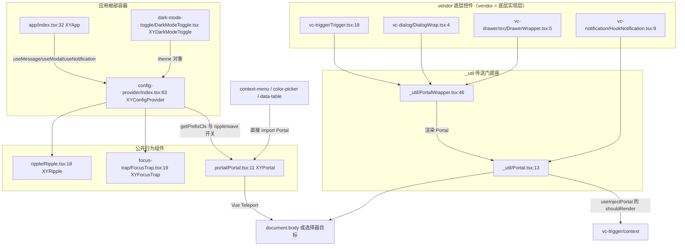
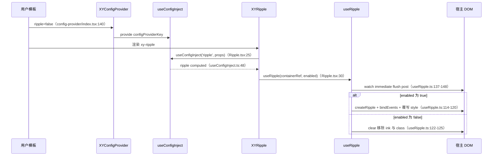
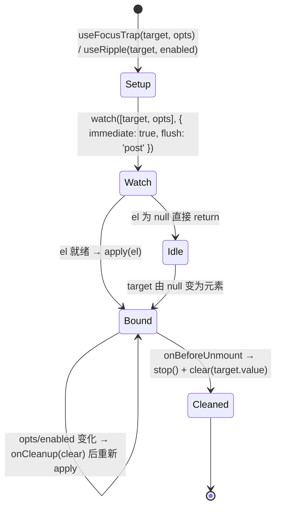

# C12-00 类横写：应用级容器与全局能力（App/Portal/FocusTrap/Ripple）

> **本篇解决**：C12 这一类里为什么同时存在「容器型组件」（App / ConfigProvider）与「行为型组件」（Portal / FocusTrap / Ripple / DarkModeToggle）两种形状迥异的东西；同类内部如何分工，哪些机制是这类共有的、哪些只属于某个组件；以及它们与 `config-provider`、`theme`、`_util` 传送门、浮层链路的边界到底画在哪一行。
> **前置**：A05《ConfigProvider 注入链与 Size/Disabled Context》（已完成）　**读者坐标**：`03-components/12-global` 类横写篇，本类共 1+8 篇

本类各组件的逐行论证在各自的组件篇，本篇不重复：C12-01《App 应用容器》、C12-02《ConfigProvider 全局配置》、C12-03《DarkModeToggle 暗色切换》、C12-04《FloatButton 浮动按钮》、C12-05《Ripple 涟漪》、C12-06《Portal 传送门》、C12-07《FocusTrap 焦点陷阱》、C12-08《SplitButton 分裂按钮》。凡本篇需要组件内部结论时，只写「编号+标题」并给一行交叉引用。

## 一、职责与边界

C12 不是「一组功能相似的组件」，而是**一类作用位置相似的组件**：它们的挂载点不在业务模板的中段，而在应用根部（`App`、`ConfigProvider`、`DarkModeToggle`）或 DOM 树的边缘（`Portal` 的传送目标、`FocusTrap` 的哨兵节点、`Ripple` 注入的 ink 节点）。这决定了本类共享的三个机制前提，也是本篇只写这三件事的理由：

1. **它们都需要一个「比自己更大的东西」来承接效果**——`App` 需要组件树外的第二配置通道、`Portal` 需要 `Teleport` 目标、`FocusTrap`/`Ripple` 需要直接改 DOM。因此本篇的主线是**副作用落点**：状态从哪来、效果写到哪去。
2. **它们都受同一个全局开关链控制**。`useConfigInject` 里 `wave` 与 `ripple` 两个开关（`packages/xiaoye-ui/src/config-provider/hooks/useConfigInject.ts:45-48`）是本类独有的消费面，其它类别的组件不吃这两个字段。开关的**注入语义**（父链回落、`??` 与 `||` 的差别、默认值写两遍）归 A05 论点 3，本篇只讲组件侧如何把它翻译成行为。
3. **它们都没有「用户输入」这条主回路**。没有 value/onChange，没有受控/非受控判定，所以本类不依赖 I13《受控与非受控》，也不该套用组件篇常见的「props → 内部状态 → 事件回流」时序图。

明确**不负责**的部分：

- 纵向配置链的四个 `InjectionKey`、`prefixCls` 派生、嵌套 ConfigProvider 合并——A05《ConfigProvider 注入链与 Size/Disabled Context》已成篇展开，本篇只在 `ripple`/`wave` 的消费端停留。
- Token 四层派生与 `hashId`：A03《Design Token 四层体系》、A04《cssinjs 样式引擎与 SSR 注水》。
- 浮层定位/层级/点外关闭：A07《浮层基础设施》与 I02《vc-trigger》。本篇只交代 `_util/Portal.tsx` 与 `_util/PortalWrapper.tsx` 这两层**被浮层复用**的事实边界（见论点 1），不重述 trigger 的 visible 状态机。
- `registerComponent` 与三种 `install` 写法的统计：A05 论点 6 已给出可复现命令，本篇不重算。
- 生成物（`src/components.ts`、`typings/global.d.ts`、`package.json` 的 `exports`）如何登记这些组件：A02《导出聚合与生成物链路》。
- `_util/components/` 整目录的机械副本问题：由 A06 登记（见 `OUTLINE.md` 已知待办 5），本篇只在源码地图里标出它存在，不展开。

依赖关系（直接 import 边，逐条落到行号）：

- 本类依赖谁：`app/index.tsx:6`（`useConfigInject`）、`app/index.tsx:7-9`（`useMessage`/`useModal`/`useNotification` 三个 API 家族）、`portal/Portal.tsx:2`（Vue 原生 `Teleport`）、`focus-trap/useFocusTrap.ts:2-8`（`@xiaoye-ui/utils/dom` 的 5 个 DOM 原子函数）、`ripple/useRipple.ts:2-11`（同一个模块的 7 个函数）、`_util/Portal.tsx:11`（`vc-trigger/context` 的 `useInjectPortal`）。
- 谁依赖本类：公开 `Portal` 被 `context-menu/ContextMenu.tsx:19`、`color-picker/ColorPicker.tsx:15`、`data-table/ColumnFilter.tsx:20` 直接使用；`_util/PortalWrapper` 被 `vc-trigger/Trigger.tsx:18`、`vc-dialog/DialogWrap.tsx:4`、`vc-drawer/src/DrawerWrapper.tsx:5`、`vc-tour/Tour.tsx:24` 使用；`_util/Portal` 被 `vc-notification/HookNotification.tsx:9` 使用；`useFocusTrap` 的 composable 形态在库内已无运行时消费者，只剩组件壳自己的那一次调用（`FocusTrap.tsx:48`）。

## 二、源码地图

行数由 `find <dir> -type f | xargs wc -l` 现场取得，`—` 表示该组件目录下无对应文件。

| 文件 | 行数 | 职责 | 关键导出 |
| --- | --- | --- | --- |
| `packages/xiaoye-ui/src/app/index.tsx` | 84 | 应用容器：聚合 message/notification/modal 三套命令式 API | `default`（`XYApp`）、`AppProps`、静态 `App.useApp` |
| `packages/xiaoye-ui/src/app/context.ts` | 44 | 两个 `InjectionKey` 与 provide/inject 包装 | `AppConfigContextKey` `AppContextKey` |
| `packages/xiaoye-ui/src/app/style/index.ts` | 22 | `App` 的样式 hook | `default` |
| `packages/xiaoye-ui/src/config-provider/hooks/useConfigInject.ts` | 74 | 本类共用的消费端，含 `wave:45-47`、`ripple:48` | `default` |
| `packages/xiaoye-ui/src/portal/Portal.tsx` | 43 | 公开传送门（Vue `Teleport` 包装） | `default`（`XYPortal`）、`__XY_PORTAL` |
| `packages/xiaoye-ui/src/portal/portalTypes.ts` | 24 | `appendTo`/`disabled`/`position`/`group` 定义 | `portalProps` `PortalAppendToType` |
| `packages/xiaoye-ui/src/portal/style/index.ts` | 10 | 空样式占位 hook | `default` |
| `packages/xiaoye-ui/src/focus-trap/FocusTrap.tsx` | 57 | 焦点陷阱包裹组件 | `default`（`XYFocusTrap`）、`__XY_FOCUS_TRAP` |
| `packages/xiaoye-ui/src/focus-trap/useFocusTrap.ts` | 227 | 陷阱真正的实现（哨兵 + MutationObserver） | `useFocusTrap` `FocusTrapOptions` |
| `packages/xiaoye-ui/src/focus-trap/focusTrapTypes.ts` | 18 | props 定义 | `focusTrapProps` |
| `packages/xiaoye-ui/src/ripple/Ripple.tsx` | 39 | 涟漪包裹组件 | `default`（`XYRipple`）、`__XY_RIPPLE` |
| `packages/xiaoye-ui/src/ripple/useRipple.ts` | 149 | 涟漪实现（mousedown + ink 节点） | `useRipple` `RIPPLE_HOST_CLASS` `RIPPLE_INK_CLASS` |
| `packages/xiaoye-ui/src/dark-mode-toggle/DarkModeToggle.tsx` | 172 | 暗色切换控件 | `default`（`XYDarkModeToggle`） |
| `packages/xiaoye-ui/src/dark-mode-toggle/useDarkMode.ts` | 115 | 暗色状态的组合式实现 | `useDarkMode` |
| `packages/xiaoye-ui/src/float-button/FloatButton.tsx` | 124 | 浮动按钮主体 | `default`（`XYFloatButton`） |
| `packages/xiaoye-ui/src/float-button/BackTop.tsx` | 140 | 回到顶部 | `default`（`XYBackTop`） |
| `packages/xiaoye-ui/src/split-button/SplitButton.tsx` | 171 | 分裂按钮（组合 button/dropdown/menu） | `default`（`XYSplitButton`） |
| `packages/xiaoye-ui/src/_util/Portal.tsx` | 72 | 内部传送门，受 `vc-trigger` 上下文控制 | `default`（内部名 `Portal`） |
| `packages/xiaoye-ui/src/_util/PortalWrapper.tsx` | 191 | 自建容器 + 滚动锁定 + 打开计数 | `default`（内部名 `PortalWrapper`）`GetContainer` |
| `packages/xiaoye-ui/src/vc-trigger/context.ts` | 38 | `useProvidePortal` `useInjectPortal` | 同名两个 |

主实现入口的定位：`packages/xiaoye-ui/src/app/index.tsx:32`（`defineComponent` 起始）、`packages/xiaoye-ui/src/portal/Portal.tsx:11`、`packages/xiaoye-ui/src/focus-trap/FocusTrap.tsx:18`、`packages/xiaoye-ui/src/ripple/Ripple.tsx:17`、`packages/xiaoye-ui/src/_util/Portal.tsx:13`、`packages/xiaoye-ui/src/_util/PortalWrapper.tsx:46`；`config-provider` 主实现入口为 `packages/xiaoye-ui/src/config-provider/index.tsx:63`。

两点必须标注。其一，`_util/Portal.tsx` 与 `_util/PortalWrapper.tsx` 的 `name` 分别是 `'Portal'`（`packages/xiaoye-ui/src/_util/Portal.tsx:15`）与 `'PortalWrapper'`（`packages/xiaoye-ui/src/_util/PortalWrapper.tsx:48`），**不符合本库 `XYXxx` 命名约定**；公开那三个组件的 `name` 全部合规（`app/index.tsx:33`、`portal/Portal.tsx:12`、`focus-trap/FocusTrap.tsx:19`、`ripple/Ripple.tsx:18`）。其二，`_util/components/Portal.tsx` 与 `_util/components/PortalWrapper.tsx` 是根级同名文件的副本，归属与直接引用计数见 A06，本篇不重复统计。

测试现状（按 `packages/xiaoye-ui/vitest.config.mts:33` 的 include glob `src/**/*.test.{js,ts,jsx,tsx}` 判定为**会被执行**）：`packages/xiaoye-ui/src/portal/index.test.js`（76 行）、`focus-trap/index.test.js`（84 行）、`ripple/index.test.js`（106 行）、`app/__tests__/app.test.tsx`（57 行）、`float-button/index.test.js`（44 行）与 `float-button/wave.test.js`（79 行）、`split-button/__tests__/split-button.test.tsx`（147 行）、`dark-mode-toggle/__tests__/dark-mode-toggle.test.tsx`（264 行）。本类里唯一没有测试文件的是 `_util/Portal.tsx` 与 `_util/PortalWrapper.tsx` 本身——它们只被**间接**覆盖，`date-picker/*.test.js` 与 `modal/*.test.js` 用 `vi.mock('../../_util/Portal')` 把它们整体替换掉，例如 `packages/xiaoye-ui/src/modal/Modal.test.js:5`。

## 三、架构与数据流

### 图 1：静态结构——本类组件与三套传送门实现的分层



这张图要读出三件事。第一，本类组件全部挂在配置链的末端（`XYPortal`/`XYFocusTrap`/`XYRipple` 各自的 `useConfigInject` 调用：`portal/Portal.tsx:22`、`focus-trap/FocusTrap.tsx:31`、`ripple/Ripple.tsx:25`），它们既是配置消费者，又是行为提供者。第二，「把 DOM 挪到别处」这件事在库里**有三套实现**：公开的 `portal/Portal.tsx`、内部的 `_util/PortalWrapper.tsx`、更内部的 `_util/Portal.tsx`；业务组件走第一套，浮层链路走第二、三套，两条线在源码层零复用。第三，`_util/Portal.tsx:11` 反向依赖 `vc-trigger/context`，也就是说内部传送门被浮层状态机劫持了，这是它不能作为公开组件的原因（详见论点 1）。

### 图 2：全局开关如何落到行为——`ripple` 的一条完整链



说明两个分支为什么存在。`useConfigInject.ts:48` 的 `props.ripple ?? configProvider.ripple?.value ?? true` 决定了**没有 ConfigProvider 时默认开启**，这条缺省是刻意重复的（提供侧 `config-provider/index.tsx:140` 也写了 `?? true`），重复的理由与代价见 A05 论点 3，本篇不重述。真正属于本类的是第二层分支：开关不是通过 props 传下来的，而是通过 `useRipple` 的第二个参数（一个 `ComputedRef<boolean>`）在 `watch` 源里参与依赖收集（`ripple/useRipple.ts:115`、`:127-138`），所以开关切换会**重新执行 apply/clear 整段 DOM 副作用**，不是简单地加一个 CSS 类。

### 图 3：行为型组件共用的 composable 生命周期



`focus-trap/useFocusTrap.ts:212-220` 与 `ripple/useRipple.ts:137-148` 是**同一个骨架**：`watch([target, 选项], ...)`、`{ immediate: true, flush: 'post' }`、`onCleanup(() => clear(el))`、再加一个 `onBeforeUnmount` 里 `stop()` + `clear(target.value)` 的兜底（`focus-trap/useFocusTrap.ts:222-226`、`ripple/useRipple.ts:150-156`）。差别只在 `useFocusTrap` 的 `apply` 内部自己判 `disabled`（`:195`），`useRipple` 在 watch 回调里判 `enabled`（`:131`）。这就是本类「行为型组件」的共有抽象——组件篇里找不到第二个类别有这种同构。`flush: 'post'` 是为了拿到渲染后的容器（哨兵与 ink 都要 append 到真实 DOM），`immediate: true` 是为了 `target` 初值即就绪的场景。

## 四、核心机制精读

### 论点 1：传送门有三套互不复用的实现，选型依据不是功能而是「调用方是否在 trigger 上下文里」

公开 `Portal` 与内部 `Portal` 解决同一个问题（把子树渲染到组件树之外的 DOM 位置），但两者在源码层零复用，且行为差异来自一处关键的设计让渡：内部实现把「要不要渲染」的决策权交给了 `vc-trigger`。

公开实现的全部复杂度是 43 行，核心只有三段：

```tsx
// packages/xiaoye-ui/src/portal/Portal.tsx:20
    const mounted = ref(false);

    const { prefixCls } = useConfigInject('portal', props);
    const [wrapSSR] = useStyle(prefixCls);

    const isInline = computed(() => props.disabled || props.appendTo === 'self');

    onMounted(() => {
      mounted.value = isClient;
    });

    return () => {
      if (isInline.value) {
        return wrapSSR(slots.default?.());
      }

      if (!mounted.value) {
        return null;
      }

      return wrapSSR(<Teleport to={props.appendTo as string}>{slots.default?.()}</Teleport>);
    };
```

三个分支各自的存在理由：`isInline`（`:25`）把 `disabled` 与 `appendTo === 'self'` 归一成「不传送」，此时返回的甚至不是元素而是裸的插槽数组（`:33`），意味着 `<xy-portal>` 自身在 DOM 里不留宿主节点；`mounted`（`:27-29`、`:36-38`）是为了躲开 SSR/hydration 阶段 `Teleport` 目标不存在的问题，挂载前直接返回 `null`；`isClient` 用模块级常量而不是运行时函数（`:8-9` 的注释明确交代了动机：避免依赖 `@xiaoye-ui/utils` 的函数版判断），所以这个值是**打包期就能确定的布尔**。

内部实现则完全不同，它的渲染决策来自注入：

```tsx
// packages/xiaoye-ui/src/_util/Portal.tsx:21
  setup(props, { slots }) {
    let isSSR = true;
    // getContainer 不会改变，不用响应式
    let container: HTMLElement;
    const { shouldRender } = useInjectPortal();

    function setContainer() {
      if (shouldRender.value) {
        container = props.getContainer();
      }
    }

    onBeforeMount(() => {
      isSSR = false;
      // drawer
      setContainer();
    });
    onMounted(() => {
      if (container) return;
      // fix: container not ready on mounted
      setContainer();
    });
```

`shouldRender` 来自 `vc-trigger/context.ts:27-38` 的 `useInjectPortal`：

```ts
// packages/xiaoye-ui/src/vc-trigger/context.ts:27
export const useInjectPortal = () => {
  useProvidePortal({}, { inTriggerContext: false });
  const portalContext = inject(PortalContextKey, {
    shouldRender: computed(() => false),
    inTriggerContext: false,
  });
  return {
    shouldRender: computed(
      () => portalContext.shouldRender.value || portalContext.inTriggerContext === false,
    ),
  };
};
```

`:35` 这一行是整个类边界的支点：只要不在 trigger 上下文里（`inTriggerContext === false`），`shouldRender` 恒为 `true`，Portal 无条件渲染；一旦进入 trigger 上下文，它就被 `vc-trigger/context.ts:12-23` 的 `sPopupVisible || popupRef || forceRender` 接管，并在 `!sPopupVisible && autoDestroy` 时熄灭（`:19-21`）。这解释了为什么 `vc-notification/HookNotification.tsx:9` 能直接用 `_util/Portal`——notification 不在 trigger 链上，走的是恒真分支；也解释了为什么公开组件**不能**用它：一个给业务用的 `<xy-portal disabled>` 语义应该由自己的 props 决定，而不是被祖先 trigger 的可见性左右。

中间层 `_util/PortalWrapper.tsx` 负责公开实现里根本没有的事：**自己造容器并挂到父节点**。

```tsx
// packages/xiaoye-ui/src/_util/PortalWrapper.tsx:87
    const getContainer = () => {
      if (!supportDom) {
        return null;
      }
      if (!container.value) {
        container.value = defaultContainer;
        attachToParent(true);
      }
      setWrapperClassName();
      return container.value;
    };
```

`defaultContainer` 在 `setup` 里就 `document.createElement('div')`（`:64`），`attachToParent`（`:74-86`）把 `getContainer` 的三种形态（选择器字符串 / 函数 / HTMLElement）归一后 `appendChild`，失败时在 `onMounted` 的 `nextTick` 里用 `raf` 再试一次（`:153-159`）。渲染段把可见性条件写成了三选一：

```tsx
// packages/xiaoye-ui/src/_util/PortalWrapper.tsx:173
    return () => {
      const { forceRender, visible } = props;
      let portal = null;
      const childProps = {
        getOpenCount: () => openCount,
        getContainer,
      };
      if (triggerUpdate.value && (forceRender || visible || componentRef.value)) {
        portal = (
          <Portal
            getContainer={getContainer}
            ref={componentRef}
            didUpdate={props.didUpdate}
            v-slots={{ default: () => slots.default?.(childProps) }}
          ></Portal>
        );
      }
      return portal;
    };
```

`componentRef.value` 出现在条件里（`:178`）是「曾经渲染过就继续渲染」的惰性保留，配合 `:172` 的 `forceRender`/`visible` 构成第三种「已经打开过就别再卸载」策略；插槽还额外收到 `childProps`（`:174-177`、`:184`），这是公开 Portal 的插槽拿不到的。三套实现的差异可以汇总成一句话：**公开版把决策权留给 props，内部版把决策权上交给它所在的宿主链路**。而调用方的分布正好印证这条边界——业务组件（`context-menu/ContextMenu.tsx:19`、`color-picker/ColorPicker.tsx:15`、`data-table/ColumnFilter.tsx:20`）清一色用公开版，vendor 层（`vc-trigger/Trigger.tsx:18`、`vc-dialog/DialogWrap.tsx:4`、`vc-drawer/src/DrawerWrapper.tsx:5`、`vc-tour/Tour.tsx:24`、`vc-tour/Mask.tsx:6`）清一色用 `PortalWrapper`，`vc-notification/HookNotification.tsx:9` 是唯一直接用底层 `Portal` 的例外。至于 `getOpenCount` 与 `useScrollLocker` 这两处「实现活着、调用方死了」的残留，已在 C07-01《Modal 对话框》论点 5 登记，本篇不重复取证。

### 论点 2：本类组件统一采用「composable + 组件壳」双出口，组件壳只做三件事且不产生自己的语义

`focus-trap`、`ripple`、`dark-mode-toggle` 三个目录的入口文件都把 hook 与组件并列导出：

```ts
// packages/xiaoye-ui/src/focus-trap/index.ts:5
export { default as focusTrapProps } from './focusTrapTypes';
export type { FocusTrapProps } from './focusTrapTypes';
export { useFocusTrap } from './useFocusTrap';
export type { FocusTrapOptions } from './useFocusTrap';
```

```ts
// packages/xiaoye-ui/src/ripple/index.ts:5
export { default as rippleProps } from './rippleTypes';
export type { RippleProps } from './rippleTypes';
export { useRipple, RIPPLE_HOST_CLASS, RIPPLE_INK_CLASS } from './useRipple';
```

对照 `dark-mode-toggle/index.ts:13`（`export { darkModeToggleProps, useDarkMode }`）可以看到同一条约定；而 `portal/index.ts:5-6` 是**唯一只导出 props 与类型、不导出 hook** 的入口——因为传送门的效果必须寄生在渲染树上，没有「命令式调用」的形态可言。这条差异本身就是分类依据：本类里凡能被「给一个 DOM 元素」表达的（焦点、涟漪、暗色属性）都有 composable 出口，凡必须「占一个 DOM 位置」的（Portal）没有。

组件壳的实现短到可以整段引用，它的三件事在 25 行里全部完成：

```tsx
// packages/xiaoye-ui/src/focus-trap/FocusTrap.tsx:30
  setup(props, { slots }) {
    const { prefixCls } = useConfigInject('focus-trap', props);
    const [wrapSSR] = useStyle(prefixCls);

    const containerRef = ref<HTMLElement | null>(null);
    const opts = computed<FocusTrapOptions>(
      () =>
        ({
          disabled: props.disabled,
          autoFocus: props.autoFocus,
          autoFocusSelector: props.autoFocusSelector,
          firstFocusableSelector: props.firstFocusableSelector,
          lastFocusableSelector: props.lastFocusableSelector,
          tabIndex: props.tabIndex,
          onFocusIn: props.onFocusIn as ((event: FocusEvent) => void) | undefined,
          onFocusOut: props.onFocusOut as ((event: FocusEvent) => void) | undefined,
        }) as FocusTrapOptions,
    );
    useFocusTrap(containerRef, opts);

    return () =>
      wrapSSR(
        <div ref={containerRef} class={prefixCls.value}>
          {slots.default?.()}
        </div>,
      );
  },
```

三件事是：`useConfigInject('focus-trap', props)` 取前缀（`:31`）、`ref` 交出宿主元素（`:34`、`:52`）、把扁平的 props **折算成 options 对象**再喂给 hook（`:35-48`）。第三件事为什么要写成一个显式 `computed` 而不是直接把 `props` 传下去：`useFocusTrap` 的签名要求第二个参数是 `Ref` 或 `ComputedRef`（`focus-trap/useFocusTrap.ts:49-52`），因为实现内部要用 `watch([target, optsComputed], ...)` 把它放进依赖源（`:212-220`），并且 `optsComputed` 还兜了一层 `options === undefined` 与 `options.value ?? {}`（`:53`）——也就是说 hook 允许完全不传选项独立使用，这是组件壳存在但**不是** hook 的前置条件的原因。`ripple/Ripple.tsx:28-30` 是同一个形状的极小化版本（只折算一个布尔 `enabled`）。

壳「不产生自己的语义」有反面证据：`FocusTrap.tsx:35-47` 把 8 个 props 一对一抄进 options，一个都没加工；`Ripple.tsx:29` 的 `enabled` 是唯一一次真判断（`!props.disabled && ripple.value`）。这意味着组件篇里读到的行为结论几乎全部属于 hook 文件，壳文件只属于「前缀与 DOM 层级」。因此 C12-07《FocusTrap 焦点陷阱》与 C12-05《Ripple 涟漪》的逐行论证应当集中在 `useFocusTrap.ts`/`useRipple.ts`，本篇也据此取样。

顺带一个属于类层面的缺陷：`useFocusTrap` 读取选择器时用了错误的空值判断，导致两个 props 之一永远无效。

```ts
// packages/xiaoye-ui/src/focus-trap/useFocusTrap.ts:67
  function getSelector() {
    const o = getOptions();
    return getComputedSelector(o.firstFocusableSelector ?? o.lastFocusableSelector ?? '');
  }
```

`??` 只在 `null/undefined` 时右跳，而 `focusTrapTypes.ts:9-10` 给这两个字段声明的默认值是 `stringType('')`（空串，非 nullish），组件壳又照抄进 options（`FocusTrap.tsx:41-42`），于是 `:69` 的右侧分支在任何路径上都不可达；只传 `lastFocusableSelector` 的用户会发现它不影响哨兵跳转的选择器。`createHiddenFocusableElements` 里同一对字段是分别读取的（`:103-104`、`:110`、`:114`），所以这个 bug 只影响 `getSelector()` 这一条路径，也就是 `onFirstHiddenFocus`/`onLastHiddenFocus`（`:72-98`）与 MutationObserver 回调（`:146`）。

### 论点 3：`wave` 与 `ripple` 是同一诉求的两套实现，本类同时提供了其中一套的组件形态

点击反馈在库里并存两条链路，且**都由本类的开关字段驱动**：

```ts
// packages/xiaoye-ui/src/config-provider/hooks/useConfigInject.ts:45
  const wave = computed<{
    disabled?: boolean;
  }>(() => props.wave ?? configProvider.wave?.value);
  const ripple = computed<boolean>(() => props.ripple ?? configProvider.ripple?.value ?? true);
```

两个开关的类型面不同（`{ disabled?: boolean }` 对比 `boolean`），缺省语义也不同：`ripple` 在最坏情况下显式落到 `?? true`（`:48`），`wave` 落到 `undefined`，由消费端用可选链兜住（`_util/wave/useWave.ts:15` 的 `if (wave?.value?.disabled || !node)`）。这个不对称如何被嵌套 ConfigProvider 放大，A05 论点 3 已给结论，本篇不重述；本篇只交代**两套实现的行为差异**，因为它是本类「谁负责反馈」的实际分工依据。

第一套是包装组件：`_util/wave/index.tsx:29` 取 `wave` 与 `csp`，`:35-38` 把 `useWave` 绑定到 `classNames(prefixCls.value, hashId.value)`，真正的监听写在 `onMounted`（`:50`）内部的一个 `watch(() => props.disabled, ...)`（`:51`）里，选项同样是 `{ immediate: true, flush: 'post' }`（`:85-88`），监听目标是 `findDOMNode(instance)` 拿到的**宿主元素的 click**，且用了捕获阶段 `node.addEventListener('click', onClick, true)`（`:82`）。事件过滤条件全部是硬编码的 DOM 猜测：

```tsx
// packages/xiaoye-ui/src/_util/wave/index.tsx:63
            onClick = (e: MouseEvent) => {
              // Fix radio button click twice
              if (
                (e.target as HTMLElement).tagName === 'INPUT' ||
                !isVisible(e.target as HTMLElement) ||
                // No need wave
                !node.getAttribute ||
                node.getAttribute('disabled') ||
                (node as HTMLInputElement).disabled ||
                node.className.includes('disabled') ||
                node.className.includes('-leave')
              ) {
                return;
              }

              showWave();
            };
```

`:72` 的 `className.includes('disabled')` 与 `:73` 的 `className.includes('-leave')` 都是**字符串子串匹配**，任何类名里含 `disabled` 片段（例如自造的 `.is-disabled-text`）都会静默禁掉波动，过渡离场帧也被一并豁免。使用方是 C01/C04 那一族：`button/button.tsx:235`、`switch/index.tsx:172`、`tag/index.tsx:158`、`dark-mode-toggle/DarkModeToggle.tsx:153`。

第二套是 `ripple`，它不包组件而是**自己造节点**：`useRipple.ts:24-40` 建一个 `role="presentation" aria-hidden` 的 span（`:28-32`），`:124-130` 的 `apply` 顺手覆写宿主的 `overflow: hidden` 与 `position: relative`，监听的是宿主自己的 `mousedown`（`:93`）。它的库内使用方只剩一处：`panel-menu/PanelMenuSub.tsx:4` 引组件形态（`:23` 注册成 `ripple` 指令）；hook 形态的库内消费者已清零，`useRipple` 的库内调用只剩组件壳自己显式传 `enabled` 的那一次（`Ripple.tsx:30`）——原先 hook 使用方走的是不传 `enabled` 的裸调、依赖 `:115` 的默认为真，这条路径已没有库内活例。

所以本类的分工是这样的：**`ripple` 目录提供的是「第二套反馈」的公开形态，而第一套（wave）留在 `_util` 里不公开**。这带来一个可验证的后果——`ConfigProvider` 的 `wave` 开关只能关掉第一套（`useConfigInject.ts:45-47` 的消费点是 `_util/wave/index.tsx:29`），关掉 `ripple` 也只能影响第二套（`Ripple.tsx:29`）；一个同时被 `<xy-ripple>` 包着、又处在 `wave: false` 环境里的元素，两套反馈各自独立开关，没有任何一处代码把它们对齐（本篇在 `ripple/`、`_util/wave/` 两个目录内未找到交叉引用，可复现命令见附录检查点 3）。

### 论点 4：本类内部有两套样式契约——容器型走 Token + `hashId`，行为型三个全部退化

`app` 与 `split-button` 符合库规范，`portal`/`focus-trap`/`ripple` 三个则各自以不同方式偏离。规范侧的证据：

```ts
// packages/xiaoye-ui/src/app/style/index.ts:6
interface AppToken extends FullToken<'App'> {}

// =============================== Base ===============================
const genBaseStyle: GenerateStyle<AppToken> = token => {
  const { componentCls, colorText, fontSize, lineHeight, fontFamily } = token;
  return {
    [componentCls]: {
      color: colorText,
      fontSize,
      lineHeight,
      fontFamily,
    },
  };
};

// ============================== Export ==============================
export default genComponentStyleHook('App', token => [genBaseStyle(token)]);
```

`split-button/style/index.ts:11-13` 定义了自己的 `SplitButtonToken extends FullToken<'SplitButton'>`（并额外挂一个由 `rootCls` 派生的 `btnCls`），`:29` 用 `[componentCls]` 作根选择器、`:33` 用 `` `&${rootCls}-btn-group > ${btnCls}` `` 做衔接，88 行文件里 grep 不到任何 `#` 或 `rgb` 色值（`grep -n '#[0-9a-fA-F]\{3,8\}\|rgba(' split-button/style/index.ts` 无输出）。这两个组件也把 `hashId` 放进了渲染类名（`app/index.tsx:37`、`:39`；`split-button/SplitButton.tsx:72`、`:161`）。

偏离侧的第一种形态是**空样式**：

```ts
// packages/xiaoye-ui/src/portal/style/index.ts:4
// 组件专属 Token（占位，后续按需扩展）
export interface ComponentToken {}

// Portal 不需要默认样式，仅占位以保持与其他组件一致的样式 hook 调用
export default genComponentStyleHook('Portal', () => {
  return {} as CSSObject;
});
```

对纯容器组件来说这是合理的（`portal/Portal.tsx:47` 在 inline 分支甚至不产生宿主元素），代价是 `useStyle` 仍要在每次渲染调一次（`portal/Portal.tsx:23`）。真正的问题是第二种形态——**用字面类名当选择器**：

```ts
// packages/xiaoye-ui/src/ripple/style/index.ts:15
export default genComponentStyleHook('Ripple', () => {
  return {
    '@keyframes xy-ripple-animation': {
      '100%': { opacity: 0, transform: 'scale(2.5)' },
    },
    '.xy-ripple': {
      position: 'relative',
      overflow: 'hidden',
      '&__ink': {
        display: 'block',
        position: 'absolute',
        background: 'rgba(0,0,0,0.1)',
        borderRadius: '100%',
        transform: 'scale(0)',
        pointerEvents: 'none',
        '&--active': {
          animationName: 'xy-ripple-animation',
          animationDuration: '0.4s',
          animationTimingFunction: 'linear',
        },
      },
    },
  } as CSSObject;
});
```

三处偏离同时出现：**没有 `token` 形参**（所以拿不到 `componentCls`）、**硬编码 `rgba(0,0,0,0.1)`**（违反 `AGENTS.md`「禁止在组件样式中硬编码颜色」）、**动画时长 `0.4s` 写死在 CSS 里**而 JS 侧另写了一个 `401` 毫秒（`useRipple.ts:77-81`）。`focus-trap/style/index.ts:7-21` 是同一形态：hook 无 token 参数，选择器写成字面量 `.xy-hidden-accessible` 与 `.xy-hidden-focusable`。这两处字面类名之所以**看起来**还能生效，是因为类名恰好等于默认前缀产物——`config-provider/context.ts:168` 的 `getPrefixCls` 返回 `xy-${suffixCls}`，而 `Ripple.tsx:34` 把 `prefixCls.value` 直接当 class，两边都是 `xy-ripple` 就撞上了；一旦有人给 ConfigProvider 传 `prefixCls`，这个巧合就断了。

更结构性的问题是样式哈希。渲染器在 root 层会把 `hashId` 注入到每个选择器：

```tsx
// packages/xiaoye-ui/src/_util/cssinjs/hooks/useStyleRegister/index.tsx:203
          if ((root || injectHash) && hashId) {
            if (mergedKey.startsWith('@')) {
              // 略过媒体查询，交给子节点继续插入 hashId
              subInjectHash = true;
            } else {
              // 注入 hashId
              mergedKey = injectSelectorHash(key, hashId, hashPriority);
            }
```

而 `portal/Portal.tsx:23`、`focus-trap/FocusTrap.tsx:32`、`ripple/Ripple.tsx:26` 三处解构都只取 `wrapSSR`，把第二个返回值丢掉，渲染出的类名里也就没有 hash（`Ripple.tsx:34` 只有 `prefixCls.value`）。这两个事实是可从源码直接核对的；它们合起来是否导致「涟漪样式在浏览器里完全不命中」，取决于 `hashPriority` 与祖先链，**本篇未做运行时验证，属于待核实推断**。注入规则本身的完整推导见 A04《cssinjs 样式引擎与 SSR 注水》论点 2，本篇不重复。

这套偏离在类型面上有正式的登记处。`theme/interface/components.ts` 里 `App?: AppComponentToken`（`:154`，其类型由 `:69` 从 `app/style` 引入）、`DarkModeToggle?: DarkModeToggleComponentToken`（`:90`）、`FloatButton?: FloatButtonComponentToken`（`:102`）、`SplitButton?: SplitButtonComponentToken`（`:130`）是「有名有型的 token」；而 `Portal?: {}`（`:162`）、`FocusTrap?: {}`（`:180`）、`Ripple?: {}`（`:181`）落在 `:160-161` 那条注释声明的占位区里——「迁移占位：以下 ComponentToken 为后续批次新组件预留，目前为空接口，待对应组件 style/index.ts 实现 ComponentToken 后再替换为具体类型」。差别在于：`app/style/index.ts:4` 的 `export type ComponentToken = {}` 同样是空接口，但它在 `:6` 立刻用 `FullToken<'App'>` 补上了完整别名 token，`:9-19` 也真的在消费 `colorText`/`fontSize`；三个行为组件的 hook 连 `token` 形参都没有，所以**这条「待替换」的迁移债在本类里从未被偿还**。后果是改这三个组件的样式不会触发任何 token 层的类型错误，它们是本类最容易失控的一块。

### 论点 5：环境闸门有三种不同写法，本类内部没有统一 SSR 策略

同属「必须碰 DOM」的组件，四个文件给出了四道不同的闸门：

```tsx
// packages/xiaoye-ui/src/portal/Portal.tsx:8
// SSR 安全的 isClient 判断，避免依赖 utils 包函数版（占位符是常量，methods 版本是函数）
const isClient = typeof window !== 'undefined' && !!window.document;
```

```tsx
// packages/xiaoye-ui/src/_util/Portal.tsx:21
  setup(props, { slots }) {
    let isSSR = true;
    // getContainer 不会改变，不用响应式
    let container: HTMLElement;
    const { shouldRender } = useInjectPortal();
    // ...
    onBeforeMount(() => {
      isSSR = false;
      // drawer
      setContainer();
    });
```

`portal/Portal.tsx:9` 的 `isClient` 是**模块级常量**，服务端打包时求值为 `false`，客户端为 `true`；`_util/Portal.tsx:22` 的 `isSSR` 是**每次 setup 的可变量**，靠 `onBeforeMount`（`:33-37`）翻成 `false`，而渲染函数按这个变量决定要不要原地渲染（`:66-68`：`if (isSSR) return slots.default?.()`）。两种策略的失败模式不同：前者在客户端首屏若 `window` 存在则永远为真，风险集中在 `mounted` 闸门（`:27-29`、`:36-38`）；后者在 hydration 阶段可能与服务端产出结构不一致，因为 `isSSR` 在 setup 时是 `true`、渲染一次后才变。第三道闸门在 `_util/PortalWrapper.tsx:19` 用 `canUseDom()` 求出的模块级 `supportDom`，并被 `getParent`（`:26-42`）与 `getContainer`（`:87-97`）双重判空；第四道是行为 hook 侧，`useFocusTrap`/`useRipple` **没有任何 SSR 判断**，它们只在 `flush: 'post'` 的 watch 回调里等元素出现（`useFocusTrap.ts:212-220`、`useRipple.ts:137-148`），也就是隐式假设「服务端不会执行 post flush」。

`useRipple` 的这个假设是有代价的：它的事件回调直接摸 `document.body`（`useRipple.ts:69-70`）与 `getComputedStyle`（`:55`），且这两行的坐标合成方式可疑——

```ts
// packages/xiaoye-ui/src/ripple/useRipple.ts:68
  const offset = getOffset(el);
  const x = event.pageX - offset.left + document.body.scrollTop - getWidth(ink) / 2;
  const y = event.pageY - offset.top + document.body.scrollLeft - getHeight(ink) / 2;
```

`x` 上加了 `scrollTop`、`y` 上加了 `scrollLeft`（`:68`、`:69`），轴向互换；`document.body.scrollTop` 在现代浏览器多为 0（滚动量在 `documentElement` 上），所以这个错误在实践中被掩盖。本篇只能证实「写法与轴向不匹配」这一事实，**无法证实它曾造成可观测的错位**，因为它依赖 `@xiaoye-ui/utils/dom` 的 `getOffset` 返回的是视口坐标还是页坐标，本篇未展开该函数。

jsdom 侧还有一道人为闸门值得记进契约：`_util/__mocks__/Portal.tsx:3-13` 提供了一个**不做传送**的同名组件（`return () => slots.default?.()`），被 `modal/Modal.test.js:5`、`modal/confirm.test.js:4`、`date-picker/RangePicker.test.js:7` 等测试用 `vi.mock('../../_util/Portal')` 装载。也就是说，任何依赖真实 `Teleport` 行为的断言在这些测试里都不成立——这是「内部 Portal 无专属测试」的连带后果（`_util/PortalWrapper.tsx` 的 `attachToParent` 失败重试分支 `:153-159` 因此无测试保护）。

### 论点 6：状态隔离度不一致——一个用闭包、一个用模块作用域

`useFocusTrap` 把所有可变状态放在 hook 函数体内：

```ts
// packages/xiaoye-ui/src/focus-trap/useFocusTrap.ts:54
  let firstHidden: HTMLElement | undefined;
  let lastHidden: HTMLElement | undefined;
  let mutationObserver: MutationObserver | undefined;
  let focusInListener: ((event: FocusEvent) => void) | undefined;
  let focusOutListener: ((event: FocusEvent) => void) | undefined;
  // 记录 bind 时绑定的元素，供 unbind 精确解绑（不能依赖 target.value，
  // watch 重跑时它可能已指向新元素）
  let boundEl: HTMLElement | null = null;
```

九个内部函数（`getOptions`/`getSelector`/`onFirstHiddenFocus`/`onLastHiddenFocus`/`createHiddenFocusableElements`/`autoElementFocus`/`bind`/`unbind`/`apply`）全部定义在 `useFocusTrap` 体内，因此每次调用形成一套独立闭包；`:59-61` 的注释甚至专门解释了为什么必须自己记 `boundEl` 而不是读 `target.value`——这是把「实例隔离」当成设计目标才会写下的东西。

`useRipple` 相反：

```ts
// packages/xiaoye-ui/src/ripple/useRipple.ts:14
const INK_CLASS = 'xy-ripple__ink';
const INK_ACTIVE_CLASS = 'xy-ripple__ink--active';
const HOST_CLASS = 'xy-ripple';

let timeout: ReturnType<typeof setTimeout> | undefined;

function getInk(el: HTMLElement): HTMLElement | undefined {
  return el.querySelector(`.${INK_CLASS}`) as HTMLElement | undefined;
}
```

`getInk`、`createRipple`、`remove`、`onMouseDown`、`onAnimationEnd`、`bindEvents` 都是**模块级函数**（`:19-93`），`useRipple` 只是 `apply`/`clear`/`watch` 的薄包装（`:114-138`）。后果有两层。第一层是并发：`timeout` 全局唯一，`onMouseDown` 每次按下都覆写它（`:76-80`），A、B 两个宿主几乎同时点击时，A 的清除定时器被 B 顶掉，A 的 `--active` 类只能等 `animationend` 回收（`:83-89`）。第二层是不可配置：模块级函数拿不到实例的 options，所以 `useRipple(target, enabled)` 的第二个参数只能决定「开或关」（`:112`、`:131`），无法像 `useFocusTrap` 那样把 `tabIndex`、选择器之类传进具体行为（对比 `useFocusTrap.ts:101-102` 在闭包里读 `getOptions()`）。

本类里第三种形态是「容器 + 模块级计数」：`_util/PortalWrapper.tsx:18` 的 `let openCount = 0` 与 `:22-24` 的 `getOpenCount()`，属于跨实例共享账本，其调用方缺失问题已在 C07-01《Modal 对话框》论点 5 登记，本篇不重述。三种形态并存说明本类**没有一条统一的「副作用属于谁」的规则**，这正是横写篇要提醒接手者的地方：改 `ripple` 时默认它是全局单例，改 `focus-trap` 时默认它是 per-call 闭包。

## 五、对外契约如何生效

本类的契约面不体现在「props → 渲染」这一条常规路径上，而是三条各自独立的通道，逐条给出行号。

**第一条：props → hook options → 原生 DOM 监听。** `focus-trap` 的事件契约是最典型的误读点：`focusTrapTypes.ts:12-13` 用 `eventType<(event: FocusEvent) => void>()` 声明 `onFocusIn`/`onFocusOut`，它们不是 `emit` 出来的事件，而是被组件壳抄进 options（`FocusTrap.tsx:44-45`），最终由 `useFocusTrap.ts:167-171` 用 `el.addEventListener('focusin', focusInListener)` 直接挂在 DOM 上。因此这两个回调拿到的是**原生 FocusEvent**，且 `focusin`/`focusout` 会冒泡，一次子元素移动的焦点变化可能触发多次。与之相对，模板里写 `@focusin` 是**不生效**的：三个行为组件都声明了 `inheritAttrs: false`（`FocusTrap.tsx:20`、`Ripple.tsx:19`、`Portal.tsx:13`），而它们的渲染函数都不接 `attrs`——`setup(props, { slots })` 的解构里根本没有 `attrs`（`FocusTrap.tsx:30`、`Ripple.tsx:24`、`Portal.tsx:19`），渲染也只写 `class={prefixCls.value}`（`FocusTrap.tsx:52`、`Ripple.tsx:34`）或只传 `to`（`Portal.tsx:40`）。合起来的效果是：调用方在 `<xy-ripple class="foo">` 上写的 `class`、`style`、任何监听器都会被丢弃。`apps/docs/examples/ripple/global-config.vue:10` 正是给 `<xy-ripple>` 挂 `class="demo-box"` 的写法，这个类名不会出现在 DOM 上。对照之下 `App` 是合规的：它没有声明 `inheritAttrs: false`（`app/index.tsx:32-34`），attrs 走 Vue 默认透传落在那个 div 上，该结论与代价由 C12-01《App 应用容器》论点 5 展开。

**第二条：位置契约 `appendTo` → `Teleport` 目标。** `portalTypes.ts:13-16` 把 `appendTo` 声明为 `[String, Object]`，联合类型 `PortalAppendToType`（`:9`）允许 `'body' | 'self' | (string & {}) | HTMLElement`；实现侧只有两个判断（`Portal.tsx:25` 把 `disabled` 与 `'self'` 归为 inline，`:40` 把它强转 `as string` 交给 `Teleport`）。这里存在一处**契约宽于实现**的裂缝：`HTMLElement` 在类型上是合法取值，但 `Portal.tsx:40` 的 `props.appendTo as string` 会原样传给 Vue 的 `to`，而 Vue 的 `Teleport` 是否接受元素实例本篇未做运行时验证；与之对比，内部实现 `_util/PortalWrapper.tsx:26-42` 的 `getParent` 是显式三分支处理（字符串走 `querySelectorAll(...)[0]`、函数直接调用、`instanceof window.HTMLElement` 才当元素用），并且最后兜回 `document.body`（`:41`）。**同一个「容器」概念，公开层是转发，内部层是解析**，这是本类目前最容易让调用方误判的地方。

**第三条：全局开关 → 组件行为。** `config-provider/index.tsx:140` 提供 `ripple`，`useConfigInject.ts:48` 消费，`Ripple.tsx:29` 折成 `enabled`，`useRipple.ts:131-134` 决定 `apply` 还是 `clear`。这条链的每一跳都是 `ComputedRef`，所以它是本类**唯一真正响应式**的外部契约；相比之下第一条链的响应性来自 `watch([target, optsComputed])`（`useFocusTrap.ts:212-220`）重跑整段 DOM 副作用，而不是值本身流动。

命令式句柄则由 `App` 独占：`app/context.ts:30` 定义 `AppContextKey`，`app/index.tsx:60` 提供，`app/index.tsx:75` 把 `useApp` 挂到静态位、`:28-30` 的实现就是 `useInjectAppContext()`。注意 `app/context.ts:36-44` 的回落是一个 `reactive` 的空对象——脱离 `<xy-app>` 调用 `useApp()` 不报错，这个决定（以及它带来的「假 thenable」问题）属于 C12-01《App 应用容器》论点 4、论点 7，本篇只登记它的边界：**本类里只有 `App` 提供句柄，其余组件提供的都是行为或位置**。

## 六、设计取舍

**取舍一：传送门为什么不收敛成一套。** 收敛的收益是消除 `_util/Portal.tsx:21-72` 与 `portal/Portal.tsx:11-43` 的重复；被放弃的原因在依赖方向上——内部实现无条件 import 了 `vc-trigger/context`（`_util/Portal.tsx:11`），一旦被公开组件复用，`portal` 就会把浮层状态机拖进包体与类型面，且公开语义（由 props 决定是否传送）与内部语义（由 `shouldRender` 决定，`vc-trigger/context.ts:35` 的恒真短路）互相矛盾。赔上的代价是**同一件事有两套 SSR 与容器解析逻辑**（见论点 5），并且 `_util/PortalWrapper.tsx:26-42` 的三形态解析没有回馈给公开层，导致 `appendTo` 的 `HTMLElement` 分支只能靠 Vue 的 `Teleport` 兜底。**这里应记一条明确的立场：公开层应当复用 `getParent` 那套解析，而不是继续依赖 `as string` 的强转**（`portal/Portal.tsx:54`），因为前者有 `document.body` 兜底（`_util/PortalWrapper.tsx:41`），后者没有。

**取舍二：`ripple` 为什么不与 `wave` 合并，或干脆取代它。** 两套实现监听的事件不同（`_util/wave/index.tsx:82` 是宿主上的捕获阶段 `click`，`useRipple.ts:93` 是宿主自己的 `mousedown`），作用对象也不同：wave 通过 `findDOMNode(instance)` 抓包装组件的宿主节点（`_util/wave/index.tsx:56`），ripple 直接把 ref 交给自己渲染的 span（`Ripple.tsx:28-30`、`:34`）。合并的可行路径是让 `Wave` 内部改调 `useRipple`，但那会连带把 `_util` 的反馈效果变成依赖公开组件——分层倒置。换来的收益是本类第一次有了「可被业务直接 import 的反馈能力」（`ripple/index.ts:7` 导出 hook 与两个类名常量），赔上是**两个互不相识的开关字段**（`useConfigInject.ts:45-48` 相邻两行，语义却分别是对象与布尔）。

**取舍三：DOM 直改还是走渲染。** `useRipple.ts:134-140` 与 `useFocusTrap.ts:100-119` 都选择用 `createElement`/`appendChild`/覆写 `style` 的方式改宿主，而不是把 ink 与哨兵写进 JSX。选择它才能成立的场景是宿主节点不进本组件的 JSX：`panel-menu/PanelMenuSub.tsx:4` 把组件注册成 `ripple` 指令打在既有元素上（`:23`，库内如今唯一的使用方），这类用法拿不到「把 ink 写进模板」的位置，只能事后附着。代价同样具体：这些副作用对 Vue 的渲染树不可见，因此不能靠 `v-if` 移除、必须自己实现 `clear`（`useFocusTrap.ts:203-210`、`useRipple.ts:132-135`），而 `clear` 的正确性完全取决于监听器与节点引用是否记全——`useFocusTrap.ts:59-61` 那段注释就是这条代价的直接产物。两个组件的文档注释甚至各自写明「推荐直接用 composable，可避免额外的 DOM 层级」（`Ripple.tsx:15`、`FocusTrap.tsx:16`），等于官方承认组件壳是次优形态。

**取舍四：保留空样式 hook。** `portal/style/index.ts:8-9` 返回 `{}`，注释写的是「仅占位以保持与其他组件一致的样式 hook 调用」。这样做的收益是 `pnpm gen:entries` 生成的 `./<name>/style` 双入口对每个组件都成立（生成物机制见 A02《导出聚合与生成物链路》，本篇不展开），调用方 `import 'xiaoye-ui/portal/style'` 不会因为缺文件而报错；赔上是每次渲染多走一次 `useStyle`（`portal/Portal.tsx:23`）与 token 体系里多一条空登记（`theme/interface/components.ts:155`）。

**取舍五：`App` 的双 context 为什么分开。** `app/context.ts` 用一个文件装两个 `InjectionKey`：`AppConfigContextKey`（`:12`，配置下行）与 `AppContextKey`（`:30`，句柄上行）。分开的必要性是类型不同（`AppConfig` 只有 `message`/`notification` 两个字段，`:7-10`；`useAppProps` 是三个 API 实例，`:24-28`），且句柄必须在 API 创建后才能提供（`app/index.tsx:49-60`）。被放弃的方案是把 `App` 的配置并进 `ConfigProvider`，但那会让 `message`/`notification` 的上下文持有者无法在 App 内部渲染（`:65-67` 的三个 holder 调用），而 holder 的渲染顺序本身是功能性的，该论证归 C12-01《App 应用容器》论点 3。

## 七、坑与改动指南

**坑 1：给三个行为组件挂 `class`/`style`/事件监听会被静默吞掉。**
触发：`<xy-ripple class="demo-box" @click="...">` 或 `<xy-focus-trap style="...">`。
症状：元素上没有这些属性，样式与监听都不生效，且不产生任何警告。
原因：三个组件都声明 `inheritAttrs: false` 但渲染函数不消费 `attrs`——`FocusTrap.tsx:20` 配 `:30`/`:52`、`Ripple.tsx:19` 配 `:24`/`:34`、`Portal.tsx:13` 配 `:19`/`:33`/`:40`，`setup` 的第二个参数只解构了 `slots`。
定位：上述六处；`apps/docs/examples/ripple/global-config.vue:10` 是一个现存的、写在文档里的错误用法。测试现状：`grep -c "attrs\|dispatchEvent\|trigger(" packages/xiaoye-ui/src/ripple/index.test.js packages/xiaoye-ui/src/focus-trap/index.test.js` 两个文件都是 `0`，**该行为无测试保护**。

**坑 2：`lastFocusableSelector` 传了等于没传。**
触发：只设置 `lastFocusableSelector`，指望它影响末尾哨兵的回跳目标。
症状：`Tab` 到末尾哨兵后仍然跳到第一个可聚焦元素，选择器像被忽略。
原因：`useFocusTrap.ts:67-70` 的 `getSelector()` 用 `o.firstFocusableSelector ?? o.lastFocusableSelector`，而两个字段在 `focusTrapTypes.ts:9-10` 的默认值是空串（`stringType('')`），`??` 不会右跳；组件壳 `FocusTrap.tsx:41-42` 又原样把默认值传下去，所以函数永远拿到 `''`。
定位：`focus-trap/useFocusTrap.ts:69`（错误判断）与 `:104`/`:114`（正确读取路径），两者不一致即为 bug 面。修 `:69` 为按调用位置分别取值前，先确认 `onLastHiddenFocus`（`:86-98`）确实想要 `lastFocusableSelector`——**该分支无测试保护**。

**坑 3：`data-xy-focustrap="true"` 不代表陷阱生效。**
触发：用 `document.querySelector('[data-xy-focustrap]')` 判断某个区域是否被锁定。
症状：`disabled` 的陷阱也带这个属性，但完全没有拦截能力。
原因：`apply()` 在 `if (!o.disabled)` 之外无条件执行 `el.setAttribute('data-xy-focustrap', 'true')`（`useFocusTrap.ts:195-200`），而真正的绑定（哨兵与 `focusin`/`focusout` 监听、MutationObserver）都在 `:196-198` 的 if 内。
定位：`useFocusTrap.ts:193-201`；测试文件对此的态度是自相矛盾的——`focus-trap/index.test.js:30` 的用例标题写「does not set data-xy-focustrap when disabled」，`:46` 却断言该属性**存在**，并用 `:31` 的注释改口为「按源项目行为」。判断陷阱状态请改用 `.xy-hidden-focusable` 是否存在（`useFocusTrap.ts:22`、`:117-118`）。

**坑 4：涟漪的时长有两个真源，改一个就错位。**
触发：把 `animationDuration` 从 `0.4s` 调大（例如做慢速主题动效）。
症状：涟漪提前消失或被 `animationend` 才收尾，两次点击之间出现残留的 `--active`。
原因：CSS 侧 `ripple/style/index.ts:29` 写 `animationDuration: '0.4s'`，JS 侧 `useRipple.ts:77-81` 另写 `401` 毫秒定时器来移除 `--active`；两个数没有共享来源。并发场景更糟：`timeout` 是模块级单例（`useRipple.ts:18`），`onMouseDown` 每次覆写它（`:76`），只有 `animationend` 回调（`:83-89`）会 `clearTimeout`。
定位：`ripple/style/index.ts:10-27` 与 `ripple/useRipple.ts:18`、`:76-80`、`:83-89`。测试现状：`ripple/index.test.js:33`、`:47` 只断言 ink 节点存在，**没有任何动画或计时断言**。

**坑 5：给 `ConfigProvider` 设 `prefixCls` 后，本类行为组件的样式与类名不再对应。**
触发：应用根部 `<xy-config-provider prefix-cls="acme">`，内部使用 `<xy-ripple>`。
症状：DOM 类名变成 `acme-ripple`，而生成的 CSS 仍按 `.xy-ripple` 书写。
原因：类名走 `useConfigInject` 的 `getPrefixCls`（`useConfigInject.ts:14` → `config-provider/context.ts:165-171`），而样式表把选择器写成字面量 `.xy-ripple`（`ripple/style/index.ts:17`）与 `.xy-hidden-accessible`/`.xy-hidden-focusable`（`focus-trap/style/index.ts:9`、`:20`），三者都不接 `token`，拿不到 `componentCls`。
定位：论点 4 已给出对照（规范侧 `app/style/index.ts:12`、`split-button/style/index.ts:29`）。这条坑在默认前缀下**不会显形**，因为 `xy-ripple` 恰好两边相等（`context.ts:168`）。

**坑 6：`<xy-app>` 上改 `message`/`notification` 配置不会向下游传播。**
触发：`<xy-app :message="{ top: '80px' }">` 之后把该值改成别的（或换成响应式来源）。
症状：下游 `useApp().message` 行为不变，首次挂载时的配置被永久固化。
原因：`app/index.tsx:47` 与 `:60` 调 `useProvideAppConfigContext`/`useProvideAppContext` 时传的是 `mergedAppConfig.value`/`memoizedContextValue.value`（computed 的**快照**），provide 的不是响应式容器（`app/context.ts:14-16`、`:32-34` 只是 `provide(key, value)`）。
定位：`app/index.tsx:43-60`；同一文件内两种写法并存的成因与完整论证归 C12-01《App 应用容器》论点 1、论点 8，本篇只登记它属于「容器型组件共有」的形态风险。

**坑 7：`Portal` 的 `position`/`group` 是实现死亡的 props。**
触发：按类型面给 `<xy-portal>` 传 `position` 或 `group`，指望它们参与分组管理。
症状：无任何效果，也不报错；文档里同样查不到它们（`apps/docs/components/portal.md` grep `position`/`group` 无命中）。
原因：两个字段只在 `portalTypes.ts:18-19` 声明，`portal/Portal.tsx` 全文没有引用；它们仍经 `portalTypes.ts:22` 的 `PortalProps` 与 `portal/index.ts:6` 公开到类型面。
定位：`grep -rn "position\|group" packages/xiaoye-ui/src/portal/` 只有 `portalTypes.ts:18-19` 两行（附录检查点 3 的命令）。处置建议与 OUTLINE 已知待办 5 的口径一致：**显式 deprecated 并在 dev 下 warning，而不是静默保留**；若要删，需同步检查生成物（`pnpm gen:entries`，见 A02《导出聚合与生成物链路》）与 `tests/__snapshots__/index.test.js.snap`。

**坑 8：`appendTo` 传 `HTMLElement` 时公开层没有解析兜底。**
触发：`<xy-portal :append-to="someEl">` 或传一个不存在的 CSS 选择器。
症状：元素实例能否生效取决于 Vue `Teleport` 的实现；传一个不存在的选择器时，没有任何库内兜底路径（本篇未做运行时验证，具体是抛错还是留空由 Vue 决定）。
原因：`portal/Portal.tsx:54` 只做 `props.appendTo as string` 的强转直传，没有 `_util/PortalWrapper.tsx:26-42` 那样的三分支解析与 `:41` 的 body 兜底，也没有 `:153-159` 的 `raf` 重试。
定位：`portal/Portal.tsx:25`、`:40` 对比 `_util/PortalWrapper.tsx:26-42`。测试现状：`portal/index.test.js:43`、`:62` 只覆盖 `'body'` 与挂载时序，**自定义选择器与元素实例分支无测试保护**。

**坑 9：焦点陷阱假设容器一定有父节点。**
触发：把 `<xy-focus-trap>` 放在没有父元素的上下文（理论上 `document.documentElement` 直挂，或渲染根即目标）里并按 `Tab` 越界。
症状：`onFirstHiddenFocus`/`onLastHiddenFocus` 抛 `TypeError`。
原因：`useFocusTrap.ts:80-81`、`:94-95` 使用 `el.parentElement!` 的非空断言作为搜索起点；`getFirstFocusableElement` 拿不到父元素时后续聚焦（`focus(...)`，`:83`）也就无从谈起。
定位：`focus-trap/useFocusTrap.ts:72-98`。测试现状：`focus-trap/index.test.js` 全部用例都挂在带父节点的结构里（`:42` 的 `attachTo: 'body'`），**这条断言路径无测试保护**。

改动本类的安全边界，按文件划三条：改 `useFocusTrap.ts` 与 `useRipple.ts` 属于**行为改动**，必须同时看两侧测试文件与 `apps/docs/examples/focus-trap/*`、`apps/docs/examples/ripple/*`；改 `ripple/style/index.ts` 或 `focus-trap/style/index.ts` 属于**契约改动**，因为选择器是字面量，任何重命名都要同步 `useRipple.ts:14-16` 与 `useFocusTrap.ts:22` 的类名常量（`RIPPLE_HOST_CLASS`/`RIPPLE_INK_CLASS` 由 `ripple/index.ts:7` 公开，改动是 breaking）；改 `_util/Portal.tsx`/`_util/PortalWrapper.tsx` 属于**基础设施改动**，影响面是 `vc-trigger`/`vc-dialog`/`vc-drawer`/`vc-tour`/`vc-notification` 五个 vendor 目录，且要注意多数测试用 `vi.mock('../../_util/Portal')` 把它替换成 `_util/__mocks__/Portal.tsx:9-11` 那个不做传送的桩——本地跑绿不代表真实 `Teleport` 路径没坏。验证命令：

```bash
pnpm --filter xiaoye-ui test:unit                 # 全量单测
pnpm --filter xiaoye-ui test:unit -- ripple       # 只跑 ripple 相关（vitest 文件过滤）
pnpm typecheck                                    # 三个空 ComponentToken 改动不会被类型拦住，见论点 4
```

## 附：本篇可证伪的三个检查点

1. **三套传送门的调用方各归各位。** 执行

   ```bash
   cd /Users/xiaoye/Desktop/publish/xiaoye-ui-vue
   grep -rn "from '../portal'\|from 'xiaoye-ui/portal'\|from '../_util/Portal'\|from '../_util/PortalWrapper'" \
     packages/xiaoye-ui/src --include='*.ts' --include='*.tsx' | grep -v dist | sort
   ```

   预期是 8 条命中（本篇论点 1 与 §一 的分层依据）：3 条业务侧指向公开层（`color-picker/ColorPicker.tsx:15`、`context-menu/ContextMenu.tsx:19`、`data-table/ColumnFilter.tsx:20`），4 条 vendor 侧指向 `../_util/PortalWrapper`（`vc-dialog/DialogWrap.tsx:4`、`vc-tour/Mask.tsx:6`、`vc-tour/Tour.tsx:24`、`vc-trigger/Trigger.tsx:18`），1 条指向 `_util/Portal`（`vc-notification/HookNotification.tsx:9`）。注意本命令的匹配面不含上一层的相对路径：`vc-drawer/src/DrawerWrapper.tsx:5` 写的是 `from '../../_util/PortalWrapper'`，需要额外加一条同款 pattern 才会命中。若出现业务组件 import `_util/Portal*`，或 vendor 层 import `../portal`，则本篇「决策权归属」这条边界不成立。

2. **`wave` 与 `ripple` 两套反馈互不知情。** 执行

   ```bash
   cd /Users/xiaoye/Desktop/publish/xiaoye-ui-vue
   grep -rin "ripple" packages/xiaoye-ui/src/_util/wave/ | wc -l
   grep -rin "wave" packages/xiaoye-ui/src/ripple/ | wc -l
   ```

   两条都必须输出 `0`（论点 3 的「没有任何一处代码把它们对齐」）。任一条非零即说明两套实现已开始收敛，本篇的「双轨并存」结论作废。

3. **`Portal` 的两个 props 确实没有实现。** 执行

   ```bash
   cd /Users/xiaoye/Desktop/publish/xiaoye-ui-vue
   grep -rn "position\|group" packages/xiaoye-ui/src/portal/ | grep -v dist
   grep -c "props.position\|props.group" packages/xiaoye-ui/src/portal/Portal.tsx
   ```

   第一条只应命中 `portalTypes.ts:18-19`（以及 `:3-7` 的 JSDoc 若被改写则另论），第二条输出 `0`。若 `Portal.tsx` 出现对这两个字段的读取，坑 7 需撤掉；若它们进了 `apps/docs/components/portal.md`，则「实现死亡但 API 存活」的判断要改写成「文档承诺未实现」。
