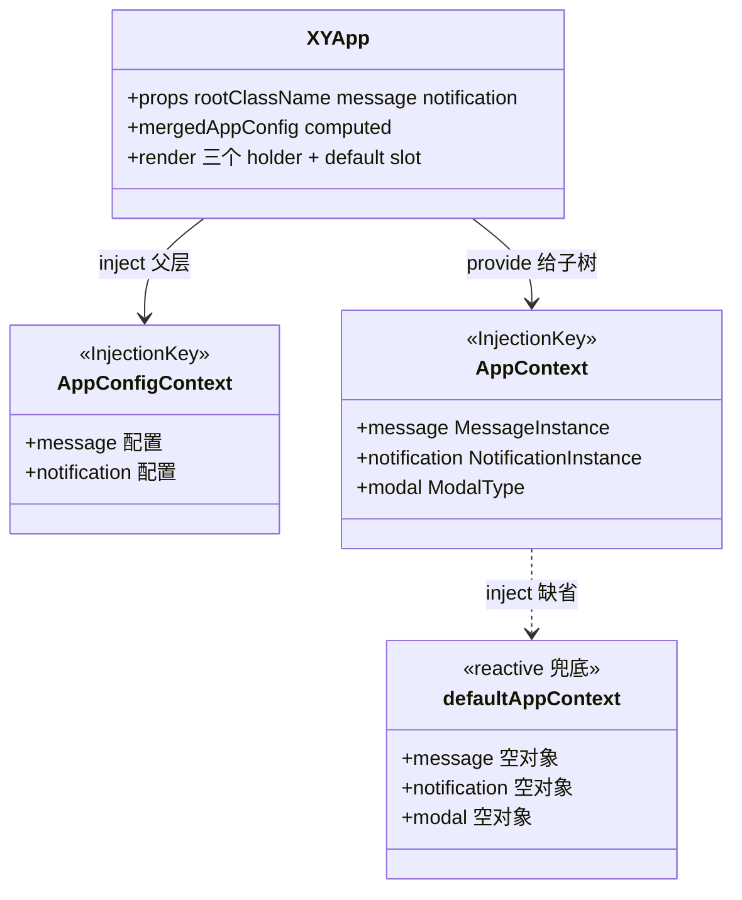
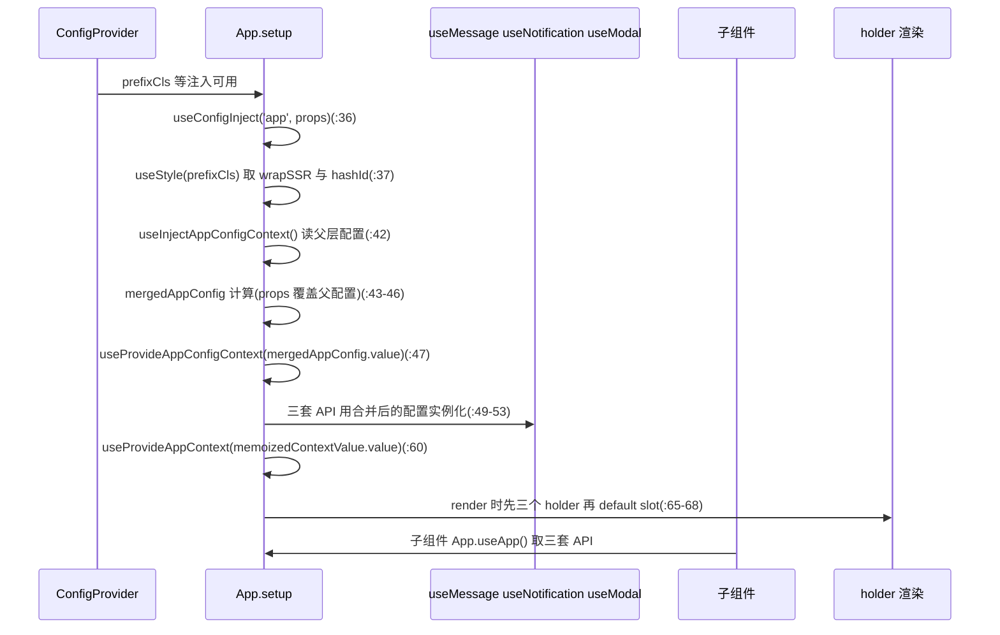

# C12-01 App 应用容器

> **本篇解决**：`<xy-app>` 只有 84 行，它凭什么成为"静态方法要用主题就必须包它"的那个容器？为什么 `App.useApp()` 在没包 `App` 时**不报错、但方法全是 undefined**？`props.message` 后来改了为什么没反应？
> **前置**：A05（ConfigProvider 注入链，已完成）、C07-01（Modal，已完成，其论点 7 讲 `useModal` 丢动作）　**读者坐标**：`03-components/12-global` 第 1/9 篇
> 本类横写篇（C12-00）负责"应用级容器与全局能力"的整体划分；本篇只讲 `app/` 自身。

---

## 一、职责与边界

`app/` 是**上下文装配容器**，不是视觉组件：它把 `message` / `notification` / `modal` 三套命令式 API 的"能吃到当前 ConfigProvider 主题与 locale"的版本，做一次 `provide`，同时把三者的 context holder 渲染进自己那层 div。

明确**不负责**：

- 三个 API 各自的实现（`message/useMessage`、`notification/useNotification`、`modal/useModal`）
- 主题与 `prefixCls` 的纵向注入（A05 已讲，本篇只说它如何被 `useConfigInject('app', props)` 取用）
- 静态方法的 DOM 挂载（`modal/confirm.tsx:20` 走 DocumentFragment，与 App 无关）

| 方向 | 对象 | 证据 |
| --- | --- | --- |
| 依赖 | `useMessage` / `useNotification` / `useModal` | `app/index.tsx:7-9` |
| 依赖 | `useConfigInject`、`useStyle`、`registerComponent` | `app/index.tsx:6`、`:18`、`:11` |
| 依赖 | 两个 context 的 provide/inject 工厂 | `app/context.ts:14-20`、`:32-44` |
| 被依赖 | 全仓只有 App 自己与一个文档示例消费 | `app/index.tsx:14`、`:16`、`:42`、`:75`；`apps/docs/examples/app/myPage.vue:12` |
| 测试 | 5 例，且被 vitest 收 | `app/__tests__/app.test.tsx:15-56`、`packages/xiaoye-ui/vitest.config.mts:33` |

规模实测：`app/` 共 4 个文件、207 行（`index.tsx` 84、`context.ts` 44、`style/index.ts` 22、`__tests__/app.test.tsx` 57）。

---

## 二、源码地图

| 文件 | 行数 | 职责 | 关键点 |
| --- | --- | --- | --- |
| `app/index.tsx` | 84 | 装配三个 API + 渲染 holder | props `:20-26`、`useApp` `:28-30`、配置合并 `:42-47`、三套 API `:49-53`、provide `:60`、渲染 `:62-70`、`App.useApp` `:75`、`install` `:77-79` |
| `app/context.ts` | 44 | 两个 InjectionKey 与 provide/inject 工厂 | `AppConfigContextKey` `:12`、默认值 `{}` `:19`、`AppContextKey` `:30`、`defaultAppContext` `:36-40` |
| `app/style/index.ts` | 22 | 样式 hook（体量极小，说明 `.xy-app` 主要不是样式容器） | — |
| `app/__tests__/app.test.tsx` | 57 | 5 个用例 | 包裹节点 `:16-26`、`rootClassName` `:28-32`、上下文键 `:34-38`、**脱离 App 的行为** `:40-50`、attrs 透传 `:52-56` |

主实现入口：`packages/xiaoye-ui/src/app/index.tsx:35`（`setup`）。

---

## 三、架构与数据流

### 3.1 结构（静态）



关键读点：`AppContext` 的兜底值是**空对象组成的 reactive**（`context.ts:36-40`），而不是"抛错的哨兵"。这一点决定了 §论点 4 的静默失效。

### 3.2 一次装配的时序



---

## 四、核心机制精读

### 论点 1：`provide` 传的是 `.value` 快照，App 的两个 context 因此**不具响应性**

```tsx
// packages/xiaoye-ui/src/app/index.tsx:42
    const appConfig = useInjectAppConfigContext();
    const mergedAppConfig = computed(() => ({
      message: { ...appConfig.message, ...props.message },
      notification: { ...appConfig.notification, ...props.notification },
    }));
    useProvideAppConfigContext(mergedAppConfig.value);
```

`mergedAppConfig` 是个 `computed`（`:44-46`），但第 47 行**取 `.value` 后交给 provide**。Vue 的 `provide` 保存的是传进去的那个值本身：这里传进去的是"computed 当时算出的普通对象"，此后 `props.message` 变化 → computed 重算，但**没有人再把这个新对象交给 provide**（`setup` 只执行一次）。

后果是具体的：**挂载后修改 `<xy-app :message="...">` 或 `:notification="...": 的字段不再生效**。同理第 55-60 行：

```tsx
// packages/xiaoye-ui/src/app/index.tsx:55
    const memoizedContextValue = computed(() => ({
      message: messageApi,
      notification: notificationApi,
      modal: ModalApi,
    }));
    useProvideAppContext(memoizedContextValue.value);
```

这里 `.value` 恰好没造成行为差异（三个 API 实例本身在 setup 期就固定了，见 `:49-53`），但它让 `memoizedContextValue` 这个 computed **变成纯摆设**——没有任何地方订阅它。两处写法一致，说明是从上游移植时的习惯性写法而非设计。

修法是一行的事：`provide` 传 computed 本身（或 `readonly` 的 ref），把 `context.ts:14-16` 的签名从 `AppConfig` 放宽到 `AppConfig | ComputedRef<AppConfig>`。

### 论点 2：`AppConfigContext` 是"父层配置 → App 合并 → 再向下提供"的单向漏斗

`useInjectAppConfigContext()` 的缺省是空对象：

```ts
// packages/xiaoye-ui/src/app/context.ts:18
export const useInjectAppConfigContext = () => {
  return inject(AppConfigContextKey, {});
};
```

因此 `:44-45` 的 `{ ...appConfig.message, ...props.message }` 在没有上层时退化为 `{ ...undefined, ...props.message }`（JS 允许展开 `undefined`，得到 `{}`），不会抛错。合并方向是**props 覆盖上层配置**，与 A05 讲的"子层覆盖父层"一致；差别在于 A05 处理的是主题对象，这里处理的是 `message` / `notification` 的运行时默认参数（类型见 `context.ts:7-10` 的 `AppConfig`，其字段来自 `message/interface` 的 `ConfigOptions` 与 `notification/interface` 的 `NotificationConfig`，`context.ts:3-4`）。

值得注意的是：**全仓没有任何其他组件 provide 这个 `AppConfigContextKey`**（`grep -rn "useProvideAppConfigContext" packages/xiaoye-ui/src` 只有 `app/index.tsx:13` 的 import 与 `:47` 的调用，以及 `context.ts:14` 的定义）。也就是说 `appConfig` 那一路永远是 `{}`——`:44-45` 的"与父层合并"在当前代码里**没有父层可合并**。它给"将来在 ConfigProvider 上直接配 message/notification"留了位置，但那条线没接。

### 论点 3：三个 holder 先渲染、default slot 后渲染，这个顺序是**功能性的**

```tsx
// packages/xiaoye-ui/src/app/index.tsx:62
    return () => {
      return wrapSSR(
        <div class={customClassName.value}>
          {ModalContextHolder()}
          {messageContextHolder()}
          {notificationContextHolder()}
          {slots.default?.()}
        </div>,
      );
```

holder 在前、业务内容在后，不是排版选择：C07-01 论点 7 已证明 `useModal` 的 `holderRef` 是在 holder 渲染时才被赋值（`modal/useModal/index.tsx:105`、`:148`），**holder 未挂载时发出的动作会被静默丢弃**。把 holder 排在同一个 fragment 的首位，让子树里后续挂载的组件在 `mounted` 阶段调用 `App.useApp().modal.info(...)` 时，ref 已经就位。

但这条保护**不覆盖"子组件 setup 阶段就调用"**的场景：此时 holder 可能尚未完成挂载。我没有实测这个时序窗口（App 只有 5 个测试用例，`app/__tests__/app.test.tsx` 里没有任何"setup 期调用 API"的用例），因此按红线标注为**待实测**，验证方法写在 §附 检查点 3。

### 论点 4：脱离 `<xy-app>` 时不抛错，而是给一组"空方法"——并且这个行为被测试钉住了

```ts
// packages/xiaoye-ui/src/app/context.ts:36
const defaultAppContext: useAppProps = reactive({
  message: {},
  notification: {},
  modal: {},
} as useAppProps);

export const useInjectAppContext = () => {
  return inject(AppContextKey, defaultAppContext);
};
```

缺省值被 `as useAppProps` 强制成"看起来类型正确"的对象，实际三个成员都是空对象。文档站示例里的标准用法是：

```vue
<!-- apps/docs/examples/app/myPage.vue:12 -->
const { message, modal, notification } = App.useApp();
```

解构本身不会报错；**报错发生在调用时**——`message.success('x')` 会变成"对 undefined 调用"。而测试把这个行为固化为契约：

```tsx
// packages/xiaoye-ui/src/app/__tests__/app.test.tsx:40
  it('脱离 App 使用时 useApp 返回可用的默认上下文（不抛错）', () => {
    const probe = defineComponent({
      setup() {
        const app = App.useApp();
        return () => h('div', { id: 'probe' }, typeof app.message?.success);
      },
    });
    const wrapper = mount(probe);
    expect(wrapper.find('#probe').text()).toBe('undefined');
    wrapper.unmount();
  });
```

用例名写"返回可用的默认上下文"，而断言值 `'undefined'` 恰好证明它**不可用**。这是本篇认为最该改的一处：`appConfig` 一路的 `{}` 缺省是安全的（只作为展开源），但 `AppContext` 的缺省应当是"抛错 + dev 下 `warning` 提示未包 `<xy-app>`"，而不是一个类型骗人、运行时才炸的空壳（`_util/warning.ts` 是现成机制，Modal 就用了它：`modal/Modal.tsx:169-173`）。

### 论点 5：`.xy-app` 这层 div 是真的会插进布局，且 attrs 走的是默认透传

`customClassName` 的构造用的是**位置参数**形式：

```tsx
// packages/xiaoye-ui/src/app/index.tsx:38
    const customClassName = computed(() => {
      return classNames(hashId.value, prefixCls.value, props.rootClassName);
    });
```

本仓库自己的 `classNames` 实现在开头就 `if (!value) continue`（`_util/classNames.ts:6`），所以 `props.rootClassName` 为 `undefined` 时被安全跳过。这与 C07-02 坑 4 记的那类写法（把变量当**对象键**：`{ [rootClassName]: true }`，未定义时会产出字面量 `"undefined"` 类名）形成对照——同一个工具，两种写法，只有前者安全。

另外组件**没有声明 `inheritAttrs: false`**（对比 `modal/Modal.tsx:155`、`drawer/index.tsx` 等都会关掉），因此测试里那句 `mount(App, { props: { class: 'extra' } })` 得到 `div.xy-app.extra`：

```tsx
// packages/xiaoye-ui/src/app/__tests__/app.test.tsx:52
  it('注册为全局组件时使用 xy-app 标签名', () => {
    const wrapper = mount(App, { props: { class: 'extra' } });
    expect(wrapper.find('div.xy-app.extra').exists()).toBe(true);
    wrapper.unmount();
  });
```

（用例名说的是标签名注册，断言实际测的是 attrs 合并——**名字与内容不符**，属测试可读性问题。）

副作用面：`:64` 的那个 `<div class="xy-app">` 会真实插入 DOM 树。对"App 必须是 flex/grid 容器的直接子元素"这类布局，它会多出一层，需要业务自己确认 `.xy-app` 有没有继承高度（`app/style/index.ts` 只有 22 行，说明这里几乎没有布局补偿）。

### 论点 6：`install` 走 `registerComponent`，`useApp` 挂在静态位上

```tsx
// packages/xiaoye-ui/src/app/index.tsx:75
App.useApp = useApp;

App.install = function (app: TypeApp) {
  registerComponent(app, App);
};
```

这两行是"全局注册"与"局部函数"两条独立通道：`:75` 让 `App.useApp()` 可以在不注册全局组件的情况下使用（文档示例正是这么用的，`apps/docs/examples/app/myPage.vue:12`）；`:77-79` 才是符合 AGENTS.md 全局注册规范的路径（必须经 `registerComponent`，它负责 `XYApp → xy-app` 的标签名映射与重复注册保护，细节归 A05）。类型面通过 `:81-84` 的 `as typeof App & Plugin & { readonly useApp: typeof useApp }` 把静态方法补回类型，因此 TS 侧不会丢 `useApp`。

`app/index.tsx:34` 用了 `initDefaultProps(AppProps(), {})`——**传了空默认值**，与 `props` 定义（`:20-26`）里也没有 `default` 一致：三个 prop 全可缺省，缺省语义由 `context.ts:19` 与 `:36-40` 的兜底承担。

### 论点 7：App 装配的三套 API 各有自己的 holder 与主题解析；`useMessage` 在 holder 未挂载时返回**永不 resolve 的假 thenable**

`app/index.tsx:49` 调用的 `useMessage` 内部是一个"API + holder"的成对结构（`message/useMessage.tsx:115-226`）。三件事值得单列：

1. **holder 自己会再取一次上下文**：`message/useMessage.tsx:54` 里 `useConfigInject('message', props)`、`:56` `getPrefixCls('message', props.prefixCls)`、`:58` `useStyle(prefixCls)`。也就是说 App **不需要**（也没有）把 prefixCls 传给它——App 的价值不在注入主题，而在**让 holder 处在正确的注入环境里**（holder 是 App 渲染输出的子节点，见 `app/index.tsx:65-67`）。
2. **holder 未挂载时的降级是静默的，而且会挂死 `await`**：

```tsx
// packages/xiaoye-ui/src/message/useMessage.tsx:129
  const open = (config: ArgsProps): MessageType => {
    if (!holderRef.value) {
      const fakeResult: any = () => {};
      fakeResult.then = () => {};
      return fakeResult;
    }
```

`MessageType` 是个 thenable。当 `holderRef` 还是 `null` 时，返回的对象带一个**什么都不做的 `then`**。两条后果：调用方看不到任何异常、也没有消息出现；更糟的是 `await message.success('x')`（或 `message.success('x').then(...)`）走的是这个假 thenable —— `then(resolve)` 被调用后既不 resolve 也不 reject，**该 await 永远不会返回**。这与 C07-01 论点 7 记的 `useModal` 丢动作是同族缺陷（那里是静默丢弃，这里是"静默丢弃 + 挂死 Promise 链"），但本处更隐蔽：`Modal` 的 `update/destroy` 至少有 `actionQueue` 兜一部分（`modal/useModal/index.tsx:122`、`:131`），而这里的早退分支没有任何补偿与告警。

3. **默认值与默认 key 都在这里**：`:23-24` 的 `DEFAULT_OFFSET = 8`、`DEFAULT_DURATION = 3`（与 C07-02 论点 5 的 `378/736` 同类，属写死的视觉数值而非 Token）；`:113` 的 `let keyIndex = 0` 是模块级自增，`:143` 用它拼 `xy-message-${keyIndex}` 作缺省 key —— 与 C07-02 论点 7 的 `currentDrawer`/`drawerId`、C07-01 论点 5 的 `getOpenCount` 同属"模块级可变状态参与标识"这一族（跨实例共享、SSR 与客户端计数不可对齐）。

顺带一个容易踩的实现细节：`:225` 的 holder 用 `key={holderKey}`（`:119` 每次 `useInternalMessage` 新建的 Symbol）保证同一 hook 实例的 holder 身份稳定；`:136` 从 `holderRef.value` 上解构 `prefixCls`/`hashId`，之所以能直接当字符串用，是因为 `expose` 传的是 computed 对象（`:101-105`）而 Vue 的 `expose` 会包一层 `proxyRefs` 自动解包——**改动这里时不能想当然把 `expose` 当普通对象赋值**。

### 论点 8：同一文件里两种写法并存——一个是函数（正确），一个是 setup 期常量（快照）

`message/useMessage.tsx` 内部恰好给出了对照：

```tsx
// packages/xiaoye-ui/src/message/useMessage.tsx:69
    const getClassName = () => classNames(hashId.value, props.rtl ? `${prefixCls.value}-rtl` : '');

    // ============================== Motion ===============================
    const getNotificationMotion = () =>
      getMotion({
        prefixCls: prefixCls.value,
        animation: props.animation ?? `move-up`,
        transitionName: props.transitionName,
      });
```

`getClassName`（`:69`）与 `getNotificationMotion`（`:72`）都是**函数**，每次底座需要时才求值，因此 `prefixCls`/`hashId` 变了会跟上。而同一个 `setup` 里的关闭图标是**直接构造的常量 VNode**：

```tsx
// packages/xiaoye-ui/src/message/useMessage.tsx:80
    const mergedCloseIcon = (
      <span class={`${prefixCls.value}-close-x`}>
        <CloseOutlined class={`${prefixCls.value}-close-icon`} />
      </span>
    );
```

它在 setup 期就把自己**当时**的 `prefixCls.value` 焊进了类名，之后 `prefixCls` 变化不会更新（底座在 `:93` 把它当固定 prop 收下）。这与 §论点 1 的 `provide(x.value)`、`app/index.tsx:60` 是同一个错误形状：**在 setup 里读 `.value` 并把结果固化**。同文件里两种写法并存，说明这不是设计选择而是演进中留下的不一致——改这类地方时，判据很简单：**凡是给底座传"渲染期才该确定"的值，必须是函数，不能是值**。

### 论点 9：App 装配的三套 API 是三次独立移植，同族细节互不一致

把 `useMessage` 与 `useNotification` 并排读，能看到 6 处"同一件事两种做法"。它们不是 bug，但每一处都是改动时容易踩的不对称：

| 维度 | `useMessage` | `useNotification` |
| --- | --- | --- |
| 默认偏移 | `DEFAULT_OFFSET = 8`（`message/useMessage.tsx:23`） | `24`（`notification/useNotification.tsx:19`） |
| 默认时长 | `DEFAULT_DURATION = 3`（`:24`） | `4.5`（`:20`） |
| 是否默认可关闭 | `closable: false`（`:92`） | `closable: true`（`:60`） |
| prefixCls 取法 | `getPrefixCls('message', props.prefixCls)`（`:56`） | `computed(() => props.prefixCls \|\| getPrefixCls('notification'))`（`:41`） |
| 挂载容器 | `props.staticGetContainer ?? getPopupContainer.value`（`:95`）——**只认静态通道** | `props.getPopupContainer?.() \|\| getPopupContainer.value?.() \|\| document.body`（`:63-64`）——**不认 `staticGetContainer`**，且多一层 `document.body` 兜底 |
| `expose` 的 `prefixCls` 形态 | 暴露 **computed 本体**（`:103`） | 暴露 **`.value` 字符串**（`:73`） |

其中最后两栏有实际影响：

1. **容器通道的不对称**意味着 `message` 与 `notification` 在"把弹层挂到哪"上行为不同：给 `ConfigProvider` 配了 `getPopupContainer` 时，只有 notification 会走 App 的三级兜底（`notification/useNotification.tsx:64`），message 走的是 `Holder` 的 `staticGetContainer ?? getPopupContainer.value`（`message/useMessage.tsx:95`）。而 App 本身**不向两者传容器参数**（`app/index.tsx:49-52` 只传配置对象），所以这条差异完全由各自 holder 内部决定。
2. **`expose` 形态不一致**是隐性风险：`message` 侧暴露 computed，靠 Vue `expose` 的 `proxyRefs` 解包才在消费处（`message/useMessage.tsx:136` 的解构）拿到字符串；`notification` 侧直接给字符串。两边 `hashId` 又都是 ref（`message/useMessage.tsx:104`、`notification/useNotification.tsx:74`）。任何"照抄另一套写法"的改动都可能把 `ComputedRefImpl` 之类的对象拼进类名字符串——这类错误不报错，只表现为样式失效。

还有一处**同族错误的复现证据**（呼应 §论点 8）：`notification/useNotification.tsx:61` 的 `closeIcon: getCloseIcon(prefixCls.value)` 与 `message/useMessage.tsx:80-84` 的 `mergedCloseIcon` 是同一个形状——在 setup 期把 `prefixCls.value` 焊进 VNode。两套都这样，说明它不是手误，而是这批 holder 从上游移植时的共同写法。改的时候**两处要一起改**，否则又制造新的不对称。

---

## 五、对外契约如何生效

| 对外面 | 生效路径 | 证据 |
| --- | --- | --- |
| `props.message` / `props.notification` | setup 期一次性合并进三套 API 的默认配置 | `app/index.tsx:43-53` |
| `App.useApp()` | 静态属性 → `useInjectAppContext()` → 命中 provide 或空壳兜底 | `app/index.tsx:28-30`、`:75`；`context.ts:42-44` |
| 三个 holder | 必须在 App 的渲染输出里，顺序先于 slot | `app/index.tsx:65-67` |
| `rootClassName` / attrs | 位置参数合并类名 + 默认 attrs 透传 | `app/index.tsx:38-40`；`__tests__/app.test.tsx:28-32`、`:52-56` |
| 主题/`prefixCls` | 经 `useConfigInject('app', props)` 取，再由 `useStyle` 出 `wrapSSR`/`hashId` | `app/index.tsx:6`、`:36-37`（纵向注入链见 A05） |
| 全局注册 | `registerComponent` | `app/index.tsx:11`、`:77-79`（规范与实现见 A05） |

一句话概括契约边界：**App 只对"挂载之后"的配置与调用负责**。挂载前调用、挂载后改配置，都落在本篇论点 1 与论点 3 的空白区里。

---

## 六、设计取舍

**为什么用"包一层容器组件"而不是让静态方法自己去读 ConfigProvider？**
静态方法（`Modal.confirm` 等）是在组件树外自己 `createVNode` + `vueRender` 挂到 DocumentFragment 的（`modal/confirm.tsx:20`、`:97-100`），拿不到 `provide` 链，只能靠 `globalConfigForApi` 这条全局兜底（其机制与代价见 A05 论点、C07-01 §五）。`App` 提供的是另一条路：**在树内**给出同源配置的 API 实例，代价是强制用户多包一层并接受多一个 DOM 节点（论点 5）。两条路并存意味着"同一个 `message.success` 有两种实现"，选错就丢主题——这是这套设计最需要读者记住的取舍。

**为什么 `useApp` 不做成组合式函数导出而挂在组件静态位？**
`App.useApp`（`:75`）与 `import { useApp }` 相比，好处是文档示例里一行 `App.useApp()` 就够、不新增包根导出名（本库包根已有大量同名歧义风险，见 A02 的生成物消解机制）。代价是不可 tree-shake 地强依赖整个组件对象。

**兜底给空壳 vs 抛错**（论点 4）：给空壳换来"不炸页面"，赔上"错误推迟到用户点击时"。本仓库对同类问题的处理是 `warning` + 明确文案（`Modal.tsx:169-173`），App 没沿用，属可改不一致。

---

## 七、坑与改动指南

1. **挂载后改 `:message` / `:notification` 不生效。**
   触发：响应式地切换 `props.message` 对象或其中字段。
   症状：已弹出的行为不变，新建的实例也用新配置失败。
   原因：`useProvideAppConfigContext(mergedAppConfig.value)`（`app/index.tsx:47`）与 `useProvideAppContext(memoizedContextValue.value)`（`:60`）都是 setup 期一次性快照。
   改法：provide computed 本体，并放宽 `context.ts:14` 与 `:32` 的参数类型。

2. **忘包 `<xy-app>` 时 `App.useApp()` 返回空壳，运行时才炸。**
   触发：在根节点没包 App 的应用里调用 `const { message } = App.useApp(); message.success(...)`。
   症状：`message.success is not a function`，报错点远离错误原因。
   原因：`context.ts:36-40` 的 `defaultAppContext` 是 `as useAppProps` 强制的空对象；测试 `app.test.tsx:40-50` 已把这一行为固化。
   定位：`app/context.ts:43`、`app/__tests__/app.test.tsx:48`。

3. **App 会给 DOM 多插一层 div，布局敏感处会断。**
   触发：`<xy-app>` 夹在 flex/grid 容器与其直接子项之间，或依赖 `:first-child`、`> *` 之类选择器。
   症状：子内容不再撑满/对齐失效。
   原因：`:64` 无条件渲染 `<div class="xy-app">`；`app/style/index.ts` 仅 22 行，几乎不做高度继承补偿。
   定位：`app/index.tsx:62-70`。

4. **`props` 变化不会重建三套 API 实例。**
   触发：切换语言/locale 后期望 `App.useApp().message` 用新文案。
   症状：仍用首次配置。
   原因：`useMessage` / `useNotification` / `useModal` 只在 setup 调用一次（`:49-53`）。
   定位：同处；对照 A05 的 locale 注入链看它应该从哪里补。

5. **holder 与 slot 的顺序不能调整。**
   触发：把 `{slots.default?.()}` 挪到最前。
   症状：子组件 `mounted` 里首次调用 `modal.info()` 偶发不显示。
   原因：`holderRef` 依赖 holder 先完成挂载（`modal/useModal/index.tsx:105`、`:148`，机制见 C07-01 论点 7）。
   定位：`app/index.tsx:65-68`。

6. **测试名称与断言内容不符，容易误读为已覆盖注册路径。**
   触发：读 `app.test.tsx:52-56` 的用例名"注册为全局组件时使用 xy-app 标签名"。
   症状：以为 `registerComponent` 被覆盖了，实际断言的是 class 合并（attrs 透传）。
   原因：用例内只 mount 并查 `div.xy-app.extra`，没有任何 `app.use(App)` / `registerComponent` 调用。
   定位：`app/__tests__/app.test.tsx:52-55`。同类"用例名与断言不符"在改测试时要一并纠正，别当契约。

7. **`await message.success(...)` 在 holder 未挂载时永不返回。**
   触发：在 `app` 之外的地方（或 App 挂载完成前）调用 `await message.success('保存成功')`，或 `message.xxx().then(...)`。
   症状：没有提示、没有报错，且 **await 之后的代码永远不执行**（表现为"点了没反应，后续逻辑也不跑"）。
   原因：`message/useMessage.tsx:130-134` 的早退分支返回一个 `then` 为空操作的假 thenable，`then(resolve, reject)` 两个都不会被调。
   定位：`message/useMessage.tsx:129-134`；对照 `notification/useNotification.tsx` 与 `modal/useModal/index.tsx:118-133`（Modal 至少有 `actionQueue` 兜 `update/destroy`）。
   临时规避：确保调用点一定在 `<xy-app>` 子树挂载之后（例如放进 `onMounted` 或用户事件回调）；根治要把早退改成"返回已 resolve 的 Promise + dev 下 `warning`"，而不是假 thenable。

8. **`message` 与 `notification` 的默认偏移/时长/可关闭性不同，跨组件对齐要显式传参。**
   触发：以为两者默认一致而只配一个。
   症状：通知离顶 24px、消息离顶 8px；通知 4.5s、消息 3s；通知有关闭按钮、消息没有。
   原因：见 §论点 9 的表（`message/useMessage.tsx:23-24`、`:92` 对比 `notification/useNotification.tsx:19-20`、`:60`）。
   定位：同四处行号；App 只合并 `props.message` / `props.notification` 两个配置对象（`app/index.tsx:43-46`），不会替你抹平这些差异。

9. **`prefixCls` 变化后，消息/通知的关闭图标类名仍是旧的。**
   触发：运行期切换 `ConfigProvider` 的 `prefixCls`（主题化/多站点共存场景）。
   症状：新弹出的 message/notification 图标类名与容器类名前缀不一致，样式脱落。
   原因：`message/useMessage.tsx:80-84` 与 `notification/useNotification.tsx:61` 都在 setup 期固化（§论点 8、§论点 9）。
   定位：同两处；同文件里 `getClassName`（`message/useMessage.tsx:69`）是正确写法的现成范本。

---

## 附：本篇可证伪的三个检查点

1. **`.value` 快照 provide**：读 `app/index.tsx:47` 与 `:60`，两行都必须是 `...(mergedAppConfig|memoizedContextValue).value`。

   ```bash
   grep -n "\.value)" packages/xiaoye-ui/src/app/index.tsx
   ```
   预期能看到这两处。若哪天改成 `useProvideAppContext(memoizedContextValue)`（不取 `.value`），论点 1 与坑 1 需重写为"已修复"。

2. **App context 的真实消费面**：

   ```bash
   grep -rn "useInjectAppConfigContext\|useInjectAppContext\|App.useApp" packages/xiaoye-ui/src apps/docs --include='*.ts' --include='*.tsx' --include='*.vue' | grep -v dist
   ```
   预期命中集中在 `app/` 内与 `apps/docs/examples/app/myPage.vue:12`。若开始出现别的组件 inject `AppContextKey`（例如表单或浮层反向消费 App 的 API 实例），本篇"App 只服务静态方法主题化"的边界描述要扩。

3. **setup 期调用是否丢动作（论点 3 留的待实测项）**：写一个临时用例（放 `/tmp`，不要提交进仓库），在 App 的 slot 子组件 `setup()` 里同步调用 `App.useApp().modal.info({ content: 'x' })`，然后断言 DOM 里是否出现 `.xy-modal`。

   ```bash
   pnpm --filter xiaoye-ui test:unit app
   ```
   跑出现象后再回填：能出现 → 论点 3 的保护范围可扩大到"setup 期也安全"；不出现 → 升级为独立坑，并在 C07-01 论点 7 交叉引用。当前本文**不下结论**。
