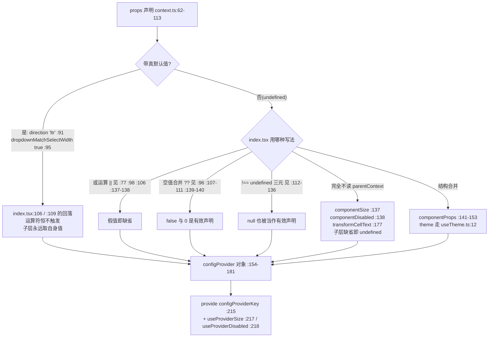
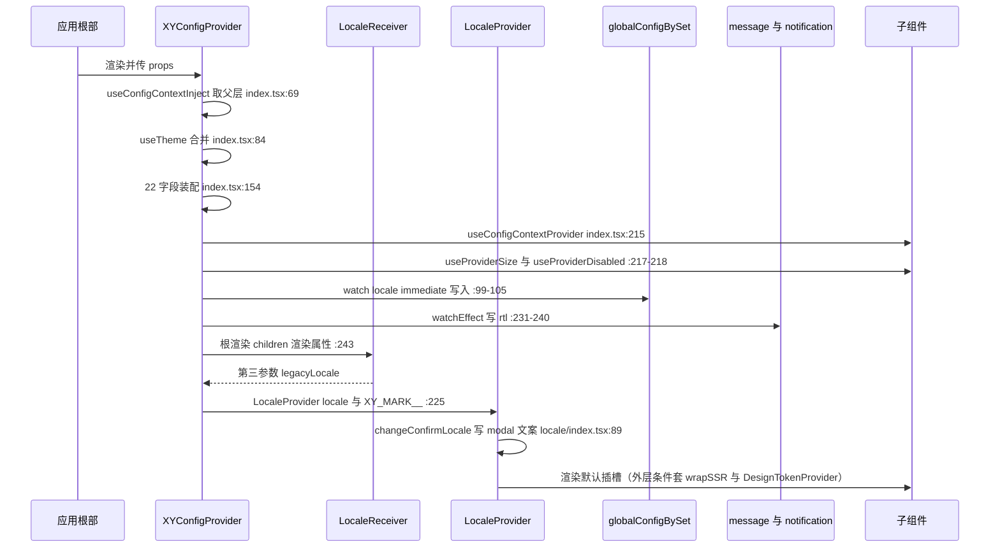

# C12-02 ConfigProvider 全局配置

> **本篇解决**：`<xy-config-provider>` 这一个组件文件里到底发生了什么——25 个 props 怎么被折算成注入对象、`locale` / `renderEmpty` / `direction` / `componentSize` 四条消费路径各自的取值时机与优先级、它为什么必须同时写三份模块级状态，以及嵌套第二层时哪些字段会**静默丢掉**父层值。
> **前置**：A05《ConfigProvider 注入链与 Size/Disabled Context》（已完成）、A03《Design Token 四层体系》　**读者坐标**：`03-components/12-global` 第 2/9 篇

## 一、职责与边界

A05 已经论证过**注入机制本身**：四个 `InjectionKey` 的分工、三级回落链、`globalConfig` 作为组件树外第二条通道的必要性。本篇不重复这些论证，只把镜头收到 `config-provider` 这个**组件**上——`packages/xiaoye-ui/src/config-provider/index.tsx:63-246` 这 184 行组件定义（`setup` 体本身占 `:68-245`）的内部实现。它负责四件事：

1. 把 25 个 props（`context.ts:62-113`）逐字段折算成 `ConfigProviderInnerProps`（`context.ts:117-161`，接口声明 25 个成员、实际装配 24 个，未装配的是 `flex`，见论点 6）并在 `index.tsx:215` 提供出去；
2. 决定渲染包裹层的**组成与顺序**（自外向内）：`LocaleProvider`（无条件）→ `DesignTokenProvider`（仅 `props.theme`）→ `wrapSSR`（仅图标前缀与父层不同）→ 默认插槽（`index.tsx:220-229`，逐条条件见论点 4）；
3. 在 `setup` 期挂三处**模块级副作用**：`globalConfigBySet.locale`（`index.tsx:99-105`）、`message.config` / `notification.config` 的 `rtl`（`index.tsx:231-240`）、以及经 `LocaleProvider` 转写的 modal 确认文案（`locale/index.tsx:86-96`）；
4. 挂静态 API：`ConfigProvider.config = setGlobalConfig`（`index.tsx:248`）与 `install`（`index.tsx:250-252`）。

明确**不负责**的部分：Token 四层派生与 `cssVariables` 旁路归 A03（其 §六 `docs/column/01-architecture/03-design-token-四层体系.md:606` 已论证 `config-provider/cssVariables.ts:84-103`）；样式注水与 `hashId` 归 A04；语言包内容与目录组织归 I11；`<xy-app>` 容器归 C12-01；暗色开关归 C12-03。本篇也**不**重新论证「为什么要四个 key」——那是 A05 论点 1 的主题。

依赖关系（都是直接 `import` 边，逐条给行号）：

- **被谁依赖**：`useConfigInject` 被 165 个文件引用（口径见论点 2 的命令）。其中两处不是引 hook 而是**反向引组件 barrel**：`notification/index.tsx:12` 取 `globalConfig`、`vc-notification/Notification.tsx:17` 取 `ConfigProvider` 与 `globalConfigForApi`——而 `index.tsx:11-12` 又正向 `import message` / `import notification`，构成两条真实的模块环，见论点 6。
- **它依赖谁**：`locale-provider`（`index.tsx:6`）、`locale/en_US`（`index.tsx:13`，硬编码兜底语言）、`theme/internal` 的 `DesignTokenProvider`（`index.tsx:30`）、`theme/themes/seed`（`index.tsx:17`）、`_util/cssinjs` 的 `createTheme`（`index.tsx:29`）、`./renderEmpty`（`index.tsx:3`，进而 `renderEmpty.tsx:1` 拉入 `../empty`）、`./globalConfig`（`index.tsx:26`）、`./SizeContext` 与 `./DisabledContext`（`index.tsx:27-28`）、`_util/registerComponent`（`index.tsx:7`）。
- **同目录的第六个文件不在 A05 的源码地图上**：`config-provider/cssVariables.ts`（103 行）只被 `globalConfig.ts:3` 使用，A05 §二 的表未登记它，本篇在源码地图补上，论证仍归 A03。

## 二、源码地图

| 文件 | 行数 | 职责 | 关键导出 |
| --- | --- | --- | --- |
| `packages/xiaoye-ui/src/config-provider/index.tsx` | 257 | 组件主实现：props → 22 字段合并 → provide → 三层包裹渲染 → 静态 API | `default`（`XYConfigProvider`）、`configConsumerProps`（`:51`） |
| `packages/xiaoye-ui/src/config-provider/context.ts` | 181 | props 工厂、公开/内部两套类型、`configProviderKey`、全局兜底对象、两个额外 Context key | `configProviderProps`（`:62`）`configProviderKey`（`:163`）`defaultConfigProvider`（`:165`）`useConfigContextInject`（`:175`）`useConfigContextProvider`（`:179`） |
| `packages/xiaoye-ui/src/config-provider/globalConfig.ts` | 157 | 组件树外通道 + 静态 API 的主题换算 | `globalConfigBySet`（`:18`）`globalConfigForApi`（`:19`）`resolveGlobalTheme`（`:72`）`setGlobalConfig`（`:123`）`globalConfig`（`:142`） |
| `packages/xiaoye-ui/src/config-provider/renderEmpty.tsx` | 35 | 默认空状态渲染器，按 `componentName` 分派 | `default`（`renderEmpty`）`DefaultRenderEmpty`（`:9`）`RenderEmptyHandler`（`:33`） |
| `packages/xiaoye-ui/src/config-provider/hooks/useConfigInject.ts` | 74 | 组件侧汇合点（机制归 A05 论点 1） | `default` |
| `packages/xiaoye-ui/src/config-provider/hooks/useTheme.ts` | 43 | 父子 `ThemeConfig` 合并与 `inherit` 截断 | `default` |
| `packages/xiaoye-ui/src/config-provider/cssVariables.ts` | 103 | 旧式 CSS 变量主题注入（论证归 A03 §六） | `registerTheme` |
| `packages/xiaoye-ui/src/config-provider/SizeContext.ts` / `DisabledContext.ts` | 16 / 17 | 尺寸与禁用两条子链 | `useInjectSize` `useProviderSize` / `useInjectDisabled` `useProviderDisabled` |
| `packages/xiaoye-ui/src/config-provider/style/index.ts` | 29 | **唯一的样式 hook**：全局图标前缀样式，无组件样式 | `default`（`useStyle`） |
| `packages/xiaoye-ui/src/config-provider/index.test.js` | 55 | mount 冒烟 + csp 透传 + `autoInsertSpaceInButton` 响应式 | — |
| `packages/xiaoye-ui/src/config-provider/__tests__/config-provider.test.tsx` | 119 | `resolveGlobalTheme` 与 `ConfigProvider.config` | — |
| `packages/xiaoye-ui/src/locale/index.tsx` | 112 | `LocaleProvider` 实现体，被 `index.tsx:6` 包裹使用 | `default` `XY_MARK`（`:62`）`Locale`（`:19`） |
| `packages/xiaoye-ui/src/locale/LocaleReceiver.tsx` | 86 | `localeData` 的读取端，第三参数给 legacy locale | `default` `useLocaleReceiver`（`:66`） |

组件主体入口 `packages/xiaoye-ui/src/config-provider/index.tsx:63`（`defineComponent` 起始，`setup` 在 `:68`），props 面入口 `packages/xiaoye-ui/src/config-provider/context.ts:62`，渲染装配入口 `packages/xiaoye-ui/src/config-provider/index.tsx:220`。

值得先登记的三个「地图级」事实：

- `config-provider` 目录**没有 `index.ts`**，入口就是 `index.tsx` 本身；`components.ts` 与包 `exports` 由 `pnpm gen:entries` 生成，目录名即组件名。
- 该目录下有 **12 个文件**，其中两份测试直接落在组件目录（`index.test.js` 在根位、`__tests__/config-provider.test.tsx` 在子目录）。按 `packages/xiaoye-ui/vitest.config.mts:33` 的 include glob `src/**/*.test.{js,ts,jsx,tsx}`，两份都会被执行——这与 A05 §二 的判定一致，本篇复核后无变化。
- `context.ts:33-34` 还声明了第五个 key `GlobalConfigContextKey`，本篇用两种口径检索全仓（见论点 6），**没有任何 provide/inject 使用它**。

## 三、架构与数据流

### 图 1：组件的静态结构——一个 setup 产出四类物件

```mermaid
classDiagram
  class XYConfigProvider {
    index.tsx:63
    +props configProviderProps
    +inheritAttrs false
    +setup 184 行
  }
  class configProviderProps {
    context.ts:62
    25 个字段
    +default 仅 2 个非 undefined
  }
  class ConfigProviderInnerProps {
    context.ts:117
    24 个装配字段 多为 ComputedRef
  }
  class configProviderKey {
    context.ts:163
  }
  class renderEmptyComponent {
    index.tsx:88
    普通函数 非 computed
  }
  class DefaultRenderEmpty {
    renderEmpty.tsx:9
    +依赖 Empty 与 useConfigInject
  }
  class memoTheme {
    index.tsx:184
    +defaultSeedToken 铺底
  }
  class DesignTokenProvider {
    theme/internal 由 index.tsx:30 引入
  }
  class LocaleProvider {
    locale/index.tsx:63
    +provide localeData 字符串 key
  }
  class LocaleReceiver {
    locale/LocaleReceiver.tsx:21
  }
  class globalConfigBySet {
    globalConfig.ts:18
  }
  class messageAndNotification {
    message/index.tsx:65
    notification/index.tsx:73
  }
  XYConfigProvider ..> configProviderProps : 输入
  XYConfigProvider ..> ConfigProviderInnerProps : 逐字段构造 index.tsx:154
  XYConfigProvider ..> configProviderKey : useConfigContextProvider index.tsx:215
  ConfigProviderInnerProps ..> renderEmptyComponent : renderEmpty 槽
  renderEmptyComponent ..> DefaultRenderEmpty : 第四级兜底 index.tsx:92
  XYConfigProvider ..> memoTheme : 仅 props.theme 时挂载 index.tsx:222
  memoTheme ..> DesignTokenProvider
  XYConfigProvider ..> LocaleProvider : index.tsx:225
  XYConfigProvider ..> LocaleReceiver : 根渲染 index.tsx:243
  XYConfigProvider ..> globalConfigBySet : watch locale 写入 index.tsx:102
  XYConfigProvider ..> messageAndNotification : watchEffect 写 rtl
```

这张图要传达的是**归属**而不是调用顺序：`index.tsx` 之外没有第二个「写配置」的地方——24 个 inner 字段全部在 `index.tsx:154-181` 这一个对象字面量里装配完毕（接口 `context.ts:117-161` 声明 25 个成员，多出的 `flex` 没有装配点，见论点 6），随后 `:215-218` 四次 `provide` 一次成型；而**写外部状态**的三条边（`globalConfigBySet`、`message`/`notification`、以及经 `LocaleProvider` 到 modal 的那条）都是单向出射，没有任何回读。后面论点 5 会说明这三条出射边在多个实例并存时的竞争关系。

### 图 2：一个 props 字段到 `configProvider` 对象的五条分支



分支 `C` 是本篇的核心发现，它不在 A05 论点 4 的三分法（父链回落 / 就地覆盖 / 结构合并）里：**`direction` 与 `dropdownMatchSelectWidth` 表面上被写成「父链回落」（`index.tsx:106`、`:109-111`），但因为在 props 上自带非 `undefined` 默认值，永远走不到回落那一侧**。论证见论点 1。

### 图 3：一次挂载的完整时序（含三条副作用出射）



时序里有两个反直觉点：其一，**副作用（写全局、写 message）发生在 provide 之后、渲染之前**，所以子组件首次 `setup` 读到的全局通道已经被本层 `locale` 覆盖过一次；其二，`LocaleReceiver` 在组件**最外层**（`index.tsx:243`），它注入的 `localeData` 来自**上一层**的 `LocaleProvider`，因此 `legacyLocale` 永远不等于本层即将提供的值——它只可能来自祖先层或独立的 `<xy-locale-provider>`，这一点在论点 3 里落到行号。

## 四、核心机制精读

### 论点 1：25 个 props 里只有 2 个带真默认值，而这 2 个恰好让 `index.tsx` 的父链回落恒不触发——嵌套覆盖实际是四类，不是三类

**断言**：`context.ts:62-113` 的 25 个字段中，只有 6 个写了 `default:`，其中 4 个是刻意写成的 `default: undefined`（`context.ts:82`、`:88`、`:94`、`:111`），真正会给值的是 `direction: 'ltr'`（`context.ts:91`）与 `dropdownMatchSelectWidth: true`（`context.ts:95`）。这两个字段在 `index.tsx` 里被写成了「读父层」的形态（`:106` 用 `||`、`:109-111` 用 `??`），但因为 Vue 会用 props 默认值填充未传的字段，`props.direction` 与 `props.dropdownMatchSelectWidth` 在 `setup` 里**恒为真值**，回落分支永远进不去。结果是：嵌套的第二层 `ConfigProvider` 只要不显式传这两个 prop，就会把父层的 `rtl` 与 `dropdownMatchSelectWidth={false}` **静默重置为默认值**——这两个字段实际属于「就地覆盖」类，A05 论点 4 的三分表把它们归在「父链回落」行，本篇按 props 默认值复核后需要修正。

`packages/xiaoye-ui/src/config-provider/context.ts:82` 起（`// ...` 处省略了中间三个无默认值的字段）：

```ts
// packages/xiaoye-ui/src/config-provider/context.ts:82
  autoInsertSpaceInButton: { type: Boolean, default: undefined },
  locale: objectType<Locale>(),
  pageHeader: objectType<{ ghost?: boolean }>(),
  componentSize: {
    type: String as PropType<SizeType>,
  },
  componentDisabled: { type: Boolean, default: undefined },
  direction: {
    type: String as PropType<'ltr' | 'rtl'>,
    default: 'ltr',
  },
  space: objectType<{ size?: SizeType | number }>(),
  virtual: { type: Boolean, default: undefined },
  dropdownMatchSelectWidth: { type: [Number, Boolean], default: true },
```

`packages/xiaoye-ui/src/config-provider/index.tsx:106` 起：

```tsx
// packages/xiaoye-ui/src/config-provider/index.tsx:106
    const direction = computed(() => props.direction || parentContext.direction?.value);
    const space = computed(() => props.space ?? parentContext.space?.value);
    const virtual = computed(() => props.virtual ?? parentContext.virtual?.value);
    const dropdownMatchSelectWidth = computed(
      () => props.dropdownMatchSelectWidth ?? parentContext.dropdownMatchSelectWidth?.value,
    );
```

逐段解释：

- `context.ts:82`、`:88`、`:94`、`:111` 四行的 `default: undefined` 不是随手写的。Vue 对 `type: Boolean` 的 prop 有一套隐式默认行为（缺省即 `false`），把这四个布尔字段显式钉成 `undefined`，正是为了让「调用方没传」与「调用方传了 false」可区分——`index.tsx:139-140` 的 `wave`/`ripple` 与 `:108` 的 `virtual` 都是靠这个区分才做得动 `??` 回落。**同一份 props 定义里，作者显然知道布尔默认值会吃掉回落分支**。
- 但 `direction` 不是布尔字段，`context.ts:89-92` 给的是字符串默认值 `'ltr'`。于是 `index.tsx:106` 的 `props.direction || parentContext.direction?.value` 变成 `'ltr' || …`：短路在左侧。这里连「显式写 undefined 默认值」的补救都没做，因为字符串域里写 `default: undefined` 会让 `useConfigInject.ts:15` 的 `props.direction ?? configProvider.direction?.value` 拿到 `undefined`——但那一段本来就在读合并结果，不受影响。
- `dropdownMatchSelectWidth` 更隐蔽：`context.ts:95` 的 `default: true` 让 `index.tsx:110` 的 `??` 也短路（`true ?? parent` 得 `true`）。`??` 只对 `null`/`undefined` 生效，而这里连 `undefined` 都拿不到。影响面不止前缀名——`useConfigInject.ts:30-32` 用同一个 `??` 合并组件自身 props，`useConfigInject.ts:33-38` 的 `virtual` 计算还把 `dropdownMatchSelectWidth.value !== false` 当与条件：**父层关掉 `dropdownMatchSelectWidth` 后，中间任意一层不带该 prop 的 ConfigProvider 都会把虚拟滚动的开关一并恢复成默认**。
- 与之对照，真正「就地覆盖」的三个字段是**没有**默认值的：`componentSize`（`context.ts:85-87`）、`componentDisabled`（`context.ts:88`）、`transformCellText`（`context.ts:77-79`），它们在 `index.tsx:137-138`、`:177` 直接读 props 不看父层——这三个的父层丢失是**设计选择**（继承改由 `SizeContext.ts` / `DisabledContext.ts` 两条子链承担，见 A05 论点 3），而 `direction`、`dropdownMatchSelectWidth` 的父层丢失是**默认值泄漏**，两者性质不同。
- 复核口径（可复现，排除 `dist` 与 `node_modules`）：

```bash
cd /Users/xiaoye/Desktop/publish/xiaoye-ui-vue/packages/xiaoye-ui/src
awk 'NR>=63 && NR<=112' config-provider/context.ts | grep -cE '^  [a-zA-Z]+:'   # 25
grep -n 'default: ' config-provider/context.ts                                  # 6 处，其中 4 处是 undefined
```

  第一条命令得 **25**（A05 §五 写的「共 24 个」是计数偏差，其字段清单本身列全了 25 个）。

**回扣**：读 `index.tsx:95-153` 这段合并代码时，判断「子层缺省会不会继承父层」不能只看 `||`/`??`/三元，必须**回到 `context.ts` 看该字段有没有真默认值**。带真默认值的字段，回落写法是装饰性的。

### 论点 2：`renderEmpty` 的四级解析发生在**调用期**，代价是把 `Empty` 组件钉进了每一条组件的依赖链，并与 `useConfigInject` 形成三模块循环

**断言**：`index.tsx:88-94` 的 `renderEmptyComponent` 是一个普通函数而不是 computed，它的四级优先（`props.renderEmpty` → `slots.renderEmpty` → `parentContext.renderEmpty` → `defaultRenderEmpty`）在**每次被调用时**重新求值，因此父层实例改配置、子层无需重新 `provide` 就能看见；但同一份实现（`renderEmpty.tsx:3` → `useConfigInject.ts:5` → `empty/index.tsx:10`）把 `Empty` 组件变成了全库 165 个文件的传递依赖。

`packages/xiaoye-ui/src/config-provider/index.tsx:88`：

```tsx
// packages/xiaoye-ui/src/config-provider/index.tsx:88
    const renderEmptyComponent = (name?: string) => {
      const renderEmpty = (props.renderEmpty ||
        slots.renderEmpty ||
        parentContext.renderEmpty ||
        defaultRenderEmpty) as RenderEmptyHandler;
      return renderEmpty(name);
    };
```

`packages/xiaoye-ui/src/config-provider/renderEmpty.tsx:1` 与 `:9`：

```tsx
// packages/xiaoye-ui/src/config-provider/renderEmpty.tsx:1
import Empty from '../empty';
import type { VueNode } from '../_util/type';
import useConfigInject from './hooks/useConfigInject';

export interface RenderEmptyProps {
  componentName?: string;
}

export const DefaultRenderEmpty = (props: RenderEmptyProps) => {
  const { prefixCls } = useConfigInject('empty', props);
  const renderHtml = (componentName?: string) => {
    switch (componentName) {
      case 'Table':
      case 'List':
        return <Empty image={Empty.PRESENTED_IMAGE_SIMPLE} />;
      case 'Select':
      case 'TreeSelect':
      case 'Cascader':
      case 'Transfer':
      case 'Mentions':
        return <Empty image={Empty.PRESENTED_IMAGE_SIMPLE} class={`${prefixCls.value}-small`} />;
      default:
        return <Empty />;
    }
  };
  return renderHtml(props.componentName);
};
```

逐段解释：

- **优先级与「prop 压过插槽」**：`index.tsx:89-92` 的四段 `||` 里，`props.renderEmpty` 在前、`slots.renderEmpty` 在后，所以模板上写 `#renderEmpty` 而 prop 上也传了函数时，**插槽被忽略**。A05 §五 已把这条列为反直觉点，本篇补的是求值时机：因为它是函数体而非 computed，`props`/`slots` 都是稳定响应式对象，所以 prop 从有到无的变化**不需要**重新 provide 就能生效；反之，`configProvider.renderEmpty`（`index.tsx:167` 装进 inner 对象）在类型上也是**函数**（`context.ts:130`）而不是 `ComputedRef`，这是 24 个装配字段里唯二的非 ref 槽位之一（另一个是 `getPrefixCls`，`context.ts:127`），下游 `useConfigInject.ts:19` 因此不做 `.value` 拆包，直接原样透传。
- **父链回溯是「链式调用」而不是「值复制」**：第三级 `parentContext.renderEmpty` 拿到的是父层同一个 `renderEmptyComponent` 闭包（父层 `index.tsx:167` 提供的就是它），所以 N 层嵌套时解析深度是 O(N) 次函数调用，而不是每层复制一份解析结果。层数很多且空状态高频渲染时，这条链是逐层展开的。
- **依赖环**：`renderEmpty.tsx:3` 引 `./hooks/useConfigInject`，`hooks/useConfigInject.ts:5` 反向引 `../renderEmpty` 的 `DefaultRenderEmpty`，而 `renderEmpty.tsx:1` 又引 `'../empty'`，`empty/index.tsx:10` 第三次引回 `config-provider/hooks/useConfigInject`——三个模块构成环。它能跑起来的原因是**环上每一处的交叉引用都推迟进了函数体**：`useConfigInject.ts:12` 在 `inject` 的兜底工厂里才 `h(DefaultRenderEmpty, …)`，`renderEmpty.tsx:10` 在组件函数体里才调 `useConfigInject`，`empty/index.tsx` 在 `setup` 里才用。任何一处被改成模块顶层求值就会命中 TDZ。
- **传递依赖面**：`DefaultRenderEmpty` 被 `useConfigInject.ts:5` 值导入且在 `:12` 使用，因此**任何**引入 `useConfigInject` 的组件都会把 `Empty`（`empty/index.tsx`）、`Empty` 的两张内联 SVG（`empty/empty.tsx`、`empty/simple.tsx`）与它的样式一起拉进来。本机统计口径：

```bash
cd /Users/xiaoye/Desktop/publish/xiaoye-ui-vue/packages/xiaoye-ui/src
grep -rl "useConfigInject" --include="*.ts" --include="*.tsx" . | wc -l   # 165
```

  165 是**引用该标识的文件数**（含 `hooks/useConfigInject.ts` 自身与 `renderEmpty.tsx`），不是组件数；它只用来量传递依赖的广度，不能用来推「有多少组件」。
- **`Empty.PRESENTED_IMAGE_SIMPLE` 是一段隐式协议**：`renderEmpty.tsx:15`、`:21` 传的是 `Empty.PRESENTED_IMAGE_SIMPLE`，它在 `empty/index.tsx:89` 被定义为 `() => h(SimpleEmptyImg)`——一个**函数**。`empty/index.tsx:47` 先把函数调用成 VNode，再在 `:48-49` 用 `image.type.PRESENTED_IMAGE_SIMPLE` 回读标记（该布尔位在 `empty/simple.tsx:40` 挂在组件对象上），最终在 `empty/index.tsx:67` 折算成 `xy-empty-normal` 类名。也就是说 `renderEmpty` 传的不只是「换张图」，而是**借图片函数对象上的一个布尔属性通知 Empty 走 normal 变体样式**；把 `simple.tsx:40` 那行删掉不会报错，只会让类名静默丢失。
- 还有一条捷径被组件用掉了：`select/index.tsx:11` 直接 `import { DefaultRenderEmpty } from '../config-provider/renderEmpty'`，绕开 ConfigProvider 的四级解析——这类直连点意味着「改了 `DefaultRenderEmpty` 的分派表会同时影响不走 ConfigProvider 的组件」。

### 论点 3：`locale` 是全模块唯一有**四条出口**的字段，四条出口的求值时机互不相同，且其中一条走的是字符串注入而不是 `InjectionKey`

**断言**：`index.tsx` 里 `locale` 一共落到四个地方——合并 computed（`:98`）、写入模块级全局通道（`:99-105`）、派生表单校验文案（`:200-214` 再经 `:216` 提供）、交给 `LocaleProvider`（`:225`）。前一条是 `computed`，第二条是 `immediate` 的 `watch`，第三条是惰性 computed，第四条是渲染期实参：**同一个 prop 的四种生效时机分别独立**，所以「改了 locale 但某条路径没跟上」不是 bug 而是这四条路径的求值点本来就错开。更关键的是第四条路径进入的是另一套链——`LocaleProvider` 用字符串 key `'localeData'` 提供（`locale/index.tsx:85`），与主链 `configProviderKey` 互不知情，两条链在 `index.tsx:225` 才汇合。

`packages/xiaoye-ui/src/config-provider/index.tsx:98`：

```tsx
// packages/xiaoye-ui/src/config-provider/index.tsx:98
    const locale = computed(() => props.locale || parentContext.locale?.value);
    watch(
      locale,
      () => {
        globalConfigBySet.locale = locale.value;
      },
      { immediate: true },
    );
```

`packages/xiaoye-ui/src/locale/index.tsx:78`：

```tsx
// packages/xiaoye-ui/src/locale/index.tsx:78
    const state = reactive({
      antLocale: {
        ...props.locale,
        exist: true,
      },
      XY_MARK__: XY_MARK,
    });
    provide('localeData', state);
    watch(
      () => props.locale,
      locale => {
        changeConfirmLocale(locale && locale.Modal);
        state.antLocale = {
          ...locale,
          exist: true,
        } as any;
      },
      { immediate: true },
    );
```

`packages/xiaoye-ui/src/config-provider/index.tsx:200`：

```tsx
// packages/xiaoye-ui/src/config-provider/index.tsx:200
    const validateMessagesRef = computed(() => {
      // Additional Form provider
      let validateMessages: ValidateMessages = {};

      if (locale.value) {
        validateMessages =
          locale.value.Form?.defaultValidateMessages ||
          defaultLocale.Form?.defaultValidateMessages ||
          {};
      }
      if (props.form && props.form.validateMessages) {
        validateMessages = { ...validateMessages, ...props.form.validateMessages };
      }
      return validateMessages;
    });
    useProvideGlobalForm({ validateMessages: validateMessagesRef });
```

逐段解释：

- **回落运算符的域选择**：`:98` 用 `||` 而不是 `??`。`locale` 是对象型 prop（`context.ts:83` 的 `objectType<Locale>()`），空对象 `{}` 是真值，会被当成「本层声明了一个空语言包」而**挡住父链**；与之对照 `pageHeader`（`:122-124`）、`input`（`:125-127`）用的是 `!== undefined` 三元。这不是笔误——`||` 对「传了但传空」和「没传」给出同一个答案，而这两者在对象域里行为本来就该一致。
- **第二条出口没有卸载清理**：`:99-105` 的 `watch` 带 `immediate: true`，写在 `:102`，目标 `globalConfigBySet` 是模块级 `reactive`（`globalConfig.ts:18`，行尾注释原文是「权重最大」）。随后由模块级 `watchEffect`（`globalConfig.ts:23-44`，镜像语句在 `:24`）搬到 `globalConfigForApi`，`Modal.confirm` 与 `notification` 就是从那里读到的（`modal/confirm.tsx:78`、`notification/index.tsx:93`）。A05 论点 5 已把这条定性为「两条通道唯一的显式交叉点」，本篇补三点它没展开的细节：其一，触发时机在 `provide`（`:215`）之后、渲染（`:242`）之前，所以本层子树首次 `setup` 时全局通道已被覆盖过一次；其二，`index.tsx:2` 只导入了 `watch / computed / defineComponent / watchEffect`，**全文件没有 `onUnmounted`**，因此这个实例销毁后 `globalConfigBySet.locale` 保留最后写入值；其三，写入的是**整个 locale 对象**，不是合并，因此嵌套两层时后写入者整体胜出。
- **第三条出口只读 `props.form`，不读合并后的 `form`**：`:210` 的判定用的是 `props.form`，而主链上还有一个做了父链回落的 `form` computed（`:131-133`）。于是「父层 ConfigProvider 设了 `form.validateMessages`、子层没设」时，子层提供的 `GlobalFormContextKey` 值里**不含父层校验文案**，只剩 `defaultLocale.Form?.defaultValidateMessages`（`:207`，即 `index.tsx:13` 硬编码导入的 `locale/en_US`）。A05 图 2 的说明给出的是「整体替换而非合并」这一层结论，本篇补的是替换值的输入源：语言包硬编码兜底 + `props.form`，两条都不含父链。
- **字符串 key 那条链的语义**：`locale/index.tsx:85` 的 `provide('localeData', state)` 用的是裸字符串，不是 `InjectionKey`，读取端 `locale/LocaleReceiver.tsx:36` 与 `:71` 都用 `inject('localeData', {})` 兜底。承载对象里那个上游遗留的字段名 `antLocale`（`locale/index.tsx:79`，是**变量名**而非类名）决定了 `exist` 标记：`:82` 与 `:93` 都无条件写 `exist: true`，所以只要挂了 `LocaleProvider`（哪怕 `locale` 是 `undefined`），`LocaleReceiver.tsx:49-57` 的 `antLocale.exist && !localeCode` 分支就会命中并返回 `en_US` 的语言码，而不是让上层拿到 `undefined`。这解释了「什么都没配的 ConfigProvider 里，组件文案已经是英文而不是空」这件事。
- **两条链的交汇点在渲染期**：`index.tsx:243` 的根渲染把 `LocaleReceiver` 的第三参数当兜底用——`<LocaleProvider locale={locale.value || legacyLocale} XY_MARK__={XY_MARK}>`（`:225`），而第三参数在 `LocaleReceiver.tsx:61` 是 `children?.(locale.value, localeCode.value, antLocale)` 里的 `antLocale`，即**祖先层**（或独立 `<xy-locale-provider>`）的语言包对象。所以 `legacyLocale` 永远不等于本层即将提供的值，它只能是上一跳的遗留值；`XY_MARK__={XY_MARK}` 的唯一作用是压掉 `locale/index.tsx:73-77` 那条 deprecation `warning`（`XY_MARK = 'internalMark'` 定义在 `:62`）。
- **第四条出口的下游是一条增量合并**：`changeConfirmLocale`（`locale/index.tsx:89` 调用，实现 `modal/locale.ts:13-24`）在有新值时做 `{ ...runtimeLocale, ...newLocale }`（`modal/locale.ts:15-18`），无新值时整体重置回 `en_US.Modal`（`:20-22`）。也就是说 modal 静态文案的合并语义和前三条都不同——它是**跨实例累积**的，父层设置过的 `okText` 在子层只给 `cancelText` 时仍会留着。

**回扣**：改 locale 相关行为时，要同时检查 `:98`（回落）、`:102`（全局通道）、`:204-208`（校验文案）、`:225`（字符串链）四个点，以及 `modal/locale.ts:13` 的合并语义。只改 `index.tsx` 一处，四条出口里有三条不会跟着变。

### 论点 4：三层包裹里只有 `DesignTokenProvider` 是**条件挂载**，条件是 `props.theme` 而不是合并后的主题——这决定了静态 API 的主题为什么能生效、继承父层主题的中间层为什么不挂 Provider

**断言**：`renderProvider`（`index.tsx:220-229`）产出的树形顺序是固定的三层——最外 `LocaleProvider`、其次 `DesignTokenProvider`、最内 `wrapSSR`，且三层的挂载条件各不相同：`wrapSSR` 看 `shouldWrapSSR`（`:79`，图标前缀与父层不同才套），`DesignTokenProvider` 看 `props.theme`（`:222`，**裸 prop 真值判定，不看 `mergedTheme`**），`LocaleProvider` 无条件套（`:224`）。第二条件是本篇要钉住的点：它让「继承父层主题」的中间层不产生新的 Provider，同时让命令式 API 的 `ConfigProvider`（`vc-notification/Notification.tsx:283` 用 `{...global}` 摊平）只要全局通道里有 `theme` 就会挂上 Provider。

`packages/xiaoye-ui/src/config-provider/index.tsx:220`：

```tsx
// packages/xiaoye-ui/src/config-provider/index.tsx:220
    const renderProvider = (legacyLocale: Locale) => {
      let childNode = shouldWrapSSR.value ? wrapSSR(slots.default?.()) : slots.default?.();
      if (props.theme)
        childNode = <DesignTokenProvider value={memoTheme.value}>{childNode}</DesignTokenProvider>;
      return (
        <LocaleProvider locale={locale.value || legacyLocale} XY_MARK__={XY_MARK}>
          {childNode}
        </LocaleProvider>
      );
    };
```

`packages/xiaoye-ui/src/config-provider/index.tsx:184`：

```tsx
// packages/xiaoye-ui/src/config-provider/index.tsx:184
    const memoTheme = computed(() => {
      const { algorithm, token, ...rest } = mergedTheme.value || {};
      const themeObj =
        algorithm && (!Array.isArray(algorithm) || algorithm.length > 0)
          ? createTheme(algorithm)
          : undefined;
      return {
        ...rest,
        theme: themeObj,

        token: {
          ...defaultSeedToken,
          ...token,
        },
      };
    });
```

`packages/xiaoye-ui/src/config-provider/style/index.ts:9`：

```ts
// packages/xiaoye-ui/src/config-provider/style/index.ts:9
  return useStyleRegister(
    computed(() => ({
      theme: theme.value,
      token: token.value,
      hashId: '',
      path: ['xiaoye-ui-icons', iconPrefixCls.value],
    })),
```

逐段解释：

- **顺序即语义**：`LocaleProvider` 在最外，它自己**不渲染任何 DOM**（`locale/index.tsx:98-100` 的 render 只返回 `slots.default?.()`），`ConfigProvider` 本身也不渲染 DOM（根节点是 `LocaleReceiver`，`:242-244`）。所以 `<xy-config-provider>` 是一个零 DOM 的结构组件，包出去的三层里没有任何一层会多出元素节点，这是「ConfigProvider 可以任意嵌套而不影响布局」的实现依据。
- **`shouldWrapSSR` 是去重而不是必需**：`:79` 的判定 `iconPrefixCls.value !== parentContext.iconPrefixCls.value` 意味着只有「本层引入新图标前缀」时才调用 `wrapSSR`。样式 hook 的注册键是 `path: ['xiaoye-ui-icons', iconPrefixCls]` 且 `hashId: ''`（`style/index.ts:13-14`），即**同前缀的多层实例命中同一条注册路径**，重复套 `wrapSSR` 只会多做一次 hash 比较。这是全模块唯一一个「为了少注水而写的分支」。
- **`props.theme` 与 `mergedTheme` 的分工**：`useTheme`（`hooks/useTheme.ts:6-15`）在「本层没传 theme 对象」时直接返回 `parentTheme?.value`，合并结果照样非空；但 `:222` 只看 `props.theme`，于是中间层拿到的是**祖先层挂载的那个 `DesignTokenProvider`**（它在树上仍然包着本层子树），行为正确，少一个 Provider 节点。真正会被这条分支影响的是「用 `ConfigProvider.config({ theme })` 设主题、树内没写 `:theme`」的场景：`index.tsx` 全文**从不读** `globalConfigForApi.theme`，所以应用树的 token 不会跟着静态 API 变；能变的只有被摊平出来的那层新 ConfigProvider——`vc-notification/Notification.tsx:277-283` 里 `const global = globalConfigForApi;` 后 `<ConfigProvider {...global} prefixCls={rootPrefixCls}>`，`theme` 作为 prop 落进 `:222` 的判定，Provider 才挂上。
- **`memoTheme` 的两处铺底**：`:195` 的 `...defaultSeedToken`（`index.tsx:17` 导入 `theme/themes/seed`）保证 `token` 永远是完整 seed 集的覆盖结果，而不是「只给一个 `colorPrimary`」的半截对象；`:187-189` 把 `algorithm` 折算成 `createTheme(algorithm)`，且当 `algorithm` 是**空数组**时给出 `theme: undefined`（`!Array.isArray(algorithm) || algorithm.length > 0` 为假）——即 `algorithm: []` 等价于「不传 algorithm」，这是一个容易被当成 bug 的显式退化分支。
- **`rest` 里带走了什么**：`:185` 只解构掉 `algorithm` 与 `token`，因此 `components`、`hashed`、`inherit` 三个字段整体进 `...rest`（`:191`）并交给 `DesignTokenProvider`。`inherit` 本来只是 `useTheme` 的截断开关（`hooks/useTheme.ts:9`），却仍被透传进 Provider 的值对象里——它在那里没有消费者，属于「顺手带过去」的中性冗余字段。
- **它是惰性的**：`memoTheme` 是 computed，唯一读取点在 `:223`，而 `:222` 的条件不成立时那一行不执行，因此没传 `theme` 的实例**不会**触发 `createTheme`/`defaultSeedToken` 展开。这个惰性是 `props.theme` 条件带来的附带收益，改动 `:222` 为「无条件挂载」会让每个 ConfigProvider 都做一次 seed token 展开。

**回扣**：调 `theme` 相关问题时，先分清三件事——`mergedTheme`（值层面，`hooks/useTheme.ts:12`）、`memoTheme`（形状转换，`:184`）、`DesignTokenProvider` 挂载与否（结构层面，`:222`）。值的继承与结构层的挂载用的是**两个不同的判定**，这是本模块最容易读错的一处。

### 论点 5：三条副作用出射边都**没有卸载清理**，且 `direction` 的真默认值让第 2 条在每次挂载时都写一次 `rtl: false`——多个实例并存时是「最后挂载者胜出」

**断言**：本组件对外部可变状态的写入共三处：`globalConfigBySet.locale`（`index.tsx:102`）、`message.config` / `notification.config` 的 `rtl`（`index.tsx:233-238`）、以及经 `LocaleProvider` 转写的 modal 文案（`locale/index.tsx:89` → `modal/locale.ts:13`）。三处都是**单向出射、无回读、无 `onUnmounted` 复位**。其中第 2 条因为 `direction` 带 `default: 'ltr'`（论点 1 已证）而**恒常触发**：`index.tsx:232` 的 `if (direction.value)` 对任何实例都成立，所以每挂一个 ConfigProvider 都会把全局 `rtl` 写一次，写值是本层的合并结果而不是祖先层的。

`packages/xiaoye-ui/src/config-provider/index.tsx:231`：

```tsx
// packages/xiaoye-ui/src/config-provider/index.tsx:231
    watchEffect(() => {
      if (direction.value) {
        message.config({
          rtl: direction.value === 'rtl',
        });
        notification.config({
          rtl: direction.value === 'rtl',
        });
      }
    });
```

`packages/xiaoye-ui/src/notification/index.tsx:93`（写入端 `:73-75`，模块变量 `:47`）：

```ts
// packages/xiaoye-ui/src/notification/index.tsx:93
  const { getPrefixCls } = globalConfig();
  const prefixCls = getPrefixCls('notification', customizePrefixCls || defaultPrefixCls);
  const cacheKey = `${prefixCls}-${placement}-${rtl}`;
  const cacheInstance = notificationInstance[cacheKey];
```

`packages/xiaoye-ui/src/message/index.tsx:56`（对照：三个字段会让实例重建，`rtl` 不会）：

```ts
// packages/xiaoye-ui/src/message/index.tsx:56
  if (options.transitionName !== undefined) {
    transitionName = options.transitionName;
    messageInstance = null; // delete messageInstance for new transitionName
    hasTransitionName = true;
  }
  if (options.maxCount !== undefined) {
    maxCount = options.maxCount;
    messageInstance = null;
  }
  if (options.rtl !== undefined) {
    rtl = options.rtl;
  }
```

逐段解释：

- **为什么第 2 条恒触发**：`direction` 来自 `:106` 的 computed，而 `props.direction` 因为有默认值永远是 `'ltr'` 或 `'rtl'`（论点 1）。`watchEffect` 在 `:231` 注册后首次同步执行，于是**任何**一个 ConfigProvider 实例挂载都会调用 `message.config` 与 `notification.config`。作者写 `if (direction.value)`（`:232`）显然是想挡「没配方向就不动全局」，但这个守卫在有真默认值的字段上永远为真——这是论点 1 的默认值泄漏在副作用侧的第二处后果。
- **写入目标是模块级 `let`，不是 reactive**：`message/index.tsx:24` 与 `notification/index.tsx:47` 都是 `let rtl = false`。消费点分别在 `message/index.tsx:156`（每条 notice 的 `content` 渲染函数里，`:151` 起）与 `notification/index.tsx:116`（**容器实例创建时**算一次 `notificationClass`，见 `:115`）。两者时机不同：message 是「下一条消息生效」，notification 是「下一套容器生效」。
- **`rtl` 不重建实例、却参与缓存键**：`setMessageConfig` 对 `top`（`message/index.tsx:43`）、`transitionName`（`:58`）、`maxCount`（`:63`）都会 `messageInstance = null` 来强制重建，唯独 `rtl` 分支（`:65-67`）只赋值。notification 侧 `getNotificationInstance` 用 `cacheKey = ${prefixCls}-${placement}-${rtl}`（`notification/index.tsx:95`）查实例缓存，因此 `rtl` 翻转后同一 `placement` 会**另建一套容器**，旧实例仍留在 `notificationInstance` 里并带着旧类名继续显示它已有的通知——症状是「同一个右上角出现两套通知容器，一套带 `-rtl` 一套不带」。
- **三个实例并存的竞争**：根 `<xy-config-provider direction="rtl">` 里挂一个局部 `<xy-config-provider>`（不写 direction）。局部层因默认值拿到 `'ltr'`（论点 1），`:233-238` 于是把 `rtl` 写成 `false`；随后根层重渲染并不会再跑一次它的 `watchEffect`（依赖没变），所以**静态 message 的 rtl 由最后挂载/最后更新的那层决定**，与「谁在树上更靠外」无关。卸载局部层也不会复位——`index.tsx:2` 的导入列表里没有 `onUnmounted`，三处写入都在实例的 effect scope 内，scope 销毁只是停止再写，已写出去的值留在模块里。
- **第 1 条与第 3 条的同构与差别**：`locale` 那条（`:102`）写的是整个对象覆盖，modal 文案那条走的是 `modal/locale.ts:15-18` 的 `{ ...runtimeLocale, ...newLocale }` **增量合并**（论点 3 末段）。两者叠加的后果是：切语言时 `okText` 会跟着换，但**换回不含 `Modal` 段的语言包时旧文案不会消失**——`newLocale` 为 `undefined` 才走 `:20-22` 的整体重置分支，而 `ConfigProvider` 只要 `locale` 非空就会传 `locale.Modal`（可能为 `undefined`，此时确实走重置）；真正的问题是嵌套层里的后写者只覆盖它带来那几个键。
- **静态 API 的类型面比组件窄**：`ConfigProvider.config` 就是 `setGlobalConfig`（`index.tsx:248`，类型在 `:254-257` 收窄为 `readonly config: typeof setGlobalConfig`），其入参类型 `GlobalConfigProviderProps` 只声明 `prefixCls` / `iconPrefixCls` / `getPopupContainer` 三项（`globalConfig.ts:46-50`）加上 `theme`（`:124`）。而 `:130-133` 的实现是 `const { theme, ...rest } = params` 后 `Object.assign(globalConfigBySet, reactive(rest))`——**实现按 `ConfigProviderProps` 全集写**，只是类型面没放开。所以「树内 25 个 prop 里只有 4 个能从静态 API 设」是类型约束造成的，不是实现限制。

**回扣**：这三条出射边解释了一个常见误判——「我在子树里放了个 ConfigProvider，怎么全局 message 的方向变了」。答案在 `:231-240` 的无条件写入 + `direction` 的真默认值，而不在 `provide`。要安全使用多实例，得显式给每层传 `direction`。

### 论点 6：公开面上有四处**已无人消费**的声明，同时它被三个文件反向 import 形成模块环——环能跑是因为所有回读都推迟进函数体

**断言**：`index.tsx:51-61` 的 `configConsumerProps`、`context.ts:33-34` 的 `GlobalConfigContextKey`、`context.ts:158-160` 的 `flex`、`context.ts:71-73` 的 `getPrefixCls` prop 这四处在 `src` 与 `apps` 内**都没有读取点**，却因为出现在包导出快照或公共类型面上而不能删。另一侧，本模块被 `notification/index.tsx:12`、`vc-notification/Notification.tsx:17`、`modal/confirm.tsx:4` 三个文件反向 import，加上自身 `:11-12` 的正向 import 构成闭环；环不炸的唯一原因是每条回读都写在函数体里。

`packages/xiaoye-ui/src/config-provider/index.tsx:51`：

```ts
// packages/xiaoye-ui/src/config-provider/index.tsx:51
export const configConsumerProps = [
  'getTargetContainer',
  'getPopupContainer',
  'rootPrefixCls',
  'getPrefixCls',
  'renderEmpty',
  'csp',
  'autoInsertSpaceInButton',
  'locale',
  'pageHeader',
];
```

`packages/xiaoye-ui/src/config-provider/context.ts:156`（`flex` 是接口成员，但装配对象里没有它）：

```ts
// packages/xiaoye-ui/src/config-provider/context.ts:156
  ripple?: ComputedRef<boolean>;
  componentProps?: ComputedRef<Record<string, Record<string, any>>>;
  flex?: ComputedRef<{
    vertical?: boolean;
  }>;
}
```

复核口径（三条命令、排除 `node_modules` 与 `dist`）：

```bash
cd /Users/xiaoye/Desktop/publish/xiaoye-ui-vue/packages/xiaoye-ui
grep -rn "configConsumerProps" src ../../apps --include='*.ts' --include='*.tsx' --include='*.vue' | grep -v 'config-provider/index.tsx:51' | wc -l   # 0
grep -rn "GlobalConfigContextKey" src --include='*.ts' --include='*.tsx' --include='*.vue' | wc -l                                                    # 2（仅声明两行）
grep -rn "configProvider\.flex\|props.getPrefixCls" src --include='*.ts' --include='*.tsx' | wc -l                                                    # 0
```

逐段解释：

- **装配字段数是 24 不是 25**：`index.tsx:154-181` 的对象字面量恰好 24 个键（`csp`、`autoInsertSpaceInButton`、`locale`、`direction`、`space`、`virtual`、`dropdownMatchSelectWidth`、`getPrefixCls`、`iconPrefixCls`、`theme`、`renderEmpty`、`getTargetContainer`、`getPopupContainer`、`pageHeader`、`input`、`pagination`、`form`、`select`、`componentSize`、`componentDisabled`、`transformCellText`、`wave`、`ripple`、`componentProps`）。接口 `ConfigProviderInnerProps`（`context.ts:117-161`）声明 25 个成员，多出的正是 `flex`（`context.ts:158-160`）。因为整条链路上没有任何读取点，它不会报错，只会让「inner 字段 = props 字段」这个直觉少一个字段——本篇 §二 的表与图 1 的计数都按 24 装配 / 25 声明修正。
- **`getPrefixCls` 是死 prop，不是死字段**：`context.ts:71-73` 把它声明成 prop，`index.tsx:70` 却在 setup 里**现造**了一个同名闭包函数并提供出去（`:162`），从不读 `props.getPrefixCls`（上面第三条命令的 0 就是这个意思）。后果是给 `<xy-config-provider :get-prefix-cls="fn">` 传函数**完全无效**，而类型面上它合法。它同时出现在 `configConsumerProps:55` 里，说明这份数组曾是「消费方该读哪些字段」的清单，如今只剩 `index.tsx:51` 一处定义与包导出快照 `tests/__snapshots__/index.test.js.snap:233` 一个字符串。
- **`GlobalConfigContextKey` 是「复制粘贴的第二个 key」**：`context.ts:33-34` 与上一行的 `GlobalFormContextKey`（`:22-23`）类型完全相同（都复用 `GlobalFormCOntextProps`，注意源码里的拼写就是 `COntext`），但没有 `useProvider`/`useInject` 包装，也没有任何 `provide`/`inject` 命中。它和 `flex` 一样属于「删掉会改公开 API、留着不做事」的负债；按 `AGENTS.md` 的生成物规则，这类包根导出名要清理必须同时更新 `tests/__snapshots__/index.test.js.snap`。
- **模块环的三条反向边**：`index.tsx:11-12` 正向 import `message` / `notification`（用于论点 5 的 rtl 同步）；反向有 `notification/index.tsx:12`（`import { globalConfig } from '../config-provider'`）、`vc-notification/Notification.tsx:17`（`import ConfigProvider, { globalConfigForApi } from '../config-provider'`）、`modal/confirm.tsx:4`（同一写法）。`message/index.tsx` 自己不 import `config-provider`（grep 无命中），它经 `message/index.tsx:2` 的 `vc-notification` 传递成环。
- **环为什么能跑**：每条回读都在函数体内——`notification/index.tsx:93` 在 `getNotificationInstance` 里调 `globalConfig()`，`vc-notification/Notification.tsx:283` 在渲染函数里用 `ConfigProvider`，`modal/confirm.tsx:84` 在 `Wrapper` 里读 `globalConfigForApi`，而 `index.tsx:233` 的 `message.config` 在 setup 的 `watchEffect` 里。模块求值阶段没有任何一处跨环取值，因此不会命中 TDZ。**这条约束是隐式的**：把上面任意一处提到模块顶层（例如在文件顶部写 `const cp = ConfigProvider;`）就会得到 `undefined` 或 `Cannot access 'X' before initialization`。
- **`index.tsx:32-49` 的 re-export 是同一枚硬币的另一面**：它把 `globalConfig` / `globalConfigForApi` / `setGlobalConfig` / `resolveGlobalTheme`（`:33-37`）与 `ConfigProviderProps` 等类型（`:40-48`）挂在组件 barrel 上，于是「想读全局配置的人」和「组件本身」被绑在同一个模块入口，环无法靠改 import 路径消解——真正解耦的做法是把 `globalConfig.ts` 提升为独立子入口，但那会改公开路径。

**回扣**：看到 `configConsumerProps` 这类「清单式导出」要当作考古线索而不是契约；判断某字段是否活着，唯一可靠的办法是 grep 它的**读取点**，而不是看类型声明——本模块四个死声明里有两个（`getPrefixCls`、`flex`）在类型面上完全合法。

## 五、对外契约如何生效

本组件的契约面只有**输入**与**结构性包裹**：`setup(props, { slots })`（`index.tsx:68`）只解构了 `slots`，全文件没有 `emits` 声明、没有 `emit(` 调用、没有 `expose(` 调用，`context.ts:62-113` 的 25 个字段里也没有任何 `onChange` 型事件。所以「订阅配置变化」在当前契约面上没有出口，调用方只能自己 watch 传入的响应式源；`<xy-config-provider ref="…">` 也拿不到任何实例方法。

**输入到提供的四步**。25 个 props（`context.ts:62-113`）在 `index.tsx:95-153` 被折算成 24 个 inner 字段（装配点 `:154-181`），随后由连续四行完成提供：`useConfigContextProvider(configProvider)`（`:215`，主链 `configProviderKey`）、`useProvideGlobalForm({ validateMessages: validateMessagesRef })`（`:216`）、`useProviderSize(componentSize)`（`:217`）、`useProviderDisabled(componentDisabled)`（`:218`）。四行的**入参形态各不相同**——`:215` 传普通对象（内部混有 `ComputedRef` 与两个裸函数），`:216` 传 `{ 字段: ComputedRef }`，`:217`/`:218` 传的是 `ComputedRef` 本身（`:137-138`），父链回落发生在被调函数内部（`SizeContext.ts:12-14`、`DisabledContext.ts:11-15`）。四个 key 的分工与「为什么不是一个 key」的论证在 A05 论点 1，本篇不重复，只登记一个 A05 没写的顺序事实：**这四次 provide 都在 `watch(locale)`（`:99-105`）之后**，而 `watch` 带 `immediate` 在 provide 之前就写过了全局通道——所以「全局通道早于组件链」这个时序在 setup 内部就已经成立（论点 3）。

**一条字段的完整生命周期**（选 `dropdownMatchSelectWidth`，因为它是论点 1 的默认值泄漏主角，且 A05 §五 用的是 `size` 举例）：`context.ts:95` 声明并给 `default: true` → `index.tsx:109-111` 用 `??` 读父层（恒不生效，论点 1）→ `:161` 装进 `configProvider` → `:215` 提供 → 子组件 `useConfigInject.ts:30-32` 再与组件自身 props 做一层 `??` → `useConfigInject.ts:33-38` 把它与 `virtual` 合成一个**与条件**塞进 `virtual` 返回值。也就是说这一条 prop 在链上被 `??` 了两次，而两次的左操作数都可能有默认值，最终 `useConfigInject.ts:37` 的 `dropdownMatchSelectWidth.value !== false` 决定了虚拟滚动是否启用。

**包裹与插槽**。默认插槽是唯一内容插槽，读取点 `:221` 的 `slots.default?.()`；`renderEmpty` 同时接受 prop 与具名插槽（`:89-90`），且 prop 优先（论点 2）。三层包裹的顺序与条件见论点 4，其中 `LocaleProvider`（`:225`）与 `DesignTokenProvider`（`:223`）都只是逻辑层，不产生 DOM 节点；`:66` 的 `inheritAttrs: false` 加上「render 里没有任何 `{...attrs}` 展开」（`:242-244` 只传 `children` 函数）意味着非 prop 属性（`class`、`style`、`data-*`）在本组件上没有落点——这也是为什么静态方法侧 `{...global}` 摊平出来的多余键（如 `globalConfig.ts:35` 赋的 `getRootPrefixCls`）不会污染 DOM。

**静态面**。`ConfigProvider.config = setGlobalConfig`（`:248`）与 `install`（`:250-252`，经 `registerComponent` 注册出 `xy-config-provider` 标签，折算规则见 A05 论点 6）；`index.tsx:32-49` 另有一整块 re-export，把 `globalConfig` 系列与类型面从组件入口透出。契约的对外形状是「props 进、四个 key 出、三条全局副作用出」，本篇论点 1、3、4、5、6 分别钉在这五条边上。

## 六、设计取舍

**给 `direction` 设 `default: 'ltr'` 换来了类型友好，赔掉了继承语义——而且类型面还没兑现这个友好。** `context.ts:89-92` 的默认值让 `index.tsx:106` 之外的所有下游读取（`useConfigInject.ts:15` 的 `props.direction ?? configProvider.direction?.value`、组件里 `direction.value === 'rtl'` 这类模板判定）拿到的一定是 `'ltr' | 'rtl'` 而不是 `undefined`；但 inner 侧的声明仍然是可选的 `direction?: ComputedRef<'ltr' | 'rtl'>`（`context.ts:121`），默认值换来的非空保证**没有写进类型**，下游照样得写 `?.value`。代价在三处同时出现且都不报错：`index.tsx:106` 的父链回落恒不生效、`:109-111` 的 `dropdownMatchSelectWidth` 同理（`context.ts:95`）、`:232` 的 `if (direction.value)` 守卫恒真（论点 5）。被放弃的写法是这个模块里已经在用的那一套：像 `autoInsertSpaceInButton`（`context.ts:82`）与 `ripple`（`:111`）那样显式写 `default: undefined`，用「未传」与「传了 false」的可区分性换回落能力——同一份 props 定义里两种选择并存，说明作者知道取舍的两端，只是 `direction` 选了类型友好那一端。**要改就得同时改三处**（默认值 + `:106`/`:109-111` 的判定 + `:232` 的守卫），只改默认值会让所有下游 `direction` 消费点出现 `undefined` 分支。

**`renderEmpty` 选「调用期解析的普通函数」而不是 computed，是为了 prop/slot 的动态性，赔上的是 tree-shaking。** `index.tsx:88-94` 的实现让「prop 从有到无」「slot 从有到无」都不需要重新 provide（论点 2），代价是 `DefaultRenderEmpty` 被 `useConfigInject.ts:5` 值导入、`:12` 现场使用，于是 `Empty`（`empty/index.tsx:10` 引回 hook）与它的两张内联 SVG（`empty/empty.tsx`、`empty/simple.tsx:40`）进入全部 165 个引用 `useConfigInject` 的文件的依赖图（口径见论点 2 的命令）。可行的替代方案是把默认渲染下沉到各组件自己（`select/index.tsx:246` 已经在做 `renderEmpty?.('Select') || <DefaultRenderEmpty …/>` 这种「context 优先、本地兜底」），或把 `DefaultRenderEmpty` 改成动态 import；前者要求每个有空状态的组件都引一次 `Empty`（覆盖面从 165 缩到实际需要空状态的组件，但把分派表复制成 N 份），后者会把主题/前缀解析推到晚于首次渲染，与本库的 SSR 注水时序（归 A04）冲突。现状选了「一处实现、人人背着」，这条取舍的产物体积代价本篇**未实测**（没有比对构建产物大小），只登记了依赖边事实。

**modal 文案走第三条全局状态而不是复用主链，是被静态方法的调用形态逼出来的。** `Modal.confirm` 的 `Wrapper` 在 `modal/confirm.tsx:82` 读 `getConfirmLocale()`，而它渲染的那层 ConfigProvider（`:84`）是孤立根——`parentContext` 落到 `defaultConfigProvider`（`context.ts:165-173`，A05 论点 5 已论证这条链在静态侧不可用）。既然组件链拿不到，就只能有人在渲染之前把语言包 push 到模块里，这个「有人」被放进了 `LocaleProvider` 的 watch（`locale/index.tsx:89`）。换来的收益是「挂一个 `<xy-config-provider :locale>` 就能让 `Modal.confirm` 的按钮文案跟着变」；赔上的是三条通道各自的复位语义不一致：`:102` 整体覆盖、`modal/locale.ts:15-18` 增量合并、两者都没有卸载清理（论点 3、论点 5）。替代写法是让 `changeConfirmLocale` 也在 `ConfigProvider` 的 `onUnmounted` 里回滚，但那会引入「卸载顺序决定全局值」的新竞态，比现状更难推理。

**`props.theme` 作为 Provider 挂载条件，是「少一层节点」和「两条主题入口」的交换。** 若改成无条件挂载 `DesignTokenProvider`（`index.tsx:222-223`），`mergedTheme` 为 `undefined` 时 Provider 会拿到 `{ token: defaultSeedToken, theme: undefined }` 这类铺底值（`:190-198`），每个实例都要做一次 seed 展开；现状把展开推迟到真有 `theme` 时才发生。代价就是论点 4 的那条割裂：`ConfigProvider.config({ theme })` 只影响被摊平出来的静态容器（`vc-notification/Notification.tsx:283`），不影响应用树。想打通就得让组件读 `globalConfigForApi.theme`，而那会把模块单例接进每个实例的渲染路径——SSR 下的跨请求串扰风险（A05 论点 5 的代价第一条）会立刻扩大到组件侧。

**零 DOM 的结构组件选择。** `:66` 的 `inheritAttrs: false` 与 `:242-244` 的「根节点是 `LocaleReceiver`、内部只有逻辑层」共同决定了本组件不产生任何元素（论点 4、§五）。换来的是可以任意层数嵌套而不引入布局节点（Flex / Grid 场景里不会多出 wrapper div）；赔上的是 `class` / `style` / `data-*` 在这层没有落点，调用方想给「配置层」加类名必须自己再包一个 div。`compatConfig: { MODE: 3 }`（`:64`）与 `configConsumerProps`（`:51-61`）是同一历史路径上留下的声明，A05 §六 已把这类「为兼容而留着」登记为遗留契约，本篇只补充它们在组件侧的具体行号。

## 七、坑与改动指南

1. **嵌套第二层不写 `direction`，父层 rtl 静默丢失，并且全局 message 方向被改回 `ltr`。** 触发：外层 `<xy-config-provider direction="rtl">`，内层任意处再挂一个不带 `direction` 的 ConfigProvider。症状：内层子树排版退回左起（`index.tsx:106` 拿到 `'ltr'`），同时静态 `message` / `notification` 的 `-rtl` 类名消失（`index.tsx:233-238` 被内层的 `watchEffect` 写了一次 `rtl: false`，论点 5）。定位：`packages/xiaoye-ui/src/config-provider/context.ts:89-92`（默认值根因）、`index.tsx:106`、`index.tsx:231-240`。该分支**无测试保护**——本模块两份测试都是单层挂载（`index.test.js:12`、`:25`、`:43`）。

2. **父层关掉 `dropdownMatchSelectWidth` 后，中间一层就把它恢复了，连带虚拟滚动一起被打开。** 触发：外层 `:dropdown-match-select-width="false"`，中间层不传该 prop，叶子里用 `useConfigInject`。症状：下拉面板宽度不再跟随、长列表重新走虚拟滚动的判定。定位：`context.ts:95` 的 `default: true` → `index.tsx:109-111` → 消费侧 `hooks/useConfigInject.ts:33-38`（`virtual` 与它是**与条件**，`:37`）。改这条时要一起看 `useConfigInject.ts:30-32`，那里还有第二次 `??`。

3. **`#renderEmpty` 插槽在同时传了 prop 时被静默忽略。** 触发：`<xy-config-provider :render-empty="fn"><template #renderEmpty>…</template></xy-config-provider>`。症状：只走 prop，插槽内容不渲染。定位：`index.tsx:89-90` 的四段 `||` 顺序（`props.renderEmpty` 在前）。改动指南：把 `:89` 与 `:90` 交换位置即可让插槽优先，但 `index.tsx:91` 的 `parentContext.renderEmpty` 是**父层已经解析过一次**的闭包，交换后父层插槽仍会盖过子层 prop，所以真正的修复需要在 `:167` 之前把「prop / slot」两级拆成两个字段提供。该文件无任何插槽优先级断言。

4. **就地 mutate 语言包对象，三条出口都不更新。** 触发：`provider.locale.Table.cancelSort = 'x'` 这类直接改属性，而不是换整个对象。症状：组件文案不变、`Modal.confirm` 文案不变、全局通道不变。定位：`index.tsx:98` 的 computed 只读 `props.locale` 这个引用；`locale/index.tsx:86-95` 的 watch 也是 `() => props.locale` 引用比较。正确用法是整体替换 `locale` 对象。注：本条只断言「这两处不会因嵌套属性变化而重算」，**是否被其他依赖连带触发未做渲染层实测**。

5. **切换语言后 `Modal.confirm` 残留上一次的部分文案。** 触发：先挂 `zh_CN`（含 `Modal`），再换成只有 `Pagination` 段的自定义语言包但 `locale.Modal` 仍存在（如 `{ okText: 'X' }`）。症状：`cancelText` / `justOkText` 仍是上一次的值。定位：`locale/index.tsx:89` 传入 `locale.Modal` → `modal/locale.ts:15-18` 的 `{ ...runtimeLocale, ...newLocale }` 增量合并；只有 `newLocale` 为 `undefined` 才走 `:20-22` 的整体重置。全仓读取点只有 `modal/confirm.tsx:82` 一处，且 **`changeConfirmLocale` / `getConfirmLocale` 在任何测试文件里都没有出现**（`grep -rn "getConfirmLocale" src --include="*.test.*"` 为空）。

6. **`:get-prefix-cls` 传给 ConfigProvider 完全无效。** 触发：想在外层注入自定义前缀函数。症状：类名仍是 `xy-*`。定位：`context.ts:71-73` 声明了 prop，但 `index.tsx:70` 自己定义了同名函数并在 `:162` 提供，从不读 `props.getPrefixCls`（论点 6）。可行路径只有 `prefixCls`（且受 A05 论点 2 的「父前缀继承不可达」限制）或组件侧 `useConfigInject.ts:65` 透传后的本地封装。

7. **`theme.algorithm: []` 等价于不传 algorithm，且 `inherit` 被顺手透传。** 触发：把 algorithm 做成可空数组再赋给 `:theme`。症状：暗色/紧凑算法没生效，也不报错。定位：`index.tsx:187-189` 的 `(!Array.isArray(algorithm) || algorithm.length > 0)`；`:185` 只解构 `algorithm` 与 `token`，`inherit` 进 `...rest`（`:191`）后被 `DesignTokenProvider` 收到但没有消费者（论点 4）。

8. **`ConfigProvider.config({ locale })` 会被随后挂载的树内实例覆盖。** 触发：先调静态 API 设全局 locale，再路由里挂载一个带 `:locale` 的 ConfigProvider。症状：`Modal.confirm` 文案跟着树内那次写入变。定位：`index.tsx:99-105`（`immediate: true`，挂载即写）→ `globalConfig.ts:18` 的 `globalConfigBySet` → `:24` 的镜像 `Object.assign`；两条写路径之间**没有优先级仲裁**，`globalConfig.ts:18` 的行尾注释「权重最大」只描述 `setGlobalConfig` 那侧的意图（`:132`），对树内写入没有任何约束。

**测试现状。** 本模块两份测试的实际覆盖面（逐条读文件得到，并用 `pnpm exec vitest run src/config-provider` 复核为 12 例全绿：`__tests__/config-provider.test.tsx` 9 例、`index.test.js` 3 例）：`index.test.js` 3 例——`mountTest` 冒烟（`:8-18`）、csp 经 Wave 透传的断言（`:20-32`，断言在 `:31`）、`autoInsertSpaceInButton` 响应式（`:34-54`，断言在 `:50` 与 `:53`）；`__tests__/config-provider.test.tsx` 两个 describe（`:13` 的 `resolveGlobalTheme` 5 例、`:64` 的 `ConfigProvider.config` 主题写入与 ref 跟随）。全仓 `src` 下只有这 2 个文件加 `_util/static-style-extract/index.test.js` 引用 `ConfigProvider`，**没有任何测试嵌套两层 ConfigProvider**，也没有测试断言 `direction` / `dropdownMatchSelectWidth` / `renderEmpty` 的父链行为。**结论：上面 1、2、3、6、7 五条坑对应的分支全部无测试保护。**改 `index.tsx:95-153` 或 `context.ts:62-113` 不会让任何现有用例变红，只有 `:102` 与 `:231-240` 这两条副作用链完全没有断言（`changeConfirmLocale` 亦然）。

**安全边界。** 可以单点改的：`index.tsx` 内某个字段的回落运算符（影响面仅该字段）、`:220-229` 三层包裹的**顺序**（不动条件即不改语义，但要确认 `LocaleProvider` 的 provide 早于子树 setup——它是 `setup` 期 provide，见 `locale/index.tsx:85`，套在更外层不会改变注入结果）、`globalConfig.ts:10-16` 的两个 getter。要谨慎的：`context.ts:62-113` 加真默认值（每加一个就多一处父链回落失效，论点 1 + 论点 5）、`context.ts:165-173` 的 `defaultConfigProvider`（三处展开点行为一起变，A05 §七 已登记）、`:154-181` 的装配对象（少一个键等于 inner 类型撒谎，`flex` 就是现成例子）。禁止手工改的：`src/components.ts`、`typings/global.d.ts`、`package.json` 的 `exports`——新增/改名组件后走 `pnpm gen:entries`。验证命令：

```bash
cd /Users/xiaoye/Desktop/publish/xiaoye-ui-vue/packages/xiaoye-ui
pnpm exec vitest run src/config-provider 2>&1 | tail -15   # 两份测试文件，逐个用例看
pnpm typecheck                                             # inner 类型与装配对象的一致性靠它
```

## 附：本篇可证伪的三个检查点

1. **真默认值只有两个，且它们让父链回落恒不生效（论点 1、坑 1、坑 2）**：

```bash
cd /Users/xiaoye/Desktop/publish/xiaoye-ui-vue/packages/xiaoye-ui/src/config-provider
grep -n "default: " context.ts                                   # 期望 6 行：82/88/94/111 是 undefined，91 是 'ltr'，95 是 true
awk 'NR>=63 && NR<=112' context.ts | grep -cE '^  [a-zA-Z]+:'    # 期望 25（props 字段数）
grep -n "props.direction\b\|props.dropdownMatchSelectWidth" index.tsx   # 期望 :106 与 :110 两处，都在 `||` / `??` 的左侧
```

   若第一条命令出现第 7 个 `default:` 且不是 `undefined`，或第二条命令不等于 25，则本篇的「25 个 props / 2 个真默认值」结论作废；若 `index.tsx` 里这两行被改成 `props.x !== undefined ? …`，坑 1、坑 2 的触发条件即消失。

2. **装配 24 个字段、接口声明 25 个成员，`flex` 无读取点（论点 6）**：

```bash
cd /Users/xiaoye/Desktop/publish/xiaoye-ui-vue/packages/xiaoye-ui/src/config-provider
awk 'NR>=155 && NR<=180' index.tsx | grep -cE '^      [a-zA-Z]'                          # 期望 24
awk 'NR>=118 && NR<=160' context.ts | grep -cE '^  [a-zA-Z]+\??:'                        # 期望 25
grep -rn "configProvider\.flex\|props\.getPrefixCls" .. --include='*.ts' --include='*.tsx' | wc -l   # 期望 0
```

   第二条与第一条的差集就是死字段。若第三条命令非 0，说明 `flex` 或 `getPrefixCls` prop 重新有了消费者，论点 6 的「四处死声明」需按读取点重写。

3. **三条副作用出射边没有卸载清理（论点 3、论点 5、坑 8）**：

```bash
cd /Users/xiaoye/Desktop/publish/xiaoye-ui-vue/packages/xiaoye-ui/src/config-provider
grep -n "onUnmounted\|onBeforeUnmount" index.tsx; echo "exit=$?"   # 期望无输出、非 0 退出码
grep -n "from 'vue'" index.tsx                                     # 期望 :2 只含 watch / computed / defineComponent / watchEffect
grep -rn "getConfirmLocale\|changeConfirmLocale" ../modal --include='*.test.*' | wc -l   # 期望 0（modal 文案链无测试）
```

   第一条一旦有命中（例如补了 `onUnmounted` 里回滚 `globalConfigBySet.locale`），论点 5 的「最后挂载者胜出」结论就要收敛成「仅并发挂载时成立」；第三条一旦有命中，坑 5 的「无测试保护」需删掉。本检查点不依赖任何构建产物，纯 grep 可复核。
