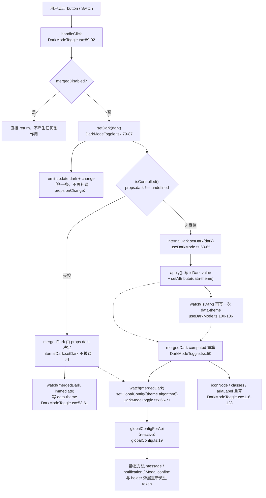
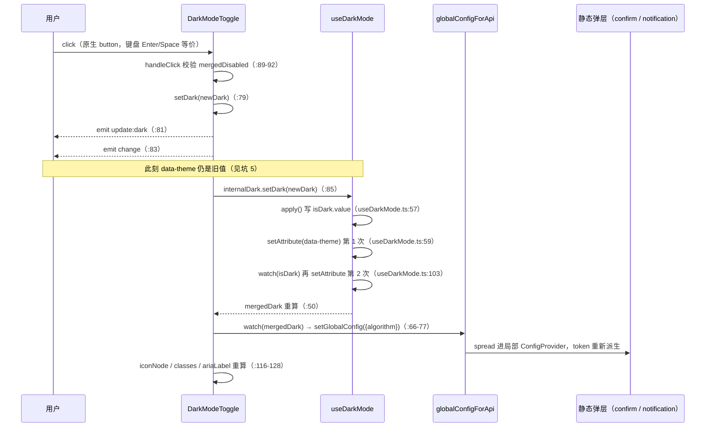
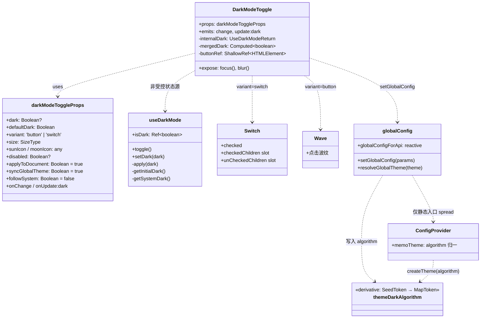

# C12-03 DarkModeToggle 暗色切换

## 一、职责与边界

DarkModeToggle 是组件库里**唯一**把「用户点一下」这件事翻译成「两套主题系统同时换档」的组件。它对外只暴露一个开关语义的控件（圆形按钮或 `Switch` 风格），内部却同时驱动三条互不相干的通道：

1. **DOM 属性通道**——把状态写成 `<html data-theme="dark|light">`，供使用方自写的 CSS 变量表（`[data-theme='dark'] { --xy-xxx }`）消费，实现是 `useDarkMode.ts:4-9`、`useDarkMode.ts:56-61`。
2. **主题算法通道**——把 `theme.darkAlgorithm` / `theme.defaultAlgorithm` 通过 `setGlobalConfig` 灌进全局配置，使 `message`、`notification`、`Modal.confirm` 这类**脱离页面级 ConfigProvider 的静态方法**也跟着换色板，实现是 `DarkModeToggle.tsx:63-77`。
3. **系统偏好通道**——`followSystem` 打开时监听 `matchMedia('(prefers-color-scheme: dark)')` 的 `change` 事件，把 OS 偏好实时映射成组件状态，实现是 `useDarkMode.ts:11-14`、`useDarkMode.ts:80-93`。

它的边界同样清晰，而且这些「没做」比「做了」更需要被写下来：

- **不做持久化**。整个组件目录内没有任何 `localStorage` / `sessionStorage` 读写（可用 `grep -rn "localStorage" packages/xiaoye-ui/src/dark-mode-toggle/` 复现，结果为空）。刷新页面即回到 `defaultDark`。
- **不管 VitePress 文档站的暗色**。文档站有自己一套 `vp-app.vue` + `useData().site.appearance` 机制，和组件库这条链路无关，本篇不做类比展开。
- **不管 CSS 变量体系的落地**。它只负责「设置 `data-theme`」和「切换算法」，`[data-theme='dark']` 下真正长什么样，是使用方的样式或 token 派生的结果。
- **不做 SSR 首屏防闪烁**。`useDarkMode` 的初始值来自 `document.documentElement` 的既有属性或 `initialValue`（`useDarkMode.ts:18-9`、`useDarkMode.ts:47-51`），服务端渲染阶段 `typeof document === 'undefined'` 时直接返回 `false`，不存在「提前脚本注入」的口子。

与 A03 Design Token 四层体系（Seed → Map → Alias → Component）的衔接点只在**第二条通道**：算法切换改变的是 Map Token 的派生方式，本篇不重复展开四层体系本身，只论证「算法实例如何被切给 ConfigProvider」。

## 二、源码地图

```
packages/xiaoye-ui/src/dark-mode-toggle/
├── index.ts                     # 导出入口 + install（registerComponent）
├── DarkModeToggle.tsx           # 主组件，172 行，受控判定 + 三条通道编排
├── darkModeToggleTypes.ts       # props 定义，42 行，13 个 prop
├── useDarkMode.ts               # 状态 composable，115 行，DOM 属性 + matchMedia
├── style/index.ts               # CSS-in-JS 样式 hook（genComponentStyleHook('DarkModeToggle')）
└── __tests__/
    └── dark-mode-toggle.test.tsx # 单元测试，264 行，3 describe / 22 it
```

两点与 AGENTS.md 模板的偏差（如实记录）：组件目录内**没有** `demo/` 子目录（`ls packages/xiaoye-ui/src/dark-mode-toggle/demo` 报 `No such file or directory`），文档示例全部放在站点侧 `apps/docs/examples/dark-mode-toggle/`，共 5 个文件（`basic.vue`、`controlled.vue`、`custom-icon.vue`、`with-config-provider.vue` 系列的 `with-config-provider`、`with-switch.vue`）；说明文字在 `apps/docs/components/dark-mode-toggle.md`（116 行），另有一篇指南 `apps/docs/guide/dark-mode.md`（126 行）在 `:85` 复述了「通过 `ConfigProvider.config()` 自动切换全局主题算法（`syncGlobalTheme`，默认开启）」这条契约。

关联的外部文件（组件本身不拥有，但机制必须靠它们才成立）：

| 文件                        | 在本篇中的作用                                                                                                       |
| --------------------------- | -------------------------------------------------------------------------------------------------------------------- |
| `theme/index.ts:5,29`       | 把 `./themes/dark` 的 derivative 以 `darkAlgorithm` 名字挂到 `theme` 默认导出上，`DarkModeToggle.tsx:13` 依赖这个入口 |
| `theme/themes/dark/index.ts`| 暗色算法实体：42 行，重新生成色板并覆盖中性色                                                                          |
| `config/index.ts:2,52`      | `darkAlgorithm` 的第二个对外出口（与 `theme` 聚合出口并列），同时提供 `applyTheme` / `getThemeCssString` |
| `config-provider/globalConfig.ts:18,19,123` | `globalConfigBySet`（reactive，权重最高）/ `globalConfigForApi` / `setGlobalConfig` 三件套，是算法通道落地的地方      |
| `switch/index.ts`           | `variant === 'switch'` 时直接复用 Switch 渲染（`DarkModeToggle.tsx:132-148`）                                          |
| `_util/wave`                | `variant === 'button'` 时包一层点击波纹（`DarkModeToggle.tsx:153`）                                                     |
| `@xiaoye-ui/icons`          | 内置 `SunIcon` / `MoonIcon`（`DarkModeToggle.tsx:5`）                                                                   |

入口导出面（`index.ts:13-28`）：

```typescript
// packages/xiaoye-ui/src/dark-mode-toggle/index.ts:13-28
export { darkModeToggleProps, useDarkMode };
export type {
  DarkModeToggleProps,
  DarkModeToggleVariant,
  DarkModeToggleSize,
  UseDarkModeOptions,
  UseDarkModeReturn,
};

/* istanbul ignore next */
DarkModeToggle.install = function (app: App) {
  registerComponent(app, DarkModeToggle);
  return app;
};

export default DarkModeToggle as typeof DarkModeToggle & Plugin;
```

值得注意的是：`useDarkMode` 是**公开 API**，不只服务本组件。任何使用方都能脱离 `XYDarkModeToggle` 单独拿它管理 `data-theme`，`useDarkMode.ts:71-97` 专门用 `getCurrentInstance()` 区分「组件内」与「裸调用」两种上下文来保证这件事成立——这是本篇论点 4 的核心。

## 三、架构与数据流

一次点击在组件内部会分裂成两条独立的写入路径，其中只有第一条经过 `useDarkMode`：



`data-theme` 属性通道的**读取侧**在本仓库里只有文档示例样式，没有一处组件库自身样式：

```
$ grep -rn "data-theme" packages/xiaoye-ui/src --include='*.ts' --include='*.tsx' --include='*.less' | head -40
packages/xiaoye-ui/src/config/index.ts:24:  root.setAttribute('data-theme', mode);
packages/xiaoye-ui/src/dark-mode-toggle/DarkModeToggle.tsx:57: ...
packages/xiaoye-ui/src/dark-mode-toggle/useDarkMode.ts:4:const DARK_MODE_ATTRIBUTE = 'data-theme';
packages/xiaoye-ui/src/_shared/style/genCardLikeStyle.ts:7: * 暗色模式交由 ConfigProvider darkAlgorithm 改 token 值，无需 [data-theme='dark'] 覆盖。
```

结果里除了写入语句、注释和测试断言之外**没有一条 `[data-theme='dark'] { ... }` 形式的选择器**；组件库侧唯一的反向表述是 `genCardLikeStyle.ts:7` 那句注释，它明确说暗色是靠算法改 token 值、不需要属性覆盖。而读取 `[data-theme='dark']` 的选择器全部出现在文档站的示例样式里（如 `apps/docs/examples/layout/side.vue:81`、`apps/docs/examples/form/advanced-search.vue:71`），是站点自己的 demo 样式，不属于组件产物。

再看一次点击的**时序**（这是坑 5 的根源，注意事件与 DOM 写入的先后）：



受控模式下两路事件发完之后就分叉：`isControlled()` 为真（`:84`）时不调用 `internalDark.setDark`，`mergedDark` 完全由 `props.dark` 决定，`data-theme` 改由组件自己的 `watch`（`:53-61`）写入。

## 四、核心机制精读

### 论点 1：它改的是 `data-theme` 属性，不是 `html.dark` 类，也不是 `prefers-color-scheme`

**断言**：组件对 DOM 的唯一写入是 `document.documentElement` 上的 `data-theme` 属性，取值严格是 `'dark'` / `'light'` 两个字符串；全链路没有任何 `classList` 操作，`prefers-color-scheme` 只作为**输入**（读取系统偏好）而不是输出目标。

```typescript
// packages/xiaoye-ui/src/dark-mode-toggle/useDarkMode.ts:4-14
const DARK_MODE_ATTRIBUTE = 'data-theme';

const getInitialDark = (): boolean => {
  if (typeof document === 'undefined') return false;
  return document.documentElement.getAttribute(DARK_MODE_ATTRIBUTE) === 'dark';
};

const getSystemDark = (): boolean => {
  if (typeof window === 'undefined' || !window.matchMedia) return false;
  return window.matchMedia('(prefers-color-scheme: dark)').matches;
};
```

```typescript
// packages/xiaoye-ui/src/dark-mode-toggle/useDarkMode.ts:56-61
const apply = (dark: boolean) => {
  isDark.value = dark;
  if (applyToDocument && typeof document !== 'undefined') {
    document.documentElement.setAttribute(DARK_MODE_ATTRIBUTE, dark ? 'dark' : 'light');
  }
};
```

三点值得逐字看：

1. `DARK_MODE_ATTRIBUTE` 是一个模块级常量（`useDarkMode.ts:4`），**不可配置**。组件没有暴露「改叫 `data-scheme` / 改成写 class」的选项，`applyToDocument`（`darkModeToggleTypes.ts:28`）只能选「写」或「不写」。
2. `getInitialDark`（`useDarkMode.ts:6-9`）读的是**同一个属性的当前值**，也就是「以 DOM 现状为准」的单向自举：如果使用方在 HTML 里提前硬编码 `<html data-theme="dark">`，组件挂载时就会把自己识别成暗色。这既是特性也是坑（见坑 1）。
3. `getSystemDark`（`useDarkMode.ts:11-14`）只做 `.matches` 的一次性快照读取，媒体查询对象与监听器在 `onMounted` 里才建立（`useDarkMode.ts:80-86`）。

再看组件侧对属性的第二处直接写入：

```typescript
// packages/xiaoye-ui/src/dark-mode-toggle/DarkModeToggle.tsx:52-61
// 受控模式下，外部 dark 变化时也同步到 document
watch(
  mergedDark,
  value => {
    if (isControlled() && props.applyToDocument && typeof document !== 'undefined') {
      document.documentElement.setAttribute('data-theme', value ? 'dark' : 'light');
    }
  },
  { immediate: true },
);
```

这里属性名是**字符串字面量** `'data-theme'` 而不是复用 `useDarkMode` 的常量（对比 `useDarkMode.ts:59`），属于同一语义在两处各写一遍。加上 `: { immediate: true }`，意味着受控模式下组件一 setup 就无条件把 `props.dark` 刷到 `<html>` 上，覆盖 `getInitialDark` 读到的原值。

判别性证据（组件目录内不存在任何 class 形式的主题开关）：

```
$ grep -rn "classList" packages/xiaoye-ui/src/dark-mode-toggle | wc -l
       0
$ grep -rn "aria-\|role=" packages/xiaoye-ui/src/dark-mode-toggle --include='*.tsx'
packages/xiaoye-ui/src/dark-mode-toggle/DarkModeToggle.tsx:140:            aria-label={ariaLabel.value}
packages/xiaoye-ui/src/dark-mode-toggle/DarkModeToggle.tsx:158:            role="switch"
packages/xiaoye-ui/src/dark-mode-toggle/DarkModeToggle.tsx:159:            aria-checked={mergedDark.value}
packages/xiaoye-ui/src/dark-mode-toggle/DarkModeToggle.tsx:160:            aria-label={ariaLabel.value}
```

`classList` 命中数为 0；类名侧只有 `prefixCls` 派生的状态类（`DarkModeToggle.tsx:118-126`），形如 `xy-dark-mode-toggle-checked`，**不含**任何 `-dark` / `.dark` 主题类。同理 `style/index.ts` 内 `grep -rniE "'dark'|\"dark\"|-dark"` 也无命中——组件样式里没有以暗色为名的选择器。

### 论点 2：`syncGlobalTheme` 默认开启，算法是**真的**灌给了 ConfigProvider，不是只好看

**断言**：这是本组件最容易被误判为「文档站外观玩具」的地方——它确实把 `theme.darkAlgorithm` 通过 `setGlobalConfig` 写进了全局配置对象，并且默认开启（`syncGlobalTheme` 默认 `true`），因此**未包裹在页面级 ConfigProvider 内的静态方法弹层也会跟随换色板**。

```typescript
// packages/xiaoye-ui/src/dark-mode-toggle/darkModeToggleTypes.ts:29-33
  /**
   * 是否同步切换全局主题算法（ConfigProvider.config）。
   * 开启后静态方法（message / notification / Modal.confirm）与 holder 弹层也会跟随切换暗/浅。
   */
  syncGlobalTheme: { type: Boolean, default: true },
```

注意 `DarkModeToggle.tsx:20-26` 的 `initDefaultProps` 默认表里**没有**列 `syncGlobalTheme`，它的 `true` 来自 props 定义自身的 `default: true`（`darkModeToggleTypes.ts:33`），两条默认机制在这里只生效后者。

```typescript
// packages/xiaoye-ui/src/dark-mode-toggle/DarkModeToggle.tsx:63-77
    // 同步全局主题算法：使 message / notification / Modal.confirm 等静态方法与
    // holder 弹层（包括未包裹在页面级 ConfigProvider 内的场景）跟随暗/浅切换
    if (props.syncGlobalTheme) {
      watch(
        mergedDark,
        dark => {
          setGlobalConfig({
            theme: {
              algorithm: dark ? theme.darkAlgorithm : theme.defaultAlgorithm,
            },
          });
        },
        { immediate: true },
      );
    }
```

`import theme from '../theme'`（`DarkModeToggle.tsx:13`）拿到的是主题算法聚合出口，`darkAlgorithm` 名字挂在 `theme/index.ts:5,29`（`import darkAlgorithm from './themes/dark'` 后再挂到默认导出）。

落地端在 `globalConfig.ts`：

```typescript
// packages/xiaoye-ui/src/config-provider/globalConfig.ts:123-133（节选）
export const setGlobalConfig = (
  // ...
) => {
  // ...
    Object.assign(globalConfigForApi, reactive({ ...rest, theme: resolvedTheme }));
```

`globalConfigForApi`（`globalConfig.ts:19`）与 `globalConfigBySet`（`globalConfig.ts:18`，注释标注「权重最大」）都是 `reactive` 对象，所以这次 `Object.assign` 会触发依赖它的渲染效应重跑——算法换档不需要使用方手动 `key` 刷新。

**反证检查**：算法通道与 `data-theme` 通道是否真的耦合？答案是否——两者由两个**互相独立**的 `watch` 驱动（`DarkModeToggle.tsx:53-61` 与 `DarkModeToggle.tsx:66-77`），关掉 `applyToDocument` 只断掉属性写入，`setGlobalConfig` 照旧执行；反之 `syncGlobalTheme=false` 时属性照写、组件库 token 不动。这解释了一个常见困惑：「为什么点了开关，页面变暗但组件库弹层没变？」——只有 `applyToDocument` 生效，`syncGlobalTheme` 被显式关掉了。

### 论点 3：文档站用的是另一套机制，二者只差在「谁持久化」

**断言**：`apps/docs` 的暗色开关**没有**使用 `XYDarkModeToggle`，它用 `@vueuse/core` 的 `useDark`（写 `html.dark` 类 + localStorage），再在自己的 `ConfigProvider` 上映射算法；这与组件的「写 `data-theme`、不持久化」是两套并行且互不相认的实现。

```typescript
// apps/docs/.vitepress/vitepress/composables/dark.ts:1-7
import { useDark, useToggle } from '@vueuse/core';

export const isDark = useDark({
  storageKey: 'vitepress-theme-appearance',
});

export const toggleDark = useToggle(isDark);
```

```typescript
// apps/docs/.vitepress/vitepress/components/vp-app.vue:19-22
// Theme algorithm based on VitePress dark mode
const themeAlgorithm = computed(() => {
  return isDark.value ? [theme.darkAlgorithm] : [theme.defaultAlgorithm];
});
```

对照第二处映射写法：

```typescript
// apps/docs/.vitepress/vitepress/composables/theme.ts:7-16
export function useThemeAlgorithm() {
  const algorithm = computed(() => {
    return isDark.value ? darkAlgorithm : defaultAlgorithm;
  });

  return {
    algorithm,
    isDark,
  };
}
```

四处差异逐条对：

| 维度        | `XYDarkModeToggle` + `useDarkMode`                     | VitePress 文档站（`composables/dark`）                 |
| ----------- | ------------------------------------------------------ | ------------------------------------------------------ |
| DOM 目标    | `<html data-theme="dark\|light">`（`useDarkMode.ts:59`） | `<html class="dark">`：`dark.ts:3-5` 只覆盖了 `storageKey`，`selector` / `attribute` 均按 `useDark` 默认值（写 `<html>` 的 `class`） |
| 持久化      | 无（组件目录内无 storage 读写）                          | 有，`storageKey: 'vitepress-theme-appearance'`（`dark.ts:4`） |
| 算法接入    | `setGlobalConfig` 全局（`DarkModeToggle.tsx:69-73`）     | 页面级 `ConfigProvider` 的 `theme`（`vp-app.vue:20-21`）  |
| 算法形态    | 单个函数值 `algorithm: darkAlgorithm`                    | 数组 `[theme.darkAlgorithm]`（`vp-app.vue:21`）            |

`grep -rn "DarkModeToggle\|dark-mode-toggle" apps/docs/.vitepress` 的全部命中只有一处，是文档侧边栏的条目名 `apps/docs/.vitepress/config/index.ts:48`，不是运行时使用。**结论**：文档站是组件的「展示者」而非「使用者」，读源码时不要把 `html.dark` 当成组件行为，也不要把 `data-theme` 当成文档站行为。

算法值形态的「函数 vs 数组」差异值得一提：`DarkModeToggle.tsx:71` 传的是裸函数，`vp-app.vue:21` 传的是数组。数组形式在 `resolveGlobalTheme`（`globalConfig.ts:72` 起）与 ConfigProvider 里都被支持（多算法可串联，如 dark + compact），单函数等价于长度为 1 的数组——使用方若把两者混用（既有全局又有局部）时，靠的是数组顺序表达叠加语义，组件这种裸函数写法无法叠加 `compactAlgorithm`。

### 论点 4：`useDarkMode` 用 `getCurrentInstance()` 分流，同一次切换最多写三次 `data-theme`

**断言**：`useDarkMode` 是公开 composable，必须同时支持「在组件 setup 里用」和「在组件外用」，它靠 `getCurrentInstance()` 判定上下文；代价是非受控路径上 `data-theme` 会被冗余写入多次，而 `followSystem` 的媒体查询监听**只有组件上下文才会注册**。

```typescript
// packages/xiaoye-ui/src/dark-mode-toggle/useDarkMode.ts:71-97
  // 仅在组件 setup 上下文中注册生命周期钩子，便于 composable 也能在测试 / 工具函数中直接调用
  const inComponent = !!getCurrentInstance();

  if (inComponent) {
    onMounted(() => {
      // 进入页面时同步一次初始状态到 document
      if (applyToDocument && typeof document !== 'undefined') {
        document.documentElement.setAttribute(DARK_MODE_ATTRIBUTE, isDark.value ? 'dark' : 'light');
      }
      if (followSystem && typeof window !== 'undefined' && window.matchMedia) {
        mediaQuery = window.matchMedia('(prefers-color-scheme: dark)');
        mediaHandler = (event: MediaQueryListEvent) => {
          apply(event.matches);
        };
        mediaQuery.addEventListener?.('change', mediaHandler);
      }
    });

    onBeforeUnmount(() => {
      if (mediaQuery && mediaHandler) {
        mediaQuery.removeEventListener?.('change', mediaHandler);
      }
    });
  } else if (applyToDocument && typeof document !== 'undefined') {
    // 非组件环境下立即同步一次初始状态
    document.documentElement.setAttribute(DARK_MODE_ATTRIBUTE, isDark.value ? 'dark' : 'light');
  }
```

三段逻辑逐条拆：

1. **`inComponent` 是运行期分支，不是类型分支**（`useDarkMode.ts:72`）。裸调用时 `getCurrentInstance()` 返回 `null`，走 `else if` 分支立即写属性（`useDarkMode.ts:94-97`）。副作用是：裸调用 `useDarkMode({ followSystem: true })` **不会**监听系统变化——`mediaQuery` 的创建被写在 `onMounted` 里（`useDarkMode.ts:80-86`），组件外根本没有这个钩子。这是一个只在源码里能看到的语义缺口，`followSystem` 文档描述（`darkModeToggleTypes.ts:34-35`）只说「仅非受控模式下生效」，没说「仅在组件内生效」。
2. **`onBeforeUnmount` 只清理监听器，不清理属性**（`useDarkMode.ts:89-93`）。组件卸载后 `<html data-theme>` 保持最后一次写入值，这是合理取舍（样式不该随控件卸载而回跳），但和「不持久化」叠加后形成第三种状态：属性留着、没有任何组件在管它。
3. **第三个写入点**在 `useDarkMode.ts:100-106`：

```typescript
// packages/xiaoye-ui/src/dark-mode-toggle/useDarkMode.ts:99-106
  // 当外部直接修改 isDark.value 时，也同步到 document
  if (applyToDocument) {
    watch(isDark, value => {
      if (typeof document !== 'undefined') {
        document.documentElement.setAttribute(DARK_MODE_ATTRIBUTE, value ? 'dark' : 'light');
      }
    });
  }
```

把三处合起来数一次「非受控点击」的 DOM 写入：`setDark → apply`（`useDarkMode.ts:59`）写第 1 次；`apply` 改 `isDark.value` 触发 `watch`（`useDarkMode.ts:103`）写第 2 次；组件挂载时 `onMounted`（`useDarkMode.ts:78`）在首屏额外写第 3 次（只发生在 mount，不参与点击）。三者写入的值总是一致的，所以症状只是「多调一次 `setAttribute`」，不是错乱；但它意味着 `useDarkMode.ts:56-61` 与 `useDarkMode.ts:100-106` 里的任意一处都可以删掉而不改变可观测行为——这是一个真实的冗余，不是设计上的双保险。

另外注意 `isDark` 用的是 `ref` 而不是 `shallowRef`（`useDarkMode.ts:47`），而 AGENTS.md 的性能约定推荐 `shallowRef`；对 boolean 而言两者开销相同，但这是组件库里少见的 `ref(boolean)` 写法，`DarkModeToggle.tsx:94` 的 `buttonRef` 反而用了 `shallowRef`。

### 论点 5：按钮风格用 `role="switch"` + `aria-checked`，键盘免费获得，但 `focus()` 在开关风格下是空实现

**断言**：`variant === 'button'` 分支渲染的是原生 `<button type="button">`，靠原生语义白拿键盘支持，并显式声明 `role="switch"` + `aria-checked` + `aria-label`；但组件 `expose` 的 `focus()/blur()` 绑定的 `buttonRef` **只在按钮分支挂载**，开关风格下调用是静默 no-op。

```tsx
// packages/xiaoye-ui/src/dark-mode-toggle/DarkModeToggle.tsx:151-169
      // 按钮风格：圆形按钮带图标
      return wrapSSR(
        <Wave>
          <button
            {...attrs}
            ref={buttonRef}
            type="button"
            role="switch"
            aria-checked={mergedDark.value}
            aria-label={ariaLabel.value}
            disabled={mergedDisabled.value}
            class={[classes.value, attrs.class]}
            style={attrs.style}
            onClick={handleClick}
          >
            {iconNode.value}
          </button>
        </Wave>,
      );
```

```tsx
// packages/xiaoye-ui/src/dark-mode-toggle/DarkModeToggle.tsx:94-99
    const buttonRef = shallowRef<HTMLElement | null>(null);

    expose({
      focus: () => buttonRef.value?.focus(),
      blur: () => buttonRef.value?.blur(),
    });
```

对照开关分支，`buttonRef` 从未被绑定：

```tsx
// packages/xiaoye-ui/src/dark-mode-toggle/DarkModeToggle.tsx:132-142
      if (props.variant === 'switch') {
        return wrapSSR(
          <Switch
            {...attrs}
            class={[classes.value, `${prefixCls.value}-switch`, attrs.class]}
            checked={mergedDark.value}
            disabled={mergedDisabled.value}
            size={size.value === 'small' ? 'small' : 'default'}
            aria-label={ariaLabel.value}
            onUpdate:checked={(v: boolean | string | number) => setDark(!!v)}
```

`<Switch>` 上没有 `ref={buttonRef}`（`:132-148` 整段都没有），因此 `variant="switch"` 时 `wrapper.vm.focus()` 命中 `buttonRef.value === null`，可选链让调用静默返回 `undefined`。测试没抓到它，因为 `dark-mode-toggle.test.tsx:168-174` 只断言「属性是函数」：

```tsx
// packages/xiaoye-ui/src/dark-mode-toggle/__tests__/dark-mode-toggle.test.tsx:168-174
  it('exposes focus and blur methods', () => {
    const wrapper = mount(DarkModeToggle);
    const vm = wrapper.vm as any;
    expect(typeof vm.focus).toBe('function');
    expect(typeof vm.blur).toBe('function');
    wrapper.unmount();
  });
```

它挂载的是默认 `variant`（按钮风格，`DarkModeToggle.tsx:21`），既没有断言焦点真的落到 `<button>`，也没有 `variant="switch"` 的第二组用例。

无障碍面上的其余事实：

- **键盘**：按钮分支是原生 `<button>`，Tab 可聚焦、Enter/Space 触发 `click`，因此 `handleClick`（`DarkModeToggle.tsx:89-92`）天然对键盘生效；组件没有实现 `onKeydown`。开关分支由 Switch 自己实现键盘：`switch/index.tsx:200` 有 `onKeydown={handleKeyDown}`。
- **`role="switch"` 的取舍**：`aria-checked`（`:159`）表达二态开关，比 `aria-pressed`（切换按钮的惯例）更贴近「暗色/亮色是两种状态」的语义；但同一个 `role="switch"` 在按钮分支与开关分支重复出现，页面上若两者并存会出现两个同名 `aria-label` 的 switch（`ariaLabel` 文案只由状态决定，`:128`，不含组件用途上下文）。
- **`disabled` 用原生属性**：`:161` 直接写 `disabled={mergedDisabled.value}`，浏览器会自动把元素移出 Tab 序列并阻止 `click`；同时 `handleClick` 内部又用 `mergedDisabled` 挡了一层（`:90`），双层防御。
- **`aria-label` 是硬编码中文**：`:128` 的字面量 `'切换到亮色模式' / '切换到暗色模式'` 没有走 locale。整个组件目录内 `grep -rn "locale\|useLocale" packages/xiaoye-ui/src/dark-mode-toggle/` 无输出（只有 `useConfigInject` 的 `prefixCls/direction/size` 三项被解构，`DarkModeToggle.tsx:34`），也就是**没有**接入 `ConfigProvider` 的多语言链路。AGENTS.md 的无障碍条款要求遵循 WCAG，可读名称（non-text content）在非中文站点上会退化成中文播报。
- **无 `aria-keyshortcuts` / 无 `title`**：源码里没有对应属性，`:154-167` 是完整的属性清单。

### 论点 6：测试真实被执行，22 条用例覆盖了 DOM 属性与算法两条通道，但无障碍与系统偏好零覆盖

**断言**：本组件**有**测试且**会**被跑到；但覆盖面对「无障碍属性」和「状态持久化」两条完全空白，且唯一的 focus 用例是形式断言。

```
$ find packages/xiaoye-ui/src/dark-mode-toggle -name '*.test.*'
packages/xiaoye-ui/src/dark-mode-toggle/__tests__/dark-mode-toggle.test.tsx

$ grep -n "include:" packages/xiaoye-ui/vitest.config.mts
33:    include: ['tests/**/*.test.{js,ts,jsx,tsx}', 'src/**/*.test.{js,ts,jsx,tsx}'],
```

文件路径 `src/dark-mode-toggle/__tests__/dark-mode-toggle.test.tsx` 能被 `src/**/*.test.tsx` 匹配，因此**确实在执行范围内**（不是只靠 `tests/` 目录）。测试文件共 264 行，三个 `describe`：`DarkModeToggle`（`:10`）、`DarkModeToggle syncGlobalTheme`（`:177`）、`useDarkMode`（`:206`），合计 22 个 `it`（两种统计方式一致：`grep -c "it(" = 22`、`grep -n "^\s*it(\|^\s*test(" | wc -l = 22`）。

覆盖到的关键行为与未覆盖到的行为：

| 已覆盖（举其要）                                                                   | 位置                            |
| ---------------------------------------------------------------------------------- | ------------------------------- |
| 默认渲染、`defaultDark` 产生 `-checked` 类                                            | `:21`、`:29`                     |
| 点击切换、`change` 与 `update:dark` 双事件                                            | `:37`、`:47`                     |
| `v-model:dark` 受控                                                                  | `:57`                            |
| `disabled` 不响应点击                                                                 | `:71`                            |
| switch 风格渲染与点击                                                                 | `:81`、`:89`                     |
| `sunIcon` / `moonIcon` 走 props 与走插槽两条解析路径                                    | `:99`、`:110`、`:121`            |
| `applyToDocument` 开 / 关时 `data-theme` 的写入与不写入                                 | `:132`、`:143`                   |
| 尺寸类 `-small` / `-large`                                                            | `:154`、`:161`                   |
| 全局算法跟随切换、`syncGlobalTheme=false` 时不覆盖已有全局主题                            | `:178-189`、`:191-203`           |
| `useDarkMode` 裸调用的返回形状、`initialValue`、`setDark`、`toggle`、属性同步              | `:215`–`:262`                    |

**零覆盖的三项**（都可用同一条命令验证，命中数为 0）：

```
$ grep -rn "aria-\|role=\|matchMedia\|localStorage" packages/xiaoye-ui/src/dark-mode-toggle/__tests__/ | wc -l
       0
```

1. **无障碍属性**：`role="switch"`、`aria-checked`、`aria-label`（组件侧 `DarkModeToggle.tsx:158-160`）没有任何断言，改动渲染分支时不会被测试拦住。
2. **`followSystem` / 媒体查询**：`useDarkMode.ts:80-93` 的整段监听逻辑（含 `onBeforeUnmount` 清理）无测试——jsdom 默认不提供 `matchMedia`，要测得先 mock，仓库里没有这个 mock。
3. **持久化**：本身没有实现，自然没有测试；但这意味着「刷新后状态」这类回归无人看守。

另外值得记录的测试细节：`:14`、`:18`、`:208`、`:212` 都在 `beforeEach/afterEach` 里 `document.documentElement.removeAttribute('data-theme')`，说明测试作者已经意识到「属性写在全局 `<html>` 上会污染相邻用例」；`:193` 甚至用 `delete (globalConfigForApi as any).theme` 手工清除前一个用例的全局残留——这两处正是本组件「副作用是全局单例」的旁证（对应坑 1、坑 2）。

### 论点 7：状态持久化与 FOUC 的答案是「组件不提供，宿主必须提供」

**断言**：本篇最容易被误答的一问——「它写 `localStorage` 吗？」答案是**不写**，而且源码里连读都没有；由此推出的直接后果是 SSR/刷新都会回到亮色，除非宿主自己注入。

三条通道的时序如下，全部集中在客户端生命周期：

| 时机                     | 发生什么                                                                       | 位置                          |
| -------------------------- | ----------------------------------------------------------------------------- | ------------------------------ |
| setup（可能服务端）        | `useDarkMode` 求初始值；服务端 `typeof document === 'undefined'` → `false`        | `useDarkMode.ts:7`、`:12`       |
| setup（服务端）            | `watch(mergedDark, ..., { immediate: true })` 的回调执行，但被 `typeof document` 守卫拦住 | `DarkModeToggle.tsx:56`         |
| setup（服务端）            | 算法通道的 `watch` **没有** document 守卫，`setGlobalConfig` 会被调用               | `DarkModeToggle.tsx:66-77`      |
| `onMounted`               | 把当前 `isDark` 刷到 `<html data-theme>`，并按需建媒体监听                             | `useDarkMode.ts:75-86`          |
| 每次 `isDark` 变化         | `watch(isDark)` 再刷一次属性                                                     | `useDarkMode.ts:100-106`        |

第三行值得单独指出：`setGlobalConfig`（`DarkModeToggle.tsx:69`）这条路径**不受** `typeof document` 保护，服务端渲染阶段也会执行一次，把全局算法设为 `defaultAlgorithm`。这在纯 Node 进程里是一个**跨请求共享的可变全局状态**——`globalConfigForApi` 是模块级 `reactive` 对象（`globalConfig.ts:19`），若宿主用同一个 Node 进程服务多个请求，A 请求挂载的 toggle 会影响 B 请求。这是本篇未能从组件源码内找到防护的一处风险，也是 AGENTS.md「SSR 兼容」要求下这个组件最实质的缺口；定位 `packages/xiaoye-ui/src/dark-mode-toggle/DarkModeToggle.tsx:65-77`、`packages/xiaoye-ui/src/config-provider/globalConfig.ts:18-19`。

与之对照，仓库里**存在**一条真正的「SSR 提前注入」实现，但它不属于本组件：`packages/xiaoye-ui/src/config/index.ts:23-48` 的 `getThemeCssString(mode)` 返回一段纯 CSS 变量字符串（`:24-33` 是亮色 8 个变量、`:35-44` 是暗色 8 个变量），由 Nuxt 模块的服务端插件在渲染时消费——`packages/nuxt-module/src/runtime/plugin.server.ts:2` 导入、`:24` 从 runtimeConfig 判定 mode、`:25` 求值 CSS 串、`:35` 把 `<style id="xy-global-theme-variables">` 塞进 head、**`:36` 直接 `html.htmlAttrs.push(\`data-theme="${mode}"\`)`**，即首屏 HTML 的 `<html>` 标签上就带着 `data-theme`；`:32-33` 的注释解释了为什么复用同一个 style id（水合时让 `registerCssVariables` 更新而非新建标签）。该文件 `:20` 与 `:31` 的注释都自称「C4: SSR FOUC 修复」，可见**防闪烁是被当作 Nuxt 模块的职责实现的，而不是组件的职责**。

这条链路的属性写入路径是 `config/index.ts:7-11` 的 `applyTheme`（同样写 `data-theme`、同样不读 storage）。**两套机制写同一个属性名**，这是本篇能确认的、最容易在改动时踩到的现实冲突：Nuxt 宿主里 `plugin.server.ts:36` 注入的 `data-theme` 与 `XYDarkModeToggle` 的 `useDarkMode` 会互相覆盖 `<html data-theme>`，而后者只在 `getInitialDark()`（`useDarkMode.ts:6-9`）里读它一次——且如「取舍 3」所论证，那次读取在组件路径上根本不会被执行。于是 Nuxt 场景下的真实行为是：SSR 输出 `data-theme="dark"`，客户端一挂载 toggle，`watch(mergedDark, { immediate: true })`（`DarkModeToggle.tsx:53-61`）就按 `defaultDark=false` 把它刷回 `light`。

## 五、对外契约如何生效

组件的公开契约有 5 类，逐类给出「契约在哪定义 + 谁消费它」的证据链。

**(1) 组件名与全局标签名。** `name: 'XYDarkModeToggle'`（`DarkModeToggle.tsx:17`）配合 `index.ts:23-26` 的 `registerComponent(app, DarkModeToggle)`，由注册工具把 `XYXxx` 映射成 `xy-xxx` 标签（AGENTS.md 强制约定）。`__XY_DARK_MODE_TOGGLE: true`（`DarkModeToggle.tsx:19`）是内部标识，供其他组件识别「这是一个暗色开关」而非普通按钮；`grep -rn "__XY_DARK_MODE_TOGGLE" packages/xiaoye-ui/src` 只命中定义处本身，说明**当前没有消费方**，它属于预留标记。

**(2) 事件契约。** `emits: ['change', 'update:dark']`（`DarkModeToggle.tsx:32`）+ props 里的 `onChange` / `'onUpdate:dark'`（`darkModeToggleTypes.ts:36-37`）双轨——但双轨只是类型面，运行时出口只有一条：`setDark` 一次调用发两路（`:81`、`:83`），且**不受控与否都会发**。以下是现状（2026-09-29 改过，见下段）：

```typescript
// packages/xiaoye-ui/src/dark-mode-toggle/DarkModeToggle.tsx:79-87
    const setDark = (dark: boolean) => {
      if (mergedDisabled.value) return;
      emit('update:dark', dark);
      // emit 已覆盖 vnode 上的 props.onChange，再手工调一次就是双投
      emit('change', dark);
      if (!isControlled()) {
        internalDark.setDark(dark);
      }
    };
```

改之前 `emit('change', dark)` 后面还紧跟一行 `props.onChange?.(dark)`（`HEAD` 的 `:82`、`:83`），也就是本栏其它篇目在归类的「事件双投递」缺陷族的形态②（`emit('x')` 紧跟 `props.onX?.(...)` 直调）：Vue 的 `emit` 本就从 `instance.vnode.props` 里取 `onChange`，而 `darkModeToggleTypes.ts:36` 声明的 `onChange` 正是同一个键，于是两条通道指向同一个用户函数。这一句已删，只留 emit；`props.onChange` 在组件里不再被读取。判别只能数调用次数——实测修前点一次 `@change` 收 2 次、修后 1 次，`toHaveBeenCalledWith` 这类断言在修前修后都成立，照不出来。现成回归用例是 `packages/xiaoye-ui/src/_util/__tests__/event-dispatch-count.test.tsx:224` 的「DarkModeToggle 点一次，@change 只投递一次」，判据在 `:228` 的 `toHaveBeenCalledTimes(1)`，把 `DarkModeToggle.tsx` 退回 `HEAD` 复跑即红。

这里有个容易被忽略的顺序契约：事件先发、状态后改（非受控分支在 `:84-86`）。使用方若在 `onChange` 里同步读 `document.documentElement.dataset.theme`，读到的是**旧值**，因为 `apply()` 还没执行。

**(3) 方法契约。** `expose({ focus, blur })`（`:96-99`）——见论点 5，开关风格下失效。

**(4) 样式契约。** `style/index.ts:148-160` 用 `genComponentStyleHook('DarkModeToggle', ...)` 注册，`mergeToken` 塞入三个组件 Token（`darkModeToggleSize: token.controlHeight`、`darkModeToggleIconSize: token.fontSizeIcon`、`darkModeToggleBorderRadius: '50%'`），其余全部引用 Alias/Map Token（`colorBgContainer`、`colorBorderSecondary`、`motionDurationMid`、`controlOutline` 等，`style/index.ts:36-55`）。含义是：**组件自身的外观由算法决定**，`darkAlgorithm` 一开，按钮底色/边框/图标色自动变暗，不需要任何 `[data-theme='dark']` 覆盖；`ComponentToken` 接口是空的（`style/index.ts:7`），即组件没有对外承诺可覆写的专属 token。尺寸契约走 `size`（`darkModeToggleTypes.ts:18`）映射到 `-small` / `-large` 类（`DarkModeToggle.tsx:123-124`）与 `controlHeightSM/LG`（`style/index.ts:101,106`）。

**(5) 全局副作用契约。** `setGlobalConfig` 写入的是**进程级单例**，`globalConfig.ts:129-134` 把它包在 `watchEffect` 里、并在每次调用前 `stopWatchEffect()`（`:124-126`）：

```typescript
// packages/xiaoye-ui/src/config-provider/globalConfig.ts:123-134（节选）
export const setGlobalConfig = (
  params: GlobalConfigProviderProps & { theme?: MaybeRef<GlobalConfigTheme> },
) => {
  if (stopWatchEffect) {
    stopWatchEffect();
  }
  stopWatchEffect = watchEffect(() => {
    const { theme, ...rest } = params;
    const resolvedTheme = resolveGlobalTheme(unref(theme));
    Object.assign(globalConfigBySet, reactive(rest));
    Object.assign(globalConfigForApi, reactive({ ...rest, theme: resolvedTheme }));
  });
```

消费方在两个静态入口，通过把 `globalConfigForApi` 整体 spread 进 `ConfigProvider` 来生效：

- `modal/confirm.tsx:78,84`：`const global = globalConfigForApi;` → `<ConfigProvider {...(global as any)} prefixCls={rootPrefixCls}>`
- `vc-notification/Notification.tsx:277,283`：`const global = globalConfigForApi;` → `<ConfigProvider {...global} prefixCls={rootPrefixCls}>`

而 `message` 静态方法**不直接读** `globalConfigForApi`——`grep -rln "globalConfigForApi" packages/xiaoye-ui/src` 的结果里 `message/` 目录一个都没有；它的暗色是靠 `message/index.tsx:76` 调 `Notification.newInstance(...)`，落到 `vc-notification/Notification.tsx:234` 建的 `NotificationWrapper`（`:253`），再由该 wrapper 的 render 读 `:277`、包 `:283` 才间接生效。也就是说：**注释里「message / notification / Modal.confirm」这句话（`DarkModeToggle.tsx:63-64`、`darkModeToggleTypes.ts:30-31`）在三者身上走的是两条不同链路**，message 是二跳生效。

同时 `useDarkMode` 作为独立公开导出（`index.ts:13`），其契约是「返回 `{ isDark, toggle, setDark }`」（`useDarkMode.ts:25-32`、`:108-112`）。注意 `toggle` 在组件内部**从未被使用**——组件走的是 `internalDark.setDark`（`DarkModeToggle.tsx:85`），`toggle` 只服务外部裸调用者，`useDarkMode.ts:67-69`。

## 六、设计取舍

静态结构上，这个组件是「一个 UI 壳 + 两个互不引用的状态源」：



四个关键取舍及其代价：

**取舍 1：属性名写死 `data-theme`，不提供 `attribute` / `selector` / `onStateChanged` 回调注入点。**
收益是零配置——默认就把状态挂到了「使用方最容易在 CSS 里消费」的位置；代价是遇到已经用 `html.dark` 类或 `data-color-scheme` 的项目必须自带一个 `MutationObserver` 或 `watch` 去桥接，或者干脆放弃 `applyToDocument`（`darkModeToggleTypes.ts:28`）自己写。`@vueuse/core` 的 `useDark` 恰恰提供这些配置项（对照 `apps/docs/.vitepress/vitepress/composables/dark.ts:3-5` 就传了 `storageKey`），所以本组件与文档站两套实现无法互换——这也是为什么 `useDarkMode` 与 `useDark` 是两个不兼容的抽象。

**取舍 2：不持久化，把选择权交给使用方。**
`useDarkMode` 全文没有 storage 读写（`useDarkMode.ts:1-115`，`grep -rn "localStorage" packages/xiaoye-ui/src/dark-mode-toggle/` 结果为空）。好处是组件不引入隐式全局状态、SSR 与测试环境行为可预测；代价是刷新即丢，而多数用户期待暗色偏好被记住。项目把这个能力留给了宿主（文档站用 vueuse 的持久化，见 `dark.ts:4`），组件库自己只提供 `defaultDark` 这个一次性入参（`darkModeToggleTypes.ts:16`）。

**取舍 3：读初始值用 DOM 现状而不是 props 单一真源。**
`getInitialDark`（`useDarkMode.ts:6-9`）以 `<html>` 上已有属性为准，这让「宿主已在服务端注入了 data-theme」的场景能自动对齐；但 `initialValue !== undefined` 时优先级更高（`useDarkMode.ts:48-50`），而组件永远传 `props.defaultDark`（默认 `false`，`DarkModeToggle.tsx:23`）——**因为默认值不是 `undefined`，`getInitialDark()` 实际上永远不会被触发**。这是全篇最微妙的一处：三元表达式 `initialValue !== undefined ? initialValue : getInitialDark() || ...`（`useDarkMode.ts:48-50`）在组件路径上恒走第一支。只有裸调用 `useDarkMode()`（不传 `initialValue`）才会读到 DOM 现状。用 `darkModeToggleProps` 里的 `defaultDark: { type: Boolean, default: false }`（`darkModeToggleTypes.ts:16`）加上 `initDefaultProps` 里的 `defaultDark: false`（`DarkModeToggle.tsx:23`）双重锁定，行为一致、但确实让 `getInitialDark` 在组件内成了死代码路径。

**取舍 4：`role="switch"` 而非 `aria-pressed`，且不复用 Button 组件。**
按钮分支自己写了 `<button>`（`DarkModeToggle.tsx:154-167`）而没有复用库内 `Button`，换来的是完全自控的圆形尺寸 token（`style/index.ts:31-32` 用 `darkModeToggleSize` 同时给宽高）和 `50%` 圆角（`style/index.ts:152`）；代价是 `Button` 的 `loading`、`href`、`block` 等能力这里都没有，也拿不到 Button 的键盘/焦点统一实现（本组件自己写了 `:focus-visible` 样式，`style/index.ts:52-55`）。

## 七、坑与改动指南

**坑 1：挂载即覆盖全局算法，卸载不回滚。**
- 触发：应用已经用 `ConfigProvider.config({ theme: { algorithm: [darkAlgorithm, compactAlgorithm] } })` 设定了全局主题，页面上任何一处 `XYDarkModeToggle` 以默认 props 挂载。
- 症状：全局算法立刻被改成 `defaultAlgorithm`，compact 叠加丢失；测试里这是**预期行为**（`dark-mode-toggle.test.tsx:181` 断言挂载后就是 `defaultAlgorithm`）。
- 原因：`DarkModeToggle.tsx:66-77` 的 `watch(mergedDark, ..., { immediate: true })` 无条件执行一次 `setGlobalConfig`，而 `setGlobalConfig` 内部先 `stopWatchEffect()` 再重建（`globalConfig.ts:124-129`），**每次调用都替换掉上一次的全局订阅**；组件没有任何 `onBeforeUnmount` 恢复逻辑（对比 `useDarkMode.ts:89-93` 只清理媒体监听）。
- 定位：`packages/xiaoye-ui/src/dark-mode-toggle/DarkModeToggle.tsx:65-77`、`packages/xiaoye-ui/src/config-provider/globalConfig.ts:123-140`。规避：显式传 `syncGlobalTheme: false`（`darkModeToggleTypes.ts:33`），此时挂载不会触碰全局（该用例见 `dark-mode-toggle.test.tsx:191-203`）。

**坑 2：多实例并存时后挂载者说话。**
- 触发：导航栏和设置面板各放一个 toggle，或路由切换反复挂载。
- 症状：`data-theme` 与 `globalConfigForApi.theme.algorithm` 由「最后一次 `watch` 触发」决定，可能出现两个按钮显示不同状态。
- 原因：`mergedDark`（`DarkModeToggle.tsx:50`）在**非受控**模式下读的是各实例私有的 `internalDark`（`DarkModeToggle.tsx:43-47`），组件之间没有任何共享状态；`useDarkMode` 也只在 `onMounted` 时读一次 DOM（`useDarkMode.ts:75-79`），之后各写各的。
- 定位：`packages/xiaoye-ui/src/dark-mode-toggle/DarkModeToggle.tsx:43-50`、`useDarkMode.ts:75-79`。改动方向：把状态上提到宿主（`v-model:dark` 走受控，`darkModeToggleTypes.ts:14`）或让 `useDarkMode` 共享一个模块级 ref。

**坑 3：`followSystem` 在受控模式下完全失效，在组件外也失效。**
- 触发：写 `<xy-dark-mode-toggle :dark="x" follow-system />`，或裸调用 `useDarkMode({ followSystem: true })`。
- 症状：系统切暗色时页面不动。
- 原因：监听器回调是 `apply(event.matches)`（`useDarkMode.ts:82-84`），只改 `isDark`；而受控时 `mergedDark` 恒取 `props.dark`（`DarkModeToggle.tsx:50`），内部 ref 的变化被完全屏蔽。组件外场景则是因为整段监听注册被包在 `if (inComponent)` 里（`useDarkMode.ts:74`）。
- 定位：`packages/xiaoye-ui/src/dark-mode-toggle/useDarkMode.ts:74-87`、`DarkModeToggle.tsx:50`、`darkModeToggleTypes.ts:34-35`（注释只写「仅非受控模式下生效」，未提组件外限制）。

**坑 4：`variant="switch"` 时 `focus()` / `blur()` 是静默空操作。**
- 触发：`ref.toggleRef.focus()` 想让开关获得焦点，组件设了 `variant: 'switch'`。
- 症状：不报错、不聚焦，返回值 `undefined`。
- 原因：`buttonRef` 只在按钮分支绑定（`DarkModeToggle.tsx:156`），开关分支渲染 `<Switch>`（`DarkModeToggle.tsx:132-148`）从未写 `ref={buttonRef}`，`expose` 里的可选链（`DarkModeToggle.tsx:97-98`）把空引用吞掉了。
- 定位：`packages/xiaoye-ui/src/dark-mode-toggle/DarkModeToggle.tsx:94-99,132-148,156`。补法：开关分支给 `<Switch>` 加 `ref`，或在 `focus()` 里退化为 `attrs` 查询。测试漏检的原因见 `dark-mode-toggle.test.tsx:168-174`（只断言 typeof）。

**坑 5：`onChange` 里读 `data-theme` 读到旧值。**
- 触发：`onChange` 回调中同步读取 `document.documentElement.dataset.theme` 做埋点或联动。
- 症状：回调参数已经是新值，DOM 属性却还是旧值。
- 原因：`setDark` 先 `emit` 再改状态（`DarkModeToggle.tsx:81-86`），真正的写入发生在 `apply()`（`useDarkMode.ts:56-61`），顺序上晚于事件；受控分支更依赖 `watch` 的异步 flush（`DarkModeToggle.tsx:53-61`）。
- 定位：`packages/xiaoye-ui/src/dark-mode-toggle/DarkModeToggle.tsx:79-87`。规避：只信回调参数，或 `nextTick` 后再读 DOM。

**坑 6：页面内组件不跟着暗——只有弹层跟。**
- 触发：只放 toggle，不写根 `ConfigProvider`，然后点暗色。
- 症状：`Modal.confirm` / `notification` 变暗，但页面上的 `Button`、`Table` 等仍是亮色。
- 原因：算法写进的是 `globalConfigForApi`（`globalConfig.ts:133`），只有 `modal/confirm.tsx:78,84` 与 `vc-notification/Notification.tsx:277,283` 两处会把它 spread 进局部 `ConfigProvider`；普通组件的主题链来自 `useTheme(props.theme, parentContext.theme)`（`config-provider/index.tsx:84-86`），**父级是 Context 而不是全局对象**，没有 ConfigProvider 就走默认主题。
- 定位：`packages/xiaoye-ui/src/config-provider/index.tsx:84-86,183-199`、`packages/xiaoye-ui/src/config-provider/hooks/useTheme.ts:12-40`。正解：在应用根部把 `globalConfigForApi.theme` 传给 `ConfigProvider`，或参考文档站的做法自建映射（`apps/docs/.vitepress/vitepress/components/vp-app.vue:20-21,52`）。

**坑 7：`algorithm` 传空数组等于没有主题。**
- 触发：改动组件让 `syncGlobalTheme` 输出 `[darkAlgorithm]` 之外还允许使用方配置算法数组，误传 `[]`。
- 症状：暗色不生效，且没有任何告警。
- 原因：归一逻辑显式短路——`algorithm && (!Array.isArray(algorithm) || algorithm.length > 0)`（`config-provider/index.tsx:187`）对空数组判假，`themeObj` 变 `undefined`（`:189`）。
- 定位：`packages/xiaoye-ui/src/config-provider/index.tsx:185-189`。

**坑 8：SSR 首屏与客户端水合不一致（闪烁）。**
- 触发：SSR 渲染含 toggle 的页面，宿主未预先注入 `data-theme`。
- 症状：服务端产出亮色 HTML，`onMounted` 后才变暗，出现一次可见跳变。
- 原因：`useDarkMode` 的服务端分支只返回 `false`（`useDarkMode.ts:7`、`useDarkMode.ts:12`），属性写入全部发生在 `onMounted`（`useDarkMode.ts:76-79`）与 `watch`（`useDarkMode.ts:101-105`），组件没有任何「内联脚本 / 提前注入」的口子。对照文档站之所以不闪，是因为它把持久化与注入交给了 VitePress（`apps/docs/.vitepress/vitepress/composables/dark.ts:3-5` 的 `useDark`），而 `packages/xiaoye-ui/src/config/index.ts:21-25` 的 `applyTheme` 只被 Nuxt 模块的服务端插件消费（`packages/nuxt-module/src/runtime/plugin.server.ts:2,25`），**不在组件链路里**。
- 定位：`packages/xiaoye-ui/src/dark-mode-toggle/useDarkMode.ts:6-14,74-97`、`packages/xiaoye-ui/src/config/index.ts:21-31`。

**改动指南（要动这个组件时按顺序做）**：
1. 新增 prop 走 `darkModeToggleProps()`（`darkModeToggleTypes.ts:11-38`），若需要默认值再同步 `initDefaultProps` 表（`DarkModeToggle.tsx:20-26`）——注意两处默认值会互相遮蔽。
2. 若引入新的可覆写尺寸/圆角，填进当前为空的 `ComponentToken`（`style/index.ts:7`）并在 `mergeToken` 里给值（`style/index.ts:149-153`），不要硬编码。
3. 目录未增删则不需要跑 `pnpm gen:entries`；一旦组件改名或删除，必须跑，因为 `src/components.ts` 与 `package.json` 的 `exports` 都是生成物。
4. 测试补在同一文件（`__tests__/dark-mode-toggle.test.tsx`），该目录被 `packages/xiaoye-ui/vitest.config.mts:33` 的 `src/**/*.test.{js,ts,jsx,tsx}` glob 覆盖，能真实执行。

## 附：本篇可证伪的三个检查点

**检查点 1：组件完全不持久化（证伪条件：任一 storage API 命中）。**

```bash
grep -rn "localStorage\|sessionStorage" packages/xiaoye-ui/src/dark-mode-toggle/ | wc -l
```

预期 `0`。若非 0，则「取舍 2：不持久化」被推翻，本篇关于「宿主必须自带持久化」的整段论证作废。对照参考：文档站侧 `grep -n "storageKey" apps/docs/.vitepress/vitepress/composables/dark.ts` 应命中 `dark.ts:4`，说明持久化确实存在于另一套机制而非本组件。

**检查点 2：`data-theme` 在组件库内只被写、不被读（证伪条件：出现以 `[data-theme` 开头的样式选择器）。**

```bash
grep -rn "\[data-theme" packages/xiaoye-ui/src --include='*.ts' --include='*.tsx' --include='*.less'
```

预期**只有两条命中且都在注释里**：`packages/xiaoye-ui/src/dark-mode-toggle/useDarkMode.ts:42`（JSDoc 举例）与 `packages/xiaoye-ui/src/_shared/style/genCardLikeStyle.ts:7`（明确写「无需 `[data-theme='dark']` 覆盖」）。再补一条正向确认：

```bash
grep -rn "setAttribute" packages/xiaoye-ui/src/dark-mode-toggle/ packages/xiaoye-ui/src/config/index.ts
```

预期 **6 条**：`DarkModeToggle.tsx:57`、`useDarkMode.ts:59,78,96,103`、`config/index.ts:10`。其中 `useDarkMode.ts` 内部就占 4 处，正是论点 4 所说「同一语义多点重复写入」的量化证据；若命中数明显变化，请重新核对那段计数。

**检查点 3：暗色算法确实通过 `setGlobalConfig` 进入全局对象，且组件挂载时立即执行一次（证伪条件：静态方法入口不 spread 全局配置）。**

```bash
grep -n "setGlobalConfig" packages/xiaoye-ui/src/dark-mode-toggle/DarkModeToggle.tsx
grep -rn "\.\.\.global\b\|\.\.\.(global as any)" packages/xiaoye-ui/src/modal/confirm.tsx packages/xiaoye-ui/src/vc-notification/Notification.tsx
```

第一条预期命中 `DarkModeToggle.tsx:8`（import）与 `:69`（调用）；第二条预期命中 `modal/confirm.tsx:84` 与 `vc-notification/Notification.tsx:283`。若第二条为空，则「弹层跟随暗色」的机制解释（论点 2、坑 6）不成立。端到端确认可以跑这条真实测试：

```bash
pnpm --filter xiaoye-ui test:unit -- dark-mode-toggle
```

其中 `dark-mode-toggle.test.tsx:178-189` 就是「挂载即写 defaultAlgorithm、点击写 darkAlgorithm、再点回 defaultAlgorithm」这条链路的现成断言。
