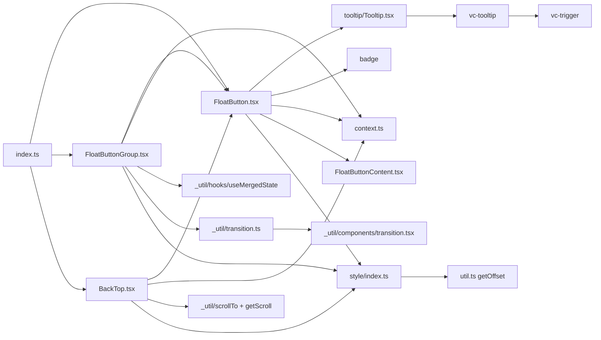
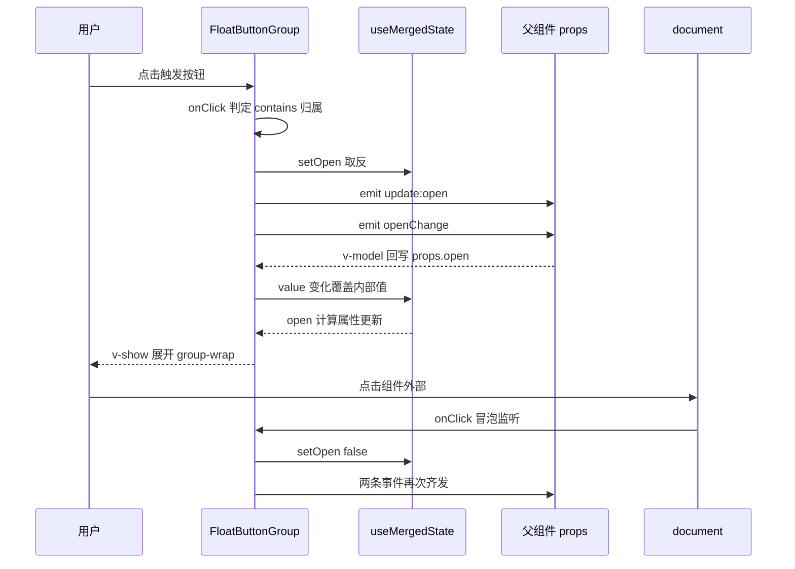
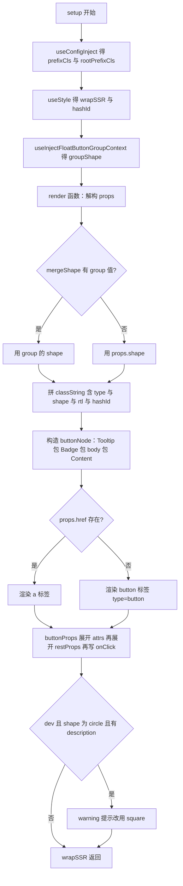

# C12-04 FloatButton 浮动按钮

> **本篇解决**：`<xy-float-button @click>` 为什么在源码层面没有通路、`FloatButton.BackTop` 与包根 `BackTop` 为什么是两个不同组件、以及「分组展开态」的状态与事件究竟经过哪几行。
> **前置**：C03-11 Affix 固钉　**读者坐标**：`03-components/12-global` 第 5/9 篇

## 一、职责与边界

`FloatButton` 负责一件事：把一个固定在视口右下角的可点击方块（或圆形）渲染出来，并让它可以成组展开、可以挂角标、可以配一段悬浮说明。它不负责浮层定位（那是 `tooltip` 经 `vc-trigger` 的事）、不负责滚动监听与滚动动画的通用抽象（`BackTop` 自己直连 `_util/getScroll` 与 `_util/scrollTo`）、也不负责涟漪效果的正确实现（它只是手写了一个 DOM 属性，见论点 2）。

边界要说清两件容易越界的事。第一，`packages/xiaoye-ui/src/float-button/` 里含有一个 `BackTop.tsx`，而 `packages/xiaoye-ui/src/back-top/` 是另一个同名组件，包根导出的 `BackTop` 归属后者，本篇只在「同名注册的先到先得」这一点上展开两者的对比，`back-top/` 自身的机制不属于本篇主题（见论点 5）。第二，`OUTLINE.md` 给本篇标注的底层是「`vc-trigger` 待核实」，核实结果是：本组件没有任何文件直接导入 `vc-trigger`，唯一的到达路径是 `FloatButton.tsx:3` 导入 `tooltip`，再由 `tooltip/Tooltip.tsx:3` 导入 `vc-tooltip`，`abstractTooltipProps.ts:2` 只以类型形式引用 `vc-trigger/interface`。因此本篇不重复 I02《vc-trigger》的论证，只说明这条间接边为何存在。

依赖清单（本组件用到的仓内模块）：

- 配置注入：`config-provider/hooks/useConfigInject`（三个文件各调用一次，`FloatButton.tsx:24`、`FloatButtonGroup.tsx:27`、`BackTop.tsx:38`）
- 样式：`theme/internal` 的 `genComponentStyleHook` 与 `mergeToken`（`style/index.ts:4`、`:360`、`:373`）、`style/motion/fade`、`style/motion/motion`、`style` 的 `resetComponent`（`style/index.ts:5-7`）
- 兄弟组件：`tooltip`、`badge`（`FloatButton.tsx:3-4`）
- 图标：`@xiaoye-ui/icons` 的 `FileTextOutlined`、`CloseOutlined`、`VerticalAlignTopOutlined`（`FloatButtonContent.tsx:2`、`FloatButtonGroup.tsx:2`、`BackTop.tsx:1`）
- 内部工具：`_util/props-util`（`initDefaultProps`、`filterEmpty`、`findDOMNode`）、`_util/classNames`、`_util/warning`、`_util/canUseDom`、`_util/getScroll`、`_util/scrollTo`、`_util/throttleByAnimationFrame`、`_util/hooks/useMergedState`、`_util/transition`
- 同类内部：`context.ts` 的 provide/inject 对（`FloatButton.tsx:7`、`BackTop.tsx:23`、`FloatButtonGroup.tsx:7`）

## 二、源码地图

| 文件 | 行数 | 职责 | 关键导出符号 |
| --- | --- | --- | --- |
| `float-button/index.ts` | 43 | 入口：把 `Group`/`BackTop` 挂到默认导出上并写 `install` | `FloatButton`（默认）、`FloatButtonGroup`、`BackTop`（`index.ts:37`） |
| `float-button/FloatButton.tsx` | 124 | 单按钮主实现，前缀常量在此 | `floatButtonPrefixCls = 'float-btn'`（`:16`） |
| `float-button/FloatButtonGroup.tsx` | 145 | 分组容器、展开态、外部点击关闭 | `XYFloatButtonGroup`（`:19`） |
| `float-button/BackTop.tsx` | 140 | 滚动可见性 + 复用 `FloatButton` 渲染 | `XYBackTop`（`:27`） |
| `float-button/FloatButtonContent.tsx` | 36 | icon 与 description 的两行布局与默认图标 | `XYFloatButtonContent`（`:8`） |
| `float-button/interface.ts` | 70 | 四组函数式 props 与联合类型 | `floatButtonProps`、`floatButtonContentProps`、`floatButtonGroupProps`、`backTopProps` |
| `float-button/context.ts` | 19 | group 向子按钮下发 `shape` | `useProvide/useInjectFloatButtonGroupContext`（`:11`、`:17`） |
| `float-button/util.ts` | 10 | 角标圆点在 45° 方向上的内缩距离 | `getOffset`（默认导出，`:1`） |
| `float-button/style/index.ts` | 396 | 全部 CSS-in-JS：分组、共享、两组动效 | 默认导出 `genComponentStyleHook('FloatButton')`（`:360`）、`ComponentToken`（`:11`） |
| `float-button/index.test.js` | 44 | `mountTest` 的挂载/更新/卸载不抛错 + 类名断言，无事件断言 | — |
| `float-button/wave.test.js` | 79 | 只对 `xy-click-animating-without-extra-node` 属性做断言 | — |

主实现入口是 `FloatButton.tsx:18` 的 `defineComponent`，其 setup 首行做配置注入（`:24`）、次行拿样式 hook（`:25`）、第三行注入 group context（`:26`），渲染函数从 `:47` 开始。样式侧的两个生成函数分工明确：`floatButtonGroupStyle`（`style/index.ts:88`）只管 `.xy-float-btn-group` 及其派生类，`sharedFloatButtonStyle`（`:207`）管单个按钮本体；两者在导出数组里是先后相邻的两条（`:391-392`，数组还有后两条动效 `:393-394`）。这里要更正我上一轮的措辞：单按钮在分组内能被「去固定化」，靠的不是这个数组顺序，而是选择器特异性，机制见论点 6。

测试文件的位置与可执行性要单独确认一次，因为 `vitest.config.mts:33` 的 include 是 `['tests/**/*.test.{js,ts,jsx,tsx}', 'src/**/*.test.{js,ts,jsx,tsx}']`，两个 `.js` 测试直接躺在组件目录里，命中第二条 glob，所以确实会被执行——但执行的内容与本篇关心的分支几乎不重叠，这一点在「七、坑与改动指南」的测试现状里逐条说明。

## 三、架构与数据流

下图是本组件的静态依赖拓扑，箭头方向是「导入」。它要说明的核心事实是：`FloatButton.tsx` 是唯一的叶子实现，`FloatButtonGroup.tsx` 与 `BackTop.tsx` 都不自己画按钮，而是把 `FloatButton` 当渲染原语复用；代价是任何进入 `FloatButton` 的 props 都要再过一层它自己的解构，论点 1 的事件丢失就发生在这条复用边上。



图里有两条边值得先点出来。一条是 `_util/transition.ts`（2 行 shim，已于 2026-09-29 删除）到 `_util/components/transition.tsx:21`：`FloatButtonGroup.tsx:4` 写的是 `from '../_util/transition'`，而 `_util` 目录下同时存在 `transition.ts`（2 行的转发壳）与 `transition.tsx`（真实实现之一），模块解析按 `.ts` 优先命中转发壳，于是分组动效的 props 实际来自 `components/transition.tsx:21` 的 `getTransitionProps`，与 `_util/transition.tsx:21` 那份同名同体函数互不影响。这正是 C12-00 横写篇归纳的「机械副本目录」在本组件里的具体落点，本篇只登记路径，不重复其论证。另一条是 `tooltip → vc-tooltip → vc-trigger`：本组件对 `vc-trigger` 的依赖完全是这条传递边，没有任何一个 `float-button/*` 文件直接引用它。

第二张图是分组展开态的完整闭环。`open` 是受控与非受控共存的（受控/非受控的判定机制见 I13，此处不重述），所以状态既可能由内部 `setOpen` 推动，也可能由父组件的 `props.open` 回流；每个开合点发两条事件（`update:open` 与 `openChange`），这两条各走一条通道，这是 `FloatButtonGroup.tsx` 里最容易被改动破坏的地方——2026-09-29 之前它还是三条，第三条 `callEvent(props.onOpenChange)` 与 `emit('openChange')` 撞在同一个函数键上，构成事件双投递，机制见五「分组的事件通道」。



闭环里有三处非直觉的分支。第一，`FloatButtonGroup.tsx:66-77` 的 `onClick` 是挂在 `document` 上的（`:85-87`），它必须先判断点击落点是否在自己内部（`:67`），再判断是否落在触发按钮上（`:68`），两个判断都用不同的 API：前者用 `floatButtonGroupRef.value?.contains`，后者用 `findDOMNode(floatButtonRef.value)?.contains`——因为 `floatButtonRef` 是指向子组件实例的 ref，不是元素，必须经 `findDOMNode` 折算（`:8` 从 `_util/props-util` 导入）。第二，`hover` 分支完全不经过 `document` 监听，它在 `:40-53` 直接给容器绑 `onMouseenter`/`onMouseleave`，`:54-56` 用计算属性决定是否展开这组处理器，所以 `trigger` 从 `click` 改成 `hover` 时，`:79-91` 的 watch 会先 `removeEventListener` 再决定是否重新绑定，这条清理边是刻意写的，不是重复代码。第三，`emit('update:open')` 与 `props['onUpdate:open']` 同时存在（`:25` 声明 emits，`interface.ts:51` 又把它声明成 prop），二者并不冲突的原因是 Vue 运行时的 `emit` 查的是 vnode 上未经 prop 声明过滤的原始 props，所以即使监听器同名键也被声明成了 prop，事件仍会送达。这属于 Vue 3.5 运行时自身的行为，其源码不在本仓库内，故此处不给行号、也不作为本篇任何结论的唯一支点：它只解释「`v-model:open` 为什么还能用」，而 `onClick` 的断链（论点 1）不依赖这条机制。

第三张图是单按钮渲染的分支图。它存在的意义是把论点 1 与论点 3 的分支位置先钉住：`shape` 走的是 context 优先，`onClick` 走的是 attrs 但 attrs 里根本不会有它。



分支图中 `K` 与 `N` 是两个关键决策点，但它们的地位不对称：`K`（`FloatButton.tsx:110`）是真实的渲染分叉，`href` 有无决定元素类型；`N`（`:102-107`）是对象字面量的键覆盖，`onClick: handleClick` 写在 `...restProps` 之后，因此 `restProps.onClick` 无论来自用户还是来自 `BackTop` 都会被静默吃掉。`O` 分支的判定条件（`:96`）用的是被解构出来的 `props.shape`，而不是 `mergeShape.value`，与 `I` 节点用的值不同源，这个不一致是论点 3 的主题。

## 四、核心机制精读

### 论点 1：`onClick` 被声明成 prop 之后，`handleClick` 去 `attrs` 里找它，同时把 `restProps` 里那份覆盖掉——用户与 `BackTop` 传的处理函数都到不了调用点

这是本篇最重要的一条，因为它同时影响 `FloatButton` 与 `FloatButton.BackTop` 两个对外出口，而文档示例正在使用它。

断言：`packages/xiaoye-ui/src/float-button/FloatButton.tsx:44` 调的是 `attrs.onClick`，`packages/xiaoye-ui/src/float-button/interface.ts:25` 又把 `onClick` 声明为组件 prop，Vue 运行时对二者只取其一（进 prop 的那份不会再出现在 attrs），于是 `attrs.onClick` 恒为 `undefined`；而调用方真正传入的函数位于 `props.onClick`，它随 `...restProps` 展开到 DOM 元素上之后，又被同一个对象字面量里靠后的 `onClick: handleClick` 覆盖。两个通道各断一次，合起来是彻底断。

```tsx
// packages/xiaoye-ui/src/float-button/FloatButton.tsx:36
    const handleClick = (e: MouseEvent) => {
      if (isUnBorderedButtonType(props.type)) {
        return;
      }
      const node = floatButtonRef.value;
      if (node) {
        node.setAttribute(`${rootPrefixCls.value}-click-animating-without-extra-node`, 'true');
      }
      (attrs.onClick as any)?.(e);
    };
```

```tsx
// packages/xiaoye-ui/src/float-button/FloatButton.tsx:102
      const buttonProps = {
        ...attrs,
        ...restProps,
        class: classString,
        onClick: handleClick,
      };
```

`restProps` 的来源是 `:48-56` 的解构：`prefixCls`、`type`、`shape`、`description`、`tooltip`、`badge` 六个键被摘走，剩下的 `href`、`target`、`onClick` 进入 `restProps`。也就是说 `restProps` 里确实带着调用方的 `onClick`，只是 `:106` 写在 `:104` 之后，键相同、后者优先。这两行如果调换顺序，`handleClick` 就会被用户函数覆盖（那是另一种坏法：波纹属性丢失）。

```ts
// packages/xiaoye-ui/src/float-button/interface.ts:15
export const floatButtonProps = () => {
  return {
    prefixCls: String,
    description: PropTypes.any,
    type: stringType<FloatButtonType>('default'),
    shape: stringType<FloatButtonShape>('circle'),
    tooltip: PropTypes.any,
    href: String,
    target: String,
    badge: objectType<FloatButtonBadgeProps>(),
    onClick: functionType<MouseEventHandler>(),
  };
};
```

props 与 attrs 的分流由 Vue 运行时完成，其源码不在本仓库内，本节只描述行为不引行号：已声明的 prop 键会在初始化时被摘进 `props` 容器，`attrs` 里只留未被声明的键；而 `emit` 取值时看的是原始 vnode props，不受声明过滤影响。两条合起来解释了本篇的一个反直觉现象：`onClick` 因为被声明为 prop 而从 attrs 消失，但 `FloatButtonGroup` 的 `emit('update:open')` 仍能送达，尽管 `'onUpdate:open'` 也同时被声明成 prop（`interface.ts:51`）。这段推理没有配运行时实验（做实验要新增用例文件，越出本篇「只写文档、不动源码」的边界），但论点 1 的结论只依赖本仓的两行代码——声明侧 `interface.ts:25` 与消费侧 `FloatButton.tsx:44`——以及下面 `BackTop.tsx:114` 与 `:106` 的键覆盖，都不需要引用 Vue 内部实现。

组件没有声明 `emits`（`FloatButton.tsx:18-23` 的选项里没有 `emits` 一项，`packages/xiaoye-ui/src/button/button.tsx:45` 同样是注释状态），所以也不存在「事件名被过滤」的额外路径。

同一个缺陷在 `BackTop` 上放大成完全失效：`BackTop.tsx:111-124` 把自己组装的 props 交给 `FloatButton`，其中第 114 行就是 `onClick: scrollToTop`。

```tsx
// packages/xiaoye-ui/src/float-button/BackTop.tsx:111
      const floatButtonProps = {
        ...attrs,
        shape: floatButtonGroupContext?.shape.value || shape,
        onClick: scrollToTop,
        class: {
          [`${prefixCls.value}`]: true,
          [`${attrs.class}`]: attrs.class,
          [`${prefixCls.value}-rtl`]: direction.value === 'rtl',
        },
```

`scrollToTop` 定义在 `BackTop.tsx:51-58`，它承担两件事：调 `scrollTo(0, {...})` 执行滚动动画，以及 `emit('click', e)` 把点击事件转给外部。由于 `FloatButton` 侧的覆盖，这两个副作用都不发生——`FloatButton.BackTop` 点击后既不滚动也不发事件。而独立组件 `back-top/BackTop.tsx:48-55` 有同名同职责的 `scrollToTop`，它渲染的是自己的 DOM 而不是复用 `FloatButton`，所以不受这条路径影响；两份实现的分叉在论点 5 展开。

文档层已经在踩这个坑：`apps/docs/examples/float-button/basic.vue:2` 写的是 `<xy-float-button @click="handleClick" />`，`shape.vue:2` 同一行写法。`@click` 编译后就是 vnode 上的 `onClick` 键，按上面的分流它进入 `props.onClick`，被 `:106` 覆盖。也就是说这两个示例的点击反馈在源码层面没有通路。

结论回扣：`FloatButton` 的对外事件契约不是「实现了但没测」，而是「声明与消费分处两个互不相交的通道」。判断依据是 `interface.ts:25`（声明侧）与 `FloatButton.tsx:44`（消费侧）指向的不是同一个容器。

### 论点 2：所谓「点击波纹」是一次性写上的 DOM 属性，全仓没有任何样式消费它，也没有任何代码撤销它

断言：`FloatButton.tsx:36-45` 这套逻辑是从 `_util/wave` 的行为反推出来的手写副本，但它只保留了「打标记」这一半；标记在本仓库里没有样式规则读取它，也没有 `animationend` 回调清除它，因此既不产生视觉效果，也会让第二次点击连视觉上的重放都做不到。涟漪的正规机制见 C12-05《Ripple 涟漪》，此处只对比接入方式。

先立「全仓只有生产者、没有消费者」这条负面结论，并用两种方法交叉验证。第一种方法按扩展名过滤搜索整个 `packages` 与 `apps`，命中仅 `FloatButton.tsx` 与 `wave.test.js`；第二种方法不限扩展名、直接搜 `packages/xiaoye-ui/src`，文件数统计为 2：

```bash
grep -rl "click-animating" packages/xiaoye-ui/src | wc -l   # 输出 2（FloatButton.tsx 与 wave.test.js）
```

`float-button/style/index.ts` 的 396 行里不含 `animating` 字样，`_util/wave` 目录下五个文件（`index.tsx`、`WaveEffect.tsx`、`useWave.ts`、`util.ts`、`style.ts`）也搜不到 `setAttribute`，即正规涟漪根本不使用这个属性名。也就是说：属性写上了，没有 CSS 规则匹配它，浏览器不产生任何动画，`transitionstart`/`animationend` 这类事件也不会被触发，因而「靠动画结束事件撤销属性」的隐含契约在这个组件里既没有实现也没有触发源。

测试文件却完全是按「有波纹」的假设写的，它甚至手工补发了动画事件：

```jsx
// packages/xiaoye-ui/src/float-button/wave.test.js:6
  async function clickFloatButton(wrapper) {
    await asyncExpect(() => {
      wrapper.find('.xy-float-btn').trigger('click');
    });
    wrapper.find('.xy-float-btn').element.dispatchEvent(new Event('transitionstart'));
    await sleep(20);
    wrapper.find('.xy-float-btn').element.dispatchEvent(new Event('animationend'));
    await sleep(20);
  }
```

这两行 `dispatchEvent` 不影响断言结果，因为断言看的是属性值本身（`:23`），而属性是同步由 `setAttribute` 写上的（`FloatButton.tsx:42`）。所以 `wave.test.js` 的 5 个用例（`:16`、`:28`、`:40`、`:52`、`:64`）真正锁住的行为只有一条：点击后属性等于字符串 `'true'`，或在不该写时等于 `undefined`。它们把「属性被写上」当成「波纹生效」来固化，一旦后来者补上 CSS 规则，就会看到属性常驻、`::after` 动画只跑一次的后果。

属性名的前缀来自 `rootPrefixCls`，即 `useConfigInject` 暴露的根前缀（`FloatButton.tsx:24` 解构、`useConfigInject.ts:17` 定义为 `configProvider.getPrefixCls()`），拼接结果是测试里断言的 `xy-click-animating-without-extra-node`（`wave.test.js:23`）。这条拼接是本组件里唯一一处把 `ConfigProvider` 的前缀当成「属性命名空间」使用的地方，其余地方它都只用于类名。

`handleClick` 开头还有一道守卫，它揭示了这个组件从按钮族移植过来时未清理的类型面：

```tsx
// packages/xiaoye-ui/src/float-button/FloatButton.tsx:34
    const isUnBorderedButtonType = (type: string | undefined) => type === 'text' || type === 'link';
```

`FloatButtonType` 只有两个成员（`interface.ts:7`），`'text'` 与 `'link'` 在类型层面不可达，但在运行时可达——因为 `type` 的 prop 定义是 `stringType<FloatButtonType>('default')`（`interface.ts:19`），运行时的类型构造器是 `String`，不做枚举校验。测试正是从运行时这条路进来的：

```jsx
// packages/xiaoye-ui/src/float-button/wave.test.js:40
  it('should not have click wave effect for link type button', async () => {
    const wrapper = mount({
      render() {
        return <FloatButton type="link">button</FloatButton>;
      },
    });
```

于是形成一组互相矛盾的证据：类型说只有 `default`/`primary`（`interface.ts:7`），实现说还要为 `text`/`link` 短路（`FloatButton.tsx:34`），测试说这两个值确实能传进来（`wave.test.js:43`、`:55`），而样式层只生成 `-default` 与 `-primary` 两个类规则（`style/index.ts:311`、`:334`）。传 `type="link"` 会得到一个带 `xy-float-btn-link` 类、但没有任何样式定义的按钮。

### 论点 3：`shape` 有四个互不同步的取值点——分组内子按钮自己的 `shape` 被静默忽略，而 dev 警告读的恰是这个被忽略的值

断言：类名读 `mergeShape`（`FloatButton.tsx:61`）、开发期警告读局部解构出来的 `shape`（`:51` 取值、`:96` 判定）、`BackTop` 自己又手写第三份合并（`BackTop.tsx:113`）、分组容器类名读第四份（`FloatButtonGroup.tsx:90` 解构、`:103-104` 拼类名）。四份里只有第一份参与最终渲染，其余三份都可能在同一时刻给出不同答案。

```tsx
// packages/xiaoye-ui/src/float-button/FloatButton.tsx:30
    const mergeShape = computed(() => {
      return groupShape?.value || props.shape;
    });
```

`groupShape` 来自同文件 `:26` 的 `const { shape: groupShape } = useInjectFloatButtonGroupContext();`，而注入端给的是带默认值的 `inject`：

```ts
// packages/xiaoye-ui/src/float-button/context.ts:17
export const useInjectFloatButtonGroupContext = () => {
  return inject(contextKey, { shape: ref() } as FloatButtonGroupContext);
};
```

提供端在 `FloatButtonGroup.tsx:30-32`，把 `computed(() => props.shape)` 原样下发。也就是说「分组形状优先于子按钮形状」是刻意的设计：分组里每个子按钮不必重复写 `shape`，代价是子按钮写的 `shape` 会被无声覆盖。

被无声覆盖的那一份并没有消失，它还在警告分支里活着：

```tsx
// packages/xiaoye-ui/src/float-button/FloatButton.tsx:58
      const classString = classNames(
        prefixCls.value,
        `${prefixCls.value}-${type}`,
        `${prefixCls.value}-${mergeShape.value}`,
```

```tsx
// packages/xiaoye-ui/src/float-button/FloatButton.tsx:94
      if (process.env.NODE_ENV !== 'production') {
        warning(
          !(shape === 'circle' && description),
```

`:96` 的 `shape` 是 `:51` 解构出的 `props.shape`（默认 `'circle'`），与 `:61` 的 `mergeShape.value` 不同源，于是两种配置下都会错：

- 分组默认 `shape="circle"`（`FloatButtonGroup.tsx:21-24` 的 `initDefaultProps` 给定），子按钮写 `shape="square"` 并带 `description` → 实际渲染成 `xy-float-btn-circle`（`mergeShape` 取分组的值），而警告判 `shape === 'circle'` 为假，**该报的不报**。
- 分组 `shape="square"`，子按钮不写 `shape`（取默认 `'circle'`）并带 `description` → 实际渲染成 square（`style/index.ts:296-310` 的 `-square` 分支会给 `height: auto`），但警告判 `shape === 'circle' && description` 为真，**不该报的报了**，提示内容还写着「supported only when `shape` is `square`」，与用户看到的 DOM 相反。

这是本篇里判别性最强的一处：同一个布尔表达式在两种合法输入下分别与渲染结果反向，修它只需要把 `:96` 换成 `mergeShape.value`，但换之前要先确认没有测试锁住旧行为——`index.test.js` 里没有 `shape` 相关断言（3 条自写用例是 `:8`、`:16`、`:25`，另有 `:6`、`:7` 两条 `mountTest`，都只碰 `type` 与子节点类型），所以这条改动没有回归网。

`:30-32` 的可选链是冗余防御：`context.ts:18` 的默认值保证返回对象恒有 `shape` 字段，解构后 `groupShape` 必为 `Ref`，`groupShape?.value` 的短路分支永不执行。反向的疏漏在 `BackTop.tsx:113`：

```tsx
// packages/xiaoye-ui/src/float-button/BackTop.tsx:111
      const floatButtonProps = {
        ...attrs,
        shape: floatButtonGroupContext?.shape.value || shape,
```

它对整体加了 `?.`（`useInjectFloatButtonGroupContext` 永不返回 `undefined`，所以这个 `?.` 无效），却没对 `.shape` 加保护——两处防御的方向写反了，只是因为默认值对象恰好补齐了字段才都没出事。更要紧的是这一行是 `mergeShape` 的重复实现，且结果必然被再覆盖一次：`BackTop` 把算好的 `shape` 当 prop 交给 `FloatButton`，`FloatButton` 内部又读同一个 context 并按 `groupShape?.value || props.shape` 优先分组值（`:31`）。分组内两者相等（都取分组值），分组外两者也相等（context 为空则都取 `props.shape`），所以它当前是纯冗余；一旦哪天要允许子按钮覆盖分组形状，这行就会变成第二个判定源。

分组的容器类名走的是另一条链，`shape` 在这里同时决定两件事：

```tsx
// packages/xiaoye-ui/src/float-button/FloatButtonGroup.tsx:101
      const groupCls = classNames(groupPrefixCls, hashId.value, attrs.class, {
        [`${groupPrefixCls}-rtl`]: direction.value === 'rtl',
        [`${groupPrefixCls}-${shape}`]: shape,
        [`${groupPrefixCls}-${shape}-shadow`]: !trigger,
      });
```

`-circle`/`-square` 恒加（`:103`），`-circle-shadow`/`-square-shadow` 只在没有 `trigger` 时加（`:104`），两者在样式侧分别是 `style/index.ts:128`/`:138`（子项排布与圆角）与 `:188`/`:191`（投影）。所以「形状」与「有无阴影」是两套正交的类，改动时不要合并成一个类；而 `:160-185` 里 `group-square` 内部又给 `wrap` 单独设了一次 `boxShadow: token.boxShadowSecondary`，意味着展开列表的投影与整组投影不是同一个来源，改投影要同时看这两处。

结论回扣：`shape` 的真相在渲染时只由 `mergeShape` 决定，但仓库里另有三处独立读取点各自成立。这解释了为什么「同一个组件在不同位置形状不一致」这类问题很难通过读 `FloatButton.tsx` 单文件定位——警告分支和 `BackTop` 都不在它的控制流里。


### 论点 4：`FloatButton.BackTop` 的滚动侧是活的、点击侧是死的——它靠窗口滚动出现，然后因为论点 1 而无法用；三条支撑代码里有一条恒不生效、一条是死字段

断言：`float-button/BackTop.tsx` 的可见性由 `scroll` 监听驱动（`:60-72`），这条链完整可用；但它唯一的动作 `scrollToTop`（`:51-58`）只能经 `onClick: scrollToTop`（`:114`）触发，而那个键在 `FloatButton.tsx:106` 被覆盖——所以渲染出来的是一个「会随滚动出现、点击无任何反应」的按钮。同时它自己带的两条辅助逻辑各有一处失效：`getDefaultTarget()` 恒返回 `window`，`state.scrollEvent` 是从未使用的死字段。

```tsx
// packages/xiaoye-ui/src/float-button/BackTop.tsx:48
    const getDefaultTarget = () =>
      domRef.value && domRef.value.ownerDocument ? domRef.value.ownerDocument : window;
```

`domRef` 绑在谁身上决定了这段代码能否成立：

```tsx
// packages/xiaoye-ui/src/float-button/BackTop.tsx:129
          <FloatButton v-show={state.visible} {...floatButtonProps} ref={domRef}>
```

`ref` 落在子组件上，拿到的就是组件公共实例，而不是 DOM 元素；`FloatButton` 的 setup 签名是 `setup(props, { attrs, slots })`（`FloatButton.tsx:23`），没有调用 `expose`，公共代理上不存在 `ownerDocument` 属性。于是 `:49` 的三元条件永远为假，「取自己所属 document」这条分支在本组件里从未被执行过——它等价于 `() => window`。对照独立实现 `back-top/BackTop.tsx:130`，那里的 `ref={domRef}` 绑的是它自己渲染的 `<div role="button">`（`:132`），`ownerDocument` 真实存在，`:44-45` 的同一份表达式才有意义。两者代码同源、结论相反，差别只在 ref 指向的元素还是组件。

> ⚠️ 未在源码中找到运行时实验证据，此处为待核实推断：「公共实例上没有 `ownerDocument`」是按 Vue 组件实例代理规则与本仓 `FloatButton.tsx:23` 未调用 `expose` 推出的，本篇没有做运行时实验（补一条用例或写临时探针都要新建文件，越出「只改这一个文档」的边界）；但它可以用一条命令判别：在 `packages/xiaoye-ui/src/float-button/` 里 `grep -n "expose" *.tsx` 无命中，而 `packages/xiaoye-ui/src/back-top/BackTop.tsx:114-117` 有 `expose`。

第二条失效不需要运行时假设：

```tsx
// packages/xiaoye-ui/src/float-button/BackTop.tsx:43
    const state = reactive({
      visible: props.visibilityHeight === 0,
      scrollEvent: null,
    });
```

`scrollEvent` 在整个文件里只出现这一次（`grep -n scrollEvent float-button/BackTop.tsx` 输出 1 行），既没被写入也没被读取——监听器的句柄实际存在闭包 `handleScroll` 里（`:60`），注销靠 `handleScroll.cancel()`（`:78`，实现见 `_util/throttleByAnimationFrame.ts:21-24`）。对照 `back-top/BackTop.tsx:39-41`，那版的 `state` 里根本没有这个键，所以它是两份实现相互抄写时留下的未清理项。

第三条是可见性对 `visibilityHeight` 不响应。文件里唯一的 `watch` 只盯 `props.target`：

```tsx
// packages/xiaoye-ui/src/float-button/BackTop.tsx:84
    watch(
      () => props.target,
      () => {
        scrollRemove();
        bindScrollEvent();
      },
    );
```

```tsx
// packages/xiaoye-ui/src/float-button/BackTop.tsx:60
    const handleScroll = throttleByAnimationFrame((e: Event | { target: any }) => {
      const { visibilityHeight } = props;
      const scrollTop = getScroll(e.target, true);
      state.visible = scrollTop >= visibilityHeight;
    });
```

`:61` 每次执行都重新读 `props.visibilityHeight`，所以值本身是响应式的，但**没有任何东西在它变化时重新求值**：用户把 `visibilityHeight` 从 400 改成 0，按钮要等下一次滚动才会出现。这条与 `:44` 的初值判定合起来看：初值只在 setup 时算一次，之后完全依赖 `scroll` 事件回灌。

节流边界还有一处两份实现的分歧，且分岐是被注释记录下来的：

```tsx
// packages/xiaoye-ui/src/back-top/BackTop.tsx:57
    // 滚动事件处理：throttle 到 raf，立即提取 target 避免事件对象在异步回调中被重置
    const handleScroll = throttleByAnimationFrame((target: HTMLElement | Window | Document) => {
```

`back-top/` 版在同步阶段就把 `e.target` 取出来（`onScroll`，`:64-66`），只把 target 传进 rAF；`float-button/` 版把整个事件对象交给 rAF，在回调里才读 `e.target`（`:60-62`）。`throttleByAnimationFrame` 是首帧节流：同一帧内后续调用会被丢弃（`_util/throttleByAnimationFrame.ts:16-18`），所以 args 是这一帧第一次调用时捕获的那份。作者显然认为事件对象存在被复用的风险并为此改了自己的那份实现，却没有回灌到 `float-button/` 这份——两条路径读到的滚动位置是否一致，取决于浏览器是否重置 `target`，此处只登记分歧，不断言它已造成故障。

最后是隐藏方式的分歧，它会影响你改样式时该看哪个文件：`float-button/BackTop.tsx:128` 用 Vue 的 `<Transition {...getTransitionProps('fade')}>`（`:126`）配 `v-show`，动效类 `xy-fade-enter`/`-leave` 由**本组件自己的样式**产出（`style/index.ts:393` 调 `initFadeMotion(token)`，类名拼法见 `style/motion/fade.ts:29-30`，`rootCls` 来自 `theme/util/genComponentStyleHook.ts:96`）；而 `back-top/` 版根本不挂 Transition，靠 `-visible` 类切 `opacity`（`back-top/style/index.ts:53-57`）。也就是说：只引 `xiaoye-ui/float-button/style` 就有 BackTop 淡入淡出，只引 `xiaoye-ui/back-top/style` 则完全没有 fade 类——同名组件的样式依赖方向也不同。

结论回扣：`FloatButton.BackTop` 是「一半活着」的组件——出现/消失正常，动作链路在 `FloatButton.tsx:106` 处断开。要修就修论点 1 那条覆盖，不要在此文件加 `onClick` 兜底，否则会出现两处调用 `scrollTo`。


### 论点 5：包根 `BackTop` 与 `FloatButton.BackTop` 是两个不同的组件，而 `xy-back-top` 这个标签只有一个位置——注册先到先得，文档表格与示例渲染的并不是同一份实现

断言：仓库里有两个 `name: 'XYBackTop'` 的组件（`back-top/BackTop.tsx:26`、`float-button/BackTop.tsx:27`），`registerComponent` 把它们折算成同一个标签名后只允许第一个存活；包根具名导出与全局类型声明都定主给了 `back-top/`，于是文档 `apps/docs/components/float-button.md:120` 的「FloatButton.BackTop」属性表描述的，和 `apps/docs/examples/float-button/back-top.vue:10` 用 `<xy-back-top />` 渲染出来的，是两个类名前缀都不同的组件。

```tsx
// packages/xiaoye-ui/src/float-button/index.ts:26
FloatButton.Group = FloatButtonGroup;
FloatButton.BackTop = BackTop;
```

```tsx
// packages/xiaoye-ui/src/float-button/index.ts:30
/* istanbul ignore next */
FloatButton.install = function (app: App) {
  registerComponent(app, FloatButton);
  registerComponent(app, FloatButtonGroup);
  registerComponent(app, BackTop);
  return app;
};
```

`index.ts:37` 还把同一个 `BackTop` 作为具名导出暴露出去，于是从 `xiaoye-ui/float-button` 导入拿到的是这份实现；而从包根 `xiaoye-ui` 导入 `BackTop` 拿到的是另一份：

```ts
// packages/xiaoye-ui/src/components.ts:28
export * from './back-top';
export { default as BackTop } from './back-top';
import './back-top/style';
```

显式 re-export（`:29`）优先级高于同名的 `export *`（`:28`，以及 `:144` 从 `./float-button` 转发来的 `BackTop`），文件末尾的歧义消解段也是同一取向：`components.ts:407` 把 `BackTopProps` 类型定主给 `./back-top`。所以「运行时具名导出」与「类型」这两面已经统一到 `back-top/`，剩下的分歧只在 `FloatButton.BackTop`（属性挂载）与 `xiaoye-ui/float-button` 子路径这两个入口上。生成的全局类型同样按包根取名：`packages/xiaoye-ui/typings/global.d.ts:11` 写的是 `XYBackTop: (typeof import('xiaoye-ui'))['BackTop']`，即 `back-top/` 版；而该文件里没有 `XYFloatButtonGroup` 条目（`grep -n FloatButtonGroup packages/xiaoye-ui/typings/global.d.ts` 无命中），因为生成器只登记每个目录的默认导出，`FloatButton.Group` 是具名挂载项。也就是说 `apps/docs/examples/float-button/group.vue:2` 用的 `<xy-float-button-group>` 标签本身没有 `GlobalComponents` 类型，模板里写错属性名不会被 IDE 拦下——这是 C12-00 横写篇「composable + 组件壳」一族共同的类型盲区，本篇只登记，不重复其论证。

标签冲突由这段决定：

```ts
// packages/xiaoye-ui/src/_util/registerComponent.ts:22
  const tagName = toXYTagName(name);
  if (!app.component(tagName)) {
    app.component(tagName, component);
  }
```

`toXYTagName`（`:6-11`）把 `XYBackTop` 折算成 `xy-back-top`，两份实现的 `name` 字符串完全相同，折算结果也相同；`if (!app.component(tagName))` 的守卫让后来者静默失效，不报错、不告警。全局注册发生在 `back-top/index.ts:8-11` 与 `float-button/index.ts:30-35` 两处 install 里，谁先跑由包根 install 的遍历顺序决定：

```ts
// packages/xiaoye-ui/src/index.ts:16
export const install = function (app: App) {
  Object.keys(components).forEach(key => {
    const component = components[key];
    if (component.install) {
      app.use(component);
    }
  });
```

> ⚠️ 未在源码中找到本仓实现支撑，此处为语言规范层面的待核实推断：ES 模块命名空间对象的键按字典序枚举，因此 `BackTop` 排在 `FloatButton` 之前，`back-top/` 版先注册、`float-button/BackTop.tsx:27` 那份在第三次 `registerComponent` 时被守卫跳过。我没有单独证实这一顺序（证实它要在应用侧跑一次全局注册，越出本篇边界）；但即便顺序相反，结论也只是「两版互换可用性」，冲突本身与「只有一版存活」不变。

对使用者的直接后果有三条，都能从代码读出而不用跑：

1. `<xy-back-top />`（示例 `back-top.vue:10`、`group.vue:9`）渲染的是 `back-top/` 版的 DOM：`<div role="button">`（`back-top/BackTop.tsx:132`）、类名前缀 `xy-back-top`（`:35` 用 `useConfigInject('back-top', props)`），点击绑定在自己的 div 上（`:135` `onClick={scrollToTop}`）→ 能用。而 `float-button.md:120` 的属性表标题是 `FloatButton.BackTop`，那份实现的前缀是 `xy-float-btn`（`float-button/BackTop.tsx:38`）、点击链按论点 1 是断的。表格与示例各说一半，读者把它们当成同一个组件就会得出「BackTop 点了没反应」的错误结论。
2. `group.vue:9` 把一个 `back-top/` 版塞进 `xy-float-button-group`，而分组子项的全部样式都只选 `.xy-float-btn-*`（`float-button/style/index.ts:128-137`、`:138-159`）：`-circle:not(:last-child)` 的 `marginBottom`、`-square` 的首尾圆角与分隔线，一条都落不到 `xy-back-top` 上。分组里它因此不参与圆角拼接，只保留自己的 `position: fixed`（`back-top/style/index.ts:38`）——固定在窗口上的元素出现在 fixed 容器内部，位置与其余子项错位。
3. `back-top/BackTop.tsx:28` 的 `__XY_BACK_TOP: true` 是内部标识却无消费者：全仓（含 `apps`）搜索 `__XY_BACK_TOP` 只有这一行命中，对比 `__XY_BUTTON` 有 4 处命中（声明之外确有读取方）。这个标记在本组件里只是命名规范的装饰，改动它不会影响任何判断分支。

结论回扣：`BackTop` 的名字在本库里同时是「一个标签名」「一个包根导出」「一个静态属性 `FloatButton.BackTop`」三种身份，分别指向两份实现中的不同一份。安全边界是：要 `xy-float-btn` 那套外观就必须显式 `import { BackTop } from 'xiaoye-ui/float-button'` 或 `FloatButton.BackTop`，用标签名拿不到它。

### 论点 6：分组内的按钮之所以不再吸附窗口，靠的是后代选择器的特异性而不是样式数组顺序；层级则完全绕开了 token——`zIndexPopup` 被声明却没人读，两处 `zIndex: 99` 是硬编码

断言：`style/index.ts` 里有两条把同一元素钉成 `position: fixed` 的规则（分组 `:106`、单按钮 `:223`），单按钮在分组内被「解固定」依赖的是 `:124-126` 那条嵌套规则编译出的后代选择器，权重高过单类选择器；而本组件的层叠层级只有两个裸数字（`:103`、`:225`），同一文件里声明的 `ComponentToken.zIndexPopup`（`:12`）没有任何消费点，另有三个派生 token 与一条 `&-pure` 样式同样只有生产端。

```ts
// packages/xiaoye-ui/src/float-button/style/index.ts:101
    [groupPrefixCls]: {
      ...resetComponent(token),
      zIndex: 99,
      display: 'block',
      border: 'none',
      position: 'fixed',
```

```ts
// packages/xiaoye-ui/src/float-button/style/index.ts:124
      [componentCls]: {
        position: 'static',
      },
```

```ts
// packages/xiaoye-ui/src/float-button/style/index.ts:220
    [componentCls]: {
      ...resetComponent(token),
      border: 'none',
      position: 'fixed',
      cursor: 'pointer',
      zIndex: 99,
```

`:124-126` 嵌在 `floatButtonGroupStyle` 的 `[groupPrefixCls]` 里，产物是 `.xy-float-btn-group .xy-float-btn`，特异性 0,2,0；`:223` 的产物是 `.xy-float-btn`，特异性 0,1,0。前者胜出与它们在导出数组里的先后无关（`:391-392` 只是把两个函数并排放进同一个数组），这点值得强调，因为「把数组顺序当覆盖依据」是改动这个文件最容易犯的错：调换 `:391` 与 `:392` 不会有任何视觉变化，删掉 `:125` 才会——分组里的子按钮会立刻全部吸附到视口右下角、彼此重叠。

分组本身是 `fixed` + `zIndex: 99`（`:103`）并因此创建层叠上下文，展开列表被显式压到底层：

```ts
// packages/xiaoye-ui/src/float-button/style/index.ts:115
      [`${groupPrefixCls}-wrap`]: {
        zIndex: -1,
        display: 'block',
        position: 'relative',
        marginBottom: margin,
      },
```

负值让列表在组内绘制于触发按钮之下（绘制顺序规则属 CSS 规范，本仓代码未注释意图，此处为推断）。可验证的事实是它与 `:118` 的 `position: relative` 成对出现：`z-index` 对静态定位元素无效，所以这两行必须一起改，只删 `position` 会让负 `z-index` 静默失效。

层级面与本库约定的偏离，用一条对照就能看清：

```ts
// packages/xiaoye-ui/src/float-button/style/index.ts:11
/** Component only token. Which will handle additional calculation of alias token */
export interface ComponentToken {
  zIndexPopup: number;
}
```

```ts
// packages/xiaoye-ui/src/tabs/style/index.ts:151
      zIndex: token.zIndexPopup,
```

`tabs/style/index.ts:904` 还演示了正确取值方式：`zIndexPopup: token.zIndexPopupBase + 50`。而 `grep -c zIndexPopup float-button/style/index.ts` 的输出是 1——唯一那次命中就是 `:12` 的声明本身。这个旋钮对用户是可见的：`theme/interface/components.ts:98` 把 `FloatButton?: FloatButtonComponentToken` 挂进组件覆写表，`theme/util/genComponentStyleHook.ts:105` 又把 `token.value[component]` 放进 `info.overrideComponentToken`，覆写值能流到样式函数入参，但本组件的生成函数从不解构它。于是 `theme.components.FloatButton.token = { zIndexPopup: 9999 }` 在类型上合法（`ComponentToken` 里 `zIndexPopup: number` 还是必填项，用户必须传一个不起作用的数字），在渲染上无效，页面里其它浮层的层级也不会跟着变——它落在 I10《z-index》记的「硬编码层级」总账里，本篇只补两处坐标：`style/index.ts:103`、`:225`。

同一文件里还有四条「只生产不消费」的面：

```ts
// packages/xiaoye-ui/src/float-button/style/index.ts:373
  const floatButtonToken = mergeToken<FloatButtonToken>(token, {
    floatButtonBackgroundColor: colorBgElevated,
    floatButtonColor: colorTextLightSolid,
    floatButtonHoverBackgroundColor: controlItemBgHover,
    floatButtonFontSize: fontSize,
```

`floatButtonColor`（类型 `:16`、赋值 `:375`）、`floatButtonHoverBackgroundColor`（`:18`、`:376`）、`floatButtonFontSize`（`:19`、`:377`）三个都在 `mergeToken` 里被算出来，但生成函数里悬停色实际用的是 `token.colorFillContent`（`:318`）与 `token.colorPrimaryHover`（`:340`），文字色用的是 `token.colorText`（`:322`）与 `colorTextLightSolid`（`:344`），字号用 `token.fontSizeSM`（`:329`）——三个自定义 token 一个都没被读到，改动它们不会改变任何像素。第四个是 `&-pure`：

```ts
// packages/xiaoye-ui/src/float-button/style/index.ts:236
      '&-pure': {
        position: 'relative',
        inset: 'auto',
      },
```

它编译成 `.xy-float-btn-pure`，而 `grep -rn "float-btn-pure" packages/xiaoye-ui/src` 零命中，组件侧也没有任何拼 `-pure` 的代码（`FloatButton.tsx:58-67` 的类名列表是定长的）。上游实现里 `PurePanel` 家族（`message/PurePanel.tsx:67`、`notification/PurePanel.tsx:105` 都真的拼了 `-pure-panel` 类）在本组件没有对应物，说明这是一段随样式表一起搬过来、但没搬渲染分支的死样式。想恢复它需要在 `FloatButton.tsx:61` 附近加类名分支，而不是改 `:236-239`。

唯一被真正消费的自研工具是角标内缩：`util.ts:1-8` 的 `getOffset` 返回 `radius - Math.sqrt(radius ** 2 / 2)`（45° 方向上的弦内缩），在 `:387-388` 分别以 `controlHeightLG / 2` 与 `borderRadiusLG` 为半径算出 `dotOffsetInCircle`、`dotOffsetInSquare`，落到 `:287-289`、`:301-303` 的 `badge-dot` 定位。它只有两个调用点，且都只服务圆点角标；计数角标（`badge-count`）走的是另一条：`:250-251` 用 `badgeOffset`（`:386` 定为 `paddingXXS * 1.5`），分组 square 下还要再加一次内边距（`:155-156`）。所以调角标位置要分清自己改的是 dot 还是 count，两类规则的偏移来源不同。

结论回扣：本组件的样式层由「一条后代覆盖 + 两个硬编码层级 + 四条死面」构成。它能跑，但 `position`/`zIndex` 的真实控制点分散在 4 个不相邻的行号上，且没有任何测试触碰样式文件（`vitest.config.mts:33` 的 include 里没有 `style/**` 的独立用例，两个组件测试也只断类名与属性）。


## 五、对外契约如何生效

属性清单见 [apps/docs/components/float-button.md](../../../apps/docs/components/float-button.md)。本节只讲契约从入口到 DOM 的路径，以及每条路径上的断点。

**前缀与样式。** 三个组件都用同一个 `floatButtonPrefixCls = 'float-btn'`（`FloatButton.tsx:16`）调 `useConfigInject`（`FloatButton.tsx:24`、`FloatButtonGroup.tsx:27`、`BackTop.tsx:38`），所以 `ConfigProvider` 改前缀时三者同步变化，这也是 `rootPrefixCls` 拼出的属性名前缀能对上测试断言的原因（`FloatButton.tsx:42` 对 `wave.test.js:23`）。样式 hook 的返回被拆成两种用法：单按钮把 `hashId` 塞进类名（`FloatButton.tsx:66`）并用 `wrapSSR` 包住返回值（`:109`），分组同样把 `hashId` 放进 `groupCls`（`FloatButtonGroup.tsx:101`）与 `wrapperCls`（`:107`），而 `BackTop.tsx:40` 只取 `wrapSSR`、丢掉 `hashId`——它的类名里没有 hash 令牌。这不影响样式生效（emotion 的 hash 规则由 `wrapSSR` 注入 `<style>`），但会让「按 hashId 定位某次渲染用了哪份样式」这类排查手段在 BackTop 上失效。

**插槽如何变成 prop。** 单按钮把两个插槽在解构阶段并入 props：`description = slots.description?.()`（`FloatButton.tsx:52`）与 `tooltip`/`slots.tooltip` 的三目判定（`:74-75`）。后果是 `props.description` 这个字段的名字骗人——它可能是插槽产物，而 `:96` 的警告读的正是这个合成值。真正的空判定在下一层：`FloatButtonContent.tsx:14` 先 `filterEmpty(slots.description?.())` 再用 `description.length` 决定是否渲染 `-description` 容器（`:21-23`），全空时回落到默认图标（`:26-28`）。于是「插槽传了但内容为空」（例如插槽内是 `v-if` 为假的注释节点）会出现两层不一致：DOM 里没有 description（Content 已过滤），警告却按未过滤值报（`FloatButton.tsx:52` 不过滤）。图标插槽则完全不过滤，直接由 `slots.icon &&` 决定 `-icon` 容器存在（`FloatButtonContent.tsx:20`）。

**attrs 与 class 的合流。** 三个组件都写 `inheritAttrs: false`（`FloatButton.tsx:21`、`FloatButtonGroup.tsx:20`、`BackTop.tsx:28`），所以每个都要手工决定 attrs 落在哪个元素：分组落在外层 div（`FloatButtonGroup.tsx:112`），单按钮落在 button/a（`:103`）。类名的合并走 `classNames(..., attrs.class, hashId.value)`（`:65-66`），随后 `:105` 用 `class: classString` 覆盖 `:103` 展开进来的 `attrs.class` —— 顺序不能反，否则用户类名会盖掉组件类名。`BackTop.tsx:115-119` 传的是一个 class 对象，它经 `...attrs` 进入单按钮后被 `:65` 收进 `classNames`（该工具接受对象形态），因此 `xy-float-btn` 会被拼两次（`FloatButton.tsx:59` 与 `BackTop.tsx:116` 各一次）；重复类名无副作用，但会出现在 DOM 上。

**分组的事件通道。** 一次开合只产生两个调用点：`emit('update:open')` 与 `emit('openChange')`（`FloatButtonGroup.tsx:60`、`:62`；hover 展开分支 `:43`、`:45`，hover 收起分支 `:49`、`:51`；外部点击分支 `:74`、`:76`）。2026-09-29 之前还有第三个：每个 `emit('openChange')` 后面紧跟一行 `callEvent(props.onOpenChange)`，helper 本体在原来的 `:27-33`。这一对补调撞在同一个函数键上——Vue 的 `emit` 本身就是从 `instance.vnode.props` 里取 `onXxx`，事件名 `openChange` 映射到 `onOpenChange`，而 `interface.ts:50` 声明的正是这个键；于是 `emit('openChange')` 已经送达过一次，再手工调一次就是双投，属本仓「事件双投递」缺陷族的形态①（`emit('x')` 紧跟 `callEvent(props.onX)`）。现在只留 emit，helper 与四处补调一并删除，`props.onOpenChange` 在组件里不再被显式读取，跟 `onUpdate:open`（`interface.ts:51`）一样只剩 vnode 键这一条通道。`emits` 声明在 `:25`，`onUpdate:open` 同时被声明成 prop——这个 prop 在组件代码里从未被读取（`grep -rn "'onUpdate:open'" packages/xiaoye-ui/src/float-button/` 只命中 `interface.ts:51` 一行），它存在的意义只是模板类型面：让 `v-model:open` 在 `apps/docs` 这类 `vue-tsc` 检查下不留隐式 attrs。事件名到 `on` + 首字母大写的映射属 Vue 运行时行为，本仓不含其源码，故此处不给行号。与上一版不同，这条现在是实测过的：修前悬停展开一次，外部 `@open-change` 收到 2 次，修后 1 次；回归用例是 `packages/xiaoye-ui/src/_util/__tests__/event-dispatch-count.test.tsx:165` 的「FloatButtonGroup 悬停展开一次，@open-change 只投递一次」，判据在 `:177` 的 `toHaveBeenCalledTimes(1)`，把 `FloatButtonGroup.tsx` 退回 HEAD 复跑即红。复跑步骤见附检查点 2。

**`v-show` 而非条件渲染。** 分组的展开列表用 `v-show={open.value}`（`FloatButtonGroup.tsx:109`），列表内容 `slots.default?.()` 因此在收起状态下仍然挂载并参与 `document` 点击的 `contains` 判定（`:67`）——这是「点开后点列表某项不收起」这一行为的实现基础。`open` 的唯一读源是 `useMergedState`（`:32`），触发按钮图标也在读它（`:128`），所以受控 `props.open` 回流后图标与列表同步；而 `handleOpenChange`（`:58-64`）先算 `nextOpen` 再发两条事件、最后 `setOpen`，顺序意味着外部若在 `onOpenChange` 里同步读 `open.value` 拿到的还是旧值。


## 六、设计取舍

**取舍一：复用 `FloatButton` 当渲染原语，而不是各自画 DOM。** `FloatButtonGroup.tsx:113-127` 与 `BackTop.tsx:129` 都不自己写 button，而是把单按钮当子组件用。换来的是类名、`Tooltip`/`Badge` 包裹结构、`href` 分叉（`FloatButton.tsx:110-118`）只有一份；赔上的是 props 必须再过一层解构——`FloatButton.tsx:48-56` 的解构白名单只摘走 6 个键，其余靠 `...restProps` 透传，而 `onClick` 恰好在白名单之外又被 `:106` 覆盖，于是复用最深的代价落在了事件上。被放弃的方案是「分组和 BackTop 各自渲染 button」：那样各自绑 `onClick` 即可绕开覆盖，但三处样式类名与 `Content` 结构要手工同步，`style/index.ts` 的 `.xy-float-btn-*` 选择器也得拆成三份。真正低成本的修法反而是 `interface.ts:25` 不把 `onClick` 声明成 prop（改由 attrs 承载），那样 `:44` 的 `attrs.onClick` 与 `:103` 的展开会同时成立——但这会让 `onClick` 从类型面消失，与手册里的 prop 表冲突，所以这条路被类型面挡住了。

**取舍二：`shape` 走 provide/inject，而不是逐层传 prop。** `context.ts:11-19` 只下发一个字段。换来分组内子项零配置统一形状（`group.vue:2` 只在外层写 `shape="circle"`），赔上是子项自己的 `shape` 失去表达力且警告判定错位（论点 3）。替代方案是本库别处已经在用的 `cloneElement` 注入：`tabs/src/TabPanelList/index.tsx:52` 与 `dropdown/dropdown.tsx:118` 都靠它把父级配置写进子节点 props，好处是子项自己的值可以被显式排在覆盖之后、保留表达力，代价是必须假设 children 的结构与键名。当前选择把复杂度压到了「一个 Ref + 三处读取」，代价由读者承担而不是代码承担。

**取舍三：外部点击关闭用 `document` 监听，而不是遮罩或 `onClickOutside` 抽象。** `FloatButtonGroup.tsx:79-94` 手工做绑定、清理与 SSR 守卫（`:82` 的 `canUseDom`）。换来的是不需要额外渲染一层透明遮罩、列表项点击不被拦截；赔上三份成本：`trigger` 变更时的显式 `removeEventListener`（`:85`）、卸载钩子（`:92-94`）、以及每个分组实例各占一条 document 监听（没有共享协调器，N 个分组就是 N 条）。库内其实存在可复用的浮层基座 `vc-trigger`（`tooltip` 就经它拿到 outside 关闭），选它意味着分组展开要变成受控浮层，`v-show` 的原地推开动效（`style/index.ts:65-67`）就得重做——这就是本篇不重复 I02 论证的原因：两条路的差别不在功能，在动效归属。

**取舍四：分组与按钮共用一个样式 hook。** `style/index.ts:390-394` 把四条生成结果放进同一个 `genComponentStyleHook('FloatButton')`。换来 token 派生只算一次（`:373-389` 的 `mergeToken` 同时服务 group 与 button，`badgeOffset`、`dotOffset*` 都来自这一处），赔上是 tree-shaking 粒度：只用单个 `<xy-float-button>` 也要吃下整段 group 规则与两组动效（`:393-394`）。分开两个 hook 能减小首屏样式，但 `wrap` 的展开动效需要与按钮共享 `floatButtonSize`（`:38`、`:57` 的位移量），拆开就得把这个尺寸提到 alias 层，本库没有为它开 alias token 的先例。

**取舍五：自己写「波纹」而不接正规涟漪。** `FloatButton.tsx:36-45` 手写了一次性 DOM 属性，而库内已有两条正规路径：`_util/wave` 目录的五个文件（`index.tsx`、`WaveEffect.tsx`、`useWave.ts`、`util.ts`、`style.ts`）与 C12-05《Ripple》的模块。接入方式是包一层 `Wave`，`packages/xiaoye-ui/src/button/button.tsx:233-237` 正是这么做的（`if (!isUnBorderedButtonType(type))` 才包），代价是多一层组件与一个额外 DOM 节点；不接入的代价是现在这样：属性写了没有样式消费、也没有撤销时机（论点 2），且 `type` 面留下了不可达的 `text`/`link` 分支（`FloatButton.tsx:34`、`interface.ts:7`）。`FloatButton.tsx:34` 的那个小函数与 `packages/xiaoye-ui/src/button/button.tsx:31` 同名同语义，是整段搬运的直接痕迹——搬来了守卫，没搬来守卫背后的 `Wave` 包装，于是 `isUnBorderedButtonType` 在本组件里唯一的作用是让 `wave.test.js:40`、`:52` 两个用例能断言「属性没写上」。


## 七、坑与改动指南

**1. 给 `<xy-float-button>` 绑 `@click`，或给 `FloatButton.BackTop` 传 `onClick`。**
触发：照手册写 `<xy-float-button @click="fn" />`（`apps/docs/examples/float-button/basic.vue:2`、`shape.vue:2` 就是这个写法），或代码里 `import { BackTop } from 'xiaoye-ui/float-button'` 后传 `onClick`。
症状：`fn` 一次都不执行，波纹属性照样写上（所以 DOM 看着「动了」），控制台无警告。
原因：`packages/xiaoye-ui/src/float-button/interface.ts:25` 把 `onClick` 声明成 prop，它因此不在 `attrs` 里，而 `FloatButton.tsx:44` 只读 `attrs.onClick`；同一函数生成的 `buttonProps` 在 `:102-107` 里先展开 `...restProps`（含 `props.onClick`）再写 `onClick: handleClick`，后者覆盖前者。`BackTop.tsx:114` 的 `onClick: scrollToTop` 走的是同一条覆盖。
定位：`packages/xiaoye-ui/src/float-button/FloatButton.tsx:44`、`:104`、`:106`、`packages/xiaoye-ui/src/float-button/interface.ts:25`、`packages/xiaoye-ui/src/float-button/BackTop.tsx:114`。**该分支无测试保护**——`index.test.js` 的三条自写用例（`:8`、`:16`、`:25`）没有任何 `trigger('click')`，`wave.test.js` 点了但只断属性（`:23`）。改法：删掉 `interface.ts:25` 的 prop 声明（让 `onClick` 落回 attrs，`:44` 立刻生效），或把 `:106` 改成先调 `restProps.onClick` 再打标记；两种改法都会改变 `wave.test.js` 的语义前提，要一起看。

**2. 在分组里给子按钮写 `shape`，或依赖那条 dev 警告。**
触发：`<xy-float-button-group shape="circle"><xy-float-button shape="square" description="反馈" /></xy-float-button-group>`。
症状：子按钮渲染成圆形（自己的 `shape` 被静默忽略）；反向配置（分组 square、子按钮缺省并带 description）会打出与 DOM 相反的警告，文案还写着「supported only when `shape` is `square`」。
原因：`FloatButton.tsx:61` 的类名取 `mergeShape.value`（`:30-32`，context 优先），`:96` 的警告取 `:51` 解构出的 `props.shape`，两处不同源。
定位：`packages/xiaoye-ui/src/float-button/FloatButton.tsx:30`、`:51`、`:61`、`:96`，下发端 `FloatButtonGroup.tsx:30-32`。**该分支无测试保护**（两个测试文件都不传 `shape`）。最小修法是 `:96` 换成 `mergeShape.value`，但要先决定「子项能否覆盖分组」——不能覆盖就把 `interface.ts:20` 的 `shape` 从 `floatButtonProps` 里挪走，让分组外才接受它。

**3. 以为 `<xy-back-top>` 就是 `FloatButton.BackTop`。**
触发：模板里写 `<xy-back-top />`（手册示例 `apps/docs/examples/float-button/back-top.vue:10`、`group.vue:9`），或把 `float-button.md:120` 的属性表当成标签的契约。
症状：两条实现的外观与行为都不同——标签版是 `role="button"` 的 div、前缀 `xy-back-top`、点击真的会滚（`back-top/BackTop.tsx:132`、`:35`、`:135`）；属性版前缀 `xy-float-btn`、点击不滚（坑 1），并且把它放进分组时拿不到任何子项样式（`float-button/style/index.ts:128-137`、`:138-159` 只选 `.xy-float-btn-*`）。
原因：两个组件的 `name` 都是 `XYBackTop`（`back-top/BackTop.tsx:26`、`float-button/BackTop.tsx:27`），折算成同一个标签名后由 `registerComponent.ts:23-25` 的守卫只留一个；包根具名导出与类型都定主给 `back-top/`（`components.ts:29`、`:447`、`typings/global.d.ts:11`）。
定位：`packages/xiaoye-ui/src/_util/registerComponent.ts:22-25`、`packages/xiaoye-ui/src/components.ts:28-29`、`packages/xiaoye-ui/src/float-button/index.ts:27`、`:33`、`:37`。要 `xy-float-btn` 外观必须显式导入子路径或用 `FloatButton.BackTop`；反过来，如果打算让标签指向 float-button 版，就得先修坑 1，否则 `<xy-back-top>` 会从「能用」变成「不能用」。

**4. 把 `theme.components.FloatButton.token.zIndexPopup` 当层级旋钮。**
触发：`ConfigProvider` 里给 FloatButton 配 `token: { zIndexPopup: 1100 }`，想让浮动按钮压过弹窗。
症状：什么都没发生；类型检查还要求你必须传这个数字（`style/index.ts:12` 的 `ComponentToken` 里它是必填）。
原因：本组件层级是两处裸数字——`style/index.ts:103`（分组）与 `:225`（单按钮），生成函数从不读 `zIndexPopup`；同库的 `tabs/style/index.ts:151`、`dropdown/style/index.ts:63` 才是 token 取值的正常写法（值由 `tabs/style/index.ts:904` 从 `zIndexPopupBase` 派生）。
定位：`packages/xiaoye-ui/src/float-button/style/index.ts:12`、`:103`、`:225`。改法是把两处 `99` 换成 `token.zIndexPopup` 并在 `:373` 的 `mergeToken` 里按 `zIndexPopupBase + N` 补默认值——这会改变与 tooltip、notification 的相对层叠，属于破坏性视觉变更，需人工比对；层级总账见 I10《z-index》。
另外，同一批 `mergeToken` 里的 `floatButtonColor`、`floatButtonHoverBackgroundColor`、`floatButtonFontSize`（`style/index.ts:375-377`）也是死值，改它们同样无效果；`:236-239` 的 `&-pure` 没有对应的渲染分支（全库 `grep -rn "float-btn-pure"` 零命中）。想清理死面就从这四条一起下手，别只删一个。

**5. 动态改 `visibilityHeight`，或依赖 BackTop 的「所属 document」。**
触发：`:visibility-height="0"` 之后又改回 400；或把 `FloatButton.BackTop` 放进 iframe / 自定义 document 滚动容器而不传 `target`。
症状：可见性要等下一次滚动才更新；非 window 的 document 里滚动监听仍挂在 `window` 上，按钮永远不出现（或永远出现）。
原因：唯一的 `watch` 只盯 `props.target`（`float-button/BackTop.tsx:84-90`），`visibilityHeight` 只在 `handleScroll` 里被动读（`:61`）；`getDefaultTarget`（`:48-49`）因为 `domRef` 绑在组件实例上（`:129`，`FloatButton.tsx:23` 没有 `expose`）拿不到 `ownerDocument`，恒返回 `window`。
定位：`packages/xiaoye-ui/src/float-button/BackTop.tsx:44`、`:48`、`:61`、`:84`、`:129`。对照可用实现：`back-top/BackTop.tsx:44-45`、`:130`。`back-top/` 版也没有 `visibilityHeight` 的 watch，这条限制两份实现共享。

**6. 调换样式生成函数的数组顺序，或只删 `position`。**
触发：以为「后导出的覆盖先导出的」而去调 `style/index.ts:391-392` 的顺序；或为了让分组内按钮保持 fixed 而删掉 `:125`；或想让展开列表盖住按钮而只删 `:116` 的 `zIndex: -1` / 只删 `:118` 的 `position: 'relative'`。
症状：调顺序毫无变化（白改）；删 `:125` 后分组内所有子按钮全部吸附到视口右下角并互相重叠；只删 `:118` 后 `zIndex: -1` 静默失效（`z-index` 对静态元素无效）。
原因：覆盖关系来自选择器特异性（`.xy-float-btn-group .xy-float-btn` 0,2,0 压过 `.xy-float-btn` 0,1,0），与数组顺序无关；`zIndex` 与 `position` 是一对。
定位：`packages/xiaoye-ui/src/float-button/style/index.ts:101-126`、`:115-119`、`:220-239`、`:390-394`。**样式文件无任何测试**（`vitest.config.mts:33` 的两条 glob 都不覆盖样式生成结果，组件测试只断类名）。验证只能靠 `apps/docs` 起站肉眼比对，或补一个 static-style-extract 快照（库内有 `_util/static-style-extract` 基建可借用）。

**7. 在分组上用 `onClick` / `href` / `badge`，或同时用 `v-model:open` 与 `@open-change` 做副作用。**
触发：`<xy-float-button-group href="..." :badge="{count:1}" @click="fn">`，或给 `@open-change` 挂了有副作用的函数（`apps/docs/components/float-button.md:115-119` 把 `openChange` 列为事件，读者会自然用 `@open-change`）。
症状：前三者完全无反应（不报错、不透传）；`@open-change` 的函数在一次开合里被调用两次（重复弹 toast、重复埋点）——后半条是修前状态，2026-09-29 已改，实测修后 1 次。
原因：`floatButtonGroupProps` 在 `interface.ts:43` 直接展开 `floatButtonProps()`，继承了 `href`/`target`/`onClick`/`badge`，但 `FloatButtonGroup.tsx:90` 只解构 `shape/type/tooltip/description/trigger`，渲染时外层 div 展开的是 `attrs`（`:112`）而非这些 prop，内层 `FloatButton` 也只拿到 `:122-125` 的四个显式键。双重调用那半条的成因则是 `emit('openChange')` 与紧随其后的 `callEvent(props.onOpenChange, ...)` 指向同一个函数键（`interface.ts:50` 声明的 `onOpenChange` 就是模板事件的落点，`emit` 已经命中过一次）；修法是每个开合点删掉补调、只留 emit，四个点与本地 helper 一并清除，现存通道在 `:43`、`:45` 与 `:49`、`:51`（hover）、`:60`、`:62`（点击取反）、`:74`、`:76`（外部点击）。
定位：`packages/xiaoye-ui/src/float-button/interface.ts:43`、`:50`、`packages/xiaoye-ui/src/float-button/FloatButtonGroup.tsx:90`、`:112`、`:122-125`、`:60`、`:62`。双重调用这条现在是实测过的（修前 2 次、修后 1 次），不是静态推论，判据见附检查点 2。

**测试现状与验证命令。** 本组件只有两个测试文件，都在组件目录里躺着：`packages/xiaoye-ui/src/float-button/index.test.js`（44 行：`index.test.js:6-7` 两条 `mountTest`，只断「挂载/强制更新/卸载不抛错」，见 `packages/xiaoye-ui/tests/shared/mountTest.js:4-21`；加 `:8`、`:16`、`:25` 三条自写用例，只有 `:22` 一条类名断言）与 `packages/xiaoye-ui/src/float-button/wave.test.js`（79 行 5 条用例，全部只断同一个属性值）。它们确实会执行且确实全过：本篇收尾实跑了 `npx vitest run src/float-button`（在 `packages/xiaoye-ui` 下），输出 `index.test.js (5 tests)`（3 条自写 + 2 条 `mountTest`）、`wave.test.js (5 tests)`、`Test Files 2 passed (2)`、`Tests 10 passed (10)`。测试文件命中 `vitest.config.mts:33` include 的第二条 glob `src/**/*.test.{js,ts,jsx,tsx}`。覆盖面与本篇论点的错位是系统性的：分组开合（`FloatButtonGroup.tsx:58-94`）、`trigger` 切换（`:79-91`）、受控 `open` 回流（`:32`）、BackTop 滚动（`BackTop.tsx:60-106`）、`href` 分叉（`FloatButton.tsx:110`）、Badge 与 Tooltip 插槽（`:70-91`）**在这两个文件里没有测试**——10 条通过的用例里没有一条触发过分组、BackTop 或断言过回调函数；盘上唯一碰到分组开合的是组件目录外那条事件投递次数回归 `packages/xiaoye-ui/src/_util/__tests__/event-dispatch-count.test.tsx:165`，它只数 `@open-change` 被调用几次，不校验类名、展开状态与 `document` 监听，所以不能算这张地图的补网；`back-top/__tests__/back-top.test.tsx`（131 行）测的是另一个组件，不能当作 `FloatButton.BackTop` 的保护网。安全边界与命令：

```bash
pnpm --filter xiaoye-ui test:unit -- float-button      # 只跑本组件两个文件
npx vitest run src/_util/__tests__/event-dispatch-count.test.tsx   # 分组事件投递次数回归（在 packages/xiaoye-ui 下跑，23 条）
pnpm typecheck                                        # interface.ts 与 style/index.ts 的 token 类型改动靠它兜
grep -rn "click-animating" packages/xiaoye-ui/src      # 改波纹前确认消费者数量（当前只有 2 个文件）
node docs/column/tools/verify-refs.mjs --excerpt <本篇>
```

`pnpm gen:entries` 只在本篇涉及的目录结构变化时才需要（新增/改名/删除组件目录）；纯改 `float-button/*` 内部实现不动生成物。若把 `onClick` 从 prop 声明里摘掉（坑 1 的两种修法之一），`apps/docs/examples/float-button/basic.vue:2` 的示例行为会开始生效，属于「文档不需要改但效果会变」的变更，PR 描述里要写明。


## 附：本篇可证伪的三个检查点

1. **`onClick` 双通道断裂**（论点 1、坑 1）。跑 `grep -n "onClick" packages/xiaoye-ui/src/float-button/interface.ts packages/xiaoye-ui/src/float-button/FloatButton.tsx packages/xiaoye-ui/src/float-button/BackTop.tsx`，应看到四类行：声明 `interface.ts:25`（与 `:66` 的 backTop 版）、attrs 消费 `FloatButton.tsx:44`、对象字面量覆盖 `FloatButton.tsx:106`、上游传入 `BackTop.tsx:114`。判定标准：只要 `:44` 读的是 `attrs`、`:106` 仍在 `...restProps`（`:104`）之后，用户函数就不可能被调用。反向证据是本篇实跑的 `npx vitest run src/float-button`（2 个文件 10 条全过）——因为没有任何用例断言点击回调，`index.test.js` 的三条自写用例（`:8`、`:16`、`:25`）连 `trigger('click')` 都没有，`wave.test.js` 的 5 条只断那个属性值。
2. **`@open-change` 是否只投递一次**（五「分组的事件通道」、坑 7）。静态一侧跑 `grep -n "emit('openChange'" packages/xiaoye-ui/src/float-button/FloatButtonGroup.tsx`，应命中 4 行、四个开合点各一条（`:45`、`:51`、`:62`、`:76`）；再跑 `grep -c "callEvent" packages/xiaoye-ui/src/float-button/FloatButtonGroup.tsx`，应为 0——helper 与四处补调已于 2026-09-29 一并删除，退回基线时这条是 5（`HEAD` 的 `:27` 声明加 `:52`、`:58`、`:69`、`:83` 四个补调，每个都与上面某条 `emit` 紧邻配对），这就是缺陷本体。动态一侧现成可跑，不需要新增用例：在 `packages/xiaoye-ui` 下执行 `npx vitest run src/_util/__tests__/event-dispatch-count.test.tsx`，本篇实跑输出 `Test Files 1 passed (1)`、`Tests 19 passed (19)`，其中 `:165` 的「FloatButtonGroup 悬停展开一次，@open-change 只投递一次」用 `:177` 的 `toHaveBeenCalledTimes(1)` 作判据；把 `FloatButtonGroup.tsx` 退回 `HEAD` 复跑，同一条会收到 2 次而变红。注意判据只能是次数：`toHaveBeenCalledWith` 在修前修后都成立，照不出双投。同批还可跑 `grep -rn "'onUpdate:open'" packages/xiaoye-ui/src/float-button/`，应只命中 `interface.ts:51`（声明后无人读）。
3. **死旋钮与死样式**（论点 6、坑 4）。三条命令给出三个数字：`grep -c "zIndexPopup" packages/xiaoye-ui/src/float-button/style/index.ts` 应为 1（唯一命中是 `:12` 的声明本身）；`grep -rn "float-btn-pure" packages/xiaoye-ui/src | wc -l` 应为 0（样式在 `:236` 生成类名却无生产者）；`grep -n "zIndex: token.zIndexPopup" packages/xiaoye-ui/src/tabs/style/index.ts` 应命中 `:151`（同库的正常写法）。同批还可核 `back-top` 归属：`grep -n "export { default as BackTop }" packages/xiaoye-ui/src/components.ts` 命中 `:29` 且路径是 `./back-top`，而 `grep -n "XYBackTop" packages/xiaoye-ui/typings/global.d.ts` 命中 `:11`——两条一起成立说明「包根 `BackTop` = `back-top/` 版」，此时 `float-button/index.ts:27` 与 `:37` 暴露的那份就只是第二入口（论点 5）。

