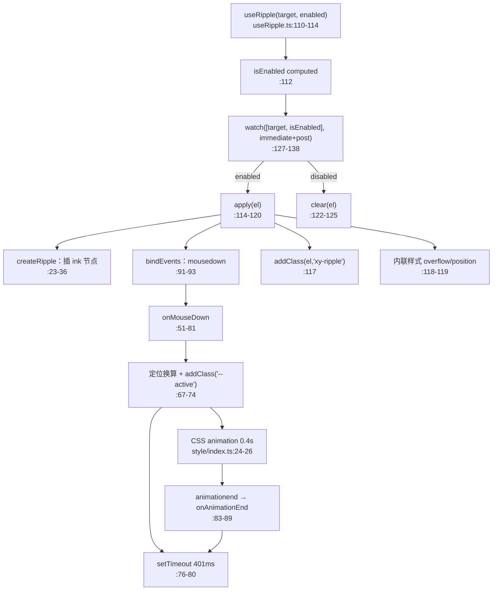
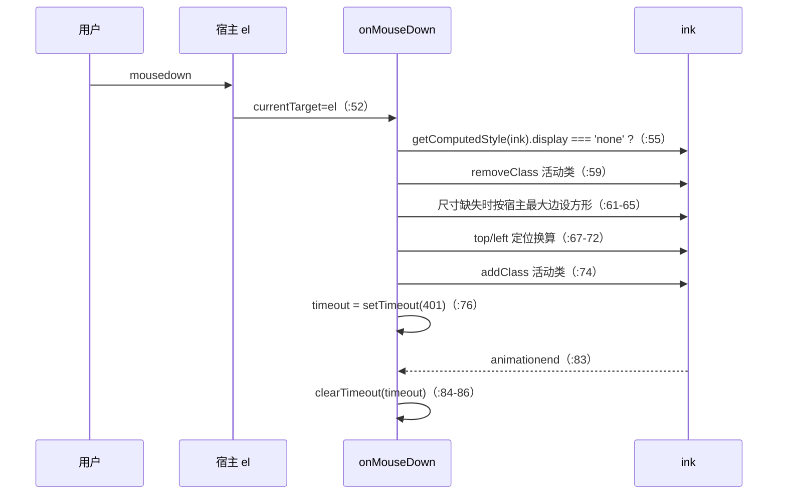

# C12-05 Ripple 涟漪

> **本篇解决**：`ripple` 为什么用模块级单变量 `timeout` 给所有宿主共用、`onMouseDown` 的坐标换算里那处轴向互换会造成什么后果、宿主 `<span>` 的 `class` 为什么会同时被 Vue 与 `removeClass` 两个所有者书写、以及这套「JS 401ms 定时器 + CSS 0.4s 关键帧」的双时钟耦合点在哪一行。
> **前置**：C01-01《Button 按钮》（另一套点击反馈 `xy-wave` 的宿主）、C12-00《类横写：应用级容器与全局能力》。

## 一、职责与边界

`ripple` 是本库**两套点击视觉反馈**中的一套，纯 DOM 实现：在一个宿主元素上插一个绝对定位的 `<span class="xy-ripple__ink">`，按下时把 ink 移到指针处并加上 `--active` 类，由 CSS 关键帧播放 0.4 秒淡出放大。它不产生任何 Vue 响应式状态，组件与 hook 两个出口最终都只是往 DOM 上写内联样式和类名。

另一套点击反馈是 `xy-wave`（`_util/wave/`），由 Button 等组件在自己的渲染里包裹 `Wave` 实现，开关链是 `ConfigProvider` 的 `wave.disabled`。两套互不引用：

```bash
grep -rn "ripple" packages/xiaoye-ui/src/_util/wave ; grep -rn "wave" packages/xiaoye-ui/src/ripple
```

两条命令的命中都为空（排除 `dist`），因此「同一个按钮被 wave 铺一层、又被 ripple 铺一层」在代码层面不会被自动防住，只能靠使用者不叠加。为什么并存、以及 `wave.disabled` 与 `ripple` 两个开关的覆盖面差异，见 C12-00 论点 3，本篇不重复论证，只补两套实现在**状态归属**上的技术差异：wave 用 Vue 侧的过渡与节点引用，ripple 全部走命令式 DOM（下文的模块级 `timeout` 就是这个选择的直接后果）。

边界上还需要钉住三件事：

1. **它只处理 `mousedown`。** `bindEvents` 只注册这一个事件（`useRipple.ts:91-93`），因此触屏（`touchstart`）与键盘（Enter/Space 激活按钮）**没有涟漪**。这是本组件与 a11y 期望之间最大的一处缺口，且源码里没有 `pointerdown` 的迹象。
2. **它不做颜色主题派生。** ink 的颜色写死为 `rgba(0,0,0,0.1)`（`style/index.ts:19`），不参与任何 Token 计算，暗色主题下不会自动变亮。这违反 AGENTS.md「组件样式禁止硬编码颜色」的硬约束，但它是本类里样式退化最彻底的一个（`FullToken<'Ripple'>` 未定义、`ComponentToken` 是空接口，`style/index.ts:4-6`），退化族谱见 C12-00 论点 4。
3. **它不是布局容器。** 组件形态渲染的是一个 `<span>`（`Ripple.tsx:34`）而非 `display: contents` 的包裹层，因此它会真的往 DOM 树里加一层，并把宿主变成定位上下文（`useRipple.ts:128-129`）。这一条与 C06-07《KeyFilter》的 `display: contents` 选择正好相反，是两者在「包裹型组件该不该产生盒子」上的分野。

## 二、源码地图

```
packages/xiaoye-ui/src/ripple/
├── index.ts          15   公开面：组件 + props + useRipple + 两个类名常量
├── Ripple.tsx        39   组件壳：26-30 五行把 ConfigProvider 开关接进 hook
├── rippleTypes.ts    11   两个 prop：prefixCls、disabled
├── useRipple.ts     149   全部机制
├── style/index.ts    ~30  一条关键帧 + 两条字面类名规则
└── index.test.js    106   5 个 it + mountTest
```

`useRipple.ts` 的内部结构值得一提：六个函数里 **五个定义在模块作用域**（`getInk:19`、`createRipple:23`、`remove:38`、`onMouseDown:51`、`onAnimationEnd:83`、`bindEvents:91`），只有 `apply:114`/`clear:122` 在 `useRipple` 闭包内。这与 C06-07 的 `useKeyFilter` 是同一套手法（handler 提到模块级以便复用），但两边在**状态放哪**上做出了不同选择：`useKeyFilter` 把状态挂在目标 DOM 节点的私有属性上，`useRipple` 把状态放在**模块级变量**上（`let timeout`，`:17`）。后者的后果见论点 3。

公开面导出两个类名常量 `RIPPLE_HOST_CLASS` / `RIPPLE_INK_CLASS`（`:149`，即 `xy-ripple` 与 `xy-ripple__ink`），意味着样式覆盖方不必硬写类名——但这两个常量的字符串值与 `style/index.ts:13`、`:16` 的字面选择器是**手写对齐**的，没有任何机制校验一致性。

`index.ts:9` 挂着 `/* istanbul ignore next */`，作用在 `install` 上（`:10-13`），即全局注册路径不进覆盖率统计。

本组件不碰 Vue 的 DOM API，一切读写都经由 `@xiaoye-ui/utils/dom` 的七个原子函数（`packages/xiaoye-ui/src/ripple/useRipple.ts:2-11` 一次性导入）。这七个定义分散在 `packages/utils/src/dom/methods/` 下：

| 用途 | 导入处 | 定义处 |
| --- | --- | --- |
| 加/摘宿主与 ink 的类 | `useRipple.ts:3`、`:10` | `packages/utils/src/dom/methods/addClass.ts:3`、`removeClass.ts:1` |
| 创建 ink 节点 | `useRipple.ts:4` | `packages/utils/src/dom/methods/createElement.ts:3` |
| 读 ink 的宽高（判是否存在、算圆心偏移） | `useRipple.ts:9`、`:5` | `getHeight.ts:1`、`getWidth.ts:1` |
| 读宿主的含边框尺寸 | `useRipple.ts:7`、`:8` | `getOuterHeight.ts:1`、`getOuterWidth.ts:1` |

有一处签名不对称值得记：`getOuterHeight(element: HTMLElement, margin?)`（`packages/utils/src/dom/methods/getOuterHeight.ts:1`）要求 `HTMLElement`，而 `getOuterWidth(element: unknown, margin?)`（`packages/utils/src/dom/methods/getOuterWidth.ts:1`）收 `unknown`。两者在 `useRipple.ts:63` 同一行里成对调用，因此宽度这一侧永远不会因传错对象类型而报编译错——这也是本组件「先量宽再量高」时缺少类型保护的地方。

## 三、架构与数据流



驱动关系里有一条**双时钟**：动画本体由 CSS 播放（`animationDuration: '0.4s'`，`style/index.ts:25`），类的摘除由 JS 定时器兜底（`setTimeout(..., 401)`，`useRipple.ts:77-81`），而 `animationend` 回调也负责摘类并清定时器（`:83-89`）。也就是说存在两条终止路径，JS 那条比 CSS 那条晚 1 毫秒——正常情况下总是 `animationend` 先到、`clearTimeout` 生效，401ms 只是「动画事件丢失」时的兜底。这个 +1ms 的耦合非常紧，任何一侧被单独改动都会让另一侧失效（见 §七 坑 4）。



## 四、核心机制精读

### 论点 1：ink 是「一次创建、长期复用」的节点，不是每次点击新建

```ts
// useRipple.ts:23-36
function createRipple(el: HTMLElement) {
  let ink = getInk(el);

  if (!ink) {
    ink = createElement('span', {
      role: 'presentation',
      'aria-hidden': true,
      class: INK_CLASS,
    }) as HTMLElement;

    ink.addEventListener('animationend', onAnimationEnd);
    el.appendChild(ink);
  }
}
```

`getInk`（`:19-21`）用 `querySelector('.xy-ripple__ink')` 在宿主子树里找现存的 ink，找到就什么都不做。因此**同一个宿主最多只有一个 ink 节点**，`onMouseDown` 每次只是重设它的 `top`/`left`/尺寸并重新加活动类（`:59` 先摘、`:74` 再上）。这带来两个非常具体的行为后果：

1. **连续快速点击同一个元素不会叠加多圈涟漪**，只会把已有那一圈重新定位并重启动画（`:59` 摘类紧接 `:74` 加类）。视觉上「点击越快速越不明显」。
2. **重播动画依赖类的摘除真的生效**。`removeClass` 紧接 `addClass` 在同一次同步执行里完成，浏览器是否会因此重启 CSS 动画取决于是否触发了样式重算——这是标准 CSS 动画问题（通常需要在摘类与加类之间强制回流），本实现里没有任何回流语句（`:59` 与 `:74` 之间只有尺寸与坐标计算）。`getWidth(ink)`/`getHeight(ink)` 这类读操作客观上会触发回流，但它们在 `:61` 的条件分支与 `:68-69` 里，是否被执行取决于 ink 是否已有尺寸。

ink 创建时带 `role="presentation"` 与 `aria-hidden: true`（`:28-29`），因此对无障碍树是隐藏的——这部分处理是对的，纯装饰节点不应被朗读。

### 论点 2：宿主类名有两个写入者，禁用态的正确性只靠「没有重渲染」

组件形态渲染的 span 直接把 `prefixCls` 写进 `class` 绑定（`Ripple.tsx:34`）。而 `useConfigInject('ripple', props)`（`:25`）派生出的 `prefixCls` 就是 `xy-ripple`——与 `useRipple` 的 `HOST_CLASS`（`:15`）同名。于是同一个类名有两个所有者：Vue 的 `class` 绑定负责挂上，`clear()` 的 `removeClass(el, HOST_CLASS)`（`:124`）负责摘掉。

测试恰好证明了这种双所有权处于微妙平衡：`index.test.js:50-70` 断言 `disabled` 时 `wrapper.find('.xy-ripple').exists()` 为 `false`。它能通过，是因为挂载后 `watch` 以 `flush: 'post'`（`useRipple.ts:147`）跑一次 `clear`，把 DOM 上的类摘干净，而**测试里没有再触发任何重渲染**。一旦组件因其他响应式依赖重渲染，Vue 会按 `:34` 的绑定把 `xy-ripple` 重新写回去，而此时 `clear` 已经把内联的 `overflow`/`position` 还原（`:42-43`）、ink 也已移除（`:47`）——于是得到「有涟漪类、无涟漪能力」的半退役状态，任何以 `.xy-ripple` 为锚的样式（`style/index.ts:13-16`）会照常命中。

> ⚠️ 未在源码中找到「重渲染后类名复位」的直接证据（这需要一次真实重渲染），此处为待核实推断，判据是 `Ripple.tsx:34` 的类绑定与 `useRipple.ts:134` 的命令式摘类指向同一个字符串。

### 论点 3：`timeout` 是模块级单变量，全库所有涟漪共享一个定时器

```ts
// useRipple.ts:18
let timeout: ReturnType<typeof setTimeout> | undefined;

// useRipple.ts:77-81
  timeout = setTimeout(() => {
    if (ink) {
      removeClass(ink, INK_ACTIVE_CLASS);
    }
  }, 401);
```

`timeout` 声明在模块作用域，**不在 `useRipple` 闭包里**。含义很直接：页面上任何元素的点击都会覆盖同一个变量（`:76` 无条件赋值），先前那个定时器句柄就此丢失，无法再被 `clearTimeout`（`:84-86` 只清最后那一个）。具体后果分两层：

- **功能上通常无害**：每个定时器的闭包捕获的是自己的 `ink`（`:77-79` 的 `if (ink)` 判的是闭包内的那个 ink），所以泄漏的定时器到点后仍会正确摘掉自己那颗 ink 的类。丢的只是「提前取消」的能力。
- **卸载路径上不干净**：`remove()`（`:38-49`）解绑 `mousedown`、解绑 `animationend`、`ink.remove()`，**但没有 `clearTimeout(timeout)`**。因此「点击后 401ms 内卸载组件」会留下一个针对已从文档移除的节点的定时器回调；如果这个句柄恰好是 `timeout` 里最新的，后续别的元素动画结束时会替它清掉（`:84-86`），否则就自然到期。这是可回收的一次性定时器，不构成持久泄漏，但说明 `remove` 的清理清单缺项。

与 `useKeyFilter` 的对照值得写下来：`useKeyFilter` 把可变状态放进 DOM 节点（每个目标一份），`useRipple` 放进模块变量（全局一份）。前者的问题是节点复用时的陈旧状态（见 C06-07 论点 1），后者的问题是跨实例互相覆盖。两者是同一个「命令式 DOM 副作用组件该如何持有状态」难题的两种答案，本库没有给出规范。


### 论点 4：两处滚动补偿既冗余又跨轴写反，只被标准模式下的零值掩盖

先看实现，再看它依赖的 `getOffset`：

```ts
// useRipple.ts:68-73
  const offset = getOffset(el);
  const x = event.pageX - offset.left + document.body.scrollTop - getWidth(ink) / 2;
  const y = event.pageY - offset.top + document.body.scrollLeft - getHeight(ink) / 2;

  ink.style.top = `${y}px`;
  ink.style.left = `${x}px`;
```

```ts
// packages/utils/src/dom/methods/getOffset.ts:10-20
    return {
      top:
        rect.top +
        (window.pageYOffset || document.documentElement.scrollTop || document.body.scrollTop || 0),
      left:
        rect.left +
        (window.pageXOffset ||
          getScrollLeft(document.documentElement) ||
          getScrollLeft(document.body) ||
          0),
    };
```

三条结论依次成立：

1. **主换算是对的。** `getOffset` 返回的是**文档坐标**（`getOffset.ts:12-13` 已在 `rect.top` 上加了 `window.pageYOffset`），`event.pageX/pageY` 同为文档坐标，于是 `pageX - offset.left`、`pageY - offset.top` 得到相对宿主的位移，轴向一一对应（`useRipple.ts:69` 用 `pageX` 配 `offset.left`，`:69` 用 `pageY` 配 `offset.top`）。
2. **两处 `document.body.scroll*` 是重复计数。** 滚动量已由 `getOffset` 按 `window.pageYOffset → documentElement.scrollTop → body.scrollTop`（`getOffset.ts:13`、`:16-19`）的兜底链加过一次，再补一次等于把滚动量算两遍——前提是它真的非零。
3. **而且两个轴还写反了。** 水平量 `x`（`:68`）加的是 `scrollTop`，垂直量 `y`（`:69`）加的是 `scrollLeft`。

三条叠起来的结果是这个缺陷**在标准模式下完全不可见**：规范里 `document.body.scrollTop/scrollLeft` 恒为 0（滚动量落在 `documentElement` 上），交叉且冗余的补偿项乘了零。要触发它需要 quirks 模式或一个自身会滚动的 `body`，那时横向滚班会被加进 `top`、纵向滚班会被加进 `left`，圆心偏差随滚动距离线性增长。

另有一个更简洁的替代（属改动建议，不作事实断言）：宿主已被写成定位上下文（`:119` 的 `position: relative`），浏览器原生的 `event.offsetX/offsetY` 就是相对宿主的坐标，`getOffset`、`pageX/pageY` 与全部滚动补偿都不必存在。源码无注释解释为何走文档坐标做减法，本篇不猜动机。

> ⚠️ 未在源码中找到对应实现，此处为规范推导（待核实）：「标准模式下 `body.scrollTop` 恒为 0」属 CSSOM 规范行为，本篇未做 quirks 模式实测。可证的源码事实只有两条——`:68-69` 的轴位交叉，与 `getOffset.ts:13`、`:16-19` 已包含滚动量。


### 论点 5：宿主是行内元素时，`overflow: hidden` 不裁切 ink

组件形态的宿主是一个 `<span>`（`Ripple.tsx:34`）。`apply()` 给它写内联样式：

```ts
// useRipple.ts:114-120
  function apply(el: HTMLElement) {
    createRipple(el);
    bindEvents(el);
    addClass(el, HOST_CLASS);
    el.style.overflow = 'hidden';
    el.style.position = 'relative';
  }
```

`position: relative` 对行内元素有效，因此 ink 的绝对定位仍有包含块；但 **`overflow: hidden` 对非替换行内元素不产生裁切**（CSS 2.1 的可溢出元素判定），而 `style/index.ts:13-16` 的 `.xy-ripple { position: relative; overflow: hidden }` 同样没有声明 `display`。于是组件形态下那颗直径等于宿主最大边的 ink（`:62-64`）**会溢出 span 的行内盒向外画圆**，除非宿主自身另有 `display`。

与之相对，hook 形态的典型宿主是 `<button>`：测试里用的就是 `h('button', ...)`（`index.test.js:78-80`），而 `button` 默认是 `inline-block`，属于可溢出元素，`overflow: hidden` 生效。这解释了两条出口路径在视觉上的差别，也说明「包一个 span」与「给已有按钮加涟漪」并不是等价用法——`Ripple.tsx:9-16` 的文档注释推荐内部组件直接用 hook 以避免额外 DOM 层级，从裁切正确性上也是更稳的选择。

### 论点 6：开关链有三级，默认值是 `true`

`enabled = !props.disabled && ripple.value`（`Ripple.tsx:29`）里的 `ripple` 来自 `useConfigInject`：

```ts
// config-provider/hooks/useConfigInject.ts:48
  const ripple = computed<boolean>(() => props.ripple ?? configProvider.ripple?.value ?? true);
// config-provider/index.tsx:140
  const ripple = computed(() => props.ripple ?? parentContext.ripple?.value ?? true);
```

`ConfigProvider` 的 `ripple` prop 声明为 `{ type: Boolean, default: undefined }`（`packages/xiaoye-ui/src/config-provider/context.ts:111`，对应的上下文类型是 `ripple?: ComputedRef<boolean>`，`:156`），而 `useConfigInject` 把它放进返回对象的第 `ripple` 位（`packages/xiaoye-ui/src/config-provider/hooks/useConfigInject.ts:72`），因此**缺省值是 `undefined` 而不是 `false`**，`??` 链一路落到最右侧的 `true`。三级语义清楚：`<xy-ripple disabled>` 只关自己、`ConfigProvider ripple=false` 关子树、都没有则默认开。注意 `??` 而不是 `||`：显式传 `false` 不会被跳过，显式传 `0` 或空串也不会（虽然类型上只允许 Boolean）。

直接调 hook 时链路不同：`useRipple(target)` 省略第二个参数时 `isEnabled` 恒为 `true`（`useRipple.ts:115`：`enabled === undefined ? true : !!enabled.value`），**完全绕过 ConfigProvider**——全局 `ripple=false` 关不掉这种裸调的涟漪，只能靠宿主自己传 `enabled` ref。这是「组件壳走配置、hook 走默认」造成的开关覆盖面缺口，也是本库两个出口最常见的语义漂移形态。库内如今没有这条裸调路径的活例：`useRipple` 的库内调用只剩组件壳显式传 `enabled` 的那一次（`Ripple.tsx:30`），对直调 hook 的接入方，这条缺口只剩约定约束。

## 五、对外契约如何生效

组件只有一个业务 prop：`disabled`（`rippleTypes.ts:6`，`booleanType(undefined)`），加上 `prefixCls`（`:5`）。`initDefaultProps(rippleProps(), { disabled: false })`（`Ripple.tsx:21-23`）把 `disabled` 默认成 `false`——注意这与 `booleanType(undefined)` 的声明值不同，最终默认值以 `initDefaultProps` 为准。

没有 `emits`、没有 `expose`、没有 `slots` 类型声明（`Ripple.tsx:17-36` 全文只用了 `slots.default`）。因此这个组件对外的全部契约就是：渲染一个带 `xy-ripple` 类的 `<span>`，把默认插槽放进去（`:34-36`），以及副作用产生的四个内联样式/类名变更。

SSR 处理与 C06-07 形成直接对照：`packages/xiaoye-ui/src/ripple/Ripple.tsx:26` 现在取双值 `const [wrapSSR, hashId] = useStyle(prefixCls);`，渲染时把 `wrapSSR(...)` 包在返回值外面并把 `hashId.value` 并进 `packages/xiaoye-ui/src/ripple/Ripple.tsx:34` 的类名数组——hash 类已落 DOM。`useKeyFilter` 一侧则是 `[, hashId]`（`packages/xiaoye-ui/src/key-filter/KeyFilter.tsx:16`）丢弃了 `wrapSSR`，两侧各丢一半的旧格局已只剩后者。历史口径存档：修复前（2026-10-02 前）`Ripple.tsx:26` 只取 `[wrapSSR]`、`class` 上没挂 hash，当时与 `packages/xiaoye-ui/src/ripple/style/index.ts:17`、`:16` 使用字面类名 `.xy-ripple` / `.xy-ripple__ink` 而不是 `componentCls` 的写法互为因果——本组件不依赖 hash 类也能命中样式。这条「行为型组件样式契约退化」的族谱在 C12-00 论点 4 里已统一记录；ripple 现存的落点只剩 `style/index.ts:4-6` 的空 `ComponentToken`。

两个类名常量 `RIPPLE_HOST_CLASS` / `RIPPLE_INK_CLASS`（`:149`，经 `index.ts:7` 转出）是覆盖样式的官方抓手，`useRipple` 也在 `:15`、`:14` 用同一对常量读写。风险点仍然是：`style/index.ts` 里的选择器是手写字面量，与常量分属两处，改名不会有任何编译错误。

测试面（`ripple/index.test.js`，106 行、5 个 `it` 外加 `mountTest(Ripple)` 注入的两个用例；按 `packages/xiaoye-ui/vitest.config.mts:33` 的 glob 会被执行）覆盖的**只有 apply/clear 的静态结果**：

| 用例 | 断言内容 | 位置 |
| --- | --- | --- |
| mountTest | 可挂载、可卸载 | `:11` |
| 启用时 host span | 类名、`tagName === 'SPAN'`、内联 `position`/`overflow` | `:13-29` |
| ink 注入 | `.xy-ripple__ink` 存在 | `:31-48` |
| `disabled` | 类与 ink 都不存在、子元素仍渲染 | `:50-70` |
| hook 启用 | 按钮上出现 `xy-ripple` 与两个内联样式 | `:72-88` |
| hook `enabled=false` | 无类、无 ink | `:90-105` |

**零覆盖的路径**：`onMouseDown` 全部逻辑（`:51-81`，包括尺寸计算与坐标换算）、`onAnimationEnd`（`:83-89`）、401ms 兜底定时器（`:76-80`）、`remove()` 的解绑与样式还原（`:38-49`）、`enabled` 由真变假的切换（`:127-138` 的第二种分支只在初始态测过）。也就是说论点 1 到论点 4 涉及的全部行为面，测试里一条都没有——改 `onMouseDown` 不会让任何用例变红。

## 六、设计取舍

**取舍一：状态放模块变量，而不是放 DOM 节点或闭包。** `useRipple` 只需要一个「待取消的定时器句柄」，作者把它写成了模块级 `let timeout`（`:17`）。三个候选位置各有代价：放 DOM expando（`useKeyFilter` 的做法）会带来节点复用时的陈旧值；放 `useRipple` 闭包会让 `onMouseDown` 这类模块级 handler 无法访问，必须改成闭包内定义 handler，于是每次 `bindEvents` 都产生新函数引用；放模块变量最简单，代价是跨实例互相覆盖（论点 3）。当前选择换来的是 handler 全部留在模块作用域、`addEventListener` 天然去重（`onMouseDown` 是同一个函数引用，重复 `bindEvents` 不会产生多重监听）——这与 C06-07 的坑 1/坑 2（handler 是每次新建的闭包，因而重复绑定且句柄丢失）恰好是一组对照实验。

**取舍二：ink 常驻复用，而不是每次点击新建再删除。** `createRipple` 的 `if (!ink)` 守卫（`:26`）让节点只建一次，之后 `onMouseDown` 只改样式（`:63-64`、`:71-72`）。好处是稳定、无 GC 抖动；代价是动画重播必须靠类的摘/加（`:59`、`:74`）来触发，而这条路径在同步代码里没有强制回流（论点 1 第 2 条）。另一个方案是每次 `createElement` 并在 `animationend` 里 `remove()`，动画重播天然成立，但要付出一连串节点创建。

**取舍三：JS 兜底定时器 + CSS 动画双终止。** `setTimeout(401)`（`:76-80`）与 `animationend`（`:83-89`）互为备份，意图是「动画事件在某些环境不可靠时仍能摘类」。代价是那个 +1ms 的硬编码耦合（`style/index.ts:25` 的 `0.4s` 与 `useRipple.ts:81` 的 `401`），两侧分属两个文件、没有任何共享常量。这是可辩护的健壮性选择，但它把「谁改动画时长」变成一次跨文件同步操作。

**取舍四：颜色与尺寸不走 Token。** ink 的 `rgba(0,0,0,0.1)`、`scale(2.5)`、`borderRadius: 100%`（`style/index.ts:19-21`、`:11`）全部硬编码，`ComponentToken` 留空（`:4-6`）。这样组件无法随主题算法变暗/变亮，暗色下涟漪几乎不可见；换来的是迁移零依赖（`style/index.ts:7` 的注释写着「迁移自源项目 ripple/style/index.ts，去掉第三参数（按任务 0.3 决策）」）。与 A03 的 Token 分层原则相比，这是一处显性欠账，属于 C12-00 论点 4 记录的「行为型三组件样式退化」之一。

## 七、坑与改动指南

**坑 1：全局 `ripple=false` 关不掉 hook 路径的涟漪。**
触发：`<xy-config-provider :ripple="false">` 环境里直调 `useRipple(ref)` 且省略 `enabled`。
症状：被裸调的元素照样出涟漪，走组件壳的没有。
原因：`useRipple(btnRef)` 省略 `enabled` 时 `isEnabled` 恒真（`useRipple.ts:115`），不读 ConfigProvider；只有 `Ripple.tsx:29` 那条路径才接 `ripple` 计算属性。
定位：`useRipple.ts:115`、`Ripple.tsx:25`、`Ripple.tsx:29`。库内暂无裸调活例，接入方直调 hook 时按本条自查。

**坑 2：滚动补偿既重复计数又跨轴互换。**
触发：页面处于 quirks 模式，或宿主所在的滚动容器就是 `document.body` 本身，然后滚动一段距离再点击。
症状：涟漪圆心随滚动距离偏移——横向滚班会让圆心得以在垂直方向偏，纵向滚班会让它水平偏。
原因：`x`（水平）加 `document.body.scrollTop`、`y`（垂直）加 `document.body.scrollLeft`（`useRipple.ts:69-70`），而滚动量已由 `getOffset` 计入文档坐标（`getOffset.ts:13`、`:16-19`），此处属于第二次累加且轴位互换。
定位：`useRipple.ts:68-73`、`packages/utils/src/dom/methods/getOffset.ts:10-20`。
补充：标准模式下 `body.scrollTop/scrollLeft` 恒为 0，因此这个缺陷在日常站点上不可见（该句属 CSSOM 规范行为，本篇未做浏览器实测）。

**坑 3：包在 `<xy-ripple>` 里的行内宿主不裁切 ink。**
触发：`<xy-ripple><a href="#">链接</a></xy-ripple>` 或直接依赖组件壳的默认 span。
症状：出现一个远超宿主宽度的半透明圆，且不随宿主边界截断。
原因：宿主是 `<span>`（`Ripple.tsx:34`），`apply` 写了 `overflow: hidden` 但行内非替换元素不产生可溢出盒（`useRipple.ts:128`），样式层也没补 `display`（`style/index.ts:13-16`）。
定位：`Ripple.tsx:34`、`useRipple.ts:114-120`、`style/index.ts:13-16`。
改法建议：给 `.xy-ripple` 补 `display: inline-block`，或按 `Ripple.tsx:9-16` 的注释建议改用 hook 挂在本身是块级/inline-block 的元素上。

**坑 4：改动画时长必须同时改两处。**
触发：把 `animationDuration` 从 `0.4s` 调到 `0.8s`。
症状：涟漪播放到一半就消失（0.4 秒时被 JS 兜底摘掉类）。
原因：`setTimeout(..., 401)` 与 CSS 时长是手写对齐的常量（`useRipple.ts:81`、`style/index.ts:25`），无共享来源。
定位：同上两行。

**坑 5：同一宿主重复调用 `useRipple` 会重复加内联样式但不会重复绑事件。**
触发：两个组件把同一个 DOM 节点作为 target 各调一次 `useRipple`（或同一组件里对同一 ref 调两次）。
症状：功能正常，但 `clear()` 由其中一方触发后，另一方仍认为涟漪已启用（`remove` 会把 `overflow`/`position` 清空并删掉 ink，`:42-47`），出现「有监听器、无 ink」。
原因：ink 存在性判据是 `getInk(el)`（`:24`），监听器判据是浏览器去重（同一函数引用 `onMouseDown`，`:51`），二者都不是引用计数。
定位：`useRipple.ts:23-36`、`:38-49`、`:91-93`。

**坑 6：卸载时不清 `timeout`。**
触发：点击后 401ms 内组件卸载。
症状：无可观察错误，但会残留一次针对游离节点的 `removeClass` 调用。
原因：`onBeforeUnmount` 只调 `clear(el)`（`:140-146`），`clear → remove` 的清单里没有 `clearTimeout`（`:38-49`）。
定位：`useRipple.ts:38-49`、`:76-80`、`:140-146`。

**改动安全边界**：动 `useRipple.ts` 前要知道测试只覆盖 apply/clear 的静态结果（§五 表），`onMouseDown` 与动画终止路径零覆盖；动 `style/index.ts` 的字面类名会同时影响 hook 与组件两条路径，且没有 Token 兜底；动 `Ripple.tsx:34` 的 `<span>` 为块级元素会改变布局语义，属于对外可见变更，需按 AGENTS.md 的语义化版本兼容要求评估。

## 附：本篇可证伪的三个检查点

**检查点 1：`useRipple` 在 `ripple/` 目录外零引用。**

```bash
cd packages/xiaoye-ui/src && grep -rn "useRipple" . --include='*.ts' --include='*.tsx' \
  | grep -v "^./ripple/" | grep -v "/dist/"
```

预期为空：hook 形态在库内已没有消费者，`useRipple` 只剩 `ripple/` 目录自己的导出、注释与组件壳 `Ripple.tsx:30` 那一次显式传 `enabled` 的调用。若出现 `ripple/` 之外的 `useRipple` 调用且省略 `enabled`，坑 1 就重新有了库内活例；若出现把 `Ripple` 组件当组件标签使用的新消费方，需复核 §五 的对外契约描述。

**检查点 2：定时器句柄只有一个全局槽位，且 `remove()` 不清它。**

```bash
grep -n "timeout" packages/xiaoye-ui/src/ripple/useRipple.ts
```

预期 4 行：声明 `:17`、赋值 `:76`、判空 `:84`、清理 `:85`，且**行号区间不落在 `:38-49`（`remove`）内**。若 `remove` 里出现第 5 处 `clearTimeout`，坑 6 已修复。

**检查点 3：坐标换算的轴向互换是源码事实，不是我的读错。**

```bash
sed -n '67,72p' packages/xiaoye-ui/src/ripple/useRipple.ts
```

预期：`x` 那一行同时含 `event.pageX`、`offset.left`、`document.body.scrollTop`；`y` 那一行同时含 `event.pageY`、`offset.top`、`document.body.scrollLeft`——也就是**主轴配对正确、补偿项轴位相反**。再配一条命令确认补偿确实冗余：

```bash
grep -n "pageYOffset\|getScrollLeft" packages/utils/src/dom/methods/getOffset.ts
```

预期命中 `:13`（`window.pageYOffset`）与 `:16-17`（`window.pageXOffset`、`getScrollLeft`）等行，说明 `getOffset` 已把滚动量计入。若 `:68-69` 的 `scrollTop/scrollLeft` 被删掉或换了轴，论点 4 与坑 2 需相应改写。

