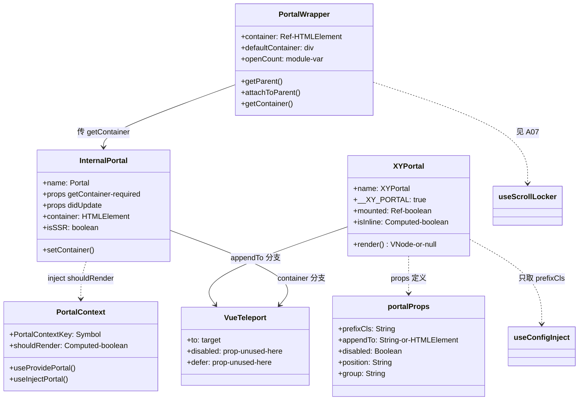
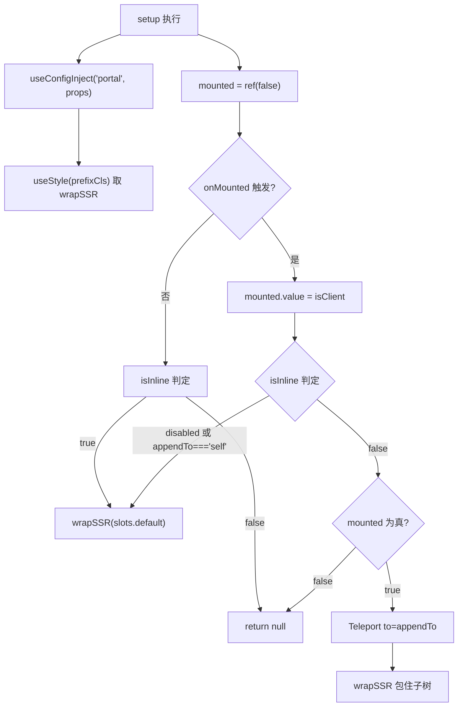
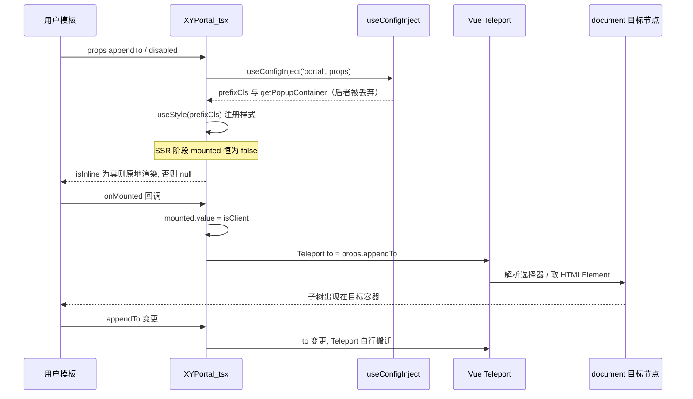

# C12-06 Portal 传送门

> **本篇解决**：`xy-portal` 这个公开组件、`_util/Portal.tsx` 这个内部组件、`_util/PortalWrapper.tsx` 这个容器编排器，三者到底是什么关系？谁在用谁、谁不在用谁？公开组件的 `appendTo` / `disabled` 是怎么变成一次 `<Teleport>` 决策的？改哪一行会让浮层全家炸？
> **前置**：A07 交互基础设施总览（一个浮层是怎么拼起来的）　**读者坐标**：`03-components/12-global` 第 6/9 篇

## 一、职责与边界

Portal 在 XiaoyeUI 里有 `Portal` 命名的**四份实现文件、三套活代码**，且三套之间互不相通。这是本篇的第一件事，也是接手时最容易搞混的地方。

| 实现 | 位置 | 组件 `name` | 面向谁 |
| --- | --- | --- | --- |
| 公开组件 | `packages/xiaoye-ui/src/portal/Portal.tsx:11` | `XYPortal` | 用户写的 `<xy-portal>`，props 是 `appendTo` / `disabled` |
| 内部组件 | `packages/xiaoye-ui/src/_util/Portal.tsx:13` | `Portal` | `PortalWrapper` 与 `vc-notification`，props 是 `getContainer` / `didUpdate` |
| 容器编排器 | `packages/xiaoye-ui/src/_util/PortalWrapper.tsx:46` | `PortalWrapper` | `vc-trigger` / `vc-dialog` / `vc-drawer` / `vc-tour` |
| 机械副本 | `packages/xiaoye-ui/src/_util/components/Portal.tsx` | `Portal` | 只被同目录副本 `components/PortalWrapper.tsx:2` 引用，业务侧零引用（归 A06 登记） |

`XYPortal` **不**在浮层主干上：主干是 `PortalWrapper` + `_util/Portal`，`Trigger.tsx:18`、`vc-dialog/DialogWrap.tsx:4`、`vc-drawer/src/DrawerWrapper.tsx:5`、`vc-tour/Tour.tsx:24`、`vc-tour/Mask.tsx:6` 都走这条。但 `XYPortal` 也不是纯文档玩具——它是**另一条浮层路线的挂载层**，有三个库内消费者（`context-menu`、`color-picker`、`data-table/ColumnFilter`，见论点 1 的表），另有五个文档示例（`apps/docs/examples/portal/` 下的 `basic.vue:22`、`nested.vue:5`、`nested.vue:19`、`custom-container.vue:20`、`with-modal.vue:19`）。公开 Portal 只做一件事：把「Vue `<Teleport>` 的 SSR 安全包装 + 三种内联/传送分支判定」封成一个 prop 面只有两个字段的组件。它不做容器创建、不做层级、不做滚动锁定、也不读 ConfigProvider 的全局容器。

明确**不负责**的三件事，都归 A07 与后续篇：

- 容器 div 的创建、挂载、类名同步与卸载回收 → `_util/PortalWrapper.tsx`，A07 已论证；
- 滚动锁定与 `autoLock` 空判失效 → 见 A07 坑 9，本篇只在 §六 第一条交代 `PortalWrapper` 侧的注入点行号（`_util/PortalWrapper.tsx:109-124`）；
- 定位求解（align）与层叠序（zIndex）→ 归 I01 / I10。

依赖清单（本篇范围内）：`portal/Portal.tsx` → `portal/portalTypes.ts:11`、`_util/props-util`（`initDefaultProps`）、`config-provider/hooks/useConfigInject`、`portal/style/index.ts:8`；`_util/Portal.tsx` → `vc-trigger/context.ts:27`（`useInjectPortal`）；`_util/PortalWrapper.tsx` → `_util/Portal.tsx`、`canUseDom`、`raf`、`hooks/useScrollLocker`。

## 二、源码地图

| 文件 | 行数 | 职责 | 关键导出 |
| --- | --- | --- | --- |
| `packages/xiaoye-ui/src/portal/index.ts` | 14 | 入口，`install` 走 `registerComponent` | `Portal`（默认）、`portalProps`、`PortalProps` |
| `packages/xiaoye-ui/src/portal/Portal.tsx` | 43 | **主实现入口**：门闸 + Teleport | `defineComponent`（`name: 'XYPortal'`，`Portal.tsx:12`） |
| `packages/xiaoye-ui/src/portal/portalTypes.ts` | 24 | 函数式 props | `portalProps`（默认导出，`portalTypes.ts:24`） |
| `packages/xiaoye-ui/src/portal/style/index.ts` | 10 | 空样式占位 hook | `genComponentStyleHook('Portal', …)`（`style/index.ts:8`） |
| `packages/xiaoye-ui/src/portal/index.test.js` | 76 | 4 条用例（inline / self / body / 挂载后） | — |
| `packages/xiaoye-ui/src/_util/Portal.tsx` | 72 | 内部传送组件，`shouldRender` 驱动 | `Portal` |
| `packages/xiaoye-ui/src/_util/PortalWrapper.tsx` | 191 | 容器编排 + `openCount` 记账 | `PortalWrapper`、`GetContainer`（`:44`）、`getOpenCount`（`:22`） |
| `packages/xiaoye-ui/src/vc-trigger/context.ts` | 38 | `PortalContext` 与 `shouldRender` 合成 | `useProvidePortal`（`:9`）、`useInjectPortal`（`:27`） |
| `packages/xiaoye-ui/src/_util/components/Portal.tsx` | 72 | 与 `_util/Portal.tsx` 仅差 2 行 import 路径 | — |
| `packages/xiaoye-ui/src/_util/__mocks__/Portal.tsx` | 13 | 测试替身 | — |

副本判定的证据：`diff packages/xiaoye-ui/src/_util/Portal.tsx packages/xiaoye-ui/src/_util/components/Portal.tsx` 只有两行差异，全是相对 import 深度（`./vue-types` → `../vue-types`、`../vc-trigger/context` → `../../vc-trigger/context`）。副本经 `_util/components/index.ts:4` 与 `:5` 进 barrel，再由 `_util/index.ts:46` 的 `export * from './components'` 汇入内部工具面——这与 OUTLINE「已知待办 5」记录的结论一致，本篇不重复展开。

生成物侧：`src/components.ts:254` 有 `export * from './portal'`，`:279` 有具名 `export { default as Portal }`，`:280` 是样式副作用导入；`typings/global.d.ts:65` 登记 `XYPortal`；`package.json:473` 与 `:477` 提供 `./portal` 与 `./portal/style` 双入口。

## 三、架构与数据流

### 图 1：静态结构（三套 Portal 的调用面）



读图要点：`XYPortal` 与 `InternalPortal` 之间**没有任何一条边**——它们各自直接对接 Vue 的 `<Teleport>`，但输入形态完全不同（一个是 `appendTo` 字符串，一个是已解析的 `HTMLElement`）。`PortalWrapper → InternalPortal` 这条边是浮层基座的主干，`PortalWrapper` 与 `InternalPortal` 的关系、`openCount` 记账与滚动锁定闸门都已在 A07 论证，本篇不重述。本篇新增的唯一结构事实是：**`XYPortal` 挂在包的公开导出面上（`components.ts:279`），但它不在浮层主干上**，它是一条只服务用户手写信创的旁路。

### 图 2：`XYPortal` 的渲染决策（三分支）



三个分支的**优先级顺序**是本组件的全部逻辑：`isInline`（`portal/Portal.tsx:25`）在 `mounted` 门闸（`:36`）**之前**判定，所以 `disabled` 与 `appendTo: 'self'` 在 SSR 阶段和客户端首帧都能直出内容；只有需要传送的那条分支才被门闸延后一帧。这条顺序如果写反（先判 `mounted`），`disabled` 模式在首帧也会返回 `null`，`index.test.js:9-24` 那条用例会当场失败。

### 图 3：一次 `<xy-portal>` 从 props 到 DOM 的闭环



图中两处「丢弃」是有意的：`useConfigInject` 返回的 `getPopupContainer`（`config-provider/hooks/useConfigInject.ts:56`）在 `portal/Portal.tsx:22` 的解构里根本没出现，`hashId` 同理（`:23` 只取 `wrapSSR`）。于是「全局容器配置」和「样式哈希」两条链都在 Portal 这里断掉，这是本篇论点 1 和论点 4 的主题。

## 四、核心机制精读

### 论点 1：公开 `XYPortal` 与浮层基座完全不通，它连 ConfigProvider 的全局容器都不继承——「统一挂载点」这件事在库里是两套口径

`_util/PortalWrapper.tsx` 那条链上，落点由 `getContainer` prop 解析、并由 ConfigProvider 的 `getPopupContainer` 注入（A07 §六 第 6 条已论证其走法，见 `Trigger.tsx:698` → `PortalWrapper.tsx:76`）。用户如果自己写 `<xy-portal>`，直觉是「它会跟着 `<xy-config-provider :get-popup-container>` 走」。源码不成立：

```tsx
// packages/xiaoye-ui/src/portal/Portal.tsx:19
  setup(props, { slots }) {
    const mounted = ref(false);

    const { prefixCls } = useConfigInject('portal', props);
    const [wrapSSR] = useStyle(prefixCls);

    const isInline = computed(() => props.disabled || props.appendTo === 'self');
```

`useConfigInject('portal', props)` 的返回值有二十二个键（`config-provider/hooks/useConfigInject.ts:50-73`），`portal/Portal.tsx:22` 只解构了 `prefixCls` 一个。被丢掉的包括：

```ts
// packages/xiaoye-ui/src/config-provider/hooks/useConfigInject.ts:26
  const getPopupContainer = computed(
    () => props.getContainer ?? props.getPopupContainer ?? configProvider.getPopupContainer?.value,
  );
```

`packages/xiaoye-ui/src/config-provider/hooks/useConfigInject.ts:56` 把 `getPopupContainer` 放进了返回对象，`useConfigInject.ts:27` 的三级回落（`props.getContainer` → `props.getPopupContainer` → context 值）本来已经替组件写好了「 prop 覆盖 context」的语义，Portal 一行都没接。更硬的一层是：`portal/portalTypes.ts:11-20` 的 props 表里**既没有 `getContainer` 也没有 `getPopupContainer`**，只有 `appendTo`（`portalTypes.ts:13`）。所以即使想在模板上写 `<xy-portal :get-popup-container="fn">`，那个值也只会落进 `attrs`，而组件声明了 `inheritAttrs: false`（`portal/Portal.tsx:13`）且渲染 `<Teleport>` 时（`portal/Portal.tsx:54`）**没有展开 `attrs`**，参数会在 DOM 上出现、在逻辑上被忽略。

`XYPortal` 不在浮层主干上（主干是 `PortalWrapper` + `_util/Portal`），但它是**另一条浮层路线唯一的挂载层**——三个库内组件直接依赖它，而那三个恰好都是 A07 §四 论点 8 认定「不走 `vc-trigger`」的手写浮层：

| 消费者 | 导入位置 | 渲染位置 | 传给 Portal 的 prop |
| --- | --- | --- | --- |
| `context-menu` | `packages/xiaoye-ui/src/context-menu/ContextMenu.tsx:19` | `packages/xiaoye-ui/src/context-menu/ContextMenu.tsx:883` | `appendTo` |
| `color-picker` | `packages/xiaoye-ui/src/color-picker/ColorPicker.tsx:15` | `packages/xiaoye-ui/src/color-picker/ColorPicker.tsx:655` | `appendTo` + `disabled` |
| `data-table` 列筛选 | `packages/xiaoye-ui/src/data-table/ColumnFilter.tsx:20` | `packages/xiaoye-ui/src/data-table/ColumnFilter.tsx:737` | 无（走默认 `'body'`） |

这张表也是 OUTLINE 里 `C03-09 context-menu` 与 `C04-10 color-picker` 两行「底层 = `portal`、前置 = C12-06」的实底。**统计这一组时必须注意 import 写法有三型**，只按一种写法统计会漏：`'../portal'`（目录，命中 2 处）、`'xiaoye-ui/portal'`（别名，命中 `ColumnFilter.tsx:20` 一处）、`'./Portal'`（Portal 自己的入口 `portal/index.ts:2`）。而 `_util/Portal` 的引用方是另一组：`packages/xiaoye-ui/src/_util/PortalWrapper.tsx:2` 与 `packages/xiaoye-ui/src/vc-notification/HookNotification.tsx:9`（排除 `_util/components/` 副本后各 1 处）。两组消费者**加起来 5 个文件，交集为空**。

所以 `getPopupContainer` 的裂缝比「用户写 `<xy-portal>` 才踩到」大得多：`ColorPicker.tsx:655` 与 `ContextMenu.tsx:883` 的落点完全由各自的 `appendTo` prop 决定，ConfigProvider 的全局容器对这条旁支**一次都不生效**。

更说明「两条路线从未打算收敛」的，是 `appendTo` 的类型被逐字抄了三份：

```bash
grep -rn "AppendToType = 'body'" packages/xiaoye-ui/src
```

命中 `packages/xiaoye-ui/src/portal/portalTypes.ts:9`、`packages/xiaoye-ui/src/context-menu/contextMenuTypes.ts:39`、`packages/xiaoye-ui/src/color-picker/colorPickerTypes.ts:12`，三行的字面量完全相同（`'body' | 'self' | (string & {}) | HTMLElement`）。`portalTypes.ts:9` 的 `PortalAppendToType` 在 `src/portal/` 之外**零消费者**（它只被 `portalTypes.ts:14` 和 `portal/index.ts:6` 引用），后两个组件另起了 `ContextMenuAppendToType`、`ColorPickerAppendToType` 两个名字。三份拷贝各自还带一份重复的默认值声明：`contextMenuTypes.ts:46-49` 与 `colorPickerTypes.ts:67-70` 都写成 `type: [String, Object] as PropType<…>` 加 `default: 'body' as const`，与 `portalTypes.ts:13-16` 逐字同形。

哨兵值 `'self'` 的语义也被读了两遍。Portal 在 `packages/xiaoye-ui/src/portal/Portal.tsx:25` 用它做 `isInline`，`ColorPicker` 又在 `packages/xiaoye-ui/src/color-picker/ColorPicker.tsx:382` 用它切换定位算法：

```tsx
// packages/xiaoye-ui/src/color-picker/ColorPicker.tsx:379
    function alignOverlay() {
      if (!isClient || !inputEl.value || !pickerEl.value) return;

      if (props.appendTo === 'self') {
        relativePosition(pickerEl.value, inputEl.value);
      } else {
        absolutePosition(pickerEl.value, inputEl.value);
      }
    }
```

`packages/xiaoye-ui/src/color-picker/ColorPicker.tsx:382` 的 `'self'` 与 `packages/xiaoye-ui/src/portal/Portal.tsx:25` 的 `'self'` 是同一个约定的两处独立实现：前者决定「贴输入框相对定位」还是「视口绝对定位」，后者决定「原地渲染」还是「传送」。两处必须同时改对，而它们之间没有任何共享常量或类型约束。`packages/xiaoye-ui/src/color-picker/ColorPicker.tsx:655` 还把第三个开关叠上来——`disabled={props.inline}`（`inline` 声明在 `packages/xiaoye-ui/src/color-picker/colorPickerTypes.ts:57`），于是 ColorPicker 上「内联显示」有 `inline` 与 `appendTo: 'self'` 两条互不校验的路径。

结论回扣：Portal 在 XiaoyeUI 不是一个「传送门抽象」，而是**两条互不相通的挂载路线**——浮层主干（`PortalWrapper` + `_util/Portal`，容器是脚本 `createElement` 出来的 `div`，落点走 `getPopupContainer` 注入链，见 A07）与手写旁支（`XYPortal`，落点走组件自己的 `appendTo`，`<Teleport>` 自己解析目标）。`getPopupContainer` 对 Modal 生效、对 `<xy-portal>` 及其四个库内消费者都不生效。写自定义浮层想跟全局容器一致时，必须在 `appendTo` 上手动把容器传进去。

### 论点 2：SSR 安全性完全由「`isClient` 常量 + `mounted` 门闸」这一对承担，`wrapSSR` 与 `<Teleport>` 自带的 `defer` 都没参与

组件文件头有一行注释直接把设计意图写了出来：

```tsx
// packages/xiaoye-ui/src/portal/Portal.tsx:8
// SSR 安全的 isClient 判断，避免依赖 utils 包函数版（占位符是常量，methods 版本是函数）
const isClient = typeof window !== 'undefined' && !!window.document;
```

`packages/xiaoye-ui/src/portal/Portal.tsx:9` 是**模块级常量**，在 `defineComponent` 之外求值一次。配套的门闸是：

```tsx
// packages/xiaoye-ui/src/portal/Portal.tsx:27
    onMounted(() => {
      mounted.value = isClient;
    });

    return () => {
      if (isInline.value) {
        return wrapSSR(slots.default?.());
      }

      if (!mounted.value) {
        return null;
      }

      return wrapSSR(<Teleport to={props.appendTo as string}>{slots.default?.()}</Teleport>);
    };
```

这四段合起来是一个**两段式闸门**：

1. **服务端**：`onMounted` 不触发（`portal/Portal.tsx:27`），`mounted` 保持 `ref(false)`（`portal/Portal.tsx:20`），传送分支返回 `null`（`portal/Portal.tsx:36-38`）；内联分支（`portal/Portal.tsx:32-34`）照常输出。这保证服务端 HTML 与客户端首帧（同样 `mounted === false`）字节一致，不会触发 Vue 的 hydration 不匹配告警——这是 `null` 分支存在的唯一理由。
2. **客户端挂载后**：`mounted.value = isClient`（`portal/Portal.tsx:28`）把分支翻到 `<Teleport>`，内容离开组件所在的 DOM 位置。

`isClient` 用 `&& !!window.document` 而不是只判 `typeof window`（`portal/Portal.tsx:9`），针对的是「有 `window` 但没有 `document`」的环境（jsdom 之外的 worker 类运行时）。注释里那句「避免依赖 utils 包函数版」说明了为什么不用 `@xiaoye-ui/utils` 里的同名判断：函数版每次调用都要执行，常量版在模块求值时算完，渲染函数里读的是一个布尔字面量。

关键对照：**内部实现用的是另一套写法**，而且语义不同。

```tsx
// packages/xiaoye-ui/src/_util/Portal.tsx:21
  setup(props, { slots }) {
    let isSSR = true;
    // getContainer 不会改变，不用响应式
    let container: HTMLElement;
    const { shouldRender } = useInjectPortal();
```

`_util/Portal.tsx:22` 的 `isSSR` 是 **setup 内的普通 `let`**，靠 `_util/Portal.tsx:33-37` 的 `onBeforeMount` 翻成 `false`；它的渲染出口是 `_util/Portal.tsx:66-69` 的三态（`shouldRender` 假 → `null`；`isSSR` 真 → 原地；否则 `<Teleport to={container}>`）。两套的差异是真实的：公开版的闸门读的是**响应式 `ref`**（变化会触发重渲染），内部版的闸门读的是**普通闭包变量**（`_util/Portal.tsx:22`），后者从 `true` 翻到 `false` 本身不会触发重渲染，必须等别的响应式源（`shouldRender`，`_util/Portal.tsx:44-51` 的 watch）带动。这是内部 Portal 一定要挂一个 `watch(shouldRender, …)` 的原因之一。

另外两点「没有发生」的事，同样是机制：

- `<Teleport>` 自带的 `defer`（Vue 提供、用于把目标解析推迟到挂载后）**没有被使用**——`portal/Portal.tsx:54` 只传了 `to`。延后挂载这件事改由组件自己用 `mounted` 门闸做，效果等价但代价是首帧必须返回 `null`。
- `wrapSSR` 在这条链上是**空转**：`packages/xiaoye-ui/src/_util/cssinjs/hooks/useStyleRegister/index.tsx:428-430` 的返回值就是 `node => node`（真正的 SSR 内联样式分支在 `useStyleRegister/index.tsx:430-450` 被整段注释掉了）。`portal/Portal.tsx:47` 与 `:40` 外面那两层 `wrapSSR` 不产生任何节点。这个结论由 A04 论点 5 统一论证（`docs/column/01-architecture/04-cssinjs-engine-样式引擎与SSR注水.md`），本篇只登记它在 Portal 上的具体落点，不重述。

所以文档里那句「组件在客户端挂载后才会执行传送，SSR 环境下安全」（`apps/docs/components/portal.md:71`）指的就是 `portal/Portal.tsx:27-29` 这三行，而不是样式层。

### 论点 3：`appendTo` 的四态类型里 `'self'` 是唯一需要被「提前截走」的值，实现靠一处 `as string` 类型让步换来了 `HTMLElement` 支持

`portalTypes.ts` 的类型面比实现面宽：

```ts
// packages/xiaoye-ui/src/portal/portalTypes.ts:3
/**
 * Portal appendTo 接受：
 * - 'body' / 'self' 字符串字面量
 * - 任意 CSS 选择器字符串
 * - HTMLElement 实例
 */
export type PortalAppendToType = 'body' | 'self' | (string & {}) | HTMLElement;

export const portalProps = () => ({
  prefixCls: String,
  appendTo: {
    type: [String, Object] as PropType<PortalAppendToType>,
    default: 'body' as const,
  },
  disabled: { type: Boolean, default: false },
```

`packages/xiaoye-ui/src/portal/portalTypes.ts:9` 的 `(string & {})` 是「保留字面量提示又允许任意字符串」的惯用写法，代价是类型层面 `'self'` 和 `'#modal'` 无法区分。真正把它们分开的是 `isInline`：

```tsx
// packages/xiaoye-ui/src/portal/Portal.tsx:25
    const isInline = computed(() => props.disabled || props.appendTo === 'self');
```

也就是说 `'self'` **不是** Teleport 能理解的目标，它是在 `portal/Portal.tsx:46` 被拦下、根本不进 `<Teleport>` 的哨兵值。这个拦截必须发生在 `portal/Portal.tsx:54` 之前，否则 `<Teleport to="self">` 会去 `querySelector('self')` 找一个不存在的标签选择器。

`HTMLElement` 分支的处理更能说明取舍：

```tsx
// packages/xiaoye-ui/src/portal/Portal.tsx:54
      return wrapSSR(<Teleport to={props.appendTo as string}>{slots.default?.()}</Teleport>);
```

`as string`（`packages/xiaoye-ui/src/portal/Portal.tsx:54`）是一次**故意的类型谎报**：Vue 的 `Teleport` `to` prop 本身就接受 `Element | string`，但本库的 `PortalAppendToType`（`portalTypes.ts:9`）里 `'self'` 这个字面量的存在让联合类型无法直接收窄成「能被 Teleport 接受的那三个成员」。写类型守卫（`typeof appendTo === 'string' && appendTo !== 'self'`）能消掉这个断言，但要在 `computed` 里多一个分支；实现选了最短的一条路。运行上没有风险，风险全在**类型面上**：`PortalProps['appendTo']`（`packages/xiaoye-ui/src/portal/portalTypes.ts:22`）对 TS 用户显示为四态联合，而组件对第四态（`'self'`）的处理路径与另外三态完全不同，编译期看不出区别。

第三条实现细节：`appendTo` 是**响应式**的。`portal/Portal.tsx:54` 每次渲染都重读 `props.appendTo`，Vue 的 `<Teleport>` 在 `to` 变化时会把子节点搬到新目标；`disabled` 与 `appendTo: 'self'` 的切换则会让整棵子树在 DOM 里**重新创建**（因为组件从 `<Teleport>` 分支切回裸插槽分支，`portal/Portal.tsx:47` 与 `:40` 是两种不同的 vnode 形状），子树内部的 `ref`、滚动位置、表单未提交状态都会丢。`apps/docs/examples/portal/custom-container.vue:20` 的 `<xy-portal :append-to="target">` 演示的正是这条路径，切换单选框时目标容器变了但 vnode 形状没变（`Teleport` → `Teleport`），所以内容不重建；而切到 `'self'` 或 `disabled` 就会重建。这个差别在源码里没有任何注释，只能从 `:33` / `:40` 两条 return 的返回类型不同推出来。

最后，默认值写了**两遍**且第二遍才生效：`portalTypes.ts:15` 有 `default: 'body' as const`，`portal/Portal.tsx:15-18` 又用 `initDefaultProps(portalProps(), { appendTo: 'body', disabled: false })` 覆写一次。`initDefaultProps` 的实现是**原地改对象**：

```ts
// packages/xiaoye-ui/src/_util/props-util/initDefaultProps.ts:16
  const propTypes: T = { ...types };
  Object.keys(defaultProps).forEach(k => {
    const prop = propTypes[k] as VueTypeValidableDef;
    if (prop) {
      if (prop.type || prop.default) {
        prop.default = defaultProps[k];
```

`packages/xiaoye-ui/src/_util/props-util/initDefaultProps.ts:16` 的展开只是浅拷贝，`initDefaultProps.ts:21` 改的是嵌套 prop 描述符对象本身；因为 `portalProps()`（`portalTypes.ts:11`）是**函数**、每次调用返回全新的描述符字面量，所以这次覆写不会污染到别处。两处值恰好相同（都是 `'body'` / `false`），行为上无差异，但它是「改默认值只改一处就漏」的经典位置（见 §七 坑 3）。

### 论点 4：`portal/style/` 是一个「返回空对象」的占位样式 hook，它仍会为一条零命中的属性选择器付出注册成本

样式入口的实现只有三行有效代码：

```ts
// packages/xiaoye-ui/src/portal/style/index.ts:4
// 组件专属 Token（占位，后续按需扩展）
export interface ComponentToken {}

// Portal 不需要默认样式，仅占位以保持与其他组件一致的样式 hook 调用
export default genComponentStyleHook('Portal', () => {
  return {} as CSSObject;
});
```

`packages/xiaoye-ui/src/portal/style/index.ts:8` 的 `genComponentStyleHook('Portal', …)` 里第二个实参是**恒返回空对象的函数**。注释（`packages/xiaoye-ui/src/portal/style/index.ts:7`）把动机写得很直白：「仅占位以保持与其他组件一致的样式 hook 调用」。也就是说这个文件存在的理由不是产出 CSS，而是让 Portal 在样式系统里有个名字。

这个写法不是 Portal 独有，全仓共 4 处，Portal 是其中之一：

```bash
grep -rn "return {} as CSSObject" packages/xiaoye-ui/src --include='index.ts'
grep -rn "({}) as CSSObject" packages/xiaoye-ui/src --include='index.ts'
```

预期第一条 3 行：`packages/xiaoye-ui/src/portal/style/index.ts:9`、`packages/xiaoye-ui/src/data-table/column/style/index.ts:10`、`packages/xiaoye-ui/src/data-table/columngroup/style/index.ts:10`；第二条 1 行：`packages/xiaoye-ui/src/data-table/row/style/index.ts:6`（写法是箭头函数直接返回 `({})`）。这三处属于 `data-table` 那条线（归 C08 族），本篇不评价它们的取舍；只登记一条与 Portal 相关的对比：Portal 的渲染出口里**连一个可以承载 class 的真实元素都不存在**，因为 `<Teleport>` 不是元素（见下一段），所以它的空 hook 比那三处更彻底。

这个名字不是白起的——它必须能在 Token 接口里查到：

```ts
// packages/xiaoye-ui/src/theme/interface/components.ts:155
  Portal?: {};
```

`packages/xiaoye-ui/src/theme/interface/components.ts:155` 给 `Portal` 登记的组件 Token 类型是空对象 `{}`，与 `style/index.ts:5` 的空 `ComponentToken` 对应。缺这一行的话 `genComponentStyleHook('Portal', …)` 在 `theme/interface/components.ts` 的联合类型上就对不上，`pnpm typecheck` 会失败。

再看「零输出」具体零在哪。`genComponentStyleHook` 的注册体即使拿到空对象也会做一件事：

```ts
// packages/xiaoye-ui/src/theme/util/genComponentStyleHook.ts:107
        flush(component, mergedComponentToken);
        return [genCommonStyle(token.value, prefixCls.value), styleInterpolation];
      }),
      hashId,
    ];
```

`packages/xiaoye-ui/src/theme/util/genComponentStyleHook.ts:108` 把 `genCommonStyle(token, prefixCls)` 和组件自己的 `styleInterpolation`（这里是 `{}`）拼成返回值，`genComponentStyleHook.ts:78` 的 `useStyleRegister` 于是照常跑一次哈希与插入。`genCommonStyle` 生成的是**属性选择器**而不是类选择器：

```ts
// packages/xiaoye-ui/src/style/index.ts:108
  const rootPrefixSelector = `[class^="${componentPrefixCls}"], [class*=" ${componentPrefixCls}"]`;
```

`packages/xiaoye-ui/src/style/index.ts:105-128` 的这条规则只做三件事：套 `fontFamily`/`fontSize`、套 `boxSizing: border-box`（`packages/xiaoye-ui/src/style/index.ts:112-114`）、给 `::before/::after` 再套一次 border-box（`packages/xiaoye-ui/src/style/index.ts:116-118`）。命中的条件是元素的 `class` 属性以 `xy-portal` 开头。**而 Portal 自己的渲染路径里没有任何一处会写出这个 class**：

```bash
grep -n "prefixCls" packages/xiaoye-ui/src/portal/Portal.tsx   # 只有 :22 与 :23 两行
```

`packages/xiaoye-ui/src/portal/Portal.tsx:22` 造出 `prefixCls`，`:23` 把它交给 `useStyle`，之后就没再出现；`:23` 那行 `const [wrapSSR] = useStyle(prefixCls)` 连元组第二位的 `hashId` 都没接（绝大多数组件写的是 `const [wrapSSR, hashId] = useStyle(…)`，例如 `packages/xiaoye-ui/src/theme/util/genComponentStyleHook.ts:77-111` 描述的这个约定）。`<Teleport>`（`packages/xiaoye-ui/src/portal/Portal.tsx:54`）本身不渲染 DOM 元素，class 无处可放。所以结论是：**Portal 注册了一条永远零命中的 CSS 规则，并丢弃了本会让它命中的两个标识**。这条规则唯一可能被命中的场景，是用户自己在页面上手写了 `class="xy-portal …"` 的元素——那时候它会拿到与全站一致的字体与盒模型，这大概率不是任何人想要的效果。

顺带一条与 A04 的一致性说明：`wrapSSR` 是恒等函数、`hashId` 才是真正生效的那一位，这个结论由 A04 论点 5 统一论证（`docs/column/01-architecture/04-cssinjs-engine-样式引擎与SSR注水.md`），本篇不重述；Portal 只是这个结论下**最极端的一个样本**——它连 `hashId` 都不接，因此 `packages/xiaoye-ui/src/portal/style/index.ts:1` 导入的 `CSSObject` 类型（用在 `style/index.ts:9` 的 `as CSSObject` 断言上）是这套样式链里唯一还在被使用的东西。

### 论点 5：`inheritAttrs: false` 配了一条不透传 `attrs` 的渲染路径，调用方写在 `<xy-portal>` 上的 `class` 与 `style` 会静默消失

这是本篇认为 Portal 上最实际的一个缺陷，因为它没有任何报错。

```tsx
// packages/xiaoye-ui/src/portal/Portal.tsx:11
export default defineComponent({
  name: 'XYPortal',
  inheritAttrs: false,
  __XY_PORTAL: true,
  props: initDefaultProps(portalProps(), {
    appendTo: 'body',
    disabled: false,
  }),
  setup(props, { slots }) {
```

`packages/xiaoye-ui/src/portal/Portal.tsx:13` 显式关掉了 Vue 的自动属性透传，`packages/xiaoye-ui/src/portal/Portal.tsx:19` 的 `setup(props, { slots })` 又**没有解构 `attrs`**——上下文对象里只取了 `slots`。再看两个渲染出口：

```tsx
// packages/xiaoye-ui/src/portal/Portal.tsx:45
    return () => {
      if (isInline.value) {
        return wrapSSR(slots.default?.());
      }
```

`packages/xiaoye-ui/src/portal/Portal.tsx:47` 直接返回插槽节点数组（外面那层 `wrapSSR` 是恒等函数，见 A04 论点 5），`packages/xiaoye-ui/src/portal/Portal.tsx:54` 返回的是不带任何 attrs 展开的 `<Teleport>`。全文件里 `{...attrs}`、`v-bind`、`class=` 出现的次数为零。

对照仓库自己的规范就很清楚这是漏写而不是设计。根目录 `AGENTS.md` 的组件实现模板在渲染时写的是 `<button class={classes.value} {...attrs} …>`；同类组件的真实做法是手工并回，例如 `statistic/Statistic.tsx` 那条线（`docs/column/03-components/11-status/C11-04-statistic-统计数值.md:447` 记录了它为什么必须把 `attrs.class` 显式并进 class 数组）。Portal 三者全无。

后果分两种，都不响：

1. **内联分支**（`packages/xiaoye-ui/src/portal/Portal.tsx:47`）：插槽可能返回多个根节点，Vue 无法自动决定把 class 挂给谁，`inheritAttrs: false` 又把唯一的兜底关掉了 ⇒ class 消失。用户想给传送内容包一层可样式的 wrapper，只能自己多写一个 `<div>`。
2. **传送分支**（`packages/xiaoye-ui/src/portal/Portal.tsx:54`）：`<Teleport>` 不是真实元素，Vue 本来也不会把 attrs 落到它上面 ⇒ class 同样消失。

再叠加论点 4 的结论，就形成一条完整的死路：**用户既无法通过 `<xy-portal class="xy-portal">` 命中 `packages/xiaoye-ui/src/style/index.ts:108` 那条属性选择器（class 被丢了），组件自身也从不输出这个 class（没有元素可挂）**。Portal 的样式面在实现上等于零，且没有任何外部途径能给它加上样式。

一个副作用值得单独提：`packages/xiaoye-ui/src/portal/portalTypes.ts:12` 声明了 `prefixCls: String`，这个 prop 确实有消费者——`packages/xiaoye-ui/src/config-provider/hooks/useConfigInject.ts:14` 的 `configProvider.getPrefixCls(name, props.prefixCls)` 会优先用它。所以 `<xy-portal prefix-cls="foo">` 能改变注册样式时的前缀，让 `packages/xiaoye-ui/src/style/index.ts:108` 变成 `[class^="foo"]`——**它能生效，但生效的是全局字体与盒模型规则，不是 Portal 自己的样式**。这是个很容易误判成「我定制了 Portal 的样式」的路径。

### 论点 6：`position` 与 `group` 是「API 面存活、实现死亡」的一对，而且手册把它们写成了可用特性

先看实现的读数面，这是全文件里唯一三处 `props.` 访问：

```bash
grep -n "props\." packages/xiaoye-ui/src/portal/Portal.tsx
# 25:    const isInline = computed(() => props.disabled || props.appendTo === 'self');
# 40:      return wrapSSR(<Teleport to={props.appendTo as string}>{slots.default?.()}</Teleport>);
```

只有 `disabled` 与 `appendTo` 被读。声明处则有四个业务 prop：

```ts
// packages/xiaoye-ui/src/portal/portalTypes.ts:17
  disabled: { type: Boolean, default: false },
  position: { type: String, default: undefined },
  group: { type: String, default: undefined },
});

export type PortalProps = Partial<ExtractPropTypes<ReturnType<typeof portalProps>>>;
```

`packages/xiaoye-ui/src/portal/portalTypes.ts:18` 与 `:19` 就是这两个死参数。三种独立方法交叉验证「无人读取」：

```bash
# 方法一：整个 portal 目录内搜读取点
grep -rn "position\|group" packages/xiaoye-ui/src/portal/          # 只命中 portalTypes.ts:18 与 :19
# 方法二：全仓搜 props 访问形态
grep -rn "props\.position\|props\.group" packages/xiaoye-ui/src/   # 0 命中
# 方法三：类型面的消费者
grep -rn "PortalProps\|portalProps" packages apps --include='*.ts' --include='*.tsx' --include='*.vue' \
  | grep -v "src/portal/"                                          # 0 命中
```

方法三的零命中还带出第二条事实：`PortalProps` 与 `portalProps`（`packages/xiaoye-ui/src/portal/index.ts:5`、`:6` 导出）**没有任何库内消费者**，它们的存在价值全在包根导出面上（`packages/xiaoye-ui/src/components.ts:254` 的 `export * from './portal'`）。删掉这两个 prop 会改变公开类型面，但不会改变任何运行时行为。

问题在于手册的态度。用法文档把它们当作可用能力描述了：

```markdown
| position | 预留的位置标识，可用于自定义样式或逻辑 | string | - |
| group | 分组标识，可用于批量管理同一组传送内容 | string | - |
```

上面两行摘自 `apps/docs/components/portal.md:59` 与 `apps/docs/components/portal.md:60`。「可用于自定义样式或逻辑」「可用于批量管理同一组传送内容」两句承诺，在 `packages/xiaoye-ui/src/portal/` 目录里**一行实现都没有**——没有 `group` 的注册表，没有按 `position` 定位的代码，也没有 `document.querySelectorAll` 之类的批量操作。`group` 若真要用于「批量管理同一组传送内容」，需要一处模块级的 group→实例映射，而 `_util/PortalWrapper.tsx:18` 那种模块级 `openCount` 记账在 Portal 这条链上完全不存在。

这与 OUTLINE「已知待办 5」登记的那一族残留（`vc-dialog`/`vc-drawer` 两侧的 `scrollLocker`、`getOpenCount`、`DrawerChild` 的 `levelDom`）是同一类问题：**声明与文档先行、实现缺席，且因为已进公开面而不能直接删**。按 OUTLINE 登记的处置口径，Drawer 篇（C07-02）给出的判断是「显式 deprecated + dev 下 warning，而非静默保留」；Portal 这两个 prop 目前处于「静默保留」状态，与专栏已有结论不一致，本篇如实记录分歧，不替它改判。

### 论点 7：内部 Portal 的渲染闸门在「没有 provider」时默认放行，`getContainer` 的 required 契约靠上游默认值兜住，而它自己的容器回收代码是被注释掉的

内部实现的渲染出口是一个四格判定：

```tsx
// packages/xiaoye-ui/src/_util/Portal.tsx:64
    return () => {
      if (!shouldRender.value) return null;
      if (isSSR) {
        return slots.default?.();
      }
      return container ? <Teleport to={container} v-slots={slots}></Teleport> : null;
    };
```

`packages/xiaoye-ui/src/_util/Portal.tsx:65` 的 `shouldRender` 来自 `packages/xiaoye-ui/src/_util/Portal.tsx:25` 的 `useInjectPortal()`，它的合成规则只有一行：

```ts
// packages/xiaoye-ui/src/vc-trigger/context.ts:27
export const useInjectPortal = () => {
  useProvidePortal({}, { inTriggerContext: false });
  const portalContext = inject(PortalContextKey, {
    shouldRender: computed(() => false),
    inTriggerContext: false,
  });
  return {
    shouldRender: computed(
      () => portalContext.shouldRender.value || portalContext.inTriggerContext === false,
    ),
  };
};
```

这里有个必须看清的语义：`packages/xiaoye-ui/src/vc-trigger/context.ts:29-32` 给 `inject` 传的兜底值是 `{ shouldRender: false, inTriggerContext: false }`，代入 `context.ts:34-36` 的表达式得到 `false || (false === false)` ＝ **真**。也就是说，**一个不在任何 Trigger / DialogWrap 之下的内部 Portal，闸门默认是打开的**，`packages/xiaoye-ui/src/_util/Portal.tsx:65` 不会因为「找不到 provider」而拒绝渲染。这条缺省语义正是 `HookNotification` 能绕开 `PortalWrapper` 直连 `Portal` 的前提——否则通知内容在 `shouldRender` 为假时会整棵变 `null`（`packages/xiaoye-ui/src/_util/Portal.tsx:65`）。

A07 的 §五 第 5 条已经指出 `useInjectPortal` 在注入之前先自 `provide` 一次（`packages/xiaoye-ui/src/vc-trigger/context.ts:28`）会把下层看到的上下文重置为「不在 trigger 里」，本篇不重述那条结论，只补一句与本篇论点相关的读法：`context.ts:28` 这次 `useProvidePortal` 写在 `inject` 之前，按 Vue 的 provide/inject 作用域它不会改变**当前实例**注入到的值（当前实例读的是父链的 provides），因此在 `useInjectPortal` 内部它不是「给自己兜底」的写法，给自己兜底的是 `context.ts:29-32` 的第二个参数。两处合起来才是「默认放行」的完整来源。

第二件事是容器获取。`packages/xiaoye-ui/src/_util/Portal.tsx:27-51` 一共给了 `container` 三个赋值入口：

```tsx
// packages/xiaoye-ui/src/_util/Portal.tsx:27
    function setContainer() {
      if (shouldRender.value) {
        container = props.getContainer();
      }
    }

    onBeforeMount(() => {
      isSSR = false;
      // drawer
      setContainer();
    });
    onMounted(() => {
      if (container) return;
      // fix: container not ready on mounted
      setContainer();
    });
```

`packages/xiaoye-ui/src/_util/Portal.tsx:33-37` 的 `onBeforeMount` 是给 Drawer 这类「挂载即需要容器」的用法准备的（原注释 `// drawer` 在 `_util/Portal.tsx:35`），`packages/xiaoye-ui/src/_util/Portal.tsx:38-42` 的 `onMounted` 用 `if (container) return;` 做幂等，`packages/xiaoye-ui/src/_util/Portal.tsx:44-51` 的 `watch(shouldRender, …)` 负责「闸门后开」的情形并在拿到容器后 `stopWatch()`（`packages/xiaoye-ui/src/_util/Portal.tsx:48-50`）——这个 watch 是**一次性的**，容器一旦到手就不再监听，因此 `getContainer` 返回值后来变了也不会重取。这与 `packages/xiaoye-ui/src/_util/Portal.tsx:23` 那句注释「getContainer 不会改变，不用响应式」是同一个假设的两次落实。

而这个假设的前提是 `getContainer` 一定存在。它的声明是强制的：

```tsx
// packages/xiaoye-ui/src/_util/Portal.tsx:17
  props: {
    getContainer: PropTypes.func.isRequired,
    didUpdate: Function,
  },
```

`packages/xiaoye-ui/src/_util/Portal.tsx:18` 用了 `PropTypes.func.isRequired`，`packages/xiaoye-ui/src/_util/Portal.tsx:29` 与 `:46` 都是**无条件调用** `props.getContainer()`。但上游的契约是松的：`packages/xiaoye-ui/src/vc-notification/HookNotification.tsx:94` 把 `getContainer` 放在**字符串数组式**的 props 声明里（无任何约束），`packages/xiaoye-ui/src/vc-notification/HookNotification.tsx:225` 原样转发 `props.getContainer`，而接口类型自己也标了可选（`packages/xiaoye-ui/src/vc-notification/HookNotification.tsx:69` 的 `getContainer?: () => HTMLElement`）。链路不炸靠的是再往上一层的解构默认值：

```ts
// packages/xiaoye-ui/src/vc-notification/useNotification.tsx:9
const defaultGetContainer = () => document.body;
```

`packages/xiaoye-ui/src/vc-notification/useNotification.tsx:75` 的 `getContainer = defaultGetContainer` 保证了到达 `HookNotification.tsx:225` 的值永远是个函数。**这条 required 契约实际上没有被任何类型或运行时校验保护，只被一个模块级默认值保护**；任何新调用方（比如 C03-09 ContextMenu、C04-10 ColorPicker 这两篇将来要直接用 Portal 的场景）漏传 `getContainer`，都会在 `packages/xiaoye-ui/src/_util/Portal.tsx:29` 抛 `TypeError: props.getContainer is not a function`，而抛出的时机是 `onBeforeMount`，栈顶看不到业务组件的名字。

第三件事，回收：

```tsx
// packages/xiaoye-ui/src/_util/Portal.tsx:59
    // onBeforeUnmount(() => {
    //   if (container && container.parentNode) {
    //     container.parentNode.removeChild(container);
    //   }
    // });
```

`packages/xiaoye-ui/src/_util/Portal.tsx:59-63` 是整段注释掉的卸载清理。**走 `PortalWrapper` 的调用方不受影响**，因为容器由 `PortalWrapper` 自己创建（`packages/xiaoye-ui/src/_util/PortalWrapper.tsx:64`）并在 `packages/xiaoye-ui/src/_util/PortalWrapper.tsx:168-176` 的 `onBeforeUnmount` 里调 `removeCurrentContainer` 摘掉——这条链 A07 已经论证过，本篇只对齐结论：容器回收的责任在包装层，不在 Portal。受影响的只有**绕过包装层、自己造容器的调用方**：`packages/xiaoye-ui/src/vc-notification/HookNotification.tsx:225` 传的 `packages/xiaoye-ui/src/vc-notification/useNotification.tsx:9` 那个 `() => document.body`，返回的是 body 本身，`removeChild` 会把整个 body 摘掉——所以这段注释在这里反而是**必要的保护**，`packages/xiaoye-ui/src/_util/Portal.tsx:60` 那句 `container.parentNode` 一旦真被取消注释，notification 卸载就会清空页面。这个推理的落点是：`_util/Portal.tsx:59-63` 不能简单取消注释，它是被一个具体调用方的容器语义（body 而非新建 div）钉死的。

## 五、对外契约如何生效

`xy-portal` 的公开面只有 props、一个 default 插槽，没有事件、没有 `expose`。路径如下。

**入口层**。`packages/xiaoye-ui/src/portal/index.ts:5` 与 `:6` 分别导出 `portalProps` 值和 `PortalProps` / `PortalAppendToType` 类型（类型源头是 `packages/xiaoye-ui/src/portal/portalTypes.ts:9` 与 `:22`），`packages/xiaoye-ui/src/portal/index.ts:9-12` 给组件挂 `install`：

```ts
// packages/xiaoye-ui/src/portal/index.ts:9
Portal.install = function (app: App) {
  registerComponent(app, Portal);
  return app;
};

export default Portal as typeof Portal & Plugin;
```

`packages/xiaoye-ui/src/portal/index.ts:10` 走的是 `registerComponent`（`packages/xiaoye-ui/src/_util/registerComponent.ts:16`），标签名由 `toXYTagName`（`packages/xiaoye-ui/src/_util/registerComponent.ts:6-11`）从组件 `name` 推出来：`XYPortal` → `xy-portal`（`packages/xiaoye-ui/src/_util/registerComponent.ts:8` 的 `replace(/^XY/, 'xy-')` 先把前两段变成 `xy-Portal`，此时 `y` 与 `P` 之间隔着连字符，`registerComponent.ts:9` 的驼峰拆字规则不再命中，最后 `registerComponent.ts:10` 的 `toLowerCase()` 收尾）。`packages/xiaoye-ui/src/_util/registerComponent.ts:23` 的 `if (!app.component(tagName))` 是单参调用形态的 getter，用来挡住重复注册。**所以 `<xy-portal>` 这个名字完全来自 `packages/xiaoye-ui/src/portal/Portal.tsx:12` 那一行 `name`**：改 `name` 等于改标签名，是破坏性变更。

**props 落地**。四个 prop 只有两个真正走到渲染：`appendTo`（`packages/xiaoye-ui/src/portal/portalTypes.ts:13`）分别以「与 `'self'` 比较」（`packages/xiaoye-ui/src/portal/Portal.tsx:25`）和「作为 `to`」（`packages/xiaoye-ui/src/portal/Portal.tsx:54`）两种方式被消费；`disabled`（`packages/xiaoye-ui/src/portal/portalTypes.ts:17`）只被 `packages/xiaoye-ui/src/portal/Portal.tsx:25` 读一次。`prefixCls`（`packages/xiaoye-ui/src/portal/portalTypes.ts:12`）不进渲染，它经 `packages/xiaoye-ui/src/config-provider/hooks/useConfigInject.ts:14` 被读，最终只影响样式注册路径。`position` / `group` 见论点 6，无消费点。

默认值的生效点是 `packages/xiaoye-ui/src/portal/Portal.tsx:15-18` 的 `initDefaultProps`（实现见 `packages/xiaoye-ui/src/_util/props-util/initDefaultProps.ts:16-31`，走的是 `initDefaultProps.ts:20-21` 那个 `prop.type || prop.default` 分支）。这里有一个容易忽略的连锁：`packages/xiaoye-ui/src/portal/portalTypes.ts:17` 把 `disabled` 的默认钉成 `false`，而 `useConfigInject` 的 disabled 合成写的是 `props.disabled ?? disabledContext.value`（`packages/xiaoye-ui/src/config-provider/hooks/useConfigInject.ts:43`）——`??` 只在 `null`/`undefined` 时回落，**一个 `default: false` 的 prop 永远吃不到 DisabledContext**。Portal 因为压根没读 `useConfigInject` 返回的 `disabled`（`packages/xiaoye-ui/src/portal/Portal.tsx:22` 只解构 `prefixCls`）而躲过了这个问题，但同一个 `portalTypes.ts:17` 的写法换到任何接了 `useConfigInject().disabled` 的组件上就会立刻失效，值得当作「默认值与 `??` 冲突」的样本记住。

**插槽**。`packages/xiaoye-ui/src/portal/Portal.tsx:19` 只解构 `slots`，两条分支都调 `slots.default?.()`（`packages/xiaoye-ui/src/portal/Portal.tsx:47`、`:40`）；`packages/xiaoye-ui/src/portal/Portal.tsx:54` 传给 `<Teleport>` 的是 JSX children 而不是 `v-slots`——对照内部实现用的是 `v-slots={slots}`（`packages/xiaoye-ui/src/_util/Portal.tsx:69`），两种写法在 Teleport 下的差别是「子节点在哪个实例作用域里求值」，公开版走 children、内部版走 slots。没有具名插槽，`apps/docs/components/portal.md:62-66` 的插槽表也只列 `default`。

**事件与 expose**。`defineComponent` 的选项里没有 `emits`（`packages/xiaoye-ui/src/portal/Portal.tsx:11-19` 的完整选项集是 `name` / `inheritAttrs` / `__XY_PORTAL` / `props` / `setup`），`setup` 也没有 `expose` 调用，因此 `<xy-portal ref="p">` 拿到的实例上没有任何自定义方法。内部实现多一个 `didUpdate`（`packages/xiaoye-ui/src/_util/Portal.tsx:19`），它由 `packages/xiaoye-ui/src/_util/Portal.tsx:52-58` 的 `onUpdated` + `nextTick` 触发、并把**自己的 props 对象**回传给调用方——这个回调在公开 Portal 上没有对应物，所以 `<xy-portal>` 无法得知「传送完成」这一刻，业务侧只能用 `nextTick` 自己估。

## 六、设计取舍

**为什么公开 Portal 不复用 `_util/PortalWrapper`？** 复用的话，`<xy-portal>` 会立刻得到容器 `div`、`wrapperClassName`、`openCount` 与滚动锁定，但代价是把 `vc-trigger/context` 这条依赖（`packages/xiaoye-ui/src/_util/Portal.tsx:11`）拖进一个纯展示组件：`PortalWrapper` 渲染 `Portal`（`packages/xiaoye-ui/src/_util/PortalWrapper.tsx:184-193`），而 `Portal` 的渲染闸门读的是 trigger 的 context（`packages/xiaoye-ui/src/vc-trigger/context.ts:12-23`）。用户只是想「把一段内容挂到 body」，却要因为祖先里可能有个 `<xy-select>` 而被 `shouldRender` 管住——A07 的 §六 已经把这条反向依赖判为「更干净的边界应该是 `Portal` 只接收一个 `shouldRender` prop」，并记录了这条重构目前没做。公开组件选择绕开整条链、直接用一个 `<Teleport>`（`packages/xiaoye-ui/src/portal/Portal.tsx:54`），换来的是零 context 依赖、约 57 行的可读实现（`packages/xiaoye-ui/src/portal/Portal.tsx` 全文 57 行），赔上的是与浮层主干的**行为分叉**：`getPopupContainer` 不生效（论点 1）、容器 `div` 与 `wrapperClassName` 没有（`packages/xiaoye-ui/src/_util/PortalWrapper.tsx:51`）、滚动锁定没有（`packages/xiaoye-ui/src/_util/PortalWrapper.tsx:109-124`，其空判失效见 A07 坑 9）。**这条分叉的代价不是理论值**：`context-menu`、`color-picker`、`data-table/ColumnFilter` 三个组件（`ContextMenu.tsx:19`、`ColorPicker.tsx:15`、`ColumnFilter.tsx:20`）全部选了旁支，于是它们各自又抄了一份 `appendTo` 类型与默认值（`contextMenuTypes.ts:39`、`colorPickerTypes.ts:12` 对比 `portalTypes.ts:9`），`ColorPicker.tsx:382` 甚至把 `'self'` 的语义再实现了一遍。两条路线并存不是历史事故，是「不想继承 trigger 上下文」这个决定的直接结果；但决定做得很安静，`portal/` 目录里没有一行注释说明为什么不复用 `PortalWrapper`。

**为什么用 `mounted` 门闸而不是 `<Teleport :defer="true">`？** `defer` 是 Vue 为「目标容器要挂载后才存在」这个场景提供的原生能力，用它就不必让首帧返回 `null`（`packages/xiaoye-ui/src/portal/Portal.tsx:36-38`）。本库选了自管门闸（`packages/xiaoye-ui/src/portal/Portal.tsx:20`、`:27-29`），得到的是**可控的分支语义**：`isInline` 能在门闸之前把 `disabled` / `'self'` 分流出去（`packages/xiaoye-ui/src/portal/Portal.tsx:25`、`:32`），这两种模式下服务端 HTML 里就有真实内容；用 `defer` 做不到这种分流，因为它只影响 Teleport 自己。赔上的是「传送分支首帧恒空」这个可观察的空窗——任何在父组件 `onMounted` 里同步查询传送内容的代码都会拿到 `null`，必须再等一帧。这个空窗没有测试守着（见 §七 坑 1）。

**空样式 hook 的取舍。** `packages/xiaoye-ui/src/portal/style/index.ts:8` 宁可返回 `{}`（`packages/xiaoye-ui/src/portal/style/index.ts:9`）也要保留 `genComponentStyleHook` 调用，是为了让 `package.json:477` 的 `./portal/style` 子入口、`packages/xiaoye-ui/src/components.ts:256` 的样式副作用导入，以及 `pnpm gen:entries` 的生成规则（OUTLINE「生成物」一节记录的三件套）都不需要为 Portal 开特例。代价是每次渲染都付出一次 `useStyleRegister` 的哈希与查询（`packages/xiaoye-ui/src/theme/util/genComponentStyleHook.ts:78`），并留下一条零命中的全局属性选择器（`packages/xiaoye-ui/src/style/index.ts:108`）。这是**「用统一性换性能」**的教科书式小额支出，单组件可忽略；它的问题在于 `style/index.ts:7` 的注释只写了动机、没写「这里没有输出」，让读者以为 Portal 有样式可定制。

## 七、坑与改动指南

**1. 在父组件 `onMounted` 里同步读传送内容。**
触发：`<xy-portal>` 默认配置下（`appendTo: 'body'`、`disabled: false`），父组件 `onMounted` 里 `document.querySelector('.teleported')` 或在插槽内容上放 `ref`。
症状：首帧查询拿到 `null`，`ref` 是 `undefined`；隔一帧再取就正常，看起来像偶发。
原因：`packages/xiaoye-ui/src/portal/Portal.tsx:36-38` 在 `mounted` 为假时返回 `null`，`mounted` 由 `packages/xiaoye-ui/src/portal/Portal.tsx:27-29` 的 `onMounted` 才置真；父组件的 `onMounted` 早于子组件生效后的那次重渲染。
定位：`packages/xiaoye-ui/src/portal/Portal.tsx:20`、`:27`、`:36`。**该分支无测试保护**——`packages/xiaoye-ui/src/portal/index.test.js:62-118` 那条用例的名字是 `renders nothing before mount when teleporting`，但它在 `index.test.js:72` 就 `await nextTick()` 了，`index.test.js:73` 断言的是「内容已在 body」，名字与断言不符（`index.test.js:70-71` 的注释自己承认「注意：mount 完成后 onMounted 已执行」）。真正测到首帧返回空的用例是 `index.test.js:26-41`（`appendTo: 'self'`），它绕过了门闸（`packages/xiaoye-ui/src/portal/Portal.tsx:46`）。

**2. 给 `<xy-portal>` 写 `class` 或 `style`。**
触发：`<xy-portal class="my-layer">` 或 `<xy-portal style="z-index:10">`。
症状：样式完全不生效，DOM 上找不到承载 class 的节点，控制台**没有任何 Vue 警告**。
原因：`packages/xiaoye-ui/src/portal/Portal.tsx:13` 关了自动透传，`packages/xiaoye-ui/src/portal/Portal.tsx:19` 没解构 `attrs`，两条出口 `packages/xiaoye-ui/src/portal/Portal.tsx:47` 与 `:40` 也都没有展开。`inheritAttrs: false` 之所以不报警，正是因为它声明了「我自己处理」，而这里并没有处理。
定位：`packages/xiaoye-ui/src/portal/Portal.tsx:13`、`:19`、`:33`、`:40`。修法二选一：在 `packages/xiaoye-ui/src/portal/Portal.tsx:54` 的 `<Teleport>` 外面套一个真实 `<div {...attrs}>`，或者显式删掉 `inheritAttrs: false` 并在内联分支文档里说明多根节点时 class 会被丢弃。**注意套 `<div>` 会改变布局语义**（多一层块级盒子），这是它一直没被顺手加上的原因。

**3. 改默认值只改一处。**
触发：把 `appendTo` 默认从 `'body'` 改成别的，只改了 `packages/xiaoye-ui/src/portal/portalTypes.ts:15` 的 `default: 'body' as const`。
症状：行为不变，默认值仍是 `'body'`，改动像没生效。
原因：`packages/xiaoye-ui/src/portal/Portal.tsx:15-18` 的 `initDefaultProps(portalProps(), { appendTo: 'body', disabled: false })` 会在 `packages/xiaoye-ui/src/_util/props-util/initDefaultProps.ts:21` 把 `prop.default` **原地覆写**回去（覆写走的是 `initDefaultProps.ts:20` 的 `prop.type || prop.default` 判真分支）。两处值当前恰好相同，所以看不出问题。
定位：`packages/xiaoye-ui/src/portal/Portal.tsx:15`、`packages/xiaoye-ui/src/portal/portalTypes.ts:15`、`packages/xiaoye-ui/src/_util/props-util/initDefaultProps.ts:16-31`。安全改法：只改 `Portal.tsx:16`，或删掉 `initDefaultProps` 包装只留 `portalTypes.ts` 一处。

**4. 直接给内部 `Portal` 传 `getContainer`。**
触发：新组件（C03-09 ContextMenu、C04-10 ColorPicker 这类手写浮层）复用 `packages/xiaoye-ui/src/_util/Portal.tsx` 而不走 `PortalWrapper`，且 `getContainer` 有可能缺省。
症状：`onBeforeMount` 阶段抛 `TypeError: props.getContainer is not a function`，调用栈顶是 `packages/xiaoye-ui/src/_util/Portal.tsx:29`，看不到业务组件名；如果补了个返回 `document.body` 的函数，则会连带发现卸载后页面内容消失（见坑 5 的同一段注释）。
原因：`packages/xiaoye-ui/src/_util/Portal.tsx:18` 声明 `isRequired`，`packages/xiaoye-ui/src/_util/Portal.tsx:18` 与 `:46` 无条件调用；而现有上游是靠 `packages/xiaoye-ui/src/vc-notification/useNotification.tsx:75` 的解构默认值 + `packages/xiaoye-ui/src/vc-notification/useNotification.tsx:9` 的 `() => document.body` 兜住的，中间层 `packages/xiaoye-ui/src/vc-notification/HookNotification.tsx:94` 与 `:225` 都不做任何校验。
定位：`packages/xiaoye-ui/src/_util/Portal.tsx:18`、`:27-31`、`:44-51`。安全边界：要么传一个**新建的 div**（配合自己的卸载逻辑），要么直接改用 `PortalWrapper`（`packages/xiaoye-ui/src/_util/PortalWrapper.tsx:46`），由它负责容器创建与摘除（`packages/xiaoye-ui/src/_util/PortalWrapper.tsx:64`、`:162-170`）。

**5. 想「补上」内部 Portal 被注释掉的卸载清理。**
触发：把 `packages/xiaoye-ui/src/_util/Portal.tsx:59-63` 取消注释。
症状：`<xy-notification>` 关闭后整页内容消失。
原因：`packages/xiaoye-ui/src/vc-notification/HookNotification.tsx:225` 传进来的容器就是 `packages/xiaoye-ui/src/vc-notification/useNotification.tsx:9` 的 `document.body`，`packages/xiaoye-ui/src/_util/Portal.tsx:61` 那句 `container.parentNode.removeChild(container)` 摘的是 `<body>`。走 `PortalWrapper` 的调用方不会有这个问题，因为它们的容器是 `packages/xiaoye-ui/src/_util/PortalWrapper.tsx:64` 新建的 `div`，摘除由 `packages/xiaoye-ui/src/_util/PortalWrapper.tsx:65-72` 的 `removeCurrentContainer` 负责，且该函数在 `:68` 已经判过 `container.value === defaultContainer` 才动手。
定位：`packages/xiaoye-ui/src/_util/Portal.tsx:59-63`、`packages/xiaoye-ui/src/vc-notification/HookNotification.tsx:225`、`packages/xiaoye-ui/src/_util/PortalWrapper.tsx:65-72`。真要加回收，正确位置是在调用方（`vc-notification`）判「这个 body 不是我造的」，不是回到 `Portal` 里。

**6. 依赖 `<xy-portal>` 跟随全局挂载容器配置。**
触发：在 `<xy-config-provider :get-popup-container="fn">` 里写 `<xy-portal>`，期望它落进 `fn()` 返回的容器。
症状：内容仍然传到 `<body>`，`fn` 一次都没被调用。
原因：`packages/xiaoye-ui/src/portal/Portal.tsx:22` 只解构 `prefixCls`，`packages/xiaoye-ui/src/config-provider/hooks/useConfigInject.ts:14-27` 算好的 `getPopupContainer` 被丢弃；`packages/xiaoye-ui/src/portal/portalTypes.ts:11-20` 也没有 `getContainer` / `getPopupContainer` 这两个 prop 位。
定位：`packages/xiaoye-ui/src/portal/Portal.tsx:22`、`packages/xiaoye-ui/src/portal/portalTypes.ts:13`。绕行写法是把容器显式写进 `appendTo`（`packages/xiaoye-ui/src/portal/Portal.tsx:54` 支持传 HTMLElement，见 `apps/docs/examples/portal/custom-container.vue:20` 的 `:append-to="target"`）。

**7. 在 `appendTo` 与 `'self'` / `disabled` 之间来回切换并指望保留状态。**
触发：`<xy-portal :disabled="d">` 里放一个输入框或滚动容器，切换 `d`。
症状：输入内容或滚动位置丢失，子组件重新挂载（其 `onMounted` 再跑一次）。
原因：两条 return 的 vnode 形状不同——内联分支返回插槽原始节点（`packages/xiaoye-ui/src/portal/Portal.tsx:47`），传送分支返回 `<Teleport>`（`packages/xiaoye-ui/src/portal/Portal.tsx:54`），Vue 无法在两者间复用实例。
定位：`packages/xiaoye-ui/src/portal/Portal.tsx:45-55`。同目标之间换 `appendTo` 不重建（`Teleport` → `Teleport`），这条差别在源码里无注释、无测试（`packages/xiaoye-ui/src/portal/index.test.js` 的 4 条用例都在 `mount` 后立即断言，没有任何一条切换 props）。

**测试现状与验证命令。** Portal 的公开实现只有 `packages/xiaoye-ui/src/portal/index.test.js` 一个测试文件（76 行、4 条用例 + `index.test.js:7` 的 `mountTest(Portal)`），它确实在跑：`packages/xiaoye-ui/vitest.config.mts:33` 的 include 是 `['tests/**/*.test.{js,ts,jsx,tsx}', 'src/**/*.test.{js,ts,jsx,tsx}']`，本文件落在第二条 glob 内。内部实现 `_util/Portal.tsx` **没有自己的单测文件**，它只在被替身换掉的条件下间接被覆盖：全仓有 6 个测试文件写了 `vi.mock('../../_util/Portal')`——`packages/xiaoye-ui/src/date-picker/DatePicker.test.js:7`、`date-picker/other.test.js:7`、`date-picker/WeekPicker.test.js:7`、`date-picker/QuarterPicker.test.js:6`、`date-picker/RangePicker.test.js:7`、`table/Table.rowSelection.test.js:5`。这个替身位于 `packages/xiaoye-ui/src/_util/__mocks__/Portal.tsx`，只有 13 行、渲染时直接返回插槽（`packages/xiaoye-ui/src/_util/__mocks__/Portal.tsx:9-11`），完全不使用 `packages/xiaoye-ui/src/_util/__mocks__/Portal.tsx:7` 声明的那个 `getContainer`。需要如实标注的是：这 6 处 `vi.mock` 用的相对路径深度比真实模块多一层（从 `src/date-picker/` 到 `src/_util/` 只需 `../`），实测 `vitest run src/date-picker/WeekPicker.test.js` 4 条全过、无报错，因此**无法从测试结论反推替身是否真被装载**，本条只登记路径事实，不下「从未生效」的断言（见本篇末尾的未证实清单）。

改 Portal 的安全边界很窄：`packages/xiaoye-ui/src/portal/Portal.tsx` 全文 43 行、只有一个渲染函数、零外部消费者（`packages/**` 内零引用，见论点 1 的 grep），所以内部改动风险低；风险全在**公开面**——`packages/xiaoye-ui/src/portal/index.ts:9-12` 的 install 名、`packages/xiaoye-ui/src/components.ts:254-256` 的三条生成物记录、`packages/xiaoye-ui/typings/global.d.ts:65` 的 `XYPortal` 声明、`packages/xiaoye-ui/package.json:414` 与 `:477` 的子入口。动 `props` 表要跑 `pnpm gen:entries`；动 `name`（`packages/xiaoye-ui/src/portal/Portal.tsx:12`）等于改标签名，需要同步 `packages/xiaoye-ui/tests/__snapshots__/index.test.js.snap`。验证命令：

```bash
pnpm --filter xiaoye-ui test:unit src/portal/index.test.js
pnpm typecheck
pnpm check:entries
```

## 附：本篇可证伪的三个检查点

1. **两条挂载路线是否仍然互不相通，以及 `position` / `group` 是否仍然是死参数。**

   ```bash
   grep -rn "from '\.\./portal'\|from 'xiaoye-ui/portal'" packages/xiaoye-ui/src --include='*.tsx' --include='*.ts'
   grep -rn "from '\.\./_util/Portal'" packages/xiaoye-ui/src --include='*.tsx' --include='*.ts' | grep -v "/components/"
   grep -rn "AppendToType = 'body'" packages/xiaoye-ui/src
   grep -n "props\." packages/xiaoye-ui/src/portal/Portal.tsx
   ```

   预期四条命令分别 3 行、1 行、3 行、3 行。第一条命中 `context-menu/ContextMenu.tsx:19`、`color-picker/ColorPicker.tsx:15`、`data-table/ColumnFilter.tsx:20`——注意 `ColumnFilter.tsx:20` 用的是别名写法 `xiaoye-ui/portal`，只搜相对路径会漏掉它。第二条只命中 `vc-notification/HookNotification.tsx:9`（`_util/PortalWrapper.tsx:2` 用的是 `from './Portal'`，不在这条 pattern 里）。第三条命中 `portal/portalTypes.ts:9`、`context-menu/contextMenuTypes.ts:39`、`color-picker/colorPickerTypes.ts:12`。第四条命中 `:25`、`:33` 与 `:54`，读取的属性只有 `disabled` 与 `appendTo`。

   判异口径：一旦第一、二条结果出现交集（比如 `XYPortal` 改成被 `PortalWrapper` 渲染，或 `Trigger` 换用 `XYPortal`），论点 1 的「两条路线」定性与 §六 第一条权衡必须重写；一旦第三条收敛成 1 行（两个消费者改回引用 `PortalAppendToType`），「类型抄三遍」这句作废；一旦第四条的 `props.` 命中里出现 `position` 或 `group`，论点 6 的「实现死亡」结论作废，应改为「手册与实现已对齐」，并去 `apps/docs/components/portal.md:59-60` 核对语义是否一致。

2. **`wrapSSR` 在 Portal 上仍是空转、`hashId` 仍未被接、Portal 仍不输出自己的 class。**

   ```bash
   grep -n "hashId\|prefixCls\|attrs" packages/xiaoye-ui/src/portal/Portal.tsx
   sed -n '428,431p' packages/xiaoye-ui/src/_util/cssinjs/hooks/useStyleRegister/index.tsx
   ```

   预期：第一条只输出 `22:    const { prefixCls } = useConfigInject('portal', props);` 与 `23:    const [wrapSSR] = useStyle(prefixCls);` 两行，**不出现 `hashId`、不出现 `attrs`**；第二条输出 `return (node: VueNode) => {` 加 `return node;`。若 `hashId` 出现，说明组件开始落样式哈希类名，论点 4 的「零命中属性选择器」结论需要按新的 class 重算；若 `attrs` 出现，坑 2 作废，应改写为「Portal 已手工透传」。`wrapSSR` 恒等这件事由 A04 论点 5 负责论证，若那条结论被推翻，本篇 §三 图 3 与论点 2 末尾需要加一句修正。

3. **`isInline` 仍然排在 `mounted` 门闸之前，SSR 直出语义没被改坏。**

   ```bash
   grep -n "isInline\|mounted\|isClient\|return null" packages/xiaoye-ui/src/portal/Portal.tsx
   pnpm --filter xiaoye-ui test:unit src/portal/index.test.js
   ```

   预期：第一条里 `isInline` 的判真分支（`:32`）行号小于门闸分支（`:36`），`isClient` 在 `:9` 与 `:28` 各出现一次，`return null` 只有 `:37` 一处；第二条 4 条用例全过。若有人把顺序调换（先判 `mounted`），`appendTo="self"` 那条用例（`packages/xiaoye-ui/src/portal/index.test.js:26-41`）会立刻失败——这也正是 §三 图 2 想钉住的那件事。
