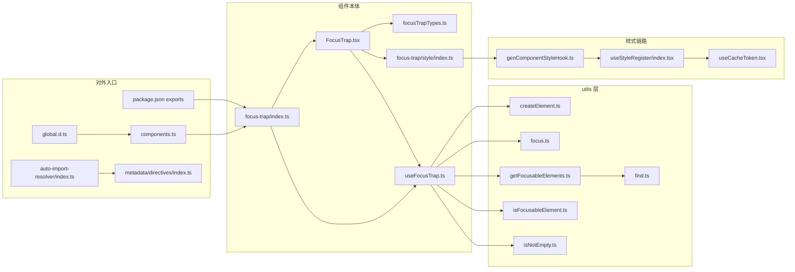
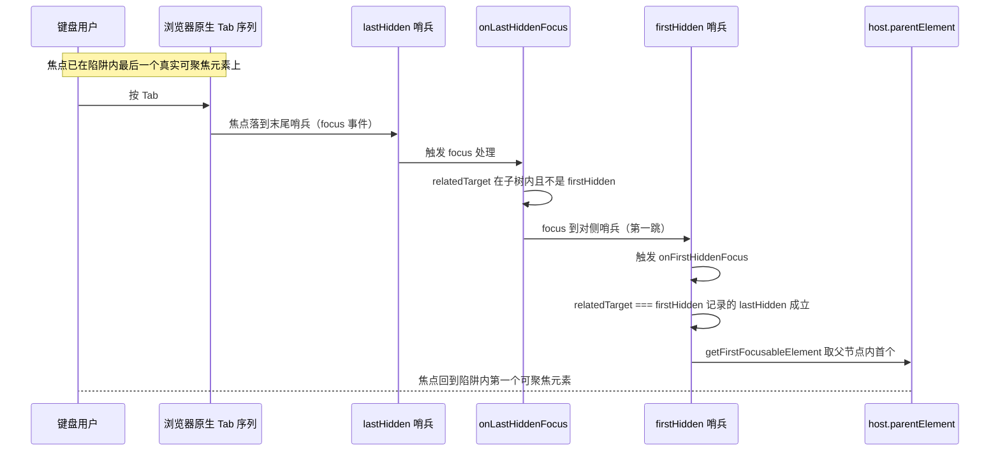
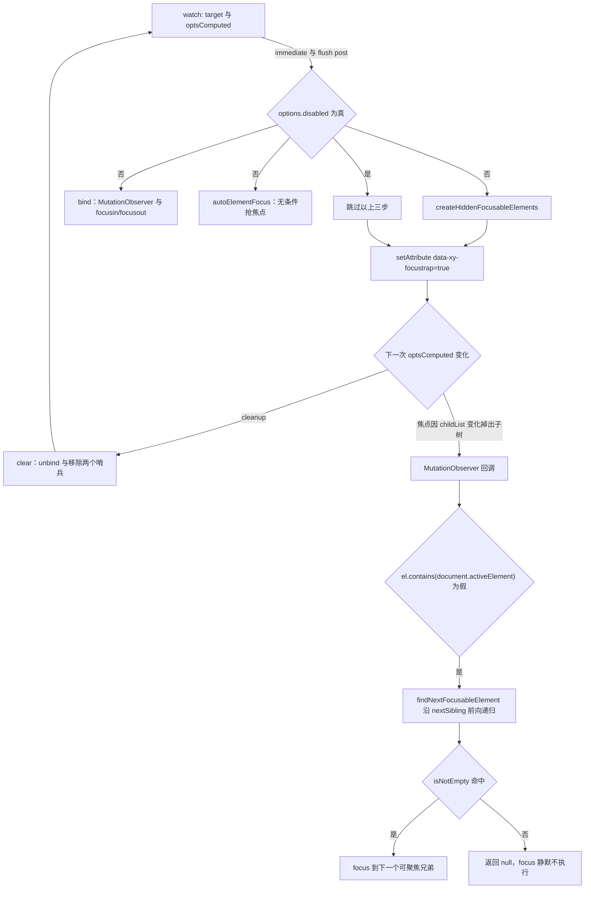

# C12-07 FocusTrap 焦点陷阱

> **本篇解决**：`packages/xiaoye-ui/src/focus-trap/` 这 340 行到底靠什么机制把焦点圈在子树里——它不拦 Tab 键，那它拦的是什么；可聚焦元素的选择器在哪、边界哨兵怎么算、`disabled` 切换时代码里留下的状态是什么；以及为什么全库只有一个消费者。
> **前置**：A07 交互基础设施总览：一个浮层是怎么拼起来的（`docs/column/01-architecture/07-overlay-infrastructure-交互基础设施总览一个浮层是怎么拼起来.md`）　**读者坐标**：`03-components/12-global` 第 7/9 篇
>
> **与 A07 的分工**：A07 已经把「浮层家族没有接焦点陷阱、Modal 自己手写 Tab 记账」作为一条坑登记过（`01-architecture/07-overlay-infrastructure-交互基础设施总览一个浮层是怎么拼起来.md:1030`）。本篇不复述那条论证，只做两件事：**用两种 grep 交叉复核那条断言**（结论有增量，见§五），以及**深入 focus-trap 本体**——选择器、哨兵、边界计算、样式副作用、测试面。

## 一、职责与边界

FocusTrap 的职责只有一条：**让 Tab 序列在宿主元素子树内闭环**——焦点从最后一个可聚焦元素继续向后时回到第一个，反向同理；进入陷阱时把焦点放到合适的元素上。

它明确**不负责**：

- **不管 ESC、不管遮罩点击、不管滚动锁定**——`useFocusTrap.ts` 全文没有 `keydown` 监听（`addEventListener` 只出现在 `:40` 的 `focus`、`:170`/`:171` 的 `focusin`/`focusout`）。
- **不记录也不恢复进入前的焦点**——文件里没有任何 `document.activeElement` 的入栈/回滚逻辑（唯一的 `activeElement` 读取在 `:141`，用途是「子树被清空后判断焦点是否已丢」）。
- **不管 inert / aria-hidden 外部内容**：它只做焦点顺序，不做可达性裁剪。
- **不拦键**：与 Modal 分岔在"谁决定何时跳"——Modal 是**哨兵 + `keydown` 记账**的混合方案（`vc-dialog/Dialog.tsx:126-130`、`vc-dialog/Content.tsx:146`、`:149` 与 `changeActive` `:33-40`），本篇 §六 取舍 1 逐条对照。

依赖关系（跨包依赖只指向 `packages/utils/`；同包依赖见下，组件本体不依赖任何 vc-\*）：

```
focus-trap/FocusTrap.tsx        → focusTrapTypes / _util/props-util / config-provider/hooks/useConfigInject / useFocusTrap / style
focus-trap/useFocusTrap.ts      → @xiaoye-ui/utils/dom{createElement,focus,getFirstFocusableElement,getLastFocusableElement,isFocusableElement}
                                 @xiaoye-ui/utils/object{isNotEmpty}
focus-trap/style/index.ts       → theme/internal{genComponentStyleHook}
```

被谁依赖：包根聚合 `components.ts:148-150`、全局类型 `global.d.ts:40`、主题 Token 注册 `theme/interface/components.ts:162`；运行时消费者在库内为零（复核过程见§五）。

## 二、源码地图

| 文件 | 行数 | 职责 | 关键导出 / 主入口 |
| --- | --- | --- | --- |
| `packages/xiaoye-ui/src/focus-trap/index.ts` | 16 | 导出入口 + `install` | `FocusTrap` 默认导出 `:16`、`useFocusTrap` `:7`、`focusTrapProps` `:5` |
| `packages/xiaoye-ui/src/focus-trap/FocusTrap.tsx` | 57 | 包裹组件（`div` 宿主 + 插槽） | `defineComponent` `:18`、`name: 'XYFocusTrap'` `:19`、composable 调用 `:48`、渲染 `:50-55` |
| `packages/xiaoye-ui/src/focus-trap/useFocusTrap.ts` | 227 | **全部机制在这里** | `FocusTrapOptions` `:11-20`、`useFocusTrap` `:49` |
| `packages/xiaoye-ui/src/focus-trap/focusTrapTypes.ts` | 18 | Props 定义 | `focusTrapProps` `:4-14`、`FocusTrapProps` `:16` |
| `packages/xiaoye-ui/src/focus-trap/style/index.ts` | 22 | 哨兵样式 | `genComponentStyleHook('FocusTrap', …)` `:7` |
| `packages/xiaoye-ui/src/focus-trap/index.test.js` | 84 | 4 条用例 + `mountTest` | `:8`-`:83` |
| `packages/utils/src/dom/methods/getFocusableElements.ts` | 26 | 可聚焦元素选择器（本库事实内核） | `:3-25` |
| `packages/utils/src/dom/methods/isFocusableElement.ts` | 14 | 第二份选择器（与上者不等价） | `:3-14` |

本篇论证还会走到这些邻近文件（都不是 focus-trap 自己的目录，列出以免误以为机制在别处）：

| 文件 | 行 | 在本篇中的作用 |
| --- | --- | --- |
| `packages/utils/src/dom/methods/find.ts` | 5 | `getFocusableElements` 的查询实现，`null` 根节点静默返回 `[]`（`:3-5`） |
| `packages/utils/src/dom/methods/focus.ts` | 3 | 所有回跳的终点，`if (element && …)` 是"无声失败"的来源（`:2`） |
| `packages/utils/src/dom/methods/createElement.ts` | 18 | 哨兵 `span` 的制造者，`document.createElement` 在 `:9` |
| `packages/utils/src/dom/methods/getFirstFocusableElement.ts` | 10 | 前跳与进入聚焦（`:7-9`） |
| `packages/utils/src/dom/methods/getLastFocusableElement.ts` | 10 | 后跳（`:7-9`） |
| `packages/utils/src/object/methods/isNotEmpty.ts` | 5 | 自愈分支的空值判据（`:4`） |
| `packages/xiaoye-ui/src/theme/util/genComponentStyleHook.ts` | 113 | `componentCls` 拼装（`:87`）与 `hashId` 返回（`:110`） |
| `packages/xiaoye-ui/src/_util/cssinjs/hooks/useStyleRegister/index.tsx` | 566 | `injectSelectorHash`（`:79-100`）与恒等 `wrapSSR`（`:428-429`） |
| `packages/xiaoye-ui/src/_util/cssinjs/hooks/useCacheToken.tsx` | — | `hashId` 恒非空（`:154`、前缀 `:17`） |
| `packages/xiaoye-ui/src/_util/cssinjs/StyleContext.tsx` | — | 默认 `hashPriority: 'low'`（`:115`） |
| `packages/xiaoye-ui/src/_util/registerComponent.ts` | 36 | `XYFocusTrap → xy-focus-trap`（`:6-11`、`:22-25`） |
| `packages/xiaoye-ui/src/config-provider/hooks/useConfigInject.ts` | — | `prefixCls` 来源（`:14`） |
| `packages/xiaoye-ui/src/vc-dialog/Dialog.tsx`、`Content.tsx` | — | Modal 的对照方案（`Dialog.tsx:126-130`、`Content.tsx:8`/`:11`/`:33-40`/`:146`/`:149`） |
| `packages/metadata/src/directives/index.ts` | 12 | 断链的自动导入记录（`:8`） |
| `packages/auto-import-resolver/src/index.ts` | — | 消费上面那张表的地方（`:55-64`） |
| `packages/xiaoye-ui/src/data-table/BodyCell.tsx` | — | `getFirstFocusableElement` 的第二消费者（`:581`、`:583`） |

`useFocusTrap.ts` 内部的分层（按行号）：

| 区段 | 行 | 内容 |
| --- | --- | --- |
| 常量与选择器拼装 | `:22-26` | `HIDDEN_ACCESSIBLE_CLASS`、`getComputedSelector` |
| 哨兵创建 | `:28-42` | `createHiddenFocusableElement` |
| 边界回流 | `:72-98` | `onFirstHiddenFocus` / `onLastHiddenFocus` |
| 哨兵挂载 | `:100-119` | `createHiddenFocusableElements` |
| 进入时的聚焦 | `:121-133` | `autoElementFocus` |
| 生命周期绑定 | `:135-191` | `bind`（含 `MutationObserver`）/ `unbind` |
| 开关与重跑 | `:193-226` | `apply` / `clear` / `watch` / `onBeforeUnmount` |

主实现入口：`packages/xiaoye-ui/src/focus-trap/useFocusTrap.ts:49`。

## 三、架构与数据流

### 图 1：静态结构图（文件与符号的依赖面）



这张图要说清三件事。**其一，组件本体与样式链路是两条互不相交的线**：`useFocusTrap.ts` 不引用任何 `vc-*`，也不引用 `theme/internal`，它对样式的唯一依赖是 `FocusTrap.tsx:7` 那句 `import useStyle from './style'`——composable 单独使用时**根本不会注册哨兵样式**（`useFocusTrap.ts` 的 import 面只有 `vue` 与 `@xiaoye-ui/utils`，没有 `./style`），这决定了后面论点 6 的结论。**其二，机制内核其实住在 `packages/utils`**：`useFocusTrap.ts:2-9` 一次导入五个 DOM 方法，其中"什么算可聚焦元素"这条判据被拆成 `getFocusableElements.ts:6-12` 与 `isFocusableElement.ts:6-12` 两份**不等价**的实现，组件只是把它们拼起来用。**其三，`AIR → META` 那条边是断头路**：`auto-import-resolver` 查的是 `metadata/src/directives/index.ts:8` 那条记录，其 `from: 'xiaoye-ui/focustrap'` 在 `package.json` 的 `exports` 里并不存在（真实键是 `package.json:315` 的 `./focus-trap`），解析器只照抄不校验（`auto-import-resolver/src/index.ts:59-68`）。另外注意 `GDT → CMP`：`typings/global.d.ts:41` 引的是包根类型而非组件目录，所以全局标签的类型面依赖聚合入口。详见 §五。

### 图 2：Tab 越界时的"两跳接力"时序



关键在于**库没有听键盘**：`useFocusTrap.ts` 全文没有 `keydown`，唯一的三个 `addEventListener` 是 `:40` 的 `focus`（挂在哨兵上）、`:170`/`:171` 的 `focusin`/`focusout`（只转发给用户回调）。所以回环是被"原生 Tab 序列走到哨兵"这件事触发的，而哨兵在 DOM 里的位置由 `el.prepend(firstHidden)` 与 `el.append(lastHidden)`（`:117`、`:118`)决定。反向（Shift+Tab）是对称的一段：`onFirstHiddenFocus`（`:72-84`）先跳 `cur.$_xy_lasthidden`（`:82`），后者再由 `:94-95` 判定"来自对侧哨兵"并调 `getLastFocusableElement(el.parentElement!, …)`（`:95`）。

注意图里最后一步的查询对象是 **`host.parentElement`**（`:81`、`:95`），不是宿主自己的子树。这不是笔误级别的细节：`FocusTrap.tsx:52` 渲染的 `<div class="xy-focus-trap">` 就是宿主，父节点是调用方放的容器，于是"回环目标"的搜索范围比陷阱本身**大一层**。为什么这么写、代价是什么，见论点 2 与 §六。

### 图 3：启停与自愈的分支



图里两条"看起来该有却没写"的分支值得点明：**`disabled` 为真时属性照样打上**（`:200` 在 `if (!o.disabled)` 块之外），所以 `data-xy-focustrap="true"` **不能**用来判断陷阱是否生效——测试 `index.test.js:46` 正是把这个反直觉行为固化成了断言。**`optsComputed` 任何变化都会整轮 `clear` + `apply`**（`:217` 注册的 `onCleanup` 与 `:216` 的 `apply`），没有增量更新路径，这是论点 4 的主证。

## 四、核心机制精读

### 论点 1：陷阱的实现是"两个自造的哨兵 span + focus 事件接力"，不是键盘拦截

断言：`useFocusTrap` 把闭环寄托在浏览器原生 Tab 序列上，它自己只在宿主子树的首尾各插入一个不可见但可聚焦的 `span`，靠这两个 span 的 `focus` 事件把焦点踢回对侧。

```tsx
// packages/xiaoye-ui/src/focus-trap/useFocusTrap.ts:28
function createHiddenFocusableElement(
  tabIndex: number,
  onFocus: (event: FocusEvent) => void,
): HTMLElement {
  const el = createElement('span', {
    class: HIDDEN_ACCESSIBLE_CLASS,
    tabIndex,
    role: 'presentation',
    'aria-hidden': true,
    'data-xy-hidden-accessible': true,
    'data-xy-hidden-focusable': true,
  }) as HTMLElement;
  el.addEventListener('focus', onFocus);
  return el;
}
```

逐段看：`class` 取的是模块级常量 `HIDDEN_ACCESSIBLE_CLASS = 'xy-hidden-accessible xy-hidden-focusable'`（`:22`，两个类名，前者负责视觉隐藏、后者负责去 outline，样式在 `style/index.ts:9` 与 `:20`）；`tabIndex` 由选项决定（`:102` 的 `o.tabIndex ?? 0`，默认 0，见 `focusTrapTypes.ts:11` 与 `FocusTrap.tsx:28`）；`role: 'presentation'` + `'aria-hidden': true` 是想让它对读屏隐身，但元素同时可聚焦——这个矛盾留到坑 4 展开。注意 `:36` 与 `:38` 写的是 `aria-hidden` / `data-xy-hidden-focusable`，它们与 `:25` 里排除选择器用的属性名严格对应。

```ts
// packages/xiaoye-ui/src/focus-trap/useFocusTrap.ts:100
function createHiddenFocusableElements(el: HTMLElement) {
  const o = getOptions();
  const tabIndex = o.tabIndex ?? 0;
  const firstFocusableSelector = o.firstFocusableSelector ?? '';
  const lastFocusableSelector = o.lastFocusableSelector ?? '';

  firstHidden = createHiddenFocusableElement(tabIndex, onFirstHiddenFocus);
  lastHidden = createHiddenFocusableElement(tabIndex, onLastHiddenFocus);

  (firstHidden as any).$_xy_lasthidden = lastHidden;
  (firstHidden as any).$_xy_focusableselector = firstFocusableSelector;
  firstHidden.setAttribute('data-xy-section', 'firstfocusableelement');

  (lastHidden as any).$_xy_firsthidden = firstHidden;
  (lastHidden as any).$_xy_focusableselector = lastFocusableSelector;
  lastHidden.setAttribute('data-xy-section', 'lastfocusableelement');

  el.prepend(firstHidden);
  el.append(lastHidden);
}
```

`:109` 与 `:113` 是**互相引用**：每个哨兵身上都挂了"对侧哨兵"的直引用，这样回环时不需要再查 DOM；`:117`/`:118` 的 `prepend`/`append` 才是陷阱的实体——哨兵一旦不是首/尾子节点，闭环就漏。这里能看出实现是**面向宿主而非面向文档**的：它不监听 `document`，只在宿主两端设桩。

结论回扣：这就是"它不拦 Tab，那它拦的是什么"的答案——拦的是**越过首尾子节点这一事实**，代价是整套机制对"原生 Tab 序列是否真的会走到哨兵"高度敏感（`tabindex="-1"` 的宿主、被 `display:none` 掉的哨兵、以及图 1 里那个没落地的样式，都会让它静默失效）。

### 论点 2：回环的搜索范围是 `el.parentElement`，比陷阱本身大一层

断言：决定"回跳到哪个元素"的两行代码，查询根节点用的都是宿主的**父元素**，而不是宿主自己。

```ts
// packages/xiaoye-ui/src/focus-trap/useFocusTrap.ts:72
function onFirstHiddenFocus(event: FocusEvent) {
  const el = target.value;
  if (!el) return;
  const { currentTarget, relatedTarget } = event;
  const cur = currentTarget as HTMLElement & {
    $_xy_lasthidden?: HTMLElement;
  };
  const focusableElement =
    relatedTarget === cur.$_xy_lasthidden || !el.contains(relatedTarget as Node)
      ? getFirstFocusableElement(el.parentElement!, getSelector())
      : cur.$_xy_lasthidden;
  focus(focusableElement as HTMLElement);
}

function onLastHiddenFocus(event: FocusEvent) {
  const el = target.value;
  if (!el) return;
  const { currentTarget, relatedTarget } = event;
  const cur = currentTarget as HTMLElement & {
    $_xy_firsthidden?: HTMLElement;
  };
  const focusableElement =
    relatedTarget === cur.$_xy_firsthidden || !el.contains(relatedTarget as Node)
      ? getLastFocusableElement(el.parentElement!, getSelector())
      : cur.$_xy_firsthidden;
  focus(focusableElement as HTMLElement);
}
```

三处细节合起来才构成机制。**（a）判定式是"或"**：`relatedTarget === cur.$_xy_*` 表示"我是从对侧哨兵跳过来的"（即第二跳），`!el.contains(relatedTarget)` 表示"我是从陷阱外面进来的"。两种情况都需要跳到边界元素，其余情况（正常越界）才走"跳对侧哨兵"这一支。**（b）查询根是 `el.parentElement!`**（`:81`、`:95`），非空断言。为什么合理：`firstHidden` 是宿主的第一个子节点，若用 `el` 作根，`getFirstFocusableElement(el, …)` 会先命中 `firstHidden` 自己，形成死循环——`:25` 的 `getComputedSelector` 用 `:not(.xy-hidden-focusable):not([data-xy-hidden-focusable="true"])` 把哨兵从选择器里排掉，正是为了让"从父层查"不查回哨兵。也就是说，**`parentElement` 与自排除选择器是一对耦合设计**，改动其中一个必须检查另一个。**（c）但它顺带把范围放大了一层**：`queryAll` 的根是父节点（`find.ts:4` 的 `element.querySelectorAll(selector)`），于是父节点里**兄弟容器**中的可聚焦元素也在候选集内。对 `<xy-focus-trap>` 这种自带包裹 `div` 的用法（`FocusTrap.tsx:52`），"陷阱"是那个 `div` 的子树，而回环目标却可能落在同一父节点下、陷阱之外的元素上。

降级路径也值得记：宿主若是 `document.documentElement`，`el.parentElement` 为 `null`，`find.ts:4` 的 `isElement(element)` 判假返回 `[]`（`find.ts:3-5`），`getFirstFocusableElement.ts:9` 于是返回 `null`，最后 `focus.ts:2` 的 `if (element && document.activeElement !== element)` 让这次回跳**静默不发生**——不报错、焦点丢失到 `body`。这类"越界即无声失败"的形状，是后面几条坑的共同成因。

### 论点 3：本库有"两份不等价的可聚焦判据"，而按侧选择器只落地了一半

断言：`useFocusTrap` 同时依赖 `getFocusableElements` 与 `isFocusableElement`，但这两份选择器在**锚点链接**和**可见性判定**上并不等价；同时 `firstFocusableSelector` / `lastFocusableSelector` 的按侧语义在运行期丢失。

```ts
// packages/utils/src/dom/methods/getFocusableElements.ts:3
export default function getFocusableElements(element: Element, selector: string = ''): Element[] {
  const focusableElements = find(
    element,
    `button:not([tabindex = "-1"]):not([disabled]):not([style*="display:none"]):not([hidden])${selector},
            [href]:not([tabindex = "-1"]):not([style*="display:none"]):not([hidden])${selector},
            input:not([tabindex = "-1"]):not([disabled]):not([style*="display:none"]):not([hidden])${selector},
            select:not([tabindex = "-1"]):not([disabled]):not([style*="display:none"]):not([hidden])${selector},
            textarea:not([tabindex = "-1"]):not([disabled]):not([style*="display:none"]):not([hidden])${selector},
            [tabIndex]:not([tabIndex = "-1"]):not([disabled]):not([style*="display:none"]):not([hidden])${selector},
            [contenteditable]:not([tabIndex = "-1"]):not([disabled]):not([style*="display:none"]):not([hidden])${selector}`,
  );
```

```ts
// packages/utils/src/dom/methods/isFocusableElement.ts:3
export default function isFocusableElement(element: unknown, selector: string = ''): boolean {
  return isElement(element)
    ? (element as Element)
        .matches(`button:not([tabindex = "-1"]):not([disabled]):not([style*="display:none"]):not([hidden])${selector},
            [href][clientHeight][clientWidth]:not([tabindex = "-1"]):not([disabled]):not([style*="display:none"]):not([hidden])${selector},
            input:not([tabindex = "-1"]):not([disabled]):not([style*="display:none"]):not([hidden])${selector},
            select:not([tabindex = "-1"]):not([disabled]):not([style*="display:none"]):not([hidden])${selector},
            textarea:not([tabindex = "-1"]):not([disabled]):not([style*="display:none"]):not([hidden])${selector},
            [tabIndex]:not([tabIndex = "-1"]):not([disabled]):not([style*="display:none"]):not([hidden])${selector},
            [contenteditable]:not([tabIndex = "-1"]):not([disabled]):not([style*="display:none"]):not([hidden])${selector}`)
    : false;
}
```

对照 `getFocusableElements.ts:7` 与 `isFocusableElement.ts:7`：前者是 `[href]`，后者是 `[href][clientHeight][clientWidth]`。`[clientHeight]` 是**属性选择器**，匹配的是 DOM 上真存在一个叫 `clientHeight` 的内容属性——而 `clientHeight` 是 IDL 只读属性，不是内容属性，普通 `<a href>` 永远带不上它。于是"链接算不算可聚焦元素"这个问题，两份判据给出相反答案：回环查询（走 `getFocusableElements.ts:4` 的 `find`）会把锚点算进去，`useFocusTrap.ts:143`/`:146` 的自愈分支却认定它不可聚焦。第二处差异更常见：`getFocusableElements.ts:17-23` 在属性筛选之后又过了一遍 `getComputedStyle` 的 `display` / `visibility`，而 `isFocusableElement` 没有这一步——所以一个 `visibility: hidden` 的按钮在两份判据下同样一边算、一边不算。改动其中一份而不同步另一份，会直接改变回环落点。

再说按侧选择器。拼装函数只有一行：

```ts
// packages/xiaoye-ui/src/focus-trap/useFocusTrap.ts:24
function getComputedSelector(selector?: string) {
  return `:not(.xy-hidden-focusable):not([data-xy-hidden-focusable="true"])${selector ?? ''}`;
}
```

而两个边界处理器共用同一个取值函数：

```ts
// packages/xiaoye-ui/src/focus-trap/useFocusTrap.ts:67
  function getSelector() {
    const o = getOptions();
    return getComputedSelector(o.firstFocusableSelector ?? o.lastFocusableSelector ?? '');
  }
```

`:69` 用的是 `??`。`firstFocusableSelector` 的默认值是空串（`focusTrapTypes.ts:9` 的 `stringType('')`，组件侧再于 `FocusTrap.tsx:27` 用 `initDefaultProps` 兜一次），空串不是 nullish，`??` 就此短路——**`lastFocusableSelector` 在任何正常用法下都不会被读到**，前跳与后跳用的是同一个选择器。代码里另外还写了按侧的字段：`:110` 把 `firstFocusableSelector` 挂到 `firstHidden.$_xy_focusableselector`，`:114` 把 `lastFocusableSelector` 挂到 `lastHidden.$_xy_focusableselector`，但全仓再没有任何一处读 `$_xy_focusableselector`（`grep -rn '_xy_focusableselector' packages apps` 只命中 `:110` 与 `:114` 这两行写入）。也就是说，**这是"写了一半的按侧设计"**：意图存在（哨兵各自携带自己的选择器），实现路径断了（处理器不读它，改读全局 options）。这是本篇对 A07 之外最有价值的一条结论——它不影响 Modal，但直接影响任何想用这两个 prop 的人（见坑 2）。

### 论点 4：`apply` 每次变更都会重跑并抢焦点，`disabled` 与 `autoFocus` 都不是"别动我焦点"的开关

断言：驱动陷阱生命周期的只有一个 `watch`，任何 option 变化都会整轮 `clear` + `apply`；而 `apply` 里 `autoElementFocus` 是**无条件调用**的。

```ts
// packages/xiaoye-ui/src/focus-trap/useFocusTrap.ts:121
function autoElementFocus(el: HTMLElement) {
  const o = getOptions();
  const { autoFocusSelector = '', firstFocusableSelector = '', autoFocus = false } = o;
  let focusableElement = getFirstFocusableElement(
    el,
    `[autofocus]${getComputedSelector(autoFocusSelector)}`,
  );

  if (autoFocus && !focusableElement) {
    focusableElement = getFirstFocusableElement(el, getComputedSelector(firstFocusableSelector));
  }
  focus(focusableElement as HTMLElement);
}
```

注意 `:126` 第一优先级永远是 `[autofocus]` 属性元素，`autoFocus` 只影响 `:129` 的兜底分支。所以 `autoFocus: false` 的准确含义是"没有 `[autofocus]` 元素时不要退到首个可聚焦元素"，而不是"进入陷阱时不要动焦点"。默认值还是 `true`（`focusTrapTypes.ts:7` 的 `booleanType(true)`，与 `FocusTrap.tsx:24` 的 `initDefaultProps` 一致），所以 `<xy-focus-trap>` 一挂载就会把焦点吸进自己子树——这就是为什么图 3 里"抢焦点"这一步看起来无法关掉。另外 `autoElementFocus` 用的是 `getFirstFocusableElement(el, …)`（`:124`、`:130`），根节点是**宿主本身**，与论点 2 里那两个用 `parentElement` 的回环查询不同层级，别把它们当同一处逻辑读。

```ts
// packages/xiaoye-ui/src/focus-trap/useFocusTrap.ts:193
function apply(el: HTMLElement) {
  const o = getOptions();
  if (!o.disabled) {
    createHiddenFocusableElements(el);
    bind(el);
    autoElementFocus(el);
  }
  el.setAttribute('data-xy-focustrap', 'true');
}

function clear(el: HTMLElement) {
  unbind();
  firstHidden?.remove();
  lastHidden?.remove();
  firstHidden = undefined;
  lastHidden = undefined;
  el.removeAttribute('data-xy-focustrap');
}
```

`:200` 在 `if` 块**外面**——`disabled` 为真时属性仍被打上，`clear`（`:203-210`）才负责摘掉它。这个不对称被测试正面固化了：`index.test.js:30` 的 it 标题写的是 "does not set data-xy-focustrap when disabled"，而 `:46` 断言的却是 `expect(host.exists()).toBe(true)`，`:31` 的行内注释还补了一句"但仍设置 data-xy-focustrap=true（按源项目行为）"——**测试标题与测试断言互相矛盾，行为以断言为准**。任何人用 `document.querySelector('[data-xy-focustrap]')` 判断"陷阱是否生效"都会得到错误答案。

驱动这一切的是最后这段：

```ts
// packages/xiaoye-ui/src/focus-trap/useFocusTrap.ts:212
const stop = watch(
  [target, optsComputed] as const,
  ([el, _opts], _old, onCleanup) => {
    if (!el) return;
    apply(el);
    onCleanup(() => clear(el));
  },
  { immediate: true, flush: 'post' },
);
```

`optsComputed` 是 `FocusTrap.tsx:35-47` 那个 computed，它每次求值都返回**新建的对象字面量**，因此只要九个 prop 里任意一个变化，`watch` 就认为值变了 → `clear` 旧哨兵、重建两个新哨兵、重挂 `MutationObserver`、再跑一次 `autoElementFocus`。副作用是可观察的：**改 `tabIndex` 或 `autoFocusSelector` 这类无关闭环的选项，也会把焦点抢回陷阱内**（`:196-198` 三连）。而 `:219` 的 `flush: 'post'` 保证第一次 `apply` 发生在 DOM 挂载之后，`target.value` 才有值——这解释了为什么 `index.test.js:23` 那几条用例都要先 `await nextTick()` 再断言哨兵存在。卸载路径是 `:222-226` 的 `onBeforeUnmount`，先 `stop()` 再 `clear(target.value)`；`clear` 里 `unbind()`（`:176-191`）用的是 `boundEl` 而不是 `target.value`（`:179`），注释在 `:59-60` 说明了原因——`watch` 重跑时 `target.value` 可能已指向新元素，用它会解绑错节点。这一段是全文里少数**明确写对**的边界处理。

### 论点 5：唯一的"自愈"分支只在焦点已经掉出子树时向前找兄弟，属性变化一概不管

断言：`bind` 挂的 `MutationObserver` 只处理一种事故——子节点被删导致焦点丢失——且它的补救是**单向前向**的，既不看前面的兄弟，也不响应属性变化。

```ts
// packages/xiaoye-ui/src/focus-trap/useFocusTrap.ts:139
    mutationObserver = new MutationObserver(mutationList => {
      mutationList.forEach(mutation => {
        if (mutation.type === 'childList' && !el.contains(document.activeElement)) {
          const findNextFocusableElement = (_el: Element | null): Element | null => {
            const focusableElement = isFocusableElement(_el as HTMLElement)
              ? isFocusableElement(
                  _el as HTMLElement,
                  getComputedSelector(getOptions().firstFocusableSelector),
                )
                ? _el
                : getFirstFocusableElement(
                    el,
                    getComputedSelector(getOptions().firstFocusableSelector),
                  )
              : getFirstFocusableElement(_el as HTMLElement);
            return isNotEmpty(focusableElement)
              ? focusableElement
              : _el?.nextSibling
                ? findNextFocusableElement(_el.nextSibling as Element)
                : null;
          };
          focus(findNextFocusableElement(mutation.nextSibling as Element) as HTMLElement);
        }
      });
    });
```

这条三目链读起来绕，拆开是三种情况（`:143-153`）：`_el` 本身按 `isFocusableElement` 的**裸判据**不可聚焦 → 到 `_el` 内部去查（`getFirstFocusableElement(_el)`，`:153`）；裸判据可聚焦但加了 `firstFocusableSelector` 后不可 → 回到宿主 `el` 全局查首个（`:149-152`）；两者都可 → 就用 `_el`（`:148`）。注意第二支的根是 `el` 而不是 `_el`，与第三层解释里的按侧选择器再次混用——`:146` 与 `:151` 都直接读 `getOptions().firstFocusableSelector`，完全绕开了 `getSelector()`，所以这条分支和回环分支用的选择器**来源相同但拼装位置不同**，改一处忘改另一处就会分叉。

真正决定行为边界的是三个约束：**入口条件** `!el.contains(document.activeElement)`（`:141`）——这是全文唯一读 `document.activeElement` 的地方，也是 §一 里"不记录进入前焦点"结论的依据；**起点** `mutation.nextSibling`（`:160`）——从被删节点的后继开始；**递归方向** 只有 `nextSibling`（`:156-157`）——找不到就顺着兄弟往后走，走到末尾返回 `null`（`:158`），`focus.ts:2` 再把它吞掉。于是"删掉的是陷阱里最后一个可聚焦元素"这种最常见的场景（例如 v-for 列表尾项被卸载），补救结果等于没有补救：焦点回到 `body`，陷阱不追。它也不会往回看 `previousSibling`，因为代码里没有这个分支。

第二个约束是观察项：`mutationObserver.observe(el, { childList: true })`（`:165`）只开了 `childList`，没有 `attributes: true`、没有 `subtree: true`。所以运行期给某个按钮加 `disabled`、加 `hidden`、或改 `style="display:none"`，**都不会触发重算**——这些元素仍留在原生 Tab 序列里直到浏览器自己跳过它们，而库侧的候选集要等到下一次 `optsComputed` 变化重建哨兵时才更新。同理，宿主子树**深层**增删节点也不触发（没开 `subtree`），只有宿主的直接子节点变化才进回调。

顺带一条：`bind`（`:135-173`）里 `focusin` / `focusout` 两个监听（`:170`/`:171`）的回调体只是 `onFocusIn && onFocusIn(event)`（`:167`）与 `:168`，**不参与任何圈定逻辑**。`onFocusIn` / `onFocusOut` 是纯透传（props 定义在 `focusTrapTypes.ts:12-13`，用 `eventType<T>()` 声明，类型是 `PropType<T | T[]>`，所以传数组也能过类型检查、但 `:167` 调用时会炸——这是个类型面与运行面不一致的小口子）。

### 论点 6：`prefixCls` 走 config-provider，哨兵类名和样式落地却各走各路

断言：这个组件有三套"命名来源"，它们只在默认配置下恰好一致：`prefixCls` 可被 `ConfigProvider` 改写，哨兵类名写死 `xy-`，而哨兵样式的选择器既不带 `componentCls` 也不带 `hashId`。

```ts
// packages/xiaoye-ui/src/focus-trap/style/index.ts:7
export default genComponentStyleHook('FocusTrap', () => {
  return {
    '.xy-hidden-accessible': {
      position: 'absolute',
      width: '1px',
      height: '1px',
      padding: 0,
      margin: '-1px',
      overflow: 'hidden',
      clip: 'rect(0,0,0,0)',
      whiteSpace: 'nowrap',
      border: 0,
    },
    '.xy-hidden-focusable': { outline: 0 },
  } as CSSObject;
});
```

第一处偏离：`genComponentStyleHook` 的回调**丢弃了 token 参数**（`:7` 的箭头函数不带形参），而全库通用写法是从 token 里取 `componentCls` 再把规则嵌进去（拼装处见 `theme/util/genComponentStyleHook.ts:87` 的 `const componentCls = '.'.${prefixCls.value}`、`:93` 的 `mergeToken`）。这里直接以裸类名 `.xy-hidden-accessible`（`:9`）与 `.xy-hidden-focusable`（`:20`）作顶层选择器，于是 FocusTrap 的样式表**与 `xy-focus-trap` 这个 prefixCls 毫无绑定**：包根的 `.xy-focus-trap` 类在发布样式里没有任何规则（组件的包裹 div 因此不产生布局影响，这一点是可取的，但也意味着它是个纯 hook 点）。

第二处偏离：`useFocusTrap.ts:22` 的 `HIDDEN_ACCESSIBLE_CLASS` 与 `:25` 排除选择器里的 `.xy-hidden-focusable` / `[data-xy-hidden-focusable="true"]` 都是硬编码字符串，**没有走 `getPrefixCls()`**。组件侧 `FocusTrap.tsx:31` 的 `useConfigInject('focus-trap', props)`（内部是 `config-provider/hooks/useConfigInject.ts:14` 的 `getPrefixCls(name, props.prefixCls)`）确实会随 `ConfigProvider` 的 `prefixCls` 改名，结果是：改名后宿主变成 `myui-focus-trap`，而哨兵仍是 `xy-hidden-accessible`。二者仍自洽（写出去和查回来的都是同一串硬编码），所以**功能不坏**；坏的是这套类名不再受前缀命名空间治理，页面里若已有别的 `xy-hidden-*` 约定就会互相染色。复核结论是：这两个类名在本库没有其他使用者（`grep -rn "xy-hidden-accessible\|xy-hidden-focusable" packages apps` 剔除 `dist/` 后的全部命中是 `style/index.ts:9`、`:20`，`useFocusTrap.ts:22`、`:25`、`:37`、`:38`，以及 `index.test.js:26`、`:48`、`:64`、`:81` 四处断言），所以目前没有跨组件耦合——但这是**约定上的脆弱**，不是实现上的安全。

第三处偏离最实际：CSS-in-JS 的 hash 限定。默认 `hashPriority` 是 `'low'`（`_util/cssinjs/StyleContext.tsx:115`），`injectSelectorHash` 会把顶层选择器改写成"hash 类 + 原选择器"：

```ts
// packages/xiaoye-ui/src/_util/cssinjs/hooks/useStyleRegister/index.tsx:79
function injectSelectorHash(key: string, hashId: string, hashPriority?: HashPriority) {
  if (!hashId) {
    return key;
  }

  const hashClassName = `.${hashId}`;
  const hashSelector = hashPriority === 'low' ? `:where(${hashClassName})` : hashClassName;

  // 注入 hashId
  const keys = key.split(',').map(k => {
    const fullPath = k.trim().split(/\s+/);

    // 如果 Selector 第一个是 HTML Element，那我们就插到它的后面。反之，就插到最前面。
    let firstPath = fullPath[0] || '';
    const htmlElement = firstPath.match(/^\w+/)?.[0] || '';

    firstPath = `${htmlElement}${hashSelector}${firstPath.slice(htmlElement.length)}`;
```

`hashId` 恒非空（`useCacheToken.tsx:154` 把 `:17` 定义的 `hashPrefix` 与 `hash(tokenKey)` 拼成 `hashId`），所以 `!hashId` 那条捷径走不到。以 `.` 开头的选择器匹配不上 `firstPath.match(/^\w+/)`（`:93`），`htmlElement` 为 `''`，最终产出 `:where(.css-xxxx).xy-hidden-accessible`（`:95` 拼接）。要命中它，DOM 里必须有带 `css-xxxx` 这个类的祖先或自身。这一条在 2026-10-02 的修复批次（cabf208）后已反转：`FocusTrap.tsx:32` 现在取双值 `const [wrapSSR, hashId] = useStyle(prefixCls);`，`:52` 渲染时把 `hashId.value` 并进容器类名，哨兵的祖先链里有了 `css-xxxx`，上面那段 `injectSelectorHash` 产出的限定选择器可以命中——「带焦点环的可见空 span」的症状随之消失。修复前的口径存档：当时 `hashId` 被丢弃、`:52` 只绑 `prefixCls.value`，且 `wrapSSR` 是恒等函数（`useStyleRegister/index.tsx:428-429`，真正的 SSR 样式内联体在 `:430-450` 整段被注释掉），哨兵的那两条规则确实不落地；测试只断言类名存在（`index.test.js:26`），所以当年这个缺陷没有测试能抓到。

## 五、对外契约如何生效

**先把 A07 那条断言复核完，因为它决定了本篇的写法。** A07 的坑 12 说 `XYFocusTrap` 已公开但库内唯一消费者是相册一族，Modal 手写 Tab 圈定，Drawer 与 `vc-trigger` 里 `KeyCode.TAB` 零命中。「唯一消费者」那一半随相册一族移出本仓而失效，按当前源码重新复核；其余部分用两种互不依赖的 grep 各自验证：

- **方法一（按导入路径字面量）**：`grep -rn "focus-trap" packages apps --include='*.ts' --include='*.tsx' --include='*.vue' --include='*.js'` 后剔除组件自身目录，命中的 `src` 内引用只有聚合入口 `components.ts:148-150`（含样式副作用 `:150`）。
- **方法二（按符号名，只要文件列表）**：`grep -rnE "useFocusTrap|XYFocusTrap|__XY_FOCUS_TRAP|FocusTrapOptions" … -l` 命中 `typings/global.d.ts`、包根导出快照 `tests/__snapshots__/index.test.js.snap`，以及 `focus-trap/` 自己的 4 个文件。

两法交集一致：`useFocusTrap`/`XYFocusTrap` 在库内的运行时消费者为零，A07 坑 12 的「唯一消费者」结论随之失效，但「能力已公开、浮层底座未接」这一定性仍然成立。本篇不重复 A07 其余部分的理由如下：

1. A07 未记录的是**文档层已经在用它**：`grep -rln "xy-focus-trap" apps/docs/examples` 得 7 个文件（`basic.vue`、`disabled.vue`、`auto-focus.vue`、`selectors.vue`、`multi-region.vue`、`in-modal.vue`、`in-drawer.vue`）。所以准确的说法不是"没人用"，而是**"手册推荐用户自己包，库自己没有包"**——`in-modal.vue:20` 与 `in-drawer.vue:20` 就是让用户在 Modal / Drawer 内容区手工套一层。这把 A07 那条"缺失"从"能力未接线"降级成"能力未内建"，用户侧是有可用路径的。
2. "Modal 手写 Tab 记账"这句容易被读成"Modal 没有哨兵"，实际 Modal 是**哨兵 + 按键**混合：`vc-dialog/Content.tsx:146`、`:149` 两个 `tabindex={0}` 的 div，配上 `vc-dialog/Dialog.tsx:126-130` 的 `KeyCode.TAB` 拦截与 `changeActive`（`:122`）。差别在谁决定跳（见 §六 取舍 1）。
3. `KeyCode.TAB` 的第二次复核：字面 grep 在 `src` 命中 4 处——`vc-picker/panels/DatetimePanel/index.tsx:59`、`vc-picker/hooks/usePickerInput.ts:72`、`vc-dialog/Dialog.tsx:142`、`vc-select/utils/keyUtil.ts:10`；`drawer/` 与 `vc-trigger/` **确实零命中**。换成语义等价式再查（`'Tab'|"Tab"|changeActive|which === 9|keyCode === 9`）只额外命中 `vc-dialog/Content.tsx:11`、`:33` 与 `Dialog.tsx:136`。另外三处都不是"把焦点圈在子树里"：`vc-picker` 两处是日期面板输入框对 Tab 的分支处理，`keyUtil.ts:10` 只是把 TAB 列进 `isValidateOpenKey` 的**排除表**（`:5` 的 `![…]`，即按 Tab 不打开下拉）。结论：A07 的断言**采信并补三条口径**。

下面是契约本身的流向。**props 的流向是"九个入口收敛成一个对象"**。声明在 `focusTrapTypes.ts:4-14`（`prefixCls` / `disabled` / `autoFocus` / `autoFocusSelector` / `firstFocusableSelector` / `lastFocusableSelector` / `tabIndex` / `onFocusIn` / `onFocusOut`），默认值由 `FocusTrap.tsx:22-29` 的 `initDefaultProps` 兜住；`setup` 立刻把它们重组成一个 computed 对象（`:35-47`），再交给 `useFocusTrap(containerRef, opts)`（`:48`）。composable 侧不直接吃这个 ref，而是再过一层 `optsComputed = computed(() => options === undefined ? {} : (options.value ?? {}))`（`useFocusTrap.ts:53`）——这行让"不传 options"与"传一个值为 `undefined` 的 ref"两种用法都落到空对象上，函数内部所有读值都统一走 `getOptions()`（`:63-65`）。因此**契约生效的唯一时机是 `watch`**：props 变化 → `optsComputed` 变化 → 整轮 `clear` + `apply`（`:212-220`），没有别的通路。这条链上有一个隐性契约值得接手者知道：`opts` 每次都是新对象字面量，所以 `watch` 的变更判定实际上退化成"有没有 prop 被重设"，任何想加"仅更新哨兵 tabIndex 不重建"的优化都必须先改掉这个对象身份。

**slot 只有一个，宿主是被自己造出来的**。渲染路径 `FocusTrap.tsx:50-55`：`wrapSSR(<div ref={containerRef} class={prefixCls.value}>{slots.default?.()}</div>)`。`containerRef` 声明在 `:34`，`useFocusTrap` 拿到的就是这个 ref，也就是说**用户无法选择被圈定的元素**——圈定范围 = 这个额外 `div` 的子树，而回环查询打到它的父节点（论点 2）。`setup` 的第二个参数只解构了 `{ slots }`（`:30`），既没有 `expose` 也没有 `emit`：组件对外**不暴露任何方法**，`focus()` 之类的能力只能靠外部自己 `document.querySelector`。同族的 Modal 走的是另一套：`vc-dialog/Content.tsx:9-12` 定义了 `ContentRef` 并把 `focus` 与 `changeActive` 交出去（`:30-38`）。这是"契约强度"上的真实差距，也是把 `XYFocusTrap` 当成可复用基座时会立刻撞上的墙。

**`inheritAttrs: false` 在这里是有代价的**。`:20` 关掉了自动继承，而 `:52` 又没有 `{...attrs}`，两者叠加的结果是：调用方写在 `<xy-focus-trap>` 上的 `id`、`style`、`class`、`data-*`、`aria-*` 以及原生 `onFocusin` 一类监听**全部静默丢弃**。文档示例 `apps/docs/examples/focus-trap/in-modal.vue:20` 那种"包一层"的写法恰好看不出来（它不带任何属性），但只要调用方想给陷阱根节点加 `aria-label` 或做测试锚点，就会发现加不上。定位就两行：`FocusTrap.tsx:20` 与 `:52`。

**事件不是 `emit`，是 prop 回调**。`onFocusIn` / `onFocusOut` 用 `eventType<T>()` 声明（`focusTrapTypes.ts:12-13`），组件把它们塞进 options（`FocusTrap.tsx:44-45`），composable 在 `useFocusTrap.ts:167-168` 包装成监听器并绑到宿主（`:170-171`）。这条链的终点是宿主 `div` 本身，因此 `focusin`/`focusout` 会随子树内任意焦点移动反复触发。

**对外入口一共四条，其中一条是坏的**：

| 入口 | 出处 | 状态 |
| --- | --- | --- |
| 包根聚合与样式副作用 | `components.ts:152-154`（`:154` 是 `import './focus-trap/style'`） | 可用 |
| 全局标签 `xy-focus-trap` | `index.ts:11-14` 的 `install` → `registerComponent` → `toXYTagName`（`_util/registerComponent.ts:6-11`）把 `XYFocusTrap` 折成 `xy-focus-trap`；类型面在 `typings/global.d.ts:41` | 可用 |
| 按需子路径 | `package.json:315-319`，`./focus-trap` 与 `./focus-trap/style` 双入口 | 可用 |
| 自动导入解析器 | `metadata/src/directives/index.ts:8` 的 `from: 'xiaoye-ui/focustrap'` → `auto-import-resolver/src/index.ts:59-68` 照抄 `dMeta.from` | **断链** |

第四条要说得准确些：`directives` 表的 6 条记录里**有 5 条的 `from` 指向不存在的目录**——`badgedirective`（`:5`）、`styleclass`（`:7`）、`focustrap`（`:8`）、`animateonscroll`（`:9`）、`keyfilter`（`:10`）都不是 `packages/xiaoye-ui/src` 下的目录（真实目录是 `focus-trap`、`key-filter` 等），`package.json` 的 `exports` 里也没有对应键；只有 `xiaoye-ui/tooltip`（`:6`）是活的（`package.json:552` 确有 `"./tooltip"`）。所以这不是 FocusTrap 独有的错，而是那张表整体过期；但对 FocusTrap 而言后果具体：**样式副作用不会被自动导入带进来**。前三条入口里只有第一条和第三条会触发 `./focus-trap/style` 的注册（`components.ts:150` / `package.json:285`），而直接 import composable 文件的用法四条都不走——这与论点 6 的"哨兵样式不落 DOM"是同一个问题的两个侧面：一个是 hash 限定导致规则命中不了，一个是压根没注册。

## 六、设计取舍

**取舍 1：不监听 `keydown`，改用"原生 Tab 序列 + 哨兵 focus 事件"。** 被放弃的那条路库里有现成对照——Modal 走的是混合方案：`vc-dialog/Dialog.tsx:126-130` 在 `props.visible` 时拦 `e.keyCode === KeyCode.TAB` 并调 `contentRef.value.changeActive(!e.shiftKey)`，而 `vc-dialog/Content.tsx:146`、`:149` 同样放了两个 `tabindex={0}` 的哨兵 `div`（`entityStyle = { outline: 'none' }` 在 `:8`），`changeActive` 的实现是读 `document.activeElement` 判断是否踩到哨兵再对跳（`:33-40`）。两条路的差别不是"有没有哨兵"，而是**谁决定何时跳**：Modal 由按键决定（一跳到位，`sentinelStart ↔ sentinelEnd`），FocusTrap 由原生 Tab 序列决定（要跳两下：真实元素 → 本侧哨兵 → 对侧哨兵 → 边界元素）。换来的是零按键侵入——不干扰 `Shift`/`Meta` 组合、不与子组件自己的 `keydown` 处理抢顺序、也不需要在宿主上挂 `tabindex`；赔上的是"必须让原生序列真的走到哨兵"这一整串前置条件（哨兵得是首尾子节点 `:117-118`、得可聚焦、不能被 `display:none` 掉，而 `:35-36` 又给了它 `aria-hidden`）。半年后接手的人若想"给 FocusTrap 加个 keydown 兜底"，请先想清楚会不会把两跳变成四跳。

**取舍 2：回环查询根选 `el.parentElement`，而不是"从 `el` 查 + 排除哨兵"。** 其实后者在代码里已经准备好了一半——`:25` 的 `getComputedSelector` 就是干排除这件事的。选 `parentElement` 换来的是**宿主不限层级**：composable 可以直接打在任意已有元素上（文档示例就是这么引导的，`apps/docs/examples/focus-trap/in-modal.vue:20` 让用户把自己的容器包进 `<xy-focus-trap>`），不需要为了圈定而再包一层 DOM。代价由 `FocusTrap.tsx:52` 那层**自带的** `div` 付：包裹组件与"宿主即范围"这条假设天然冲突，于是 `<xy-focus-trap>` 的语义比它的实现窄。要修的话，正确方向不是把 `parentElement` 改成 `el`，而是让组件形态不再自己造宿主（例如渲染函数支持 `as`/单根透传），改完还得回头确认 `:25` 的排除仍然必要。

**取舍 3：可聚焦判据下沉到 `packages/utils`，但事实上只有一个消费者。** `packages/utils/src/dom/methods/` 下 `getFocusableElements`、`isFocusableElement`、`getLastFocusableElement` 三者在 `src` 里的唯一引用点就是 `useFocusTrap.ts:5-7`；`getFirstFocusableElement` 有第二个消费者——表格单元格编辑进入时定位第一个可聚焦控件（`data-table/BodyCell.tsx:581`，取到后 `:583` 直接 `focus()`）。这意味着 utils 层的这两份不等价判据（论点 3）不是"组件私有 bug"，而是**包级公共 API 的行为分叉**：动 `getFocusableElements.ts:6-12` 的任何一行，同时影响焦点回环和表格编辑态的自动聚焦。把判据放 utils 的收益（可复用、可单测）目前没兑现，成本（两个组件各自演化出不同解释）已经兑现。

**取舍 4：组件壳 + composable 双形态。** `FocusTrap.tsx` 只有 57 行，把全部机制放进 227 行的 `useFocusTrap.ts`（`:49`），这是符合本项目"内部组件推荐直接用 composable"约定的（注释见 `:16`）。收益是已有宿主的调用方能零成本接入；成本是**组件形态成了二等公民**：`props → opts computed → watch` 这条链只在组件侧存在，attrs 丢失（`:20` + `:52`）、样式注册依赖包根副作用（`components.ts`）这两件事只发生在组件形态上（hashId 不落 DOM 那一条已于 2026-10-02 修复，`:32`/`:52` 现在取双值并绑 hashId）。用 composable 的人拿不到 `xy-hidden-*` 样式；用组件的人在修复后能拿到被 hash 限定的样式——两条路仍不对称，但缺口已经收窄。

**SSR 与 tree-shaking**。`watch` 的 `flush: 'post'`（`:219`）加 `if (!el) return`（`:215`）保证服务端渲染阶段不会碰 `document`（`document.activeElement` 只在回调里读，`:141`；`document.createElement` 在 `createElement.ts:9`，只由 `apply` 触发）。真正的 SSR 侧缺口在样式：`wrapSSR` 是恒等函数（`useStyleRegister/index.tsx:428-429`），其内联 `<style>` 分支整段被注释（`:430-450`），所以首屏样式采集这条退路对本组件不可用。tree-shaking 面则是好的——`useFocusTrap.ts:2-9` 只从 `@xiaoye-ui/utils/dom` 具名导入五个函数，不用陷阱的构建不会把 `getFocusableElements` 的选择器模板打进去；`index.ts:10-14` 的 `install` 被 `/* istanbul ignore next */` 标了豁免，也说明包作者知道它是纯副作用胶水。

## 七、坑与改动指南

**坑 1：用 `<xy-focus-trap>` 包内容，Tab 到边界后焦点跳到陷阱外面的兄弟元素。**
触发：陷阱组件与同层其它可聚焦元素并存（`in-modal.vue:20` 那种套在 Modal 内容区的写法最容易碰上，因为宿主 `div` 的父节点是 Modal 的内容容器）。
症状：连按 Tab 走到最后一个字段后，焦点短暂跳到"看不见但会读"的外部控件，或回环目标不是第一个字段而是同一容器里更早的元素。
定位：`useFocusTrap.ts:81` 与 `:95` 的 `el.parentElement!`（范围放大一层）＋ `FocusTrap.tsx:52` 的包裹 `div`（宿主比语义范围小一层）。规避办法是把宿主选成范围本身——即直接用 `useFocusTrap(yourRef, …)` 而不要包组件；否则就得保证父节点里除陷阱外没有别的可聚焦元素。

**坑 2：`lastFocusableSelector` 单独设置没有任何效果。**
触发：只想改后跳（Shift+Tab）落点，例如 `last-focusable-selector=".cancel"` 而不动 `first-focusable-selector`。
症状：前跳后跳都按 `firstFocusableSelector` 走，看起来像"prop 被忽略了"。
定位：`useFocusTrap.ts:69` 的 `o.firstFocusableSelector ?? o.lastFocusableSelector ?? ''`——空串不是 nullish，默认值来自 `focusTrapTypes.ts:9` 与 `FocusTrap.tsx:27`，故右操作数不可达；`lastHidden.$_xy_focusableselector` 在 `:114` 写了但全仓无人读（对照 `:110`）。文档示例 `selectors.vue:12` 同时给了两个值，恰好掩盖了这条。**在把按侧读取补回来之前，任何"按侧"的用法都只能当"两侧同一个选择器"来测。**

**坑 3：切换 `disabled` 或改任意 prop 会把焦点抢回陷阱内；`autoFocus: false` 关不掉 `[autofocus]`。**
触发：陷阱常驻、用 `disabled` 做启停（`multi-region.vue:22`、`:45` 就是这种多区切换用法），或运行期改 `tabIndex` / `autoFocusSelector`。
症状：用户正在陷阱外输入时焦点被突然夺走；设了 `:auto-focus="false"` 仍然一进陷阱就聚焦。
定位：`useFocusTrap.ts:212-220` 的 `watch` 对任何 option 变化都跑 `apply`，而 `:198` 的 `autoElementFocus(el)` 在 `if (!o.disabled)` 块内**无条件调用**；`autoFocus` 只参与 `:129` 的兜底判断，`:124-127` 的 `[autofocus]` 查询永远先执行。默认还是开着的（`focusTrapTypes.ts:7`）。

**坑 4：哨兵是 `aria-hidden="true"` 的可聚焦元素，与 ARIA 规范直接冲突。**
触发：任何启用陷阱的场景，用 axe-core / Lighthouse a11y 扫描，或配合读屏操作。
症状：审计报 `aria-hidden-focus`（"Focusable element should not be hidden from assistive technology by aria-hidden"）；读屏在某些实现下会把落在哨兵上的焦点念成空白或跳字；键盘用户感到"有一次按键没有可见反馈"。
定位：`useFocusTrap.ts:35-36`（`role: 'presentation'` 与 `'aria-hidden': true` 同时写在带 `tabIndex`（`:34`）的 `span` 上）。**两跳接力把这个暴露放大了**：一次回环里焦点会先后停在两个哨兵上（`:82` → `:95`），期间任何一个被读屏捕获都会说话。这条本篇无法在源码里"修正"，只能如实登记：库的意图（用 `aria-hidden` 让哨兵静默）与规范（可聚焦元素不得 `aria-hidden`）是矛盾的。

**坑 5：陷阱内最后一个可聚焦元素被卸载，焦点掉到 `body` 且陷阱不回追。**
触发：`v-if` / `v-for` 移除宿主直接子节点（列表尾项、被折叠的表单区），且移除瞬间焦点正落在被移除的子树里。
症状：焦点丢失（按 Tab 从页面顶部重新开始），陷阱仍在但不做任何补救。
定位：`useFocusTrap.ts:139-163`——入口条件 `:141` 满足，但起点是 `mutation.nextSibling`（`:160`）、递归只走 `nextSibling`（`:156-157`），到末尾返回 `null`（`:158`），最后 `focus.ts:2` 的空值判断把这次调用吞掉。**这条分支无测试保护**（`index.test.js` 全文没有 `MutationObserver`、`childList` 或 `removeChild` 相关用例）。

**坑 6：把 `data-xy-focustrap="true"` 当成"陷阱已生效"的判据。**
触发：写 E2E 或单测时用属性选择器断言陷阱状态（`index.test.js:24`、`:45` 就是这个属性）。
症状：`disabled` 陷阱仍被判定为已启用；或反过来以为属性存在即生效。
定位：`useFocusTrap.ts:200` 在 `if (!o.disabled)` 之外，`clear` 才在 `:209` 摘掉它。要判"是否真在圈定"应查 `.xy-hidden-focusable` 的数量（`:117-118` 才会创建）。顺带一条同源风险：`index.test.js:30` 的 it 标题与 `:46` 的断言互相矛盾，照标题理解会理解错行为。

**坑 7：锚点链接与 `visibility: hidden` 元素在两条代码路径里表现相反。**
触发：陷阱里用 `<a href>` 作为唯一可聚焦元素（卡片、图片查看器里的操作链接都属这一类），或有靠 `visibility` 隐藏的按钮。
症状：回环能把焦点放到链接上，但卸载补救分支会跳过它；`visibility: hidden` 的按钮在回环候选集里不存在，却会被自愈分支当成可聚焦目标。
定位：`getFocusableElements.ts:7`（`[href]`）对 `isFocusableElement.ts:7`（`[href][clientHeight][clientWidth]`，属性选择器，真实锚点不带这个内容属性）；可见性筛选只在 `getFocusableElements.ts:17-23` 有，`isFocusableElement` 没有。自愈分支调用点在 `useFocusTrap.ts:143`、`:146`。

**坑 8：运行期改 `disabled` / `hidden` / 行内 `display:none` 不会让陷阱重算。**
触发：焦点圈定期间动态禁用或隐藏某个控件。
症状：候选集与实际 Tab 序列不一致，回环落点像是"旧快照"。
定位：`useFocusTrap.ts:165` 的 `observe(el, { childList: true })`，没有 `attributes` 也没有 `subtree`；重算只发生在 `optsComputed` 变化时（`:212-220`）。

**坑 9：写在 `<xy-focus-trap>` 上的 `id`、`style`、`aria-*`、原生焦点监听全部丢失。**
触发：给陷阱根节点加测试锚点、内联样式或 `aria-label`。
症状：DOM 上这些属性不存在，监听不触发。
定位：`FocusTrap.tsx:20`（`inheritAttrs: false`）＋ `:52`（渲染时未 `{...attrs}`）。这是**该分支无测试保护**的第二处（`index.test.js` 没有任何 attrs 断言）。

**坑 10：自动导入 / 直接用 composable 时，哨兵样式不会进来。**
触发：`useFocusTrap(ref, opts)` 直用，或经 `unplugin-vue-components` + `@xiaoye-ui/metadata` 解析。
症状：哨兵成为带焦点环的可见空 `span`（视觉层出现多余的 1px 方框或焦点环，`clip` 与 `outline: 0` 都不生效）。
定位：三处独立成因——`metadata/src/directives/index.ts:8` 的 `from: 'xiaoye-ui/focustrap'` 是不存在的子路径（真实键 `package.json:315`），`auto-import-resolver/src/index.ts:67` 会原样交给构建器；composable 路径根本不 import `./style`；组件路径注册了样式（`components.ts`），且 2026-10-02 起 `FocusTrap.tsx:32`/`:52` 取双值并把 hashId 绑上容器，默认 `hashPriority: 'low'`（`StyleContext.tsx:115`）的限定选择器 `:where(.css-xxxx).xy-hidden-accessible`（`useStyleRegister/index.tsx:85`、`:95`）因此可命中；修复前 hashId 被丢弃，该选择器匹配不到任何节点。（此条成因里 `focustrap` 子路径与 composable 不 import 样式两条不受修复影响，照旧成立。）

**测试现状。** 本篇范围内只有 `packages/xiaoye-ui/src/focus-trap/index.test.js`（84 行）：`mountTest(FocusTrap)` 在 `:8`，其余 4 条用例（`:10`、`:30`、`:52`、`:68`）断言的全是"`data-xy-focustrap` 属性在不在、`.xy-hidden-focusable` 在不在"。也就是说，**机制的三条主脊——哨兵接力 `:72-98`、进入聚焦 `:121-133`、自愈 `:139-163`——零测试覆盖**，选择器不等价（坑 7）与样式落地（坑 10）同样没有任何测试面。要补测，注意 jsdom 不提供"按 Tab 顺序推进焦点"的能力，得自己 `el.dispatchEvent(new FocusEvent('focus', { relatedTarget }))` 并断言 `document.activeElement`，因为处理器的全部输入就是 `currentTarget` 与 `relatedTarget`（`:75`、`:89`）。

**改动安全边界。** 可以安全动的：`autoElementFocus` 的优先级（`:124-131`，影响面仅限进入陷阱那一次）、`observe` 选项扩 `attributes`（`:165`，只会增加重算）、把 `hashId` 补回 `FocusTrap.tsx:52` 的 class（与 110 处组件一致）。**不要单独动**的：`:81`/`:95` 的 `parentElement`（与 `:25` 的自排除是一对，论点 2）、`getFocusableElements.ts:6-12` 与 `isFocusableElement.ts:6-12`（要改就两份一起改，且会波及 `data-table/BodyCell.tsx:581`）、`:200` 的属性写入时机（有测试正面固化，`index.test.js:46`）。改完的最小验证序列：

```bash
pnpm --filter xiaoye-ui test:unit src/focus-trap
pnpm typecheck
pnpm gen:entries && pnpm check:entries   # 未增删组件目录时应当无漂移
```

> 属性清单见 [apps/docs/components/focus-trap.md](../../../apps/docs/components/focus-trap.md)，本篇不重复。

## 附：本篇可证伪的三个检查点

1. **"陷阱不拦键"可以直接证伪。** 跑 `grep -n "keydown" packages/xiaoye-ui/src/focus-trap/useFocusTrap.ts`，应当**零命中**；再跑 `grep -n "addEventListener" packages/xiaoye-ui/src/focus-trap/useFocusTrap.ts`，应当**恰好三处**：`:40` 的 `focus`（挂在哨兵上）、`:170` 的 `focusin`、`:171` 的 `focusout`（这两处只转发回调，`:167-168`）。只要出现第四个监听点是键盘事件，论点 1 就得改写。
2. **`lastFocusableSelector` 不可达是可算的。** 先看 `sed -n '67,70p' packages/xiaoye-ui/src/focus-trap/useFocusTrap.ts`，第 `:69` 行是 `o.firstFocusableSelector ?? o.lastFocusableSelector ?? ''`；再用 `node -e "console.log(JSON.stringify('' ?? '.x'))"` 复核 `??` 对空串不回退（输出 `""`）。配合 `sed -n '9,10p' packages/xiaoye-ui/src/focus-trap/focusTrapTypes.ts` 确认默认值是 `''`。最后 `grep -rn "_xy_focusableselector" packages apps --include='*.ts' --include='*.tsx'` 应当只有 `useFocusTrap.ts:110` 与 `:114` 两行写入、零行读取——三条同时成立，坑 2 成立；任一条被改动（比如处理器改成读 `cur.$_xy_focusableselector`），按侧语义就回来了，本篇结论需作废。
3. **哨兵样式是否落地可在浏览器里一眼验出。** 打开任一用了 `<xy-focus-trap>` 的示例页（`apps/docs/examples/focus-trap/basic.vue:9`），在控制台执行
   ```js
   const s = document.querySelectorAll('.xy-hidden-focusable');
   [s.length, getComputedStyle(s[0]).position, getComputedStyle(s[0]).outlineStyle];
   ```
   预期 `s.length === 2`（`useFocusTrap.ts:117-118` 各插一个），而 `position` **不是** `"absolute"`、`outlineStyle` **不是** `"none"`——即 `style/index.ts:9`/`:20` 的两条规则没命中，原因是它们被编译成 `:where(.css-xxxx).xy-hidden-accessible`（`useStyleRegister/index.tsx:85`、`:95`，默认 `hashPriority: 'low'` 见 `StyleContext.tsx:115`），而 `FocusTrap.tsx:52` 的 class 里没有那个 hash 类（`:32` 丢弃了 `hashId`）。若某天 `position` 变成 `"absolute"`，说明 hashId 已被补回，坑 10 的前半个成因消失，此时只剩 composable 直用不 import 样式这一条。
