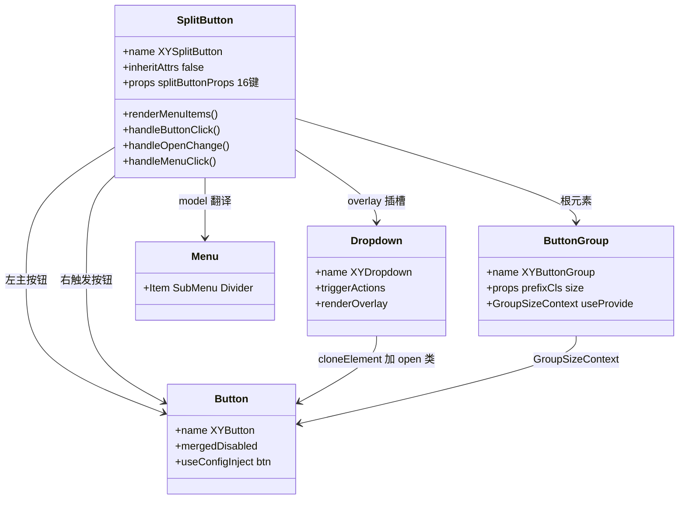
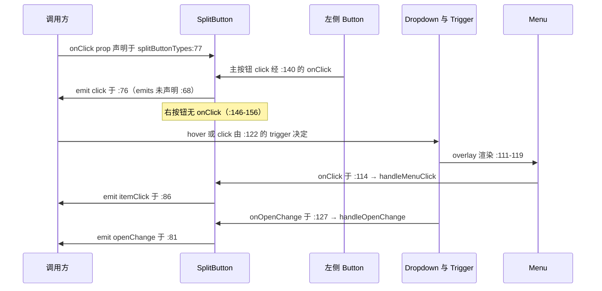
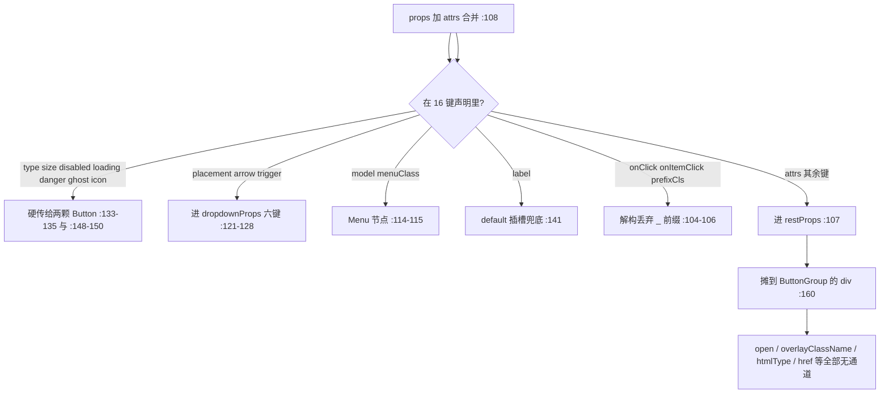

# C12-08 SplitButton 分裂按钮

> **本篇解决**：分裂按钮把「主按钮点击」与「下拉箭头点击」两条路径组合在一起时，组合层自己新增了什么失效模式——顶层开关被翻译成几份往下传、事件是否互相串台、哪些 prop 在组合时被静默丢弃。
> **前置**：C01-01 Button 按钮　C03-08 Dropdown 下拉菜单　C03-01 Menu 导航菜单　**读者坐标**：`03-components/12-global` 第 9/9 篇（含 C12-00 横写篇）

## 一、职责与边界

分裂按钮要回答的产品问题是：一个主命令加一组次要命令，怎样占一个控件的位置。XiaoyeUI 的答案是**纯组合**：`SplitButton` 内部没有浮层逻辑、没有按钮视觉逻辑、也没有自己的状态机，它只做四件事——把共享开关抄给两颗按钮（`packages/xiaoye-ui/src/split-button/SplitButton.tsx:131-156`）、把六个键拼成一张 Dropdown 白名单（`:121-128`）、把 `model` 数据翻译成 `Menu` 节点树（`:20-51`）、把根类名挂到 `Button.Group` 的 `div` 上（`:158-168`）。171 行里没有一个 `ref`、没有一行 `watch`，唯一的 `computed` 是 `:71` 那行对 `prefixCls` 的同层别名，不承载任何状态；响应式输入只有 `useConfigInject` 与 `useStyle`（`:70-72`）。

明确不负责的部分，恰好是本篇所有坑的来源：弹层的定位、动画与展开状态在 `dropdown` 与 `vc-dropdown`；按钮的尺寸、语义色与波纹在 `button`；菜单的键盘导航与溢出折叠在 `menu`；浮层挂载容器只从 `ConfigProvider` 取（`:126`），不接受组件级入参。

依赖清单（`packages/xiaoye-ui/src/split-button/SplitButton.tsx:3-12`）：

| 依赖 | 用途 | 引用点 |
| --- | --- | --- |
| `button`（默认导出与 `.Group`） | 两颗按钮与外层容器 | `:3`、`:15`、`:131-159` |
| `dropdown` | 右半按钮的浮层触发器 | `:4`、`:164-166` |
| `menu`（`.Item` `.SubMenu` `.Divider`） | 浮层内容 | `:5`、`:114-118` |
| `config-provider/hooks/useConfigInject` | `prefixCls` `direction` `getPopupContainer` | `:11`、`:70` |
| `split-button/style` | 组件样式 hook | `:12`、`:72` |
| `@xiaoye-ui/icons` `DownOutlined` | 右按钮箭头 | `:8`、`:154` |

## 二、源码地图

| 文件 | 行数 | 职责 | 关键导出与入口 |
| --- | --- | --- | --- |
| `packages/xiaoye-ui/src/split-button/index.ts` | 23 | 包入口、`install` | `XYSplitButton`（默认导出 `:15-23`）、`splitButtonProps`（`:6`） |
| `packages/xiaoye-ui/src/split-button/SplitButton.tsx` | 171 | 唯一主实现 | 组件定义 `:53`、render 闭包 `:89`、DOM 产出 `:158-168` |
| `packages/xiaoye-ui/src/split-button/splitButtonTypes.ts` | 84 | props 与数据面类型 | `splitButtonProps()` `:46-80`、`SplitButtonItem` `:25-44` |
| `packages/xiaoye-ui/src/split-button/style/index.ts` | 88 | CSS-in-JS | `genComponentStyleHook('SplitButton', …)` `:76-88` |
| `packages/xiaoye-ui/src/split-button/__tests__/split-button.test.tsx` | 147 | 14 个 `it` 加 `mountTest` | 无快照文件（该目录只有 `.test.tsx` 一个文件） |

被谁引用：包聚合入口 `packages/xiaoye-ui/src/components.ts`（生成物，由 `pnpm gen:entries` 写入）、`packages/xiaoye-ui/package.json` 的 `./split-button` 与 `./split-button/style` 双入口、Vue `GlobalComponents` 声明 `packages/xiaoye-ui/typings/global.d.ts`；文档侧入口是 `apps/docs/.vitepress/config/index.ts` 与 `apps/docs/examples/split-button/` 的 6 个示例。组件名与标签由 `packages/xiaoye-ui/src/_util/registerComponent.ts` 从 `name: 'XYSplitButton'`（`SplitButton.tsx:55`）映射为 `xy-split-button`，内部标记 `__XY_SPLIT_BUTTON` 在同一行 `:57`。

一个容易误读的反差是**门面与下游的规模**：整篇的发布面是 16 个 prop（`splitButtonTypes.ts:47-79`），而它下游的 Dropdown 声明了 26 个（`packages/xiaoye-ui/src/dropdown/props.ts:27-76`）、Button 声明了 16 个（`packages/xiaoye-ui/src/button/buttonTypes.ts:21-43`）。差集不是「简化」，而是**没有通道**——本篇论点 5 与论点 6 处理的就是这个差集。

## 三、架构与数据流

### 3.1 静态结构：一个根元素承载两个命名空间



`ButtonGroup` 渲染的 `div` 就是 `SplitButton` 的根元素：`SplitButton.tsx:161` 把 `xy-split-button` 追加到它的 class 上，而 `packages/xiaoye-ui/src/button/button-group.tsx:58` 自己产出 `xy-btn-group`。因此 DOM 上只有**一个**元素同时带这两个类，`split-button/style/index.ts:33` 的 `&${rootCls}-btn-group > ${btnCls}` 选择器正是靠这个双类名同元素才成立。这个约定是隐性的：它的成立依赖 `SplitButton.tsx:106` 把 `prefixCls` 解构丢弃——`ButtonGroup` 自己也声明了 `prefixCls`（`button-group.tsx:11`），一旦把它摊进 `restProps`，按钮组的根类名就会被组合件的前缀顶掉。

### 3.2 两条点击路径的完整闭环



三条 emit（`:76`、`:81`、`:86`）都没有声明式契约兜着：`emits` 选项在 `:68` 是**一行注释**。它们能工作依赖 Vue 的「未声明 emit 回退到 `vnode.props` 上的同名处理器」，这一点在论点 1 展开。

### 3.3 prop 分流：进入白名单、进入透传、被丢弃



图里 `G` 与 `I` 两条边是组合件独有的：`G` 那三个丢弃看起来像「未使用变量的垃圾」，实际是防串台的承重墙（论点 1）；`I` 那条则解释了为什么 `SplitButton` 上写 `v-model:open` 不会报错也不会有任何效果（论点 5）。

## 四、核心机制精读

### 论点 1：两条点击路径不串台，靠的是三行「解构即丢弃」这一手滑刀，而不是事件契约

**断言**：`SplitButton` 的三个事件没有一个有声明式契约；主按钮与箭头按钮之所以互不触发对方的回调，完全是因为 `onClick` 在 `:104-106` 被解构丢弃了一次——这道丢弃同时兼任「阻止它随 `restProps` 落到根 `div`」的职责。删掉这道丢弃（它看起来像未使用变量），点箭头就会触发主按钮回调。

```tsx
// packages/xiaoye-ui/src/split-button/SplitButton.tsx:63
  slots: Object as CustomSlotsType<{
    icon: any;
    default: any;
    overlay: any;
  }>,
  // emits: ['click', 'itemClick', 'openChange'],
  setup(props, { slots, attrs, emit }) {
    const { prefixCls, direction, getPopupContainer } = useConfigInject('split-button', props);
    const splitButtonPrefixCls = computed(() => prefixCls.value);
    const [wrapSSR, hashId] = useStyle(prefixCls);

    // 主按钮点击
    const handleButtonClick = (e: MouseEvent) => {
      emit('click', e);
    };
```

```tsx
// packages/xiaoye-ui/src/split-button/SplitButton.tsx:100
        menuClass,
        trigger,
        arrow,
        placement = direction.value === 'rtl' ? 'bottomLeft' : 'bottomRight',
        onClick: _onClick,
        onItemClick: _onItemClick,
        prefixCls: _prefixCls,
        ...restProps
      } = { ...props, ...attrs } as SplitButtonProps & HTMLAttributes;
```

```tsx
// packages/xiaoye-ui/src/split-button/SplitButton.tsx:158
      return wrapSSR(
        <ButtonGroup
          {...restProps}
          class={classNames(splitButtonPrefixCls.value, attrs.class, hashId.value)}
        >
          {leftButton}
          <Dropdown {...dropdownProps} v-slots={{ overlay: () => overlay }}>
            {rightButton}
          </Dropdown>
        </ButtonGroup>,
      );
```

**逐段解释**。`:68` 那一行注释是整篇契约的地基：`emits` 未声明，所以 `emit('click', e)`（`:76`）能不能到达调用方，取决于运行时的「未声明事件回退到 `vnode.props` 上的 `onClick`」这条通道。这条通道在本仓的当前依赖版本上是通的——`packages/xiaoye-ui/src/split-button/__tests__/split-button.test.tsx:50-58` 那条用例（挂上 `onClick`、点第一颗 `.xy-btn`、断言 `toHaveBeenCalled`）实测通过：`npx vitest run src/split-button/__tests__/split-button.test.tsx` 输出 `Test Files 1 passed / Tests 15 passed`。

第二道保险在 `splitButtonTypes.ts:77`：`onClick: eventType<MouseEventHandler>()` 把它**声明成 prop**，于是 Vue 在初始化时把它从 `attrs` 里摘走，`{ ...props, ...attrs }`（`:108`）拿到的 `onClick` 只有一份。`:104` 再把它解构成 `_onClick` 丢弃。两道叠加的结果是 `onClick` 既不会进 `restProps`、也不会进 `dropdownProps`（`:121-128` 的六个键里没有它）。

关键在于**如果它进了 `restProps` 会怎样**。`ButtonGroup` 只声明 `prefixCls` 与 `size` 两个 prop（`packages/xiaoye-ui/src/button/button-group.tsx:10-15`），也**没有**写 `inheritAttrs: false`（对比 `SplitButton.tsx:56` 与 `packages/xiaoye-ui/src/dropdown/dropdown.tsx:24` 都显式写了），所以 `restProps` 里剩下的键会一路穿到 `button-group.tsx:58` 那个 `div`。`onClick` 落到 `div` 上之后，右按钮（`:146-156`，它自己没有 `onClick`）的点击事件冒泡到这个 `div`，主按钮回调就被第二次触发。也就是说：**「右半只开菜单、左半只执行主命令」这条产品语义，在源码里的实现位置是一行看起来可以顺手清理的 `_onClick`**。而测试面只覆盖了正向那一半（`:50-58` 断言点左按钮会响），没有任何用例断言「点右按钮不响」——这条回归无人看守。

第三个观察点是三个事件的**契约形状各不相同**，全挤在同一个组件里：

| 事件 | prop 声明 | emits 声明 | 到达调用方的通道 |
| --- | --- | --- | --- |
| `click` | `splitButtonTypes.ts:77` 有 | `SplitButton.tsx:68` 注释掉 | 未声明回退，命中 `props.onClick` |
| `itemClick` | `splitButtonTypes.ts:79` 有（名字是 `onItemClick`） | 同上 | 未声明回退，命中 `props.onItemClick` |
| `openChange` | **完全没有声明** | 同上 | `attrs` 里的 `onOpenChange` 经未声明回退命中 |

`openChange` 这一行值得单独记：因为 `onOpenChange` 不在 props 表里，它**留在 `attrs`**，于是 `{...props, ...attrs}` 之后它没有被任何一行解构丢弃，会随 `restProps`（`:107`）摊到 `ButtonGroup` 的 `div` 上（`:160`）。它在那里变成一个永不触发的 DOM 事件监听器，同时不影响 `emit('openChange')`（`:81`）的正常送达。结论：同一份调用方传入的处理器，在 `click` 上走「摘走再丢弃」，在 `openChange` 上走「留在 attrs 里被摊到 DOM」，两条路径都能工作，但只有前者是刻意的。

**回扣**：组合件的「事件不串台」不是设计出来的不变量，而是三行解构的副产品。改动 `:90-108` 这段（换 `omit`、清 lint 的未使用变量、改成 `v-bind` 展开）之前，先补一条「点右按钮不触发 `onClick`」的用例。

### 论点 2：一个 `disabled` 开关被翻译成四次下发与两次重算，代价是短路了它下游的两条兜底

**断言**：`disabled` 在 `SplitButton` 里落了四个地方（左按钮、右按钮、Dropdown 的 `trigger`、Dropdown 的 `disabled`），Dropdown 内部又各自重算一次；而 `splitButtonTypes.ts:53` 给 `disabled` 设了 `false` 默认值，使得 `props.disabled` 恒有值，于是它**硬传给 Button 的那个 `??` 兜底被永久短路**——`DisabledContext` 对整个 SplitButton 失效。

```ts
// packages/xiaoye-ui/src/split-button/splitButtonTypes.ts:50
  // 按钮尺寸
  size: String as PropType<SizeType>,
  // 是否禁用
  disabled: booleanType(false),
  // 是否加载中
  loading: booleanType(false),
```

```tsx
// packages/xiaoye-ui/src/split-button/SplitButton.tsx:121
      const dropdownProps = {
        trigger: disabled ? [] : trigger,
        placement,
        arrow,
        disabled,
        getPopupContainer: getPopupContainer?.value,
        onOpenChange: handleOpenChange,
      };
```

```tsx
// packages/xiaoye-ui/src/split-button/SplitButton.tsx:131
      const leftButton = (
        <Button
          type={type}
          size={size}
          disabled={disabled}
          loading={loading}
          danger={danger}
          ghost={ghost}
          icon={icon}
          onClick={handleButtonClick}
          v-slots={{ default: slots.default ?? (() => label) }}
        />
      );
```

`booleanType` 的实现是 `{ type: Boolean, default: defaultVal as boolean }`（`packages/xiaoye-ui/src/_util/type.ts:58-60`），所以 `disabled`、`loading`、`danger`、`ghost`、`arrow` 五个开关**不传就是 `false`，且永远是布尔**——不是 `undefined`。这一步决定了后面两件事。

第一件：Button 侧的兜底。`packages/xiaoye-ui/src/button/button.tsx:51` 写的是 `const mergedDisabled = computed(() => props.disabled ?? disabledContext.value)`，其中 `disabledContext` 来自 `packages/xiaoye-ui/src/config-provider/DisabledContext.ts:7` 的 `useInjectDisabled`（这条链在 Button 侧的完整形态由 C01-01 的论点 2 登记，本篇只处理组合层把它短路掉的那一手）。`SplitButton.tsx:135`、`:150` 传下去的是恒有值的布尔，`false ?? anything` 就是 `false`，因此外层任何 `DisabledContext`（`Form` 的整体禁用、任何包裹用的 disabled provider）对分裂按钮的两颗按钮**零效果**。对照被组合的那一侧自己的写法：Button 把 `disabled` 声明成 `{ type: Boolean, default: undefined }`（`packages/xiaoye-ui/src/button/buttonTypes.ts:33`），刻意留 `undefined` 才让 `??` 有右侧可走；`ghost`、`block`、`danger` 三个键同样留 `undefined`（`:34-36`）。组合层用 `booleanType(false)` 把这份克制抹平了。

第二件：`SplitButton` 自己也没接这条兜底。`useConfigInject` 已经把 `disabled` 合成好了（`packages/xiaoye-ui/src/config-provider/hooks/useConfigInject.ts:43`），但 `SplitButton.tsx:70` 只解构 `prefixCls, direction, getPopupContainer`，不取 `disabled`。也就是说本组件同时命中该缺陷族的**两条判据**：① 不接 `useConfigInject` 合成的 `disabled`；② 把带 `false` 默认值的自己的 prop 硬传给子控件。即便有人后来补上 ①，`useConfigInject.ts:43` 里的 `props.disabled ??` 仍然被 `splitButtonTypes.ts:53` 的默认值吃掉——**根因在默认值，不在解构**。

第三件是重复劳动。`SplitButton.tsx:122` 的 `disabled ? [] : trigger` 与 `packages/xiaoye-ui/src/dropdown/dropdown.tsx:183` 的 `const triggerActions = disabled ? [] : trigger` 是同一条逻辑的两份拷贝，两处的输入在这一路上必然相同（`disabled` 由 `:125` 原样下发），所以组合层那份是纯冗余；同时 `dropdown.tsx:175` 还会在触发按钮的 vnode 上再写一次 `{ disabled, 'aria-disabled': true }`，与 `SplitButton.tsx:150` 传给 Button 的那一份叠成两个来源。一份状态、四次下发（`:122`、`:125`、`:135`、`:150`）、两次重算（`dropdown.tsx:175`、`:183`）。

一个反直觉的副产品：`disabled` 与「浮层是否已展开」的组合缺陷在这条路上**不显形**。C03-08 的坑 7 记录了 Dropdown 层的 `disabled` 只管触发不管受控展开（`:disabled` 加 `:open="true"` 会呈现禁用样式配打开的浮层，因为 `dropdown.tsx:146-148` 的 `mergedVisible` 不参与 `disabled` 判断）。而 `SplitButton` 根本没有受控通道（论点 5），拿不到 `open`，所以那个缺陷被上游的缺失掩盖了——**下游的洞被上游的更小的门面挡住，这类情况在组合件里不能当成「已修」**。

测试现状：`__tests__/split-button.test.tsx:62-71` 那条 `disables both buttons when disabled` 只断言两颗按钮 DOM 上的 `disabled` 属性存在，既不检查 `dropdownProps.trigger` 是否变成空数组，也不检查 Dropdown 是否收到 `disabled`。`:112-124` 那条「转发给 Dropdown 的 props」只断言 `placement` 与 `trigger` 两个键。所以 `:122` 这条三元分支**无测试保护**。

### 论点 3：RTL 兜底是死分支，而且这个死分支在组合层被重新写了一遍

**断言**：`SplitButton.tsx:103` 用解构默认值实现的「RTL 就镜像到 `bottomLeft`」永远不成立，因为 `initDefaultProps` 已经给 `placement` 填了 `'bottomRight'`；同一形状的兜底在 `dropdown.tsx` 与 `dropdown-button.tsx` 各有一份（C03-08 的坑 8 已论证），组合层不是复用而是**第三次重写**，并且额外把下游那两份也一并变成不可达。

```tsx
// packages/xiaoye-ui/src/split-button/SplitButton.tsx:58
  props: initDefaultProps(splitButtonProps(), {
    type: 'default',
    trigger: 'hover',
    placement: 'bottomRight',
  }),
```

```tsx
// packages/xiaoye-ui/src/split-button/SplitButton.tsx:90
      const {
        type = 'default',
        size,
        disabled,
        loading,
        danger,
        ghost,
        label,
        icon = slots.icon?.(),
        model,
        menuClass,
        trigger,
        arrow,
        placement = direction.value === 'rtl' ? 'bottomLeft' : 'bottomRight',
```

```ts
// packages/xiaoye-ui/src/_util/props-util/initDefaultProps.ts:16
  const propTypes: T = { ...types };
  Object.keys(defaultProps).forEach(k => {
    const prop = propTypes[k] as VueTypeValidableDef;
    if (prop) {
      if (prop.type || prop.default) {
        prop.default = defaultProps[k];
      } else if (prop.def) {
```

`splitButtonTypes.ts:73` 的 `placement: String as PropType<SplitButtonPlacement>` 本身**没有**默认值，但 `initDefaultProps` 命中的正是 `initDefaultProps.ts:20-21` 那条 `prop.default = …` 分支（描述符对象有 `type`），于是运行时 `props.placement` 恒为 `'bottomRight'`。`:103` 的解构默认值只在 `undefined` 时生效，因此 `direction.value === 'rtl'` 这个判断从未参与过任何一次渲染。`direction` 在这条路径上的唯一作用，是 `dropdown.tsx:167`、`:180` 那两个 `-rtl` 类名——**方向只改了类名，没改几何**。

再往下看一层：`SplitButton` 恒把非空 `placement` 下发（`:123`），于是 `dropdown.tsx:128-131` 里那份「`!placement` 时按 `direction` 兜底」的分支在分裂按钮这条链路上是**第二次不可达**。三份同形死分支的成因不同但结果一致，这正是 `initDefaultProps` 与解构默认值/`??` 兜底混用后的必然产物。对照：`trigger` 的默认值 `'hover'`（`:60`）没有配任何兜底分支，所以它是**活的**——分裂按钮默认悬停即开菜单，这是组合层自己选的语义，`dropdown.tsx:29` 给 Dropdown 选的也是 `'hover'`，两处独立声明、互不引用。

`SplitButtonPlacement` 的类型面还比下游的实现面**宽一档**：`splitButtonTypes.ts:14-22` 允许 `topCenter` 与 `bottomCenter`，而 `dropdown.tsx:134-141` 把任何含 `Center` 的值判为 deprecated、裁成 `top` 或 `bottom` 并弹一条 `devWarning`。所以 `<xy-split-button placement="bottomCenter">` 的诚实描述是「得到 `bottom`，外加一条来自下游的弃用告警」。同时 `dropdown.tsx:58-65` 的动画名判定读的是**原始** `props.placement`（`includes('top')`），与归一后的 computed 各读各的——这条子串判定链由 C03-08 的论点 5 完整论证，本篇只登记「组合层的类型面把这个形状交给了用户」。

### 论点 4：菜单打开时箭头不旋转——这条样式规则有三个各自足以致死的独立原因

**断言**：`split-button/style/index.ts:69` 生成的「展开态箭头旋转 180°」规则在本仓不可能命中任何元素，原因有三条且互相独立：类名 `xy-split-button-open` 从未被渲染、图标类名 `xyicon-down` 从未被生成、`::before` 伪元素无 `content` 因此不存在。这是组合件独有的失效模式——三个被组合的组件各自都「没错」，只是没有任何一层负责把它们的名字对齐。

```ts
// packages/xiaoye-ui/src/split-button/style/index.ts:61
      // 下拉箭头图标
      [`${token.iconCls}-down`]: {
        fontSize: fontSizeIcon,
        transition: `transform ${motionDurationMid}`,
      },
    },

    // 菜单展开时箭头旋转 180°
    [`${componentCls}-open ${token.iconCls}-down::before`]: {
      transform: 'rotate(180deg)',
    },
  } as CSSObject;
```

`componentCls` 是 `.${prefixCls.value}`（`packages/xiaoye-ui/src/theme/util/genComponentStyleHook.ts:87`），而 `prefixCls` 来自 `useConfigInject('split-button', props)`（`SplitButton.tsx:70`），展开为 `xy-split-button`；`iconCls` 是 `.${iconPrefixCls.value}`（`genComponentStyleHook.ts:95`），默认前缀 `xyicon`（`packages/xiaoye-ui/src/config-provider/context.ts:14`）。于是编译出来的选择器是 `.xy-split-button-open .xyicon-down::before`。

**第一条死因**：`.xy-split-button-open` 从未出现在 DOM 上。全文件与 open 相关的只有四处（`SplitButton.tsx:68` 的注释、`:80` 的 `handleOpenChange`、`:81` 的 `emit('openChange')`、`:127` 下发给 Dropdown 的 `onOpenChange`），组件里没有一个 `ref` 承接展开态，根类名计算 `:161` 的 `classNames(...)` 只有三项。展开状态确实存在，但它写在厂商层：`packages/xiaoye-ui/src/vc-dropdown/Dropdown.tsx:88-94` 在 `triggerVisible` 为真时给触发子节点补一个类。

```tsx
// packages/xiaoye-ui/src/vc-dropdown/Dropdown.tsx:86
    const renderChildren = () => {
      const children = slots.default?.();
      return triggerVisible.value && children
        ? cloneElement(
            children[0],
            { class: props.openClassName || `${props.prefixCls}-open` },
            false,
          )
        : children;
    };
```

`:91` 的兜底是 `${props.prefixCls}-open`，而这一路的 `prefixCls` 由业务层写死为 Dropdown 自己的前缀（`packages/xiaoye-ui/src/dropdown/dropdown.tsx:37-40` 的 `useConfigInject('dropdown', props)`，`:202` 的 `prefixCls: prefixCls.value`），也就是 `xy-dropdown-open`。类名确实落到了右按钮元素上（`cloneElement` 第三参 `false` 走合并语义，`packages/xiaoye-ui/src/_util/vnode.ts:25`，所以按钮原有类名不会被顶掉），但命名空间与样式表的期望差了一整个组件——这正是 `split-button` 与 `dropdown` 两张样式表各自抄了一遍同一个规则、又各自都没抄对的结果（Dropdown 那一份的错位由 C03-08 的坑 3 记录，它把病因归在 `xy-dropdown-open` 与 `xy-dropdown-wrap-open` 的名字差档上）。

**第二条死因**：`.xyicon-down` 这个类在仓库里根本不存在。右按钮的图标是 `<DownOutlined />`（`SplitButton.tsx:154`），它在 `packages/icons/src/index.js:1006` 被映射到 `chevrondown`，而该组件的模板只有一个硬编码类名的 `span`：

```vue
<!-- packages/icons/src/chevrondown/ChevronDownIcon.vue:1 -->
<template>
  <span class="xyicon">
    <svg
      width="14"
      height="14"
```

图标唯一的属性出口是 `v-bind="pti()"`，而 `pti` 只映射三个属性：

```ts
// packages/core/src/composables/index.ts:20
  const pti = () => {
    const attrs: Record<string, any> = {};
    if (props.size) attrs.width = attrs.height = String(props.size);
    if (props.fill) attrs.fill = props.fill;
    if (props.strokeWidth) attrs['stroke-width'] = String(props.strokeWidth);
    return attrs;
  };
```

也就是说本仓的图标是「一个 `xyicon` 外壳加一颗内联 `svg`」，**没有**按图标名派生的修饰类。可复现命令：`grep -rn "iconCls}-down" packages apps --include='*.ts' --include='*.tsx' --include='*.vue'` 的命中全是样式声明——本组件两行（`split-button/style/index.ts:62`、`:69`）、Dropdown 三行（`dropdown/style/index.ts:79`、`:83`、`:89`），另有三行是 `-download` 被子串匹配带进来的（`packages/xiaoye-ui/src/upload/style/picture.ts:167`、`:178`、`:211`）；**没有一行是这个类名的产出点**。

**第三条死因**：即便前两条都被修好，`transform` 也无处可施。CSS 的 `::before` 必须有 `content` 才会生成伪元素盒子，而图标类名上唯一的全局规则 `resetIcon()`（`packages/xiaoye-ui/src/style/index.ts:28-54`，由 `packages/xiaoye-ui/src/theme/util/genComponentStyleHook.ts:66` 与 `packages/xiaoye-ui/src/config-provider/style/index.ts:19` 两处挂到 `.${iconPrefixCls}` 上）声明的全是盒模型与 `svg` 子元素，**没有**任何 `::before` 与 `content`；同一文件里带 `&::before` 加 `content` 的是 `clearFix()`（`packages/xiaoye-ui/src/style/index.ts:56-60`），它不作用于图标。也就是说这条规则的形状停留在「图标字体」时代——用 `::before` 承载字形再对它旋转；换成 SVG 图标后没有任何一层同步它。

顺带同一段样式里的第二个死键：组件 token `splitBorderWidth` 在 `split-button/style/index.ts:6-9` 声明、在 `:85-87` 由 `getDefaultToken` 回映射成 `token.lineWidth`，并且已经在主题的类型面上正式登记（`packages/xiaoye-ui/src/theme/interface/components.ts:45` 引入、`:130` 挂进 `ComponentTokenMap`），但 `genBaseStyle`（`:17-73`）的解构清单里没有它，全文件也没有第二处读取——调用方可以合法地在 `ConfigProvider` 的 `theme.token.SplitButton.splitBorderWidth` 上写一个值，类型不报错、运行时零效果。本组件的接缝实际是靠 `:42-52` 的四个 `borderStart*Radius: 0` 实现的，压根没有分隔线元素可供赋值；这一类「容器型组件走完整 Token 契约」（该类两种样式契约的归类见 C12-00 的论点 4）里，token 的注册与消费是两件事，注册表管前者、`genBaseStyle` 的解构清单管后者。

**回扣**：判断「组合件的样式会不会失效」，看的不是规则写得多对，而是**状态跨越了几个命名空间**。这里状态在厂商层（`triggerVisible`），类名在 Dropdown 命名空间，样式表在 SplitButton 命名空间，图标又没有自己的名字——四者两两不同名。

### 论点 5：门面只留六条通道，其余下游能力既不透传也不报错，而是变成 wrapper 上的野属性

**断言**：`SplitButton` 递给 Dropdown 的是一张**六键字面量**（`:121-128`），Dropdown 的 26 个 prop 里只有 4 个能进来；剩下的键（含 `open` 与两个延迟）如果用户在 `<xy-split-button>` 上写，会经 `attrs` 落到 `ButtonGroup` 的 `div` 上，不报错、不生效。分裂按钮因此**结构上无法受控**。

对照 C03-08 的坑 6：`Dropdown.Button` 也重造了一张 13 键白名单（`packages/xiaoye-ui/src/dropdown/dropdown-button.tsx:75-89`），并且在那张表里**保留了** `open` 与 `visible`。组合层的第二张表比第一张更窄：

| 下游能力 | 声明处 | 能否经 SplitButton 生效 |
| --- | --- | --- |
| `trigger` `placement` `arrow` `disabled` | `dropdown/props.ts:29`、`:44`、`:28`、`:37` | 能，经 `SplitButton.tsx:122-125` |
| `getPopupContainer` | `dropdown/props.ts:41` | 只从 `ConfigProvider` 取（`:126`），组件级入参无通道 |
| `open` / `visible` | `dropdown/props.ts:36`、`:35` | 不能，`:121-128` 里没有该键 |
| `mouseEnterDelay` / `mouseLeaveDelay` | `dropdown/props.ts:57-58` | 不能，且 Dropdown 的默认值 `0.15` / `0.1` 被硬套（`dropdown.tsx:26-27`） |
| `overlayClassName` / `overlayStyle` / `forceRender` / `destroyPopupOnHide` / `openClassName` / `align` / `transitionName` / `menu` | `dropdown/props.ts:54-61`、`:59`、`:40`、`:43`、`:32` | 不能 |

`open` 这条的后果要说足：Dropdown 的受控判定是 `mergedVisible = typeof props.visible === 'boolean' ? props.visible : props.open`（`dropdown/dropdown.tsx:146-148`）。`SplitButton` 两个都不传，`mergedVisible` 恒为 `undefined`，厂商层的 `props.visible === undefined` 判定恒真（`vc-dropdown/Dropdown.tsx:54`、`:61`），所以状态完全由厂商层的 `triggerVisible` 本地持有。**任何「外部控制开合」的需求，在这张六键表面前只能改 `SplitButton.tsx`**。

漏键之后的行为也要写清，因为它是「为什么不报错」的答案。`SplitButton` 声明了 `inheritAttrs: false`（`:56`），这是它自己不被 Vue 自动透传的原因；但它在 `:160` 用 `{...restProps}` 手工把 `attrs` 摊给了 `ButtonGroup`，而 `button-group.tsx` 只声明 `prefixCls` 与 `size`（`:10-15`）且没有写 `inheritAttrs: false`，于是这些键继续自动下沉到 `:58` 的 `div`。结论：`<xy-split-button overlay-class-name="x">` 的产物是 `<div class="xy-btn-group xy-split-button" overlay-class-name="x">`——一个对 `div` 毫无意义的属性。类型面同样不承诺：`SplitButtonProps` 由 `ExtractPropTypes` 派生（`SplitButton.tsx:17`），门面上没有的键在类型上也不存在，因此这类写法要么写在 `v-bind` 展开的对象里、要么写在模板里绕开类型检查。

还有两处**类型收窄**造成的能力裁剪，形状与 `arrow` 一样但更容易被忽略：

- `arrow: booleanType(false)`（`splitButtonTypes.ts:75`）只允许布尔，而 Dropdown 的 `arrow` 是 `someType<boolean | DropdownArrowOptions>([Boolean, Object])`（`dropdown/props.ts:28`）。`dropdown.tsx:190` 的 `arrowPointAtCenter: typeof arrow === 'object' && arrow.pointAtCenter` 因此在分裂按钮这条路上恒为 `false`。至于 `pointAtCenter` 即使传对了有没有用，C03-08 的论点 5 末段与 `A07` 的 placement 链条已经给出结论：厂商层在 `vc-dropdown/Dropdown.tsx:127` 用固定的 `placements` 表覆盖了业务层的 `builtinPlacements`，该开关在 Dropdown 族本来就是零效果——本篇的形状是**组合层把「传对象」这个动作也一并禁掉了**，两道闸门各自独立。
- `loading: booleanType(false)`（`:55`）只允许布尔，而 Button 的 `loading` 是 `[Boolean, Object]` 且对象形态带 `delay`（`buttonTypes.ts:29-31`），Button 也确实读这个 delay（`packages/xiaoye-ui/src/button/button.tsx:64-66`）。所以分裂按钮拿不到「延迟 loading」这条已经在 Button 里实现的通道。

**回扣**：组合件的 prop 面收缩是必然的，但要区分三种收缩——**改名转发**（`menuClass` 对应 `class`）、**类型收窄**（`arrow`、`loading`）、**整键消失且静默**（`open`、延迟、`overlayClassName`）。只有第三种需要立刻补：要么在 `:121-128` 加键，要么给 `attrs` 加一道白名单，别让它们落到 DOM 上伪装成「已接受」。

### 论点 6：`SplitButtonItem` 的索引签名承诺「透传额外属性」，实现只读七个具名键

**断言**：数据面是组合层自己新造的，它比前两条更容易被当成契约使用。`SplitButtonItem` 带一个 `[key: string]: any` 索引签名，注释写着「透传给底层 `Menu.Item` 的额外属性」，但 `renderMenuItems` 从不展开这个对象——多写的字段既不会到达菜单项，也不会被类型系统拦下。

```tsx
// packages/xiaoye-ui/src/split-button/SplitButton.tsx:20
function renderMenuItems(items: SplitButtonItem[], MenuItem: any, SubMenu: any, Divider: any) {
  return items.map((item, index) => {
    if (!item) return null;
    // 在该项前渲染分割线
    const divider =
      item.divided && index > 0 ? <Divider key={`divider_${item.key ?? index}`} /> : null;
    const itemKey = item.key ?? index;

    // 存在 children 时渲染为子菜单
    if (item.children && item.children.length > 0) {
      return [
        divider,
        <SubMenu key={itemKey} title={item.label} icon={item.icon} disabled={item.disabled}>
          {renderMenuItems(item.children, MenuItem, SubMenu, Divider)}
        </SubMenu>,
      ];
    }

    return [
      divider,
      <MenuItem
        key={itemKey}
        disabled={item.disabled}
        danger={item.danger}
        icon={item.icon}
        title={item.title}
      >
        {typeof item.label === 'function' ? item.label() : item.label}
      </MenuItem>,
    ];
  });
}
```

`splitButtonTypes.ts:42-43` 的注释与索引签名是这一条的锚点（`// 透传给底层 Menu.Item 的额外属性` 紧接 `[key: string]: any`）。对照实现：`:40-48` 的 `MenuItem` 只有 `key`、`disabled`、`danger`、`icon`、`title` 五个属性加 children，没有任何 `{...item}` 或 `v-bind`；`:32-34` 的 `SubMenu` 更少，只有 `key`、`title`、`icon`、`disabled`。索引签名的唯一实际效果是让 `model` 里的拼写错误通过类型检查。

同一份数据在两种节点上的语义还是分裂的：

- `danger`：叶子读（`:43`），分支不读（`:32`）——子菜单标题永远不会变红，而样式侧的 danger 规则只挂在 item 上（`packages/xiaoye-ui/src/dropdown/style/status.ts:7` 与 `:12` 拼出的选择器只有 `${menuCls}-item-danger`）。
- `title`：叶子当原生 tooltip 用（`:45`），分支位置被 `label` 占据（`:32` 的 `title={item.label}`）——同一个字段在两级里是两种东西，类型注释（`splitButtonTypes.ts:38-39`）写的还是另一件事（`title` 上方的注释是「是否禁用菜单项」，与它上一行的 `disabled` 重复，属于注释错位）。
- `divided`：`:25` 的 `index > 0` 守卫让**第一项的 `divided` 恒被静默忽略**，`model[0] = { divided: true, ... }` 不报错也不出现分割线。
- `key`：`:26` 的 `item.key ?? index` 是**本层下标**，而 `:33` 的递归让每层下标都从 0 起算，于是顶层第 0 项与某个子菜单的第 0 项拿到同一个 key。`onItemClick` 的入参声明为 `{ key; item; domEvent }`（`splitButtonTypes.ts:79`），实际透传的是 Menu 的点击信息（`SplitButton.tsx:114` 的 `onClick={handleMenuClick}` → `:86` 的 `emit('itemClick', info)`），所以在缺省 `key` 的数据上，调用方拿到的 `info.key` 不保证唯一。
- `MenuItem`、`SubMenu`、`Divider` 三个节点由函数参数注入（`:20`），实参来自 `Menu.Item` 等静态属性（`:115`，静态挂载见 `packages/xiaoye-ui/src/menu/index.tsx:25-28`）。`Menu.ItemGroup` 同样存在（`:28`）却没有任何数据字段能触发它——`SplitButtonItem` 里没有 group 概念，`renderMenuItems` 也不认。

`model` 缺省时的兜底也值得一记，因为它是 `mountTest` 实际走的那条路：

```tsx
// packages/xiaoye-ui/src/split-button/SplitButton.tsx:110
      // 下拉菜单内容：优先使用 overlay 插槽，否则用 model 渲染 Menu
      const overlay =
        slots.overlay?.() ??
        (model && model.length > 0 ? (
          <Menu class={menuClass} selectable={false} onClick={handleMenuClick}>
            {renderMenuItems(model, Menu.Item, Menu.SubMenu, Menu.Divider)}
          </Menu>
        ) : (
          <Menu />
        ));
```

`model` 未声明默认值（`splitButtonTypes.ts:65` 的 `arrayType<SplitButtonItem[]>()` 不传参，`packages/xiaoye-ui/src/_util/type.ts:83-84` 的形状是 `{ type: Array, default: defaultVal }`，不传参即 `undefined`），所以不传 `model` 时走 `:118` 的 `<Menu />` 空兜底——浮层仍然会因为 hover 而弹出，内容是一张零项菜单。`packages/xiaoye-ui/tests/shared/mountTest.js:10` 恰好就是不带任何 props 的 `<Component />`，所以这条路径每轮 CI 都被渲染一次，却没有任何断言检查浮层内容（它只断言更新与卸载不抛异常）。

`menuClass`（`:114`）这条通道本身能落（Dropdown 与厂商层的两次 clone 都不改 `class`），但用户按 `xy-menu-*` 写的后代选择器会落空：浮层里菜单的 `prefixCls` 被厂商层改写为 `xy-dropdown-menu`（`vc-dropdown/Dropdown.tsx:70`），业务层那次 clone 用的是覆盖语义、厂商层这次用的是合并语义，两类键的存活规则不同——这一整段机制由 C03-08 的论点 1 与论点 3 论证，本篇只登记组合层的对应事实：**`menuClass` 是改名转发，`selectable={false}` 是硬编码且无开关**（`:114`，Dropdown 侧的默认值同样是 `false`，`dropdown/dropdown.tsx:105`），所以分裂按钮的菜单永远不可选中，也没有把它改回可选中的一行代码。

## 五、对外契约如何生效

**从包入口到组件名**。`packages/xiaoye-ui/src/split-button/index.ts:15-21` 把 `install` 挂在组件上并交给 `registerComponent` 注册，标签名由 `name: 'XYSplitButton'`（`SplitButton.tsx:55`）反推；类型面在 `packages/xiaoye-ui/typings/global.d.ts:81` 有一条 `XYSplitButton` 声明，指向包根导出的 `SplitButton`。这三处都是生成物的投影，手工加键不会同步（`pnpm gen:entries` 的口径见根目录 `AGENTS.md`）。

**props 的合流点只有一个**：`:108` 的 `{ ...props, ...attrs }`。由于 16 个键全在声明里（`splitButtonTypes.ts:47-79`），Vue 已经把命中的那几个从 `attrs` 里摘走，所以这个展开顺序在正常情况下不产生冲突；它真正的作用是把「没声明的键」与「声明了的键」混进同一个解构，让 `:90-107` 一次解构就能同时分流。这一手与 `packages/xiaoye-ui/src/dropdown/dropdown.tsx:195-196` 的 `{...props, ...attrs}` 是同一形状，但两处对这个形状的使用相反：Dropdown 在展开**之后**列出 11 个显式覆盖键（`:197-207`），因此 attrs 永远压不过业务层的计算值；SplitButton 则是在展开之后**丢弃**三个键（`:104-106`）、把六个键另起一个字面量（`:121-128`），因此 attrs 的去处只有一个——`:160` 的 `restProps`。这两种写法的差别决定了「用户多传一个键」在下层的命运，也是判断同类组合件的第一个看点。

**插槽三条，语义不对称**。`slots` 声明在 `:63-67`，只有 `icon`、`default`、`overlay`。`overlay`（`:112`）用 `??` 优先于 `model`，所以给了插槽就没有 `menuClass`、没有 `selectable={false}`、也没有 `onItemClick`——**插槽会连带切断 `itemClick` 事件**，因为 `handleMenuClick` 只挂在自动生成的那个 `Menu` 上（`:114`），自定义 overlay 里的菜单不会接到它。`icon`（`:98`）是解构默认值 `slots.icon?.()`，它只喂给左按钮（`:139`），右半的箭头在 `:154` 被硬编码成 `<DownOutlined />`，没有任何 prop 或插槽能替换它。`default`（`:141`）回落到 `label`，但只回落给左按钮，右按钮永远无文字。三条插槽的作用域都是「左半」或「整个浮层」，没有一条能碰到右半按钮——这是它与 `Dropdown.Button` 最实用的差距（见六）。

**命令式句柄为零**。组件没有调用 `expose`（对照 `packages/xiaoye-ui/src/button/button.tsx:172` 的 `expose({…})`，句柄里是 `focus` 与 `blur`，实现见 `:167` 与 `:170`；以及厂商层 `packages/xiaoye-ui/src/vc-dropdown/Dropdown.tsx:49-51` expose 出的 `triggerRef`——后者被业务层挡在 `dropdown.tsx` 之外，C03-08 的坑 4 已记录）。因此 `ref` 到一个 `<xy-split-button>` 上拿不到 `focus()`、拿不到 `open()`、也拿不到任何关闭浮层的入口；结合论点 5 的「无受控通道」，外部想主动收起浮层只剩「把鼠标移出浮层」这一条物理路径。

**样式契约**。`useStyle(prefixCls)`（`:72`）返回的 `wrapSSR` 包住整棵树（`:158`），`hashId` 与组件类名、用户 `class` 一起并进那一次 `classNames`（`:161`）。这里属性顺序是**正确**的：`{...restProps}` 写在 `:160`、`class` 写在 `:161`，后者覆盖前者，同时把 `attrs.class` 显式收进来，所以用户类名不会丢、`hashId` 也不会被顶掉。组件的几何全部靠组合层重写按钮组规则实现（`split-button/style/index.ts:42-52` 的四个 `borderStart*Radius: 0` 加 `:43` 的 `paddingInline`），它不改 Button 的任何样式，也不引入自己的分隔线。

**事件契约的实际形状**见论点 1 的表；补充一条判形：本仓对「props 声明事件 vs 声明 emits」的选择不统一，`dropdown-button.tsx:97` 干脆把用户的 `onClick` 直接挂到左按钮上（不经过 `emit`），而 `SplitButton.tsx:140` 挂的是内部包装函数再 `emit`。两种写法对外表现相同（都能拿到 `MouseEvent`），但后者会让 `onClick` 的 prop 声明与未声明的 emits 形成论点 1 那条隐式耦合。

## 六、设计取舍

**本仓其实有两份分裂按钮**，而且它们是同一形状的两次独立实现：`packages/xiaoye-ui/src/dropdown/dropdown-button.tsx`（`XYDropdownButton`）与 `packages/xiaoye-ui/src/split-button/SplitButton.tsx`（`XYSplitButton`）。两者的骨架逐行对应——同一个 `Button.Group` 容器（`dropdown-button.tsx:14` 与 `SplitButton.tsx:15`）、同一套「左 Button 加包在 Dropdown 里的右 Button」（`:91-115` 与 `:131-166`）、同一份 `trigger: 'hover'` 与 `placement: 'bottomRight'` 默认值（`:23-27` 与 `:58-62`）、同一条 `disabled ? [] : trigger`（`:78` 与 `:122`）、同一条不可达的 RTL 解构默认值（`:61` 与 `:103`）、同一行被注释掉的 `emits`（`:28` 与 `:68`）。

差异是逐项的，而且**互有长短**：

| 维度 | `Dropdown.Button` | `SplitButton` |
| --- | --- | --- |
| 受控开合 | 有 `open` 与 `visible` 两条（`dropdown-button.tsx:84-85`） | 无（`SplitButton.tsx:121-128`） |
| 浮层类名与样式 | 转发 `overlayClassName` `overlayStyle`（`:86-87`） | 无 |
| hover 延迟 | 转发（`:82-83`） | 无，硬吃 Dropdown 的 `0.15` 与 `0.1`（`dropdown.tsx:26-27`） |
| 两颗按钮的定制 | `leftButton` 与 `rightButton` 两个插槽（`:31-32`、`:112`、`:114`） | 无，右按钮与箭头都写死（`:146-156`） |
| 菜单数据 | 走 `overlay`，需要自己写 `Menu` | 走 `model`，自动递归生成 `Menu`（`:20-51`） |
| 菜单项点击回流 | 无专属事件 | `itemClick`（`:86`） |
| 表单语义 | 转发 `htmlType` `href` `title`（`:98-100`） | 全缺，门面上没有这三个键 |
| 根命名空间 | `xy-dropdown-button`（`:45`、`:110`） | `xy-split-button`（`:70`、`:161`） |

于是「为什么不用另一条路」这个问题有两个方向的答案。对 `SplitButton`：它换来的是一个**数据化的入参**（`model` 加递归渲染，不需要用户手写 `Menu` 树）和一个 `itemClick` 回流，赔上的是 Dropdown 门面里的几乎全部能力——受控、延迟、浮层类名、右侧按钮定制、以及 Button 自己的 `htmlType`。对 `Dropdown.Button`：它保留了 `open`，代价是用户必须自己构造 overlay。两个组件各自选了相反的一半，且**没有一个从另一个继承另一个的所选**。这是本篇最需要留档的一条：`split-button` 的多数「静默丢弃」（论点 5）不是组合的必要代价，而是第二份实现没有把第一份已经写好的转发抄过来。

`htmlType` 缺失的实际后果值得单独一句：Button 的 `htmlType` 默认值是 `'button'`（`buttonTypes.ts:24`），两颗内层按钮都拿的是这个默认，所以分裂按钮**放进 `form` 里不会提交**，而 `Dropdown.Button` 能把 `htmlType` 转下去（`dropdown-button.tsx:98`）。要拿到提交语义，用户目前只能改用 `Dropdown.Button` 或者给 SplitButton 补转发。

第三个取舍是 SSR 与 tree-shaking 的形状。`SplitButton` 在模块顶层 `import Button / Dropdown / Menu` 三个组件（`:3-5`），且渲染时**无条件**创建 `ButtonGroup` 与两颗 `Button`，`Menu` 也在没数据时兜底创建一颗空的（`:118`）。也就是说按需引入分裂按钮必然把三整条组件链拉进来，即使 `model` 为空也不会省下 `Menu` 的样式注册（`genComponentStyleHook` 的缓存路径按组件与 prefixCls 记账，见 `packages/xiaoye-ui/src/theme/util/genComponentStyleHook.ts:74`）。这类组合件的 tree-shaking 边界是「组合即全量」，写文档时不该承诺按需。

## 七、坑与改动指南

1. **不写 `model` 也不给 `overlay` 插槽时，悬停会弹出一张空浮层。**
   触发：`<xy-split-button label="保存" />`，鼠标移到右半那颗箭头上。
   症状：弹层出现，内容区为一张零项菜单，没有告警，也没有「无菜单就不触发」的降级。
   原因：`SplitButton.tsx:113` 的判定是 `model && model.length > 0`，两条都不满足时走 `:118` 的 `<Menu />` 空兜底；而 `trigger` 与 `disabled` 无关，`:122` 仍然给出 `'hover'`（默认值来自 `:60`）。
   定位：`packages/xiaoye-ui/src/split-button/SplitButton.tsx:110-119` 与 `:122`。修法是「无 overlay 且无 model 时不把右按钮包进 Dropdown」，或至少把 `trigger` 一并置空；`packages/xiaoye-ui/tests/shared/mountTest.js:10` 每轮都在渲染这条路径但没有任何内容断言，**该分支无测试保护**。

2. **外层 `Button.Group` 的 `size` 对分裂按钮的两颗按钮失效。**
   触发：`<xy-button-group size="small"><xy-split-button /><xy-button /></xy-button-group>`。
   症状：同级的普通按钮变小，分裂按钮的两颗保持 `middle`；`SplitButton` 自己的 `size`  prop 传了才生效。
   原因：`SplitButton` 把 `size` 只发给两颗 `Button`（`:134`、`:149`），**没有**发给 `ButtonGroup`（`:159-161` 只传 `restProps` 与 `class`），而 `ButtonGroup` 无条件 `provide` 一份 `GroupSizeContext`（`button-group.tsx:28-32`，其值是 `computed(() => props.size)` 即 `undefined`），把外层那一份遮蔽掉。按钮侧的读取顺序是 `compactSize || groupSizeContext?.size || size.value`（`button.tsx:91`），中间档被内层顶成 `undefined`，只剩最后一档的 `SizeContext`。四级链本身、以及 `useInject()` 在没有提供者时返回空对象而非 `undefined` 的细节，由 C01-01 的论点 2 论证；本篇只补「嵌套时内层把外层顶掉」这一级，它是组合件才会出现的形态。
   定位：`packages/xiaoye-ui/src/split-button/SplitButton.tsx:159-161` 与 `packages/xiaoye-ui/src/button/button-group.tsx:28-32`。最小修法是给 `ButtonGroup` 补一个 `size={size}`；同时注意 `Space.Compact` 那条路是好的，因为 `compactSize` 排在第一位。

3. **清理「未使用变量」会让两条点击路径串台。**
   触发：把 `:104` 的 `onClick: _onClick` 删掉（或改成不解构），或者把 `restProps` 从 `ButtonGroup` 换成一个显式 `omit` 时忘了排除 `onClick`。
   症状：点右半箭头也会触发主按钮回调；`onClick` 被调用两次，第一次来自左按钮、第二次来自根 `div` 上冒泡的监听器。
   原因：`ButtonGroup` 没有 `inheritAttrs: false`（`button-group.tsx:21-24` 的声明块里没有这一项），落到它身上的监听器会穿到 `:58` 的 `div`；而分裂按钮的语义要求只有左按钮能触发 `click`。
   定位：`packages/xiaoye-ui/src/split-button/SplitButton.tsx:99-108` 与 `:160`。现有测试只有 `__tests__/split-button.test.tsx:50-58` 的正向断言，**没有**「点右按钮不响」的反向断言——改这段之前先补它。

4. **`v-model:open` 与一切浮层参数写在分裂按钮上不报错、不生效。**
   触发：`<xy-split-button v-model:open="o" overlay-class-name="wide" :mouse-leave-delay="0.5" />`。
   症状：`o` 永远是初始值；浮层宽度与收起延迟仍是 Dropdown 的默认。
   原因：`:121-128` 的六键里没有它们，而它们会经 `restProps`（`:107`）摊到 `ButtonGroup` 的 `div` 上变成野属性；Dropdown 侧的 `mergedVisible` 因此拿到 `undefined`（`dropdown/dropdown.tsx:146-148`），厂商层的非受控判定恒真（`vc-dropdown/Dropdown.tsx:54`）。
   定位：`packages/xiaoye-ui/src/split-button/SplitButton.tsx:121-128`。修法是在这张表里加键，参照 `dropdown-button.tsx:84-88` 已有的转发写法。

5. **RTL 下浮层不会镜像，而且 `direction` 看起来「接了」。**
   触发：在 `direction="rtl"` 的 `ConfigProvider` 下使用默认 `placement`。
   症状：仍在 `bottomRight`（作者意图是 `bottomLeft`，见 `:103` 的三元左支），只有 `-rtl` 类名生效。
   原因：`initDefaultProps` 在 `:61` 给 `placement` 落了一个字符串默认值，走的是 `initDefaultProps.ts:20-21` 的 `prop.default =` 分支，`:103` 的解构默认永不触发。
   定位：`packages/xiaoye-ui/src/split-button/SplitButton.tsx:58-62` 与 `:103`；同一形状在 `dropdown/dropdown.tsx:28` 与 `dropdown-button.tsx:25` 各有一份，三份都死（C03-08 的坑 8 已论证后两份）。改法是删掉 `:61` 那行，但删之前要确认 `:103` 之后所有读取点都容忍 `undefined`。

6. **菜单数据里四个字段会在特定位置静默消失。**
   触发：`model[0].divided = true`；或给有 `children` 的项写 `danger`；或给叶子项写 `title` 同时给分支项也写 `title`；或在 `model` 项上写任何额外字段指望「透传」。
   症状：第一项没有分割线；子菜单标题不变红；分支项的 `title` 被 `label` 顶掉；额外字段全部无效。
   原因：`:25` 的 `index > 0` 守卫、`:32` 与 `:40-48` 的不对称属性清单、`splitButtonTypes.ts:42-43` 那句「透传给底层 `Menu.Item` 的额外属性」与索引签名。
   定位：`packages/xiaoye-ui/src/split-button/SplitButton.tsx:24-49` 与 `packages/xiaoye-ui/src/split-button/splitButtonTypes.ts:38-43`。测试只覆盖「两项无嵌套无分割线」这一种形状（`__tests__/split-button.test.tsx:97-110`，而且它只断言 `XYDropdown` 存在，没断言任何菜单内容）。

7. **想给箭头加「展开即旋转」的视觉，改样式表是改不出来的。**
   触发：按 `split-button/style/index.ts:69` 的意图给 `.xy-split-button-open` 补规则，或以为 `arrow` prop 能控制箭头形状。
   症状：类名永远不在 DOM 上；`arrow` 传 `true` 只多一个箭头 div。
   原因：论点 4 的三条死因叠加——展开类由厂商层写成 `xy-dropdown-open`（`vc-dropdown/Dropdown.tsx:91`），图标没有 `-down` 修饰类（`packages/icons/src/chevrondown/ChevronDownIcon.vue:2` 与 `packages/core/src/composables/index.ts:20-26`），`::before` 没有 `content` 因此不存在（`packages/xiaoye-ui/src/style/index.ts:28-54`）。
   定位：三处都要动才可能生效；单点修法是在 `SplitButton.tsx` 里加一个 `openRef` 接住 `handleOpenChange`（`:80-82`）并把它并入 `:161` 的 `classNames`。

8. **给浮层菜单写样式要用 `menuClass`，但它的选择器只能落在容器上。**
   触发：`menuClass="my-menu"` 后写 `.my-menu .xy-menu-item`。
   症状：规则不命中。
   原因：`menuClass` 被加在自动生成的 `Menu` 元素上（`:114`），而浮层内菜单的类名前缀在厂商层被改写为 `xy-dropdown-menu`（`vc-dropdown/Dropdown.tsx:70`），`xy-menu-*` 那套类名在这里不存在。
   定位：`packages/xiaoye-ui/src/split-button/SplitButton.tsx:114`；两次 clone 的覆盖与合并语义差别见 C03-08 的论点 1，本篇不重复论证。

**测试与验证边界**。本篇范围内只有一个测试文件，`vitest.config.mts:33` 的 glob 会收它（`packages/xiaoye-ui/vitest.config.mts` 的 `include` 覆盖 `src/**/*.test.{js,ts,jsx,tsx}`）；实测结果 `Test Files 1 passed / Tests 15 passed`（14 个 `it` 加 `mountTest` 的 1 个），无快照文件。它的覆盖面是：标签与插槽（`:9-24`）、五个外观开关（`:26-48`、`:73-95`）、`onClick` 正向（`:50-58`）、DOM 层 `disabled`（`:62-71`）、`placement` 与 `trigger` 转发（`:112-124`）、overlay 插槽存在性（`:126-136`）、按钮颗数（`:138-146`）。**没有**覆盖的：`itemClick` 与 `openChange` 两个事件（一处断言都没有）、`arrow`、`menuClass`、RTL、`:122` 的 trigger 抑制、`:118` 的空菜单兜底、以及论点 4 的三条死 CSS。改这个组件的安全边界因此很窄：外观与转发的回归能被抓住，凡涉及状态回流与样式的改动都等于没有保护网。

```bash
# 组件级回归（唯一可靠的一道）
pnpm --filter xiaoye-ui test:unit -- src/split-button
# 门面与下游的差集（论点 5 的可复现口径）
node -e "const fs=require('fs');const s=fs.readFileSync('packages/xiaoye-ui/src/split-button/SplitButton.tsx','utf8');console.log(s.match(/const dropdownProps = \{[\s\S]*?\};/)[0]);"
# 死类名核查（论点 4）
grep -rn "iconCls}-down" packages --include='*.ts' --include='*.tsx' --include='*.vue'
```

第二条命令打印出的就是那六个键，它是本篇论点 5 的全部证据；把它和 `packages/xiaoye-ui/src/dropdown/props.ts:27-76` 的键清单并排看，差集一目了然。

## 附：本篇可证伪的三个检查点

1. **`emits` 从未声明，三个事件全靠未声明回退**。跑 `grep -n "emits" packages/xiaoye-ui/src/split-button/SplitButton.tsx`，期望只有一行命中且以 `//` 开头（`:68`）；若出现未注释的 `emits: [...]`，论点 1 里「`onClick` 靠 attrs 摘除加解构丢弃两道保险」的判断就要重做。
2. **`.xyicon-down` 全仓只出现在样式里**。跑 `grep -rn "iconCls}-down" packages --include='*.ts' --include='*.tsx' --include='*.vue'`，期望 8 行命中全部是样式声明（`split-button/style/index.ts` 2 行、`dropdown/style/index.ts` 3 行，外加 3 行被 `-download` 子串带进来的 `upload/style/picture.ts`），且没有一行给元素写上这个类名；若某天图标组件开始产出按名派生的修饰类，论点 4 的第二条死因作废，但第一、第三条仍然成立。
3. **`placement` 的 RTL 分支不可达**。跑 `grep -n "placement" packages/xiaoye-ui/src/split-button/SplitButton.tsx packages/xiaoye-ui/src/split-button/splitButtonTypes.ts`，期望看到 `:61` 的 `placement: 'bottomRight'`（`initDefaultProps` 的入参）与 `:103` 的三元并存——两者同时存在即说明三元左支不可达；若 `:61` 那行被删掉，本篇论点 3 与本仓 C03-08 坑 8 的口径需要一起复核。
